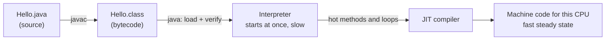

## Where we are

You can write a Java class with fields, methods and a `main`, and you know `javac` and `java` make
it run. This lesson opens the box between "I typed `java Hello`" and "the CPU did the work". Every
later JVM lesson (memory, class loading, GC, profiling) hangs off this picture.

## The problem

It is your second week on the team. You ship a small change, the service restarts, and for the
first minute the latency graph spikes to five times normal. Then it settles and stays flat. Your
lead asks two questions in the stand-up: "Why is it slow only right after a deploy?" and "Why does
the same jar run on my ARM laptop and on the x86 Linux servers?" You need one picture that answers
both.

Start with the second question. A CPU only runs its own machine code. Intel/AMD chips speak
x86-64, most phones and newer Macs speak ARM64, and neither can read the other's instructions.

- **C compiles once per platform**: a different binary for every CPU and operating system. Fast,
  but every library author builds and tests many binaries.
- **A pure interpreter** (a program that reads your code and performs each step) runs anywhere the
  interpreter runs, but every step pays "read it, work out what it means, then do it".

Java wanted both: **one** artifact that runs everywhere, at close to native speed. The answer is a
pipeline, and the first question (slow after deploy) falls out of its last two stages.



## Stage 1: javac turns source into bytecode

**Bytecode** is a compact instruction set for an imaginary computer, the Java Virtual Machine.
It is not x86 or ARM; it is the same on every platform.

```java
public class Calc {
    static int add(int a, int b) {
        return a + b;
    }

    public static void main(String[] args) {
        System.out.println(add(2, 3));
    }
}
```

**Predict:** `javac` is a compiler, so does it turn `add` into clever, optimised code? Guess how
many instructions `return a + b;` becomes.

Four, and they are as literal as possible. `javap` (the class-file disassembler that ships with
the JDK) shows them:

```text
$ javac Calc.java
$ javap -c Calc
  static int add(int, int);
    Code:
       0: iload_0        // push local variable 0 (a) onto the operand stack
       1: iload_1        // push local variable 1 (b)
       2: iadd           // pop two ints, push their sum
       3: ireturn        // return the int on top of the stack
```

- The JVM is a **stack machine**: instructions push values onto, and pop them from, a small
  per-method *operand stack* instead of naming CPU registers. That keeps bytecode independent of
  any real CPU.
- `javac` does very little optimising. It checks types, resolves names and emits straightforward
  bytecode. The real optimisation happens later, at run time.

A `.class` file always starts with the bytes `CAFEBABE`, followed by a version number (major
version 65 for Java 21). An older JVM refuses a newer class file with
`UnsupportedClassVersionError`.

**Rule:** `javac` produces portable bytecode, one `.class` file per class (nested classes get
their own `Outer$Inner.class`). The JVM is the per-platform part.

```quiz
{"question": "Your lead builds app.jar on an ARM Mac with Java 21. Which part has to be different on the x86 Linux server?", "level": "easy",
 "options": [
   {"text": "The .class files: they must be recompiled for x86", "why": "Bytecode is CPU-independent; the same .class files run on both machines."},
   {"text": "The JVM installed on the server", "correct": true, "why": "The JVM is a native program built for each OS and CPU; it is the per-platform part that turns bytecode into that machine's instructions."},
   {"text": "Nothing at all: Java runs without anything installed", "why": "Something has to execute the bytecode. That is the JVM, and it is built separately per platform."},
   {"text": "The source code, because ARM and x86 need different Java syntax", "why": "Java source and bytecode are the same everywhere. Only the JVM differs."}]}
```

## Stage 2: the JVM loads the class

`java Calc` starts the JVM, a native program built separately for each OS and CPU. Its first job
is to find `Calc.class`, read it, check that the bytecode is well-formed and safe (the
**verifier**), and set the class up in memory. This is **class loading**; it gets its own module
(JAVA-JVM-4) and lifecycle lesson (LIFECYCLE-1). For now: classes are loaded lazily, the first time
the program needs them, not all at start-up.

## Stage 3: the interpreter runs bytecode straight away

The JVM begins by **interpreting**: for each bytecode instruction, it runs a small piece of
pre-built machine code that does what that instruction means. `iadd` means "pop two ints, add,
push".

This starts instantly (no compile step), but it is slow for code that runs millions of times,
because the "look up what this instruction means" cost is paid on every execution.

**Rule:** all code starts out interpreted. Start-up is quick; first requests are slow. That is the
first half of your lead's "slow after deploy" answer.

## Stage 4: the JIT compiles the hot spots

Most programs spend most of their time in a small part of their code: a loop in a parser, the
`equals` of a hot map key. The JVM bets on that. It counts how often each method is called and
how often each loop jumps back to its start. When a method crosses a threshold it is "hot", and
the **JIT compiler** (Just-In-Time: compiles while the program runs) translates its bytecode into
real machine code for this exact CPU. From then on, calls go to the compiled version.

This is where HotSpot, the standard OpenJDK JVM, gets its name: it finds the hot spots.

The JIT has an advantage over `javac`: it compiles with **run-time knowledge**. It has watched the
code run, so it knows which branches are taken, which concrete classes appear at a call site, and
which methods are small enough to paste into their caller. That pasting is called **inlining**,
and it is the most important JIT optimisation, because it opens the door to all the others.

## Tiered compilation: C1 then C2

HotSpot has two JIT compilers:

| Compiler | Compiles | Code quality | Used for |
|---|---|---|---|
| **C1** (client) | fast | decent | getting warm code off the interpreter quickly, while collecting a profile |
| **C2** (server) | slower | highly optimised | code that stays hot, using the profile C1 gathered |

**Tiered compilation** (on by default since Java 8) chains them. Step through one method's life:

```anim
{"title": "One hot method moving through the tiers",
 "stages": ["Tier 0: interpreter", "Tier 3: C1 + profiling", "Tier 4: C2 optimised", "Deoptimise"],
 "frames": [
  {"stage": 0, "note": "work() is called for the first time. It runs in the interpreter while the JVM counts its calls and loop back-edges."},
  {"stage": 1, "note": "After roughly a few hundred calls it is warm. C1 compiles it quickly, adding code that records the types seen and branches taken."},
  {"stage": 2, "note": "After roughly thousands of calls it is hot. C2 recompiles it using that profile: inlining, escape analysis, loop optimisations. The tier-3 version is retired."},
  {"stage": 3, "note": "A guard fails: C2 assumed something that is no longer true (next section). The C2 code is thrown away and the method runs in the interpreter again."},
  {"stage": 0, "note": "Back in tier 0 the method still gives correct results, just slower. If it stays hot it is compiled again, this time knowing about the new case."}
 ]}
```

Tiers 1 and 2 exist for special cases; tier 0 → 3 → 4 is the normal path. The thresholds are
tunable flags and adapt to load, so do not quote exact numbers in an interview: "hundreds, then
thousands of invocations" is accurate.

Compiled machine code is stored in the **code cache**, a separate memory area outside the heap. If
it fills up, the JVM stops compiling and logs a warning; the app keeps running, slowly.

## Speculation and deoptimisation

C2 optimises by **speculating**: "every call here has seen only `ArrayList`, so I will inline
`ArrayList.get` and skip the virtual dispatch."

**Predict:** after hours of only `ArrayList`, a `LinkedList` reaches that call site. What happens:
a crash, a wrong result, or something else?

Something else. C2 left a cheap check (a *guard*) in front of its assumption. The guard fails, and
the JVM **deoptimises**: it throws that compiled code away, continues the method in the
interpreter, and may recompile later with the new knowledge. The result is always correct; the
cost is a moment of slowness. In `-XX:+PrintCompilation` output you see `made not entrant` when
compiled code is retired.

**Rule:** JIT code is fast because it bets on what it has seen. Changing behaviour (new subclasses,
new branches) can cost a deoptimisation and a recompile, which shows as latency blips.

```quiz
{"question": "The code cache fills up in production. What happens?", "level": "hard",
 "options": [
   {"text": "An OutOfMemoryError is thrown and the JVM crashes", "why": "The code cache is not the heap, and running out of it is not fatal. The JVM logs a warning and carries on."},
   {"text": "JIT compiling stops; the app runs on, slower", "correct": true, "why": "Already-compiled code keeps running, but new hot methods stay in the interpreter (or in their current tier), so throughput drops while nothing errors."},
   {"text": "New compiled code spills over into the heap instead", "why": "Compiled code lives only in the code cache, a separate area outside the heap. There is no overflow into the heap."},
   {"text": "The GC frees old compiled code, so nothing changes at all", "why": "The heap GC does not manage the code cache. The JVM can flush some unused compiled code, but compiling still stalls, and a full cache shows as a slowdown."}]}
```

## On-stack replacement

What about a `main` that is called once but contains a loop that runs a billion times? Waiting for
the *next* call would be useless. **On-stack replacement (OSR)** compiles the loop and switches the
running method into compiled code in the middle of the loop. `PrintCompilation` marks OSR
compilations with `%`.

```quiz
{"question": "In -XX:+PrintCompilation output you see: 77  72 %  4  WarmUp::work @ 4 (29 bytes). What happened?", "level": "medium",
 "options": [
   {"text": "C2 compiled the loop inside work() and switched the running call into it mid-loop", "correct": true, "why": "% marks an OSR compilation, @ 4 is the bytecode index of the loop, and tier 4 is C2."},
   {"text": "work() was deoptimised and sent back to the interpreter", "why": "Deoptimisation shows as 'made not entrant' at the end of the line, not as %."},
   {"text": "C1 compiled work() with profiling", "why": "C1 with profiling is tier 3. This line says tier 4, which is C2."},
   {"text": "work() is 4% of the CPU time", "why": "PrintCompilation does not show CPU share. The % is the OSR marker and the 4 is the tier."}]}
```

## Lab (~10 min)

Save this as `WarmUp.java`. The single-file launcher (`java WarmUp.java`, available since Java 11)
compiles it in memory and runs it.

```java
public class WarmUp {
    static long work(int n) {
        long sum = 0;
        for (int i = 0; i < n; i++) {
            sum += (i % 7) * (i % 3);
        }
        return sum;
    }

    public static void main(String[] args) {
        long sink = 0;
        for (int batch = 1; batch <= 15; batch++) {
            long start = System.nanoTime();
            for (int call = 0; call < 100; call++) {
                sink += work(10_000);
            }
            long micros = (System.nanoTime() - start) / 1_000;
            System.out.printf("batch %2d: %,8d us%n", batch, micros);
        }
        System.out.println("sink=" + sink); // use the result so the JIT cannot delete the work
    }
}
```

1. **Predict first:** will batch 1 and batch 15 take the same time? Then run `java WarmUp.java`.
   Batch 1 is several times slower than the rest, which stay flat. That gap is warm-up:
   interpreter, then C1, then C2.
2. **Break it:** `java -Xint WarmUp.java`. `-Xint` disables the JIT. Watch for every batch staying
   slow: as slow as batch 1 or slower, and several times slower than the warmed-up batches
   (about 8x on one test machine). There is no warm-up because nothing ever gets compiled.
3. `java -XX:+PrintCompilation WarmUp.java | findstr WarmUp::work` (use `grep` on Linux/macOS).
   You should see lines like these (times and ids will differ; times will be larger with the
   single-file launcher, which compiles in memory first):

```text
     76   70 %     3       WarmUp::work @ 4 (29 bytes)
     76   71       3       WarmUp::work (29 bytes)
     77   72 %     4       WarmUp::work @ 4 (29 bytes)
     80   70 %     3       WarmUp::work @ 4 (29 bytes)   made not entrant
     80   73       4       WarmUp::work (29 bytes)
     84   71       3       WarmUp::work (29 bytes)   made not entrant
```

   Columns: time (ms), compile id, `%` = OSR, tier (3 = C1 with profiling, 4 = C2), method. Each
   tier-3 version is retired ("made not entrant") once its tier-4 replacement is ready.
4. `javac WarmUp.java && javap -c WarmUp` and find the `irem` and `imul` instructions for the loop
   body.

Your exact numbers will differ by machine; the *shape* (slow first, then flat) is what matters.

## Gotchas

- **"Java is interpreted" is wrong, and "Java is compiled ahead of time" is wrong too.** It is
  compiled to bytecode, then interpreted, then JIT-compiled where hot. Say all three.
- **Benchmarks without warm-up measure the interpreter.** Timing the first call tells you nothing
  about steady-state speed. Use JMH (JAVA-JVM-8).
- **Cold start after every deploy.** A freshly started service is slow for its first requests.
  Mitigations: warm-up traffic before joining the load balancer, Class Data Sharing, and newer
  ahead-of-time features (JAVA-JVM-3).
- **`javac` does not optimise much**, so do not micro-optimise source for the compiler's sake.
  Folding compile-time constants (`static final` primitives and strings) is about the only notable
  trick.
- **A full code cache silently stops JIT compilation.** Look for "CodeCache is full. Compiler has
  been disabled" in logs; raise `-XX:ReservedCodeCacheSize` if needed.
- **Deoptimisation storms** happen when a call site that was always one type suddenly sees many.
  This is real but rare; profile before blaming it.

## In interviews

Usually asked as a warm-up: "What happens when you run a Java program?", "What is the JIT and why
not compile everything up front?", "Why is Java platform independent?", "Why is the first request
slow after a deploy?". Related bank questions:
[JVM internals and memory allocation](#/q/jvm-internals) opens with this pipeline, and
[Stack vs Heap: What Happens on int a = 10?](#/q/java-stack-vs-heap-memory) starts at the
bytecode level (`bipush 10; istore_1`).

Typical follow-ups:

- *Why not compile everything ahead of time?* Strong answer: the JIT uses run-time profiles
  (actual types, branch frequencies) to inline and specialise more aggressively than a static
  compiler can, and it can undo bad bets by deoptimising. The cost is warm-up time and CPU spent
  compiling. AOT options (GraalVM native image, Project Leyden work in recent JDKs) trade some
  peak performance or dynamism for start-up.
- *What is deoptimisation?* Speculative compiled code has guards; a failed guard sends execution
  back to the interpreter and discards that code.

## Explain it in 2 minutes

Prompt: "Walk me from `Hello.java` to the CPU running it."

- `javac` checks and compiles source to portable bytecode in `.class` files (a stack-machine
  instruction set, `CAFEBABE` header).
- `java` starts a platform-specific JVM, which loads classes lazily, verifies the bytecode and
  initialises them.
- Execution starts in the interpreter: instant start, slow per instruction.
- Counters find hot methods and loops; C1 compiles them quickly with profiling, C2 recompiles the
  hottest using the profile (inlining, escape analysis). OSR handles long-running loops.
- Optimisations are speculative with guards; deoptimisation falls back when assumptions break.
- Consequence: warm-up. Benchmark and capacity-plan for steady state, not the first second.

## Check yourself

1. What does `javac` output, and is it specific to your CPU?
2. Why does the JVM interpret first instead of compiling everything at start-up?
3. What do C1 and C2 each contribute in tiered compilation?
4. What does `%` mean in `-XX:+PrintCompilation` output, and why is it needed?
5. A service is fast in load tests but its p99 latency spikes for a minute after each deploy.
   What is the most likely JVM reason?

### Answers

1. Bytecode in `.class` files. It is CPU-independent; the JVM is the platform-specific part.
2. Compiling everything would delay start-up and waste effort on code that runs once. Interpreting
   costs nothing up front and lets the JVM gather profiles to compile the hot code better.
3. C1 compiles quickly, gets code off the interpreter and collects a profile. C2 compiles slowly
   but produces highly optimised code using that profile.
4. On-stack replacement: a long-running loop is compiled and the running method switches into
   compiled code mid-loop, because the next call might never come.
5. JIT warm-up (plus class loading and cache filling): code is interpreted or C1-compiled until it
   becomes hot enough for C2.

## Next

JAVA-JVM-2 (JVM memory areas) shows where the stack frames, objects and compiled code you met here
actually live; JAVA-JVM-4 and LIFECYCLE-1 zoom into class loading.
