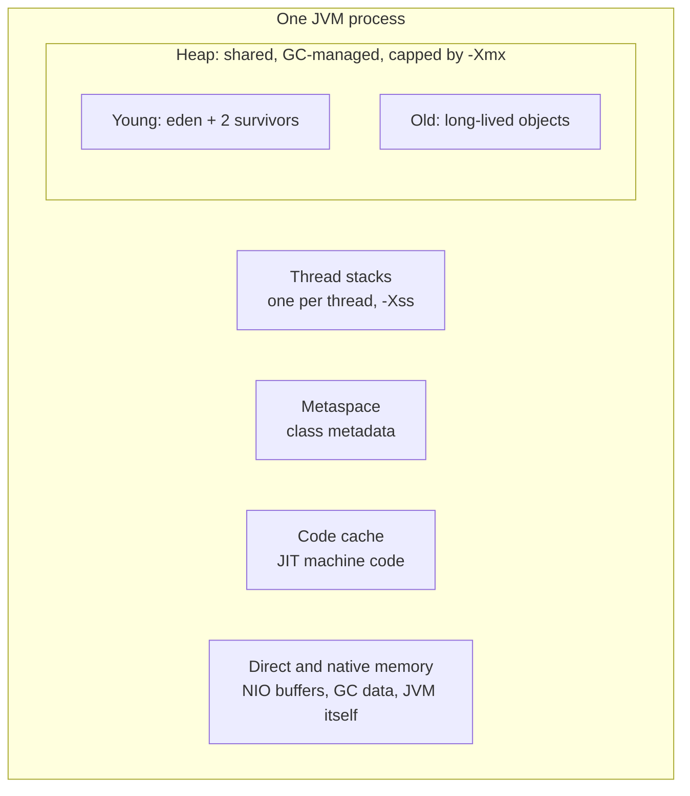

## Where we are

From JAVA-JVM-1 you know the path: `javac` makes bytecode, the JVM loads, interprets and JIT-compiles
it. Now: *where does all that live while it runs*?

This map is the base for:

- GC (JAVA-JVM-5);
- leak hunting (JAVA-JVM-7);
- the memory model (JAVA-JVM-6).

## The problem

Monday morning. Your order service's pod (its running container) restarted 14 times overnight.

Kubernetes, the system that runs the containers, says `OOMKilled`, exit code 137: it killed the
process for exceeding its memory limit.

You search the logs for `OutOfMemoryError`: nothing. Yet:

- the pod has a 2 GB memory limit;
- the JVM runs with `-Xmx2g`.

So how did it use more than 2 GB when the heap is capped at 2 GB? To answer that you need a map of
where a JVM keeps things.

A running program creates data with very different lifetimes:

- a loop counter that lives for one method call,
- an `Order` object that lives as long as someone references it,
- the description of the `Order` class, which lives as long as the class is loaded,
- the machine code the JIT produced for `Order.total()`.

Putting all of these in one pool would make cleanup slow and complicated. So the JVM splits its
memory into areas, each with its own lifetime rule and its own failure mode:



Only the heap box is limited by `-Xmx`. Everything else is extra, which is already half the answer to
the Monday-morning mystery.

## The thread stack: one frame per method call

Every thread gets its own **stack**, a region of memory that grows by one **frame** each time a
method is called and shrinks when it returns. A frame holds that call's local variables and its
operand stack (the scratch space bytecode uses, from JAVA-JVM-1).

```java
void placeOrder() {
    int quantity = 10;                 // primitive local: value lives in the frame
    Order order = new Order(quantity); // reference lives in the frame, object on the heap
    order.submit();                    // pushes a new frame for submit()
}                                      // frame popped: quantity and the reference vanish
```

```text
 main thread's stack                 heap
 ┌──────────────────────────┐
 │ submit()  frame          │
 ├──────────────────────────┤
 │ placeOrder() frame       │
 │   quantity = 10          │
 │   order    = ref ────────┼──────► Order{ quantity=10, ... }
 ├──────────────────────────┤
 │ main() frame             │
 └──────────────────────────┘
```

**Rule:** local primitives and local *references* live in the frame.

- Objects never do, at least not in the language model.
- Frames are freed instantly on return, with no GC involved.
- No other thread can see them.

The stack has a fixed maximum size, set with `-Xss` (commonly 1 MB on 64-bit platforms). Recurse
too deep and you get `StackOverflowError`.

```quiz
{"question": "A recursive parser hits StackOverflowError on deeply nested JSON. Which flag changes how deep it can recurse?", "level": "easy",
 "options": [
   {"text": "-Xss", "correct": true, "why": "It sets each thread's stack size, and each call needs one frame on that stack. (The real fix is usually to iterate with an explicit stack.)"},
   {"text": "-Xmx", "why": "That caps the heap, where objects live. Frames are not on the heap."},
   {"text": "-XX:MaxMetaspaceSize", "why": "Metaspace holds class metadata; it does not grow with call depth."},
   {"text": "-Xms", "why": "That is the starting heap size: still the heap, not the stack."}]}
```

(Refinement: if the JIT proves an object never escapes a method, *escape analysis* can replace it
with plain locals, so it is never allocated. An optimisation, not something to rely on.)

## The heap: where every object lives

The **heap** is one big region shared by all threads. Every `new` puts an object or array there,
and it stays until the garbage collector finds that nothing can reach it any more (JAVA-JVM-5).

- `-Xms` sets the starting heap size and `-Xmx` the maximum. With no flags, the maximum defaults
  to a quarter of the machine's (or container's) memory; `-XX:MaxRAMPercentage` changes that
  fraction, which is the usual knob in containers.
- The heap is split into two generations (JAVA-JVM-5 explains why):
  - a **young generation** (new objects: *eden* and two *survivor* spaces);
  - an **old generation** (objects that survived several collections).
- Regions instead of contiguous spaces; both keep the young/old idea:
  - G1 uses many equal-sized regions;
  - Generational ZGC (opt-in on Java 21 with `-XX:+UseZGC -XX:+ZGenerational`) uses regions of a few sizes.

**Predict:** in `class Cart { int count; }`, where does `count` live?

On the heap, inside the `Cart` object. Fields belong to their object, so an `int` *field* lives on the
heap even though an `int` *local* lives in a stack frame.

Running out gives `java.lang.OutOfMemoryError: Java heap space`.

## What an object costs

**Predict:** `new Object()` has no fields. How many bytes does it take on a 64-bit Java 21 JVM:
0, 8, or 16?

16. Every object starts with a **header**:

- a *mark word* (8 bytes on 64-bit; holds the hash code, lock state and GC age);
- a *class pointer* (usually 4 bytes thanks to compressed class pointers).

Objects are then padded to a multiple of 8 bytes. So:

```text
new Object()                 → 12-byte header + 4 padding        = 16 bytes
an Integer                   → 12-byte header + 4-byte int       = 16 bytes
a Long                       → 12-byte header + 8-byte long + 4 pad = 24 bytes
one element of List<Long>    → 24-byte Long + 4-byte reference in the backing array
```

References are 4 bytes, not 8, when **compressed oops** are on (the default for heaps under
roughly 32 GB). Cross that size and every reference doubles, which is why a 33 GB heap can hold
*less* than a 31 GB one.

JDK 25 adds an opt-in 8-byte header (`-XX:+UseCompactObjectHeaders`); on Java 21 assume 12.

**Rule:** small objects are dominated by overhead. A `HashMap<Integer, Integer>` entry costs
dozens of bytes for 8 bytes of data. (Lesson DSA-CPLX-3 builds on this.)

```quiz
{"question": "On Java 21 with default settings, roughly how much heap does one element of an ArrayList<Long> cost?", "level": "medium",
 "options": [
   {"text": "About 28 bytes: a 24-byte Long object plus a 4-byte reference in the backing array", "correct": true, "why": "12-byte header + 8-byte long = 20, padded to 24; the array slot holds a compressed 4-byte reference."},
   {"text": "8 bytes: a long is 8 bytes", "why": "That is a long in a long[]. A List holds references to boxed Long objects, each with a header."},
   {"text": "16 bytes: 8 for the value and 8 for the reference", "why": "This forgets the object header, and with compressed oops the reference is 4 bytes, not 8."},
   {"text": "12 bytes: the header only, because small values are cached", "why": "Long caches only -128..127, and even a cached Long is still a full 24-byte object, merely shared."}]}
```

## Metaspace: the class descriptions

When a class is loaded, the JVM stores its metadata (method bytecode, field layout, constant
pool) in **metaspace**, which lives in *native* memory, outside the heap.

- Before Java 8 this was "PermGen", a capped area (`-XX:MaxPermSize`) that often filled up; metaspace grows as needed.
- By default metaspace has **no upper limit**; cap it with `-XX:MaxMetaspaceSize`.
- Two things that people assume are in PermGen/metaspace are actually on the heap: **static
  fields** (stored with the class's `java.lang.Class` object) and the **interned string pool**
  (moved to the heap in Java 7).

Running out gives `OutOfMemoryError: Metaspace`, usually a class-loader leak (JAVA-JVM-4, JAVA-JVM-7).

```quiz
{"question": "A service runs with -Xmx1g and -XX:MaxMetaspaceSize=256m. A static Map<String, Price> CACHE is never cleared and keeps growing. Which error eventually appears?", "level": "medium",
 "options": [
   {"text": "OutOfMemoryError: Java heap space", "correct": true, "why": "The static field sits with the Class object on the heap, and the Map and every Price it holds are ordinary heap objects. They fill the 1 GB heap."},
   {"text": "OutOfMemoryError: Metaspace", "why": "A common belief: 'static means class, class means metaspace'. Metaspace holds only the class's description (bytecode, field layout), which does not grow with the map."},
   {"text": "StackOverflowError", "why": "Nothing here recurses; a static field is not stored on any thread's stack."},
   {"text": "Nothing: the 256 MB metaspace cap protects the heap", "why": "The two areas are capped separately, and this map is on the heap, where -Xmx applies."}]}
```

## The code cache and direct memory

- **Code cache:** where the JIT's machine code goes (JAVA-JVM-1).
  - Native memory, capped by `-XX:ReservedCodeCacheSize`.
  - When full, compilation stops.
- **Direct memory:** `ByteBuffer.allocateDirect(...)` gives off-heap memory the OS can do I/O on
  without copying; Netty relies on it. Capped by `-XX:MaxDirectMemorySize`; exhausting it gives
  `OutOfMemoryError: Direct buffer memory`.
- Each **thread stack** is native memory too: 500 threads × 1 MB is up to 500 MB of address space
  outside `-Xmx` (committed lazily, but it adds up).

## Putting it together: why the container got killed

Back to Monday morning. **Predict** before reading on: which areas from the map push the process
past 2 GB while the heap stays under `-Xmx2g`?

All of the non-heap ones. Process memory is roughly:

```text
RSS ≈ heap (≤ Xmx) + metaspace + code cache + thread stacks + direct buffers
      + GC data structures + JVM internals + native libraries
```

The kernel sees the whole process cross 2 GB and kills it. The heap never filled, so the JVM never
threw `OutOfMemoryError`: that is why the logs are silent.

**Rule:** size the heap to leave headroom (a common starting point is a heap around 50–75% of the
container limit) and measure with Native Memory Tracking (`-XX:NativeMemoryTracking=summary`,
then `jcmd <pid> VM.native_memory summary`), covered in JAVA-JVM-7.

```quiz
{"question": "That pod: 2 GB limit, -Xmx2g, OOMKilled with exit code 137, no OutOfMemoryError logged. What is the right first change?", "level": "hard",
 "options": [
   {"text": "Lower the heap to leave headroom (for example -XX:MaxRAMPercentage=70) and check native usage with Native Memory Tracking", "correct": true, "why": "The process, not the heap, crossed the limit. Shrinking the heap makes room for metaspace, stacks, code cache and direct buffers; NMT shows which one is large."},
   {"text": "Add -XX:+HeapDumpOnOutOfMemoryError and wait for the next crash", "why": "The heap never filled, so no OutOfMemoryError is thrown and no dump is written. The kernel kills the process from outside."},
   {"text": "Raise -Xmx to 3g so the heap has more room", "why": "The heap was not the problem, and a heap allowed past the container limit makes the kill come sooner."},
   {"text": "Catch OutOfMemoryError in main and log it", "why": "There is nothing to catch: a kernel OOM kill sends SIGKILL, which the JVM cannot intercept."}]}
```

## Lab (~10 min)

**Break it** two different ways and compare the errors. Save as `Crash.java`:

```java
import java.util.ArrayList;
import java.util.List;

public class Crash {
    static int depth = 0;

    static void recurse() {
        depth++;
        recurse();               // each call pushes a new frame on this thread's stack
    }

    public static void main(String[] args) {
        String mode = args.length > 0 ? args[0] : "stack";
        if (mode.equals("stack")) {
            try {
                recurse();
            } catch (StackOverflowError e) {
                System.out.println("StackOverflowError after " + depth + " frames");
            }
        } else {
            List<long[]> hoard = new ArrayList<>();   // reachable from main's stack frame
            try {
                while (true) {
                    hoard.add(new long[1_000_000]);    // ~8 MB each, on the heap
                }
            } catch (OutOfMemoryError e) {
                int n = hoard.size();
                hoard = null;                          // drop the references so we can print safely
                System.out.println("OutOfMemoryError after " + n + " arrays: " + e.getMessage());
            }
        }
    }
}
```

Run:

```text
java Crash.java stack
java -Xss256k Crash.java stack
java -Xss4m Crash.java stack
java -Xmx64m Crash.java heap
java -Xmx256m Crash.java heap
```

**Predict** first: which runs change the frame count, and which change the array count? Then
observe:

- Stack depth scales with `-Xss` (on one machine: about 3,700 frames at 256k, 24,000 at the
  default, 100,000 at 4m). The count varies between runs, because interpreted and JIT-compiled
  frames have different sizes.
- The heap failure says `Java heap space`, and the number of arrays scales with `-Xmx`, not
  `-Xss`.
- Stretch: `java -XX:MaxMetaspaceSize=4m Crash.java stack` dies with an `OutOfMemoryError` before
  your code runs.
  - Often so early that even the message fails to print.
  - Why: the single-file launcher first loads the whole `javac` compiler.
- Now `javac Crash.java` and run `java -XX:MaxMetaspaceSize=4m Crash stack`: it works, because the
  precompiled program loads far fewer classes.
  - Metaspace use is about *how many classes* are loaded, not how many objects.

## Gotchas

- **"Primitives on the stack, objects on the heap" is half right**: primitive *fields* live in heap objects; only locals
  are in frames.
- **`-Xmx` is not the process size**: metaspace, threads, code cache and direct buffers sit on top; leave headroom.
- **Catching `OutOfMemoryError` rarely helps**: other threads may be failing too; use `-XX:+HeapDumpOnOutOfMemoryError`
  and restart.
- **Deep recursion on production input** (long linked structures, deep JSON) overflows the stack: iterate with an
  explicit stack.
- **Metaspace is unlimited by default**: a class-loader leak grows until the container dies; cap it.

## In interviews

Asked as "Stack vs heap?", "Where do static variables live?", "What replaced PermGen?", "Why was my pod OOM-killed with
-Xmx set?". Bank:

- [Stack vs Heap: What Happens on int a = 10?](#/q/java-stack-vs-heap-memory)
- [Pass-by-Value vs Pass-by-Reference](#/q/pass-by-value-vs-reference) (Java copies the reference in the frame)
- [String Immutability and String Storage](#/q/java-string-immutability)
- [Virtual memory, paging and physical vs virtual addressing](#/q/virtual-memory-and-paging)

- *Is the stack thread-safe?* Locals are confined to their thread, but the heap objects they point to are shared and not
  automatically safe (JAVA-JVM-6).
- *Can an object live on the stack?* Not in the language; escape analysis can scalar-replace non-escaping objects.

## Explain it in 2 minutes

Prompt: "Describe the JVM's memory areas and what fails in each."

- Per-thread stacks of frames (locals, references): `StackOverflowError`, `-Xss`.
- One shared, GC-managed heap (young/old): `Java heap space`, `-Xms`/`-Xmx`.
- Metaspace (native, replaced PermGen) for class metadata; statics and interned strings are on the heap.
- Code cache, direct buffers and thread stacks are native too.
- Process memory is the sum: containers need headroom above `-Xmx`.

## Check yourself

1. In `class Point { int x; }`, where does `x` live? And the local `int y = 1;`?
2. What replaced PermGen, and where does it live?
3. How big is `new Object()` on a typical 64-bit Java 21 JVM?

### Answers

1. `x` inside the `Point` object on the heap; `y` in the method's stack frame.
2. Metaspace (Java 8), in native memory outside the heap.
3. 16 bytes: 12-byte header (mark word + compressed class pointer) padded to 8.

## Next

JAVA-JVM-5 explains how the heap is cleaned and why it is split young/old; JAVA-JVM-6 covers threads sharing heap objects.
