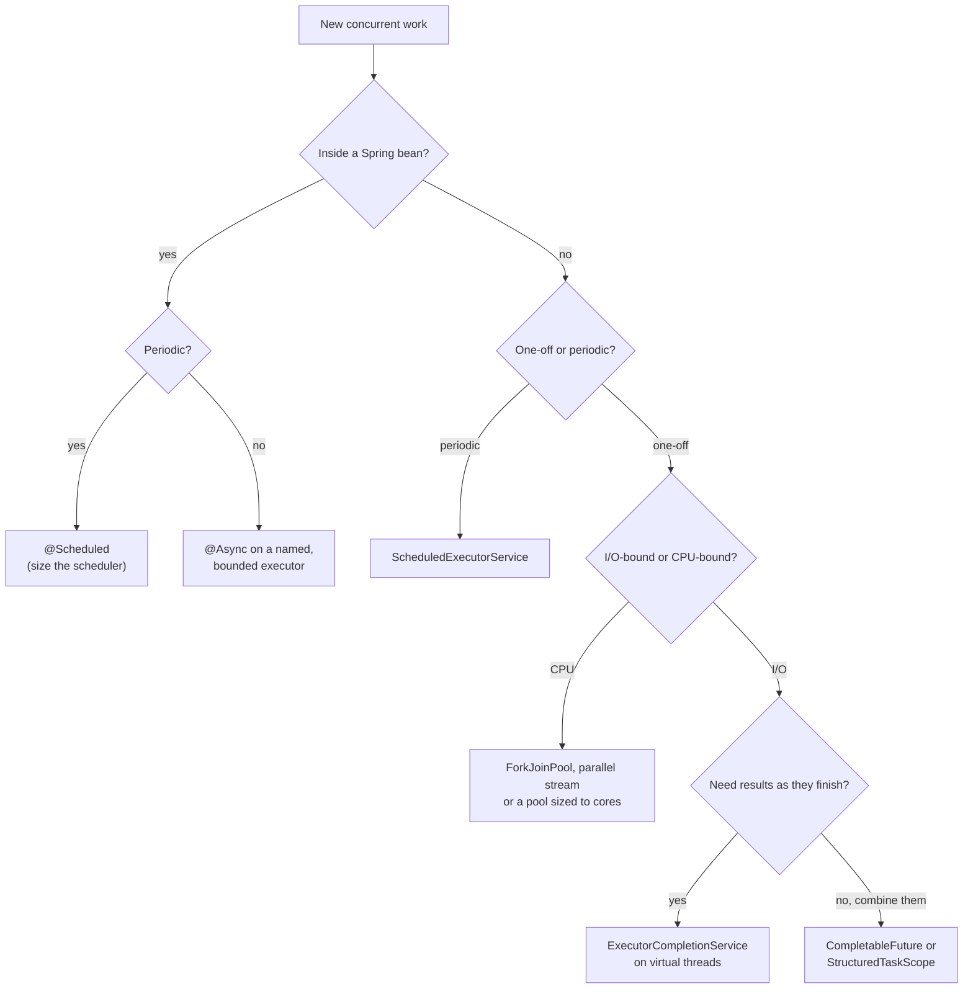

## Where we are

JAVA-CONC-1 to JAVA-CONC-7 gave you the parts one at a time: threads, locks, atomics, executors, `CompletableFuture`,
virtual threads and the classic problems. What is still missing is choosing between them. This lesson puts every
option side by side, with one decision flow, so you can pick in seconds and explain why.

## The problem

It is Monday morning. A nightly job is supposed to send a "still alive" heartbeat to the monitoring service every
30 seconds while it exports claims. The on-call channel shows the last heartbeat at 01:13, but the export finished
at 04:40. Nobody restarted anything, and the log has **no error at all**.

The scheduling code is one line: `scheduler.scheduleAtFixedRate(heartbeat, 0, 30, SECONDS)`. One bad response made
`heartbeat` throw once, and the JDK quietly stopped running it. A colleague says, "we should have used `@Scheduled`".
Another says, "use a `Timer`, it is simpler". A third wants `CompletableFuture` everywhere.

Each of them is right for *some* job. By the end of this lesson you will know which one, and you will reproduce the
silent stop yourself in the lab.

## The decision flow

Four questions settle most choices. Is it inside Spring? Is it one-off or periodic? Is it waiting on I/O or using the
CPU? Do you need each result the moment it finishes, or all of them combined?



**How to read it:** the Spring branch is a first cut. Inside a bean you can still use any JDK tool below it. The
annotations simply wire the executor and its lifecycle for you.

## 1. A raw `Thread`

**What:** one thread you start yourself (JAVA-CONC-1). Java 21 builders make the kind explicit.

```java
Thread audit = Thread.ofPlatform().name("audit-writer").start(() -> writeAuditLog());
Thread fetch = Thread.ofVirtual().name("fetch-1").start(() -> callPartnerApi());
audit.join();
```

- **Choose it when:** you need one long-lived background thread with a clear owner (a listener loop), or a quick
  demo.
- **Pitfall:** no result, no limit, no shutdown hook. An exception just kills the thread and prints a stack trace.
  Ten of these in a codebase is ten things nobody stops on shutdown.

## 2. `ExecutorService`: `Callable`, `Future`, `invokeAll`, `invokeAny`

**What:** a pool fed by a queue (JAVA-CONC-4). `submit(Callable)` returns a `Future`. Two bulk methods save loops:

```java
List<Callable<String>> calls = List.of(() -> call("eu", 300), () -> call("us", 100), () -> call("ap", 200));
for (Future<String> f : pool.invokeAll(calls)) System.out.print(f.get() + " ");   // eu us ap
String fastest = pool.invokeAny(calls);                                            // us
```

- `invokeAll` waits until **every** task is done and returns the futures **in the order of your list**, not finish
  order. The timeout overload cancels whatever has not finished when time runs out.
- `invokeAny` returns the result of **one task that succeeded** (in practice the first) and cancels the rest. It
  throws `ExecutionException` only if all of them fail. That is the classic "ask three mirrors, take the first
  answer".

- **Choose it when:** a fixed batch of independent tasks and you want all results, or the first good one.
- **Pitfall:** `invokeAll` makes you wait for the slowest task before you can touch the fastest result.

```quiz
{"question": "You call invokeAll on three tasks that take 300 ms, 100 ms and 200 ms (in that list order). When does invokeAll return, and in what order are the futures?", "level": "easy",
 "options": [
   {"text": "After about 300 ms, futures in list order", "correct": true, "why": "invokeAll waits until every task is done, and the Javadoc promises the same order as the task list's iterator."},
   {"text": "After about 100 ms, with only the finished future", "why": "That is closer to invokeAny, which returns as soon as one task succeeds."},
   {"text": "After about 300 ms, futures in finish order (100, 200, 300)", "why": "Finish order is what ExecutorCompletionService gives you. invokeAll keeps your list order."},
   {"text": "Immediately, with futures that are still running", "why": "submit returns at once. invokeAll waits, and every returned future has isDone() == true."}]}
```

## 3. Results as they finish: `ExecutorCompletionService`

**Predict:** you submit four report calls that take 700, 100, 400 and 250 ms, then loop `cs.take().get()` four
times. In what order do the results print?

**Answer:** `100, 250, 400, 700`. An `ExecutorCompletionService` wraps an executor and puts each future on an
internal queue **when it completes**. `take()` hands you the next finished one, blocking only if none is ready yet.

```java
CompletionService<String> cs = new ExecutorCompletionService<>(workers);
for (int ms : List.of(700, 100, 400, 250)) cs.submit(() -> fetchReport(ms));
for (int i = 0; i < 4; i++) System.out.println(cs.take().get());   // fastest first
```

- **Choose it when:** each result is useful on its own. Stream rows to the UI, write each file as it arrives, or show
  "3 of 10 done".
- **Pitfall:** you must call `take()` exactly once per submitted task, or futures pile up in its queue. A failed task
  still comes out of `take()`, and its `get()` throws, so wrap each `get()` and carry on.

```quiz
{"question": "A page shows prices from 12 airline APIs. Each takes 0.2 to 3 seconds. Product wants each price to appear as soon as it arrives. Which tool fits best?", "level": "medium",
 "options": [
   {"text": "ExecutorCompletionService over a virtual-thread executor", "correct": true, "why": "The calls are I/O-bound, so virtual threads are cheap, and take() hands over each price in finish order so it can be pushed straight away."},
   {"text": "invokeAll on a fixed pool of 12 threads", "why": "invokeAll returns only when all 12 are done, so the fast prices wait about 3 seconds for the slowest."},
   {"text": "A parallel stream over the 12 airlines", "why": "Parallel streams run on the shared common pool, which is meant for CPU work. Twelve blocking HTTP calls there stall every other parallel stream in the JVM."},
   {"text": "invokeAny", "why": "invokeAny keeps only one result and cancels the other 11. Product wants all of them."}]}
```

## 4. Periodic work: `ScheduledExecutorService`

**What:** an executor that runs tasks later, or again and again. Three methods:

```java
ses.schedule(() -> sendReminder(), 10, SECONDS);                  // once, after 10 s
ses.scheduleAtFixedRate(heartbeat, 0, 30, SECONDS);               // start times 0, 30, 60, ...
ses.scheduleWithFixedDelay(pollInbox, 0, 30, SECONDS);            // 30 s gap after each run *ends*
```

- **Fixed rate** aims at a steady clock. If one run takes longer than the period, the next one starts late but
  **never overlaps** (the Javadoc says so explicitly).
- **Fixed delay** waits a full gap after each run finishes. Choose it for polling, so a slow run never causes the
  next one to start straight away.

**Why not `java.util.Timer`?** A `Timer` has a single background thread. If a task throws, that thread dies, and the
timer is dead for good. Every later `schedule` call throws `IllegalStateException: Timer already cancelled.` The
`Timer` Javadoc itself calls `ScheduledThreadPoolExecutor` "effectively a more versatile replacement".

**Predict:** in a `ScheduledExecutorService`, the periodic task throws a `RuntimeException` on its third run. Do you
get a stack trace? Does run four happen?

**Answer:** no and no. The Javadoc for both periodic methods says that if any execution throws, *"subsequent
executions are suppressed"*. The exception is stored in the returned `ScheduledFuture`, whose `isDone()` becomes
`true`. Nothing is printed, because nobody calls `get()` on a periodic future (its `get()` never returns normally).
That is the Monday-morning heartbeat. The fix is to catch inside the task:

```java
Runnable guarded = () -> {
    try { heartbeat.run(); }
    catch (RuntimeException e) { log.warn("heartbeat failed, next tick will retry", e); }
};
```

- **Choose it when:** timeouts, reminders, heartbeats, polling, cache refresh inside one JVM.
- **Pitfall:** the silent stop above. Also, like `newFixedThreadPool` in JAVA-CONC-4, its queue is unbounded, and
  `maximumPoolSize` has no effect.

```quiz
{"question": "You applied the fix: the heartbeat is wrapped in guarded(), which catches RuntimeException and logs it. On run 3 the heartbeat hits a failed assert and throws AssertionError. What happens?", "level": "hard",
 "code": ["Runnable guarded = () -> {", "    try { heartbeat.run(); }", "    catch (RuntimeException e) { log.warn(\"heartbeat failed\", e); }", "};"],
 "options": [
   {"text": "No log line, and the heartbeat never runs again: the AssertionError slips past the catch", "correct": true, "why": "AssertionError is an Error, not a RuntimeException, so the catch does not match. It escapes the task, later runs are suppressed and the cause sits unread in the ScheduledFuture. A real run printed run 1, run 2, then isDone=true. Catch Throwable (or Exception plus Error) in a periodic task's guard."},
   {"text": "The guard logs it and run 4 happens as normal", "why": "Only if the catch matched. AssertionError extends Error, which is a sibling of Exception, so catch (RuntimeException e) never sees it."},
   {"text": "An Error is fatal, so the JVM prints a stack trace and exits", "why": "An Error thrown inside an executor task is captured in the task's future like any other Throwable. The JVM keeps running, and nothing is printed."},
   {"text": "The scheduler thread dies and the whole ScheduledExecutorService shuts down", "why": "That is java.util.Timer. The executor keeps its thread and its other tasks; only this periodic task stops."}]}
```

## 5. CPU-bound splitting: `ForkJoinPool` and parallel streams

**What:** divide-and-conquer with work stealing (`RecursiveTask`, JAVA-CONC-4), and its friendly face, the parallel
stream (JAVA-FUND-7).

```java
long sum = IntStream.rangeClosed(1, 1_000_000).parallel().asLongStream().sum();
```

**Predict:** on an 8-core laptop, what does `ForkJoinPool.commonPool().getParallelism()` print?

**Answer:** `7` (a real run on 8 cores). Both tools run on the JVM-wide **common pool**, whose default parallelism is
one fewer than the available processors.

- **Choose it when:** large, CPU-heavy, side-effect-free work over data that splits cheaply (arrays, ranges).
- **Pitfall:** blocking I/O on the common pool starves every other parallel stream and every `…Async` stage that has
  no executor. For CPU work that is not divide-and-conquer, a fixed pool sized to the number of cores is simpler.

## 6. Async pipelines: `CompletableFuture`

**What:** a future you can attach steps to (JAVA-CONC-5): `thenApply`, `thenCompose`, `thenCombine`, `allOf`,
`exceptionally`, `orTimeout`.

```java
CompletableFuture<String> user = CompletableFuture.supplyAsync(() -> findUser(id), io);
CompletableFuture<Integer> orders = CompletableFuture.supplyAsync(() -> countOrders(id), io);
String view = user.thenCombine(orders, (u, n) -> u + " has " + n + " orders").orTimeout(1, SECONDS).join();
```

- **Choose it when:** several dependent or independent calls must be combined, with fallbacks and deadlines,
  without blocking a thread at every step.
- **Pitfall:** the `…Async` methods (`supplyAsync`, `thenApplyAsync`) run on the common pool when you pass no
  executor. A plain `thenApply` runs on whichever thread completes the previous stage (or on your thread, if it is
  already done). `orTimeout` and `cancel(true)` do not stop the underlying work.

## 7. Virtual threads and `StructuredTaskScope`

**What:** cheap threads that unmount while blocked (JAVA-CONC-6). With them you can write plain blocking code for
each task, and use `StructuredTaskScope` so that subtasks cannot outlive the block that started them.

```java
try (ExecutorService io = Executors.newVirtualThreadPerTaskExecutor()) {
    for (Claim c : claims) io.submit(() -> upload(c));    // one virtual thread per task, no pool sizing
}
```

- **Choose it when:** many tasks that mostly wait (HTTP, JDBC, files): the Java 21 default for I/O fan-out.
- **Pitfall:** they make waiting cheap, not computing fast. Limit downstream calls with a `Semaphore`, not with a
  pool. On Java 21, watch for pinning in `synchronized` blocks that do I/O.

`StructuredTaskScope` (JAVA-CONC-6) is still a **preview API** through Java 26, and its shape has changed since
Java 21 (`StructuredTaskScope.open(...)` with `Joiner`s), so learn the idea but do not pin production code to it.

## 8. Inside Spring: `@Async` and `@Scheduled`

Both annotations are wrappers around the executors above (SPRING-BOOT-5 lists them).

- **`@Async`** (needs `@EnableAsync`) hands the call to an executor and returns at once. The return type is `void`,
  `Future` or `CompletableFuture`. In Spring Boot, if you define no `Executor` bean, you get a
  `ThreadPoolTaskExecutor` with 8 core threads and an unbounded queue, or a virtual-thread `SimpleAsyncTaskExecutor`
  when `spring.threads.virtual.enabled=true`. Plain Spring, without Boot, falls back to `SimpleAsyncTaskExecutor`,
  which starts a **new thread for every call**.
- **`@Scheduled`** (needs `@EnableScheduling`) runs a method on `fixedRate`, `fixedDelay` or `cron`. Boot's default
  scheduler has **one thread** (unless virtual threads are enabled: then Boot uses a `SimpleAsyncTaskScheduler`
  with no pool), so a slow job delays every other job (`spring.task.scheduling.pool.size`).

**The proxy trap** (SPRING-BOOT-3): `@Async` works only when the call goes through the Spring proxy. `this.export()`
from inside the same class skips the proxy and runs **synchronously on the caller's thread**, with no error. Call it
from another bean.

**Exceptions behave differently from the JDK.** A `void` `@Async` method's exception is only logged, unless you
register an `AsyncUncaughtExceptionHandler`. A repeating `@Scheduled` task's exception is logged and **suppressed,
so the next run still happens** (Spring's default error handler for repeating tasks): the opposite of a raw
`ScheduledExecutorService`.

- **Pitfall:** self-invocation, a hidden single scheduler thread, and the default unbounded `@Async` queue. Define
  your own named executor with a bounded queue for real load.

```quiz
{"question": "In a Spring Boot service, OrderService.place() calls this.sendConfirmationEmail(), which is annotated @Async. Emails take 2 seconds. What happens to place()?", "level": "medium",
 "options": [
   {"text": "place() takes 2 seconds longer: the email runs synchronously on the request thread", "correct": true, "why": "A self-call skips the proxy, so @Async never applies. Move the method to another bean (e.g. EmailSender) and inject it."},
   {"text": "place() returns at once, and the email runs on the default async executor", "why": "That is only true when the call goes through the proxy, from another bean."},
   {"text": "Spring fails at startup because @Async methods cannot be called from the same class", "why": "There is no check and no error. That silence is exactly what makes the trap dangerous."},
   {"text": "The email runs on the @Scheduled thread", "why": "@Async and @Scheduled use different executors, and here neither is involved, because the proxy was skipped."}]}
```

## 9. Reactive (WebFlux) or virtual threads?

- **Choose WebFlux (BE-STORY-13) when:** streaming or end-to-end backpressure is the point, or the service already
  is reactive. One blocking call on its event-loop thread stalls many requests at once.
- **Choose virtual threads when:** classic request/response on Spring MVC with JDBC, which is most services.

## The comparison table

| Way | Best for | Results | Threads by default | Main pitfall |
|---|---|---|---|---|
| `Thread` | One owned background loop | None | One per call | No limit, no shutdown |
| `ExecutorService` + `invokeAll/Any` | Fixed batch, all or first | `Future`, list order | Pool you size | Wait for the slowest |
| `ExecutorCompletionService` | Use each result as it lands | Finish order | Your executor | One `take()` per task |
| `ScheduledExecutorService` | Delays and periodic jobs | `ScheduledFuture` | Core size you pick | A throw silently stops the task |
| `ForkJoinPool` / parallel stream | Big CPU-bound splits | Combined value | Common pool, about cores − 1 | Blocking I/O starves the JVM |
| `CompletableFuture` | Composing calls with fallbacks | Chained CF | Common pool | Forgetting the executor |
| Virtual threads (+ scope) | Many blocking I/O tasks | Plain values | One per task | CPU work, pinning, preview API |
| `@Async` | Fire-and-forget in Spring | `void` or CF | 8 core, unbounded queue (Boot) | Self-invocation |
| `@Scheduled` | Periodic jobs in Spring | None | 1 thread (Boot), unless virtual threads are enabled (then `SimpleAsyncTaskScheduler`, no pool) | One slow job delays all |
| WebFlux | Streaming, backpressure | `Mono` / `Flux` | Event loops | Blocking the loop |

## Lab (~10 min)

You will run a periodic heartbeat and a fan-out together, then break the heartbeat exactly as in the story. Save as
`SchedulerLab.java`, then run `javac SchedulerLab.java && java SchedulerLab`.

```java
import java.util.List;
import java.util.concurrent.*;
import java.util.concurrent.atomic.AtomicInteger;

public class SchedulerLab {
    static final boolean BREAK_IT = false;   // step 2: set to true
    static final boolean GUARD_IT = false;   // step 3: set to true as well

    public static void main(String[] args) throws Exception {
        AtomicInteger beat = new AtomicInteger();
        try (ScheduledExecutorService scheduler = Executors.newSingleThreadScheduledExecutor();
             ExecutorService workers = Executors.newFixedThreadPool(4)) {

            // 1) A periodic job: a heartbeat every 200 ms
            Runnable heartbeat = () -> {
                int n = beat.incrementAndGet();
                if (BREAK_IT && n == 3) throw new IllegalStateException("bad row in run " + n);
                System.out.println("heartbeat " + n);
            };
            ScheduledFuture<?> job = scheduler.scheduleAtFixedRate(
                    GUARD_IT ? guarded(heartbeat) : heartbeat, 0, 200, TimeUnit.MILLISECONDS);

            // 2) Fan out four "report" calls; handle each result the moment it finishes
            CompletionService<String> cs = new ExecutorCompletionService<>(workers);
            List<Integer> delaysMs = List.of(700, 100, 400, 250);
            for (int ms : delaysMs) cs.submit(() -> fetchReport(ms));
            for (int i = 0; i < delaysMs.size(); i++) {
                System.out.println("  done: " + cs.take().get());   // completion order, not submit order
            }

            Thread.sleep(300);
            System.out.println("job.isDone() = " + job.isDone() + ", beats so far = " + beat.get());
            if (job.isDone()) {
                try { job.get(); } catch (ExecutionException e) { System.out.println("cause: " + e.getCause()); }
            }
        }   // close(): shutdown() cancels the periodic job, then waits for the workers
    }

    static String fetchReport(int ms) throws InterruptedException {
        Thread.sleep(ms);   // stands in for an HTTP or DB call
        return "report-" + ms + "ms";
    }

    static Runnable guarded(Runnable task) {
        return () -> {
            try { task.run(); }
            catch (RuntimeException e) { System.out.println("heartbeat failed, will retry next tick: " + e.getMessage()); }
        };
    }
}
```

**Step 1, as written.** Predict the order of the `done:` lines first. One real run printed (the exact interleaving
with the heartbeats varies from run to run):

```text
heartbeat 1
  done: report-100ms
heartbeat 2
  done: report-250ms
heartbeat 3
  done: report-400ms
heartbeat 4
  done: report-700ms
heartbeat 5
heartbeat 6
job.isDone() = false, beats so far = 6
```

The reports come out in finish order, 100 → 250 → 400 → 700, although they were submitted as 700, 100, 400, 250.

**Step 2, break it.** Set `BREAK_IT = true`. Watch for this: **no stack trace anywhere**, and the heartbeats stop
after 2 while the reports carry on.

```text
heartbeat 1
  done: report-100ms
heartbeat 2
  done: report-250ms
  done: report-400ms
  done: report-700ms
job.isDone() = true, beats so far = 3
cause: java.lang.IllegalStateException: bad row in run 3
```

The only trace is inside the future, and in production nothing calls `job.get()`. That is the 01:13 heartbeat.

**Step 3, fix it.** Also set `GUARD_IT = true`. Run 3 logs `heartbeat failed, will retry next tick: bad row in run 3`,
and heartbeats 4, 5 and 6 follow, with `job.isDone() = false`.

**Try it:** change `scheduleAtFixedRate` to `scheduleWithFixedDelay` and make the heartbeat `Thread.sleep(150)`.
The gap between beats grows to 350 ms or a little more (one run measured 360 to 390 ms), because the delay is
counted from the end of each run.

## Gotchas

- **A periodic task that throws stops forever, silently.** Wrap the body of every `scheduleAtFixedRate` and
  `scheduleWithFixedDelay` task in try/catch and log it. Alert on "last success" time, not only on errors.
- **`java.util.Timer` dies on the first exception** and rejects every later `schedule`. Use a
  `ScheduledExecutorService`.
- **`invokeAll` returns in list order and only after the slowest task.** If you need finish order, use
  `ExecutorCompletionService`.
- **Parallel streams and `…Async` methods called without an executor share the common pool** (a plain `thenApply`
  runs on the thread that completed the previous stage). Keep blocking I/O off the common pool.
- **`@Async` self-invocation runs synchronously**, and Boot's default `@Async` queue is unbounded. Call through
  another bean, and define a bounded, named executor.

## In interviews

The question usually arrives as "how would you run these N calls in parallel?" or "build a scheduler". Bank questions:
[Java threading fundamentals](#/q/java-threading-fundamentals),
[Runnable vs Callable, Future, FutureTask and CompletableFuture](#/q/runnable-callable-future-completablefuture),
[Task Scheduler with wait() and a Fixed Worker Pool](#/q/task-scheduler-with-wait-and-workers),
[Design a Task Scheduler (Cron/Airflow-like)](#/q/design-task-scheduler) and
[Synchronous vs asynchronous calls in Spring Boot](#/q/spring-sync-vs-async-calls).

Typical follow-ups:

- **"Your scheduled job stopped and there is no error. Why?"** A strong answer names the suppression rule of
  `ScheduledExecutorService`, explains that the exception is inside an unread `ScheduledFuture`, contrasts it with
  `Timer` (thread dies) and Spring `@Scheduled` (logged, keeps running), and gives the fix: catch inside the task and
  monitor the last-success time.

## Explain it in 2 minutes

*"How do you choose a concurrency tool in Java 21 and Spring?"*

- First, the shape: periodic or one-off, I/O-bound or CPU-bound, all results or each as it lands.
- I/O fan-out: virtual threads, with `ExecutorCompletionService` for finish order or `CompletableFuture` to combine.
- CPU work: a pool sized to cores, or ForkJoin and parallel streams, never with blocking I/O on the common pool.
- Periodic: `ScheduledExecutorService` (catch inside the task), never `Timer`, or `@Scheduled` in Spring with a sized
  scheduler.
- Spring `@Async` only through the proxy, on your own bounded executor. WebFlux only when streaming or backpressure
  is the point.

## Check yourself

1. What is the difference between what `invokeAll` returns and what `ExecutorCompletionService.take()` gives you?
2. A `scheduleAtFixedRate` task with a 1 s period takes 3 s once. Does the next run overlap it?
3. What happens to a `java.util.Timer` after one of its tasks throws?
4. Your periodic task's `ScheduledFuture.isDone()` is `true`, but you never cancelled it. What does that tell you?

### Answers

1. `invokeAll` returns all futures together, in list order, after the slowest task. `take()` returns one future at a
   time, in finish order.
2. No. The next run starts late, but the Javadoc guarantees runs of the same task never execute concurrently.
3. Its single thread dies. The timer is cancelled, and every later `schedule` throws `IllegalStateException`.
4. A run threw, and all later runs were suppressed. Call `get()` to see the cause, in an `ExecutionException`.

## Next

You now have the whole toolbox. DIST-SYS-13 (scheduling and background jobs) takes the periodic-job choices across
many instances, and the capstone's hold-expiry job (CAPSTONE-7) and virtual-thread work (CAPSTONE-8) put them into a
real service.
