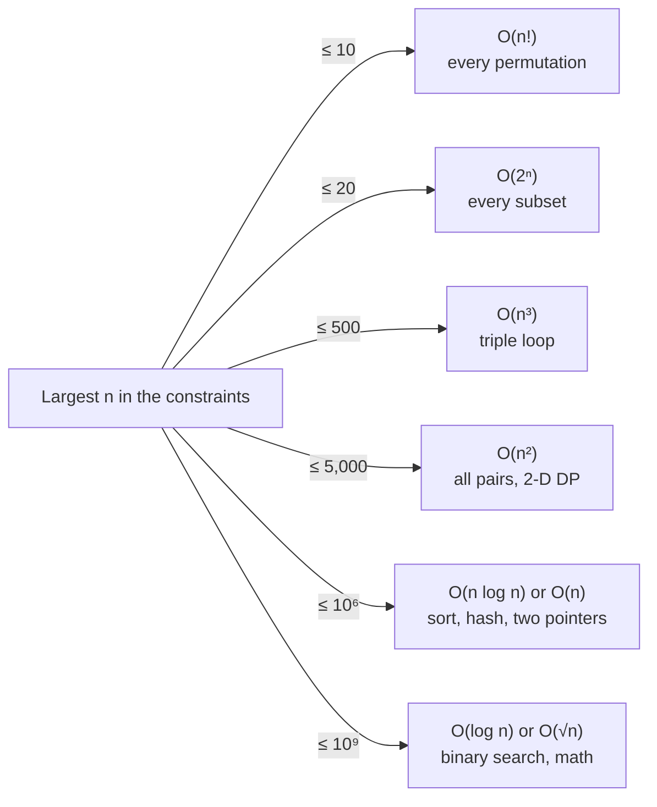

## Where we are

You can write a Java class with a `main` method, loops and arrays. This lesson adds one skill that
every later coding lesson relies on: looking at a problem's input limits and knowing, before you
write any code, roughly how fast your solution has to be.

## The problem

You are 20 minutes into a 90-minute online assessment. The first problem says:

> Given an array `nums` of length `n` (1 ≤ n ≤ 10⁵) and a target, return the indices of two numbers
> that add up to the target.

You write two nested loops that try every pair. All three sample tests pass. You submit, and the
hidden tests come back "Time Limit Exceeded". Now you have to rethink the solution with the clock
running, and the second problem is still unread.

The constraint `n ≤ 10⁵` told you in advance that nested loops would fail. This lesson teaches you to
read that signal in the first minute, not after a failed submit.

## Counting operations

An **operation** here means one simple step: an addition, a comparison, an array read. We don't count
them exactly. We only want to know how the count **grows** as the input gets bigger.

```java
int sum = 0;
for (int i = 0; i < n; i++) {
    sum += nums[i];          // runs n times
}
```

If `n` is 10, the body runs 10 times; if `n` is 1,000, it runs 1,000 times. The work grows in step
with `n`.

```java
int pairs = 0;
for (int i = 0; i < n; i++) {
    for (int j = i + 1; j < n; j++) {
        if (nums[i] + nums[j] == target) pairs++;   // runs n(n-1)/2 times
    }
}
```

For `n = 10`, the inner line runs 45 times. For `n = 1,000`, about 500,000 times. Multiply `n` by
100 and the work multiplies by about 10,000.

**Predict:** for `n = 1,000,000`, roughly how many times does this loop body run?

```java
int steps = 0;
for (int k = n; k > 1; k /= 2) {
    steps++;
}
```

About 20 times. Each step halves what is left, and 2²⁰ is about a million. That count is the
**logarithm**: `log₂(n)` is just "how many times can I halve `n` before reaching 1".

## Big-O: keeping only what matters

**Big-O notation** describes how the number of operations grows with the input size, ignoring
constant factors and smaller terms. We write the pairs loop as **O(n²)**, read "order n squared",
even though the exact count is `n(n-1)/2`.

Why throw information away?

- The `/2` doesn't change the shape. At `n = 10⁵`, `n²/2` is still 5 × 10⁹, which is far too slow.
- Smaller terms vanish at scale. `n² + 3n + 7` at `n = 10⁵` is about 10¹⁰ + 300,007. The `3n + 7`
  is noise.

The general rule: **count how many times the innermost line runs, as a formula in `n`, then keep
only the fastest-growing term and drop its constant.**

```quiz
{"question": "Your loops do 3n² + 100n + 5 operations. What is the Big-O?", "level": "easy",
 "options": [
   {"text": "O(n²)", "correct": true, "why": "Keep the fastest-growing term (3n²) and drop its constant."},
   {"text": "O(n)", "why": "100n is bigger than 3n² only while n < 34. Big-O describes growth as n gets large, where n² wins."},
   {"text": "O(3n² + 100n)", "why": "That is an exact count, not a growth shape. Big-O drops constants and smaller terms."},
   {"text": "O(n³)", "why": "Nothing here multiplies three factors of n; adding terms never raises the power."}]}
```

The shapes you will meet, from fastest to slowest:

```text
O(1)        constant      - array index, HashMap get (on average)
O(log n)    logarithmic   - binary search, halving loops
O(n)        linear        - one pass over the input
O(n log n)  linearithmic  - sorting
O(n²)       quadratic     - all pairs
O(n³)       cubic         - all triples, three nested loops
O(2ⁿ)       exponential   - all subsets
O(n!)       factorial     - all orderings (permutations)
```

## Nested is not the same as n²

Big-O counts how many times the innermost line runs, not how many loops you can see.

```quiz
{"question": "What is the time complexity of this code?", "level": "medium",
 "code": ["for (int i = 0; i < n; i++) {", "    for (int j = 0; j < 5; j++) {", "        total += nums[i] * j;", "    }", "}"],
 "options": [
   {"text": "O(n)", "correct": true, "why": "The inner loop always runs 5 times, a constant, so the body runs 5n times: O(n)."},
   {"text": "O(n²)", "why": "Two nested loops are only n² when both depend on n. Count the runs, don't count the loops."},
   {"text": "O(1): the inner bound is a constant", "why": "Only the inner loop is constant. The outer loop still grows with n, so the body runs 5n times."},
   {"text": "O(n log n)", "why": "There is no halving anywhere; nothing here produces a log factor."}]}
```

The reverse trap also exists: one visible loop that calls `list.contains(x)` hides a second loop
inside the call. DSA-CPLX-2 lists those hidden costs.

Now an inner loop whose bound changes on every outer iteration. Count the runs per outer iteration,
then add them up.

```quiz
{"question": "What is the time complexity of this code?", "level": "hard",
 "code": ["for (int i = 1; i < n; i *= 2) {", "    for (int j = 0; j < i; j++) {", "        ops++;", "    }", "}"],
 "options": [
   {"text": "O(n)", "correct": true, "why": "The inner loop runs 1, 2, 4, ... times, up to below n. That sum 1 + 2 + 4 + ... is less than 2n, so the total is O(n)."},
   {"text": "O(n log n)", "why": "That treats every inner pass as n work. Only the last pass is close to n; the earlier ones halve each time, and together they add up to less than one more n."},
   {"text": "O(log n)", "why": "The outer loop does run about log n times, but each iteration does i work, not one step. Count the inner runs."},
   {"text": "O(n²)", "why": "Two nested loops are n² only when both run about n times each. Here the outer loop runs only log n times."}]}
```

## The machine's budget: roughly 10⁸ per second

To turn an operation count into a time, you need one number: **a typical judge runs roughly 10⁸
simple operations per second** in Java. This is a rule of thumb, not a law. A tight loop over an
`int[]` can be much faster; a loop full of `HashMap` calls and object creation can be ten times
slower. Most online judges give 1–2 seconds per test, so your budget is somewhere around **10⁸
operations, give or take a factor of a few**.

**Predict:** with `n = 10⁵`, about how long does the all-pairs Two Sum take at 10⁸ per second?

- O(n²) → 10¹⁰ operations → around 100 seconds. Fails.
- O(n log n) → 10⁵ × 17 ≈ 1.7 × 10⁶. Instant.
- O(n) → 10⁵. Instant.

## From constraints to expected complexity

Turn that budget around and you get a table. Given the largest `n`, it tells you the slowest
complexity that still fits in about 10⁸ operations.



| Max n | Expected complexity | Why it fits | Typical technique |
|---|---|---|---|
| ≤ 10 | O(n!) or O(n! · n) | 10! ≈ 3.6 × 10⁶ | try every permutation |
| ≤ 20 | O(2ⁿ) or O(2ⁿ · n) | 2²⁰ ≈ 10⁶ | try every subset, bitmask DP |
| ≤ 500 | O(n³) | 500³ = 1.25 × 10⁸ | triple loop, interval DP |
| ≤ 5,000 | O(n²) | 5,000² = 2.5 × 10⁷ | all pairs, 2-D DP |
| ≤ 10⁶ | O(n log n) or O(n) | 10⁶ × 20 = 2 × 10⁷ | sorting, heaps, hashing, two pointers |
| ≤ 10⁹ | O(log n) or O(√n) | log₂ 10⁹ ≈ 30 | binary search, math |

You will meet the techniques later; for now, the names: **DP** (dynamic programming) stores the
answers to smaller subproblems so each is solved once, a **heap** is a structure that hands back its
smallest item quickly, and **two pointers** are two indices that walk through an array, often from
both ends.

The most common constraint you will see is `n ≤ 10⁵`. It sits in the `≤ 10⁶` row: the problem wants
O(n log n) or O(n). It is an almost certain sign that the obvious nested loop is not the answer.

Two more readings of the table:

- **If n is tiny, say ≤ 20, the problem is inviting brute force.** Don't waste time looking for a
  clever greedy rule.
- **If n is up to 10⁹, you can't even read every value.** The answer must come from binary search or
  a formula.

```quiz
{"question": "Constraints say 1 ≤ n ≤ 2,000. What is the slowest complexity that will comfortably pass?", "level": "medium",
 "options": [
   {"text": "O(n²)", "correct": true, "why": "2,000² = 4 × 10⁶, far inside a 10⁸ budget. An all-pairs solution is fine here."},
   {"text": "O(n³)", "why": "2,000³ = 8 × 10⁹, about 80 times over budget."},
   {"text": "O(n log n)", "why": "It passes, but it is not the slowest that passes. Spending interview time hunting for it when O(n²) fits is the mistake this table prevents."},
   {"text": "O(2ⁿ)", "why": "2²⁰⁰⁰ is astronomically large; exponential is only for n around 20."}]}
```

## When there are two sizes

Many problems have more than one input. A grid has `rows` and `cols`. A graph has `V` vertices and
`E` edges. Keep both letters: O(rows × cols), O(V + E). Then plug in the largest values. A 1,000 ×
1,000 grid is 10⁶ cells, which is fine for one BFS (a search that visits every cell once) but not
for a BFS from every cell.

## Space complexity, briefly

The same counting works for memory. **Space complexity** is how much extra memory your solution
uses as `n` grows. An extra `int[n]` is O(n) space. A `boolean[n][n]` is O(n²) space, and at
`n = 10⁵` that's 10¹⁰ bytes, which no judge allows. DSA-CPLX-3 goes deep on this.

## Lab (~10 min)

Be the judge. The program checks whether an array has a duplicate in two ways: compare all pairs
(O(n²)), and sort then compare neighbours (O(n log n)). The arrays have no duplicates, so both methods
do their full work. Any run over a 2-second limit is flagged.

```java
import java.util.Arrays;
import java.util.Random;

public class GrowthLab {
    static final int MAX_N = 64_000;                      // break it: raise this to 256_000
    static final double LIMIT_MS = 2_000;                 // a typical judge's time limit

    static boolean hasDuplicatePairs(int[] a) {           // O(n²)
        for (int i = 0; i < a.length; i++)
            for (int j = i + 1; j < a.length; j++)
                if (a[i] == a[j]) return true;
        return false;
    }

    static boolean hasDuplicateSorted(int[] a) {          // O(n log n)
        int[] copy = a.clone();
        Arrays.sort(copy);
        for (int i = 1; i < copy.length; i++)
            if (copy[i] == copy[i - 1]) return true;
        return false;
    }

    static int[] distinctShuffled(int n) {
        int[] a = new int[n];
        for (int i = 0; i < n; i++) a[i] = i * 7;          // all different
        Random r = new Random(42);
        for (int i = n - 1; i > 0; i--) {                 // Fisher-Yates shuffle
            int j = r.nextInt(i + 1);
            int t = a[i]; a[i] = a[j]; a[j] = t;
        }
        return a;
    }

    public static void main(String[] args) {
        for (int k = 0; k < 5; k++) {                     // warm-up so the JIT (run-time compiler) has compiled both
            hasDuplicatePairs(distinctShuffled(2_000));
            hasDuplicateSorted(distinctShuffled(2_000));
        }
        System.out.printf("%8s %12s %12s%n", "n", "pairs(ms)", "sorted(ms)");
        for (int n = 4_000; n <= MAX_N; n *= 2) {
            int[] a = distinctShuffled(n);

            long t0 = System.nanoTime();
            boolean x = hasDuplicatePairs(a);
            long t1 = System.nanoTime();
            boolean y = hasDuplicateSorted(a);
            long t2 = System.nanoTime();

            if (x != y) throw new AssertionError("methods disagree");
            double pairsMs = (t1 - t0) / 1e6;
            System.out.printf("%8d %12.1f %12.2f%s%n", n, pairsMs, (t2 - t1) / 1e6,
                    pairsMs > LIMIT_MS ? "   <- pairs: time limit exceeded" : "");
        }
    }
}
```

Run it with `java GrowthLab.java`. One run on a laptop printed this (your numbers will differ):

```text
       n    pairs(ms)   sorted(ms)
    4000          2.0        21.46
    8000          9.7         2.06
   16000         33.7         4.66
   32000        134.0        10.67
   64000        519.0        10.41
```

**What to observe:** each time `n` doubles, the pairs column grows by roughly 4×, because
(2n)² = 4n². The sorted column stays at a few milliseconds; at these sizes timer noise, garbage
collection and the JIT (the JVM's just-in-time compiler, which turns hot code into machine code
while the program runs; see the odd first row) hide its gentle n log n growth. At 64,000 the pairs
method has done about 2 × 10⁹ comparisons in about half a second: a tight `int[]` loop like this
beats 10⁸ per second by a wide margin, which shows how cautious the rule of thumb is.

**Break it:** predict the pairs time for 128,000 and 256,000 *before* you run them (4× per
doubling). Then set `MAX_N` to `256_000`. On the same laptop, 128,000 took about 2.1 seconds and
256,000 about 8.6 seconds, both flagged "time limit exceeded", while the sorted column was still
around 25 ms. That flag is the hidden-test failure from "The problem", reproduced on your machine.

## Gotchas

- **Designing from the samples.** Samples have n = 5; read the constraint line first and pick a target from the table.
- **Treating 10⁸/s as exact.** Boxing (wrapping an `int` in an `Integer`), hashing and objects cost 5–10× more; at the edge, assume too slow.
- **Counting loops, not runs.** A constant inner bound is O(n); one loop calling `list.contains(x)` is O(n²).
- **Forgetting a hidden size.** One pass over 10⁵ strings of 10⁴ chars is 10⁹ character operations; name every size.
- **Dropping the log.** O(n log n) and O(n) both pass at 10⁶; at 10⁸ only O(n) might, so state the log.

## In interviews

Never asked on its own: it shapes the first two minutes of every coding round. Practise reading constraints on:

- [Two Sum](#/q/two-sum)
- [Trapping Rain Water](#/q/trapping-rain-water)
- [Koko Eating Bananas](#/q/koko-eating-bananas): piles up to 10⁹, a huge value range that signals binary search on the answer.
- [First Bad Version](#/q/first-bad-version)
- [Subarray Sum Equals K](#/q/subarray-sum-equals-k)

**"What are the time and space complexity?"** Name each size (n = array length, k = window), give both, and point at
the line that causes the dominant term.

**"Would this pass if n were 10⁷?"** Use the table aloud: 10⁷ × log ≈ 2.3 × 10⁸ is borderline in Java; O(n) is safer.

## Explain it in 2 minutes

*"How do you decide what complexity a problem needs?"*

1. Count how work grows with input size; keep the dominant term (Big-O).
2. A judge does roughly 10⁸ simple operations per second; limits are 1–2 s.
3. Max n sets the ceiling: 10 → n!, 20 → 2ⁿ, 500 → n³, 5,000 → n², 10⁶ → n log n, 10⁹ → log n.
4. Tiny n invites brute force; huge n means binary search or math.
5. Stay well inside the budget when constant factors are heavy.

## Check yourself

1. Outer `for (int i = 1; i < n; i *= 2)`, inner loop runs `n` times. Big-O?
2. `1 ≤ n ≤ 18`: what kind of solution does that invite?
3. n ≤ 2 × 10⁵: is O(n²) acceptable?

### Answers

1. O(n log n): about log₂ n outer iterations, n work each.
2. Brute force over all subsets, O(2ⁿ · n): 2¹⁸ ≈ 2.6 × 10⁵.
3. No: 4 × 10¹⁰ is about 400× over a 10⁸ budget; you need O(n log n) or better.

## Next

DSA-CPLX-2 (hidden time costs), DSA-CPLX-3 (where memory goes) and DSA-CPLX-5 (amortised "usually O(1)" operations).
