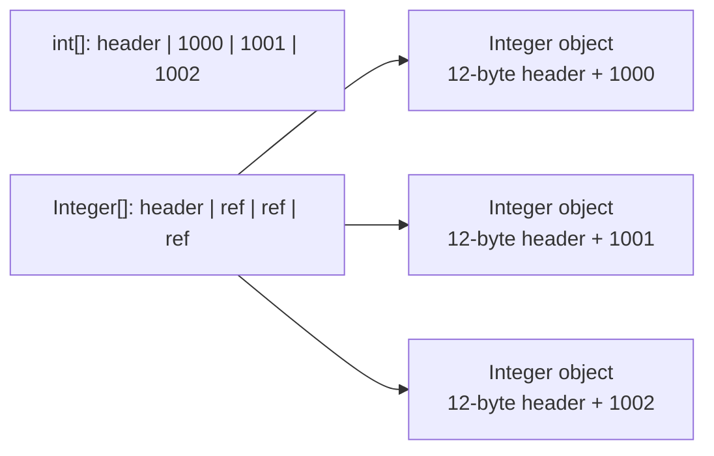

## Where we are

From DSA-CPLX-1 you can count operations, write Big-O, and use the constraints table to pick a target time
complexity. You also met **space complexity**, which counts how memory grows with `n`. This lesson
turns that "O(n) space" into real bytes in Java, because in Java the constant factor on memory is
often 4–10×, and that is the difference between passing and failing.

## The problem

You are on the last problem of an assessment: up to 3 × 10⁶ numbers, memory limit 256 MB. You read
them into an `ArrayList<Integer>`, count them in a `HashMap<Integer, Integer>`, and the logic is right
on every sample. The hidden tests come back "Memory Limit Exceeded". On paper you used "n integers",
about 12 MB. In the JVM you used far more.

**Predict:** before reading on, guess how many bytes one `HashMap<Integer, Integer>` entry really costs.
You will check your guess in the HashMap section.

All sizes below are **rough figures on a typical 64-bit HotSpot JVM with compressed references**
(the default when the heap is under about 32 GB). Other JVMs and settings differ. Treat them as
estimates for back-of-envelope sums, not facts to quote to the byte.

## Every object pays a header

A **reference** is the "pointer" a variable holds to an object on the heap. With compressed
references it's roughly 4 bytes. An **object header** is the bookkeeping the JVM stores at the
start of every object (for locking, hashing and its class). It's roughly 12 bytes. Objects are then
rounded up to a multiple of 8 bytes.

A primitive array pays one header, then the raw values:

```text
int[] of 1,000,000      ~16 bytes header + 4 × 10⁶   ≈ 4 MB
long[] of 1,000,000     ~16 bytes header + 8 × 10⁶   ≈ 8 MB
boolean[] of 1,000,000  ~16 bytes header + 1 × 10⁶   ≈ 1 MB  (a byte per boolean, not a bit)
```

General rule: **primitive arrays cost about the size of the primitive times n. Everything else
costs headers and references on top.**

## Boxing: `Integer` versus `int`

**Boxing** is wrapping a primitive (`int`) in an object (`Integer`) so it can live in a collection.
Java does it automatically, which is called **autoboxing**.

```java
int[] a = new int[n];            // n values in one block
Integer[] b = new Integer[n];    // n references, each to a separate Integer object
for (int i = 0; i < n; i++) b[i] = i + 1000;
```

**Predict:** using the header and reference sizes above, how many bytes per element does `b` cost?

An `Integer` object is roughly 16 bytes (12-byte header plus a 4-byte int). `Integer[]` adds a
4-byte reference per slot:



So:

```text
int[n]        ≈  4 bytes per element
Integer[n]    ≈ 20 bytes per element (4 reference + 16 object)
ArrayList<Integer> ≈ the same as Integer[], plus spare capacity (see DSA-CPLX-5)
```

That's roughly **5× the memory** for the same numbers, and the objects are scattered around the
heap, which is also slower to read.

One wrinkle: Java caches `Integer` objects for -128 to 127, so small values share objects. Don't
count on it for real data.

```quiz
{"question": "Why does an Integer[] of a million values take about 5× the memory of an int[]?", "level": "easy",
 "options": [
   {"text": "Each slot holds a reference to a separate object that carries its own header", "correct": true,
    "why": "About 4 bytes of reference plus a 16-byte Integer object per value, against 4 raw bytes in int[]."},
   {"text": "It doesn't: each Integer is just 8 bytes, a 4-byte int plus a 4-byte reference", "why": "That forgets the object header. The Integer itself is about 16 bytes (12-byte header plus the int, padded to 8), and the 4-byte reference in the array comes on top."},
   {"text": "Arrays of objects reserve spare capacity", "why": "Plain arrays never have spare capacity; their length is fixed. That is ArrayList."},
   {"text": "The JVM keeps a second copy for the garbage collector", "why": "There is no second copy. The cost is per-object overhead, not GC bookkeeping."}]}
```

## HashMap entries are heavy

A `HashMap` stores each key–value pair in an internal **node** object, which holds the key's hash, a
reference to the key, a reference to the value, and a reference to the next node in its bucket.
The map also keeps an array of buckets (the **table**), kept at most 75% full by default.

For `HashMap<Integer, Integer>`, one entry costs roughly:

```text
node object              ~32 bytes
table slot(s)            ~5–11 bytes (4 per slot, 1.3–2.7 slots per entry)
boxed key (Integer)      ~16 bytes
boxed value (Integer)    ~16 bytes
-----------------------------------
total                    roughly 70–80 bytes per entry
```

Compare that with 8 bytes for two raw `int`s. A million entries is roughly 70–80 MB instead of 8 MB.
(In a *count* map the value box mostly disappears: counts up to 127 come from the `Integer` cache, so
an entry is nearer 55 bytes.) That is the story's failure: 3 × 10⁶ entries at about 55 bytes is about
165 MB for the map, plus about 60 MB for the `ArrayList<Integer>`, plus the spare room the garbage
collector needs: past 256 MB. How close was your guess?

The rule: **if the keys are small dense integers (0 to n, or `'a'` to `'z'`), use an array instead
of a map.** `int[26]` for letter counts, `int[n]` for "seen" counts. Keep `HashMap` for keys that
are large, sparse or not integers.

```quiz
{"question": "Count how often each letter appears in a string of 10⁶ lowercase letters, using as little memory as possible. What do you count in?", "level": "medium",
 "options": [
   {"text": "int[26], indexed by c - 'a'", "correct": true, "why": "Small dense keys: about 120 bytes in total, and no boxing on each increment."},
   {"text": "HashMap<Character, Integer>", "why": "Correct but heavy: up to 26 nodes, boxed keys, a new Integer for most increments, and hashing on every character."},
   {"text": "BitSet", "why": "A BitSet stores one yes/no bit per index. It can say which letters appear, not how many times."},
   {"text": "s.toCharArray(), then sort and count runs", "why": "Copies 2 MB of chars and costs O(n log n) time to answer what 26 counters answer in one pass."}]}
```

## Strings and `char[]`

Since Java 9, a `String` is an object (roughly 24 bytes) pointing at a `byte[]`. For text that fits
in Latin-1, that array uses 1 byte per character. Otherwise it uses 2. So a short ASCII string costs
roughly 40–50 bytes, mostly overhead.

```java
char[] cs = s.toCharArray();   // a new copy, 2 bytes per char
String t = s.substring(2, 9);  // also a new copy (since Java 7u6)
```

Two consequences:

- `toCharArray()` is O(n) time and O(n) space. Do it **once**, outside the loop.
- Creating many substrings (for example as map keys) copies characters every time. Store indices
  `(start, end)` when you can.

## Recursion uses the stack

Every method call gets a **stack frame**, a small block on its thread's **call stack** holding its
parameters and local variables. The stack is small: the default is commonly around 1 MB per thread
on 64-bit platforms, configurable with `-Xss`.

```java
static int depth(Node node) {            // DFS on a tree where every node has one child
    if (node == null) return 0;
    return 1 + depth(node.next);
}
```

**Predict:** the tree is 10⁶ nodes deep (a "stick") and the heap is 2 GB. Does `depth` return?

No: it throws `StackOverflowError`. The frames live on the call stack, not the heap. How deep you can go
depends on the frame size and the JIT, typically somewhere from thousands to tens of thousands of
frames. So **recursion depth is space complexity too**: a DFS is O(h) space, where h is the height,
and h can be n.

There are three fixes, in order of preference:

1. Rewrite it with an explicit `ArrayDeque` as the stack. Heap memory is much larger than the call
   stack.
2. Use BFS if the order doesn't matter.
3. In an OA where you control `main`, run the code in a thread with a bigger stack:
   `new Thread(null, task, "big", 1L << 27).start()` (asks for 128 MB of stack).

```quiz
{"question": "A recursive DFS throws StackOverflowError on a 10⁵-node path graph. A teammate reruns it with -Xmx4g. What happens?", "level": "hard",
 "options": [
   {"text": "It still overflows: -Xmx sizes the heap, and each thread's stack is a separate area sized by -Xss", "correct": true,
    "why": "Frames go on the thread's call stack. Fix the depth (explicit ArrayDeque, BFS) or give that thread a bigger stack."},
   {"text": "It passes, because the stack grows into the extra heap", "why": "The stack and the heap are separate areas. More heap does nothing for call depth."},
   {"text": "It passes, because the JIT turns the recursion into a loop", "why": "HotSpot does not do tail-call elimination, and 1 + depth(next) is not even a tail call."},
   {"text": "It now fails with OutOfMemoryError instead", "why": "Deep recursion fails with StackOverflowError whatever the heap size. OutOfMemoryError is about the heap (or native memory)."}]}
```

## Rolling arrays in DP

**Dynamic programming (DP)** fills a table where each cell is computed from earlier cells. Often a
row depends only on the row before it.

```java
// Longest common subsequence: dp[i][j] depends on row i-1 and row i only
int[][] dp = new int[n + 1][m + 1];          // n = m = 10⁴ → 10⁸ ints ≈ 400 MB
```

Since only two rows are ever needed, keep just those:

```java
int[] prev = new int[m + 1], cur = new int[m + 1];
for (int i = 1; i <= n; i++) {
    for (int j = 1; j <= m; j++) {
        cur[j] = a[i - 1] == b[j - 1] ? prev[j - 1] + 1 : Math.max(prev[j], cur[j - 1]);
    }
    int[] tmp = prev; prev = cur; cur = tmp; // swap, don't reallocate
}
// answer in prev[m]
```

This is a **rolling array**. Space drops from O(n·m) to O(m), from roughly 400 MB to 80 KB. The cost
is that you can't reconstruct the actual subsequence afterwards without extra work. Mention this
trade-off out loud.

## Bitsets: one bit per flag

A `boolean[]` spends a whole byte per flag. A **bitset** packs 64 flags into each `long`.
`java.util.BitSet` does this for you.

```java
BitSet seen = new BitSet(n);    // ~n/8 bytes
seen.set(42);
if (seen.get(42)) { /* ... */ }
```

For 10⁹ flags (for example "which IDs appeared"), a `boolean[]` is roughly 1 GB and a `BitSet` is
roughly 125 MB. A plain `long` also works as a bitset of up to 64 items, which is how bitmask DP
over subsets of n ≤ 20 stores "which items are used" (DSA-CPLX-1's `≤ 20` row).

## Adjacency matrix versus adjacency list

A **graph** is a set of vertices (V) joined by edges (E). There are two common ways to store it:

```text
Matrix: boolean[V][V], adj[u][v] = true if edge u→v       space O(V²)
List:   List<List<Integer>>, adj.get(u) holds u's neighbours  space O(V + E)
```

With V = 10⁵ and E = 2 × 10⁵ (a typical sparse graph):

- Matrix: 10¹⁰ booleans ≈ 10 GB. Impossible.
- List: roughly 10⁵ inner `ArrayList`s plus 4 × 10⁵ boxed entries (undirected edges are stored
  twice) ≈ roughly 20 MB. Fine.

Use a matrix only when V is small (up to a few thousand) or the graph is dense and you need O(1)
"is there an edge u–v?" checks. If the list is still too heavy, the next step is primitive arrays
(`int[] head, next, to`), which removes the boxing.

```quiz
{"question": "V = 2,000 vertices, and the algorithm asks \"is there an edge u–v?\" millions of times. Which storage fits?", "level": "medium",
 "options": [
   {"text": "boolean[2000][2000] adjacency matrix", "correct": true, "why": "4 × 10⁶ booleans is about 4 MB, and every check is one array read, O(1)."},
   {"text": "List<List<Integer>>, scanning u's neighbours", "why": "Fits in memory, but each check scans a neighbour list: O(degree) per query instead of O(1)."},
   {"text": "A matrix is never acceptable: always O(V²)", "why": "O(V²) only hurts when V² is large. At V = 2,000 it is 4 MB, well inside a judge's limit."},
   {"text": "A BitSet of V bits", "why": "V bits can mark vertices, not pairs. You would need V² bits (a BitSet per row would work)."}]}
```

## Lab (~10 min)

Measure boxing and map overhead with `Runtime`. Measurements like this are noisy because the
garbage collector runs when it likes, so run it two or three times and look at the order of
magnitude, not the exact digits.

```java
import java.util.ArrayList;
import java.util.HashMap;
import java.util.List;
import java.util.Map;
import java.util.function.IntFunction;

public class MemoryLab {
    static final int N = 1_000_000;

    static long used() {
        Runtime rt = Runtime.getRuntime();
        for (int i = 0; i < 3; i++) System.gc();   // a request, not a guarantee
        return rt.totalMemory() - rt.freeMemory();
    }

    static void measure(String label, IntFunction<Object> build) {
        long before = used();
        Object keep = build.apply(N);              // keep a reference so it isn't collected
        long after = used();
        System.out.printf("%-28s ~%5.1f bytes/element%n", label, (after - before) / (double) N);
        if (keep.hashCode() == 42) System.out.print("");  // stops the JIT discarding 'keep'
    }

    public static void main(String[] args) {
        measure("int[]", n -> {
            int[] a = new int[n];
            for (int i = 0; i < n; i++) a[i] = i + 1000;
            return a;
        });
        measure("Integer[]", n -> {
            Integer[] a = new Integer[n];
            for (int i = 0; i < n; i++) a[i] = i + 1000;   // outside the -128..127 cache
            return a;
        });
        measure("ArrayList<Integer>", n -> {
            List<Integer> a = new ArrayList<>();
            for (int i = 0; i < n; i++) a.add(i + 1000);
            return a;
        });
        measure("HashMap<Integer,Integer>", n -> {
            Map<Integer, Integer> m = new HashMap<>();
            for (int i = 0; i < n; i++) m.put(i + 1000, i + 1000);
            return m;
        });
    }
}
```

Run it with `java -Xmx2g MemoryLab.java`. **Predict** the four numbers first, from the sections above.

**What to observe:** `int[]` comes out at about 4 bytes per element, `Integer[]` at about 20,
`ArrayList<Integer>` a little higher (spare capacity), and the `HashMap` several times higher again
(one Java 21 run printed 4.2, 20.3, 21.6 and 73.4). Note that `m.put(i + 1000, i + 1000)` boxes the
same number twice, creating two separate `Integer` objects.

**Break it:** run `java -Xmx64m MemoryLab.java`. Predict which line dies. The first three rows still
print; the `HashMap` row fails with `OutOfMemoryError: Java heap space`, because about 75 MB of entries
cannot fit in a 64 MB heap. That is "Memory Limit Exceeded" on your own machine. Then write a recursive
method `int down(int k) { return k == 0 ? 0 : 1 + down(k - 1); }`, find by doubling `k` roughly where it
throws `StackOverflowError`, and run it again with `-Xss8m` to see the limit move.

## Gotchas

- **`HashMap<Integer,Integer>` for counts of small keys.** Use `int[26]`, `int[128]` or `int[n]`: smaller and faster.
- **Deep recursion on adversarial input.** A DFS on a 10⁵-node path or a recursive flood fill on a 1,000 × 1,000 grid
  overflows; use an explicit `ArrayDeque`.
- **A full 2-D DP table when only the last row is used.** Roll it to two rows, or one row updated in the right direction.
- **An adjacency matrix for a sparse graph.** If V² is above roughly 10⁸, use lists.
- **Quoting exact byte counts.** Say "roughly, on a 64-bit JVM with compressed references"; know where overhead comes from.

## In interviews

Memory comes up as a follow-up: "Can you reduce the space?" or "What if this doesn't fit in memory?"

- [Edit Distance](#/q/edit-distance)
- [Number of Islands](#/q/number-of-islands)
- [Longest Substring Without Repeating Characters](#/q/longest-substring-without-repeating-characters)
- [HashMap internals and complexity](#/q/hashmap-internals)
- [Java Stack vs Heap](#/q/java-stack-vs-heap-memory)
- [Sort a File Too Large for Memory](#/q/external-sort-large-file)

**"Your DP is O(n·m) space. Can you do better?"** Say which cells each cell depends on, roll to O(m), and note you
lose path reconstruction.

## Explain it in 2 minutes

*"Your O(n) solution ran out of memory. Why, and what would you change?"*

1. Big-O hides constants: object headers (~12 bytes) and references (~4 bytes).
2. Boxing makes an int ~20 bytes; a HashMap entry costs ~70–80.
3. Fix: primitive arrays for dense keys, `BitSet` for flags, adjacency lists for sparse graphs.
4. DP: keep only the rows you need.
5. Recursion uses the small thread stack; go iterative when depth can reach n.

## Check yourself

1. Roughly what does a `HashSet<Integer>` of 10⁶ elements cost, and what replaces it for values in 0..10⁶?
2. `dp[i][j]` depends on `dp[i-1][j]` and `dp[i-1][j-1]`. How much space do you need?
3. V = 50,000, E = 100,000. Matrix or list?

### Answers

1. A HashSet is a HashMap underneath (value is a shared dummy), so ~50–60 bytes per element: tens of MB.
   A `boolean[10⁶ + 1]` (~1 MB) or `BitSet` (~125 KB) does the job.
2. O(m): two rows, or one row if you loop `j` from high to low so `dp[j-1]` still holds the previous row.
3. List. A matrix is 2.5 × 10⁹ booleans (~2.5 GB).

## Next

DSA-CPLX-4 (optimisation playbook) uses these facts to trade memory for time; DSA-CPLX-2 is the time-side twin.
