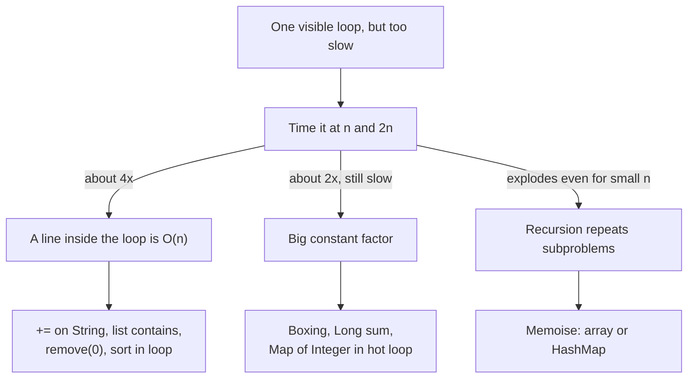

## Where we are

From DSA-CPLX-1 you can count how often the innermost line runs, write it as Big-O, and check it against
the budget of roughly 10⁸ simple operations per second. That only works if you count *every* loop,
including the ones hidden inside library calls. This lesson lists the common Java calls that look
like one step but are really a loop.

## The problem

You are in an online assessment. The task: keep the first letter of each *new* word, for up to
`n = 10⁵` words. You read the constraint, check the DSA-CPLX-1 table (O(n) or O(n log n) needed) and write
one loop:

```java
String result = "";
for (int i = 0; i < n; i++) {
    if (!seen.contains(words[i])) {      // seen is an ArrayList<String>
        seen.add(words[i]);
        result += words[i].charAt(0);
    }
}
```

**Predict:** one loop over `n` words. What is the real time complexity?

Samples pass; the hidden tests come back "Time Limit Exceeded". The loop is O(n²) twice over:
`contains` on a list scans the whole list, and `+=` on a String copies the whole string. At `n = 10⁵`
that's two costs of about n²/2 each, roughly 10¹⁰ steps, not 10⁵.

A **hidden cost** is work that a single line of code does in a loop you don't see. Each section
below shows one of them, the fix, and the rule.

## 1. String concatenation in a loop

A Java `String` is **immutable**: once created, it never changes. So `s += x` can't append in
place. It builds a brand-new string and copies every existing character into it.

```java
String s = "";
for (int i = 0; i < n; i++) s += 'a';
```

**Predict:** for `n = 10⁵`, roughly how many characters get copied in total?

About 5 × 10⁹. Iteration `i` copies the `i` characters already there, so the total is
0 + 1 + ... + (n-1) ≈ n²/2. That is 50 times the 10⁸ budget, for a loop that "just appends".

The fix is `StringBuilder`, which keeps a growable buffer and appends in place:

```java
StringBuilder sb = new StringBuilder();
for (int i = 0; i < n; i++) sb.append('a'); // O(n) total
String s = sb.toString();
```

**Rule:** any `+=` on a String inside a loop is O(length) per iteration. Use `StringBuilder`. (A
single `a + b + c` outside a loop is fine. The compiler handles it.) The same copying hides in
`s.substring(a, b)` and `s.toCharArray()`: each returns a fresh copy, so work with indices and
convert once, outside the loop.

```quiz
{"question": "Why does s += x inside a loop cost O(n²) overall?", "level": "easy",
 "options": [
   {"text": "String is immutable, so each += builds a new string and copies every existing character", "correct": true,
    "why": "The copy grows by one each iteration: 0 + 1 + ... + (n-1) ≈ n²/2 characters."},
   {"text": "Each += triggers a garbage collection", "why": "The old strings do become garbage, but GC runs occasionally, not per +=. The copying alone is quadratic."},
   {"text": "String methods are synchronized", "why": "That is StringBuffer, StringBuilder's older thread-safe cousin. Locking adds a constant cost, never an extra factor of n."},
   {"text": "It isn't: javac rewrites the loop to use one StringBuilder, so it is O(n)", "why": "javac (with invokedynamic concatenation since Java 9) optimises one expression, but each += still builds a fresh string, so the copying stays quadratic."}]}
```

## 2. `list.remove(0)` and `list.add(0, x)`

An `ArrayList` keeps its elements in one array. Removing the first element means shifting every
other element left by one.

```java
List<Integer> queue = new ArrayList<>(...);
while (!queue.isEmpty()) {
    int x = queue.remove(0);                // O(size) shift each time → O(n²) overall
}
```

The fix is `ArrayDeque`, a circular buffer where removing from either end is O(1):

```java
Deque<Integer> queue = new ArrayDeque<>(...);
while (!queue.isEmpty()) {
    int x = queue.pollFirst();              // O(1)
}
```

**Rule:** `ArrayList` is fast only at the end. For a queue (BFS) or anything that removes from the
front, use `ArrayDeque`.

`LinkedList` has the mirror-image trap: `get(i)` walks node by node from the nearer end (up to n/2
nodes), so `for (i...) list.get(i)` over a
`LinkedList` is O(n²).

## 3. `contains` on a List

`List.contains(x)` checks every element one by one until it finds a match: O(n).

```java
List<Integer> seen = new ArrayList<>();
for (int x : nums) {
    if (seen.contains(x)) return true;      // O(n) inside O(n) → O(n²)
    seen.add(x);
}
```

A `HashSet` answers "is x in here?" in O(1) on average by jumping straight to a bucket computed from
`x.hashCode()`:

```java
Set<Integer> seen = new HashSet<>();
for (int x : nums) {
    if (!seen.add(x)) return true;          // add returns false if already present
}
```

**Rule:** if you ask "have I seen this?" inside a loop, the collection must be a `HashSet`,
a `HashMap`, or an array indexed by the value. The same trap appears with `list.indexOf` and
`String.indexOf` inside a loop.

```quiz
{"question": "banned is a List<String> of 10⁴ words. You check 10⁵ words against it and time out. Which change fixes it?", "level": "medium",
 "code": ["int count = 0;", "for (String w : words) {", "    if (banned.contains(w)) count++;", "}"],
 "options": [
   {"text": "Copy banned into a HashSet<String> once, before the loop", "correct": true,
    "why": "One O(10⁴) copy, then 10⁵ average-O(1) lookups. From about 10⁹ comparisons to about 10⁵."},
   {"text": "Sort banned first, then keep calling contains", "why": "List.contains never uses binary search; it scans from the start whatever the order. You would need Collections.binarySearch."},
   {"text": "Make banned a LinkedList", "why": "contains on a LinkedList is still a linear scan, and following node links is slower than walking an array."},
   {"text": "Create the ArrayList with an initial capacity of 10⁴", "why": "Capacity only avoids resizing while adding. Each contains still scans every element."}]}
```

## 4. Autoboxing in hot loops

**Autoboxing** is Java silently wrapping an `int` into an `Integer` object (or a `long` into a `Long`).
Each wrap can allocate a new object. (DSA-CPLX-3 shows what that costs in memory.)

```java
Long total = 0L;                            // capital L: an object
for (int i = 0; i < n; i++) total += i;     // unbox, add, box a new Long: every iteration
```

It's still O(n), but with a much bigger constant: an allocation per step, plus garbage collection
work afterwards. In a tight OA time limit, that's often enough to time out.

```java
long total = 0L;                            // primitive: no objects at all
```

Boxing also hides inside generics: `Map<Integer, Integer>` boxes on every `get` and `put`,
`List<Integer>` on every `add`. **Rule:** use primitives (`int`, `long`, `int[]`) for counters,
sums and hot inner loops. Use boxed types only where a collection forces you to.

There's a correctness trap too: `Integer a = 1000, b = 1000; a == b` is `false`, because `==`
compares references (on a default JVM). Values from -128 to 127 come from a cache, so small numbers seem to work. Use
`.equals` or unbox.

```quiz
{"question": "Words \"x\" and \"y\" each appear 500 times in words. What does the last line print?", "level": "hard",
 "code": ["Map<String, Integer> counts = new HashMap<>();", "for (String w : words) counts.merge(w, 1, Integer::sum);",
          "System.out.println(counts.get(\"x\") == counts.get(\"y\"));"],
 "options": [
   {"text": "false", "correct": true,
    "why": "get returns Integer objects, and == compares references. 500 is outside the default -128..127 cache, so each count was boxed into its own object."},
   {"text": "true", "why": "That is what you get for counts up to 127, which is why the bug passes small tests and fails on big ones. Use equals or compare ints."},
   {"text": "It throws NullPointerException", "why": "Both keys are present, so get returns non-null Integers. == on two references never unboxes them."},
   {"text": "It does not compile: == cannot compare Integer objects", "why": "== on two references is legal Java. It compiles and silently compares identity."}]}
```

## 5. Sorting inside a loop

`Collections.sort` and `Arrays.sort` are O(k log k) for k elements. Called once, that's fine. But
look at this:

```java
for (int i = 0; i < n; i++) {
    pending.add(nums[i]);
    Collections.sort(pending);              // O(k log k) in general, at least O(k) every time
    if (i % 2 == 1) {                       // every second step, take the largest out
        int max = pending.remove(pending.size() - 1);
    }
}
```

`pending` grows to about n/2 elements, so that's at least O(n · k), and O(n · k log k) in general. (Java's sort spots an already-sorted
prefix, so re-sorting a nearly sorted list is closer to O(k), but it still touches all k elements.)
The question is always: **"do I need everything sorted, or just the smallest/largest?"** If it's just
the extreme, use a `PriorityQueue` (a **heap**: a structure that keeps the smallest, or largest,
element at the top with O(log k) insert and remove):

```java
PriorityQueue<Integer> maxHeap = new PriorityQueue<>(Comparator.reverseOrder());
for (int i = 0; i < n; i++) {
    maxHeap.offer(nums[i]);                 // O(log k)
    if (i % 2 == 1) {
        int max = maxHeap.poll();           // O(log k): take the largest out
    }
}
```

If you only ever insert and never remove, a running `max` variable is enough; a heap earns its place
once you also take elements out.

**Rule:** sort once, before the loop. If you need order *during* the loop, use a heap or a
`TreeMap` (a sorted map with O(log n) insert, remove and "next larger key").

```quiz
{"question": "n numbers, which may repeat, arrive one at a time. After every second number you must remove and report the largest number still held. Which structure fits?", "level": "medium",
 "options": [
   {"text": "PriorityQueue with Comparator.reverseOrder()", "correct": true,
    "why": "offer and poll are O(log n), so the whole stream is O(n log n), and duplicates are kept."},
   {"text": "ArrayList, calling Collections.sort after each insert", "why": "That is the sort-inside-a-loop trap: at least O(n) per step even though Java's sort spots the sorted prefix, so O(n²) or worse in total."},
   {"text": "TreeSet with pollLast()", "why": "The speed is right, but a Set silently drops repeated numbers, so a duplicate largest would be reported once. A TreeMap with counts would work."},
   {"text": "ArrayList with Collections.max then remove", "why": "max scans the list (O(n)) and remove shifts it, so each step is O(n) and the total O(n²)."}]}
```

## 6. Missing memoisation

A recursive function that calls itself on the same inputs repeatedly does the same work again and
again.

```java
static long fib(int n) {
    if (n < 2) return n;
    return fib(n - 1) + fib(n - 2);         // fib(n-2) is computed twice, fib(n-3) three times...
}
```

This is roughly O(1.6ⁿ): `fib(50)` makes about 4 × 10¹⁰ calls. **Memoisation** means caching each result
the first time you compute it and returning the cached value after that:

```java
static long[] memo = new long[93];          // fib(0..92); fib(93) overflows a long
static long fib(int n) {
    if (n < 2) return n;
    if (memo[n] != 0) return memo[n];
    return memo[n] = fib(n - 1) + fib(n - 2);
}
```

Now each `n` is computed once: O(n). **Rule:** if a recursive function's result depends only on its
arguments, and the same arguments come up again (draw the call tree for a small case and look for
repeats), cache it. This is the bridge from recursion to dynamic programming.

## Finding the hidden loop

When a one-loop solution times out, time it at `n` and `2n` and let the growth tell you where to look:



## The summary table

```text
Looks like O(1)                     Really                Use instead
----------------------------------  --------------------  ------------------------------
s += x  (String, in a loop)         O(len)                StringBuilder
arrayList.remove(0) / add(0, x)     O(n)                  ArrayDeque
linkedList.get(i)                   O(n)                  ArrayList, or an iterator
list.contains(x) / indexOf(x)       O(n)                  HashSet / HashMap / array
Long sum; sum += i                  O(1) + allocation     long
sort(...) inside a loop             ≥ O(k) each time      sort once / PriorityQueue / TreeMap
recursive call on repeated args     exponential           memo array or HashMap
s.substring(a, b), toCharArray()    O(b - a) copy         indices; convert once
```

## Lab (~10 min)

Time three of these traps against their fixes at growing `n`.

```java
import java.util.ArrayDeque;
import java.util.ArrayList;
import java.util.Deque;
import java.util.HashSet;
import java.util.List;
import java.util.Set;

public class HiddenCostLab {

    static long time(Runnable r) {
        long t0 = System.nanoTime();
        r.run();
        return (System.nanoTime() - t0) / 1_000_000;
    }

    public static void main(String[] args) {
        System.out.printf("%8s | %8s %8s | %8s %8s | %8s %8s%n",
                "n", "str+=", "sb", "remove0", "deque", "listHas", "setHas");
        for (int n = 5_000; n <= 40_000; n *= 2) {
            final int N = n;

            long concat = time(() -> {
                String s = "";
                for (int i = 0; i < N; i++) s += 'a';
                if (s.length() != N) throw new AssertionError();
            });
            long builder = time(() -> {
                StringBuilder sb = new StringBuilder();
                for (int i = 0; i < N; i++) sb.append('a');
                if (sb.length() != N) throw new AssertionError();
            });

            long remove0 = time(() -> {
                List<Integer> q = new ArrayList<>();
                for (int i = 0; i < N; i++) q.add(i);
                while (!q.isEmpty()) q.remove(0);
            });
            long deque = time(() -> {
                Deque<Integer> q = new ArrayDeque<>();
                for (int i = 0; i < N; i++) q.addLast(i);
                while (!q.isEmpty()) q.pollFirst();
            });

            long listHas = time(() -> {
                List<Integer> seen = new ArrayList<>();
                for (int i = 0; i < N; i++) if (!seen.contains(i)) seen.add(i);
            });
            long setHas = time(() -> {
                Set<Integer> seen = new HashSet<>();
                for (int i = 0; i < N; i++) seen.add(i);
            });

            System.out.printf("%8d | %8d %8d | %8d %8d | %8d %8d%n",
                    n, concat, builder, remove0, deque, listHas, setHas);
        }
    }
}
```

Run it with `java HiddenCostLab.java`. **Predict** first: when `n` doubles, which columns should grow
about 4× and which about 2×?

**What to observe:** in the three "trap" columns (`str+=`, `remove0`, `listHas`), the time grows
faster and faster as `n` doubles, heading for the 4× per doubling that is the O(n²) signature from
DSA-CPLX-1. (At these small sizes JIT warm-up and CPU caches blur it to 2–4×.) The "fix" columns stay
at a few milliseconds. `remove(0)` may look less dramatic because the shift is a fast bulk memory
copy, but it still grows quadratically.

**Break it:** change the loop bound to `n <= 160_000`. Predict the `listHas` time for 160,000 from
the 40,000 row (two doublings, so at least 16×), then run it. On one laptop, 160,000 took about 2 s
for `str+=`, 1.8 s for `remove0` and 25 s for `listHas`: the hidden-test timeout from "The problem",
while every fix column stayed at a few ms. (The `listHas` row alone can take 30 s or more.) Then add a
fourth pair that computes the recursive `fib(40)` with and without the memo array.

## Gotchas

- **`s += c` while building an answer.** Use a `StringBuilder` from the start: the most common hidden O(n²) in string problems.
- **`ArrayList` as a BFS queue with `remove(0)`.** Always write `Deque<Integer> q = new ArrayDeque<>()`.
- **`visited` as a `List`.** Membership checks need a `boolean[]` or a `HashSet`.
- **`Integer` compared with `==`.** Works for -128..127 (cached), silently fails above; use `.equals()` or `int`.
- **Re-sorting a growing list.** If you only need the top, a heap gives it in O(log k).
- **Plain recursion for "count the ways".** Look for repeated arguments and memoise.

## In interviews

The most common reason a "correct" OA submission times out on hidden tests, and interviewers spot it instantly.

- [Sliding Window Maximum](#/q/sliding-window-maximum)
- [Decode Ways](#/q/decode-ways) and [Delete and Earn](#/q/delete-and-earn)
- [Rotting Oranges](#/q/rotting-oranges)
- [Add Two Large Numbers as Strings](#/q/add-strings)
- [Find Median from Data Stream](#/q/find-median-from-data-stream): re-sorting per insert is the brute force; two heaps fix it.

**"What's the complexity of this line?"** (pointing at `contains` or `+=`). Name the hidden loop, give the real total,
and name the replacement structure and its cost.

## Explain it in 2 minutes

*"Your code has one loop but times out. What would you look for?"*

1. Library calls that loop: `String +=`, `remove(0)`, list `contains`/`indexOf`, `LinkedList.get`, `substring`.
2. Sorting inside a loop; a heap or `TreeMap` keeps order incrementally.
3. Recursion repeating subproblems: memoise.
4. Constant-factor killers: boxing and allocation in hot loops.
5. Confirm by timing at n and 2n: doubles or quadruples?

## Check yourself

1. `List<String> banned` has 10⁴ words; you check 10⁵ words against it. Cost and fix?
2. Why can `Long sum` be slower than `long sum` when both are O(n)?
3. How does a small call tree tell you memoisation will help?

### Answers

1. Up to 10⁹ string comparisons. Put the banned words in a `HashSet<String>`: about 10⁵ hash lookups.
2. Every `+=` unboxes, adds and allocates a new `Long`: allocation and GC on every iteration.
3. The same arguments appear in more than one node (e.g. `fib(3)` under both `fib(5)` and `fib(4)`).

## Next

DSA-CPLX-3 (where memory goes) is the memory-side twin; DSA-CPLX-4 combines both into a brute-force-to-optimal playbook.
