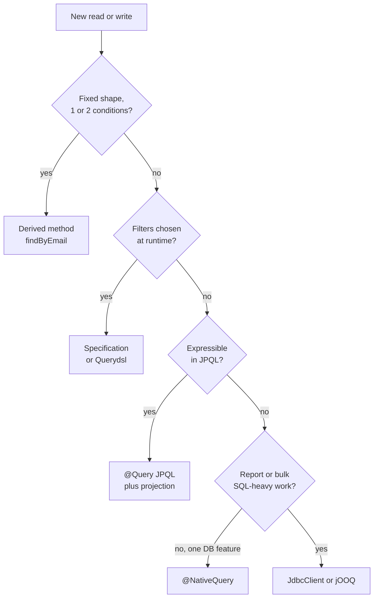

## Where we are

SPRING-BOOT-7 explained what Hibernate does inside a transaction: the persistence context, dirty checking, flush,
lazy loading, N+1 and `join fetch`. This lesson is the toolbox on top of it. First, every way Spring Data JPA can
fetch data and when to pick each. Then the mapping choices that decide what your tables look like and what
happens when you delete.

Shown on Spring Boot 4 (Spring Data 2025.x, Hibernate 7); also works on Boot 3.2+ unless a line says otherwise.

## The problem

It is sprint review. Your orders screen has five optional filters, a sortable table and infinite scroll. The
repository has `findByStatusAndCustomerIdAndCreatedAtBetweenAndTotalGreaterThanEqualOrderByCreatedAtDesc`, and a
colleague is about to add the 32 combinations needed for "any filter may be empty". The DBA's slow-query log shows
`select count(*) from orders where ...` on every scroll, the slowest statement in the system. Then QA reports that
after the nightly "cancel stale orders" bulk update, the same request still shows an order as `NEW`.

## The querying ladder

Start at the top and step down only when the step above stops fitting.



## Derived query methods

**Predict:** what SQL does `List<Order> findTop3ByStatusAndTotalGreaterThanOrderByCreatedAtDesc(Status s,
BigDecimal min)` produce?

**Answer:** roughly `select ... from orders where status = ? and total > ? order by created_at desc` with a limit
of 3. Spring Data parses the method name at startup: a subject (`find...By`, `count...By`, `exists...By`), optional
`Top3`, properties joined with `And` / `Or`, keywords such as `GreaterThan` or `IgnoreCase`, and `OrderBy`. A
misspelled property fails at startup.

```java
interface OrderRepository extends JpaRepository<Order, Long> {
    Optional<Order> findByOrderNumber(String orderNumber);
    boolean existsByCustomerIdAndStatus(long customerId, Status status);
    List<Order> findByStatus(Status status, Limit limit);   // Limit.of(50): a runtime row limit
}
```

Past about three conditions, move to `@Query` (fixed shape) or a `Specification` (runtime shape). One trap: a
derived `deleteBy...` **loads every matching entity and deletes them one by one** so that `@PreRemove` callbacks
run. For 100,000 rows that is 100,000 objects in memory.

## `@Query`: JPQL, native SQL, named queries

**JPQL** is written against entities and fields, not tables, so it survives column renames and works with
`join fetch`. **Native SQL** reaches database features JPQL lacks (window functions, `jsonb` operators, `ON
CONFLICT`, CTEs), at the cost of portability and of returning only what you map.

```java
@Query("select o from Order o join fetch o.customer where o.status = :status")
List<Order> findWithCustomer(@Param("status") Status status);

@NativeQuery(value = "select * from orders where tags @> cast(:tag as jsonb)",
             countQuery = "select count(*) from orders where tags @> cast(:tag as jsonb)")
Page<Order> findByTag(@Param("tag") String tag, Pageable pageable);
```

`@NativeQuery` is a composed form of `@Query(nativeQuery = true)`. Spring Data can derive a count query for simple
queries; for anything complex, declare `countQuery` yourself.

**Named queries** (`@NamedQuery` on the entity, resolved by `DomainClass.methodName`) work too, but they live far
from the repository, so most teams prefer `@Query`.

## Projections: load only what the screen shows

Loading full entities for a read-only list costs columns, dirty-check snapshots and lazy-loading risk. A
**projection** returns a smaller shape.

| Kind | Example | Notes |
|---|---|---|
| Interface, closed | `interface OrderRow { Long getId(); Status getStatus(); }` | Spring Data can select only those columns |
| Interface, open | `@Value("#{target.first + ' ' + target.last}") String getName();` | SpEL can touch anything, so **no** column optimisation |
| Class / record DTO | `record OrderRow(Long id, Status status) {}` | Fields come from the single constructor's parameter names |
| Dynamic | `<T> List<T> findByStatus(Status s, Class<T> type);` | The caller picks entity or DTO per call |

In JPQL you can write the constructor expression yourself: `select new com.shop.OrderRow(o.id, o.status) from Order
o`.

```quiz
{"question": "You declare interface OrderRow { Long getId(); @Value(\"#{target.customer.name}\") String getCustomerName(); } as a projection. What does Spring Data do?", "level": "easy",
 "options": [
   {"text": "Loads the whole entity and evaluates the SpEL on it, so there is no column optimisation", "correct": true, "why": "@Value makes it an open projection. The expression could touch any attribute, so Spring Data cannot narrow the select list."},
   {"text": "Selects only id and customer.name with a join", "why": "That optimisation applies to closed projections, where every accessor matches a property."},
   {"text": "Fails at startup because projections cannot navigate associations", "why": "Open projections can navigate; they just give up the query optimisation."},
   {"text": "Runs one extra query per row to evaluate the SpEL", "why": "The expression is evaluated on the loaded entity. A lazy association could add queries, but that is N+1 from SPRING-BOOT-7, not a projection rule."}]}
```

## Dynamic filters: Criteria, Specification, Querydsl, Example

The **Criteria API** is JPA's type-safe query builder: `CriteriaBuilder` makes predicates, `Root` is the entity
being queried. It is verbose on its own. A Spring Data **`Specification<T>`** wraps one predicate as a reusable
object, and `JpaSpecificationExecutor<T>` adds `findAll(spec, pageable)` to the repository.

```java
static Specification<Order> hasStatus(Status s) { return (root, q, cb) -> cb.equal(root.get("status"), s); }
static Specification<Order> totalAtLeast(BigDecimal m) { return (root, q, cb) -> cb.ge(root.get("total"), m); }

Specification<Order> spec = Specification.unrestricted();   // "match everything" (Spring Data JPA 4)
if (filter.status() != null) spec = spec.and(hasStatus(filter.status()));
if (filter.minTotal() != null) spec = spec.and(totalAtLeast(filter.minTotal()));
Page<Order> page = orders.findAll(spec, PageRequest.of(0, 20, Sort.by("createdAt").descending()));
```

Five optional filters become five small methods instead of 32 repository methods. Spring Data JPA 4 adds
`PredicateSpecification` (not tied to a query type), and the docs also show `UpdateSpecification` and
`DeleteSpecification` for bulk writes.

**Querydsl** does the same with generated `Q` classes (`QOrder.order.status.eq(NEW)`), but needs an annotation
processor. **Query by Example** builds a query from a probe object, fine for equality search forms, but it cannot
express ranges or grouped conditions like `a or (b and c)`, and handles no collections or maps.

```quiz
{"question": "An admin search page has six optional filters, including a date range and a minimum amount. Which approach fits best?", "level": "medium",
 "options": [
   {"text": "Specifications combined with and() for each filter that is present", "correct": true, "why": "Each filter is one small reusable predicate, and only the present ones are added. Paging and sorting come for free through JpaSpecificationExecutor."},
   {"text": "A derived method per combination of filters", "why": "Six optional filters means 64 combinations, each with an unreadable name."},
   {"text": "Query by Example", "why": "Example matching handles equality and string matching on a probe, but not ranges like a date window or a minimum amount."},
   {"text": "One @Query with \"(:status is null or o.status = :status)\" for every filter", "why": "It works for a few filters, but the optional-parameter trick often defeats index use and grows into an unreadable query. Specifications build only the predicates you need."}]}
```

## Paging: `Page`, `Slice` and scrolling

**Predict:** an infinite-scroll feed uses `Page<Order>`. How many SQL statements run per scroll?

**Answer:** two. A `Page` knows the total, so Spring Data runs your query with `limit/offset` **plus** a `count(*)`
over the same filter. On a big table with a selective-looking but unindexed filter, that count is often the slower
statement. A **`Slice`** fetches `size + 1` rows to answer "is there a next slice?" and skips the count. Pick `Page`
only when the UI really shows "page 3 of 120".

Both still use `OFFSET`, which reads and throws away every skipped row (DB-SQL-8). The fix is **keyset** paging,
and Spring Data has it built in since 3.1: return a **`Window<T>`** and take a **`ScrollPosition`**.

```java
Window<Order> findFirst20ByStatusOrderByCreatedAtDesc(Status status, ScrollPosition position);

Window<Order> w = orders.findFirst20ByStatusOrderByCreatedAtDesc(NEW, ScrollPosition.keyset());
while (!w.isEmpty()) {
    w.forEach(this::export);
    if (w.isLast()) break;
    w = orders.findFirst20ByStatusOrderByCreatedAtDesc(NEW, w.positionAt(w.size() - 1));
}
```

Keyset scrolling rewrites the `WHERE` clause to start right after the last row's sort values, so the index jumps
there directly. It needs a stable sort, non-null sort properties, the sort columns present in the result (also in
projections), and an index that matches the sort. It suits feeds, exports and infinite scroll, not "jump to page 57".

## `@Modifying` bulk updates and the persistence-context trap

```java
@Modifying
@Query("update Order o set o.status = 'CANCELLED' where o.status = 'NEW' and o.createdAt < :cutoff")
int cancelStale(@Param("cutoff") Instant cutoff);
```

One statement updates thousands of rows, no entities are loaded, no `@Version` is checked and no entity callbacks
run. `@Modifying` is required on `@Query` methods that write.

**Predict:** in one transaction you load order 42 (status `NEW`), call `cancelStale(...)`, then call
`findById(42)`. What status do you see?

**Answer:** still `NEW`. The bulk update went straight to the database. Order 42 is already in the persistence
context, and `findById` is served from it (SPRING-BOOT-7), so you read stale data. Worse, if you then modify that
stale object, dirty checking can write the old status back. The docs say it directly: the `EntityManager` may hold
outdated entities after a modifying query, and it is **not** cleared automatically. The fix:
`@Modifying(flushAutomatically = true, clearAutomatically = true)`, or a bulk update in its own transaction with
nothing loaded beforehand.

```quiz
{"question": "A service method loads a Customer, changes its email (not yet flushed), then calls a @Modifying(clearAutomatically = true) bulk update on orders, and returns. What happens to the email change?", "level": "hard",
 "options": [
   {"text": "It is lost: clearing the context detached the customer before its change was flushed", "correct": true, "why": "clear() drops all pending, unflushed changes. Add flushAutomatically = true so the email update is flushed before the bulk statement and the clear."},
   {"text": "It is saved at commit, because dirty checking runs at the end of the transaction", "why": "Dirty checking only covers managed entities. After clear() the customer is detached and Hibernate no longer watches it."},
   {"text": "It is saved, because the JPQL update auto-flushes the whole context first", "why": "Hibernate may auto-flush before a query that touches affected tables, but an update on orders gives no guarantee about a pending Customer change. flushAutomatically makes it explicit."},
   {"text": "The bulk update fails with an exception because there are unflushed changes", "why": "Nothing checks for that. The silent loss is what makes it a trap."}]}
```

## When to leave JPA: `JdbcClient` and jOOQ

JPA shines when you load an aggregate, change it and let dirty checking write it back. It fights you on big reports,
bulk inserts and SQL whose exact shape matters. Spring Framework 6.1 added **`JdbcClient`**, a fluent `JdbcTemplate`:

```java
List<DailyTotal> rows = jdbc.sql("select day, sum(total) as total from orders where day >= ? group by day")
        .param(from).query(DailyTotal.class).list();
```

**jOOQ** generates Java classes from your schema so SQL is type-checked at compile time. Mixing is normal: entities
for writes, `JdbcClient` for reports, in the same transaction manager.

| Need | Choose |
|---|---|
| Lookup by one or two fields | Derived method |
| Fixed query, joins, fetch plan | `@Query` JPQL with `join fetch` or a DTO |
| Optional filters from a form | `Specification` (or Querydsl) |
| Simple equality search form | Query by Example |
| Database-specific SQL | `@NativeQuery` with `countQuery` |
| Read-only list | Projection (closed interface or record) |
| Infinite scroll, export | `Window` + keyset `ScrollPosition`, or `Slice` |
| Many rows changed by one rule | `@Modifying` with flush and clear |
| Reports, heavy SQL | `JdbcClient` or jOOQ |

## Cascades, `orphanRemoval` and `ON DELETE`

Three different things are often mixed up:

- **`cascade`** on an association passes an `EntityManager` operation from parent to child: `PERSIST` saves new
  items with the order, `REMOVE` deletes them with it, `ALL` passes everything. Use it only from an aggregate root to
  the parts it owns (`Order` → `OrderLine`), never on `@ManyToOne` (deleting a line must not delete the order).

**Predict:** does `cascade = REMOVE` delete a line removed from `getLines()`?

- **No: that is `orphanRemoval = true`**, which deletes a child **removed from the collection**:
  `order.getLines().remove(line)` issues a `DELETE`. `cascade = REMOVE` only acts when the parent is removed.
- **`ON DELETE CASCADE`** is a database foreign-key rule. The database removes children itself, which is fast and
  also protects against SQL deletes from outside the app, but Hibernate does not know it happened, so callbacks do
  not run and loaded children are stale.

Rule of thumb: `cascade = ALL, orphanRemoval = true` for owned parts of an aggregate; a database `ON DELETE` for big
child tables where loading children to delete them would be too slow.

## Inheritance strategies

Your `Payment` can be a `CardPayment` or an `UpiPayment`. JPA offers:

| Strategy | Tables | Polymorphic query | Choose when |
|---|---|---|---|
| `SINGLE_TABLE` (default) | One, with a discriminator column | Fastest, no joins | Subclasses add few columns; you accept nullable subclass columns |
| `JOINED` | One per class, joined on the id | Joins every subtype table | Subclasses differ a lot; you need `NOT NULL` on subclass columns |
| `TABLE_PER_CLASS` | One per concrete class | `UNION` across tables | Rarely; polymorphic queries are slow and ids must be unique across tables |
| `@MappedSuperclass` | No table for the parent | None: it is not an entity | Sharing fields (`id`, `createdAt`) without polymorphism |

```quiz
{"question": "Payments come in 3 types that share 8 columns and add 1 or 2 each. Reports constantly query \"all payments last week\". Which mapping?", "level": "medium",
 "options": [
   {"text": "SINGLE_TABLE with a discriminator", "correct": true, "why": "Polymorphic queries hit one table with no joins, and the few nullable subtype columns are a small price."},
   {"text": "JOINED", "why": "Every \"all payments\" query would join three subtype tables for one or two columns each."},
   {"text": "TABLE_PER_CLASS", "why": "Polymorphic queries become a UNION over every table, the slowest option for exactly this report."},
   {"text": "@MappedSuperclass", "why": "It shares fields but creates no Payment entity, so you cannot query all payments polymorphically at all."}]}
```

## Value types: `@Embeddable` and `AttributeConverter`

An **`@Embeddable`** is a value object stored in the owner's table: `@Embedded Address shipping` maps to
`shipping_street`, `shipping_city` columns (rename with `@AttributeOverride`). A Java record can be the embeddable on
current Hibernate. An **`AttributeConverter<X, Y>`** maps one field to one column, for example a `Money` type
to cents, or an enum to a stable code instead of its ordinal:

```java
@Converter(autoApply = true)
class StatusConverter implements AttributeConverter<Status, String> {
    public String convertToDatabaseColumn(Status s) { return s == null ? null : s.code(); }
    public Status convertToEntityAttribute(String c) { return c == null ? null : Status.fromCode(c); }
}
```

## Auditing, soft delete and locks

**Auditing.** `@EnableJpaAuditing` plus `@EntityListeners(AuditingEntityListener.class)` fills `@CreatedDate`,
`@LastModifiedDate` (and `@CreatedBy` with an `AuditorAware` bean). Bulk `@Modifying` updates bypass it.

**Soft delete.** Hibernate's `@SQLDelete` replaces the generated `DELETE`, and **`@SQLRestriction`** (since 6.3; it
replaces the deprecated `@Where`) adds a SQL condition to every load of the entity or collection:

```java
@Entity
@SQLDelete(sql = "update customer set deleted_at = now() where id = ?")
@SQLRestriction("deleted_at is null")
class Customer { @Id Long id; Instant deletedAt; }
```

The restriction cannot be switched off per query (admin "show deleted" screens need a native query), and a
soft-deleted row still occupies its unique email.

**Locks.** `@Lock(PESSIMISTIC_WRITE)` gives `select ... for update`; see DB-SQL-7.

## Two Hibernate traps

**`MultipleBagFetchException`.** A **bag** is an unordered `List` collection without an index column. Join-fetching
two bags at once (`join fetch o.lines join fetch o.payments`) is rejected, because the result is a Cartesian product
Hibernate cannot split back into two lists. Fixes: fetch one collection per query (the second query hits the
persistence context), use batch fetching for the second, or make one of them a `Set` (which still multiplies rows,
so it hides the cost rather than removing it).

**Join fetch plus pagination.** **Predict:** what `limit` does Hibernate send for `join fetch o.lines` with a
`Pageable`?

None: a limit would cut an order's lines in half, so Hibernate loads **all** matching rows and pages in memory,
with only a warning in the log ("firstResult/maxResults specified with collection fetch; applying in memory"). Set `hibernate.query.fail_on_pagination_over_collection_fetch=true` to make it an error,
then page over ids first (`select o.id ... limit 20`) and fetch those orders with their lines in a second query.

## Lab (~10 min)

You will simulate the two costliest mistakes from this lesson without a database: an `OFFSET` page deep in a table,
and a bulk update behind the persistence context's back. Save as `RepositoryLab.java`, then run `javac
RepositoryLab.java && java RepositoryLab`.

```java
import java.util.*;

public class RepositoryLab {
    static final boolean CLEAR_AFTER_BULK = true;   // step 2: set to false

    record Order(long id, String status) {}

    // The "database": rows sorted by id
    static final TreeMap<Long, Order> table = new TreeMap<>();
    // The "persistence context": what this transaction has already loaded (SPRING-BOOT-7)
    static final Map<Long, Order> context = new HashMap<>();
    static int rowsRead = 0;

    static Order findById(long id) {
        return context.computeIfAbsent(id, k -> { rowsRead++; return table.get(k); });
    }

    // Like @Modifying @Query("update Order o set o.status = :to where o.status = :from"): goes straight to the table
    static int bulkUpdate(String from, String to) {
        int n = 0;
        for (Map.Entry<Long, Order> e : table.entrySet()) {
            if (e.getValue().status().equals(from)) { e.setValue(new Order(e.getKey(), to)); n++; }
        }
        if (CLEAR_AFTER_BULK) context.clear();      // clearAutomatically = true
        return n;
    }

    // OFFSET paging: the database walks past every skipped row
    static List<Order> offsetPage(int page, int size) {
        List<Order> result = table.values().stream().skip((long) page * size).limit(size).toList();
        rowsRead += page * size + result.size();
        return result;
    }

    // KEYSET paging: "where id > :lastId order by id limit :size" jumps straight there via the index
    static List<Order> keysetPage(long lastId, int size) {
        List<Order> result = table.tailMap(lastId, false).values().stream().limit(size).toList();
        rowsRead += result.size();
        return result;
    }

    public static void main(String[] args) {
        for (long id = 1; id <= 100_000; id++) table.put(id, new Order(id, id % 2 == 0 ? "NEW" : "PAID"));

        rowsRead = 0;
        List<Order> deep = offsetPage(9_000, 10);
        System.out.println("offset page 9000 -> first id " + deep.get(0).id() + ", rows read " + rowsRead);

        rowsRead = 0;
        List<Order> jump = keysetPage(90_000, 10);
        System.out.println("keyset after 90000 -> first id " + jump.get(0).id() + ", rows read " + rowsRead);

        Order before = findById(2);
        System.out.println("loaded order 2: " + before.status());
        int changed = bulkUpdate("NEW", "CANCELLED");
        System.out.println("bulk update changed " + changed + " rows");
        System.out.println("findById(2) now says: " + findById(2).status() + " (table says " + table.get(2L).status() + ")");
    }
}
```

**Step 1, as written.** Predict both "rows read" numbers first. A run printed:

```text
offset page 9000 -> first id 90001, rows read 90010
keyset after 90000 -> first id 90001, rows read 10
loaded order 2: NEW
bulk update changed 50000 rows
findById(2) now says: CANCELLED (table says CANCELLED)
```

Same ten rows, 9,001 times less work for the keyset version.

**Step 2, break it.** Set `CLEAR_AFTER_BULK = false`. Watch for the last line: `findById(2) now says: NEW (table
says CANCELLED)`. That is the QA bug from the story: the identity map served the object loaded before the bulk
update.

**Step 3, think.** Add a pending change before the bulk update (`context.put(5L, new Order(5, "SHIPPED"))`) with
clearing on. Which `@Modifying` attribute would have saved it? (Answer: `flushAutomatically = true`.)

## Gotchas

- **Derived `deleteBy...` loads every row first:** use a `@Modifying` delete or `ON DELETE` for large sets.
- **`Page` always runs a count query:** use `Slice` or `Window` unless the UI shows a total.
- **`@Modifying` neither flushes nor clears by default,** and skips `@Version`, auditing and listeners.
- **Open projections (`@Value`) load the whole entity:** use closed interfaces or records.
- **Collection `join fetch` plus paging pages in memory:** fail fast with the flag and page over ids first.

## In interviews

Asked as "How would you implement a search API with optional filters?", "Page vs Slice?", "Which inheritance
strategy and why?", "What does `orphanRemoval` do that `CascadeType.REMOVE` doesn't?" and "Why did my bulk update
not show up?"

- [Hibernate save vs persist vs update vs merge](#/q/hibernate-save-vs-persist-vs-update-vs-merge)
- [Transactions in Spring: @Transactional](#/q/spring-transactional-management)
- [What is JdbcTemplate and how do you use it?](#/q/spring-jdbctemplate)
- [SQL query optimization](#/q/sql-query-optimization)

Typical follow-ups:

- *"Your paged endpoint is slow at page 5,000."* Name `OFFSET` cost and the count query, move to `Slice` or keyset
  `Window`, and index the sort columns.
- *"How do you load an order with lines and payments?"* Not one double `join fetch` (bag exception or a Cartesian
  product); fetch lines with the order and payments in a second query or via batch fetching.

## Explain it in 2 minutes

*"Walk me through how you choose a querying approach in Spring Data JPA."*

- Derived methods for simple lookups, `@Query` JPQL for fixed richer shapes, native SQL (with a count query) for
  database features, `JdbcClient` or jOOQ for heavy reports.
- `Specification` for runtime filters; projections (closed interfaces or records) for read-only lists.
- `Page` only when a total is shown; otherwise `Slice` or keyset `Window`.
- `@Modifying` bulk updates bypass the persistence context: flush before, clear after.

## Check yourself

1. What does `orphanRemoval = true` do that `cascade = CascadeType.REMOVE` does not?
2. Why does a `Slice` avoid a query that a `Page` needs?
3. Name two requirements for keyset scrolling with `Window`.
4. What exception do you get when you `join fetch` two `List` collections at once, and why?

### Answers

1. Deletes a child removed from the collection; `REMOVE` acts only when the parent is removed.
2. It fetches one extra row to learn whether more exist, so it needs no `count(*)`.
3. Any two of: a stable sort, non-null sort properties, sort columns in the result, a matching index.
4. `MultipleBagFetchException`: the Cartesian product cannot be split back into two unordered lists.

## Next

**SPRING-BOOT-8** tests these repositories against a real PostgreSQL with Testcontainers, and **DB-SQL-8** goes
deeper on keyset pagination and batching at the SQL level.
