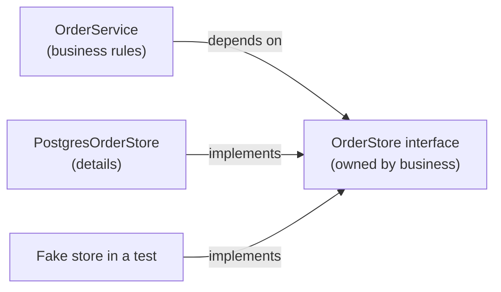

## Where we are

You can write a Java class, an interface, and a class that implements it. This lesson is about
how to *arrange* classes so that the code stays easy to change.

We take each of the five SOLID principles in the same order:

1. code that breaks it;
2. the pain that causes;
3. the fix;
4. the pattern the fix leads to.

The pattern lessons (LLD-DESIGN-2–LLD-DESIGN-4) start from these fixes.

## The problem

It is Monday and you own the checkout code of a small online shop. Three tickets land at once, all
due before Friday's release.

Last month a one-line discount change broke the confirmation emails,
so you open the class carefully. It works:

```java
class OrderService {
    void placeOrder(Order order) {
        double total = order.amount();
        if (order.customerType().equals("GOLD"))   total *= 0.90;
        else if (order.customerType().equals("SILVER")) total *= 0.95;

        var db = new MySqlDatabase("jdbc:mysql://prod/shop");
        db.insert("orders", order.id(), total);

        var mail = new SmtpClient("smtp.shop.com");
        mail.send(order.email(), "Order " + order.id() + " confirmed: " + total);
    }
}
```

The tickets: a PLATINUM discount, Postgres instead of MySQL, and an SMS instead of an email.

- Every ticket means editing this one method.
- Each edit can break the other two features.
- You can't unit-test the discount without a real database and a mail server.

SOLID is five rules of thumb that stop code from ending up like this.

Two words we will use throughout:

- **Coupling** is how much one class depends on the details of another. Above, `OrderService`
  is tightly coupled to MySQL and SMTP.
- **Cohesion** is how closely related the things inside one class are. A class that does
  discounts, storage and email has low cohesion.

The goal is low coupling and high cohesion.

## S: Single Responsibility Principle

**Violation.** `OrderService` above does three jobs: pricing, saving and notifying.

**Pain.** A class has many *reasons to change*. When the marketing team changes discounts, the
storage code is in the same file and the same test, so it is at risk too. Merge conflicts pile
up in one file.

**Refactor.** Give each job its own class.

```java
class PriceCalculator { double total(Order o) { /* discounts only */ return o.amount(); } }
class OrderRepository { void save(Order o, double total) { /* storage only */ } }
class OrderNotifier   { void confirm(Order o, double total) { /* messaging only */ } }

class OrderService {                 // now it only coordinates the steps
    private final PriceCalculator pricing = new PriceCalculator();
    private final OrderRepository repo = new OrderRepository();
    private final OrderNotifier notifier = new OrderNotifier();

    void placeOrder(Order o) {
        double total = pricing.total(o);
        repo.save(o, total);
        notifier.confirm(o, total);
    }
}
```

**The rule:** a class should have one reason to change, meaning one group of people or one
concern that asks for changes to it. This does not mean "one method". `PriceCalculator` can
have ten methods, as long as they are all about price.

**Leads to:** the *Facade* idea. `OrderService` becomes a thin coordinator in front of focused
helpers. Spring's typical controller → service → repository layering is SRP applied at scale.

```quiz
{"question": "Which class breaks the Single Responsibility Principle?", "level": "easy",
 "options": [
   {"text": "ReportService, which computes monthly totals and also lays out the PDF", "correct": true,
    "why": "Two reasons to change: finance changes the numbers, design changes the layout. Split calculation from rendering."},
   {"text": "PriceCalculator with ten methods, all about price", "why": "SRP is not \"one method\". Ten methods with one concern is high cohesion."},
   {"text": "OrderRepository with save, findById and delete", "why": "All three are storage of orders: one concern, one reason to change."},
   {"text": "DiscountPolicy, an interface with one method", "why": "One small interface about discounts is SRP done right, not broken."}]}
```

## O: Open/Closed Principle

**Violation.** The discount `if/else` chain on `customerType`.

**Pain.** Adding PLATINUM means editing `PriceCalculator`, which is code that already works and
is already tested. Every new type adds another branch, and the chain gets copied into the
invoice code, the refund code, and so on.

**Refactor.** Put the thing that varies behind an interface, and add new behaviour by adding a
class.

```java
interface DiscountPolicy { double apply(double amount); }

class GoldDiscount   implements DiscountPolicy { public double apply(double a) { return a * 0.90; } }
class SilverDiscount implements DiscountPolicy { public double apply(double a) { return a * 0.95; } }
class NoDiscount     implements DiscountPolicy { public double apply(double a) { return a; } }

class PriceCalculator {
    double total(Order o, DiscountPolicy policy) { return policy.apply(o.amount()); }
}
```

**Predict:** after this refactor, which existing classes do you edit to add PLATINUM?

None of the pricing classes.

- PLATINUM is a new class, `PlatinumDiscount`, and `PriceCalculator` and the other policies stay untouched.
- The only other change is one entry where a policy is picked for a customer (more below).

**The rule:** code should be *open for extension* (you can add behaviour) but *closed for
modification* (you don't edit working code to do it). You can't close code against every
change, so close it against the changes you expect. Here, new customer tiers are expected.

**Leads to:** the **Strategy** pattern, which is a family of interchangeable algorithms behind
one interface. Someone still has to pick the right policy for a customer. That choice usually
moves into one small place, a map or a **Factory** (LLD-DESIGN-2), so it is not spread across the code.

```quiz
{"question": "The shop has exactly one discount rule and nobody expects another. A reviewer asks you to add a DiscountPolicy interface \"for OCP\". Best answer?", "level": "medium",
 "options": [
   {"text": "Keep the simple code; add the interface when a second variant appears or is clearly expected", "correct": true,
    "why": "You close code against the changes you expect. An interface with one implementation and no expected second is cost without benefit."},
   {"text": "Add it: OCP says every behaviour should sit behind an interface", "why": "That is the over-engineering trap. OCP is about expected axes of change, not abstracting everything."},
   {"text": "Add an abstract base class instead, since it is lighter than an interface", "why": "Same speculative abstraction, plus inheritance. The question is whether to abstract at all."},
   {"text": "Move the rule into a static utility method", "why": "That changes where the code sits, not how it extends. It neither helps nor answers the reviewer's point."}]}
```

## L: Liskov Substitution Principle

**Violation.**

```java
class PaymentMethod {
    void pay(double amount)    { /* ... */ }
    void refund(double amount) { /* ... */ }
}
class GiftCard extends PaymentMethod {
    @Override void refund(double amount) {
        throw new UnsupportedOperationException("gift cards can't be refunded");
    }
}
```

**Pain.** The code that processes returns takes a `PaymentMethod` and calls `refund`. It worked
for every payment method until someone passed a `GiftCard`, and then it crashed in production.
Now callers have to write `if (pm instanceof GiftCard)`, which is the OCP problem again.

**Refactor.** Model only what is really true of every subtype.

```java
interface PaymentMethod { void pay(double amount); }
interface Refundable extends PaymentMethod { void refund(double amount); }

class CreditCard implements Refundable { public void pay(double a) {} public void refund(double a) {} }
class GiftCard   implements PaymentMethod { public void pay(double a) {} }
```

The returns code now asks for a `Refundable`, so the compiler stops a gift card from getting in.

**The rule:** anywhere the code expects a parent type, any subtype must work without surprising
the caller. In particular, a subtype must not throw where the parent doesn't, must not accept
less input, and must not return a weaker result. "Is-a" in plain English is not enough. A
square is a rectangle in maths, but:

```java
Rectangle r = new Square();   // Square overrides both setters to keep width == height
r.setWidth(5);
r.setHeight(4);
System.out.println(r.area());
```

**Predict:** what does this print, if the caller expects rectangle behaviour (20)?

16. `setHeight(4)` also set the width to 4. Code written for `Rectangle` breaks when handed a `Square`.

**A JDK example of the tension:** `List.of(1, 2).add(3)` throws `UnsupportedOperationException`.
The `List` interface documents `add` as optional, so this is legal, but it surprises people for
exactly this reason.

**Leads to:** preferring small interfaces and composition over deep inheritance trees. This is
also why the patterns in LLD-DESIGN-2–LLD-DESIGN-4 mostly implement interfaces instead of extending classes.

## I: Interface Segregation Principle

**Violation.**

```java
interface MessageChannel {
    void send(String to, String text);
    void schedule(String to, String text, java.time.Instant at);
    boolean wasRead(String messageId);
}
class SmsChannel implements MessageChannel {
    public void send(String to, String text) { /* works */ }
    public void schedule(String to, String text, java.time.Instant at) { throw new UnsupportedOperationException(); }
    public boolean wasRead(String id) { throw new UnsupportedOperationException(); } // SMS has no read receipts
}
```

**Pain.** `SmsChannel` is forced to "implement" methods it can't support, which is the LSP
problem again. Code that only sends messages still depends on scheduling and read-receipt
methods, so a change to those methods recompiles and retests it for no reason.

**Refactor.** Split by what each caller needs. These are called **role interfaces**: small
interfaces named after one job.

```java
interface Sender         { void send(String to, String text); }
interface Scheduler      { void schedule(String to, String text, java.time.Instant at); }
interface ReadReceipts   { boolean wasRead(String messageId); }

class SmsChannel  implements Sender { public void send(String to, String text) { } }
class PushChannel implements Sender, ReadReceipts {
    public void send(String to, String text) { }
    public boolean wasRead(String id) { return false; }
}
```

**The rule:** no class should be forced to depend on methods it doesn't use. Write interfaces
for the client that calls them, not for the class that implements them.

**Leads to:** small interfaces that are easy to wrap. That makes **Adapter** and **Decorator**
(LLD-DESIGN-3) cheap, because a wrapper only has to implement one or two methods. Spring Data shows the
same idea: you can extend the bare `Repository` marker and declare only the queries you need,
instead of inheriting every `CrudRepository` method.

```quiz
{"question": "interface Bird { void fly(); } and Penguin implements Bird by throwing UnsupportedOperationException. What is the best fix?", "level": "medium",
 "options": [
   {"text": "Split it: Bird for what all birds do, FlyingBird extends Bird with fly(); Penguin implements only Bird", "correct": true,
    "why": "Model only what is true of every subtype (LSP) and keep interfaces client-shaped (ISP). The compiler then stops fly() on a penguin."},
   {"text": "Make Penguin.fly() do nothing instead of throwing", "why": "Still a broken promise: a caller asking a bird to fly gets silent failure. The crash just moves to a quieter bug."},
   {"text": "Callers check instanceof Penguin before calling fly()", "why": "Every caller now knows every subtype, and each new flightless bird means editing them all: LSP and OCP broken."},
   {"text": "Catch UnsupportedOperationException wherever fly() is called", "why": "Using exceptions as a type check hides the design error and still forces every caller to care."}]}
```

## D: Dependency Inversion Principle

First, two terms:

- A **high-level module** holds the business rules (place an order).
- A **low-level module** holds the details (talk to MySQL, open an SMTP connection).

**Violation.** `new MySqlDatabase(...)` and `new SmtpClient(...)` inside `placeOrder`. The
business rule depends directly on the details.

**Pain.** You can't test `placeOrder` without a real database. Switching to Postgres means
editing business code, and the connection settings are buried in the logic.

**Refactor.** The high-level code defines the interface it needs, and the details implement it.
The object that does the work is handed in from outside, usually through the constructor.

```java
interface OrderStore { void save(Order o, double total); }        // owned by the business side
interface Notifier   { void confirm(Order o, double total); }

class OrderService {
    private final OrderStore store;
    private final Notifier notifier;

    OrderService(OrderStore store, Notifier notifier) {           // dependencies come in
        this.store = store;
        this.notifier = notifier;
    }
    void placeOrder(Order o, double total) { store.save(o, total); notifier.confirm(o, total); }
}

class PostgresOrderStore implements OrderStore { public void save(Order o, double t) { /* SQL */ } }
```

In a test you pass a fake `OrderStore` written as a lambda (an inline implementation of a
one-method interface, JAVA-FUND-7), with no database:
`new OrderService((o, t) -> saved.add(o), (o, t) -> {})`.

**The rule:** high-level modules should not depend on low-level modules; both should depend on
abstractions. It is called *inversion* because the interface now belongs to the business side,
and the database code depends *upward* on it, which is the reverse of the original arrow
(before: `OrderService ──▶ MySqlDatabase`).



**Leads to:** **dependency injection** (DI), which means passing an object its dependencies
instead of letting it create them. Spring is a DI container: it builds `PostgresOrderStore`,
sees that `OrderService`'s constructor needs an `OrderStore`, and passes it in. DIP is the
principle and DI is the technique. They are related but not the same thing.

```quiz
{"question": "OrderService has the constructor OrderService(MySqlOrderRepository repo), and Spring injects the repository. Which statement is true?", "level": "hard",
 "options": [
   {"text": "It uses dependency injection but still breaks DIP: business code depends on a concrete low-level class", "correct": true,
    "why": "DI is how the object arrives; DIP is what type it depends on. Depend on an OrderStore interface the business side owns."},
   {"text": "DIP is satisfied because Spring creates the dependency, not OrderService", "why": "That is DI. Switching to Postgres still means editing OrderService's constructor and imports."},
   {"text": "DIP is satisfied because it uses constructor injection rather than field injection", "why": "The injection style changes testability and immutability, not the direction of the dependency."},
   {"text": "It breaks SRP, not DIP", "why": "OrderService can still have one job. The problem is that it names a MySQL class."}]}
```

## How SOLID feeds the patterns

| Principle | The fix in one line | Pattern it leads to |
|---|---|---|
| SRP | One reason to change per class | Facade (thin coordinator) |
| OCP | Vary behaviour by adding classes | Strategy, Factory, Template Method (LLD-DESIGN-4) |
| LSP | Subtypes keep the parent's promises | Composition over inheritance |
| ISP | Small, client-shaped interfaces | Adapter, Decorator (easy to wrap) |
| DIP | Depend on interfaces, inject them | Dependency injection, Spring beans |

## Lab (~10 min)

Save as `Lab.java` and run `java Lab.java`.

```java
import java.util.*;

public class Lab {
    public static void main(String[] args) {
        var sender = new AlertSender();
        sender.send("EMAIL", "ops@example.com", "Disk 91% full");
        sender.send("SMS", "+910000000000", "Disk 91% full");
    }
}

class AlertSender {
    void send(String channel, String to, String text) {
        if (channel.equals("EMAIL")) {
            System.out.println("[smtp] connecting to smtp.example.com");
            System.out.println("[email] " + to + ": " + text);
        } else if (channel.equals("SMS")) {
            System.out.println("[sms-gateway] " + to + ": " + text.substring(0, Math.min(160, text.length())));
        } else {
            throw new IllegalArgumentException("unknown channel " + channel);
        }
    }
}
```

1. **Predict** the principles this breaks before reading the answer. (OCP: every new channel is a
   new branch. DIP: the class builds its own connections. SRP: it formats text and handles transport.)
   **Break it:** add `sender.send("SLACK", "#ops", "Disk 91% full");` to `main`. It compiles, then
   fails at run time with `IllegalArgumentException: unknown channel SLACK`. That is the OCP cost: a
   missing branch shows up in production, not in the compiler.
2. Refactor. Create `interface Channel { String name(); void send(String to, String text); }`,
   one class per channel, and an `AlertSender` that takes a `List<Channel>` in its constructor
   and builds a `Map<String, Channel>` from it.
3. Add a `SlackChannel` **without editing `AlertSender`**. If you had to touch it, OCP is still
   broken.
4. Write a `main` that uses a fake `Channel` which records messages into a list, and check that
   the list holds what you sent. You have just tested `AlertSender` without SMTP.

What to observe: after step 2, the only line that changes when you add a channel is the one that
builds the list. That line is the wiring that Spring does for you.

## Gotchas

- **SRP is not "one method per class".** Group by reason to change, not by size.
- **OCP everywhere is over-engineering.** Add the interface at the second variant or a clearly expected one; one `if` is fine.
- **`instanceof` on a parent type is an LSP smell.** If callers must ask "which subtype?", the hierarchy is lying.
- **`UnsupportedOperationException` stubs signal a fat interface.** Split it (ISP).
- **DIP is not "Spring injects it".** `@Autowired MySqlDatabase` is still concrete; inject the interface the business side owns.

## In interviews

SOLID is the scoring rubric of the LLD round ("can I add a new X without editing existing classes?"):
[SOLID principles and dependency inversion](#/q/solid-principles) (asked directly in some loops),
[Design a (Multi-level) Parking Lot](#/q/design-parking-lot),
[Design a Notification System](#/q/design-notification-system).

- *"How would you add a new notification channel?"* One new class implementing `Channel`, registered; nothing existing
  changes (OCP, made possible by depending on the interface, DIP).
- *"Isn't this over-engineered?"* Name the axis of change you expect and admit you would not abstract what doesn't change.

## Explain it in 2 minutes

Prompt: *"Walk me through SOLID using one class you would refactor."*

- Start from a god class (pricing + saving + emailing): risky to change, impossible to test.
- SRP splits it by reason to change; OCP replaces the type `if/else` with Strategy.
- LSP: subtypes keep the parent's promises; a throwing override is the warning sign.
- ISP: small, client-shaped interfaces, no throwing stubs.
- DIP: business code owns interfaces, details implement them, DI wires them, so tests use fakes.

## Check yourself

1. `UserService` validates, hashes passwords, writes to the DB and emails. Which principle breaks, and what is the first split?
2. When is a `switch` on an enum in business code an OCP smell, and when is it fine?
3. `ReadOnlyAccount extends Account` overrides `withdraw` to throw. What is broken and how do you fix it?

### Answers

1. SRP. Extract hashing, a repository and a notifier; `UserService` stays as the coordinator.
2. A smell when every new value means editing it and the switch gets copied around; fine when the set is truly fixed
   (days of the week) or it lives in exactly one place, such as a factory.
3. LSP. Split the capability (`Account` without `withdraw`, `WithdrawableAccount` with it) so the type system blocks the call.

## Next

LLD-DESIGN-2 (Creational), LLD-DESIGN-3 (Structural) and LLD-DESIGN-4 (Behavioural) name these fixes as patterns.
