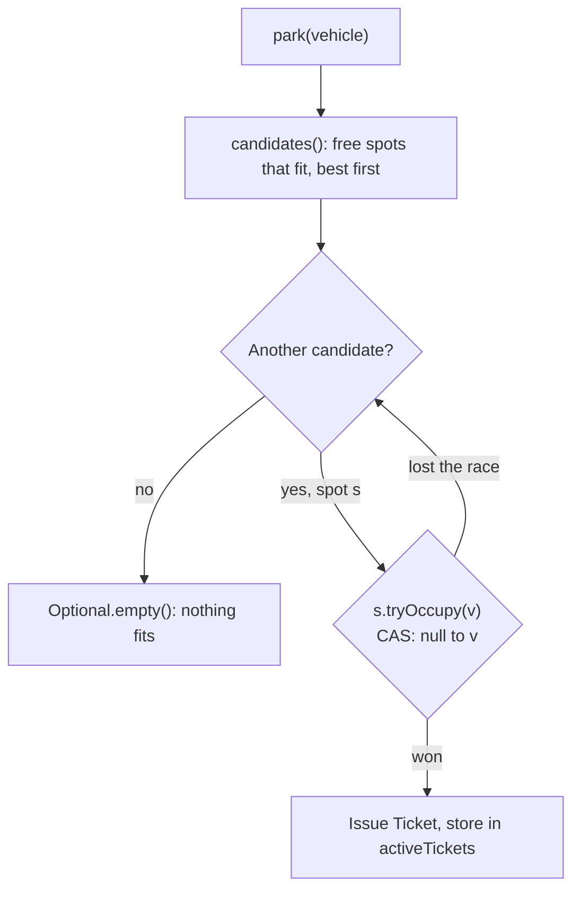

## Where we are

LLD-DESIGN-5 gave you a seven-step routine: requirements, entities, relationships, class diagram, APIs, concurrency, extensibility.

This lesson runs that routine on the first two of the four LLD questions Microsoft candidates report most: parking lot and LRU cache with pluggable eviction. LLD-DESIGN-8 does the other two, rate limiter and notification system.

Each case has complete Java 21 code with tests in a `main`, so you can run it with one command and change it.

This lesson is longer than usual because of the code.

Do one case per sitting if you need to: about 25 minutes each, reading the code and running it. Each case lists the follow-ups interviewers ask and shows where the design absorbs them.

## The problem

In the round you have about 30 minutes of coding time. You can't invent a clean design from nothing in that time; you need to have built each common design once already, so that in the room you are *adapting* a shape you know.

Each case below is that shape. Read the tests first: they are the requirements written as code.

How to run any case:

1. Save the code block as the file name shown.
2. Run `java <FileName>.java`. Java 21 compiles and runs a single source file directly, so no build tool is needed.
3. Each file prints `All ... tests passed` or fails with an `AssertionError` naming the broken check.

The tests use a tiny `check` helper instead of JUnit so that the file stays self-contained; in a real project each `static void` test method becomes a JUnit `@Test`.

One technique appears in every case, here and in LLD-DESIGN-8: **injecting the clock**.

- Instead of calling `System.currentTimeMillis()` inside the logic, the class receives a `Clock` or a `LongSupplier`.
- Tests pass a fake clock they can move by hand, so time-based behaviour (fees, expiry, refill, backoff) is tested instantly and deterministically.
- This is LLD-DESIGN-1's dependency inversion applied to time.

## The Java tools the code uses

The concurrency modules (B-track) go deeper on each of these; here is just enough to read the
code:

- **`ConcurrentHashMap`**: a map that many threads can use at once. `computeIfAbsent(key, f)`
  creates a value for a missing key *atomically*: two threads asking for the same key get the
  same value.
- **`AtomicReference` / `AtomicLong`**: a single variable with atomic updates.
  `compareAndSet(expected, new)` (CAS) sets the value only if it still equals `expected`, and
  tells you whether it did.
- **`synchronized` / `ReentrantLock`**: only one thread at a time runs the guarded code. Use them
  when several fields must change together.
- **`CopyOnWriteArrayList`**: a list that copies itself on every write, so iterating is always
  safe. Good for listener lists (many reads, rare writes).
- **Virtual threads**: very cheap threads (Java 21). `Executors.newVirtualThreadPerTaskExecutor()`
  runs each task on its own virtual thread; closing the executor in try-with-resources waits for
  all tasks to finish.
- **`CompletableFuture<T>`**: a result that will arrive later. `supplyAsync(task, executor)`
  starts the task; `allOf(...)` completes when all of them have; `join()` waits for the result.
- **`CountDownLatch(1)`**: a gate. Threads call `await()` and all go through together when the
  test calls `countDown()`, so the threads really do race, which is what a concurrency test needs.

## Case 1: Parking lot

### Requirements

```text
Functional
  F1  Several levels; each spot is SMALL, MEDIUM or LARGE
  F2  Vehicles: MOTORBIKE (needs SMALL+), CAR (MEDIUM+), TRUCK (LARGE)
  F3  Entry: assign a spot, issue a ticket; refuse if nothing fits
  F4  Exit: given a ticket, free the spot and compute the fee
  F5  Show free spots for a vehicle type
Non-functional
  N1  Several entry gates at once: two cars must never get the same spot
  N2  New spot-choice rules and new pricing without editing ParkingLot
Out of scope
  Payments, reservations, persistence (an interface would plug in later)
```

### Class diagram

```text
Legend:  ──▷ implements    ◆── owns    ──▶ uses

 ┌──────────────────────────────┐
 │ ParkingLot (facade)          │──▶ SpotSelectionStrategy «interface»
 │ park(Vehicle): Optional<T>   │        ◁── SmallestFitFirst
 │ unpark(ticketId): Receipt    │──▶ PricingStrategy «interface»
 │ freeSpotsFor(type): long     │        ◁── HourlyPricing
 └───┬──────────────────┬───────┘──▶ java.time.Clock (injected)
     ◆                  ◆
  Spot (many)        Ticket (active, by id) ──▶ Vehicle, Spot
  id, level, size
  occupant: AtomicReference<Vehicle>

 Vehicle(plate, VehicleType)   VehicleType ──▶ SpotSize (minimum size that fits)
 Receipt(ticket, exit, feeCents)
```

Design choices to say out loud:

- **Strategy twice**: where to park (`SpotSelectionStrategy`) and what to charge
  (`PricingStrategy`). These are the two things product managers change.
- **Concurrency without a global lock**: each `Spot` holds its occupant in an
  `AtomicReference`. `tryOccupy` uses **compare-and-set** (CAS): "set this to my car *only if* it
  is still empty", done atomically by the CPU. If another gate wins the race, we try the next
  candidate spot.
- `activeTickets.remove(id)` is atomic, so a ticket can be redeemed only once, even if two exit
  gates scan it at the same moment.

How one `park` call runs, including the race it can lose:



```quiz
{"question": "Two entry gates call park() for two cars at the same instant, and both candidate lists start with spot M1. What happens at M1?", "level": "easy",
 "options": [
   {"text": "Exactly one compareAndSet(null, car) succeeds; the other gate's tryOccupy returns false and it tries its next candidate", "correct": true, "why": "CAS sets the occupant only if it is still null, atomically. The loser falls through to the next spot, so a stale candidate list costs a retry, never a double booking."},
   {"text": "Both succeed and the second car overwrites the first in M1", "why": "That is what a plain set() after an isFree() check would do. compareAndSet refuses because M1 is no longer null."},
   {"text": "The second gate blocks until the first car leaves M1", "why": "Nothing waits: CAS returns false at once. Blocking is what a lock does, and even then the loser should move on, not wait for an exit."},
   {"text": "park() throws because the candidate list is out of date", "why": "A stale list is expected and harmless. tryOccupy re-checks atomically, so ParkingLot never needs the list to be current."}]}
```

**Predict:** the last test releases 50 cars at once onto a lot of 10 medium spots. How many tickets come
back, and can two of them name the same spot?

Exactly 10 tickets, on 10 different spots.

A car gets a spot only by winning a compare-and-set; the other 40 lose every race and get `Optional.empty()`. The test `concurrentArrivalsNeverDoubleBookASpot` checks both numbers.

### Code and tests

Save as `ParkingLotDemo.java`.

```java
import java.time.*;
import java.util.*;
import java.util.concurrent.*;
import java.util.concurrent.atomic.*;

// ---------- Tests (plain main, so `java ParkingLotDemo.java` runs everything) ----------
public class ParkingLotDemo {
    public static void main(String[] args) throws Exception {
        carTakesSmallestFittingSpot();
        carOverflowsToLargeSpotWhenMediumsAreFull();
        truckIsTurnedAwayWhenNoLargeSpotIsFree();
        feeRoundsUpToWholeHours();
        ticketCannotBeUsedTwice();
        concurrentArrivalsNeverDoubleBookASpot();
        System.out.println("All parking lot tests passed");
    }

    static final Map<VehicleType, Long> RATES = Map.of(
            VehicleType.MOTORBIKE, 100L, VehicleType.CAR, 200L, VehicleType.TRUCK, 500L);

    static ParkingLot lot(Clock clock, Spot... spots) {
        return new ParkingLot(List.of(spots), new SmallestFitFirst(), new HourlyPricing(RATES), clock);
    }

    static void carTakesSmallestFittingSpot() {
        var lot = lot(Clock.systemUTC(),
                new Spot("L1-A", 1, SpotSize.LARGE), new Spot("L2-M", 2, SpotSize.MEDIUM));
        Ticket t = lot.park(new Vehicle("KA01", VehicleType.CAR)).orElseThrow();
        check(t.spot().id().equals("L2-M"), "car should take the medium spot, got " + t.spot().id());
    }

    static void carOverflowsToLargeSpotWhenMediumsAreFull() {
        var lot = lot(Clock.systemUTC(),
                new Spot("M1", 1, SpotSize.MEDIUM), new Spot("L1", 1, SpotSize.LARGE));
        lot.park(new Vehicle("CAR-1", VehicleType.CAR)).orElseThrow();
        Ticket second = lot.park(new Vehicle("CAR-2", VehicleType.CAR)).orElseThrow();
        check(second.spot().id().equals("L1"), "second car should overflow to the large spot");
    }

    static void truckIsTurnedAwayWhenNoLargeSpotIsFree() {
        var lot = lot(Clock.systemUTC(), new Spot("M1", 1, SpotSize.MEDIUM));
        check(lot.park(new Vehicle("TR-1", VehicleType.TRUCK)).isEmpty(), "truck must not fit a medium spot");
        check(lot.freeSpotsFor(VehicleType.CAR) == 1, "the failed attempt must not hold the spot");
    }

    static void feeRoundsUpToWholeHours() {
        var clock = new MutableClock(Instant.parse("2026-01-01T10:00:00Z"));
        var lot = lot(clock, new Spot("M1", 1, SpotSize.MEDIUM));
        Ticket t = lot.park(new Vehicle("KA01", VehicleType.CAR)).orElseThrow();
        clock.advance(Duration.ofMinutes(130));            // 2h10m -> billed as 3h
        Receipt r = lot.unpark(t.id());
        check(r.feeCents() == 600, "expected 600, got " + r.feeCents());
        check(lot.freeSpotsFor(VehicleType.CAR) == 1, "spot should be free after exit");
    }

    static void ticketCannotBeUsedTwice() {
        var lot = lot(Clock.systemUTC(), new Spot("M1", 1, SpotSize.MEDIUM));
        Ticket t = lot.park(new Vehicle("KA01", VehicleType.CAR)).orElseThrow();
        lot.unpark(t.id());
        try {
            lot.unpark(t.id());
            throw new AssertionError("second unpark should fail");
        } catch (IllegalArgumentException expected) { }
    }

    static void concurrentArrivalsNeverDoubleBookASpot() throws Exception {
        Spot[] spots = new Spot[10];
        for (int i = 0; i < spots.length; i++) spots[i] = new Spot("M" + i, 1, SpotSize.MEDIUM);
        var lot = lot(Clock.systemUTC(), spots);
        var start = new CountDownLatch(1);
        var tickets = new ConcurrentLinkedQueue<Ticket>();
        try (var pool = Executors.newVirtualThreadPerTaskExecutor()) {
            for (int i = 0; i < 50; i++) {
                String plate = "CAR-" + i;
                pool.submit(() -> {
                    start.await();                           // release all threads at once
                    lot.park(new Vehicle(plate, VehicleType.CAR)).ifPresent(tickets::add);
                    return null;
                });
            }
            start.countDown();
        }                                                     // close() waits for all tasks
        long distinctSpots = tickets.stream().map(t -> t.spot().id()).distinct().count();
        check(tickets.size() == 10, "exactly 10 cars should get in, got " + tickets.size());
        check(distinctSpots == 10, "no spot may be issued twice");
    }

    static void check(boolean ok, String msg) { if (!ok) throw new AssertionError(msg); }
}

// ---------- Domain ----------
enum SpotSize { SMALL, MEDIUM, LARGE }

enum VehicleType {
    MOTORBIKE(SpotSize.SMALL), CAR(SpotSize.MEDIUM), TRUCK(SpotSize.LARGE);

    final SpotSize minSize;
    VehicleType(SpotSize minSize) { this.minSize = minSize; }

    boolean fitsIn(SpotSize size) { return size.compareTo(minSize) >= 0; }
}

record Vehicle(String plate, VehicleType type) { }

final class Spot {
    private final String id;
    private final int level;
    private final SpotSize size;
    private final AtomicReference<Vehicle> occupant = new AtomicReference<>();

    Spot(String id, int level, SpotSize size) { this.id = id; this.level = level; this.size = size; }

    /** Atomic: only one of many racing threads can win a free spot. */
    boolean tryOccupy(Vehicle v) { return occupant.compareAndSet(null, v); }
    void release()               { occupant.set(null); }
    boolean isFree()             { return occupant.get() == null; }
    String id()                  { return id; }
    int level()                  { return level; }
    SpotSize size()              { return size; }
}

record Ticket(String id, Vehicle vehicle, Spot spot, Instant entry) { }
record Receipt(Ticket ticket, Instant exit, long feeCents) { }

// ---------- Strategies (OCP: new rules = new classes, ParkingLot unchanged) ----------
interface SpotSelectionStrategy {
    /** Free spots that fit, in the order we should try them. */
    List<Spot> candidates(List<Spot> spots, VehicleType type);
}

final class SmallestFitFirst implements SpotSelectionStrategy {
    private static final Comparator<Spot> ORDER = Comparator
            .comparing(Spot::size).thenComparingInt(Spot::level).thenComparing(Spot::id);

    @Override public List<Spot> candidates(List<Spot> spots, VehicleType type) {
        return spots.stream().filter(Spot::isFree).filter(s -> type.fitsIn(s.size())).sorted(ORDER).toList();
    }
}

interface PricingStrategy {
    long feeCents(VehicleType type, Duration stay);
}

final class HourlyPricing implements PricingStrategy {
    private final Map<VehicleType, Long> centsPerHour;

    HourlyPricing(Map<VehicleType, Long> centsPerHour) { this.centsPerHour = Map.copyOf(centsPerHour); }

    @Override public long feeCents(VehicleType type, Duration stay) {
        long minutes = Math.max(1, stay.toMinutes());
        long hours = (minutes + 59) / 60;                    // round up; minimum one hour
        return hours * centsPerHour.get(type);
    }
}

// ---------- The facade ----------
final class ParkingLot {
    private final List<Spot> spots;
    private final SpotSelectionStrategy selector;
    private final PricingStrategy pricing;
    private final Clock clock;
    private final Map<String, Ticket> activeTickets = new ConcurrentHashMap<>();
    private final Set<String> platesInside = ConcurrentHashMap.newKeySet();
    private final AtomicLong ticketSeq = new AtomicLong();

    ParkingLot(List<Spot> spots, SpotSelectionStrategy selector, PricingStrategy pricing, Clock clock) {
        this.spots = List.copyOf(spots);
        this.selector = selector;
        this.pricing = pricing;
        this.clock = clock;
    }

    Optional<Ticket> park(Vehicle v) {
        if (!platesInside.add(v.plate())) throw new IllegalStateException("already inside: " + v.plate());
        for (Spot s : selector.candidates(spots, v.type())) {
            if (s.tryOccupy(v)) {                            // lost the race? try the next candidate
                var t = new Ticket("T" + ticketSeq.incrementAndGet(), v, s, clock.instant());
                activeTickets.put(t.id(), t);
                return Optional.of(t);
            }
        }
        platesInside.remove(v.plate());
        return Optional.empty();
    }

    Receipt unpark(String ticketId) {
        Ticket t = activeTickets.remove(ticketId);           // atomic: a ticket is redeemed once
        if (t == null) throw new IllegalArgumentException("unknown or already used ticket: " + ticketId);
        Instant exit = clock.instant();
        long fee = pricing.feeCents(t.vehicle().type(), Duration.between(t.entry(), exit));
        t.spot().release();
        platesInside.remove(t.vehicle().plate());
        return new Receipt(t, exit, fee);
    }

    long freeSpotsFor(VehicleType type) {
        return spots.stream().filter(Spot::isFree).filter(s -> type.fitsIn(s.size())).count();
    }
}

// ---------- Test helper: a clock we can move by hand ----------
final class MutableClock extends Clock {
    private volatile Instant now;
    MutableClock(Instant start) { this.now = start; }
    void advance(Duration d)    { now = now.plus(d); }
    @Override public Instant instant()           { return now; }
    @Override public ZoneId getZone()            { return ZoneOffset.UTC; }
    @Override public Clock withZone(ZoneId zone) { return this; }
}
```

### Follow-ups and how the design handles them

- **"Is it thread-safe?"** Yes, per spot. The candidate list may be stale by the time we use it,
  which is fine because `tryOccupy` re-checks atomically and we fall through to the next spot.
  The concurrency test releases 50 threads at once onto 10 spots and checks that exactly 10 win.
  The alternative, one `synchronized park()`, is also correct and simpler. Say that you'd start
  there if the interviewer wants speed of delivery, and that per-spot CAS lets gates work in
  parallel.
- **"Thousands of spots: `candidates()` scans them all."** Keep one queue of free spots per size
  (`Map<SpotSize, ConcurrentLinkedDeque<Spot>>`): poll on entry, offer back on exit. `park`
  becomes O(1), and the strategy decides which queue to poll first.
- **"Add EV charging spots."** Give `Spot` a set of features, add `requiresCharging` to the
  request, and write a selection strategy that filters on it. `ParkingLot` doesn't change.
- **"Weekend pricing / first hour free."** A new `PricingStrategy`, or a decorator around
  `HourlyPricing` that subtracts the free hour.
- **"A display board per level."** Observer: `ParkingLot` publishes `SpotOccupied` and
  `SpotFreed` events, and each board subscribes.
- **"Lost ticket."** Index active tickets by plate as well (`platesInside` becomes a
  `Map<String, Ticket>`), and charge a lost-ticket fee through the pricing strategy.

## Case 2: LRU cache with pluggable eviction

### Requirements

```text
Functional
  F1  get(key), put(key, value), remove(key) with a fixed capacity
  F2  When full, evict one entry chosen by a policy: LRU now, LFU (and others) later
  F3  Optional TTL per entry: expired entries are never returned
Non-functional
  N1  O(1) get and put for LRU
  N2  Safe under concurrent use
  N3  Adding a new eviction policy doesn't change the cache class
```

**LRU** (least recently used) evicts the entry that was read or written longest ago. **LFU**
(least frequently used) evicts the entry used the fewest times.

### Class diagram

```text
 ┌──────────────────────────────┐        ┌─────────────────────────────┐
 │ Cache<K,V>                   │──────▶│ EvictionPolicy<K> «interface»│
 │ store: HashMap<K, Entry<V>>  │        │ onInsert / onAccess /        │
 │ lock: ReentrantLock          │        │ onRemove / evict(): K        │
 │ get / put / put(ttl) / remove│        └──────▲───────────────▲───────┘
 └──────────────────────────────┘               │               │
   Entry<V>(value, expiresAtMillis)        LruPolicy<K>     LfuPolicy<K>
   clock: LongSupplier (injected)          map + doubly      freq map +
                                           linked list       buckets of
                                                             LinkedHashSet
```

Design choices to say out loud:

- **Split storage from ordering.** The `Cache` owns the key→value map. The policy owns only
  *ordering metadata* and answers one question: "who goes next?" That split is what makes the
  policy pluggable (Strategy) and lets you test each policy alone.
- **LRU in O(1)**: a `HashMap` finds a key's node in O(1), and a doubly linked list moves that
  node to the "most recent" end in O(1). Dummy `head` and `tail` nodes remove all the
  null checks at the ends.
- **LFU in O(1)** (amortised): a map from frequency to an insertion-ordered set of keys, plus the
  current minimum frequency. Ties at the same frequency evict the oldest key.
- **One lock, on purpose.** In an LRU cache, `get` *changes* the order, so even reads are writes.
  A read/write lock buys nothing here.

```quiz
{"question": "Your LRU cache uses one ReentrantLock around the map and the policy. The interviewer says: \"Locks are slow. Use a ConcurrentHashMap for the store and a ConcurrentLinkedDeque for recency.\" Which design do you defend?", "level": "medium",
 "options": [
   {"text": "Keep one lock: \"update the map and move the key in the recency list\" is one invariant across two structures", "correct": true, "why": "Each concurrent structure is safe alone, but another thread can run between the two steps and leave map and order out of step. If throughput matters, split into N segments, each with its own lock."},
   {"text": "Switch to a ReadWriteLock so many get() calls run in parallel", "why": "In LRU, get() moves the key to the most recent end, so it is a write. Read locks would let concurrent writes corrupt the linked list."},
   {"text": "Accept it: two thread-safe structures make a thread-safe cache", "why": "Two thread-safe structures don't make a thread-safe pair. The race is between the structures, not inside either."},
   {"text": "Lock only put(); get() never changes anything", "why": "get() calls policy.onAccess, which unlinks and re-links a node. Unlocked, two gets can corrupt the prev/next pointers."}]}
```

**Predict:** a cache of capacity 2 under LRU. You `put a`, `put b`, `get a`, then `put c`. Which key is
evicted?

`b`. Reading `a` moved it to the most recent end, so `b` became the least recently used.

- That is the first test, `lruEvictsLeastRecentlyUsed`.
- Under LFU the same sequence also evicts `b`, for a different reason: `a` has been used twice and `b` once.

### Code and tests

Save as `CacheDemo.java`.

```java
import java.time.Duration;
import java.util.*;
import java.util.concurrent.*;
import java.util.concurrent.atomic.AtomicLong;
import java.util.concurrent.locks.ReentrantLock;
import java.util.function.LongSupplier;

// ---------- Tests ----------
public class CacheDemo {
    public static void main(String[] args) throws Exception {
        lruEvictsLeastRecentlyUsed();
        updatingAKeyDoesNotEvict();
        lfuEvictsLeastFrequentlyUsed();
        expiredEntriesDisappear();
        concurrentUseKeepsSizeWithinCapacity();
        System.out.println("All cache tests passed");
    }

    static final LongSupplier REAL_TIME = System::currentTimeMillis;

    static void lruEvictsLeastRecentlyUsed() {
        var cache = new Cache<String, Integer>(2, new LruPolicy<>(), REAL_TIME);
        cache.put("a", 1);
        cache.put("b", 2);
        cache.get("a");                                      // a is now most recently used
        cache.put("c", 3);                                   // evicts b
        check(cache.get("b").isEmpty(), "b should be evicted");
        check(cache.get("a").orElseThrow() == 1 && cache.get("c").orElseThrow() == 3, "a and c stay");
    }

    static void updatingAKeyDoesNotEvict() {
        var cache = new Cache<String, Integer>(2, new LruPolicy<>(), REAL_TIME);
        cache.put("a", 1);
        cache.put("b", 2);
        cache.put("a", 10);                                  // update, not insert
        check(cache.size() == 2 && cache.get("b").isPresent(), "update must not evict");
        check(cache.get("a").orElseThrow() == 10, "value should be updated");
    }

    static void lfuEvictsLeastFrequentlyUsed() {
        var cache = new Cache<String, Integer>(2, new LfuPolicy<>(), REAL_TIME);
        cache.put("a", 1);
        cache.put("b", 2);
        cache.get("a");
        cache.get("a");
        cache.get("b");                                      // a used 3x, b used 2x
        cache.put("c", 3);                                   // evicts b
        check(cache.get("b").isEmpty() && cache.get("a").isPresent(), "LFU should evict b");
    }

    static void expiredEntriesDisappear() {
        var now = new AtomicLong(1_000);
        var cache = new Cache<String, String>(10, new LruPolicy<>(), now::get);
        cache.put("session", "xyz", Duration.ofSeconds(30));
        now.addAndGet(29_000);
        check(cache.get("session").isPresent(), "still valid at 29s");
        now.addAndGet(1_000);
        check(cache.get("session").isEmpty(), "expired at 30s");
        check(cache.size() == 0, "expired entry should be removed");
    }

    static void concurrentUseKeepsSizeWithinCapacity() throws Exception {
        var cache = new Cache<Integer, Integer>(100, new LruPolicy<>(), REAL_TIME);
        try (var pool = Executors.newVirtualThreadPerTaskExecutor()) {
            for (int t = 0; t < 32; t++) {
                int seed = t;
                pool.submit(() -> {
                    var rnd = new Random(seed);
                    for (int i = 0; i < 10_000; i++) {
                        int k = rnd.nextInt(500);
                        if (rnd.nextBoolean()) cache.put(k, k); else cache.get(k);
                    }
                });
            }
        }
        check(cache.size() <= 100, "size exceeded capacity: " + cache.size());
    }

    static void check(boolean ok, String msg) { if (!ok) throw new AssertionError(msg); }
}

// ---------- The eviction policy is a Strategy ----------
interface EvictionPolicy<K> {
    void onInsert(K key);
    void onAccess(K key);
    void onRemove(K key);
    /** Chooses a victim, forgets it, and returns it. */
    K evict();
}

/** O(1) LRU: a hash map to find nodes, a doubly linked list to keep recency order. */
final class LruPolicy<K> implements EvictionPolicy<K> {
    private final class Node {
        final K key;
        Node prev, next;
        Node(K key) { this.key = key; }
    }

    private final Map<K, Node> nodes = new HashMap<>();
    private final Node head = new Node(null);               // head.next = least recently used
    private final Node tail = new Node(null);               // tail.prev = most recently used

    LruPolicy() { head.next = tail; tail.prev = head; }

    @Override public void onInsert(K key) { Node n = new Node(key); nodes.put(key, n); addLast(n); }
    @Override public void onAccess(K key) { Node n = nodes.get(key); if (n != null) { unlink(n); addLast(n); } }
    @Override public void onRemove(K key) { Node n = nodes.remove(key); if (n != null) unlink(n); }

    @Override public K evict() {
        Node lru = head.next;
        if (lru == tail) throw new IllegalStateException("nothing to evict");
        unlink(lru);
        nodes.remove(lru.key);
        return lru.key;
    }

    private void addLast(Node n) { n.prev = tail.prev; n.next = tail; tail.prev.next = n; tail.prev = n; }
    private void unlink(Node n)  { n.prev.next = n.next; n.next.prev = n.prev; }
}

/** LFU with LRU tie-break: frequency buckets, each an insertion-ordered set. */
final class LfuPolicy<K> implements EvictionPolicy<K> {
    private final Map<K, Integer> freq = new HashMap<>();
    private final Map<Integer, LinkedHashSet<K>> buckets = new HashMap<>();
    private int minFreq = 0;

    @Override public void onInsert(K key) {
        freq.put(key, 1);
        buckets.computeIfAbsent(1, f -> new LinkedHashSet<>()).add(key);
        minFreq = 1;
    }

    @Override public void onAccess(K key) {
        Integer f = freq.get(key);
        if (f == null) return;
        removeFromBucket(key, f);
        if (f == minFreq && !buckets.containsKey(f)) minFreq = f + 1;
        freq.put(key, f + 1);
        buckets.computeIfAbsent(f + 1, x -> new LinkedHashSet<>()).add(key);
    }

    @Override public void onRemove(K key) {
        Integer f = freq.remove(key);
        if (f != null) removeFromBucket(key, f);             // minFreq may go stale; evict() repairs it
    }

    @Override public K evict() {
        if (freq.isEmpty()) throw new IllegalStateException("nothing to evict");
        if (!buckets.containsKey(minFreq)) minFreq = Collections.min(buckets.keySet());
        K victim = buckets.get(minFreq).iterator().next();   // oldest key at the lowest frequency
        onRemove(victim);
        return victim;
    }

    private void removeFromBucket(K key, int f) {
        LinkedHashSet<K> bucket = buckets.get(f);
        bucket.remove(key);
        if (bucket.isEmpty()) buckets.remove(f);
    }
}

// ---------- The cache ----------
final class Cache<K, V> {
    private record Entry<T>(T value, long expiresAtMillis) { }

    private final int capacity;
    private final EvictionPolicy<K> policy;
    private final LongSupplier clock;
    private final Map<K, Entry<V>> store = new HashMap<>();
    private final ReentrantLock lock = new ReentrantLock(); // get() mutates order too, so one lock

    Cache(int capacity, EvictionPolicy<K> policy, LongSupplier clockMillis) {
        if (capacity <= 0) throw new IllegalArgumentException("capacity must be positive");
        this.capacity = capacity;
        this.policy = policy;
        this.clock = clockMillis;
    }

    Optional<V> get(K key) {
        lock.lock();
        try {
            Entry<V> e = store.get(key);
            if (e == null) return Optional.empty();
            if (e.expiresAtMillis() <= clock.getAsLong()) {  // lazy expiry on read
                store.remove(key);
                policy.onRemove(key);
                return Optional.empty();
            }
            policy.onAccess(key);
            return Optional.of(e.value());
        } finally {
            lock.unlock();
        }
    }

    void put(K key, V value) { put(key, value, null); }

    void put(K key, V value, Duration ttl) {
        Objects.requireNonNull(key);
        Objects.requireNonNull(value);
        lock.lock();
        try {
            long expiresAt = ttl == null ? Long.MAX_VALUE : clock.getAsLong() + ttl.toMillis();
            if (store.containsKey(key)) {
                store.put(key, new Entry<>(value, expiresAt));
                policy.onAccess(key);
                return;
            }
            if (store.size() >= capacity) store.remove(policy.evict());
            store.put(key, new Entry<>(value, expiresAt));
            policy.onInsert(key);
        } finally {
            lock.unlock();
        }
    }

    boolean remove(K key) {
        lock.lock();
        try {
            if (store.remove(key) == null) return false;
            policy.onRemove(key);
            return true;
        } finally {
            lock.unlock();
        }
    }

    int size() {
        lock.lock();
        try { return store.size(); } finally { lock.unlock(); }
    }
}
```

### Follow-ups and how the design handles them

- **"Make it thread-safe."** Done with one `ReentrantLock` around every operation, because the
  map and the policy must change together. If the interviewer pushes on throughput: split into N
  independent *segments* by `hash(key) % N`, each with its own lock and capacity/N (some
  accuracy lost, much less contention). Production libraries such as Caffeine go further: they
  record reads in buffers and apply them to the policy in batches, and use an eviction policy
  called Window TinyLFU. Mention that; don't build it.
- **"Why not `ConcurrentHashMap` plus a `ConcurrentLinkedDeque`?"** Each is safe alone, but
  "update the map *and* move the key in the deque" is two steps, and another thread can run
  between them. The invariant spans both structures, so it needs one lock.
- **"Add TTL."** Done: `put(key, value, ttl)` stores an expiry time, and `get` checks it (*lazy
  expiry*). Lazy expiry alone lets dead entries take up space until they are read, so add either
  a periodic sweep on a `ScheduledExecutorService`, or a check during eviction that prefers an
  expired entry over the policy's victim.
- **"Add FIFO / LFU / random."** One new `EvictionPolicy` class. LFU is shown; FIFO is LRU
  without the move-on-access.
- **"Is there a one-line LRU in the JDK?"** `LinkedHashMap` with `accessOrder = true` and an
  overridden `removeEldestEntry` gives a working, non-thread-safe LRU in about ten lines. It's
  worth mentioning, then building the explicit version, because that is what is being tested.
- **"Notify me on eviction."** Observer: an `EvictionListener<K,V>` called after the victim is
  removed, *outside* the lock so a slow listener can't block the cache.
- **"Load on miss."** Add `get(key, loader)`. Be careful not to call a slow loader while holding
  the lock; for the "thundering herd" (many threads missing the same key at once), hold a
  per-key future so only one thread loads.

```quiz
{"question": "In the interview you mention the JDK shortcut and write this. What does it print?", "level": "hard",
 "code": ["var m = new LinkedHashMap<String, Integer>(16, 0.75f, false) {",
          "    @Override protected boolean removeEldestEntry(Map.Entry<String, Integer> e) {",
          "        return size() > 2;",
          "    }",
          "};",
          "m.put(\"a\", 1); m.put(\"b\", 2);",
          "m.get(\"a\");",
          "m.put(\"c\", 3);",
          "System.out.println(m.keySet());"],
 "options": [
   {"text": "[b, c]: with accessOrder = false the map keeps insertion order, so it is a FIFO cache and evicts a", "correct": true, "why": "The third constructor argument is accessOrder. false (the default) means get() doesn't reorder, so the eldest entry is still a. Pass true for LRU. A real run printed [b, c]."},
   {"text": "[a, c]: get(\"a\") made a the most recent, so b is evicted", "why": "That is the LRU answer, and it needs accessOrder = true. With false, reads don't change the order."},
   {"text": "[a, b, c]: removeEldestEntry only suggests a removal; the map never evicts by itself", "why": "put() calls removeEldestEntry after inserting, and returning true removes the eldest entry right there."},
   {"text": "[c, b, a]: LinkedHashMap iterates newest first", "why": "Iteration runs from eldest to newest in both ordering modes."}]}
```

## Lab (~10 min): break the parking lot's compare-and-set

The concurrency test is all that stands between this design and a double-booked spot. Watch it catch a
real race.

1. Save Case 1 as `ParkingLotDemo.java` in its own folder and run `java ParkingLotDemo.java`. It prints
   `All parking lot tests passed`.
2. **Break it:** replace `tryOccupy` in `Spot` with the obvious check-then-act version:

```java
    boolean tryOccupy(Vehicle v) {               // BROKEN: check, then act
        if (occupant.get() != null) return false;
        Thread.yield();                          // widen the gap between check and act
        occupant.set(v);
        return true;
    }
```

3. Run it. Watch for `AssertionError: exactly 10 cars should get in, got 50`: every thread passed the
   check before any of them set the occupant, so all 50 cars "won" one of the 10 spots. In five test runs
   it failed like this every time.
4. Delete the `Thread.yield()` line and run five more times. Now some runs pass and others fail with
   `got 11`. That is how this bug looks in production: rare, load-dependent, and invisible to happy-path
   tests.
5. **Fix it two ways.** Put back `return occupant.compareAndSet(null, v);` and see it pass. Then keep the
   broken body but declare the method `synchronized boolean tryOccupy(Vehicle v)`: it passes too, because
   only one thread at a time can run the check and the set.

What to observe: a check and an action on shared state must be one atomic step (CAS or a lock), and only a
test that makes threads really race (the `CountDownLatch`) can prove it.

## Gotchas

- **Check-then-act on shared state.** "Find a free spot, then take it" is two steps; another
  thread can run between them. Use CAS (`compareAndSet`), `computeIfAbsent`, or one lock around
  both.
- **A lock that covers too little.** In the cache, the map and the eviction policy must change
  under the *same* lock. Two thread-safe structures don't make a thread-safe pair.
- **Calling out while holding a lock.** Listeners, loaders and network calls inside a lock turn
  one slow dependency into a frozen system. Collect what you need, unlock, then call.

## In interviews

Two of the Microsoft dossier's four most repeated LLD questions (LLD-DESIGN-8 has the rest): [Design a (Multi-level) Parking Lot](#/q/design-parking-lot) and [Cache Service with Pluggable Eviction](#/q/design-cache-pluggable-eviction).

- The cache also appears as a coding question, [LRU Cache](#/q/lru-cache) and [LFU Cache](#/q/lfu-cache), often with thread-safety and TTL follow-ups.
- Closely related: [In-memory KV Store with Expiry](#/q/design-key-value-store-with-ttl).

What a strong answer contains, whichever of the four you get:

- Written requirements, including the concurrency requirement, before any class.
- One or two patterns, each tied to a requirement (Strategy for "pluggable", Decorator for
  "add X to every channel", Observer for "react to events", Composite for "several limits").
- Code that runs, with a test of the concurrency claim, not only the happy path.
- For each follow-up: which class changes, and why nothing else does.

## Explain it in 2 minutes

Prompt: *"Walk me through your cache with pluggable eviction and how it stays thread-safe."*

- Requirements: fixed capacity, pluggable policy, optional TTL, O(1), thread-safe.
- `Cache` owns the map; `EvictionPolicy` (Strategy) only answers "who goes next?"
- LRU: hash map plus doubly linked list; LFU: frequency buckets.
- One lock: `get` reorders, so map and policy change together.
- Lazy TTL plus a sweep; segments for throughput; callbacks outside the lock.

## Check yourself

1. In the parking lot, why is it safe for `candidates()` to return spots that another thread
   takes a moment later?
2. Why does the LRU cache use one lock rather than a read/write lock?

### Answers

1. `tryOccupy` re-checks with compare-and-set. If the spot was taken, CAS fails and the loop
   tries the next candidate, so a stale list can cost a retry but never a double booking.
2. In LRU, `get` changes the recency order, so every operation writes; a read lock would allow
   concurrent writes to the linked list.

## Next

LLD-DESIGN-8: the rate limiter and the notification system, reusing this lesson's cache to expire idle keys.
