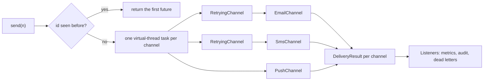

## Where we are

LLD-DESIGN-6 ran the LLD-DESIGN-5 routine on Case 1, the parking lot, and Case 2, the LRU cache with
pluggable eviction. You saw the clock injected rather than read, compare-and-set on one field, one lock
when an invariant spans two structures, and Strategy for the part that changes. Its section "The Java
tools the code uses" explains `ConcurrentHashMap`, virtual threads and `CompletableFuture`, which this
lesson leans on. Here are the other two of the four: Case 3, the rate limiter, and Case 4, the
notification system. When a follow-up says "the Case 2 cache", it means LLD-DESIGN-6's cache.

## The problem

It is Monday, 9:05. One tenant's script is calling your API 2,000 times a second, and every other
tenant's dashboard is timing out. Your lead wants per-tenant limits by lunch, with a daily cap on top.
That afternoon product asks for the next thing: tell users by email, SMS or push when their job finishes,
without one flaky SMS provider holding up the emails, and without messaging a user twice because a client
retried.

That is a rate limiter and a notification system. Same rules as part 1: requirements first, read the
tests first, and run each file with `java <FileName>.java`.

## Case 3: Rate limiter

### Requirements

```text
Functional
  F1  allow(key) -> true/false, where key is a user, tenant, API key or IP
  F2  Token bucket by default; other algorithms pluggable (sliding log, fixed window...)
  F3  Different limits per key (tenant plans), and several limits at once (10/s AND 1000/day)
Non-functional
  N1  Thread-safe: concurrent calls must never let through more than the limit
  N2  Fast: O(1) per call for the token bucket
Out of scope
  Distributed limiting across servers (discussed in follow-ups)
```

### The algorithms, in one table

| Algorithm | How it works | Strength | Weakness |
|---|---|---|---|
| Fixed window counter | Count calls per clock window (for example per minute) | Tiny memory | Up to 2× the limit across a window boundary |
| Sliding window log | Keep a timestamp per allowed call; drop those older than the window | Exact | Memory grows with the limit |
| Sliding window counter | Weighted mix of the current and previous window counts | Small and close to exact | An approximation |
| Token bucket | A bucket of up to N tokens refills at a fixed rate; each call takes one | Allows short bursts, smooth on average, O(1) | Two parameters to explain |
| Leaky bucket | Requests queue and leave at a fixed rate | Perfectly smooth output | Adds delay; bursts wait |

The **token bucket** is the default answer: `capacity` controls the burst and the refill rate
controls the long-run average.

```quiz
{"question": "A token bucket has capacity 20 and refills 5 tokens per second. What do the two numbers control?", "level": "easy",
 "options": [
   {"text": "20 is the largest burst a quiet client can send at once; 5 per second is the long-run average it can sustain", "correct": true, "why": "A full bucket lets 20 calls through instantly. After that, calls pass only as fast as tokens refill."},
   {"text": "20 is the limit per minute; 5 is the number of retries allowed", "why": "Neither number is a window or a retry count. Capacity bounds the bucket; the rate refills it."},
   {"text": "20 requests queue up and leave at 5 per second", "why": "That is the leaky bucket, which delays requests to smooth the output. A token bucket answers at once, yes or no."},
   {"text": "At most 5 calls ever pass in any one second", "why": "A full bucket passes 20 in the same instant. A hard cap per rolling second is closer to a sliding window."}]}
```

### Class diagram

```text
 ┌───────────────────────────────┐       ┌──────────────────────────────┐
 │ RateLimiter (facade)          │──────▶│ LimiterFactory «interface»   │
 │ limiters: ConcurrentHashMap   │       │ create(key, now): Limiter    │  per-tenant config lives here
 │ allow(key): boolean           │       └──────────────────────────────┘
 └──────────────┬────────────────┘
                ──▶ Limiter «interface»: tryAcquire(now), refund(now)
                       ◁── TokenBucket        (synchronized, long arithmetic)
                       ◁── SlidingWindowLog   (synchronized, ArrayDeque of timestamps)
                       ◁── AllOf              (Composite: a Limiter made of Limiters)
   clock: LongSupplier of nanoseconds (injected)
```

Design choices to say out loud:

- **One limiter object per key**, created on first use with `computeIfAbsent`, which is atomic
  per key in `ConcurrentHashMap`. Different keys never contend with each other.
- **Each limiter is `synchronized` on itself.** "Refill, check, take a token" must happen as one
  step, and the lock covers only one key's bucket.
- **Integer arithmetic for tokens.** Refill whole tokens and carry the leftover nanoseconds
  forward (`lastRefillNanos += newTokens * nanosPerToken`), so there is no floating-point drift
  and the tests can check exact numbers.
- **Multiple limits as a Composite** (a GoF pattern from LLD-DESIGN-3's table: a group that behaves like one
  member). `AllOf` takes a permit from each limit in turn and *refunds* the ones it took if a
  later limit says no, so a rejected call doesn't use up the daily allowance.

```quiz
{"question": "A tenant plan says \"10 calls per second AND 1,000 per day\", and a call rejected by the per-second limit must not use up the daily allowance. Which design?", "level": "medium",
 "options": [
   {"text": "An AllOf composite that takes a permit from each limit and refunds the ones it took if a later limit says no", "correct": true, "why": "The composite is itself a Limiter, so the facade doesn't change, and the refund stops a rejected call from costing a daily token."},
   {"text": "Call two RateLimiter facades one after the other in the controller", "why": "If the daily check runs first and the per-second check then rejects, the daily token is already gone, and nothing gives it back."},
   {"text": "One token bucket with capacity 1,000 and a refill of 10 per second", "why": "A full bucket lets 1,000 calls through in one second, breaking the per-second limit, and the refill allows far more than 1,000 a day."},
   {"text": "A sliding window log of 1,000 per day", "why": "It enforces only the daily limit, and stores up to 1,000 timestamps per key. The 10 per second limit is gone."}]}
```

**Predict:** the last test fires 1,000 virtual threads at one 100-token bucket while the clock stands
still. How many calls get through? And what if `tryAcquire` were not `synchronized`?

Exactly 100. Refill, check and take run as one step under the bucket's lock, so no two threads can spend
the same token. Without `synchronized`, two threads can both read `tokens == 1` and both decrement, and
the count of allowed calls drifts above 100.

### Code and tests

Save as `RateLimiterDemo.java`.

```java
import java.time.Duration;
import java.util.*;
import java.util.concurrent.*;
import java.util.concurrent.atomic.*;
import java.util.function.LongSupplier;

// ---------- Tests ----------
public class RateLimiterDemo {
    static final long SECOND = 1_000_000_000L;

    public static void main(String[] args) throws Exception {
        tokenBucketAllowsABurstThenRefills();
        slidingLogNeverExceedsLimitInAnyWindow();
        keysAreIsolated();
        multipleLimitsRefundOnReject();
        concurrentCallersNeverOverAdmit();
        System.out.println("All rate limiter tests passed");
    }

    static void tokenBucketAllowsABurstThenRefills() {
        var now = new AtomicLong(0);
        var bucket = new TokenBucket(5, 1, Duration.ofSeconds(1), now.get()); // burst 5, 1 token/s
        for (int i = 0; i < 5; i++) check(bucket.tryAcquire(now.get()), "burst call " + i);
        check(!bucket.tryAcquire(now.get()), "6th call in the same instant is rejected");
        now.addAndGet(SECOND / 2);
        check(!bucket.tryAcquire(now.get()), "half a token is not a token");
        now.addAndGet(SECOND / 2);
        check(bucket.tryAcquire(now.get()), "one token after one second");
        check(!bucket.tryAcquire(now.get()), "and only one");
    }

    static void slidingLogNeverExceedsLimitInAnyWindow() {
        var log = new SlidingWindowLog(3, Duration.ofSeconds(1));
        check(log.tryAcquire(0) && log.tryAcquire(SECOND / 10) && log.tryAcquire(SECOND / 5), "3 allowed");
        check(!log.tryAcquire(SECOND / 2), "4th inside the window rejected");
        check(log.tryAcquire(SECOND + 1), "first timestamp has left the window");
    }

    static void keysAreIsolated() {
        var now = new AtomicLong(0);
        var limiter = new RateLimiter(
                (key, t) -> new TokenBucket(1, 1, Duration.ofSeconds(1), t), now::get);
        check(limiter.allow("alice"), "alice first call");
        check(!limiter.allow("alice"), "alice second call rejected");
        check(limiter.allow("bob"), "bob has his own bucket");
    }

    static void multipleLimitsRefundOnReject() {
        var now = new AtomicLong(0);
        var limiter = new RateLimiter((key, t) -> new AllOf(List.of(
                new TokenBucket(3, 3, Duration.ofSeconds(1), t),    // 3 per second
                new TokenBucket(5, 5, Duration.ofMinutes(1), t))),  // and 5 per minute
                now::get);
        for (int i = 0; i < 3; i++) check(limiter.allow("u"), "call " + i);
        check(!limiter.allow("u"), "per-second limit hit");
        now.set(SECOND);
        check(limiter.allow("u") && limiter.allow("u"), "minute bucket must still hold 2 tokens");
        check(!limiter.allow("u"), "per-minute limit hit");
    }

    static void concurrentCallersNeverOverAdmit() throws Exception {
        var frozen = new AtomicLong(0);                      // time stands still: no refill
        var limiter = new RateLimiter(
                (key, t) -> new TokenBucket(100, 1, Duration.ofHours(1), t), frozen::get);
        var allowed = new AtomicInteger();
        try (var pool = Executors.newVirtualThreadPerTaskExecutor()) {
            for (int i = 0; i < 1_000; i++) pool.submit(() -> { if (limiter.allow("hot")) allowed.incrementAndGet(); });
        }
        check(allowed.get() == 100, "expected exactly 100, got " + allowed.get());
    }

    static void check(boolean ok, String msg) { if (!ok) throw new AssertionError(msg); }
}

// ---------- One limiter per key; the algorithm is a Strategy ----------
interface Limiter {
    boolean tryAcquire(long nowNanos);
    /** Give back one permit taken by tryAcquire (used when a composite limit rejects). */
    void refund(long nowNanos);
}

/** Token bucket: holds up to `capacity` tokens and gains one every `nanosPerToken`. */
final class TokenBucket implements Limiter {
    private final long capacity;
    private final long nanosPerToken;
    private long tokens;
    private long lastRefillNanos;

    TokenBucket(long capacity, long tokens, Duration per, long nowNanos) {
        if (capacity <= 0 || tokens <= 0) throw new IllegalArgumentException("capacity and rate must be positive");
        this.capacity = capacity;
        this.nanosPerToken = per.toNanos() / tokens;
        this.tokens = capacity;                             // start full: allow an initial burst
        this.lastRefillNanos = nowNanos;
    }

    @Override public synchronized boolean tryAcquire(long now) {
        refill(now);
        if (tokens == 0) return false;
        tokens--;
        return true;
    }

    @Override public synchronized void refund(long now) { tokens = Math.min(capacity, tokens + 1); }

    private void refill(long now) {
        long newTokens = (now - lastRefillNanos) / nanosPerToken;
        if (newTokens > 0) {
            tokens = Math.min(capacity, tokens + newTokens);
            lastRefillNanos += newTokens * nanosPerToken;    // keep the fractional remainder
        }
    }
}

/** Sliding window log: exact, but stores one timestamp per allowed call. */
final class SlidingWindowLog implements Limiter {
    private final int limit;
    private final long windowNanos;
    private final Deque<Long> timestamps = new ArrayDeque<>();

    SlidingWindowLog(int limit, Duration window) { this.limit = limit; this.windowNanos = window.toNanos(); }

    @Override public synchronized boolean tryAcquire(long now) {
        while (!timestamps.isEmpty() && timestamps.peekFirst() <= now - windowNanos) timestamps.pollFirst();
        if (timestamps.size() >= limit) return false;
        timestamps.addLast(now);
        return true;
    }

    @Override public synchronized void refund(long now) { timestamps.pollLast(); }
}

/** Several limits at once ("10/s AND 1000/day"). Composite: it is itself a Limiter. */
final class AllOf implements Limiter {
    private final List<Limiter> parts;

    AllOf(List<Limiter> parts) { this.parts = List.copyOf(parts); }

    @Override public boolean tryAcquire(long now) {
        List<Limiter> taken = new ArrayList<>();
        for (Limiter l : parts) {
            if (!l.tryAcquire(now)) {
                taken.forEach(t -> t.refund(now));          // don't charge limits that passed
                return false;
            }
            taken.add(l);
        }
        return true;
    }

    @Override public void refund(long now) { parts.forEach(p -> p.refund(now)); }
}

@FunctionalInterface
interface LimiterFactory {
    /** Per-key (per-tenant, per-API) configuration lives here. */
    Limiter create(String key, long nowNanos);
}

/** The facade callers use. */
final class RateLimiter {
    private final Map<String, Limiter> limiters = new ConcurrentHashMap<>();
    private final LimiterFactory factory;
    private final LongSupplier clockNanos;

    RateLimiter(LimiterFactory factory, LongSupplier clockNanos) {
        this.factory = factory;
        this.clockNanos = clockNanos;
    }

    boolean allow(String key) {
        long now = clockNanos.getAsLong();
        return limiters.computeIfAbsent(key, k -> factory.create(k, now)).tryAcquire(now);
    }
}
```

### Follow-ups and how the design handles them

- **"Thread safety?"** `computeIfAbsent` creates exactly one limiter per key; each limiter's
  `synchronized` methods make refill-check-take atomic. The test fires 1,000 virtual threads at
  a 100-token bucket with time frozen and checks that exactly 100 get through.
- **"Different limits per tenant."** That is what `LimiterFactory` is for:
  `(key, now) -> plans.get(tenantOf(key)).newLimiter(now)`. Changing a tenant's plan means
  dropping its limiter from the map so the next call creates one with the new settings.
- **"Multiple limits at once."** `AllOf`, shown in the test: 3 per second and 5 per minute. The
  refund matters: without it, the 4th call (rejected by the per-second limit) would still have
  used a per-minute token. The refund isn't perfectly atomic across concurrent callers; the
  worst case is a brief extra rejection, never letting through too many. Say that trade-off.
- **"Switch to sliding window."** A different factory: `(key, now) -> new SlidingWindowLog(...)`.
  Nothing else changes.
- **"Memory: millions of keys, most idle."** The map grows forever. Store limiters in the Case 2
  cache with a TTL instead of a plain map, so idle keys expire. (An expired key just gets a fresh,
  full bucket, which is the correct behaviour for an idle user.)
- **"Return how long to wait."** Change `boolean` to a `Decision(allowed, retryAfter)` record.
  For a token bucket, the wait is the time until the next token: `nanosPerToken` minus the time
  since the last refill. Map it to HTTP 429 with a `Retry-After` header.
- **"Many servers."** Per-server buckets let through N × limit in total. Keep the bucket in
  Redis and make refill-check-take atomic with a Lua script, or accept approximate limits with
  local buckets that sync periodically. This is where the question turns into HLD.

```quiz
{"question": "\"100 requests per minute\" is built as a token bucket with capacity 100 that refills 100 tokens per minute and starts full. A client sends as fast as it can from t = 0. About how many calls are allowed between t = 0 and t = 30 s?", "level": "hard",
 "options": [
   {"text": "About 150: a burst of 100 at once, then one token every 0.6 s, about 50 more by 30 s", "correct": true, "why": "Capacity sets the burst and the refill keeps running while the client drains it. That burst is the point of a token bucket; if no 60-second span may exceed 100, use a sliding window log."},
   {"text": "100: the bucket enforces 100 per rolling minute", "why": "That is the sliding window log's guarantee. A token bucket bounds only the burst and the long-run average."},
   {"text": "About 50: half a minute earns half the tokens", "why": "That forgets the bucket starts full. The first 100 calls pass instantly."},
   {"text": "Up to 200: the window boundary lets two full windows through", "why": "That is the fixed window counter's weakness, up to 2x around a boundary. A token bucket has no window."}]}
```

## Case 4: Notification system

### Requirements

```text
Functional
  F1  send(notification) to a user on the requested channels: EMAIL, SMS, PUSH
  F2  Respect user preferences: skip channels the user opted out of
  F3  Retry transient failures with exponential backoff; don't retry permanent ones
  F4  Report the outcome per channel; failed deliveries go to a dead-letter list
  F5  The same notification id sent twice is delivered once (idempotency)
Non-functional
  N1  Channels are independent: a slow or failing SMS provider doesn't block email
  N2  A new channel (Slack, WhatsApp) is one new class
Out of scope
  Durable queue across restarts, templates, quiet hours (discussed in follow-ups)
```

**Idempotent** means doing it twice has the same effect as doing it once, which matters because
callers retry when they time out.

### Class diagram

```text
 ┌───────────────────────────────────────┐
 │ NotificationService                   │──▶ RecipientStore «interface» (contact + opt-ins)
 │ send(Notification): CF<List<Result>>  │──▶ ExecutorService (virtual threads)
 │ subscribe(DeliveryListener)           │──▶ DeliveryListener «interface»  (Observer)
 │ byId: ConcurrentHashMap (idempotency) │
 └───────────────┬───────────────────────┘
                 ──▶ Channel «interface»: type(), deliver(to, n) throws DeliveryException
                        ◁── EmailChannel / SmsChannel / PushChannel   (Strategy; Adapters to vendors)
                        ◁── RetryingChannel(inner, RetryPolicy, Sleeper)   (Decorator)
                                   ──▶ RetryPolicy «interface» ◁── ExponentialBackoff
 Notification(id, userId, subject, body, channels)    DeliveryResult(id, channel, status, detail)
```

Design choices to say out loud:

- **Channel is a Strategy, and each real one is an Adapter** to a vendor SDK (LLD-DESIGN-3). The service
  builds an `EnumMap` from whatever channels it is given, the way Spring would inject
  `List<Channel>`. A new channel is a new class.
- **Retry is a Decorator.** `RetryingChannel` wraps any channel, so retry logic is written once
  and the channels stay simple. The `RetryPolicy` decides the delays, and `DeliveryException`
  says whether an error is worth retrying (an invalid phone number is not).
- **Fan-out in parallel.** Each channel runs as its own task on a virtual-thread executor, and
  failures are caught per channel, so one bad provider can't block or fail the others.
- **Observer for outcomes.** Metrics, audit logs and the dead-letter list are just listeners.
- **The sleeper is injected** for the same reason as the clock: tests record the backoff delays
  instead of waiting for them.

One `send`, from the idempotency check to the listeners:



**Predict:** `ExponentialBackoff(3, 100 ms, 5 s)` wraps an email channel that fails twice with a retryable
error, then works. How many attempts are made, and which delays are slept?

Three attempts, with sleeps of 100 ms and then 200 ms: `base`, then twice `base`. The third attempt
succeeds, so there is no third delay. The `RecordingSleeper` in `transientFailureIsRetriedWithBackoff`
records exactly that list instead of waiting.

### Code and tests

Save as `NotificationDemo.java`.

```java
import java.time.Duration;
import java.util.*;
import java.util.concurrent.*;
import java.util.concurrent.atomic.AtomicInteger;

// ---------- Tests ----------
public class NotificationDemo {
    public static void main(String[] args) throws Exception {
        sendsOnOptedInChannelsOnly();
        transientFailureIsRetriedWithBackoff();
        permanentFailureIsNotRetried();
        exhaustedRetriesEndInDeadLetter();
        duplicateIdIsDeliveredOnce();
        System.out.println("All notification tests passed");
    }

    static final Recipient ALICE = new Recipient("alice", "alice@example.com", "+911234567890", "device-1");
    static final RetryPolicy BACKOFF = new ExponentialBackoff(3, Duration.ofMillis(100), Duration.ofSeconds(5));

    static NotificationService service(Set<ChannelType> optedIn, Channel... channels) {
        RecipientStore store = new RecipientStore() {
            public Optional<Recipient> find(String userId) { return Optional.of(ALICE); }
            public Set<ChannelType> optedIn(String userId) { return optedIn; }
        };
        return new NotificationService(List.of(channels), store, Executors.newVirtualThreadPerTaskExecutor());
    }

    static Notification note(String id, ChannelType... types) {
        return new Notification(id, "alice", "Build finished", "Your build #42 passed", Set.of(types));
    }

    static void sendsOnOptedInChannelsOnly() {
        var email = new FakeChannel(ChannelType.EMAIL, 0, true);
        var sms = new FakeChannel(ChannelType.SMS, 0, true);
        try (var svc = service(Set.of(ChannelType.EMAIL), email, sms)) {
            var results = svc.send(note("n1", ChannelType.EMAIL, ChannelType.SMS)).join();
            check(status(results, ChannelType.EMAIL) == Status.SENT, "email sent");
            check(status(results, ChannelType.SMS) == Status.SKIPPED, "sms skipped: user opted out");
            check(sms.calls.get() == 0, "sms channel never called");
        }
    }

    static void transientFailureIsRetriedWithBackoff() {
        var sleeper = new RecordingSleeper();
        var flaky = new FakeChannel(ChannelType.EMAIL, 2, true);            // fails twice, then works
        try (var svc = service(Set.of(ChannelType.EMAIL), new RetryingChannel(flaky, BACKOFF, sleeper))) {
            var results = svc.send(note("n2", ChannelType.EMAIL)).join();
            check(status(results, ChannelType.EMAIL) == Status.SENT, "sent on 3rd attempt");
            check(flaky.calls.get() == 3, "3 attempts");
            check(sleeper.delays.equals(List.of(Duration.ofMillis(100), Duration.ofMillis(200))), "backoff " + sleeper.delays);
        }
    }

    static void permanentFailureIsNotRetried() {
        var broken = new FakeChannel(ChannelType.SMS, Integer.MAX_VALUE, false); // e.g. invalid number
        try (var svc = service(Set.of(ChannelType.SMS), new RetryingChannel(broken, BACKOFF, new RecordingSleeper()))) {
            var results = svc.send(note("n3", ChannelType.SMS)).join();
            check(status(results, ChannelType.SMS) == Status.FAILED, "failed");
            check(broken.calls.get() == 1, "no retry on a permanent error");
        }
    }

    static void exhaustedRetriesEndInDeadLetter() {
        var down = new FakeChannel(ChannelType.PUSH, Integer.MAX_VALUE, true);
        var deadLetters = new CopyOnWriteArrayList<DeliveryResult>();
        try (var svc = service(Set.of(ChannelType.PUSH), new RetryingChannel(down, BACKOFF, new RecordingSleeper()))) {
            svc.subscribe(r -> { if (r.status() == Status.FAILED) deadLetters.add(r); });
            svc.send(note("n4", ChannelType.PUSH)).join();
            check(down.calls.get() == 3, "maxAttempts = 3");
            check(deadLetters.size() == 1, "one dead letter");
        }
    }

    static void duplicateIdIsDeliveredOnce() {
        var email = new FakeChannel(ChannelType.EMAIL, 0, true);
        try (var svc = service(Set.of(ChannelType.EMAIL), email)) {
            var first = svc.send(note("n5", ChannelType.EMAIL));
            var again = svc.send(note("n5", ChannelType.EMAIL));             // client retried the request
            check(first == again, "same future for the same id");
            again.join();
            check(email.calls.get() == 1, "delivered once");
        }
    }

    static Status status(List<DeliveryResult> rs, ChannelType t) {
        return rs.stream().filter(r -> r.channel() == t).findFirst().orElseThrow().status();
    }

    static void check(boolean ok, String msg) { if (!ok) throw new AssertionError(msg); }

    /** Fails the first `failures` calls, then succeeds. */
    static final class FakeChannel implements Channel {
        final ChannelType type; final int failures; final boolean retryable;
        final AtomicInteger calls = new AtomicInteger();
        FakeChannel(ChannelType type, int failures, boolean retryable) {
            this.type = type; this.failures = failures; this.retryable = retryable;
        }
        public ChannelType type() { return type; }
        public void deliver(Recipient r, Notification n) throws DeliveryException {
            if (calls.incrementAndGet() <= failures) throw new DeliveryException(type + " failed", retryable);
        }
    }

    static final class RecordingSleeper implements Sleeper {
        final List<Duration> delays = new CopyOnWriteArrayList<>();
        public void sleep(Duration d) { delays.add(d); }   // records instead of sleeping: fast tests
    }
}

// ---------- Domain ----------
enum ChannelType { EMAIL, SMS, PUSH }
enum Status { SENT, FAILED, SKIPPED }

record Recipient(String userId, String email, String phone, String deviceToken) { }
record Notification(String id, String userId, String subject, String body, Set<ChannelType> channels) { }
record DeliveryResult(String notificationId, ChannelType channel, Status status, String detail) { }

final class DeliveryException extends Exception {
    private final boolean retryable;
    DeliveryException(String message, boolean retryable) { super(message); this.retryable = retryable; }
    boolean retryable() { return retryable; }
}

interface RecipientStore {
    Optional<Recipient> find(String userId);
    Set<ChannelType> optedIn(String userId);
}

// ---------- Channel = Strategy; a new channel is a new class ----------
interface Channel {
    ChannelType type();
    void deliver(Recipient to, Notification n) throws DeliveryException;
}

// ---------- Retry = Decorator around any Channel ----------
interface RetryPolicy {
    /** Delay before the next attempt, or empty to give up. */
    Optional<Duration> delayAfter(int failedAttempts);
}

record ExponentialBackoff(int maxAttempts, Duration base, Duration cap) implements RetryPolicy {
    @Override public Optional<Duration> delayAfter(int failedAttempts) {
        if (failedAttempts >= maxAttempts) return Optional.empty();
        Duration d = base.multipliedBy(1L << Math.min(failedAttempts - 1, 30)); // base, 2x, 4x ...
        return Optional.of(d.compareTo(cap) > 0 ? cap : d);
    }
}

@FunctionalInterface
interface Sleeper {
    Sleeper REAL = Thread::sleep;
    void sleep(Duration d) throws InterruptedException;
}

final class RetryingChannel implements Channel {
    private final Channel inner;
    private final RetryPolicy policy;
    private final Sleeper sleeper;

    RetryingChannel(Channel inner, RetryPolicy policy, Sleeper sleeper) {
        this.inner = inner; this.policy = policy; this.sleeper = sleeper;
    }

    @Override public ChannelType type() { return inner.type(); }

    @Override public void deliver(Recipient to, Notification n) throws DeliveryException {
        for (int attempt = 1; ; attempt++) {
            try {
                inner.deliver(to, n);
                return;
            } catch (DeliveryException e) {
                if (!e.retryable()) throw e;
                Optional<Duration> delay = policy.delayAfter(attempt);
                if (delay.isEmpty()) throw e;
                try {
                    sleeper.sleep(delay.get());
                } catch (InterruptedException ie) {
                    Thread.currentThread().interrupt();           // keep the interrupt visible
                    throw new DeliveryException("interrupted while retrying", false);
                }
            }
        }
    }
}

// ---------- Observer: anyone can listen to delivery results ----------
@FunctionalInterface
interface DeliveryListener {
    void onResult(DeliveryResult result);
}

// ---------- The service ----------
final class NotificationService implements AutoCloseable {
    private final Map<ChannelType, Channel> channels;
    private final RecipientStore recipients;
    private final ExecutorService executor;
    private final List<DeliveryListener> listeners = new CopyOnWriteArrayList<>();
    private final Map<String, CompletableFuture<List<DeliveryResult>>> byId = new ConcurrentHashMap<>();

    NotificationService(List<Channel> channels, RecipientStore recipients, ExecutorService executor) {
        Map<ChannelType, Channel> m = new EnumMap<>(ChannelType.class);
        for (Channel c : channels) m.put(c.type(), c);
        this.channels = Collections.unmodifiableMap(m);
        this.recipients = recipients;
        this.executor = executor;
    }

    void subscribe(DeliveryListener l) { listeners.add(l); }

    /** Idempotent by notification id: a repeated id returns the first call's future. */
    CompletableFuture<List<DeliveryResult>> send(Notification n) {
        return byId.computeIfAbsent(n.id(), id -> dispatch(n));
    }

    private CompletableFuture<List<DeliveryResult>> dispatch(Notification n) {
        Recipient to = recipients.find(n.userId())
                .orElseThrow(() -> new IllegalArgumentException("unknown user " + n.userId()));
        Set<ChannelType> allowed = recipients.optedIn(n.userId());
        List<CompletableFuture<DeliveryResult>> perChannel = n.channels().stream()
                .map(type -> CompletableFuture.supplyAsync(() -> deliverOne(type, to, n, allowed), executor))
                .toList();                                    // channels run in parallel, fail independently
        return CompletableFuture.allOf(perChannel.toArray(CompletableFuture[]::new))
                .thenApply(v -> perChannel.stream().map(CompletableFuture::join).toList());
    }

    private DeliveryResult deliverOne(ChannelType type, Recipient to, Notification n, Set<ChannelType> allowed) {
        Channel channel = channels.get(type);
        DeliveryResult result;
        if (!allowed.contains(type)) {
            result = new DeliveryResult(n.id(), type, Status.SKIPPED, "user opted out");
        } else if (channel == null) {
            result = new DeliveryResult(n.id(), type, Status.SKIPPED, "no channel configured");
        } else {
            try {
                channel.deliver(to, n);
                result = new DeliveryResult(n.id(), type, Status.SENT, "ok");
            } catch (DeliveryException e) {
                result = new DeliveryResult(n.id(), type, Status.FAILED, e.getMessage());
            }
        }
        for (DeliveryListener l : listeners) l.onResult(result);
        return result;
    }

    @Override public void close() { executor.close(); }
}
```

### Follow-ups and how the design handles them

- **"Thread safety?"** Shared state is the channel map (immutable after construction), the
  listener list (`CopyOnWriteArrayList`: many reads, rare writes) and the idempotency map
  (`ConcurrentHashMap.computeIfAbsent`, so two concurrent sends with the same id get the same
  future and only one dispatch happens).
- **"Add backoff jitter."** If thousands of deliveries fail together, they all retry at the same
  instants. Make the delay random between 0 and the computed backoff ("full jitter") inside
  `ExponentialBackoff`. It is one change in one class.
- **"Limit each user to N notifications per day."** Another decorator, `RateLimitedChannel`,
  using Case 3's `RateLimiter` keyed by user and channel. That is the lab below, and the bank
  question [Job-completion Notifier with Per-user Daily Limit](#/q/design-job-completion-notifier-with-daily-limit).
- **"The idempotency map grows forever."** Keep ids in the Case 2 cache with a TTL (for example
  24 hours) instead of a plain map.
- **"OTPs must not wait behind marketing mail."** Priority: separate executors (or queues) per
  priority, so a backlog of low-priority sends never delays an OTP.
- **"What if the process crashes mid-retry?"** In-memory retries are lost. Durability needs a
  persistent queue or an outbox table: write the notification, then deliver from the table and
  mark it done. Sleeping on a virtual thread is cheap, but at scale you would also schedule
  retries on a delay queue rather than hold a task per retry. This is the bridge to the HLD
  version of the question.
- **"Templates and quiet hours."** A `TemplateRenderer` (Strategy) before dispatch, and a
  `QuietHoursPolicy` that delays or skips non-urgent sends. Both go in front of the fan-out;
  channels don't change.

## Lab (~10 min): per-user daily limit

Combine Case 3 and Case 4.

1. Copy `NotificationDemo.java` to `LimitLab.java` (rename the public class to `LimitLab`), and
   paste in the `Limiter`, `TokenBucket`, `LimiterFactory` and `RateLimiter` types from Case 3.
   Add `import java.util.function.LongSupplier;` at the top.
2. Add this decorator:

```java
final class RateLimitedChannel implements Channel {
    private final Channel inner;
    private final RateLimiter limiter;

    RateLimitedChannel(Channel inner, RateLimiter limiter) { this.inner = inner; this.limiter = limiter; }

    @Override public ChannelType type() { return inner.type(); }

    @Override public void deliver(Recipient to, Notification n) throws DeliveryException {
        if (!limiter.allow(to.userId() + ":" + inner.type())) {
            throw new DeliveryException("daily limit reached", false);   // permanent: don't retry
        }
        inner.deliver(to, n);
    }
}
```

3. Build an email channel as
   `new RateLimitedChannel(new RetryingChannel(email, BACKOFF, sleeper), limiter)` with a limiter
   of 2 per day: `(key, t) -> new TokenBucket(2, 2, Duration.ofDays(1), t)` and a clock of
   `System::nanoTime`.
4. Send three notifications with different ids. Check that the first two are `SENT` and the third
   is `FAILED` with "daily limit reached".
5. **Break it:** swap the order to `new RetryingChannel(new RateLimitedChannel(email, limiter), ...)`
   and make the fake email channel fail once with a retryable error
   (`new FakeChannel(ChannelType.EMAIL, 1, true)`). Send two notifications. The first is `SENT`,
   but the second fails with "daily limit reached": the first notification's retry went through
   the limiter again and used up the user's second token.

What to observe: decorator order is a design decision. Put the limiter *outside* the retry so a
user is charged per notification, not per attempt.

## Gotchas

- **`System.currentTimeMillis()` inside logic.** It makes time-based tests slow and flaky. Inject
  a `Clock` or `LongSupplier`, and use `System.nanoTime()` for measuring intervals (it isn't
  affected by wall-clock changes).
- **Retrying everything.** Retrying a permanent error (an invalid address, a 400 response) only
  adds load. Classify errors as retryable or not, cap the attempts, and back off with jitter.
- **Unbounded per-key maps.** Per-user buckets and idempotency ids grow forever. Give them a TTL.

## In interviews

These two complete the four most repeated LLD questions in the Microsoft dossier:
[Design a Rate Limiter](#/q/design-rate-limiter) (five sightings, including a multi-tenant,
pluggable-algorithm version in an AA round) and
[Design a Notification System](#/q/design-notification-system). Closely related:
[Job-completion Notifier with Per-user Daily Limit](#/q/design-job-completion-notifier-with-daily-limit)
and [Design an Alert Monitoring System](#/q/design-alert-monitoring-system).

A strong answer meets LLD-DESIGN-6's checklist; here the patterns are Decorator (retry, limits),
Observer (outcomes) and Composite (several limits).

## Explain it in 2 minutes

Prompt: *"Walk me through your rate limiter design and how it handles multiple limits and
thread safety."*

- Requirements: `allow(key)`, per-key limits, pluggable algorithm, several limits at once,
  thread-safe, O(1).
- Token bucket by default: capacity for bursts, refill rate for the average; whole-token
  arithmetic with the remainder carried forward.
- `Limiter` interface (Strategy) with token bucket and sliding log; `LimiterFactory` holds
  per-tenant config; `RateLimiter` is the facade with a `ConcurrentHashMap` of per-key limiters.
- Thread safety: `computeIfAbsent` for creation; each limiter synchronised on itself, so
  different keys never contend.
- Multiple limits: `AllOf` composite with refunds, so a rejected call doesn't use up the other
  limits.
- Scale: TTL eviction for idle keys; Redis plus a Lua script for limits shared across servers.

## Check yourself

1. In `AllOf`, what goes wrong without the refund step?
2. Why is `RetryingChannel` a decorator rather than code inside `NotificationService`?
3. Which decorator should be outermost: the rate limiter or the retry? Why?

### Answers

1. A call rejected by a later limit would still have used a permit from the earlier ones, so a
   user hammering a per-second limit would quietly use up their per-day allowance.
2. Retry is one concern that applies to every channel. As a decorator it is written once,
   tested alone, and added to or removed from any channel without editing it or the service
   (SRP and OCP).
3. The rate limiter, outside the retry, so the user is charged once per notification and not
   once per attempt.

## Next

JAVA-CONC-5 and JAVA-CONC-6 (CompletableFuture, virtual threads) explain the async tools used here in depth, and
JAVA-CONC-7 rebuilds the concurrent LRU and rate limiter as concurrency problems; practise the rest of the
LLD bank under a 60-minute timer alongside them.
