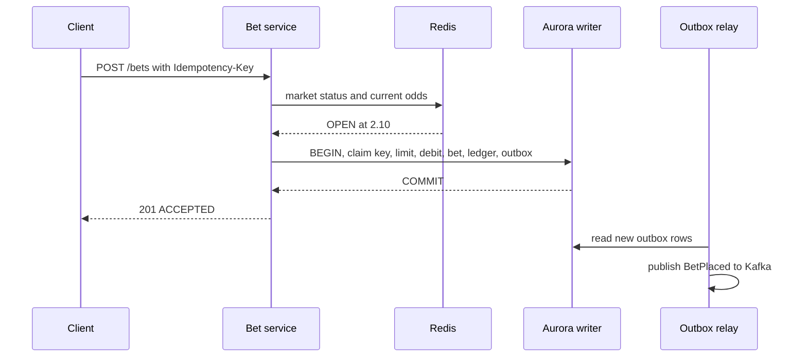

## Where we are

What SYS-DES-8 already did for the sportsbook:

- **Scoped and sized it:** odds fan-out is the scaling problem, bet placement the correctness problem.
- **Drew the high-level design:**
  - odds ingest → Kafka → Redis and push gateways;
  - bet service → one Aurora transaction → outbox → Kafka.
- **Chose the stores and wrote the schema,** including the `accounts`, `ledger_txns`, `ledger_entries`,
  `rg_usage`, `outbox` and `idempotency_keys` tables.

Keep its Step 4 open: the SQL here uses that schema. This lesson goes inside the boxes.

## The problem

Your boxes are on the whiteboard and the interviewer nods. Then:

"It's the 89th minute of the final. A goal goes in.

- Thousands of people tap Place in the next few seconds;
- some of them twice, because the stadium Wi-Fi dropped;
- and one of them has exactly £10 left and taps on two phones.

Walk me through what your system does."

The diagram doesn't answer that. The deep dives do:

- how prices reach the phone in order;
- how a bet is placed exactly once;
- how you prove the money is right;
- how 2M bets settle at the final whistle;
- how a self-excluded user is stopped every time.

## Deep dive 1: odds ingestion and pushing over WebSockets

**Ingest.** Prices come from data suppliers and from the operator's own traders. The ingest
service normalises them into one internal format and gives each change a per-event sequence
number:

```text
{eventId: 991, seq: 18234, marketId: 5001, selectionId: 77, odds: 2.10, status: "OPEN", ts: …}
```

**Kafka, keyed by event.** Publishing to `odds-updates` with key `event_id` puts every change for
one match in one partition, so consumers see them **in order** (SYS-DES-1, BE-STORY-11). The topic is a log, so a
consumer that restarts can resume from its offset.

**The odds service** consumes the topic and keeps the **current** state in Redis: one hash per
market, with odds, status and the latest `seq`. That's what bet placement reads. It also writes
odds to Aurora, but conflated (latest value every second or so), because the database only needs
the current price and an audit history, not every tick on the hot path.

**Push gateways.** Each gateway node holds tens of thousands of WebSocket connections and a local
map: `eventId → connections subscribed to it`. Every gateway reads the *whole* odds topic with its
own consumer group. Upstream odds volume is small compared with the fan-out, so each node can
afford to see everything and forward only what its clients watch. (The alternative is a pub/sub
channel per event in Redis. That's lighter per node, but you lose replay.)

**Predict:** one selection's price changes 40 times a second, and the client's buffer is flushed every
250 ms. How many updates for that selection reach the phone each second?

At most four, one per flush, each carrying the newest price. Here is how:

**Conflation.** A client doesn't need 40 prices a second for one selection. It needs the latest one.
Each connection gets a small buffer holding **only the newest update per selection**. Every
~250–500 ms, the buffer is flushed as one batched message. This bounds messages per client
regardless of how fast prices move, and it's the single biggest lever on the 5M-messages/s
estimate. It also handles **slow clients**: a phone on a weak signal gets fewer, fresher messages
instead of a growing backlog. If its buffer can't drain at all, disconnect it and let it resync.

**Ordering and gaps.** The gateway drops any update whose `seq` is not newer than the last one it
sent for that selection, so duplicates and late arrivals can't move a price backwards. On
(re)connect, the client sends the last `seq` it saw per event. The gateway replies with a
**snapshot** from Redis followed by live deltas.

**Operations.** The load balancer must support WebSockets (AWS's Application Load Balancer does).
Gateways send heartbeats (ping/pong) to detect dead connections. On a deploy, drain nodes gradually
and have clients reconnect with **jittered backoff**. Otherwise a million clients reconnect in the
same second, a **reconnect storm**.

## Deep dive 2: bet placement

This is where the interviewer will spend the most time. The steps, in order:

```text
1. Authenticate; validate the request (stake > 0, selection exists)
2. Self-exclusion / time-out check                         (Redis cache, Aurora as truth)
3. Market OPEN (not suspended) and current odds            (Redis)
   compare with oddsSeen under acceptOddsChange:
     NONE   → any change: 409 ODDS_CHANGED
     HIGHER → accept if current ≥ oddsSeen (better for the user), else 409
     ANY    → accept at current odds
4. Trading limits: max stake / max payout for this selection
5. ONE database transaction:
     a. claim the idempotency key            (a retry stops here, with the original result)
     b. responsible-gambling counter, conditional update
     c. debit the wallet, conditional update (DB-SQL-7)
     d. insert the bet at the odds validated in step 3
     e. ledger txn + 2 entries
     f. record bet_id against the idempotency key
     g. outbox row "BetPlaced"
   COMMIT
6. 201 ACCEPTED
```

The same steps as messages, for one accepted bet:



The transaction, as the SQL it runs (values inlined for readability; in code they are bind
parameters):

```sql
BEGIN;

INSERT INTO idempotency_keys (user_id, idem_key, created_at)
VALUES (42, '7f3a2c1e-0000-4000-8000-000000000001', CURRENT_TIMESTAMP)
ON CONFLICT DO NOTHING;
-- 0 rows → a retry: ROLLBACK, then return the stored result:
--   SELECT bet_id FROM idempotency_keys WHERE user_id = 42 AND idem_key = '7f3a…0001';

INSERT INTO rg_usage (user_id, kind, period_start) VALUES (42, 'STAKE_DAY', CURRENT_DATE)
ON CONFLICT DO NOTHING;
UPDATE rg_usage SET used = used + 10.00
WHERE user_id = 42 AND kind = 'STAKE_DAY' AND period_start = CURRENT_DATE
  AND used + 10.00 <= 100.00;                          -- 0 rows → 422 LIMIT_EXCEEDED

UPDATE accounts SET balance = balance - 10.00
WHERE user_id = 42 AND kind = 'USER_CASH' AND balance >= 10.00;   -- 0 rows → 402

INSERT INTO bets (id, user_id, selection_id, stake, odds_at_placement, placed_at, status)
VALUES (880417, 42, 77, 10.00, 2.10, CURRENT_TIMESTAMP, 'OPEN');

INSERT INTO ledger_txns (id, type, bet_id, created_at)
VALUES ('0b9d0c55-0000-4000-8000-000000000002', 'BET_STAKE', 880417, CURRENT_TIMESTAMP);
INSERT INTO ledger_entries (txn_id, account_id, amount) VALUES
  ('0b9d0c55-0000-4000-8000-000000000002', 420, -10.00),   -- user 42's cash account
  ('0b9d0c55-0000-4000-8000-000000000002',   1,  10.00);   -- HOUSE_STAKES

UPDATE idempotency_keys SET bet_id = 880417
WHERE user_id = 42 AND idem_key = '7f3a2c1e-0000-4000-8000-000000000001';

INSERT INTO outbox (topic, msg_key, payload, created_at)
VALUES ('bets', '42', '{"type":"BetPlaced","betId":880417}', CURRENT_TIMESTAMP);

COMMIT;
```

Why each piece is there:

- **The idempotency key goes first.** If the same request arrives twice at the same moment, the
  second `INSERT` waits on the first one's uncommitted key, then does nothing once the first
  commits. The duplicate never reaches the debit. If the first transaction rolled back, the
  second inserts the key and proceeds normally.
- **Conditional updates instead of read-then-write** (DB-SQL-7). Both the limit counter and the balance
  re-check their condition after waiting for the row lock, so two devices can't both squeeze under
  the limit or spend the same £10.
- **Every bet locks rows in the same order** (idempotency key, usage, wallet), so concurrent bets
  for one user queue up rather than deadlock (DB-SQL-7). Different users never touch the same rows.
- **The house account is *not* updated here.** Its `balance` would be a single row locked by every
  bet in the system, a global hotspot that serialises all placement. Entries are written for it,
  and its balance is computed from them asynchronously.
- **The price race.** Odds can change between step 3 and `COMMIT`, a window of milliseconds. The
  bet is accepted at the price that was validated. The business accepts that tiny window, because
  **suspension** on a goal is what really protects it, and the suspension check is in step 3.

**In-play delay.** For in-play bets, operators commonly hold the bet for a few seconds before
accepting it, so nobody can bet on a goal they saw before the market was suspended. The bet is
stored as `PENDING` with the stake already debited. After the delay, a worker re-checks that the
market wasn't suspended and the price still holds, then marks it `ACCEPTED`, or rejects it and
refunds the stake with a reversing ledger transaction. The client learns the outcome over the
WebSocket.

```quiz
{"question": "The same POST /bets (same Idempotency-Key) reaches two API pods 1 ms apart, and both run the bet transaction. What happens?", "level": "hard",
 "options": [
   {"text": "The second INSERT into idempotency_keys waits on the first's uncommitted key; once the first commits it inserts 0 rows, rolls back and returns the stored bet_id. One debit.", "correct": true, "why": "The primary key makes the second insert wait for the first transaction's outcome. ON CONFLICT DO NOTHING then reports 0 rows, so the duplicate never reaches the wallet update. Had the first rolled back, the second would proceed normally."},
   {"text": "Both succeed: under MVCC neither transaction can see the other's uncommitted row", "why": "Snapshots hide uncommitted rows from reads, but a unique index check must wait for the other inserter to finish. That is exactly why claiming the key first is safe."},
   {"text": "The second fails with a unique-violation error and the user sees a 500", "why": "ON CONFLICT DO NOTHING turns the conflict into 0 rows, which the code treats as a retry and answers with the original result."},
   {"text": "Both debit the wallet, and CHECK (balance >= 0) catches the second", "why": "Only if the balance happens to run out. With £100 in the wallet both debits fit. The key stops the duplicate before any money moves."}]}
```

## Deep dive 3: the wallet as a double-entry ledger

**Double-entry** bookkeeping records every movement of money as a transaction with at least two
**entries**: money leaves one account and arrives in another. With signed amounts, the rule is
simple: **the entries of every transaction sum to zero.** Money is never created or destroyed in
the books, only moved.

The accounts: each user has a `USER_CASH` account. The operator has `HOUSE_STAKES` (stakes on open
bets), `HOUSE_PNL` (profit and loss) and `PSP_CLEARING` (money in transit with the payment
provider).

```text
                                   USER_CASH(42)  HOUSE_STAKES  HOUSE_PNL  PSP_CLEARING
Deposit £50                            +50.00                               −50.00
Bet £10 @ 2.10                         −10.00        +10.00
Bet wins: pays £21                     +21.00        −10.00      −11.00
  (or) bet loses                                     −10.00      +10.00
  (or) bet void: refund                +10.00        −10.00
```

Each row sums to zero. The user's balance is the sum of their entries; `accounts.balance` is a
cached copy, updated in the same transaction as the entries, with `CHECK (balance >= 0)` as the
backstop.

Rules that make it trustworthy:

- **Append-only.** Entries are never updated or deleted. A mistake is corrected with a new,
  reversing transaction, so the history shows both.
- **Reconcile continuously.** Two queries should always return no rows:

```sql
-- every transaction balances
SELECT txn_id, sum(amount) AS imbalance
FROM ledger_entries
GROUP BY txn_id
HAVING sum(amount) <> 0;

-- every cached user balance matches its entries
SELECT a.id, a.balance, COALESCE(sum(e.amount), 0) AS from_entries
FROM accounts a
LEFT JOIN ledger_entries e ON e.account_id = a.id
WHERE a.user_id IS NOT NULL
GROUP BY a.id, a.balance
HAVING a.balance <> COALESCE(sum(e.amount), 0);
```

  Run them on a replica or a read model, and page someone if either returns a row.

- **External money is two-phase.** A deposit is pending until the payment provider confirms it.
  Credit the user only on confirmation, and make the provider's callback idempotent with the
  provider's own transaction id as the key.

```quiz
{"question": "In the double-entry ledger, which entries record a £10 bet (already placed) that loses?", "level": "easy",
 "options": [
   {"text": "HOUSE_STAKES −10.00, HOUSE_PNL +10.00", "correct": true, "why": "The user paid at placement. Losing moves the stake from open stakes to profit and loss, and the entries sum to zero."},
   {"text": "USER_CASH −10.00, HOUSE_PNL +10.00", "why": "That charges the user a second time: the stake left USER_CASH when the bet was placed."},
   {"text": "HOUSE_PNL +10.00 only", "why": "One entry can't sum to zero. Money would appear from nowhere, and the reconciliation query would flag the transaction."},
   {"text": "No entries: the stake just stays in HOUSE_STAKES", "why": "Then HOUSE_STAKES would hold stakes on bets that are no longer open, and the operator's profit would never be recorded."}]}
```

## Deep dive 4: settlement

**The trigger.** A result arrives from the results feed ("event 991: selection 77 won") and goes
onto Kafka topic `results`. The settlement service records it (`selections.result`,
`markets.status = 'RESULTED'`), then settles the market's open bets.

**In batches, in parallel, idempotently.** 2M bets can't be one transaction (it would hold locks for
minutes and bloat the table, DB-SQL-7), and they can't be done one by one. Several workers each claim a
batch:

```sql
SELECT id, user_id, stake, odds_at_placement
FROM bets
WHERE selection_id IN (77, 78, 79) AND status = 'OPEN'
ORDER BY id
LIMIT 1000
FOR UPDATE SKIP LOCKED;
```

`SKIP LOCKED` (DB-SQL-7) means each worker gets a different batch, with no coordination. For each batch,
in one short transaction:

```sql
UPDATE bets SET status = 'WON', payout = stake * odds_at_placement, settled_at = CURRENT_TIMESTAMP
WHERE id = 880417 AND status = 'OPEN';
```

plus:

- a `BET_PAYOUT` ledger transaction per winner (or `BET_LOST` moving the stake to `HOUSE_PNL`);
- one credit per **user** in the batch, applied in ascending account id order so two workers can't
  deadlock.

The `AND status = 'OPEN'` guard makes a re-run harmless: an already-settled bet updates 0
rows and gets no second payout. Kafka delivers at least once (BE-STORY-11), so this matters.

If `bets` is sharded by user (DB-SQL-10), settlement fans out: each shard settles its own open bets for the
market, in parallel.

**Corrections.** Results are sometimes changed after the fact (a goal awarded on review, a feed
error). **Resettlement** reverses the original ledger transactions with new, opposite ones, then
settles again with the new result. The user may already have withdrawn the winnings, so a user
balance can need to go below zero for this one case. Handle it as a recorded debt, not by breaking
the `CHECK` for ordinary bets.

**Voids.** If the event is abandoned, bets are void: refund the stake (`BET_REFUND`), using the same
batch machinery.

```quiz
{"question": "The final whistle leaves 2M open bets on one market. Pick the settlement design.", "level": "medium",
 "options": [
   {"text": "Several workers each claim 1,000 open bets with FOR UPDATE SKIP LOCKED and settle each batch in one short transaction, guarded by AND status = 'OPEN'", "correct": true, "why": "SKIP LOCKED gives each worker a different batch without coordination, short transactions keep locks brief, and the guard makes a redelivered result harmless."},
   {"text": "One transaction that updates all 2M bets and writes their ledger rows", "why": "It would hold locks for minutes and bloat the table, and a failure near the end rolls everything back."},
   {"text": "One worker settling bets one at a time, in id order", "why": "Correct but far too slow for 2M bets: winners wait hours for payouts."},
   {"text": "Workers split the bet ids into ranges and update them without locks or a status guard", "why": "When Kafka redelivers the result, a re-run pays every winner again. The status guard is what makes settlement idempotent."}]}
```

## Deep dive 5: responsible-gambling limit checks

**Responsible gambling (RG)** is the set of tools that let users control their gambling, and that
regulators require operators to enforce:

- **Deposit limits** (per day, week, month), **loss limits**, **stake limits**, **session time
  limits** and reality checks.
- **Time-outs** (a short break) and **self-exclusion** (months or years), including national
  schemes such as GAMSTOP in Great Britain, which operators there must check.

**Predict:** a user has used £400 of a £500 daily deposit limit and starts two £100 deposits on two
devices at the same moment. The service checks the limit, then runs the deposit transaction. Do both go
through?

Yes, both: each check saw £400 used. The first rule below is the fix.

Design rules:

- **Enforce them in the same transaction as the money movement**, with conditional updates on
  `rg_usage`. A check done *before* the transaction is the write-skew bug from DB-SQL-7: two deposits on
  two devices both see £400 of a £500 limit, and both go through.
- **Fail closed.** If the limit service or database can't be reached, reject the deposit or bet.
  Taking a bet you weren't allowed to take is a regulatory breach. Missing one is only lost revenue.
- **Decreases apply immediately; increases wait.** Regulators commonly require a cooling-off period
  before a higher limit takes effect (Great Britain does, for example). Store the pending value and
  the time it becomes effective.
- **Self-exclusion is checked everywhere**: at login, deposit and bet. When it starts, end active
  sessions and stop marketing. Cache the flag in Redis for speed, but treat Aurora as the truth, and
  publish an event so every service reacts at once.
- **Keep the history.** Every limit change and every block is an auditable record.

## Step 7: failure modes

| Failure | Effect | Response |
|---|---|---|
| Odds feed stalls | Prices go stale; users could bet on old prices | Heartbeat per event; **suspend markets** automatically if no update for N seconds |
| Redis unavailable | Bet placement can't verify odds or status | Fail closed: suspend betting (or fall back to the odds service); browsing serves from Aurora readers with degraded freshness |
| Aurora writer fails | Writes fail for tens of seconds during failover | API returns retryable `503`; clients retry **with the same idempotency key**, so no duplicates; app reconnects via the cluster endpoint |
| A push gateway dies | Its clients lose updates | Clients reconnect elsewhere with jitter; snapshot + deltas by `seq` |
| Kafka consumer lag on results | Payouts delayed | Alert on lag; add settlement workers; settlement is idempotent so replays are safe |
| Duplicate or out-of-order messages | Double payouts, prices moving backwards | `status = 'OPEN'` guard; per-selection `seq` checks |
| Wrong result published | Wrong payouts | Resettlement with reversing ledger transactions |
| Kick-off traffic wall | Cold caches, pool exhaustion, autoscaling too slow | **Scheduled pre-scaling** and cache warming before known big events; small pools sized by Little's law (DB-SQL-8) |
| Ledger mismatch detected | Money integrity in doubt | Reconciliation alarm pages on-call; freeze affected accounts; investigate before any manual fix |

And **how you'd know**: bet acceptance rate and rejection reasons, p99 placement latency, odds age
per event, Kafka consumer lag, settlement backlog, WebSocket connection counts, and the two
reconciliation queries.

## Step 8: trade-offs in one breath

> "I kept money in one relational database so the debit, the bet and the ledger commit together,
> and I scale reads with replicas, Redis and read models rather than sharding on day one. I push odds
> through Kafka to a gateway fleet with per-client conflation, trading message volume for freshness
> of the latest price. I accept bets at the price validated a few milliseconds earlier and rely on
> instant suspension, rather than locking prices inside the transaction. If writes outgrew one
> Aurora writer, I'd shard by user_id, because every money transaction is per user."

## The deep-dive questions interviewers ask

**"The odds changed between the user seeing them and tapping Place. What happens?"**
The client sends `oddsSeen` and `acceptOddsChange`. The server compares with the current odds in
Redis: reject with the new price (`409`) or accept per the user's setting. The accepted price is
stored in `odds_at_placement`; settlement only ever uses that.

**"The client timed out and retried. Can the bet be placed twice?"**
No. The idempotency key is claimed first in the same transaction as the debit. A concurrent
duplicate waits on the uncommitted key and then finds it taken; a later retry finds the stored
`bet_id` and returns the original result.

**"Two bets from two devices, £10 each, £10 balance."**
The conditional `UPDATE ... WHERE balance >= 10` re-checks after the row lock, so one gets 1 row
and the other 0 rows and a `402`. `CHECK (balance >= 0)` is the backstop. (DB-SQL-7's lab shows this.)

**"How do you settle 2M bets quickly and safely?"**
Parallel workers claim batches with `FOR UPDATE SKIP LOCKED`; short transactions; `status = 'OPEN'`
guard for idempotency; per-user credits in a fixed order; fan out per shard if sharded. Measure
settlement lag as an SLO.

**"How do you get odds to a million clients?"**
Kafka keyed by event for order; gateways hold connections and subscriptions; per-client conflation
of latest-only updates every few hundred ms; snapshot plus deltas by `seq` on reconnect; jittered
reconnects; pre-scaled gateways for big events.

**"Redis goes down in the middle of the final."**
Bet placement fails closed (suspend) rather than accept unverified prices. Browsing degrades to
Aurora readers. Redis itself runs replicated with automatic failover, so this should be seconds, not
minutes.

**"How do you prove the money is right?"**
Double-entry ledger, append-only, entries summing to zero per transaction; cached balances
reconciled against entries continuously; reversals instead of edits; a full audit trail by
`ledger_txns`.

**"Why not just use serializable isolation everywhere?"**
It would be correct, but hot rows such as a popular market's counters would cause constant
serialization failures and retries at kick-off. Targeted conditional updates at read committed give
the same guarantees for these specific invariants, more cheaply (DB-SQL-7).

## Lab (~10 min)

Part 1 is code: build the per-client conflation buffer from deep dive 1. Save as
`ConflationLab.java` and run `java ConflationLab.java`.

```java
import java.util.*;

public class ConflationLab {

    record OddsUpdate(long selectionId, long seq, double odds) { }

    /** One per connected client: keeps only the newest update per selection until the next flush. */
    static final class ClientBuffer {
        private final Map<Long, OddsUpdate> pending = new LinkedHashMap<>();
        private final Map<Long, Long> lastSentSeq = new HashMap<>();
        int messagesSent = 0;

        void offer(OddsUpdate u) {
            long sent = lastSentSeq.getOrDefault(u.selectionId(), -1L);
            OddsUpdate queued = pending.get(u.selectionId());
            if (u.seq() <= sent || (queued != null && u.seq() <= queued.seq())) return;  // stale: drop
            pending.put(u.selectionId(), u);                                              // newer: replace
        }

        /** Called every flush interval: one WebSocket message carrying the latest of each selection. */
        List<OddsUpdate> flush() {
            if (pending.isEmpty()) return List.of();
            List<OddsUpdate> batch = new ArrayList<>(pending.values());
            batch.forEach(u -> lastSentSeq.put(u.selectionId(), u.seq()));
            pending.clear();
            messagesSent++;
            return batch;
        }
    }

    public static void main(String[] args) {
        Random random = new Random(7);
        ClientBuffer client = new ClientBuffer();
        Map<Long, Long> seq = new HashMap<>();
        Map<Long, Double> truth = new HashMap<>();
        Map<Long, Double> clientView = new HashMap<>();
        int updates = 0;

        // 10 seconds of a busy in-play market: 3 selections, an update every 5 ms on average,
        // occasionally delivered twice or out of order. Flush to the client every 250 ms.
        List<OddsUpdate> late = new ArrayList<>();
        for (int ms = 0; ms < 10_000; ms++) {
            if (random.nextInt(5) == 0) {
                long sel = 77 + random.nextInt(3);
                long s = seq.merge(sel, 1L, Long::sum);
                double odds = Math.round((1.5 + random.nextDouble() * 4) * 100) / 100.0;
                OddsUpdate u = new OddsUpdate(sel, s, odds);
                truth.put(sel, odds);
                client.offer(u);
                updates++;
                if (random.nextInt(20) == 0) late.add(u);       // this one will arrive again, late
            }
            if (ms % 97 == 0 && !late.isEmpty()) late.forEach(client::offer);
            if (ms % 250 == 249) client.flush().forEach(u -> clientView.put(u.selectionId(), u.odds()));
        }
        client.flush().forEach(u -> clientView.put(u.selectionId(), u.odds()));

        System.out.println("odds updates produced : " + updates);
        System.out.println("messages sent to client: " + client.messagesSent);
        System.out.println("final odds, server     : " + new TreeMap<>(truth));
        System.out.println("final odds, client     : " + new TreeMap<>(clientView));
        System.out.println("client ends up correct : " + truth.equals(clientView));
    }
}
```

What you should see:

- about 2,000 updates produced;
- **40** messages sent (one per 250 ms flush);
- the client's final odds equal to the server's.

Then **break it**: delete the stale-drop line in `offer` (the one ending `// stale: drop`) and run again.

The late duplicates now overwrite newer prices, and the client ends on a wrong price for at least one
selection. That's why every update carries a sequence number.

Part 2 is design, on paper: **add accumulators** (one bet on several selections; all must win, and
the odds multiply). Decide (1) the data model change, (2) when an accumulator settles, (3) what a
void leg does. Then check:

```text
1. bets keeps the stake and combined odds; a new bet_legs(bet_id, selection_id, odds_at_placement,
   result) table holds one row per selection. Index bet_legs on (selection_id) for settlement.
2. Each result settles legs. A losing leg settles the whole bet as LOST immediately; the bet is WON
   only when its last leg wins. Settlement now touches bets via bet_legs, idempotently per leg.
3. A void leg drops out: the combined odds are recomputed without it (odds of 1.0 for that leg).
   Liability gets harder too: one bet now depends on several events.
```

## Gotchas

- **Checking balance or limits outside the transaction.** That's write skew and double-spend
  waiting to happen. Conditional updates inside the transaction, with constraints as a backstop.
- **One house account row updated by every bet.** A global lock that serialises all placement. Write
  entries for the house accounts; compute their balances asynchronously, or split them into buckets.
- **Non-idempotent settlement.** Kafka redelivers. Guard each update with `status = 'OPEN'` and key
  ledger transactions by bet and type.
- **Failing open on responsible gambling.** If a limit can't be checked, the bet or deposit is
  refused.

## In interviews

Expect deep follow-ups on concurrency, idempotency and failure.

- [Design a Payment Service](#/q/design-payment-system) and
  [Idempotency in Payment Systems](#/q/idempotency-in-payment-systems): the wallet, ledger and
  deposit flows.
- [Design Microsoft Teams Messaging](#/q/design-chat-application): WebSocket gateways and fan-out.

Typical follow-up:

- *"Add cash-out."* A cash-out offers the user a price to settle an open bet early. It's a new
  ledger transaction (stake release plus a cash-out amount) and a bet status change, guarded by
  `status = 'OPEN'`, priced from current odds, with its own odds-changed check and suspension rules.

## Explain it in 2 minutes

*"Walk me through your sportsbook design."*

- Odds: ingest → Kafka keyed by event → Redis current state → gateway fleet with per-client
  conflation over WebSockets, sequence numbers for order and resync.
- Placement: odds and suspension checked against Redis; one Aurora transaction claims the
  idempotency key, updates limit counters and the wallet with conditional updates, inserts the bet,
  the ledger entries and an outbox row.
- Money: a double-entry ledger, append-only, reconciled continuously; no hot house-balance row.
- Settlement: results via Kafka; parallel, batched, idempotent workers with `SKIP LOCKED`;
  resettlement by reversal.
- Failure: fail closed on prices and limits, retry with idempotency keys through failover,
  pre-scale for big events, alert on odds age, lag and ledger imbalance.

## Check yourself

1. Why is the idempotency key claimed *before* the wallet debit, in the same transaction?
2. Write the ledger entries for a £20 bet at odds 1.50 that wins.
3. Why does the bet transaction not update `HOUSE_STAKES.balance`?
4. Settlement crashes halfway through a market and Kafka redelivers the result. Why is no bet paid
   twice?

### Answers

1. So a duplicate request stops before any money moves. In the same transaction, so the key and the
   bet commit or roll back together: no key without a bet, no bet without a key.
2. Placement: USER_CASH −20, HOUSE_STAKES +20. Win (payout 30): HOUSE_STAKES −20, HOUSE_PNL −10,
   USER_CASH +30. Each transaction sums to zero.
3. It would be one row locked by every bet on the platform, serialising all placement. The entries
   are written; the house balance is derived from them asynchronously.
4. Each bet's update has `AND status = 'OPEN'`, so already-settled bets match 0 rows and get no
   second payout transaction. Batches claimed with `SKIP LOCKED` are picked up again only if they
   didn't commit.

## Next

This closes the F track's case studies. Revisit **DB-SQL-7** and **DB-SQL-10** before the interview: most of this
design's hard answers are those two lessons applied to money.
