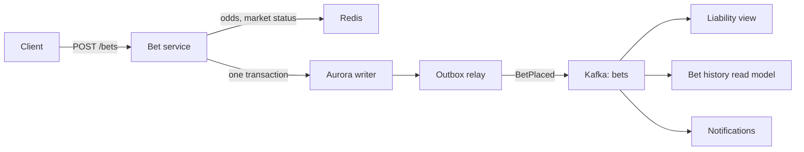

## Where we are

- SYS-DES-2 gave you the eight-step method and SYS-DES-4 ran it on three classic questions.
- DB-SQL-6–DB-SQL-10 gave you the database depth: indexes, transactions and MVCC, query performance, and the
  scaling ladder from replicas to sharding.

This lesson and SYS-DES-10 put them together on the question a betting company is
most likely to ask: **design a sports betting platform**. It's the longest case in the track, so it comes
in two parts:

- **Part 1 (this lesson):** requirements, estimates, API, data model, the high-level design and the
  database choices.
- **Part 2 (SYS-DES-10):** the five deep dives (odds, bet placement, the wallet ledger, settlement,
  responsible gambling), failure modes, trade-offs, the interviewer's deep-dive questions, and the lab.

## The problem

"Design a sportsbook." Users browse football matches, see prices that move every few seconds, and
place bets. When the match ends, winners get paid.

What makes it hard is the combination:

- **Odds** (the price: a £10 bet at odds of 3.0 returns £30, your £10 stake plus £20 winnings) must reach a
  million screens within a second.
- **Bets** move real money and can never be lost, doubled or placed at a price that no longer exists.
- **Load** isn't smooth: it arrives in walls at kick-off and after every goal.
- And the whole thing is **regulated**, so limits and self-exclusion are legal requirements, not features.

## Step 1: requirements

```text
Functional (in scope)
  - Browse sports → events → markets → selections with current odds
  - Live odds updates pushed to the client
  - Place a single bet (one selection, one stake) at the current price
  - Wallet: balance, deposit and withdraw (via a payment provider), bet history
  - Settle bets automatically when a result arrives; pay winners
  - Responsible gambling: deposit/loss/stake limits, time-outs, self-exclusion

Out of scope (say so): accumulators (multi-leg bets), cash-out, in-house pricing models,
  KYC/identity checks, payment-provider internals, casino games

Non-functional
  - Bet placement: p99 under ~300 ms (excluding any deliberate in-play delay)
  - An accepted bet is never lost; money is never created or destroyed; no double debit
  - Odds on screen at most ~1 s behind the source
  - Bet placement available ~99.95% during events; browsing can degrade more gracefully
  - Full audit trail of every money movement (regulators will ask)
```

Vocabulary used from here on:

- an **event** is a match;
- a **market** is a question about it ("match result");
- a **selection** is a possible answer ("Arsenal win") with **odds**;
- **In-play** betting happens while the event is running;
- **Suspending** a market stops new bets on it, for example the instant a goal is scored;
- **Settlement** decides each bet as won, lost or void and pays out;
- **Liability** is what the operator would pay if a selection wins.

## Step 2: estimates for a big-match spike

Every number here is an **assumption** you'd state out loud and check with the interviewer.

**Predict:** a million phones each watch about 20 selections that change about 5 times a second
in-play. If the server pushed every change, how many messages a second would that be, and how does it
compare with the bet rate?

```text
Concurrent users at a big final:        1,000,000 (assumption)
WebSocket connections:                   ~1,000,000 (one per open app)

Odds fan-out
  Each client watches ~20 selections; together they change ~5 times/s in-play (assumption)
  Naive push:   1M clients × 5 msgs/s            = 5M messages/s
  Conflated:    at most 2 batched msgs/s/client   = 2M messages/s
  Egress:       2M × ~200 bytes                   ≈ 400 MB/s ≈ 3.2 Gbit/s
  Gateways:     if one node holds ~50k connections (roughly; measure it), ~20 nodes + headroom

Bets
  20% of users bet in the 10 min before kick-off: 200k / 600 s   ≈ 330 bets/s
  Burst after a goal, ~10–15× for a minute                       ≈ 3,000–5,000 bets/s
  Each bet ≈ 7 row writes (idempotency key, wallet, bet, ledger txn, 2 entries, outbox)
  5,000 bets/s × 7                                                ≈ 35,000 row writes/s

Storage
  10M bets on a big day × ~1 KB (bet + ledger rows + indexes)     ≈ 10 GB/day → ~3.6 TB/year

Settlement
  2M open bets on the final's "match result" market, all decided at the final whistle
```

About 5 million messages a second, against a few thousand bets a second at the very worst: three orders
of magnitude apart. That gap shapes the whole design.

**So…**

1. **Fan-out is the scaling problem.** Millions of messages a second means a horizontally scaled
   push tier, conflation, and subscriptions by event.
2. **Bet placement is a correctness problem at moderate write rates.**
   - A few thousand short transactions a second is within reach of one well-sized Aurora writer, if each
     transaction is tiny.
   - That's the peak to load-test. Sharding stays an option, not day one.
3. **Settlement is a batch job with a deadline.** 2M bets processed one at a time is far too slow,
   so it must be parallel and idempotent.
4. **The spike is scheduled.** Kick-off times are known days ahead, so scale up *before* the event
   rather than relying on autoscaling to react to a wall of traffic.

## Step 3: the API

```text
GET  /sports/{id}/events?status=LIVE|UPCOMING&cursor=…     → events (cacheable)
GET  /events/{id}/markets                                   → markets + selections + odds + version

WS   /ws        client → {"subscribe": [eventId…]}
                server → {"eventId", "seq", "changes": [{"selectionId", "odds", "status"}…]}

POST /bets      Idempotency-Key: <uuid>
                {selectionId, stake, oddsSeen, acceptOddsChange: "NONE" | "HIGHER" | "ANY"}
                → 201 {betId, status: "ACCEPTED" | "PENDING", odds}
                → 409 {error: "ODDS_CHANGED", currentOdds}   → 409 {error: "MARKET_SUSPENDED"}
                → 422 {error: "LIMIT_EXCEEDED", limit}       → 402 {error: "INSUFFICIENT_FUNDS"}
GET  /me/bets?status=OPEN|SETTLED&cursor=…                  → keyset-paginated history (DB-SQL-8)
GET  /me/wallet                                             → balance
POST /me/deposits        Idempotency-Key: <uuid>  {amount, paymentMethodId}
PUT  /me/limits          {kind: "DEPOSIT_DAY", amount}
POST /me/self-exclusion  {period}
```

A **WebSocket** is one long-lived, two-way connection, opened as an HTTP request and then
"upgraded" (SYS-DES-7 compares it with polling). The server can push odds the moment they change.

Two API decisions to point out:

- `acceptOddsChange` makes the user's intent explicit when the price moves between seeing it and tapping
  "Place".
- Every money-moving `POST` carries an **idempotency key** (SYS-DES-3), because mobile clients on stadium
  Wi-Fi *will* retry.

```quiz
{"question": "Why does POST /bets carry an Idempotency-Key header?", "level": "easy",
 "options": [
   {"text": "So a retried request (a timeout on stadium Wi-Fi) returns the original result instead of placing and debiting a second bet", "correct": true, "why": "Mobile clients will retry. The key lets the server recognise the repeat and answer with the first bet."},
   {"text": "So the server can authenticate the user without a token", "why": "Identity comes from authentication. The key only identifies one logical request."},
   {"text": "So bets are processed in the order the user placed them", "why": "A random UUID carries no order. Where order matters, it comes from Kafka keys and sequence numbers."},
   {"text": "So a CDN can cache the response", "why": "Money-moving POSTs are never cached. The server stores the result itself, against the key."}]}
```

## Step 4: the data model

The shared schema (`users`, `sports`, `events`, `markets`, `selections`, `bets`) stays, with a few
columns added. Money gets a proper ledger.

```sql
-- additions to the shared tables
ALTER TABLE markets    ADD COLUMN status TEXT NOT NULL DEFAULT 'OPEN';  -- OPEN, SUSPENDED, RESULTED
ALTER TABLE selections ADD COLUMN odds_version BIGINT NOT NULL DEFAULT 0;
ALTER TABLE selections ADD COLUMN result TEXT;                          -- WIN, LOSE, VOID

-- the queries we must serve fast
CREATE INDEX bets_user_time        ON bets (user_id, placed_at DESC, id DESC);  -- my bets (keyset)
CREATE INDEX bets_open_by_selection ON bets (selection_id) WHERE status = 'OPEN'; -- settlement (DB-SQL-6)
CREATE INDEX events_sport_start    ON events (sport_id, starts_at);
CREATE INDEX markets_event         ON markets (event_id);
CREATE INDEX selections_market     ON selections (market_id);

-- retries: one row per (user, key), checked inside the bet transaction
CREATE TABLE idempotency_keys (
  user_id     BIGINT      NOT NULL,
  idem_key    UUID        NOT NULL,
  bet_id      BIGINT,
  created_at  TIMESTAMPTZ NOT NULL,
  PRIMARY KEY (user_id, idem_key)
);

-- the ledger (SYS-DES-10, deep dive 3)
CREATE TABLE accounts (
  id       BIGINT PRIMARY KEY,
  user_id  BIGINT REFERENCES users,          -- NULL for the operator's own accounts
  kind     TEXT NOT NULL,                     -- USER_CASH, HOUSE_STAKES, HOUSE_PNL, PSP_CLEARING
  balance  NUMERIC(14,2) NOT NULL DEFAULT 0,  -- cached; maintained for user accounts only
  CHECK (user_id IS NULL OR balance >= 0)
);
CREATE UNIQUE INDEX accounts_user_kind ON accounts (user_id, kind);

CREATE TABLE ledger_txns (
  id          UUID PRIMARY KEY,
  type        TEXT NOT NULL,                  -- DEPOSIT, BET_STAKE, BET_PAYOUT, BET_REFUND, ...
  bet_id      BIGINT,
  created_at  TIMESTAMPTZ NOT NULL
);
CREATE TABLE ledger_entries (
  id          BIGINT GENERATED ALWAYS AS IDENTITY PRIMARY KEY,
  txn_id      UUID   NOT NULL REFERENCES ledger_txns,
  account_id  BIGINT NOT NULL REFERENCES accounts,
  amount      NUMERIC(14,2) NOT NULL          -- signed; the entries of one txn sum to zero
);
CREATE INDEX ledger_entries_account ON ledger_entries (account_id, id);
CREATE INDEX ledger_entries_txn     ON ledger_entries (txn_id);

-- the shared schema's wallet_transactions becomes a view: the user's side of each movement
CREATE VIEW wallet_transactions AS
SELECT e.id, a.user_id, e.amount, t.type, t.created_at
FROM ledger_entries e
JOIN accounts a    ON a.id = e.account_id
JOIN ledger_txns t ON t.id = e.txn_id
WHERE a.kind = 'USER_CASH';

-- responsible gambling: running totals per user, kind and period
CREATE TABLE rg_usage (
  user_id       BIGINT NOT NULL,
  kind          TEXT   NOT NULL,                -- STAKE_DAY, DEPOSIT_DAY, LOSS_WEEK, ...
  period_start  DATE   NOT NULL,
  used          NUMERIC(12,2) NOT NULL DEFAULT 0,
  PRIMARY KEY (user_id, kind, period_start)
);

-- events to publish, written in the same transaction as the change (DB-SQL-10)
CREATE TABLE outbox (
  id          BIGINT GENERATED ALWAYS AS IDENTITY PRIMARY KEY,
  topic       TEXT NOT NULL,
  msg_key     TEXT NOT NULL,
  payload     TEXT NOT NULL,
  created_at  TIMESTAMPTZ NOT NULL
);
```

Why the idempotency key has its own table rather than a unique column on `bets`:

- DB-SQL-10 partitions `bets` by `placed_at`, and Postgres requires every unique constraint on a partitioned
  table to include the partition key.
- A separate small table keeps "one bet per key" enforceable. It's cleaned up after a few days.

Bet ids come from an ID generator (Snowflake-style or UUIDv7), not a database sequence, so the id
is known before the insert and stays unique if `bets` is ever sharded.

```quiz
{"question": "A reviewer asks: \"Why a separate idempotency_keys table? Just add UNIQUE (user_id, idem_key) to bets.\" What is the real reason?", "level": "hard",
 "options": [
   {"text": "bets is partitioned by placed_at, and Postgres requires a unique constraint on a partitioned table to include the partition key; adding placed_at would let a retry with a new timestamp through", "correct": true, "why": "UNIQUE (user_id, idem_key, placed_at) is allowed but useless: the retry arrives at a different time, so its row counts as unique. The small separate table enforces one bet per key and is cleaned up after a few days."},
   {"text": "Unique indexes are too slow on a table with billions of rows", "why": "A B-tree lookup stays fast at that size. The obstacle is the partitioning rule, not speed."},
   {"text": "The unique column would work; the table exists only so keys can be deleted after a few days", "why": "Cleanup is a bonus. On the partitioned bets table the constraint can't be created without the partition key at all."},
   {"text": "Postgres cannot put a unique constraint on a UUID column", "why": "UUID columns can be unique like any other type; idempotency_keys's own primary key includes one."}]}
```

## Step 5: the high-level design

```text
 odds suppliers ─┐                                   ┌──────────────► Redis: current odds,
 traders' tools ─┴─► odds ingest ──► Kafka            │                 market status, catalogue
                     (normalise,      "odds-updates"  │
                      sequence)       key = event_id ─┼──► odds service ──► Aurora (selections,
                                                      │                     conflated writes)
                                                      └──► push gateways (each reads all events,
                                                           keeps local subscriptions)
                                                                │ WebSocket
 clients ◄══════════════════════════════════════════════════════╯
    │
    │ HTTPS
    ▼
 load balancer ──► API (EKS pods)
                     ├─► bet service ──► Aurora writer: idempotency, wallet, bet, ledger, outbox
                     │        └─ reads odds + market status from Redis, limits from Aurora
                     ├─► wallet service ──► payment provider (deposits, withdrawals)
                     └─► history reads ──► Aurora readers / read models

 outbox relay ──► Kafka "bets" ──► liability (traders), notifications, read models (CQRS)

 results feed ──► Kafka "results" ──► settlement workers ──► Aurora (bets, ledger) ──► outbox
```

The bet path from that picture, on its own:



**Predict:** which of these steps must finish before the user sees `201`, and which can lag behind?

Everything up to `COMMIT` is on the user's clock. The relay and everything after Kafka can lag by
seconds, because the bet is already safe in Aurora.

Walk one bet through it:

1. The client taps "Place".
2. The bet service checks the idempotency key, the market status and current odds in Redis, and the user's
   limits.
3. Then, in **one** Aurora transaction, it debits the wallet, inserts the bet and the ledger entries, and
   writes an outbox row.
4. It returns `201`.
5. The outbox relay publishes `BetPlaced` to Kafka, and traders' liability view and the user's bet history
   update from it.

## Database choices

| Data | Store | Why |
|---|---|---|
| Bets, wallet accounts, ledger, idempotency keys, RG limits | **Aurora PostgreSQL** (writer) | ACID transactions across them in one `COMMIT`; constraints as a backstop; SQL for audit and reconciliation |
| Catalogue, history reads, reports | Aurora **readers** | Reads that tolerate ~ms of lag (DB-SQL-10) |
| Current odds, market status, catalogue cache, sessions, RG flags | **Redis** | Microsecond reads at very high rates; updated on change |
| Odds updates, results, bet events | **Kafka** | Ordered per key, replayable, many consumers |
| My-bets view, liability, analytics | Read models (CQRS) | Shapes the write model serves badly (DB-SQL-10) |

Why not a NoSQL store such as DynamoDB or Cassandra for bets? It could hold bets at huge scale. But:

- the core operation is "debit the wallet *and* record the bet *and* write the ledger, atomically";
- the numbers from Step 2 fit a relational writer;
- Aurora gives that atomicity with plain SQL, plus up to 15 readers and failover in tens of seconds.

Revisit if write volume outgrows one writer even after the ladder in DB-SQL-10, and say what you'd give up.

`bets` is partitioned by month on `placed_at` (DB-SQL-10) from the start, because it only grows.

- Sharding by `user_id` is held in reserve.
- Every transaction above touches one user's rows plus append-only house entries, so that option stays open.

```quiz
{"question": "The interviewer pushes: \"Bets are the biggest table. Put them in DynamoDB and keep the wallet in Aurora.\" Which response fits this design?", "level": "medium",
 "options": [
   {"text": "Keep bets, wallet, ledger and idempotency keys in one Aurora writer: the debit, the bet and the ledger must commit atomically, and the Step 2 rates fit one writer", "correct": true, "why": "The core operation spans all of them. Partition bets by month now, keep sharding by user_id in reserve, and revisit only if writes outgrow the DB-SQL-10 ladder."},
   {"text": "Agree, and debit the wallet first, then write the bet to DynamoDB", "why": "A crash between the two leaves money taken and no bet. You would need a saga to repair it, all to solve a scale problem the numbers say you don't have."},
   {"text": "Agree, and run a distributed two-phase commit across Aurora and DynamoDB", "why": "DynamoDB can't join a two-phase commit with Postgres, and 2PC would add latency and failure modes at the kick-off peak."},
   {"text": "Shard Aurora by bet id from day one", "why": "Sharding by bet id spreads one user's wallet and bets across shards, so the per-user transaction stops being local. If you ever shard, shard by user_id."}]}
```

## Lab (~10 min): re-run the numbers and the hot queries

A design exercise on paper. Size the platform for an ordinary Saturday: **300,000** concurrent users
across ten matches, with the same per-user assumptions as Step 2.

1. Redo the Step 2 maths: conflated messages per second, egress, gateway nodes (at ~50k connections
   each), bets per second before kick-off and after a goal, and row writes per second.
2. Write the keyset query for page 2 of `GET /me/bets` for user 42, given the last row of page 1
   (`placed_at = '2026-11-21 15:02:11+00'`, `id = 880417`), and name the index that serves it.
3. **Break it:** a colleague "simplifies" Step 4. They:
   - drop `idempotency_keys`;
   - add an `idem_key` column to the partitioned `bets` table;
   - run `ALTER TABLE bets ADD UNIQUE (user_id, idem_key);`.

   What does Postgres do? And what goes wrong if they "fix" it by adding `placed_at` to the constraint?

Then check:

```text
1. Messages: 300k × 2/s = 600k/s; egress 600k × ~200 bytes ≈ 120 MB/s ≈ 1 Gbit/s;
   gateways 300k / 50k = 6 nodes + headroom.
   Bets: 20% of 300k = 60k in 600 s ≈ 100/s; after a goal ×10–15 ≈ 1,000–1,500/s;
   × 7 rows ≈ 7,000–10,500 row writes/s. Same shape, smaller: fan-out still dominates.
2. SELECT id, selection_id, stake, odds_at_placement, status, placed_at
   FROM bets
   WHERE user_id = 42 AND (placed_at, id) < ('2026-11-21 15:02:11+00', 880417)
   ORDER BY placed_at DESC, id DESC
   LIMIT 20;
   Served by bets_user_time (user_id, placed_at DESC, id DESC): one seek, then 20 entries,
   however deep the page.
3. Postgres refuses: a unique constraint on a partitioned table must include all partitioning
   columns. With placed_at added it is accepted but useless: a retry arrives at a new time, so its
   row is "different" and the bet is placed twice. Keep the separate table.
```

## Gotchas

- **Pushing every odds tick to every client.** The fan-out estimate shows why it can't work.
  Conflate per client, subscribe by event, and batch.
- **Reacting to kick-off with autoscaling.** The wall arrives faster than new pods and connections
  warm up. Pre-scale for scheduled events.
- **A unique idempotency column on the partitioned `bets` table.** It can't catch retries (the lab
  shows why). Give the keys their own small table.

## In interviews

Asked as:

- "Design a sports betting platform / sportsbook"
- "Design the bet placement service"
- "Design a wallet"
- "How would you push live odds to millions of users?"
- "Design settlement"

Bank:

- [Design an Idempotent API](#/q/design-idempotent-api): the idempotency-key table.
- [Design a Ticket Booking System](#/q/design-ticket-booking): contention on scarce resources at a
  scheduled spike.
- [Microservices communication: gRPC vs REST vs events](#/q/microservices-communication-grpc-vs-rest-eda):
  why bets and results flow through Kafka.
- [Scaling an RDBMS and When to Use NoSQL](#/q/rdbms-scaling-vs-nosql): defending Aurora for bets.

Typical follow-up:

- *"Make it multi-region."* Keep each user's money in one home region (a single writer per user),
  replicate catalogue and odds globally, and route bet placement to the user's home region. Two
  writers for the same wallet would reintroduce double-spend.

## Explain it in 2 minutes

*"Scope it, size it and draw it: the first 15 minutes of a sportsbook design."*

- Scope: browse, live odds, single bets, wallet, settlement, responsible gambling; the spike is at
  kick-off and is scheduled.
- Numbers: odds fan-out is the scaling problem; a few thousand bets a second is the correctness one.
- API and data: `acceptOddsChange`, idempotency keys in their own table, a ledger and an outbox.
- Boxes: odds → Kafka → Redis and gateways; bets → one Aurora transaction → outbox → Kafka.
- Stores: Aurora for money, Redis for current odds, Kafka for ordered streams.

## Check yourself

1. From the Step 2 numbers, what is the scaling problem, and what is the correctness problem?
2. Why are bet ids generated by an ID generator rather than a database sequence?

### Answers

1. Scaling: odds fan-out to ~1M WebSocket clients (millions of messages a second). Correctness: bet
   placement and the wallet, at a few thousand transactions a second.
2. The id is known before the insert, and it stays unique if `bets` is ever sharded.

## Next

SYS-DES-10: the five deep dives this design leads to, then failure modes and trade-offs.
