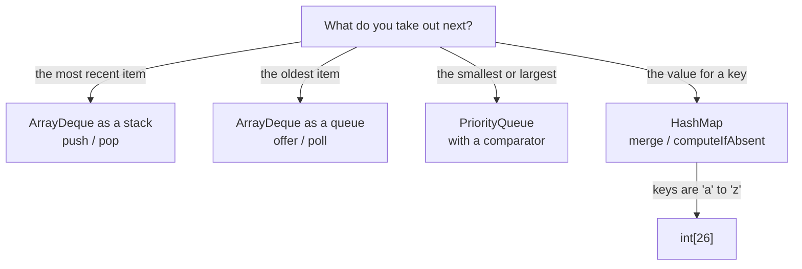

## Where we are

You can write a basic Java class with loops, arrays and methods.

In a coding interview the same ten library calls come up in almost every problem, and each has a short
form and a trap. This lesson makes them automatic.

You'll see a few things before their own lessons teach them; for now, one line each:

- `<>` (the diamond) lets the compiler fill in a type such as `<String>`.
- A **lambda** `(a, b) -> a + b` is a short inline function.
- A **method reference** `Integer::sum` names an existing method as one.
- O(1), O(log n) and O(n) say how work grows with input size (DSA-CPLX-1).
- **boxing** wraps an `int` in an `Integer` object.

## The problem

You are 25 minutes into a 45-minute coding round. Your solution passes every example, and the
interviewer says: "Looks good. Let's run the hidden tests." These are lines you wrote:

```java
Stack<Integer> st = new Stack<>();                         // legacy class
Map<String, Integer> count = new HashMap<>();
if (count.containsKey(w)) count.put(w, count.get(w) + 1);  // clumsy
else count.put(w, 1);
PriorityQueue<int[]> pq = new PriorityQueue<>((a, b) -> a[0] - b[0]);  // can overflow
int mid = (lo + hi) / 2;                                   // can overflow
```

None fail on small examples.

- Hidden tests with values near 10⁹ break two.
- The interviewer has noticed all four.

Each section below fixes one.

## Pick the container first

Most of these idioms start with choosing a container. Ask what the problem needs you to take out next:



## Counting with `Map.merge`

A **`Map`** stores key → value pairs. `HashMap` is the usual implementation, with O(1) average
lookup.

Counting things is the single most common map job.

```java
Map<String, Integer> count = new HashMap<>();
for (String w : words) {
    count.merge(w, 1, Integer::sum);   // absent: put 1; present: old + 1
}
int c = count.getOrDefault("x", 0);    // read without a null check
```

`merge(key, value, fn)` means: if the key is absent, store `value`; otherwise store
`fn(oldValue, value)`. If `fn` returns `null`, the key is removed.

**Rule:** count with `merge`, read with `getOrDefault`. If the keys are `'a'`–`'z'`, skip the map
and use `int[26]`, indexed by `c - 'a'`.

```quiz
{"question": "A sliding window drops word w. Which line decrements its count?", "level": "easy",
 "options": [
   {"text": "count.merge(w, -1, Integer::sum);", "correct": true, "why": "merge adds -1 to the old value. Follow it with if (count.get(w) == 0) count.remove(w), so the map size still means 'distinct words in the window'."},
   {"text": "count.put(w, count.get(w)--);", "why": "-- needs a variable; it cannot be applied to a method's return value, so this does not compile."},
   {"text": "count.getOrDefault(w, 0) - 1;", "why": "That computes a number and throws it away. getOrDefault only reads; nothing is stored."},
   {"text": "count.merge(w, -1, (a, b) -> a - b);", "why": "fn receives (old, -1), so old - (-1) = old + 1: it increments. merge passes the new value as the second argument."}]}
```

## Grouping with `computeIfAbsent`

Grouping means building a key → list map, for example "anagrams grouped by sorted letters" or
"adjacency list of a graph".

```java
Map<Integer, List<Integer>> graph = new HashMap<>();
for (int[] e : edges) {
    graph.computeIfAbsent(e[0], k -> new ArrayList<>()).add(e[1]);
    graph.computeIfAbsent(e[1], k -> new ArrayList<>()).add(e[0]);
}
```

`computeIfAbsent` returns the existing list, or creates one, stores it and returns it, in one call.
Don't write `computeIfAbsent(k, k -> ...)`: a lambda parameter can't reuse the name of a local
variable still in scope, and that compile error wastes a minute.

## `Deque`, not `Stack`

- A **stack** is last-in, first-out (LIFO).
- A **queue** is first-in, first-out (FIFO).
- A **`Deque`** ("deck", double-ended queue) can do both. `ArrayDeque` is its fast array-based implementation.

```java
Deque<Integer> stack = new ArrayDeque<>();
stack.push(1); stack.push(2);
int top = stack.pop();          // 2

Deque<Integer> queue = new ArrayDeque<>();
queue.offer(1); queue.offer(2);
int first = queue.poll();       // 1
```

Why not `java.util.Stack`? It's a legacy class built on `Vector`:

- synchronized on every call;
- it exposes index-based methods that break the stack abstraction;
- its own Javadoc recommends `Deque`.

**Watch out:** `ArrayDeque` rejects `null` elements.

## `PriorityQueue` and comparators

A **`PriorityQueue`** is a heap: `poll()` always returns the smallest element according to its
ordering: O(log n) `offer`/`poll`, O(1) `peek`, but O(n) `remove(Object)`. By default it's a min-heap.

```java
PriorityQueue<Integer> minHeap = new PriorityQueue<>();
PriorityQueue<Integer> maxHeap = new PriorityQueue<>(Comparator.reverseOrder());

// meetings as int[]{start, end}: order by end time
PriorityQueue<int[]> byEnd = new PriorityQueue<>(Comparator.comparingInt(m -> m[1]));

// by frequency descending, then word ascending
PriorityQueue<String> pq = new PriorityQueue<>(
    Comparator.<String>comparingInt(count::get).reversed()
              .thenComparing(Comparator.naturalOrder()));
```

A **comparator** is a function `compare(a, b)` that returns:

- a negative number if a comes first;
- zero if they're equal;
- positive if b comes first.

**Watch out:** if you change an element's priority after inserting it, the heap won't notice: remove it
(O(n)) and re-insert it.

**Predict:** you offer 5, 1, 4, 2, 3 to a min-heap and call `System.out.println(pq)`. Sorted?

No. It prints `[1, 2, 4, 5, 3]`: the heap's internal array.

- A heap only guarantees that the top is the minimum.
- Iterating or printing gives heap order; only repeated `poll()` gives sorted order.

```quiz
{"question": "You need the k largest numbers from a stream of n numbers, using O(k) memory. Which heap?", "level": "medium",
 "options": [
   {"text": "A min-heap of size k: offer each number, poll when the size exceeds k", "correct": true, "why": "The top is the smallest of your current top k, exactly the one to evict. O(n log k) time, O(k) memory."},
   {"text": "A max-heap of all n numbers, then poll k times", "why": "Right answer, but it holds all n numbers: O(n) memory, which the question rules out."},
   {"text": "A max-heap of size k, polling when the size exceeds k", "why": "poll would remove the largest number, one of those you want to keep."},
   {"text": "A min-heap of size k, then print it to get the answer sorted", "why": "The heap holds the right k numbers, but printing shows heap order, not sorted order."}]}
```

## `Integer.compare`, not subtraction

**Predict:** `(a, b) -> a - b` compares `2_000_000_000` with `-2_000_000_000`. What does `a - b` give?

It should be 4 × 10⁹, but an `int` holds only about ±2.1 × 10⁹, so it wraps around to a negative
number. The comparator now claims the larger number comes first, and sorts and heaps silently
misbehave on hidden tests.

```java
(a, b) -> Integer.compare(a, b)
Comparator.comparingInt(x -> x[0])
(a, b) -> Long.compare(a[1], b[1])
```

**Rule:** never subtract in a comparator.

## Binary search midpoint: `lo + (hi - lo) / 2`

```java
int mid = (lo + hi) / 2;          // lo + hi can exceed 2^31 - 1 and go negative
int mid = lo + (hi - lo) / 2;     // never overflows when 0 ≤ lo ≤ hi
int mid = (lo + hi) >>> 1;        // also safe for non-negative lo, hi: unsigned shift
```

This matters most in **binary search on the answer**, where `lo` and `hi` are values up to 10⁹, not
indices; there, make them `long`.

## Overflow in general

An `int` runs from -2³¹ to 2³¹ - 1, one more negative value than positive. Sums and products are where
overflow bites:

```java
int sum = 0;  for (int x : nums) sum += x;    // 10⁵ values of 10⁹ → overflow
long sum = 0; for (int x : nums) sum += x;    // fine

long area = (long) w * h;                     // cast BEFORE multiplying
long bad  = (long) (w * h);                   // multiplied as int, then cast: too late
```

If you're unsure, `Math.addExact` and `Math.multiplyExact` throw instead of wrapping.

```quiz
{"question": "Which of these is still negative?", "level": "hard",
 "code": ["int x = Integer.MIN_VALUE;   // -2,147,483,648"],
 "options": [
   {"text": "Math.abs(x)", "correct": true, "why": "+2,147,483,648 does not fit in an int (max 2,147,483,647), so it wraps back to MIN_VALUE. Math.absExact would throw instead."},
   {"text": "Math.abs((long) x)", "why": "Widened to long first, so +2,147,483,648 fits."},
   {"text": "-(long) x", "why": "The cast applies before the minus, so the negation happens in long and the result is positive."},
   {"text": "Math.abs(x + 1)", "why": "x + 1 is -2,147,483,647, whose absolute value fits exactly in an int."}]}
```

## Arrays pitfalls

```java
int[][] dp = new int[n][m];
for (int[] row : dp) Arrays.fill(row, -1);   // correct: fill each row
Arrays.fill(dp, new int[m]);                 // WRONG: every row is the SAME array

List<int[]> wrong = Arrays.asList(new int[]{1, 2});   // a list of ONE int[]
List<Integer> right = List.of(1, 2);

Arrays.sort(intervals, (a, b) -> Integer.compare(a[0], b[0]));  // int[][] with a comparator: fine
// Arrays.sort(int[], comparator) does not exist: box to Integer[] or sort then reverse

System.out.println(Arrays.toString(arr));         // debug print for 1-D
System.out.println(Arrays.deepToString(grid));    // and for 2-D
```

`Integer` values compared with `==` compare references. That works for -128..127 (cached) and fails
above.

Use `.equals()` or compare `int`s.

```quiz
{"question": "After this runs, what is dp[2][0]?", "level": "medium",
 "code": ["int[][] dp = new int[3][3];", "Arrays.fill(dp, new int[3]);", "dp[0][0] = 7;"],
 "options": [
   {"text": "7", "correct": true, "why": "Arrays.fill stored one and the same int[3] in all three slots. A write through dp[0] is visible through dp[2]."},
   {"text": "0", "why": "That would be true if each row were its own array, as after new int[3][3] alone or a fill per row."},
   {"text": "It throws ArrayIndexOutOfBoundsException", "why": "Every index is in range; the bug is silent sharing, not a crash."},
   {"text": "It does not compile", "why": "Arrays.fill(Object[], Object) accepts it: an int[] is an Object, and dp is an array of int[] rows."}]}
```

## Streams: nice for setup, not for hot loops

Streams are fine for one-off conversions:

```java
int[] arr = list.stream().mapToInt(Integer::intValue).toArray();
List<Integer> boxed = Arrays.stream(arr).boxed().toList();
```

In an algorithm's inner loop, though, they box values and allocate objects; a plain loop is faster
and easier for the interviewer to follow. Also, `Collectors.toMap` throws on duplicate keys unless
you pass a merge function, and a lambda can't reassign a local variable.

## Fast I/O for online assessments

When an assessment makes you read standard input with around 10⁵ numbers or more, `Scanner` can be
slow enough to matter (it parses with regular expressions). Use this instead:

```java
import java.io.*;
import java.util.*;

public class Main {
    public static void main(String[] args) throws IOException {
        BufferedReader in = new BufferedReader(new InputStreamReader(System.in));
        int n = Integer.parseInt(in.readLine().trim());
        StringTokenizer st = new StringTokenizer(in.readLine());
        long sum = 0;
        for (int i = 0; i < n; i++) sum += Integer.parseInt(st.nextToken());

        PrintWriter out = new PrintWriter(new BufferedWriter(new OutputStreamWriter(System.out)));
        out.println(sum);
        out.flush();                     // forget this and nothing is printed
    }
}
```

The same goes for output: write to a `PrintWriter` (or a `StringBuilder`) and flush once, rather
than calling `System.out.println` 10⁵ times.

## Lab (~10 min)

Use these idioms together on "top k most frequent words", and watch the comparator bug happen.

```java
import java.util.*;

public class IdiomsLab {

    static List<String> topK(String[] words, int k) {
        Map<String, Integer> count = new HashMap<>();
        for (String w : words) count.merge(w, 1, Integer::sum);

        // min-heap of size k: least frequent (then alphabetically last) on top
        PriorityQueue<String> pq = new PriorityQueue<>(
            Comparator.<String>comparingInt(count::get)
                      .thenComparing(Comparator.<String>reverseOrder()));
        for (String w : count.keySet()) {
            pq.offer(w);
            if (pq.size() > k) pq.poll();
        }
        List<String> res = new ArrayList<>();
        while (!pq.isEmpty()) res.add(pq.poll());
        Collections.reverse(res);
        return res;
    }

    public static void main(String[] args) {
        String[] words = {"i", "love", "code", "i", "love", "java", "i"};
        System.out.println(topK(words, 2));           // expect [i, love]

        Integer[] xs = {2_000_000_000, -2_000_000_000, 0};
        Integer[] bad = xs.clone(), good = xs.clone();
        Arrays.sort(bad, (a, b) -> a - b);            // overflowing comparator
        Arrays.sort(good, Integer::compare);
        System.out.println("subtract: " + Arrays.toString(bad));
        System.out.println("compare:  " + Arrays.toString(good));

        int lo = 1_500_000_000, hi = 2_000_000_000;
        System.out.println("(lo+hi)/2       = " + (lo + hi) / 2);
        System.out.println("lo+(hi-lo)/2    = " + (lo + (hi - lo) / 2));
    }
}
```

Run it with `java IdiomsLab.java`. **Predict** each line before you look.

**What to observe:** `[i, love]`; the subtraction comparator leaves the array unsorted
(`[2000000000, -2000000000, 0]`) while `Integer::compare` sorts it; `(lo+hi)/2` prints
`-397483648`.

**Break it:**

1. Delete the `.thenComparing(...)` tie-break and call `topK(new String[]{"pear", "apple", "fig"}, 1)`.
2. All counts tie, so the answer should be `[apple]` (alphabetically first).
3. Watch for `[fig]`: with no tie-break, the winner is whatever order the `HashMap` happened to iterate
   in, the kind of bug that passes the examples and fails a hidden test.

Then **extend it**:

- add a group-anagrams method using `computeIfAbsent`;
- use a `Deque` as a stack to reverse `res` instead of `Collections.reverse`.

## Gotchas

- **`(a, b) -> a - b` in a comparator.** Use `Integer.compare` or `Comparator.comparingInt`.
- **`(lo + hi) / 2` with large values.** Use `lo + (hi - lo) / 2`, and `long` when searching answers up to 10⁹ or more.
- **`java.util.Stack`.** Use `Deque<Integer> st = new ArrayDeque<>()`.
- **`Arrays.fill(dp, new int[m])`.** It shares one row; fill each row in a loop.
- **Forgetting `out.flush()` with `PrintWriter`.** Nothing prints and the OA marks every test wrong.
- **`int` sums of many large values.** Use `long`, and cast before multiplying.

## In interviews

These idioms appear inside almost every problem and decide whether your code survives hidden tests.

- [Top K Frequent Elements](#/q/top-k-frequent-elements) and [Top K Frequent Error Codes](#/q/top-k-frequent-words)
- [Meeting Rooms II](#/q/meeting-rooms-ii)
- [Valid Parentheses](#/q/valid-parentheses)
- [Merge car-rental booking intervals](#/q/merge-intervals)
- [Koko Eating Bananas](#/q/koko-eating-bananas) and [Search in Rotated Sorted Array](#/q/search-in-rotated-sorted-array)
- [Group items sharing at least one attribute](#/q/group-items-by-shared-attributes)

**"Why `ArrayDeque` and not `Stack`?"** `Stack` is a legacy class extending `Vector`, synchronized for no benefit;
the Javadoc itself recommends `Deque`.

## Explain it in 2 minutes

*"What Java habits do you rely on in a coding round?"*

1. `merge`/`getOrDefault` for counting, `computeIfAbsent` for grouping.
2. `ArrayDeque` for stacks and queues; `PriorityQueue` with `Comparator.comparingInt`.
3. No subtraction in comparators, and a safe midpoint (overflow).
4. `long` for sums and products, cast before multiplying.
5. Plain loops in hot paths; fast I/O with flush when reading stdin.

## Check yourself

1. Write the one-liner that increments a word count in a `Map<String,Integer>`.
2. What does `new PriorityQueue<>(Comparator.reverseOrder())` give you?
3. You print a `PriorityQueue` and it isn't sorted. Is it broken?

### Answers

1. `count.merge(word, 1, Integer::sum);`
2. A max-heap: `poll()` returns the largest element.
3. No. A heap only guarantees the top is the minimum; poll repeatedly to get sorted order.

## Next

INTV-TIPS-2 uses this fluency in a full round; DSA-CPLX-2 explains why choices like `ArrayDeque.poll()` over `ArrayList.remove(0)`, which shifts every element, are also about speed.
