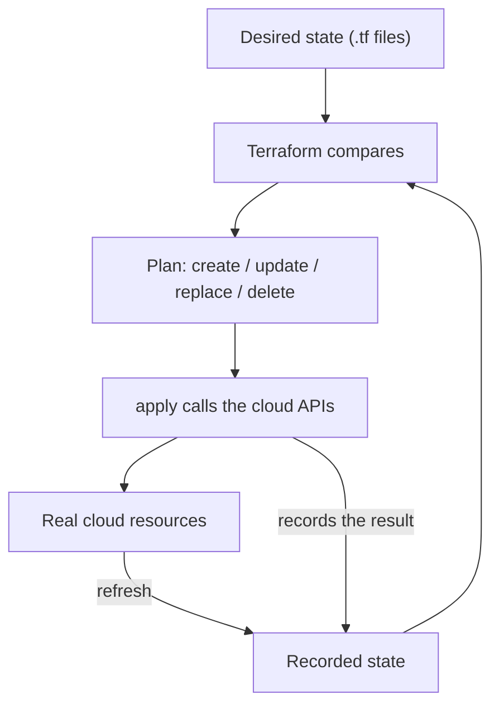

## Where we are

DIST-SYS-8 mapped ShopKart onto AWS: VPC, subnets, security groups, IAM roles, S3, RDS. It ended with
one line on **infrastructure as code** and why clicked-together infrastructure drifts.

This lesson is that line in full:

- Terraform, and how it decides what to change;
- where it keeps its memory;
- how a team uses it safely through the CI/CD pipeline from DIST-SYS-6.

## The problem

It is Thursday afternoon. A customer audit on Monday asks why ShopKart's production database security
group allows traffic from `0.0.0.0/0`.

You open the console: someone opened it "for ten minutes" months ago.

Staging was built by hand by one engineer, production by another, and nobody can list how they differ.

The same week, the business wants ShopKart in a second region. The only plan anyone has is "click it all again
and hope".

Missing:

- **reproducibility** (build the same environment twice);
- **review** (a change is a diff someone approves);
- **drift detection** (see when reality no longer matches what was agreed).

**Infrastructure as code (IaC)** means describing infrastructure in versioned text files in Git and
letting a tool create and change the real resources from them.

## Declarative, not imperative

- An **imperative** approach lists steps: "create a bucket, then turn on versioning". Run it twice and the
  second run fails or makes a second bucket.
- A **declarative** approach describes the end state: "there is a bucket called X with versioning on". The
  tool compares that with what exists and works out the steps.



Declarative is what makes a re-run safe: if reality already matches, the plan is empty.

That is the idempotency DIST-SYS-3 asked of retries, applied to infrastructure.

## Providers, resources and data sources

Terraform files use **HCL** (HashiCorp Configuration Language) and end in `.tf`. Three building blocks:

- A **provider** is a plugin that knows one platform's API: `aws`, `azurerm`, `google`, `kubernetes`,
  even `github`. Terraform's core knows nothing about S3; the AWS provider does.
- A **resource** is one thing Terraform creates and owns, such as a bucket or a security group.
- A **data source** reads something that exists already, which Terraform does not own, such as the
  current AWS account or a VPC another team manages.

```hcl
terraform {
  required_version = ">= 1.11"
  required_providers {
    aws = {
      source  = "hashicorp/aws"
      version = "~> 6.0"
    }
  }
}

provider "aws" {
  region = "ap-south-1"
}

data "aws_caller_identity" "current" {}     # read-only: which account am I in?

resource "aws_s3_bucket" "invoices" {        # owned: Terraform creates and deletes it
  bucket = "shopkart-invoices-${data.aws_caller_identity.current.account_id}"
}
```

- **Order:** referring to another block's attribute (`data.aws_caller_identity.current.account_id`) also
  tells Terraform the order. It builds a dependency graph and creates things in sequence, in parallel where
  it can.
- **Pin the provider** (`~> 6.0` allows 6.x, not 7.0): major versions contain breaking changes.

```quiz
{"question": "ShopKart's app needs the id of a VPC that the network team created and manages in their own Terraform. Which block do you write in ShopKart's configuration?", "level": "easy",
 "options": [
   {"text": "A data source that looks up the VPC", "correct": true, "why": "A data source reads something that already exists and that this configuration does not own."},
   {"text": "A resource \"aws_vpc\" with the same settings", "why": "A resource means Terraform creates and owns it: you would get a second VPC, or fight the network team over one."},
   {"text": "An output", "why": "An output exposes a value from your configuration; it does not read anything from outside."},
   {"text": "A provider block", "why": "The provider knows how to talk to AWS, but it does not by itself fetch any particular VPC."}]}
```

## Variables, outputs and locals

- A **variable** is an input, so one configuration serves several environments.
- An **output** is a value the configuration exposes, such as a bucket name for the app's config.
- A **local** is a named expression, to avoid repeating yourself.

```hcl
variable "environment" {
  type        = string
  description = "dev, staging or prod"
}

locals {
  common_tags = { app = "shopkart", env = var.environment }
}

output "invoices_bucket" {
  value = aws_s3_bucket.invoices.bucket
}
```

Values come from:

- a `terraform.tfvars` file;
- `-var` flags;
- or `TF_VAR_environment` environment variables.

## The workflow: init, plan, apply, destroy

```text
terraform init      download providers and modules, connect to the state backend
terraform plan      compare desired vs recorded vs real; print what would change
terraform apply     show the plan again, ask for "yes", then make the changes
terraform destroy   delete everything this configuration manages
```

The plan marks each resource:

- `+` create;
- `~` update in place;
- `-` destroy;
- or `-/+` **replace** (destroy and recreate, because that attribute cannot be changed in place).

Reading the plan is the whole skill. A `-/+` on a database is a delete of your data; a rename of a bucket is a
replace.

- `terraform fmt` rewrites files into the standard layout.
- `terraform validate` checks syntax and references without calling the cloud.

Both belong in CI.

```quiz
{"question": "You rename the identifier of ShopKart's staging database in code. The plan shows -/+ next to aws_db_instance.main. What happens if you apply?", "level": "medium",
 "options": [
   {"text": "The database is destroyed and a new, empty one is created", "correct": true, "why": "-/+ means replace: the attribute cannot change in place, so Terraform deletes and recreates. Without a snapshot the data is gone."},
   {"text": "The database is renamed in place and keeps its data", "why": "That would be ~ (update in place). -/+ says this change cannot be made in place."},
   {"text": "Terraform copies the data to the new database first", "why": "Terraform calls create and delete APIs; it does not migrate data for you."},
   {"text": "Nothing; -/+ is only a warning", "why": "Every symbol in a plan is an action apply will take."}]}
```

## The state file

Terraform needs to remember which real resource belongs to which address.

That memory is the **state file**, `terraform.tfstate`: JSON mapping `aws_s3_bucket.invoices` to the real
bucket, with every attribute Terraform knows about it.

Lose the state and Terraform believes nothing exists, so the next apply tries to create it all again.

Two facts follow:

- **State can contain secrets.** If a resource has a password attribute, such as a database's master
  password, it is stored in state in plain text. Treat the state file as sensitive.
- **State must be shared and locked.** On a laptop, only that laptop knows the truth. Two people
  applying at once can corrupt it.

## Remote state with locking

A **backend** is where state lives.

For AWS teams the usual choice is an S3 bucket, with versioning on (so a bad write can be rolled back) and
encryption.

```hcl
terraform {
  backend "s3" {
    bucket       = "shopkart-tfstate"
    key          = "staging/app/terraform.tfstate"
    region       = "ap-south-1"
    encrypt      = true
    use_lockfile = true
  }
}
```

**Locking** means only one `plan` or `apply` can hold the state at a time; the second waits or fails.

- **Native (Terraform 1.11+):** the S3 backend can lock natively: `use_lockfile = true` writes a lock object
  next to the state (it was experimental in 1.10).
- **Older way:** still common in existing code, a DynamoDB table named in `dynamodb_table`, which the current
  S3 backend docs mark as deprecated.
- **Migrating:** both can be set at once.

The state bucket itself is created once, by hand or by a small separate configuration.

## Drift, and plan as the diff

**Drift** is when real infrastructure no longer matches the code, usually because someone changed it in
the console.

- `plan` refreshes state against the real resources first, so drift shows up as a proposed change back to
  what the code says.
- `terraform plan -refresh-only` shows only what changed outside Terraform, without proposing fixes.

What to do:

- **Wrong console change:** `apply` reverts it.
- **Right one:** put it in the code.
- **Early warning:** a scheduled `plan` that alerts on a non-empty diff finds drift early.

## Modules: reuse

A **module** is a folder of `.tf` files with variables in and outputs out. Every configuration is a
module (the **root module**); others are called from it.

```hcl
module "invoices_bucket" {
  source      = "./modules/private-bucket"
  name        = "shopkart-invoices-${var.environment}"
  environment = var.environment
}
```

The module bakes in your standards once: versioning, encryption, public access blocked, tags.

- Pin registry modules like a library.
- Keep modules small: a module with forty variables is as hard to change as the click-ops it replaced.

## One state per environment

Dev, staging and prod must not share a state file, or a mistake in dev can touch prod.

- **Workspaces** give one configuration several named states. But they share one backend and credentials,
  and applying in the wrong one is easy.
- **Separate directories** (`envs/staging/`, `envs/prod/`), each with its own backend key and calling the
  same modules, let prod have its own AWS account, role and approval.

Prefer the latter; workspaces suit short-lived copies such as a per-branch test stack.

## Secrets

- Never write a secret into a `.tf` or `.tfvars` file that is committed.
- Never commit state. Add `*.tfstate`, `*.tfstate.*` and `.terraform/` to `.gitignore`.
- Mark variables and outputs `sensitive = true` so they are hidden in plan output. This hides them from
  the screen, **not** from state.
- Let AWS generate and hold the secret (Secrets Manager, or RDS's managed master password) and pass
  Terraform only its ARN, so the value never reaches state.
- If Terraform must pass the value itself, use:
  - **ephemeral values** (Terraform 1.10+: ephemeral variables and resources, never written to plan or state);
  - **write-only arguments** (Terraform 1.11+: the provider receives the value but Terraform does not store it).
  - For example, `aws_db_instance` accepts `password_wo` with `password_wo_version`.
  - Terraform stores only the version number, so you bump it to send a new password.
- CI authenticates to AWS with short-lived credentials through an IAM role (for GitHub Actions, OIDC
  federation), not stored access keys. This is DIST-SYS-8's "roles, not keys" again.

## Terraform in CI/CD

```text
pull request ─► init -backend=false, fmt -check, validate ─► init, plan ─► plan posted on the PR ─► review
merge to main ► init, plan -out=tfplan ─► approval gate shows that plan ─► apply tfplan
```

Apply only from the pipeline, never from laptops.

`validate` needs providers installed, so CI first runs `terraform init -backend=false`, which downloads them
without touching the state backend.

**Predict:** a plan was saved on the PR at 10:00, and another PR was applied at 11:00.

At 12:00 the pipeline runs `terraform apply tfplan` with the 10:00 file. What happens?

Terraform refuses: the saved plan is **stale**, because state changed after it was made.

A saved plan is only valid against the exact state it was computed from. Two ways to work with that:

- **Usual fix:** **re-plan on main after merge**, save that plan, show it at an approval gate, and apply
  exactly that file.
- **Atlantis style:** apply the PR's own saved plan before merging, while the PR holds a lock on that
  directory.

Either way, treat the plan file as a **sensitive artifact**. It contains the configuration and values, which
can include secrets, so keep it short-lived and access-restricted.

```quiz
{"question": "Your pipeline saves a plan on each PR and applies that file after merge. Two PRs touching the same state merge an hour apart. What happens to the second apply?", "level": "hard",
 "options": [
   {"text": "Terraform rejects the saved plan as stale, because state changed after it was made", "correct": true, "why": "A saved plan is tied to the state it was computed from. Re-plan on main and apply that plan behind an approval gate."},
   {"text": "It applies and silently undoes the first PR's changes", "why": "This is the danger people fear, and exactly why Terraform checks the saved plan against current state and refuses."},
   {"text": "Terraform quietly re-plans and applies the new result", "why": "apply with a plan file never re-plans; what you reviewed is what runs, or nothing runs."},
   {"text": "The state lock makes the second apply wait, then it succeeds", "why": "Locking stops two operations at the same moment; it does not make an outdated plan valid."}]}
```

## OpenTofu and the alternatives

In 2023 HashiCorp moved Terraform to the Business Source License, which is not open source.

The community forked the last open version as **OpenTofu**, now a CNCF project (accepted into the CNCF
Sandbox in April 2025):

- same HCL;
- a `tofu` command;
- most configurations move across with little change.

Check parity for newer features.

| Tool | One-line trade-off |
|---|---|
| **CloudFormation** | AWS-native, state managed by AWS, no backend to run; AWS only, verbose YAML/JSON |
| **AWS CDK** | Real languages (Java, TypeScript) that generate CloudFormation; AWS only, inherits its limits |
| **Pulumi** | Real languages, many clouds; state backend and a smaller community than Terraform's |
| **Terraform / OpenTofu** | Many clouds and SaaS providers, huge ecosystem; you manage state |

## Lab (~10 min)

You need:

- an AWS account;
- the AWS CLI logged in;
- Terraform 1.11 or later.

This costs pennies at most, but do the cost step at the end.

1. **Set a budget alert first.** In AWS Billing, create a monthly cost budget of a small amount (for
   example 5 USD) with an email alert. This catches anything you forget to delete, in any lab.
2. Make a folder with `main.tf`:

```hcl
terraform {
  required_version = ">= 1.11"
  required_providers {
    aws = { source = "hashicorp/aws", version = "~> 6.0" }
  }
}

provider "aws" { region = "ap-south-1" }

data "aws_caller_identity" "current" {}

resource "aws_s3_bucket" "lab" {
  bucket        = "iac-lab-${data.aws_caller_identity.current.account_id}"
  force_destroy = true   # lab only: lets destroy delete a non-empty bucket
}

resource "aws_s3_bucket_versioning" "lab" {
  bucket = aws_s3_bucket.lab.id
  versioning_configuration { status = "Enabled" }
}

output "bucket_name" { value = aws_s3_bucket.lab.bucket }
```

3. Run `terraform init`, `terraform fmt`, `terraform validate`, `terraform plan`.
   - Observe: two resources to add, one output.
   - Then `terraform apply`, type `yes`, and note the output.
4. **Predict:** you run `terraform plan` again without touching anything. What does it print?
   - Run it. It prints **No changes.**
   - Reality already matches the code, so there is nothing to do: that is idempotency.
5. Open `terraform.tfstate` and find your bucket's entry. This is why state is never committed.

**Then break it:** in the S3 console, open the bucket's Properties and **suspend** versioning.

**Predict:** what will `terraform plan` propose now, and on which resource?

Run it. Terraform proposes `~ update in-place` on `aws_s3_bucket_versioning.lab`, status `Suspended` →
`Enabled`.

That is drift, found by `plan`. Run `apply` to put it back.

Try one more: change the bucket name in `main.tf` and run `plan`.

Observe `-/+` (must be replaced). Revert it without applying.

**Clean up:** run `terraform destroy`, type `yes`, and confirm the bucket is gone in the console.

Keep the budget alert.

## Gotchas

- **State committed or lost:** committed leaks secrets, lost means Terraform forgets everything; use an
  encrypted, versioned remote backend with locking from day one.
- **Applying without reading the plan:** read every replace and destroy; add
  `lifecycle { prevent_destroy = true }` to databases and buckets.
- **Console fixes:** the next apply silently undoes them; fix in code (or import) and run scheduled plans.
- **`sensitive = true` is not encryption:** it hides values on screen; they are still in state.
- **Applying a PR's saved plan after merge:** it is rejected as stale; re-plan on main behind an approval gate.
- **Unpinned providers and modules:** pin with `~>` and commit `.terraform.lock.hcl`.

## In interviews

Asked as:

- "Used Terraform?"
- "Where do you keep state?"
- "How do you handle drift?"
- "How do infra changes reach prod?"
- "Terraform vs CloudFormation?"

Bank:

- [CI/CD pipeline basics](#/q/ci-cd-pipeline-basics)
- [Re-architect Your Current Project Without Public Cloud](#/q/design-current-project-without-cloud)

**Follow-up: "Someone changed prod in the console. Now what?"**

1. A scheduled `plan -refresh-only` shows the drift.
2. Codify it if it was right, apply to revert if not.
3. Then remove the console permission that allowed it.

## Explain it in 2 minutes

"Explain how Terraform works and how your team uses it."

- Declarative HCL in Git; providers call each cloud's API; `plan` diffs code against state and reality.
- State maps code to real resources: S3 with locking (`use_lockfile` on 1.11+, DynamoDB before),
  encrypted and versioned because it holds secrets.
- Modules package standards; separate state per environment, ideally per account.
- CI runs fmt, validate and plan on each PR, re-plans on main and applies behind approval; scheduled
  plans catch drift.

## Check yourself

1. Why are declarative re-runs safe?
2. What does the state file store, and why never commit it?
3. How does S3 backend locking work today, and what was the older way?
4. Workspaces or separate directories for dev and prod?

### Answers

1. You describe the end state and the tool computes steps; if reality matches, the plan is empty.
2. Each resource address mapped to the real resource and its attributes, secrets in plain text included.
3. `use_lockfile = true` (1.11+) writes a lock object in the bucket; previously a DynamoDB table, now deprecated.
4. Separate directories or accounts: prod gets its own credentials and approval; workspaces suit
   short-lived copies.

## Next

REFERENCE-4 places Terraform beside every other backend tool; AI-BUILD-10 uses it to ship TriageDesk on AWS.
