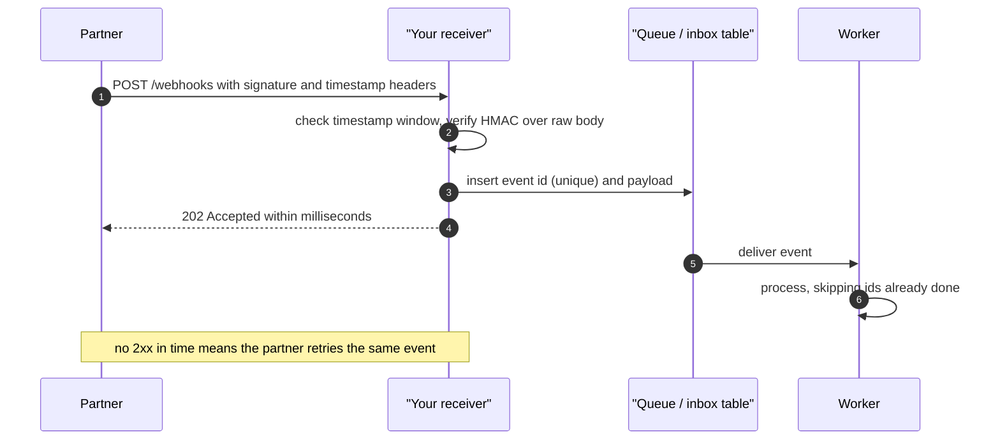
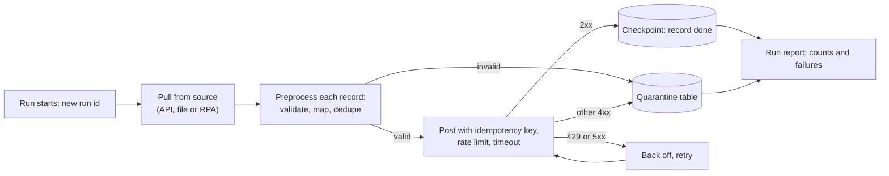

## Where we are

WEB-API-3 taught you to design an API others call (idempotency keys, cursors, one error format). Now **you**
are the client of systems you do not control, and picking the style and making the job safe to re-run is most of the work.

## The problem

It is Monday. ShopKart has signed a new supplier. Every 15 minutes you must take the supplier's stock levels,
clean them up, and post them to a marketplace partner's API so ShopKart never sells what it does not have.
The supplier has no API, only a portal where a human logs in and reads a table. The marketplace accepts at
most 10 requests per second and answers `429` when you go faster.

On Tuesday the job dies on row 3,412 of 8,000 because one product code is blank. It restarts from row 1 and
posts 3,411 updates a second time. On Wednesday the portal adds a cookie banner and the job "succeeds" with
zero rows. Nobody notices until customers buy stock that does not exist.

The job was written as a script, not as an **integration**: code that moves data between systems owned by
different people, and assumes each can be slow, wrong, down or changed without notice.

## The menu: seven integration styles

| Style | Who starts it | Typical shape |
|---|---|---|
| **API pull** | You call them | `GET /stock?updatedSince=...` over HTTPS |
| **Webhook push** | They call you | `POST /webhooks/supplier` when something changes |
| **Polling** | You, on a timer | API pull repeated every N minutes, asking "what changed?" |
| **Batch file** | Either side drops a file | CSV or fixed-width file on SFTP, nightly |
| **Screen scraping / RPA** | You drive their UI | A browser bot logs in and reads the screen |
| **CDC / messaging** | Their database or broker | Every committed change streamed as an event |
| **iPaaS / Camel** | A middle layer | Routes that connect the other styles without much code |

## API pull: the default when it exists

If the other side has a documented, versioned API, use it: you get a contract, typed errors and a stated rate
limit. The cost is their uptime and limits, and data only as fresh as your last call; the client code itself
(timeouts, retries, error mapping) is WEB-API-7.

## Webhooks: receiving

A **webhook** is an HTTP request the other system sends to a URL you register when an event happens.

**Predict:** your webhook handler validates, writes to three tables and calls another service before
answering. It takes 20 seconds. The sender gives up after 10 seconds. What happens next?

The sender treats the timeout as a failure and **sends the same event again**, while your first attempt
also finishes: you process it twice. Webhooks are **at-least-once**, so duplicates are normal.



A safe receiver does four things, in this order:

1. **Check the timestamp** header. Reject anything outside a few minutes, the **replay window**, so a
   captured valid request cannot be resent tomorrow.
2. **Verify the signature.** The sender computes an **HMAC** (a hash keyed with a secret only you and they
   know) over the timestamp plus the raw body, and sends it in a header. You recompute it over the **raw
   bytes** you received, before any JSON parsing reformats them, and compare with a **constant-time**
   comparison such as `MessageDigest.isEqual`. `String.equals` stops at the first differing character, so
   its timing leaks how much of a guess was right. Better still, compare the decoded raw bytes (or normalise
   the hex case first), so `AB12` and `ab12` are not a false mismatch. When the secret is rotated, accept a
   signature made with the old or the new secret for a short overlap.
3. **Deduplicate.** Store the event id with a unique constraint. A second insert fails, and you answer
   `2xx` without processing again. This makes you an **idempotent consumer** (a receiver that applies each
   message once, however many times it arrives; DIST-SYS-3).
4. **Answer fast, work later.** Save the event, answer `202`, and process it asynchronously.

```quiz
{"question": "Your receiver verifies the HMAC with a constant-time compare, keeps processed event ids for 1 hour, and accepts timestamps up to 24 hours old. What breaks?", "level": "hard",
 "options": [
   {"text": "A captured request replayed 2 hours later is processed again: its id has been forgotten, but its timestamp is still inside the window", "correct": true, "why": "The window only protects you if the dedupe store remembers ids for longer than the window. Keep ids longer than the tolerance (or shrink the tolerance to minutes)."},
   {"text": "Nothing: the HMAC check stops every replay", "why": "A replay is the original, validly signed request. The signature matches, so only the timestamp window and dedupe can stop it."},
   {"text": "Legitimate retries are rejected as stale", "why": "Partner retries arrive within minutes to hours, well inside a 24-hour window. The problem is the opposite: too much is accepted."},
   {"text": "Duplicates within the first hour are processed twice", "why": "Within the hour the id is still in the store, so the unique constraint catches the duplicate."}]}
```

**Choose it** when you need changes within seconds. The cost is a public endpoint, duplicates, out-of-order
delivery and **missed events** if you are down longer than their retries, so pair it with a periodic
**reconciliation** pull.

## Webhooks: sending

When ShopKart is the sender, the duties flip:

- **Sign** each request (per-subscriber secret, timestamp, unique event id), and send from an **outbox** (a
  table written in the same transaction as the business change, published later; DIST-SYS-3).
- **Retry** timeouts and `5xx` with backoff and **jitter** (a random spread added to each wait) for hours, not
  forever, then park the event in a **dead-letter queue** for replay. Never retry a `4xx` other than `429`.
- **Validate subscriber URLs** against **SSRF** (tricking your server into calling an internal address; WEB-API-4).

## Polling done well

**Polling** means calling the API on a timer and asking what changed since last time: no public endpoint,
and a missed run is caught by the next one. Make it cheap with **conditional requests** (WEB-API-1): send
last time's `ETag` in `If-None-Match`; if nothing changed, the server answers `304 Not Modified` with no body.
For lists, keep a **watermark**: the highest change marker you have fully processed, saved after each page.

**Predict:** your watermark is the last `updated_at` you saw, and you ask for `updated_at > :watermark`.
Two rows changed in the same millisecond, and your page ended after the first one. What happens to the
second?

It is lost forever: the next query starts strictly after that timestamp. Use the API's **cursor**, a change
sequence number, or a compound watermark `(updated_at, id)`; or overlap a little and let an idempotent upsert
absorb the repeats.

**Choose it** when there are no webhooks and minutes of delay are fine; you control the pace, at the cost of
up to one interval of delay, wasted calls and watermark bugs.

```quiz
{"question": "Your poller sends If-None-Match with the ETag from the previous call. Nothing has changed on the server. What should come back?", "level": "easy",
 "options": [
   {"text": "304 Not Modified with no body", "correct": true, "why": "The ETag still matches, so the server skips the body. You keep using what you already have."},
   {"text": "200 OK with the same body again", "why": "That is what happens without a conditional header, or if the server ignores it."},
   {"text": "204 No Content", "why": "204 means the request succeeded and there is no body to send; it does not mean \"unchanged since your copy\"."},
   {"text": "412 Precondition Failed", "why": "412 is for conditional writes such as If-Match on a PUT, when the resource changed under you."}]}
```

## Batch files over SFTP

Banks, payers and older systems exchange **batch files**: a CSV dropped on an **SFTP** server (file transfer
over SSH) on a schedule. The classic bug is reading a half-written file. The rules:

- **Atomic hand-off.** The writer uploads `stock_20261121.csv.tmp`, then renames it to `.csv` (a rename is
  atomic), or sends a separate `.done` marker file.
- **Checksums.** Verify the SHA-256 from a manifest or sidecar file before importing.
- **Idempotent import.** Record file name plus checksum with a unique key: a repeat is skipped, a corrected
  file is processed. **Archive** processed files so you can replay one.

**Choose it** when the partner offers only files, or volume is large and daily freshness is enough; it is cheap
and easy to replay, at the cost of hours of delay and format drift (a new column breaks the parser).

## Screen scraping and RPA: when the screen is the only API

**RPA** (robotic process automation) means a program drives a user interface the way a person would, with
**Selenium** or **Playwright** opening a browser, logging in and reading or typing. It is the **last resort**,
after asking for an API, an export or a file feed: the UI is not a contract, and a renamed button, a new
pop-up or a session timeout breaks the bot, often silently.

**Predict:** Wednesday's run returned zero rows and exit code 0. Which single check would have paged someone?

An **assertion on counts**: zero rows when yesterday had 8,000 is an alert, not a success. Every step "worked";
only a check on the outcome can notice that nothing was read. How to make a bot survivable:

- **Stable selectors and explicit waits.** Prefer roles, labels and `data-testid` over long XPath, and wait
  for a condition with a timeout, never a fixed sleep.
- **Guarded stages.** Check preconditions, handle pop-ups, act, handle pop-ups, **verify the outcome**: right
  page and right record before acting, the save really happened after.
- **Assert on counts**, as above, and alert on the run report, not only on exceptions.
- **Idempotent and re-runnable.** Record which records are done, so a crash at record 3,412 resumes there.

## CDC and messaging

**Change data capture (CDC)** reads a database's own change log (PostgreSQL's WAL, MySQL's binlog) and
emits every committed insert, update and delete as an event. **Debezium**, running on Kafka Connect, is the
common open-source tool; DB-SQL-10 and DIST-SYS-9 go deeper.

- **Choose it when:** you own (or are trusted with) the source database, need every change in order, and
  cannot change the application that writes it.
- **Benefit:** no polling, no missed changes, and the writer is untouched.
- **Cost:** you couple to their **table schema**, which is not an API, and you now run Kafka Connect. If you
  can change the writer, publishing curated events from an outbox is safer.

If both sides already share a broker, plain **messaging** is simplest: consume their topic (DIST-SYS-2).
An **iPaaS** (hosted connectors such as MuleSoft or Boomi) or **Apache Camel** (its open-source, code-first
cousin) pays off only when you have dozens of integrations of the same few shapes.

## Decision matrix

| Need | First choice | Fallback |
|---|---|---|
| Documented API, minutes of delay fine | API pull / polling with a cursor | Batch file |
| Changes within seconds, partner supports it | Webhooks + reconciliation pull | Polling at a short interval |
| Large daily volume, partner offers files | SFTP batch file | API pull, paged |
| You own the source DB, need every change | Outbox + CDC if you can change the writer; Debezium on its tables if not | Polling a change table |
| Shared broker already exists | Messaging | Webhooks |
| No API, no export, no feed | RPA, behind guarded stages | Ask for an export, again |
| Dozens of similar integrations | Apache Camel or an iPaaS | A shared in-house job framework |

```quiz
{"question": "A regional partner's legacy system has no API and no webhooks, but its admin screen can schedule a nightly CSV export to a folder. You need the data by 7 am. Which style?", "level": "medium",
 "options": [
   {"text": "Batch file: have the export land on SFTP, import it with checksum and file-level idempotency", "correct": true, "why": "A supported export beats driving their UI. Daily freshness meets the 7 am need, and files are easy to replay."},
   {"text": "RPA: a bot logs in at 6 am and reads every page of the screen", "why": "RPA is the last resort. There is a supported export, which will not break when they move a button."},
   {"text": "Debezium on their database", "why": "You do not own their database, and CDC couples you to their table schema. Far too invasive for a nightly need."},
   {"text": "Poll their screen every minute", "why": "Polling needs an API to call. Scraping every minute adds load and fragility for data that is only needed daily."}]}
```

## The pull, preprocess, post job

Most integrations are a job with three stages: **pull**, **preprocess** (validate, map, dedupe), **post**.



The rules that would have saved each day:

- **Idempotency keys.** Derive a deterministic key per record, such as a hash of `sku + snapshotTime`, and
  send it as `Idempotency-Key` (WEB-API-3), so a re-run is applied once. With no such header, upsert by
  natural key or keep your own "sent" table.
- **Checkpoints.** Record each record (or batch) as done, so Tuesday's restart resumes at row 3,412.
- **Isolate, continue, report.** Move a bad record to a **quarantine** with the reason, carry on, and end
  with a report: `8000 read, 7998 posted, 2 quarantined`.
- **Rate-limit-aware posting.** Throttle yourself to the documented limit with a **token bucket** (a counter
  refilled at the allowed rate; each request spends one token or waits). On `429 Too Many Requests`, honour
  the `Retry-After` header before trying again; if it is absent, use exponential backoff with jitter. Retry
  `5xx` and timeouts too, a bounded number of times, and only because the idempotency key makes it safe.
- **Timeouts** on every HTTP call and UI step, plus a maximum run time so a hung run cannot overlap the next.
- **Observability:** a run correlation id in every log line and header, counts as metrics (DIST-SYS-7), no PII.

```quiz
{"question": "Your job posts 8,000 records. Record 5,000 gets 429 with Retry-After: 30. What should the job do?", "level": "medium",
 "options": [
   {"text": "Wait 30 seconds, retry record 5,000 with the same idempotency key, then continue at the throttled rate", "correct": true, "why": "429 is a transient \"slow down\". Honour Retry-After, keep the key so the retry is safe, and keep the rate below the limit."},
   {"text": "Retry immediately in a tight loop until it succeeds", "why": "That makes the overload worse and can get your client blocked. The server told you how long to wait."},
   {"text": "Quarantine record 5,000 as invalid and move on", "why": "Nothing is wrong with the record. Quarantine is for records that will never succeed, such as validation failures."},
   {"text": "Abort the run and restart from record 1 later", "why": "Restarting from the top reposts 4,999 records. Checkpoints let you continue where you are."}]}
```

## Lab (~10 min)

Build a webhook receiver's security core: timestamp window, HMAC-SHA256 over `timestamp.body`, constant-time
compare, and deduplication by event id. Save as `WebhookReceiver.java`, then `javac WebhookReceiver.java`
and `java WebhookReceiver`.

```java
import java.nio.charset.StandardCharsets;
import java.security.MessageDigest;
import java.time.Duration;
import java.time.Instant;
import java.util.HashMap;
import java.util.HexFormat;
import java.util.Map;
import javax.crypto.Mac;
import javax.crypto.spec.SecretKeySpec;

public class WebhookReceiver {

    enum Outcome { ACCEPTED, DUPLICATE, BAD_SIGNATURE, STALE }

    static final Duration TOLERANCE = Duration.ofMinutes(5);   // replay window
    static final Duration ID_RETENTION = Duration.ofHours(1);  // how long processed ids are remembered

    private final byte[] secret;
    private final Map<String, Instant> seenEventIds = new HashMap<>();   // in production: a table, unique key

    WebhookReceiver(byte[] secret) { this.secret = secret; }

    // The sender signs "timestamp.body", so a captured body cannot be replayed with a fresh timestamp.
    static String sign(byte[] secret, long timestamp, String body) throws Exception {
        Mac mac = Mac.getInstance("HmacSHA256");
        mac.init(new SecretKeySpec(secret, "HmacSHA256"));
        byte[] raw = mac.doFinal((timestamp + "." + body).getBytes(StandardCharsets.UTF_8));
        return HexFormat.of().formatHex(raw);
    }

    // eventId is read from the (signed) body after verification; passed in here to keep the demo short.
    Outcome receive(String eventId, long timestamp, String signature, String body, Instant now) throws Exception {
        if (Duration.between(Instant.ofEpochSecond(timestamp), now).abs().compareTo(TOLERANCE) > 0) {
            return Outcome.STALE;                                  // 1. outside the replay window
        }
        String expected = sign(secret, timestamp, body);           // 2. recompute over the raw body
        boolean match = MessageDigest.isEqual(                     //    time depends only on length
                expected.getBytes(StandardCharsets.UTF_8), signature.getBytes(StandardCharsets.UTF_8));
        if (!match) {
            return Outcome.BAD_SIGNATURE;
        }
        seenEventIds.values().removeIf(seenAt -> seenAt.isBefore(now.minus(ID_RETENTION)));
        if (seenEventIds.putIfAbsent(eventId, now) != null) {
            return Outcome.DUPLICATE;                              // 3. already processed: still answer 2xx
        }
        return Outcome.ACCEPTED;                                   // 4. enqueue for async processing, answer 2xx
    }

    public static void main(String[] args) throws Exception {
        byte[] secret = "demo-shared-secret".getBytes(StandardCharsets.UTF_8);   // real code: a secret manager
        WebhookReceiver receiver = new WebhookReceiver(secret);
        Instant now = Instant.ofEpochSecond(1_800_000_000L);
        long ts = now.getEpochSecond();
        String body = "{\"id\":\"evt_1\",\"type\":\"order.shipped\",\"orderId\":\"A-100\"}";
        String sig = sign(secret, ts, body);

        System.out.println("signature    = " + sig.substring(0, 16) + "...");
        System.out.println("first        = " + receiver.receive("evt_1", ts, sig, body, now));
        System.out.println("redelivery   = " + receiver.receive("evt_1", ts, sig, body, now.plusSeconds(30)));
        String tampered = body.replace("A-100", "A-999");
        System.out.println("tampered     = " + receiver.receive("evt_1", ts, sig, tampered, now));
        Instant later = now.plus(Duration.ofHours(2));             // attacker resends the captured request
        System.out.println("replay later = " + receiver.receive("evt_1", ts, sig, body, later));
    }
}
```

**Predict** the four outcomes before you run it. Real output (Java 21):

```text
signature    = 7c2d383dd806c755...
first        = ACCEPTED
redelivery   = DUPLICATE
tampered     = BAD_SIGNATURE
replay later = STALE
```

**Break it.** Replace the timestamp check's condition with `false`, so the window is never enforced, and
run again. Watch the last line: it becomes `replay later = ACCEPTED`. The dedupe store forgot `evt_1` after
`ID_RETENTION`, so the captured request, signature and all, is processed again: the hard quiz above, live.
Put the check back. And if the sender signed only the body, an attacker could attach a fresh timestamp to
a captured request; that is why the timestamp is **inside** the signed string.

## Gotchas

- **Parsing JSON before verifying the signature.** Re-serialising changes bytes and the HMAC fails, or
  worse, you trust a body you have not verified. Verify the raw bytes first.
- **Doing the work before answering the webhook.** Slow handlers cause retries and duplicates. Store,
  answer `2xx`, process asynchronously, dedupe by event id.
- **Timestamp watermarks with `>`.** Rows sharing the boundary timestamp are skipped forever. Use a cursor,
  a sequence number, or `(updated_at, id)`.
- **Retrying a POST with no idempotency key.** A timeout does not mean it failed; the retry may apply it
  twice. Send a deterministic key or upsert by natural key.
- **An RPA run that "succeeds" with zero rows.** UI changes fail silently. Assert expected counts and
  verify the outcome of every stage.

## In interviews

Asked as "Tell me about your current work", "Webhook or polling?" and "How do you make a job safe to
re-run?". Bank:
[Walk Me Through Your Current Work / Projects](#/q/walk-through-current-work),
[Integrate a central HR system with many local HR systems](#/q/design-central-hr-system-integration),
[Design an Idempotent API](#/q/design-idempotent-api),
[Messaging systems (queues, pub/sub) in backend services](#/q/messaging-systems-fundamentals),
[A system failure you handled](#/q/system-failure-and-fault-tolerance-story).

**Follow-up: "Why not just use the API?"** Say what you asked for first (API, export, file feed), why RPA
was left, and how you contained its fragility (guarded stages, count checks, alerts).

**STAR prompts for "tell me about your work"** (your own facts only; the full method is INTV-TIPS-6):

- **Situation:** which source, and why it had no usable API.
- **Task:** what you owned, and how many records per run.
- **Action:** the style you chose and why, plus how you made it re-runnable, isolated bad records and respected limits.
- **Result:** a measured outcome, and what you would do next.

## Explain it in 2 minutes

"You must sync data from a system you do not own into a partner's API. How do you design it?"

- Pick the style by what the source offers: API, webhooks, files, CDC, and RPA only as the last resort.
- Webhooks: verify an HMAC over timestamp plus raw body with a constant-time compare, enforce a replay
  window, dedupe by event id, answer fast and process asynchronously, reconcile periodically.
- Polling: conditional requests, and a cursor or compound watermark, not a bare timestamp.
- The job: pull, preprocess, post, with idempotency keys, checkpoints and a quarantine for bad records.
- Operations: throttle to the limit, honour `Retry-After`, timeouts everywhere, alert on suspicious counts.

## Check yourself

1. Name the four steps a webhook receiver takes, in order, and why the order matters.
2. What is wrong with `WHERE updated_at > :lastSeen` as a polling watermark, and one fix?
3. How do you stop a reader from importing a half-uploaded SFTP file, and the same file twice?
4. A posting job crashes halfway. What two mechanisms make the restart safe?

### Answers

1. Timestamp window, HMAC over the raw body, dedupe by event id, then store, answer `2xx` and process
   later. Cheap rejections first, and nothing trusted before it is verified.
2. Rows sharing the last timestamp that fall after the page boundary are never read. Use a cursor or
   sequence number, or the pair `(updated_at, id)`.
3. The writer uploads to a temporary name and renames when complete (or sends a `.done` marker); the
   reader records file name plus checksum with a unique key and skips repeats.
4. Checkpoints (skip records already done) and idempotency keys (a repeated post is applied once).

## Next

DIST-SYS-13 schedules jobs like this one safely (one instance at a time, no overlap); WEB-API-7 writes the
HTTP client calls with timeouts, retries and error mapping.
