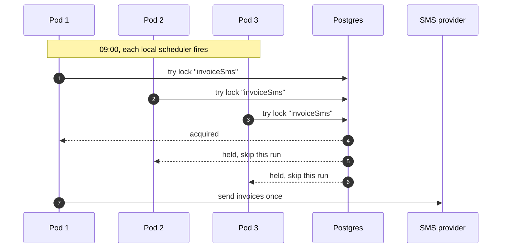

## Where we are

JAVA-CONC-8 covered scheduling **inside one JVM**:

- `ScheduledExecutorService`, fixed rate vs fixed delay;
- the silent stop when a periodic task throws;
- Spring's `@Scheduled` with its single default thread.

Production services run as several instances, though, and restart whenever they are deployed. This lesson is
about making a job:

- run once per schedule across a fleet;
- run later at a precise time;
- survive restarts without losing or doubling work.

## The problem

It is the first of the month, 09:00. Your billing service runs on three Kubernetes pods (a pod is one running
instance of your service; DIST-SYS-5).

A method annotated
`@Scheduled(cron = "0 0 9 1 * *")` sends "your invoice is ready" SMS messages.

By 09:02 the support channel is on fire: every customer got **three** messages, and the SMS bill tripled. Last
month it was fine, because the service ran on one pod.

Then a second report: the "expire unpaid holds after 15 minutes" job missed a whole hour of holds during last night's
deployment, because the pods were restarting at the exact minute the cron fired. You need two things:

- exactly one runner per tick;
- no lost work when a tick is missed.

## Why `@Scheduled` runs on every pod

**Predict:** three identical pods, each with `@EnableScheduling` and the same cron. How many times does the method
run at 09:00?

**Answer:** three. `@Scheduled` is purely local: each JVM has its own scheduler thread and its own clock, and none of
them knows the others exist.



**How to read it:** with a shared lock one pod wins and the others skip; the three fixes are a lock per run, a
shared worker queue, or one elected leader.

## Strategy 1: ShedLock, a lock per run

**ShedLock** is a small library that wraps a scheduled method in a named lock stored in a shared database (or Redis,
ZooKeeper and others). Every pod still fires; only the one that gets the lock runs the body.

```java
@Configuration
@EnableScheduling
@EnableSchedulerLock(defaultLockAtMostFor = "10m")
class SchedulingConfig {
    @Bean
    LockProvider lockProvider(DataSource dataSource) {
        return new JdbcTemplateLockProvider(JdbcTemplateLockProvider.Configuration.builder()
                .withJdbcTemplate(new JdbcTemplate(dataSource))
                .usingDbTime()                 // use the database clock, not each pod's clock
                .build());
    }
}

@Scheduled(cron = "0 0 9 1 * *")
@SchedulerLock(name = "invoiceSms", lockAtMostFor = "30m", lockAtLeastFor = "1m")
void sendInvoiceSms() { ... }
```

- **`lockAtMostFor`** is a safety net for a pod that dies while holding the lock: the lock expires after that time.
  Set it well above the longest normal run.
- **`lockAtLeastFor`** keeps the lock for a minimum time, so a very short job is not run again by a pod whose clock
  is a few seconds behind.
- A pod that finds the lock taken **skips** that run; it does not wait or queue it.
- It is only a lock, not a scheduler; it needs a `shedlock` table.

Use it for jobs that are one indivisible unit: a nightly report, a monthly export, a cache rebuild.

```quiz
{"question": "At 09:00, pod 2 tries to run a @SchedulerLock job, but pod 1 already holds the lock. What does pod 2 do?", "level": "easy",
 "options": [
   {"text": "Skips this run and waits for the next scheduled time", "correct": true, "why": "ShedLock does not wait or queue: a pod that cannot get the lock simply skips that execution."},
   {"text": "Blocks until pod 1 releases the lock, then runs the job", "why": "That would run the job twice per tick, which is exactly what the lock prevents."},
   {"text": "Queues the run and executes it after pod 1 finishes", "why": "ShedLock is only a lock, not a scheduler, so it keeps no queue of missed runs."},
   {"text": "Throws an exception that stops pod 2's scheduler", "why": "Skipping is normal behaviour. No exception is thrown, and later ticks run as usual."}]}
```

## Strategy 2: a worker queue with `SKIP LOCKED`

When the work is a set of rows (holds to expire, emails to send), do not elect one runner; let **every** pod help.
DB-SQL-7 introduced `FOR UPDATE SKIP LOCKED`: each transaction locks some rows and skips rows another transaction
already holds.

```sql
-- every pod, every few seconds, in its own short transaction
select id, payload from job
where status = 'READY' and due_at <= now()
order by due_at
limit 50
for update skip locked;
-- process them, then: update job set status = 'DONE' where id = any(?)
```

Two pods never get the same row, nobody blocks, and adding pods adds throughput.

One design choice matters:

- **Short processing:** hold the row lock during processing. A crash simply releases it and the row is picked up again.
- **Long processing:** instead, use a lease.
  1. Mark rows `RUNNING` with a `locked_until` lease in a short transaction, and commit.
  2. Process, then mark `DONE`.
  3. A sweeper returns expired `RUNNING` rows to `READY`.

Either way a row can run twice after a crash, so the work must be idempotent (running it twice has the same
effect as running it once).

## Strategy 3: leader election

A **leader** is the one instance allowed to run singleton work (several schedules, a stream consumer, a
coordinator) until it stops renewing its claim. Two common building blocks:

- **A database lease row:** `update leader set holder = :me, expires_at = now() + interval '30 seconds' where name =
  'scheduler' and (holder = :me or expires_at < now())`. One row updated means you lead; renew every 10 seconds.
- **A Kubernetes `Lease`** (`coordination.k8s.io/v1`), a Kubernetes object one instance holds to act as leader:
  the same idea stored in the cluster API, with a holder identity and a duration (Kubernetes basics are in DIST-SYS-5).

The trap: a leader paused by a long GC can wake up after its lease expired and act alongside the new leader. Fixes:

- keep the work itself idempotent; or
- pass a **fencing token** (a number that grows with every new lease) to the systems it writes to, so stale
  leaders are rejected.

```quiz
{"question": "Every 5 minutes, 50,000 expired seat holds must be released. The service runs on 4 pods. Which approach fits best?", "level": "medium",
 "options": [
   {"text": "Each pod polls with SELECT ... FOR UPDATE SKIP LOCKED in small batches", "correct": true, "why": "The work is row-shaped, so all four pods can share it without blocking each other, and a crashed pod's rows are picked up again."},
   {"text": "ShedLock on the @Scheduled method", "why": "It is correct (only one pod runs), but one pod does all 50,000 rows while three sit idle. ShedLock suits indivisible jobs."},
   {"text": "Plain @Scheduled on every pod, each releasing all expired holds", "why": "All four pods process the same rows at once: wasted work, lock waits and possibly duplicate side effects."},
   {"text": "A Kubernetes CronJob that starts a new pod every 5 minutes", "why": "It works, but pod start-up adds latency and cost for a 5-minute cadence, and the row-sharing problem is still yours inside the Job."}]}
```

## Quartz with a clustered JDBC job store

**Quartz** is a full scheduler library: jobs, triggers, persistence and misfire rules. With the **JDBC job store**
and `isClustered=true`, every node shares the Quartz tables and only one node fires each trigger.

```properties
spring.quartz.job-store-type=jdbc
spring.quartz.properties.org.quartz.jobStore.isClustered=true
spring.quartz.properties.org.quartz.scheduler.instanceId=AUTO
```

- `@DisallowConcurrentExecution` stops a slow run overlapping the next.
- Node clocks must be synchronised.
- **When:** Quartz pays off for many dynamic, per-tenant schedules that must survive restarts.

## Kubernetes CronJob

A **CronJob** creates a Kubernetes `Job` (a pod that runs to completion) on a cron schedule, outside your service.

**Predict:** with default settings, a 20-minute run of a CronJob scheduled every 15 minutes: what happens at the
next tick?

**Answer:** a second run starts and overlaps the first, because `concurrencyPolicy` defaults to `Allow`.

```yaml
apiVersion: batch/v1
kind: CronJob
metadata:
  name: monthly-invoices
spec:
  schedule: "0 9 1 * *"
  timeZone: "Asia/Kolkata"
  concurrencyPolicy: Forbid
  startingDeadlineSeconds: 600
  jobTemplate:
    spec:
      backoffLimit: 2
      template:
        spec:
          restartPolicy: OnFailure
          containers:
            - name: invoices
              image: billing-jobs:1.4.0
              args: ["send-invoices"]
```

- **`concurrencyPolicy`:** `Allow` (the default) lets runs overlap, `Forbid` skips a new run while the previous one
  is still going, `Replace` stops the old run and starts the new one.
- **`startingDeadlineSeconds`:** if a run could not start on time (controller down, cluster busy), it is still started
  within this many seconds; later than that, that run is skipped and counted as failed. Unset means no deadline.
- **`timeZone`** is stable since Kubernetes 1.27; without it, the controller's local time zone is used.
- The docs say a CronJob creates a Job "approximately once" per schedule: sometimes two, sometimes none. **Jobs
  must be idempotent.**

Choose it for heavy or rare batch work that should not share resources with the request-serving pods.

**Cloud schedulers** (Amazon EventBridge Scheduler, Google Cloud Scheduler) move "who fires" out of your service,
but the target must still be idempotent.

## Delayed jobs: "run this at 10:15"

Some work is not periodic but scheduled per item: send a reminder 24 hours after sign-up, expire a hold at
`created_at + 15 min`, retry a failed webhook in 5 minutes.

| Mechanism | How | Limits |
|---|---|---|
| DB table with `due_at` | Insert a row; workers poll `due_at <= now()` with `SKIP LOCKED` | Polling interval sets precision; very durable and transactional with your data |
| Redis sorted set | `ZADD jobs <dueEpochMs> <id>`; poll `ZRANGEBYSCORE jobs -inf <now> LIMIT 0 10`, claim each with `ZREM` (only the caller that gets 1 owns it) | Fast, but durability depends on Redis persistence (DIST-SYS-1); add a processing set or the job is lost if the claimer crashes |
| SQS delay | Per-message timer or queue delay | At most **15 minutes**; FIFO queues do not support per-message timers |
| RabbitMQ | Message TTL plus a dead-letter exchange; the delayed-message plugin | The plugin's README now says it is no longer maintained and points to TTL plus dead-lettering and native delays on quorum queues in newer RabbitMQ |

For long delays (days), keep the DB table. It is:

- queryable ("which reminders are pending for this user?");
- cancellable with a `delete`;
- committed in the same transaction as the business change that created it.

## Idempotent jobs, missed fires and catch-up

**Predict:** your pods are all down from 08:58 to 09:03 during a deployment. Does the 09:00 `@Scheduled` run happen
when they come back?

**Answer:** no. A local `@Scheduled` cron just computes the next fire time from "now" at startup; the 09:00 run is
gone. Other tools differ, and you should know how each behaves:

| Tool | A missed fire time |
|---|---|
| `@Scheduled` (with or without ShedLock) | Lost; the next run is the next cron time |
| Quartz | A **misfire** if it is late beyond the misfire threshold; per trigger you choose the instruction, e.g. fire once now or do nothing (a cron trigger's default "smart policy" fires once now) |
| Kubernetes CronJob | Started late if still within `startingDeadlineSeconds`; it does not replay every missed tick (past 100 missed, it warns and starts only the most recent) |

Design jobs so that missing or doubling a tick does not matter:

- **Process "everything due", not "this tick's work".** `where due_at <= now() and status = 'READY'` catches up
  automatically after downtime; "rows created in the last 5 minutes" loses them.
- **Make each item idempotent.** A status guard (`update ... where status = 'HELD'`), a unique idempotency key on the
  side effect (`invoice_sms(invoice_id)` with a unique constraint), or a provider-side idempotency key.
- **Keep a watermark** for time-window jobs: store "processed up to" and advance it only after success.
- **Alert on the last successful run time**, not only on errors, because a job that never starts logs nothing.

```quiz
{"question": "A ShedLock job runs every 5 minutes with lockAtMostFor = \"5m\". After a data spike, one run takes 8 minutes. What happens at the next tick?", "level": "hard",
 "options": [
   {"text": "Another pod acquires the expired lock and runs the job while the first run is still going", "correct": true, "why": "lockAtMostFor is a hard expiry, not a heartbeat. After 5 minutes the lock is free, so the next tick runs concurrently. Set lockAtMostFor well above the worst-case run, and keep the job idempotent anyway."},
   {"text": "The next tick waits until the 8-minute run releases the lock", "why": "ShedLock never waits: a pod that cannot get the lock skips. Here it does get the lock, because it has expired."},
   {"text": "Nothing: ShedLock extends the lock automatically while the method is running", "why": "The basic lock is time-based and expires at lockAtMostFor. ShedLock has a separate, opt-in extension mechanism, but the default does not renew."},
   {"text": "Every pod runs, because an expired lock disables ShedLock until restart", "why": "An expired lock is simply free for the next pod to take. Only one pod acquires it."}]}
```

## When to step up to a workflow engine

When a job becomes **several steps with dependencies, per-step retries, waits of days or compensation**, you are
hand-writing a workflow engine in status columns. Step up to:

- **Temporal** (durable workflows as code, for business processes); or
- **Apache Airflow** (scheduled DAGs, for data pipelines).

SYS-DES-5 covers how they work.

## The decision table

| Situation | Choose |
|---|---|
| One instance only, ever | `@Scheduled` (JAVA-CONC-8) |
| Indivisible job, several instances | `@Scheduled` + ShedLock |
| Many rows of work, several instances | Worker queue with `SKIP LOCKED` |
| Singleton process beyond one job (a coordinator) | Leader election (DB lease or Kubernetes `Lease`) |
| Many dynamic, persistent schedules (per tenant) | Quartz, clustered JDBC store |
| Heavy, rare batch in its own pod | Kubernetes CronJob with `Forbid` and a deadline |
| Fire from outside the service, managed | EventBridge Scheduler or Cloud Scheduler |
| Run one item at a precise later time | DB `due_at` + `SKIP LOCKED` (or SQS under 15 minutes) |
| Multi-step, long-running, with retries and waits | Temporal (business) or Airflow (data) |

## Lab (~10 min)

You will simulate four pods claiming jobs from a shared table, including delayed jobs, then break the claim and
watch duplicates appear. A `ReentrantLock.tryLock()` per row stands in for the row lock: `tryLock` returning `false`
is exactly "skip locked".

Save as `JobQueueLab.java`, then run `javac JobQueueLab.java && java JobQueueLab`.

```java
import java.util.*;
import java.util.concurrent.*;
import java.util.concurrent.atomic.AtomicInteger;
import java.util.concurrent.locks.ReentrantLock;

public class JobQueueLab {
    static final boolean BREAK_IT = false;      // step 2: claim without a row lock
    static final boolean IDEMPOTENT = false;    // step 3: dedupe the side effect by job key

    // One row of a "jobs" table: id, idempotency key, due_at, status
    static final class Row {
        final long id; final String key; final long dueAtMs;
        final ReentrantLock rowLock = new ReentrantLock();   // stands in for the database row lock
        volatile String status = "READY";
        Row(long id, String key, long dueAtMs) { this.id = id; this.key = key; this.dueAtMs = dueAtMs; }
    }

    static final List<Row> table = new ArrayList<>();
    static final Map<Long, AtomicInteger> runs = new ConcurrentHashMap<>();
    static final Set<String> sentKeys = ConcurrentHashMap.newKeySet();
    static final AtomicInteger emailsSent = new AtomicInteger();
    static final long start = System.currentTimeMillis();

    static long now() { return System.currentTimeMillis() - start; }

    // SELECT ... WHERE status = 'READY' AND due_at <= now() ORDER BY due_at LIMIT 1 FOR UPDATE SKIP LOCKED
    static Row claimNext() throws InterruptedException {
        for (Row r : table) {
            if (!r.status.equals("READY") || r.dueAtMs > now()) continue;
            if (BREAK_IT) {                       // read, then write: no lock between check and act
                Thread.sleep(1);
                r.status = "RUNNING";
                return r;
            }
            if (r.rowLock.tryLock()) {            // tryLock = SKIP LOCKED: never wait for a busy row
                try {
                    if (r.status.equals("READY")) { r.status = "RUNNING"; return r; }
                } finally { r.rowLock.unlock(); }
            }
        }
        return null;
    }

    static void execute(Row r) {
        runs.computeIfAbsent(r.id, k -> new AtomicInteger()).incrementAndGet();
        if (!IDEMPOTENT || sentKeys.add(r.key)) emailsSent.incrementAndGet();   // the side effect
        r.status = "DONE";
    }

    public static void main(String[] args) throws Exception {
        for (long id = 1; id <= 200; id++) {
            long due = id <= 190 ? 0 : 300;       // the last 10 are delayed jobs, due in 300 ms
            table.add(new Row(id, "reminder-" + id, due));
        }
        try (ExecutorService pods = Executors.newFixedThreadPool(4)) {   // four "pods", each one worker
            for (int p = 0; p < 4; p++) {
                pods.submit(() -> {
                    while (table.stream().anyMatch(r -> !r.status.equals("DONE"))) {
                        Row r = claimNext();
                        if (r == null) { Thread.sleep(20); continue; }   // nothing due: poll again later
                        if (r.dueAtMs > 0) System.out.println("delayed job " + r.id + " ran at ~" + now() + " ms");
                        execute(r);
                    }
                    return null;
                });
            }
        }
        long duplicates = runs.values().stream().filter(c -> c.get() > 1).count();
        System.out.println("jobs run: " + runs.size() + ", jobs run more than once: " + duplicates
                + ", emails sent: " + emailsSent.get());
    }
}
```

**Step 1, as written.** Predict: will any of the 10 delayed jobs run before 300 ms? A run printed ten lines like
`delayed job 194 ran at ~321 ms` (all at or after 300 ms; the polling interval adds a little) and then:

```text
jobs run: 200, jobs run more than once: 0, emails sent: 200
```

**Step 2, break it.** Set `BREAK_IT = true`.

The claim is now "read the status, then write it" with a gap between,
like a `select` without `for update`.

Watch for each "delayed job" line appearing **several times**, and a summary
like this (the exact numbers vary from run to run):

```text
jobs run: 200, jobs run more than once: 198, emails sent: 780
```

That is the three-SMS incident from the story, in miniature.

**Step 3, defence in depth.** Keep `BREAK_IT = true` and also set `IDEMPOTENT = true`.

- Jobs still run more than once, but `emails sent` drops back to `200`.
- That is because the side effect is keyed by `reminder-<id>` (in a real system, a unique constraint or a
  provider idempotency key).

Correct claiming prevents most duplicates; idempotency makes the rest harmless.

## Gotchas

- **`@Scheduled` runs on every instance:** add ShedLock, a worker queue or a leader before a second pod.
- **`lockAtMostFor` below the worst run** lets a second pod start while the first still runs.
- **ShedLock skips, never queues,** and relies on clocks: use `usingDbTime()`.
- **A local cron loses fires during downtime:** query "everything due", not "this tick's window".
- **CronJob defaults allow overlap** and fire only approximately once: set `Forbid`, keep the Job idempotent.

## In interviews

Asked as "Run a scheduled job only once across instances", "Design a job scheduler", "Send a reminder 24 hours
after sign-up".

- [Design a Distributed Job Scheduler](#/q/design-job-scheduler)
- [Design a Task Scheduler (Cron/Airflow-like)](#/q/design-task-scheduler)
- [Task Scheduler with wait() and a Fixed Worker Pool](#/q/task-scheduler-with-wait-and-workers)
- [Design an Idempotent API](#/q/design-idempotent-api)
- [Messaging systems (queues, pub/sub) in backend services](#/q/messaging-systems-fundamentals)

Typical follow-ups:

- *"What if the node holding the lock dies mid-run?"* The lock expires after `lockAtMostFor` (ShedLock) or the row
  lock is released on disconnect (`SKIP LOCKED`); the job reruns, so it must be idempotent.
- *"What about a leader paused by GC?"* Lease expiry plus a fencing token, or idempotent writes, so a stale leader
  cannot do damage.

## Explain it in 2 minutes

*"Your service runs on five pods and has a nightly job and a per-user reminder. How do you schedule them?"*

- Plain `@Scheduled` fires on all five pods, so it needs coordination.
- Nightly job: `@Scheduled` plus ShedLock (DB clock, generous `lockAtMostFor`), or a CronJob with `Forbid` if heavy.
- Reminders: a `due_at` table that every pod polls with `FOR UPDATE SKIP LOCKED`.
- Every job idempotent and processing "everything due"; alert on the last successful run.

## Check yourself

1. When is a `SKIP LOCKED` worker queue better than ShedLock?
2. What is the maximum SQS delay, and what would you use for a 24-hour delay?
3. Why should a job query "everything due" rather than "rows from the last 5 minutes"?

### Answers

1. When the work is many independent rows that every pod can share without blocking.
2. 15 minutes. For 24 hours, a `due_at` table polled with `SKIP LOCKED`.
3. Missed ticks would lose work; "everything due" catches up after downtime.

## Next

**SYS-DES-5** takes the step beyond single jobs into DAG orchestration, and **CAPSTONE-7** builds a real hold-expiry
job with `SKIP LOCKED`.
