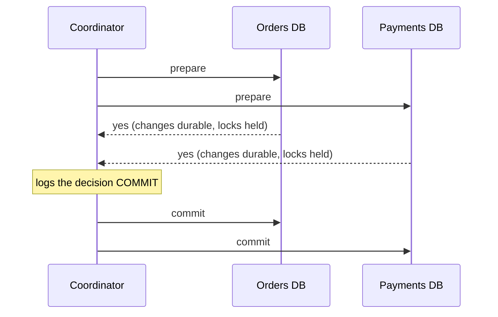

## Where we are

BE-STORY-10 named the "Survive" and "Consistency" patterns and showed a cascading failure in ten
threads. WEB-API-5 set a timeout on every hop. This lesson goes one level deeper:

- how each pattern works inside;
- how to configure it in Spring Boot with Resilience4j;
- how the patterns interact;
- how to keep data consistent across services with sagas, the outbox and idempotent consumers.

## The problem

Friday, 19:00. Payments' database is slow, so Payments answers in 8 seconds instead of 80 ms.
Within two minutes:

1. Orders' 200 Tomcat threads are all blocked on Payments, so Orders stops answering.
2. The gateway and the mobile app both retry, so Payments gets several times its normal traffic.
3. Customers whose call "failed" were in fact charged; their orders are stuck in `PENDING`.
4. Some `OrderPlaced` events were never published, so Inventory never reserved stock.

Four different failures: **blocking** (1), **amplification** (2), **unclear outcomes** (3) and
**lost writes** (4). Each pattern below fixes one of them.

## Why failures cascade

A slow dependency is worse than a dead one.

- **A dead one** fails fast (connection refused).
- **A slow one** holds a thread, a connection and memory for every caller, for as long as it is slow.

Every service has a fixed pool of each (JAVA-CONC-4), and once the pool is full the service fails *all* requests,
including ones that never touch the slow dependency.

```text
Payments slow ─► Orders threads pile up waiting ─► Orders pool full ─► Orders "down"
                                                          └─► Checkout, Cart (call Orders) pile up
```

**The rule:** resilience is mostly about *bounding* things: how long you wait, how many times you
try, how many resources one dependency may hold, and how much load you accept.

## Timeouts first

A **timeout** is the longest you will wait for a call before giving up. It is the first pattern
because every other one depends on it:

- a retry needs the first attempt to *end*;
- a circuit breaker counts failures that only happen if calls end.

- Set a short **connect timeout** and a **read timeout** a little above the callee's p99 latency (the
  latency 99% of calls beat).
- Shrink budgets along the chain (WEB-API-5).
- Remember the hidden waits: HikariCP's `connectionTimeout` (DB-SQL-5), statement timeouts, Kafka's `delivery.timeout.ms`.

A timeout does not mean the work did not happen: Payments may finish the charge after you gave up.
That is why the next patterns lean on idempotency.

## Retries: exponential backoff, jitter, and only when safe

A **retry** repeats a failed call, betting that the failure was **transient**: a brief network
blip, a pod restarting, a 503 during a deploy.

Retry only when both are true:

1. **The fault is transient.** Retry connection resets, timeouts, 502/503/504, 429 (after its
   `Retry-After`). Never retry 400, 401, 403, 404, 422: the same request will fail the same way.
2. **The operation is idempotent** (repeating it has the same effect as doing it once). GET, PUT
   and DELETE are idempotent by design; a POST is only safe with an **idempotency key** that the
   server stores with the result (WEB-API-3).

Wait with two ingredients:

- **exponential backoff** (`base × 2^attempt`: 100, 200, 400 ms..., capped), so a struggling
  service gets more room each time;
- plus **jitter** (randomness), so a thousand clients that failed together do not retry in synchronized waves.
  "Full jitter" waits a random time between 0 and the backoff value (AWS Architecture Blog, *Exponential Backoff And Jitter*, 2015).

**Retry storms.** Retries multiply: gateway, Orders and the HTTP client each retrying 3 times turn
one click into 3 × 3 × 3 = 27 calls to Payments. Retry at **one layer only**, and use a **retry
budget**: retries may add only a small fraction of traffic (say 10%). Envoy has retry budgets,
gRPC has retry throttling; in your own code a token bucket does it.

## Circuit breaker: stop calling a dependency that is down

Retries help with blips. During a real outage they just add load.

A **circuit breaker** watches the outcome of calls to one dependency and, when too many fail, stops calling it for a while and fails
immediately instead.

The name comes from the electrical breaker that cuts the current to protect
the wiring; the analogy breaks in that a software breaker resets itself by testing the line.

```text
           failure rate ≥ threshold
 CLOSED ───────────────────────────► OPEN ──(wait duration elapsed)──► HALF_OPEN
 (calls flow,                       (fail fast,                       (let N trial calls through)
  outcomes recorded)                 no calls made)                     │           │
    ▲                                                                   │ trials ok │ trials fail
    └───────────────────────────────────────────────────────────────────┘           └──► OPEN
```

- **Closed**: normal. Results go into a **sliding window** (the last N calls, or the last N
  seconds). Slow calls can count as failures too.
- **Open**: every call fails at once with an exception (in Resilience4j,
  `CallNotPermittedException`). The caller uses a fallback. The dependency gets room to recover.
- **Half-open**: after the wait, a few trial calls go through. Success closes the breaker; failure
  opens it again.

It protects both sides: the caller stops wasting threads, the callee stops being hammered.

## Bulkhead: one dependency cannot drain the pool

A **bulkhead** caps the resources one dependency may use, so its slowness stays contained, like
the watertight walls that stop one flooded compartment from sinking a ship.

- **Semaphore bulkhead**: at most N concurrent calls to Payments; call N+1 is rejected (or waits a
  bounded time). Cheap, works on the caller's own thread.
- **Thread-pool bulkhead**: calls to Payments run on their own small pool with a bounded queue.
  Stronger isolation, extra threads and hand-offs.

With 200 Tomcat threads and a Payments bulkhead of 20, a Payments outage holds at most 20 threads;
the other 180 keep serving the catalog, as in the BE-STORY-10 lab.

## Rate limiting and load shedding: protect yourself

The previous patterns protect a *caller* from its dependencies. The callee needs protection too.

- **Rate limiting** caps requests per client per time window (token bucket; LLD-DESIGN-8 built one),
  answering `429 Too Many Requests` with `Retry-After`. Usually at the gateway, per API key.
- **Load shedding** rejects work early when the service itself is overloaded: a fast `503` is far
  cheaper than accepting a request and timing out. Shed low-priority traffic first. Bound every
  queue: an unbounded one turns overload into latency, then into memory exhaustion.

## Fallback: a degraded answer instead of an error

A **fallback** is what you return when the call fails or is not permitted. Good fallbacks are
honest about being degraded:

- Recommendations down → show bestsellers from a cache.
- Payments not answering → accept the order as `PAYMENT_PENDING` and confirm it asynchronously.
- Price service down → **no fallback**: never sell at a stale or guessed price. Failing is correct.

A fallback that hides a real problem (an empty list that looks like "no orders") is a silent data
bug. Count fallback activations and alert on them.

## Resilience4j in Spring Boot

**Resilience4j** is the usual Java library for these patterns (Hystrix, its predecessor, has been
in maintenance mode since 2018). Add `io.github.resilience4j:resilience4j-spring-boot3` (on Spring
Boot 4, `resilience4j-spring-boot4`, 2.4.0+) plus the AOP starter (`spring-boot-starter-aop`; Spring
Boot 4 renamed it `spring-boot-starter-aspectj`), and configure named instances:

```yaml
resilience4j:
  circuitbreaker:
    instances:
      payments:
        sliding-window-type: COUNT_BASED
        sliding-window-size: 20
        minimum-number-of-calls: 10            # don't judge on 2 calls
        failure-rate-threshold: 50             # percent
        slow-call-duration-threshold: 2s
        slow-call-rate-threshold: 50
        wait-duration-in-open-state: 30s
        permitted-number-of-calls-in-half-open-state: 3
  retry:
    instances:
      payments:
        max-attempts: 3                        # includes the first call
        wait-duration: 200ms
        enable-exponential-backoff: true
        exponential-backoff-multiplier: 2
        enable-randomized-wait: true           # jitter
        randomized-wait-factor: 0.5
        retry-exceptions:                      # only these are retried
          - org.springframework.web.client.ResourceAccessException
          - org.springframework.web.client.HttpServerErrorException
  bulkhead:
    instances:
      payments:
        max-concurrent-calls: 20
        max-wait-duration: 0                   # reject at once when full
```

```java
import io.github.resilience4j.bulkhead.annotation.Bulkhead;
import io.github.resilience4j.circuitbreaker.annotation.CircuitBreaker;
import io.github.resilience4j.retry.annotation.Retry;
import org.springframework.stereotype.Service;
import org.springframework.web.client.RestClient;

record AuthorizeRequest(String orderId, long amountMinor, String idempotencyKey) {}

record PaymentResult(String orderId, String status) {
    static PaymentResult pending(String orderId) { return new PaymentResult(orderId, "PAYMENT_PENDING"); }
}

@Service
class PaymentsClient {
    private final RestClient payments;   // built with connect + read timeouts, as in WEB-API-5

    PaymentsClient(RestClient paymentsRestClient) { this.payments = paymentsRestClient; }

    @Retry(name = "payments", fallbackMethod = "pending")
    @CircuitBreaker(name = "payments")
    @Bulkhead(name = "payments")
    public PaymentResult authorize(AuthorizeRequest req) {
        return payments.post().uri("/authorize")
                .header("Idempotency-Key", req.idempotencyKey())   // makes the retry safe
                .body(req)
                .retrieve()
                .body(PaymentResult.class);
    }

    // Same parameters plus the exception; same return type.
    PaymentResult pending(AuthorizeRequest req, Throwable cause) {
        return PaymentResult.pending(req.orderId());
    }
}
```

How the annotations nest: by default Resilience4j applies them as
`Retry ( CircuitBreaker ( RateLimiter ( TimeLimiter ( Bulkhead ( your method ) ) ) ) )`. So:

- each retry attempt passes through the breaker and is counted by it;
- once the breaker is open, its `CallNotPermittedException` is *not* in `retry-exceptions`, so it is not retried;
- the fallback sits on the outermost aspect on purpose: a fallback on the breaker would turn every failure into a
  "success" before Retry ever saw it.

Actuator exposes breaker state and Micrometer metrics for each instance (SPRING-BOOT-11).

## Consistency 1: why dual writes fail

Placing an order must save the order *and* tell other services. The tempting code:

```text
@Transactional placeOrder():  INSERT order  ──►  kafka.send(OrderPlaced)  ──►  COMMIT
```

- **Send before the commit**, and the commit fails: the event announces an order that does not exist.
- **Commit, then crash** (or find Kafka down) before the send: the order exists and nobody hears about it.
- **An after-commit listener** narrows that window but does not close it.

This is the **dual-write problem**: two systems, no shared transaction. Two-phase commit (XA) across a database and a broker
is slow, poorly supported and couples availability; modern systems avoid it.

## Consistency 2: the transactional outbox

**Transactional outbox**: write the event into an `outbox` table *in the same local database
transaction* as the business change. A separate **relay** reads unpublished rows and sends them to
the broker. Now the order and its event commit together or not at all.

```java
@Service
class OrderService {
    private final JdbcClient jdbc;

    OrderService(JdbcClient jdbc) { this.jdbc = jdbc; }

    @Transactional
    public UUID placeOrder(String customerId, long totalMinor) {
        UUID orderId = UUID.randomUUID();
        jdbc.sql("INSERT INTO orders (id, customer_id, total_minor, status) VALUES (?, ?, ?, 'PENDING')")
                .params(orderId, customerId, totalMinor).update();
        String payload = """
                {"orderId":"%s","totalMinor":%d}""".formatted(orderId, totalMinor);  // use your JSON mapper
        jdbc.sql("INSERT INTO outbox (id, aggregate_id, type, payload) VALUES (?, ?, 'OrderPlaced', ?)")
                .params(UUID.randomUUID(), orderId, payload).update();
        return orderId;
    }
}
```

The relay, in its simplest polling form (Postgres; `SKIP LOCKED` lets several relay instances
share the work without taking the same rows, DB-SQL-7):

```java
@Component
class OutboxRelay {
    record Row(UUID id, UUID aggregateId, String type, String payload) {}

    private final JdbcClient jdbc;
    private final KafkaTemplate<String, String> kafka;

    OutboxRelay(JdbcClient jdbc, KafkaTemplate<String, String> kafka) { this.jdbc = jdbc; this.kafka = kafka; }

    @Scheduled(fixedDelay = 500)
    @Transactional
    public void publishBatch() {
        List<Row> rows = jdbc.sql("""
                SELECT id, aggregate_id, type, payload FROM outbox
                WHERE published_at IS NULL ORDER BY created_at LIMIT 100
                FOR UPDATE SKIP LOCKED""").query(Row.class).list();
        for (Row r : rows) {
            var msg = new ProducerRecord<>("orders", r.aggregateId().toString(), r.payload());
            msg.headers().add("eventId", r.id().toString().getBytes(StandardCharsets.UTF_8));
            try {
                kafka.send(msg).get(10, TimeUnit.SECONDS);          // wait for the broker's ack, bounded
            } catch (Exception e) {
                throw new IllegalStateException("outbox publish failed for " + r.id(), e);  // rows stay unpublished
            }
            jdbc.sql("UPDATE outbox SET published_at = now() WHERE id = ?").param(r.id()).update();
        }
    }
}
```

Keyed by `aggregateId`, all events for one order land on one partition, in order (DIST-SYS-2). The
alternative to polling is **change data capture** (CDC): a tool such as Debezium tails the
database's write-ahead log and publishes outbox rows, with no polling query.

Note the guarantee: the relay can crash after the send and before the `UPDATE`, so the event is
sent again. The outbox gives **at-least-once** delivery, never exactly once.

## Consistency 3: idempotent consumers

Because delivery is at least once, every consumer must make duplicates harmless. An **idempotent
consumer** records the ids of events it has processed, in the same transaction as its effect:

```java
@KafkaListener(topics = "orders", groupId = "inventory")
@Transactional
public void onOrderEvent(ConsumerRecord<String, String> rec) {
    String eventId = new String(rec.headers().lastHeader("eventId").value(), StandardCharsets.UTF_8);
    int inserted = jdbc.sql("INSERT INTO processed_events (event_id) VALUES (?) ON CONFLICT DO NOTHING")
            .param(eventId).update();
    if (inserted == 0) return;                                  // duplicate: already handled
    reserveStock(rec.value());                                  // same DB transaction as the insert
}
```

A rollback un-records the id too, so the redelivery is processed properly. Effects outside your
database (an email, an external API) need that system's own idempotency key.

## Consistency 4: sagas

A **saga** is a business transaction split into local transactions, one per service, where each
step has a **compensating action** that semantically undoes it if a later step fails.

"Semantically" matters: you cannot un-send an email or un-charge a card; you send a correction or issue a refund.

```text
1. Orders:    create order PENDING        compensate: cancel order
2. Inventory: reserve stock               compensate: release stock
3. Payments:  charge card     (fails!)    ── triggers 2's and 1's compensations, in reverse order
```

**Choreography**: no coordinator; each service reacts to the previous event and publishes its own
(`OrderCreated` → `StockReserved` → `PaymentFailed` → Inventory releases, Orders cancels). Simple
for 2–3 steps; beyond that nobody sees the whole flow, and cyclic event dependencies creep in.

**Orchestration**: one orchestrator (often inside Orders) tells each service what to do, tracks the
saga's state, and runs compensations on failure. The flow is visible and testable in one place; the
orchestrator is one more component to keep reliable. At its core it is a loop: execute each step,
push it on a stack, and on failure pop and compensate the completed steps in reverse order.

A production orchestrator:

- persists the saga's state after every step (so it resumes after a crash);
- sends commands through the outbox;
- requires every step *and* every compensation to be idempotent and retryable.

Workflow engines (Temporal, Camunda, AWS Step Functions) do this for
you; more on them is coming in SYS-DES-5.

**Watch out:** sagas give no isolation. Other requests can see the `PENDING`
order mid-flight, so model those intermediate states explicitly.

## Distributed transactions: the options

The four sections above are one answer to "how do I keep two services consistent?". Interviewers expect you to know
the alternatives and say why you rejected them.

REFERENCE-2 has catalog entries for saga, outbox and idempotent
receiver; REFERENCE-3 places them in event-driven architecture.

**Two-phase commit (2PC, XA)** makes several resources commit atomically. A coordinator runs two rounds:



**Predict:** both participants voted yes, and the coordinator crashes before sending `commit`. What do they do?

Nothing, and that is the problem. A participant that voted yes has promised to commit if told to, so it may not
decide alone: it stays **in doubt**, holding its row locks, until the coordinator recovers and replays its log.

- **Blocking:** one dead coordinator blocks every participant.
- **Cost:** add the extra round trips and locks held across the network, and 2PC costs latency and availability.
- **Support:** Kafka and most cloud services do not take part in XA at all, and Postgres ships
  with `max_prepared_transactions = 0`, which disables `PREPARE TRANSACTION`.
- **In Spring:** `JtaTransactionManager` makes `@Transactional` span XA resources by delegating to an external JTA transaction manager.

The other options trade isolation for availability:

| Way | How it works | When to choose | Pitfall |
|---|---|---|---|
| 2PC / XA | Prepare everywhere, then commit everywhere | Two databases in one data centre, both XA-capable, low volume | Blocks on coordinator failure; brokers and SaaS APIs cannot join |
| Saga, orchestration | A coordinator runs local steps and compensations in reverse | Four or more steps, or the flow must be visible and monitored | Orchestrator must persist state; compensations are not rollbacks |
| Saga, choreography | Each service reacts to the previous event | Two or three steps, loosely owned by different teams | Nobody sees the whole flow; cycles creep in |
| Outbox, polling relay | Event row in the same transaction; a job publishes it | The default way to publish reliably | Polling load and latency; table cleanup |
| Outbox, CDC relay | Debezium reads the WAL and publishes outbox rows | High volume, low latency, a Kafka Connect platform already running | Another system to run; WAL retention if the connector stalls |
| Inbox / idempotent consumer | Record the message id in the same transaction as the effect | Every consumer of at-least-once delivery | Effects outside your DB need their own idempotency key |
| TCC (Try-Confirm-Cancel) | Try reserves (tentative, with expiry), then Confirm or Cancel | Short business holds: seats, stock, credit limits | Three idempotent APIs per service; Cancel can arrive before Try |

TCC is 2PC moved up into the business layer: "Try" is a visible reservation ("2 seats held for 10 minutes"), not
a database lock, so nothing blocks if the coordinator dies. The reservation expires on its own.

| | Consistency | Isolation | Latency | When the coordinator or a step fails |
|---|---|---|---|---|
| 2PC / XA | Atomic | Full (locks held) | High: two rounds, locks across the network | Participants block in doubt until recovery |
| TCC | Eventual, short window | Reservations visible as "held" | Medium: two calls per service | Reservations expire; Cancel cleans up |
| Saga | Eventual | None: others see `PENDING` | Low per step | Compensations run; must be idempotent |
| Outbox + inbox | Eventual, at-least-once | None | Relay delay (ms to seconds) | Redelivery; duplicates dropped by the inbox |

Rule of thumb: inside one database use a local transaction; across services use outbox + idempotent consumers
for every event, a saga for the multi-step business flow, and TCC only where a hold must expire on its own.

```quiz
{"question": "A booking flow must hold a concert seat while the payment provider (an external API) charges the card, and release it if payment fails or the user abandons. Which fits best?", "level": "medium",
 "options": [
   {"text": "TCC: Try reserves the seat with an expiry, then Confirm on payment success or Cancel on failure", "correct": true, "why": "The hold is a visible business state that expires on its own, so a crashed coordinator or abandoned user does not block the seat forever."},
   {"text": "XA two-phase commit across the seat database and the payment provider", "why": "An external payment API cannot join an XA transaction, and holding database locks during a card charge blocks other buyers."},
   {"text": "A single @Transactional method that calls the payment API before committing", "why": "The payment is outside the database transaction: a rollback after a successful charge leaves the customer charged without a seat."},
   {"text": "Choreography with no reservation step", "why": "Without a hold, two buyers can both pay for the same seat; you still need a tentative reservation."}]}
```

## Lab (~10 min)

**Break it: a retry storm, then a circuit breaker.** Java 21, no dependencies. A fake clock makes
it run instantly: a request arrives every 100 ms, and Payments is down from 1 s to 4 s.

```java
import java.util.concurrent.ThreadLocalRandom;

public class Breaker {
    enum State { CLOSED, OPEN, HALF_OPEN }

    static final class CallNotPermitted extends RuntimeException {}

    static final class CircuitBreaker {
        private final int failureThreshold;
        private final long openMillis;
        private State state = State.CLOSED;
        private int consecutiveFailures;
        private long openedAt;

        CircuitBreaker(int failureThreshold, long openMillis) {
            this.failureThreshold = failureThreshold;
            this.openMillis = openMillis;
        }

        boolean allow() {
            if (state == State.OPEN && now - openedAt >= openMillis) moveTo(State.HALF_OPEN);
            return state != State.OPEN;
        }

        void onSuccess() {
            consecutiveFailures = 0;
            if (state != State.CLOSED) moveTo(State.CLOSED);
        }

        void onFailure() {
            consecutiveFailures++;
            if (state == State.HALF_OPEN || consecutiveFailures >= failureThreshold) {
                openedAt = now;
                moveTo(State.OPEN);
            }
        }

        private void moveTo(State next) {
            System.out.printf("t=%5d ms  breaker %s -> %s%n", now, state, next);
            state = next;
        }
    }

    static long now;                 // a fake clock in ms, so the lab runs instantly
    static int dependencyCalls;

    static String callPayments() {
        dependencyCalls++;
        now += 20;                                        // each call costs 20 ms
        boolean down = now >= 1_000 && now < 4_000;       // Payments is down from 1 s to 4 s
        if (down) throw new IllegalStateException("503 from payments");
        return "approved";
    }

    static long backoffWithFullJitter(int attempt, long baseMs, long capMs) {
        long ceiling = Math.min(capMs, baseMs << attempt);   // 100, 200, 400 ... capped
        return ThreadLocalRandom.current().nextLong(ceiling + 1);
    }

    static String guarded(CircuitBreaker breaker) {
        if (breaker != null && !breaker.allow()) throw new CallNotPermitted();
        try {
            String result = callPayments();
            if (breaker != null) breaker.onSuccess();
            return result;
        } catch (IllegalStateException e) {
            if (breaker != null) breaker.onFailure();
            throw e;
        }
    }

    static String withRetry(CircuitBreaker breaker, int maxAttempts) {
        for (int attempt = 1; ; attempt++) {
            try {
                return guarded(breaker);
            } catch (IllegalStateException transientFault) {   // CallNotPermitted is NOT caught: never retried
                if (attempt >= maxAttempts) throw transientFault;
                now += backoffWithFullJitter(attempt, 50, 1_000);
            }
        }
    }

    public static void main(String[] args) {
        var flags = java.util.List.of(args);
        int maxAttempts = flags.contains("retry") ? 3 : 1;
        CircuitBreaker breaker = flags.contains("breaker") ? new CircuitBreaker(5, 500) : null;
        int ok = 0, failed = 0, failedFast = 0;
        for (int request = 0; request < 60; request++) {
            now = request * 100L;                             // a user request arrives every 100 ms
            try {
                withRetry(breaker, maxAttempts);
                ok++;
            } catch (CallNotPermitted e) {
                failedFast++;                                 // fallback: "payment pending"
            } catch (IllegalStateException e) {
                failed++;
            }
        }
        System.out.printf("ok=%d failed=%d failedFast=%d callsToPayments=%d%n",
                ok, failed, failedFast, dependencyCalls);
    }
}
```

1. `java Breaker.java` — no retries: 60 calls to Payments, about half the requests fail (those in
   the outage window).
2. `java Breaker.java retry` — three attempts each: calls to Payments **double** to about 120, yet
   almost no extra request succeeds. During a real outage that extra load is what keeps the
   dependency down.
3. `java Breaker.java retry breaker` — watch the state transitions. After five failures the breaker
   opens; requests fail fast (where the fallback would run); every 500 ms one trial call probes;
   calls to Payments drop to a few dozen, and the breaker closes soon after Payments recovers.
4. **Change it:** set `maxAttempts` to 5 and rerun `retry`: every failed request now costs Payments
   five calls. Then imagine two more layers above doing the same.

## Gotchas

- **Retrying non-idempotent calls** double-charges after a timeout: add an idempotency key first, then retry.
- **Retrying at every layer** multiplies traffic: retry in one place, with backoff, jitter and a budget.
- **Fallback on the inner aspect** turns failures into successes so Retry never fires: put it on the outermost annotation.
- **`@TimeLimiter` on a blocking method** does nothing: it needs `CompletableFuture`; use the HTTP client's timeouts instead.
- **One breaker for unrelated endpoints** lets one bad endpoint open the circuit for all: one breaker per dependency/endpoint.
- **Liveness probes that call dependencies** make Kubernetes restart Orders when Payments is down: check only the process
  (probes come in DIST-SYS-5).

## In interviews

Bank: [Microservices patterns: API gateway, service discovery, circuit breaker, saga](#/q/microservices-design-patterns),
[Design an Idempotent API](#/q/design-idempotent-api),
[Idempotency in Payment Systems](#/q/idempotency-in-payment-systems),
[Design a Payment Service](#/q/design-payment-system),
[Design a Rate Limiter](#/q/design-rate-limiter),
[Kafka architecture](#/q/kafka-architecture),
[A system failure you handled](#/q/system-failure-and-fault-tolerance-story).

**Follow-up: "Why not two-phase commit?"** It blocks while a participant is unreachable, needs every participant (broker
included) to support it, and ties all services' availability together; sagas trade isolation for availability.

**Follow-up: "How do you know the saga never left an order stuck?"** Idempotent compensations plus a reconciliation job
that finds orders stuck in an intermediate state and repairs or alerts.

## Explain it in 2 minutes

*"Payments becomes slow. Walk me through how Orders survives and how no order is lost."*

- Timeouts below Orders' own budget; one layer retries transient faults with backoff, jitter and an idempotency key.
- A bulkhead caps threads on Payments; the breaker opens and fails fast.
- The fallback accepts the order as `PAYMENT_PENDING`, confirmed later.
- Order and `OrderPlaced` commit together via the outbox; a relay publishes.
- Consumers deduplicate by event id; a saga compensates if payment fails.

## Check yourself

1. Name two conditions that must both hold before you retry a call.
2. Your code commits the order and then sends `OrderPlaced`. Describe the failure and the fix.
3. Choreography vs orchestration: when does each fit?

### Answers

1. The fault is transient (timeout, 503, reset; not 4xx), and the call is idempotent or carries an idempotency key.
2. A crash between commit and send loses the event. Write it to an outbox table in the same transaction; a relay or CDC
   publishes; consumers deduplicate.
3. Choreography for 2–3 loosely owned steps; orchestration when the flow is longer, changes often, or needs one place to
   see its state.

## Next

DIST-SYS-4 goes down to the Linux box these services run on; DIST-SYS-5 then puts them into containers and Kubernetes.
