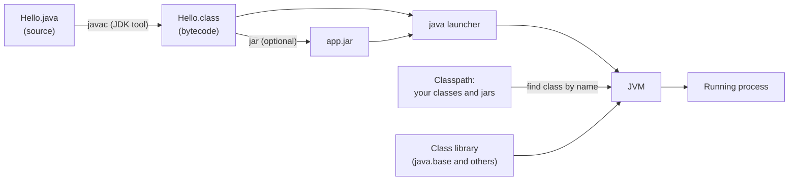

## Where we are

From BE-STORY-1 you know that a program is a file on disk, a process is that program running, and
that `java Hello` starts a process. This lesson fills in the toolbox around that command: what you
actually install, which pieces compile and which pieces run, and how the JVM finds your classes. The
next lesson, JAVA-JVM-1, then opens the JVM itself.

## The problem

It is 6 pm on your second day. You cloned the ShopKart service, and the team lead wants a demo at
9 tomorrow. You type `mvn package` (Maven, the build tool that compiles and
packages the project) and it fails: `release version 21 not supported`. Confused, you
run `java -version`. It says 21. You reinstall Java. Same error.

You give up on Maven and try a tiny class by hand. `java Hello` works. You add `package com.shop;`
to the top, recompile, and now it says `Could not find or load main class Hello`. The code has not
changed at all.

Both failures have the same root: you do not yet know which Java your tools are using, or where the
JVM looks for classes. By the end of this lesson you will fix both in under a minute, and you will
know the three letters everyone mixes up: JDK, JRE and JVM.

## From source file to running program

Here is the whole journey at a glance. Each box gets its own section below.



## The JVM: the part that runs bytecode

`javac` turns your `.java` source into **bytecode**: instructions for an imaginary computer, stored
in `.class` files and identical on every platform.

The **JVM** (Java Virtual Machine) is the program that runs bytecode. It is native code, built
separately for each operating system and CPU, so there is a Windows x64 JVM, a Linux ARM64 JVM, and
so on. That is how one `.class` file runs everywhere: **the bytecode is portable, the JVM is not.**

Strictly, "the JVM" is a **specification**: a document saying what each bytecode instruction must
do. **HotSpot** is the implementation almost everyone runs, and it comes from the **OpenJDK**
project. How HotSpot executes bytecode (interpreter, JIT) is the whole of JAVA-JVM-1.

**Rule:** the JVM executes bytecode and manages memory. It does not compile `.java` files, and on
its own it does not contain the standard library.

## The JRE and the JDK

Your code calls `String`, `List`, `HttpClient`. Those classes have to come from somewhere.

- The **JRE** (Java Runtime Environment) is the JVM **plus** the Java class library (`java.base`,
  `java.net.http`, `java.sql` and the rest) **plus** the `java` launcher. It is everything needed to
  *run* a Java program.
- The **JDK** (Java Development Kit) is the JRE **plus** the tools developers use to *build* one:

| Tool | What it does |
|---|---|
| `javac` | compiles `.java` source to `.class` bytecode |
| `java` | starts a JVM and runs a class or a jar |
| `jar` | packages classes and resources into a `.jar` (a zip file with a manifest) |
| `jlink` | builds a trimmed, custom runtime (below; `jdeps` tells it which modules you need) |
| `javap`, `jcmd`, `jstack`, `jfr` | diagnostics: disassemble a `.class`, inspect a running JVM (later lessons) |

```text
+-------------------------------------------------- JDK ---+
|  javac  jar  javap  jdeps  jlink  jcmd ...               |
|  +--------------------------------------------- JRE ---+ |
|  |  class library: java.base, java.sql, java.net.http..| |
|  |  java launcher                                      | |
|  |  +-------------------------------------- JVM ---+   | |
|  |  |  class loader, interpreter + JIT, GC         |   | |
|  |  +----------------------------------------------+   | |
|  +-----------------------------------------------------+ |
+----------------------------------------------------------+
```

Analogy: the JVM is an engine, the JRE is a car built around it, the JDK is the car plus the garage
tools. It breaks in one place: since Java 11, Oracle no longer offers the "car without the garage"
separately (next section).

**Rule:** JDK ⊃ JRE ⊃ JVM. Build machines need the JDK; a production container needs only a runtime.

```quiz
{"question": "A slim production image has a runtime that can run your jar, but not the JDK tools. Which of these is missing from it?", "level": "easy",
 "options": [
   {"text": "javac", "correct": true, "why": "javac is a developer tool, so it ships only with the JDK. You compile on the build machine, not in production."},
   {"text": "java.util.ArrayList", "why": "ArrayList is part of the class library, which every runtime includes. Without it almost no program could run."},
   {"text": "The JVM", "why": "Every runtime contains a JVM: something has to execute the bytecode."},
   {"text": "The java launcher", "why": "The launcher is how you start the program (java -jar app.jar), so it is part of the runtime."}]}
```

## Since Java 11 there is no separate JRE download

End users used to install a JRE, not a JDK. Up to Java 10 Oracle also offered a separate JRE
download. JDK 9 had already removed the `jre/` folder
inside the JDK (modular run-time images, JEP 220), and **from Java 11 Oracle stopped offering JRE
downloads; use `jlink` to build a runtime.** You download a JDK. Some vendors (for example Eclipse
Temurin) still publish JRE-only builds for convenience, which is why you will see
`eclipse-temurin:21-jre` images for Docker (a tool that packages an app and its runtime into a
container image).

What replaced it is **`jlink`**. Java 9 split the class library into **modules**: named groups of
packages with declared dependencies, such as `java.base` or `java.sql`. Because the library is
modular, `jlink` can assemble a runtime that contains only the modules your app needs:

```text
$ jdeps --print-module-deps --ignore-missing-deps target/app.jar
java.base,java.logging,java.sql
$ jlink --add-modules java.base,java.logging,java.sql --strip-debug --no-header-files \
        --no-man-pages --output build/runtime
$ build/runtime/bin/java -jar target/app.jar
```

The result is a folder with its own `bin/java` and only the listed modules, much smaller than a full
JDK. Teams use it to shrink container images.

**Vendors.** Oracle JDK, Temurin, Corretto and Zulu are builds of the same OpenJDK code with
different licences and support; the version (LTS releases 8, 11, 17, 21, 25) matters more.

## JAVA_HOME and PATH

An **environment variable** is a named text value the operating system hands to every program it
starts. Two of them matter here, with two different consumers:

- **`PATH`** is a list of folders the **shell** searches when you type a command. If
  `C:\Program Files\Java\jdk-21\bin` is on it, typing `java` runs that JDK's launcher.
- **`JAVA_HOME`** points at a JDK's **root folder** (not its `bin`). The shell ignores it. **Tools**
  read it: Maven, Gradle, IntelliJ run configurations, Tomcat start scripts.

```text
JAVA_HOME = C:\Program Files\Java\jdk-21         <- root, no \bin
PATH      = ...;%JAVA_HOME%\bin;...              <- the shell finds java.exe here
```

**Rule:** point `PATH` at `%JAVA_HOME%\bin` (or `$JAVA_HOME/bin`) so the two can never disagree.

```quiz
{"question": "Back to your 6 pm problem: java -version prints 21, but mvn package fails with 'release version 21 not supported'. What do you check first?", "level": "medium",
 "options": [
   {"text": "JAVA_HOME: it probably points at an older JDK, and Maven uses JAVA_HOME", "correct": true, "why": "java -version shows the Java the shell finds on PATH. mvn -v shows the Java Maven uses, from JAVA_HOME. They disagree."},
   {"text": "Reinstall JDK 21", "why": "JDK 21 is already installed and on PATH. Reinstalling does not change where JAVA_HOME points, which is why it did not help."},
   {"text": "The CLASSPATH variable", "why": "CLASSPATH tells the JVM where to find classes at run time. It has nothing to do with which JDK Maven compiles with."},
   {"text": "The code uses a Java 21 feature, so remove it", "why": "The code is fine. The compiler Maven is using is too old to target release 21."}]}
```

## javac and java, with packages

A **package** is a namespace for classes, declared at the top of the file, and it must match the
folder structure under a source root:

```java
// src/com/shop/Hello.java
package com.shop;

public class Hello {
    public static void main(String[] args) {
        System.out.println("Hello from " + Hello.class.getName());
    }
}
```

(Classes with a package will not start from the Run button, which runs classes without one. Use a
terminal for this section and the lab.)

```text
$ javac -d out src/com/shop/Hello.java     # -d: write classes under out/, creating out/com/shop/
$ java -cp out com.shop.Hello              # fully qualified name, classpath root = out
Hello from com.shop.Hello
```

**Predict:** the file is at `out/com/shop/Hello.class`. Does `java out/com/shop/Hello` work? Does
`java -cp out Hello`?

Neither. `javac` takes a **file path**, but `java` takes a **fully qualified class name**
(package plus class name). The JVM turns `com.shop.Hello` into the relative path
`com/shop/Hello.class` and looks for it under each classpath entry. `Hello` alone becomes
`Hello.class`, which is not there. That is the second failure from "The problem".

Shortcut for experiments: `java src/com/shop/Hello.java` compiles in memory and runs a single source
file (since Java 11), leaving no `.class` behind.

## The classpath: where the JVM looks for classes

The **classpath** is the list of folders and jar files the JVM searches, in order, for your classes
and libraries. It is set by, from highest priority:

1. `-cp` / `-classpath` / `--class-path` on the command line,
2. otherwise the `CLASSPATH` environment variable,
3. otherwise just `.` (the current directory).

```text
java -cp "out;lib/jackson-databind.jar;lib/jackson-core.jar" com.shop.Hello    # Windows: ;
java -cp "out:lib/jackson-databind.jar:lib/jackson-core.jar" com.shop.Hello    # Linux/macOS: :
java -cp "out;lib/*" com.shop.Hello                                           # every jar in lib/
```

**The first entry containing a class wins.** If two versions of the same library are on the
classpath, whichever comes first is used, with no warning.

The standard library is **not** on the classpath; the runtime always provides it from its own
modules. (Since Java 9 there is also a **module path**, `--module-path`, for modular jars. Most
Spring Boot apps still run on the classpath.)

Run this to see all of it from inside a program:

```java
public class WhereAmI {
    public static void main(String[] args) {
        System.out.println("java.version = " + System.getProperty("java.version"));
        System.out.println("java.home    = " + System.getProperty("java.home"));    // which runtime is running me
        System.out.println("class path   = " + System.getProperty("java.class.path")); // where MY classes come from
        System.out.println("modules      = " + ModuleLayer.boot().modules().size());  // library modules loaded

        // The standard library comes from the runtime's modules, not from the class path.
        System.out.println("String     is in " + String.class.getModule());
        System.out.println("WhereAmI   is in " + WhereAmI.class.getModule());

        // The JVM finds classes by fully qualified name. A name that is nowhere on the class path fails.
        for (String name : new String[] {"java.util.ArrayList", "com.shop.Missing"}) {
            try {
                Class.forName(name);
                System.out.println("found   " + name);
            } catch (ClassNotFoundException e) {
                System.out.println("missing " + name + " -> " + e.getClass().getSimpleName());
            }
        }
    }
}
```

You should see `String` in `module java.base`, your own class in an **unnamed module** (that is how
classpath code shows up), `java.util.ArrayList` found, and `com.shop.Missing` reported as a
`ClassNotFoundException`.

```quiz
{"question": "Your code compiles against library v2. At run time it fails with NoSuchMethodError on a method that exists only in v2. The classpath is below. What happened?", "level": "hard",
 "code": ["java -cp \"lib/shop-util-1.0.jar;lib/shop-util-2.0.jar;out\" com.shop.Main"],
 "options": [
   {"text": "The JVM loaded the class from v1, because the first classpath entry that has it wins", "correct": true, "why": "Both jars contain the same class name. The JVM stops at the first match, v1, which lacks the method your v2-compiled code calls."},
   {"text": "The JVM merged both versions and the newer method was lost", "why": "Classes are never merged. One class file is picked for each name, the first one found."},
   {"text": "The JVM picked v2, but v2 is corrupt", "why": "The JVM does not prefer newer versions. It does not even know which jar is newer; order is all that matters."},
   {"text": "javac should have caught this, so the compiler is broken", "why": "javac checked your code against v2, which was correct. The run-time classpath is a separate decision the compiler never sees."}]}
```

## jar and java -jar

A **jar** is a zip file of classes and resources plus `META-INF/MANIFEST.MF`, a small text file of
metadata. If the manifest names a `Main-Class`, the jar is directly runnable:

```text
$ jar --create --file hello.jar --main-class com.shop.Hello -C out .
$ java -jar hello.jar
Hello from com.shop.Hello
```

**Predict:** your jar needs a library in `lib/`, so you run `java -cp "lib/*" -jar app.jar`. Is
`lib/` searched?

No. With `-jar`, the jar is the source of all user classes, and **`-cp` and `CLASSPATH` are
ignored**. Extra jars must be listed in the manifest's `Class-Path` line. That is why Spring Boot
builds a "fat jar" with all dependencies nested inside, plus its own launcher class that knows how
to read them.

## Lab (~10 min)

Build, package and trim the app by hand, without Maven, so every step is visible.

1. Copy `WhereAmI` into `src/com/shop/WhereAmI.java` and add `package com.shop;` as its first line.
2. Compile and run from the classpath:
   `javac -d out src/com/shop/WhereAmI.java` then `java -cp out com.shop.WhereAmI`.
   `class path` prints `out`.
3. **Break it.** Run each of these and read the error:
   - `java -cp src com.shop.WhereAmI`: wrong root, there is no `.class` under `src`.
   - `java -cp out WhereAmI`: not the fully qualified name.
   - `java out/com/shop/WhereAmI`: a path, not a class name.

   The first two print `Error: Could not find or load main class ...` followed by
   `Caused by: java.lang.ClassNotFoundException`. The last one is different: the launcher turns the
   path into the class name `out.com.shop.WhereAmI`, finds a file at `out/com/shop/WhereAmI.class`
   (the classpath is `.`), and prints `Error: Could not find or load main class out.com.shop.WhereAmI`
   with `Caused by: java.lang.NoClassDefFoundError: out/com/shop/WhereAmI (wrong name:
   com/shop/WhereAmI)`: the file exists, but the name inside it does not match what you asked for.
4. Package it: `jar --create --file app.jar --main-class com.shop.WhereAmI -C out .`, then
   `java -jar app.jar`. `class path` now prints just `app.jar`. Run `java -cp out -jar app.jar` and
   confirm `-cp` was ignored.
5. Trim it: `jdeps --print-module-deps --ignore-missing-deps app.jar` prints `java.base`. Then
   `jlink --add-modules java.base --output rt` and `rt/bin/java -jar app.jar` (`rt\bin\java` on
   Windows). `java.home` now points at `rt`, and `modules` drops to 1. Compare the size of `rt` with
   your JDK folder (on one Windows machine: about 43 MB against 317 MB).

**What you should observe:** the classpath decides what is found; `-jar` replaces the classpath; a
`jlink` runtime reports its own `java.home`, loads one module, and still runs your jar because it
needs only `java.base`.

## Gotchas

- **`JAVA_HOME` and `PATH` disagree.** `java -version` and `mvn -v` show different versions. Set
  `JAVA_HOME` to the JDK root, not to `bin`, and put `JAVA_HOME/bin` on `PATH`.
- **`java Hello.class` or `java out/com/shop/Hello`.** `java` takes a fully qualified class name
  plus a classpath, not a file path (the single-file launcher takes a `.java` path, which is
  different).
- **`-cp` with `-jar` does nothing.** Use the manifest `Class-Path`, a fat jar, or drop `-jar` and
  run `java -cp "app.jar;lib/*" com.shop.Main`.
- **Classpath separator.** `;` on Windows, `:` on Linux/macOS. A script copied between them
  silently builds the wrong classpath.
- **Duplicate libraries on the classpath.** The first match wins, so compile-time and run-time
  versions can differ and fail with `NoSuchMethodError` or `NoClassDefFoundError`. Check with
  `mvn dependency:tree`.
- **Compiling with a newer JDK than you run.** A class compiled for Java 21 will not load on an
  older runtime (`UnsupportedClassVersionError`). Use `javac --release 17` when you must target an
  older runtime.

## In interviews

Asked as a warm-up, or as the first step of "walk me through what happens when you run a Java
program". Related bank question: [JVM internals and memory allocation](#/q/jvm-internals) usually
starts with "what is the JVM?" before going deep. The model answer is in "Explain it in 2 minutes"
below.

Typical follow-ups:

- *"Is Java platform independent? Is the JVM?"* Bytecode is; the JVM is not. You need a JVM built for
  each OS and CPU, and that is exactly what makes the bytecode portable.
- *"`NoClassDefFoundError` vs `ClassNotFoundException`?"* `ClassNotFoundException` is a checked
  exception from loading a class by name (`Class.forName`) when it is not found.
  `NoClassDefFoundError` is an error: the class was present at compile time but cannot be loaded at
  run time (missing from the classpath, or its static initialiser failed earlier). LIFECYCLE-1 and
  JAVA-JVM-4 go deeper.

## Explain it in 2 minutes

Prompt: *"What is the difference between the JDK, the JRE and the JVM, and what do you put in a
production Docker image?"*

- The JVM executes bytecode and manages memory; it is per-platform, which makes bytecode portable.
- The JRE adds the standard class library and the `java` launcher: enough to run.
- The JDK adds developer tools: `javac`, `jar`, `jlink` and diagnostics such as `javap` and `jcmd`.
- Since Java 11 Oracle offers no separate JRE; CI builds with a JDK and the production image ships a
  runtime, ideally trimmed with `jlink` to the modules `jdeps` reports.
- Classes are found by fully qualified name on the classpath; the standard library comes from the
  runtime itself; `java -jar` uses the jar and its manifest instead.
- What goes wrong: `JAVA_HOME` (for tools) and `PATH` (for the shell) point at different JDKs,
  duplicate jars cause `NoSuchMethodError`, `-cp` is ignored with `-jar`, and version skew gives
  `UnsupportedClassVersionError`.

## Check yourself

1. Which of JDK, JRE, JVM contains `javac`? Which contains `java.util.ArrayList`?
2. Why can one `.class` file run on Windows and Linux when the JVM cannot?
3. Your class is `com.shop.Hello`, compiled into `out/com/shop/Hello.class`. Write the run command.
4. You run `java -cp lib/* -jar app.jar` and get `ClassNotFoundException` for a class in `lib/`.
   Why?
5. What does `jlink` produce, and why did it make a separate JRE download unnecessary?

### Answers

1. `javac` is only in the JDK. `ArrayList` is in the class library, so it is in the JRE (and hence in
   the JDK), not in the bare JVM.
2. Bytecode is the same on every platform; each platform has its own native JVM that knows how to
   execute it there.
3. `java -cp out com.shop.Hello`.
4. With `-jar`, `-cp` is ignored. The dependency must be listed in the manifest's `Class-Path`,
   packaged inside a fat jar, or the app run with `-cp` and a main class instead of `-jar`.
5. A self-contained runtime folder (its own `bin/java`) holding only the modules you list. Java 9's
   module system made the library splittable, so each app can build exactly the runtime it needs
   instead of relying on a one-size JRE.

## Next

JAVA-JVM-1 opens the JVM box you just located: what `javac` actually writes into a `.class` file,
and how the interpreter and JIT turn it into machine code.
