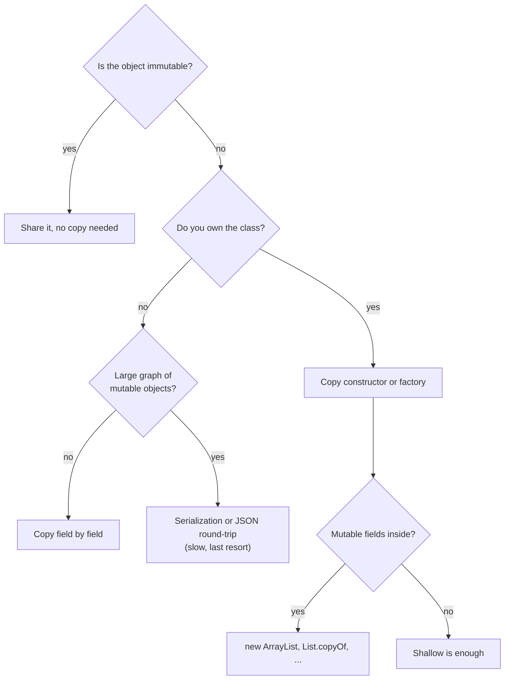

## Where we are

From JAVA-FUND-3 you know `==` versus `equals`, the immutability recipe and why `String` is immutable. From
JAVA-FUND-6 you know what a `List` holds inside. This lesson answers the "how many ways can I..." questions:
create an object, copy it, build a string, use an enum, nest a class. Each gets a table so you can pick, not just
list.

## The problem

You are building the bed planner for a hospital ward app. A new ward should start from a template, so you write
`Ward icu2 = icu.clone();`, rename it and add a bed to the copy:

```java
Ward icu = new Ward("ICU");
icu.beds.add("bed-1");
Ward icu2 = icu.clone();          // Ward implements Cloneable and calls super.clone()
icu2.name = "ICU-2";
icu2.beds.add("bed-2");
System.out.println(icu.name + " " + icu.beds);
```

**Predict:** what does the last line print?

`ICU [bed-1, bed-2]`. The name stayed separate, but the original ward gained a bed it never had. The next morning
the planner shows phantom beds in the ICU and a nurse is sent to a bed that does not exist. `clone()` copied the
`beds` *reference*, so both wards share one list. Copying, like creating and building strings, is really
several different operations.

## Ways to create an object

`new Ward("ICU")` is not the only way an object comes to life. A **static factory method** is a `static` method
that returns an instance, such as `List.of("a")` or `Integer.valueOf(42)`; unlike a constructor, it has a name,
can return a cached instance, and can return a hidden subtype. **Reflection** (`java.lang.reflect`) lets code
create and call classes it knows only by name at run time. A `Supplier<T>` is an interface whose `get()` returns
a T, and a **method reference** such as `ArrayList::new` fills one with "call this constructor" (JAVA-FUND-7).

| Way | Example | When to choose | Pitfall |
|---|---|---|---|
| `new` | `new Ward("ICU")` | The default: you know the exact class | Always a brand-new object of exactly that class |
| Static factory | `List.of(a, b)`, `Integer.valueOf(42)`, `Path.of("x")` | You want a name, caching, or freedom to return a subtype | `List.of` returns an unmodifiable list and rejects `null` |
| Builder | `HttpRequest.newBuilder().uri(u).GET().build()` | Many optional parameters | More code; validate in `build()`, or half-built objects slip through |
| Reflection | `cls.getDeclaredConstructor().newInstance()` | Frameworks and plugins that know the class only at run time | Slow, no compile-time checks, exceptions wrapped in `InvocationTargetException` |
| `clone()` | `icu.clone()` | Almost never (next section) | Shallow; no constructor runs |
| Deserialization | `objectInputStream.readObject()` | Reading back bytes written by Java serialization | Your class's constructor does not run, so its validation is skipped |
| `Supplier` / `::new` | `Supplier<List<String>> s = ArrayList::new;` | Hand someone a recipe that creates on demand | Each `get()` creates a new object; it is not a cache |
| DI container | Spring calls your constructor for you | Application services and their dependencies | Hidden wiring; SPRING-BOOT-1 builds one, SPRING-BOOT-2 explains Spring's |

**Rule:** start with `new`. Reach for a static factory when a name or caching helps, and a builder when the
parameter list grows optional parts.

```quiz
{"question": "What can Integer.valueOf(42) do that new Ward(...) style construction can never do?",
 "level": "easy",
 "options": [
   {"text": "Return an object that already exists instead of creating a new one", "correct": true,
    "why": "A static factory is just a method, so it can hand back a cached instance. Integer.valueOf caches -128 to 127. new always allocates."},
   {"text": "Skip the constructor's validation",
    "why": "A factory normally calls a constructor itself. Skipping constructors is what deserialization and clone() do."},
   {"text": "Create an object of a class unknown at compile time",
    "why": "That is reflection: getDeclaredConstructor().newInstance() on a Class loaded by name."},
   {"text": "Avoid allocation for any value, even Integer.valueOf(1000)",
    "why": "Only -128 to 127 are cached by default. Integer.valueOf(1000) == Integer.valueOf(1000) prints false: two new objects."}]}
```

## Shallow and deep copies

A **shallow copy** duplicates the object's fields, so reference fields still point at the same objects. A
**deep copy** also duplicates what those references point to, as far down as needed to make the copy
independent. The ward bug is a shallow copy of a mutable `List`.

Why is `clone()` considered broken? `Cloneable` is a marker interface with no methods; `Object.clone()` is
`protected`, throws the checked `CloneNotSupportedException` if you forgot `implements Cloneable`, performs a
"shallow copy" (its Javadoc's words) and runs no constructor. And a `final` field cannot be reassigned in your
override, so a `final` list can never be deep-copied that way. Arrays are the exception: `a.clone()` is fine.

Use a **copy constructor** or **copy factory** instead: an ordinary constructor or static method that takes an
instance and copies what needs copying.

```java
Ward(Ward other) {                       // copy constructor: you decide what is deep
    this.name = other.name;              // String is immutable, sharing is safe
    this.beds = new ArrayList<>(other.beds);
}
```

| Way | Example | When to choose | Pitfall |
|---|---|---|---|
| `clone()` | `super.clone()` in a `Cloneable` class | Arrays; legacy code | Shallow, protected, checked exception, cannot fix `final` fields |
| Copy constructor / factory | `new Ward(icu)`, `Ward.copyOf(icu)` | The default for mutable classes | You must remember to copy each mutable field |
| `List.copyOf(list)` | `List.copyOf(beds)` | An independent, unmodifiable list | Copies the list, not the elements; `Collections.unmodifiableList` is only a view (JAVA-FUND-3) |
| Record + `withX` | `ward.withName("ICU-2")` | Immutable values: "copy" means "new value with one change" | Java 21 records do not generate `withX`; you write it. A `List` component is still shared |



**Rule:** copy only mutable state; share immutable state. Better still, make values immutable so copying
disappears.

```quiz
{"question": "Your Appointment record has a List<String> notes component. You need a version with a new time, and edits to either notes list must not affect the other. Which way?",
 "level": "medium",
 "options": [
   {"text": "A withTime method that calls the canonical constructor with List.copyOf(notes)", "correct": true,
    "why": "Records do not generate withX, so you write it, and List.copyOf gives the new record its own unmodifiable list."},
   {"text": "Make the record implement Cloneable and call clone()",
    "why": "clone() would be shallow, sharing the list, and record fields are final, so you cannot replace the list inside clone()."},
   {"text": "Collections.unmodifiableList(notes)",
    "why": "That is a read-only view over the same list. If someone mutates the original, both records see it."},
   {"text": "Serialize to JSON and read it back",
    "why": "It works, but it is slow and heavy for one small record you own. Write the method."}]}
```

## Ways to build strings

From JAVA-FUND-3: every "change" to a `String` creates a new one. So how should you join text?

Since Java 9 (JEP 280), `javac` compiles `a + b + c` into one `invokedynamic` call to
`java.lang.invoke.StringConcatFactory`, which picks an efficient strategy at run time. One `+` expression is
fine. `s += line` in a loop is not: every pass copies everything built so far.

| Way | Example | When to choose | Pitfall |
|---|---|---|---|
| `+` | `"Bed " + id + " in " + ward` | One expression, outside loops | `+=` in a loop |
| `StringBuilder` | `sb.append(line).append('\n')` | Building in a loop, single thread | Not synchronized; do not share across threads |
| `StringBuffer` | same API as `StringBuilder` | Legacy code only | Synchronized on every call; slower |
| `String.join` / `StringJoiner` | `String.join(", ", beds)`, `new StringJoiner(", ", "[", "]")` | Delimiters, prefix and suffix | `String.join` throws `NullPointerException` on a `null` delimiter or collection |
| `Collectors.joining` | `stream.collect(joining(", "))` | The end of a stream (JAVA-FUND-7) | Elements must already be strings; `map(String::valueOf)` first |
| `String.format` / `formatted` | `"%s has %d beds".formatted(ward, n)` | Readable templates, number formatting | Slower than `+`; a wrong specifier fails only at run time |
| Text block | `"""` ... `"""` | Multi-line JSON, SQL, HTML (Java 15+) | Common indentation is stripped, and the closing `"""` line counts toward it |

## Literals, the pool and ==

A string **literal** is text in quotes in your source. The JLS says a literal always refers to the same
`String` instance: the JVM keeps a **string pool** of them. `new String("ab")` always creates a second object.
`intern()` returns the pooled copy of an equal string, adding it to the pool first if needed.

**Predict:** `String ab = "ab"; String b = "b";` What are `"a" + "b" == ab` and `"a" + b == ab`?

`true`, then `false`. `"a" + "b"` is a **constant expression**, an expression the compiler can evaluate itself
(literals, and `final` variables whose declaration initialises them with a constant). The JLS says such strings
"are computed at compile time and then treated as if they were literals", so it is the pooled `"ab"`. `"a" + b`
uses a non-final variable, so it runs at run time, and "strings computed by concatenation at run time are newly
created and therefore distinct". Same characters, different object.

```quiz
{"question": "The declaration and the assignment are now on separate lines. What does this print?", "level": "hard",
 "code": [
   "final String b;",
   "b = \"b\";",
   "System.out.println((\"a\" + b) == \"ab\");"],
 "options": [
   {"text": "false", "correct": true,
    "why": "A constant variable must be final AND initialised with a constant in its declaration. A blank final assigned later is not one, so \"a\" + b runs at run time and creates a new String."},
   {"text": "true",
    "why": "That is the answer for final String b = \"b\";. final alone is not enough: without the initialiser in the declaration, the compiler does not fold the concatenation."},
   {"text": "It does not compile: a blank final cannot be read",
    "why": "b is definitely assigned before it is read, which is all the compiler requires. It compiles and runs."},
   {"text": "It depends on whether the JIT has optimised the line",
    "why": "The result is decided by javac and the JLS, not by the JIT. It is the same on every run."}]}
```

**Rule:** compare strings with `equals`. `==` on strings tests where the object came from, not what it says.

## Enums are classes

An **enum** is a class with a fixed set of instances, its constants, so it can have fields, a constructor and
methods. The JLS makes the constructor `private` by default and blocks every other way in: `Enum.clone()` is
`final`, reflective instantiation is prohibited, and deserialization never creates duplicates. So `==` is safe.

```java
enum Fee {
    FLAT { long apply(long paise) { return paise + 2_000; } },
    PERCENT { long apply(long paise) { return paise * 102 / 100; } };
    abstract long apply(long paise);
}
```

Each constant above has its own **class body** (an anonymous class, per the JLS), which makes the enum a compact
**Strategy pattern**: one method (`apply`), one implementation per constant.

| Way | Example | When to choose | Pitfall |
|---|---|---|---|
| Fields + constructor | `ICU("Intensive care", 8)` | Data per constant | Keep fields `final`: each constant is shared app-wide |
| Constant-specific body | `FLAT { long apply(...) {...} }` | Behaviour differs per constant (Strategy) | `FLAT.getClass()` is an anonymous subclass; use `getDeclaringClass()` |
| `values()` / `valueOf` | `Fee.valueOf("FLAT")` | Listing constants, parsing input | `valueOf` throws `IllegalArgumentException` for an unknown name; `values()` returns a new array each call |
| `ordinal()` | `FLAT.ordinal()` is `0` | Internal use by `EnumMap` and `EnumSet` | Changes when constants are reordered or inserted; never persist it |
| `EnumMap` / `EnumSet` | `new EnumMap<>(Fee.class)`, `EnumSet.of(FLAT)` | Maps and sets keyed by an enum | `EnumMap` rejects `null` keys; otherwise an array or bit vector inside, faster than `HashMap` |

A `switch` *expression* over an enum must cover every constant or add `default`; leave `default` out and adding a
constant breaks the build at every switch that forgot it.

```quiz
{"question": "Version 1 saved SUSPENDED's ordinal() to the database. Version 2 inserted PENDING after ACTIVE. What prints?",
 "level": "medium",
 "code": [
   "enum StatusV1 { ACTIVE, SUSPENDED, CLOSED }",
   "enum StatusV2 { ACTIVE, PENDING, SUSPENDED, CLOSED }",
   "int stored = StatusV1.SUSPENDED.ordinal();",
   "System.out.println(StatusV2.values()[stored]);"],
 "options": [
   {"text": "PENDING", "correct": true,
    "why": "SUSPENDED was 1. In version 2, index 1 is PENDING. No error, just wrong data: every suspended account now reads as pending."},
   {"text": "SUSPENDED", "why": "Ordinals are positions, not names. Store name() and read back with valueOf to get this."},
   {"text": "It throws ArrayIndexOutOfBoundsException",
    "why": "That happens only when a constant is removed and the old index runs past the end. Here index 1 still exists."},
   {"text": "It throws IllegalArgumentException", "why": "That is valueOf with an unknown name. Indexing an array never throws it."}]}
```

**Rule:** persist `name()` (or an explicit code field), never `ordinal()`. JPA's `@Enumerated` defaults to
`ORDINAL`, so write `@Enumerated(EnumType.STRING)` (SPRING-BOOT-7).

## Nested classes

A class declared inside another class is **nested**. The four kinds differ in one thing: whether an instance
secretly holds a reference to an instance of the outer class. A **lambda** is a function written inline,
`() -> ...`, for an interface with one abstract method; the JLS says that, unlike in an anonymous class, `this` in
a lambda body means the same as in the surrounding code.

```java
class Outer {
    int cacheSize = 10_000;
    class Report { int size() { return cacheSize; } }   // inner: reads Outer's field
}
```

**Predict:** `Report` declares no fields. Does a `Report` object have any?

Yes. The same class in the lab prints `final ObjectsLab ObjectsLab$Report.this$0`: a hidden field pointing at
the outer object, because `size()` reads `cacheSize`. If a long-lived cache, listener list or thread holds a
`Report`, the outer object and everything it references can never be garbage collected: a memory leak with no
visible cause. Java 21's `javac` omits the field when the outer instance is unused, but do not rely on that.

| Way | Example | When to choose | Pitfall |
|---|---|---|---|
| Static nested | `static class Node { ... }` | The default: a helper type grouped with its owner (`Map.Entry`, builders) | None; it has no outer reference |
| Inner (non-static) | `outer.new Report()` | It truly needs the outer instance's state | Hidden `this$0` reference; leaks the outer object |
| Local | `class Row { ... }` inside a method | A helper used in one method only | Can read only locals that are never reassigned |
| Anonymous | `new Runnable() { public void run() {...} }` | A one-off implementation with state or several methods | Verbose; in an instance method it can hold the outer object, like an inner class |
| Lambda | `() -> refresh()` | One-method interfaces (JAVA-FUND-7) | `this` means the enclosing object, not the lambda |

The lab prints `ObjectsLab$1` for `this` in the anonymous class and `ObjectsLab` in the lambda.

**Rule:** make nested classes `static` unless they need the outer instance.

## Lab (~10 min)

Save as `ObjectsLab.java` and run `java ObjectsLab.java`. Predict each numbered line before you run it.

```java
import java.util.*;

public class ObjectsLab {
    static class Ward implements Cloneable {                  // break-it target: shallow clone
        String name;
        List<String> beds = new ArrayList<>();
        Ward(String name) { this.name = name; }
        @Override public Ward clone() {
            try {
                return (Ward) super.clone();                   // copies the fields, not the list
            } catch (CloneNotSupportedException e) {
                throw new AssertionError(e);
            }
        }
    }

    enum StatusV1 { ACTIVE, SUSPENDED, CLOSED }
    enum StatusV2 { ACTIVE, PENDING, SUSPENDED, CLOSED }      // someone inserted PENDING

    enum Fee {
        FLAT { long apply(long paise) { return paise + 2_000; } },
        PERCENT { long apply(long paise) { return paise * 102 / 100; } };
        abstract long apply(long paise);
    }

    int cacheSize = 10_000;
    class Report { int size() { return cacheSize; } }          // inner: reads the outer field

    Runnable anonymous() {
        return new Runnable() {
            public void run() { System.out.println("7 anonymous this: " + this.getClass().getName()); }
        };
    }
    Runnable lambda() { return () -> System.out.println("8 lambda this:    " + this.getClass().getName()); }

    public static void main(String[] args) throws Exception {
        Ward a = new Ward("ICU");
        a.beds.add("bed-1");
        Ward b = a.clone();
        b.name = "ICU-copy";
        b.beds.add("bed-2");
        System.out.println("1 a=" + a.name + " " + a.beds + " | b=" + b.name + " " + b.beds);

        String ab = "ab";
        String b2 = "b";
        System.out.println("2 " + ("a" + "b" == ab) + " " + ("a" + b2 == ab) + " " + (("a" + b2).intern() == ab));

        int stored = StatusV1.SUSPENDED.ordinal();             // saved to the DB as 1
        System.out.println("3 stored " + stored + " -> read back as " + StatusV2.values()[stored]
                + ", by name: " + StatusV2.valueOf(StatusV1.SUSPENDED.name()));

        System.out.println("4 " + Fee.FLAT.apply(10_000) + " " + Fee.PERCENT.apply(10_000)
                + " " + Fee.FLAT.getClass().getName() + " vs " + Fee.FLAT.getDeclaringClass().getSimpleName());

        try {
            var ctor = Fee.class.getDeclaredConstructors()[0];  // the private enum constructor
            ctor.setAccessible(true);
            ctor.newInstance("HACK", 2);
        } catch (IllegalArgumentException e) {
            System.out.println("5 " + e.getMessage());
        }

        ObjectsLab outer = new ObjectsLab();
        System.out.println("6 " + Arrays.toString(Report.class.getDeclaredFields()));

        outer.anonymous().run();
        outer.lambda().run();
    }
}
```

**What you should observe** (real output, Java 21):

```text
1 a=ICU [bed-1, bed-2] | b=ICU-copy [bed-1, bed-2]
2 true false true
3 stored 1 -> read back as PENDING, by name: SUSPENDED
4 12000 10200 ObjectsLab$Fee$1 vs Fee
5 Cannot reflectively create enum objects
6 [final ObjectsLab ObjectsLab$Report.this$0]
7 anonymous this: ObjectsLab$1
8 lambda this:    ObjectsLab
```

Line 5 is the JLS rule in action: reflection cannot create a third `Fee`.

**Break it, then fix it:**

1. Delete `implements Cloneable` from `Ward`. Watch for
   `java.lang.AssertionError: java.lang.CloneNotSupportedException: ObjectsLab$Ward`: nothing at compile time
   warned you.
2. Put it back and deep-copy instead: `Ward copy = (Ward) super.clone(); copy.beds = new ArrayList<>(beds);
   return copy;`. Line 1 becomes `1 a=ICU [bed-1] | b=ICU-copy [bed-1, bed-2]`. Now make `beds` `final` and see
   why that fix stops compiling; replace `clone()` with a copy constructor.
3. Change `String b2 = "b";` to `final String b2 = "b";`. Line 2 becomes `2 true true true`.
4. Delete `return cacheSize;` from `Report` (return `0`) and rerun: line 6 prints `[]`.

## Gotchas

- **`clone()` is shallow:** mutable fields end up shared; use a copy constructor.
- **`s += x` in a loop** copies the whole string each pass; use `StringBuilder` (not `StringBuffer`).
- **`==` on strings** passes for literals and constants, then fails on run-time strings; use `equals`.
- **Persisting `ordinal()`:** inserting a constant remaps old rows; store `name()` or use `EnumType.STRING`.
- **Inner classes held by long-lived objects** keep the outer object alive; default to `static` nested.
- **`this` in a lambda** is the enclosing object; in an anonymous class it is the anonymous object.

## In interviews

Bank: [Deep vs Shallow Copy](#/q/deep-vs-shallow-copy),
[String Immutability and String Storage](#/q/java-string-immutability),
[Java Reflection](#/q/java-reflection), [Java serialization](#/q/java-serialization),
[Singleton and Factory design patterns](#/q/singleton-and-factory-patterns),
[Implement an immutable class](#/q/immutable-class).

- *"Best way to write a singleton?"* A single-constant enum: the JLS forbids cloning, reflective creation and duplicate
  deserialization of enum constants, the usual ways a class-based singleton gets a second instance.

## Explain it in 2 minutes

Prompt: *"How do you copy an object in Java, and why not use `clone()`?"*

- Shallow copies fields; deep also copies what mutable fields point to.
- `clone()`: methodless marker, `protected`, checked exception, shallow, cannot replace `final` fields.
- Prefer a copy constructor or factory; copy mutable fields, share immutable ones; `List.copyOf` for lists.
- Serialization or JSON round-trips deep-copy anything, slowly.
- Best: immutable records with `withX`, so copying mostly disappears.

## Check yourself

1. Name two ways to create an object that skip your class's constructor.
2. When would you choose `StringBuffer` over `StringBuilder`?
3. Why should a nested class handed to a long-lived listener list be `static`?

### Answers

1. `clone()` and Java deserialization of a `Serializable` class.
2. Only in legacy code; it synchronizes every call, and a builder is rarely shared across threads.
3. A non-static inner instance holds a hidden reference to its outer object, which then can never be collected.

## Next

JAVA-JVM-2 shows where these objects, the string pool and hidden outer references live in memory; JAVA-FUND-7 turns
the lambda into a full tool.
