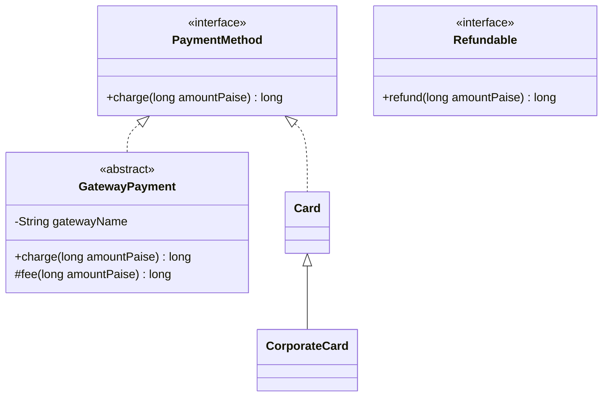

## Where we are

From JAVA-FUND-1 you can compile and run classes from the classpath, JAVA-JVM-1 showed how the JVM
executes them, and LIFECYCLE-1 showed when a class is loaded and initialised. This lesson is about
how to *shape* those classes: the four OOP pillars with real code, overloading versus overriding,
how the JVM picks which method runs, and when to use an abstract class, an interface, composition or
a sealed hierarchy.

## The problem

It is Friday evening. Product wants a fourth payment method, PayLater, live in ShopKart by Monday.
You open checkout and find this:

```java
double charge(String method, double amount) {
    if (method.equals("CARD"))   { return amount * 1.02; }   // 2% card fee
    if (method.equals("UPI"))    { return amount; }
    if (method.equals("WALLET")) { return amount + 1.0; }
    throw new IllegalArgumentException(method);
}
```

To add PayLater you must edit the method that every payment already goes through, so one slip breaks
card charging for everyone. A typo like `"CRAD"` compiles fine. And refunds, limits and receipts each
have their own copy of this `if` chain, so you have four places to edit, not one. OOP lets each
payment method keep its rules in its own class and lets the language pick the right one.

## Encapsulation: hide the state, expose behaviour

**Encapsulation** means an object keeps its fields private and lets callers change them only
through methods that enforce the rules.

```java
public class Wallet {
    private long balancePaise;                       // nobody outside can set this directly

    public void debit(long paise) {
        if (paise <= 0) throw new IllegalArgumentException("amount must be positive");
        if (paise > balancePaise) throw new IllegalStateException("insufficient balance");
        balancePaise -= paise;
    }

    public long balancePaise() { return balancePaise; }
}
```

**Rule:** the class, not its callers, owns its invariants (rules that must always be true, such as
"balance is never negative"). Public setters for every field are not encapsulation; they are
public fields with extra steps.

## Abstraction: depend on what, not how

**Abstraction** means callers see *what* something does and not *how*. In Java the usual tool is an
**interface**: a type that lists method signatures without committing to an implementation.

```java
public interface PaymentMethod {
    long charge(long amountPaise);                   // what: "charge this amount, return total"
}
```

Checkout can now accept any `PaymentMethod` without knowing whether it talks to a card gateway or a
wallet table.

## Inheritance: reuse and "is-a"

**Inheritance** means a class (`extends`) takes over the fields and methods of a parent class and
may add or replace behaviour. Java allows **one** parent class but any number of interfaces.

```java
public class Card implements PaymentMethod {
    @Override
    public long charge(long amountPaise) { return amountPaise + amountPaise * 2 / 100; }
}

public class CorporateCard extends Card {             // a CorporateCard IS-A Card
    @Override
    public long charge(long amountPaise) { return super.charge(amountPaise) + 500; }  // reuse parent
}
```

`super.charge(...)` calls the parent's version. A subclass constructor always calls a parent
constructor first, explicitly with `super(...)` or implicitly with the no-argument one. The
subclass's own field initialisers run only **after** that parent constructor returns. Keep that in
mind; a quiz below depends on it.

Here is the family you are building, plus two types coming later in this lesson:



Dashed arrows mean "implements an interface", solid arrows "extends a class". `Refundable` stands
alone: any class, from any family, can add it.

```quiz
{"question": "ShopKart wants PayLater to reuse Card's fee logic and also be Refundable and Auditable (two interfaces). Which declaration does Java allow?", "level": "easy",
 "options": [
   {"text": "class PayLater extends Card implements Refundable, Auditable", "correct": true, "why": "One parent class plus any number of interfaces is exactly what Java allows."},
   {"text": "class PayLater extends Card, Wallet implements Refundable", "why": "A class can extend only one class. Java forbids multiple inheritance of classes (state)."},
   {"text": "class PayLater implements Card, Refundable, Auditable", "why": "Card is a class, so it must be extended, not implemented."},
   {"text": "It is impossible: a class that extends another class cannot implement interfaces", "why": "extends and implements combine freely; CorporateCard already does it through Card."}]}
```

## Polymorphism: one call, many behaviours

**Polymorphism** ("many forms") means one variable of a parent type can hold objects of different
classes, and the call runs the version belonging to the actual object.

**Predict:** what three numbers does this print?

```java
List<PaymentMethod> methods = List.of(new Card(), new CorporateCard(), amount -> amount);
for (PaymentMethod m : methods) {
    System.out.println(m.charge(10_000));
}
```

It prints `10200`, `10700` and `10000`. Each object runs its own `charge`, even though the loop only
knows `PaymentMethod`. The third element is a lambda: because `PaymentMethod` has exactly one
abstract method, a lambda can implement it (JAVA-FUND-7 covers this). The `if` chain is gone; adding
PayLater means adding a class, not editing checkout.

## Overloading vs overriding

The most-asked pair in OOP interviews, and they are decided at different times.

**Overloading** is several methods in the same class with the **same name but different parameter
lists**. The **compiler** picks one, using the *declared* (static) types of the arguments.

**Overriding** is a subclass providing a method with the **same signature** as the parent. The
**JVM** picks one at run time, using the *actual* class of the object.

**Predict:** `x` holds a `String`. Which line prints?

```java
class Printer {
    void print(Object o) { System.out.println("Object"); }
    void print(String s) { System.out.println("String"); }   // overload
}

Object x = "hello";
new Printer().print(x);
```

It prints `Object`. Overload resolution happened at compile time, and the compiler only saw the
declared type `Object`. Overriding is the opposite: `PaymentMethod m = new CorporateCard();
m.charge(...)` runs `CorporateCard.charge`.

Rules for a valid override:

- same name and parameter types; the return type may be a **subtype** (covariant return),
- access may be widened (`protected` → `public`) but never narrowed,
- it may not throw new or broader **checked** exceptions than the parent declares,
- `static`, `private` and `final` methods are not overridden. A `static` method with the same
  signature in a subclass **hides** the parent's one: which runs depends on the declared type,
- fields are never polymorphic: `parentRef.field` reads the parent's field even if the subclass
  declares one with the same name.

Always write `@Override`. If you misspell the name or get a parameter type wrong, the compiler
refuses instead of silently creating an overload.

```quiz
{"question": "What does this print?", "level": "medium",
 "code": ["class A { String who() { return \"A\"; } }", "class B extends A { @Override String who() { return \"B\"; } }", "", "static void show(A a) { System.out.println(\"show(A): \" + a.who()); }", "static void show(B b) { System.out.println(\"show(B): \" + b.who()); }", "", "A x = new B();", "show(x);"],
 "options": [
   {"text": "show(A): B", "correct": true, "why": "Two decisions at two times: javac picks the overload show(A) from the declared type A, then the JVM dispatches who() on the real object, a B."},
   {"text": "show(B): B", "why": "That assumes overloads are chosen at run time. They are chosen by the compiler, which only sees the declared type A."},
   {"text": "show(A): A", "why": "Right overload, but who() is overridden, so the runtime class B decides which version runs."},
   {"text": "show(B): A", "why": "This mixes up both rules: overloads use the declared type, overrides use the runtime class."}]}
```

## Dynamic dispatch: how the JVM picks the override

**Dynamic dispatch** is the run-time lookup behind overriding. You saw in JAVA-JVM-1 that `javac`
emits bytecode; for `m.charge(x)` it emits an `invokeinterface` (or `invokevirtual` for a class
type) that names only `PaymentMethod.charge`. When that instruction runs, the JVM looks at the
object's actual class and finds the most specific implementation, walking up the parent chain
(`CorporateCard`, then `Card`, then `Object`) until it finds one.

HotSpot implements this with per-class method tables, and the JIT often removes the lookup entirely
when a call site only ever sees one class (the speculation you met in JAVA-JVM-1).

**Rule:** overloads are chosen by the compiler from declared types; overrides are chosen by the JVM
from the runtime class, every time, even inside a constructor.

```quiz
{"question": "What does `new Child();` print?", "level": "hard",
 "code": ["class Base {", "    Base() { init(); }", "    void init() { }", "}", "class Child extends Base {", "    private String name = \"child\";", "    @Override void init() { System.out.println(\"init sees \" + name); }", "}"],
 "options": [
   {"text": "init sees null", "correct": true, "why": "Base's constructor runs first and dynamic dispatch calls Child.init, but Child's field initialiser has not run yet, so name is still null."},
   {"text": "init sees child", "why": "Field initialisers of Child run only after the Base constructor returns, which is after init() was called."},
   {"text": "Nothing: Base.init runs because we are still inside Base's constructor", "why": "Dispatch always uses the object's real class, which is Child from the moment it is allocated, even during Base's constructor."},
   {"text": "It does not compile: constructors cannot call overridable methods", "why": "It compiles. That is why this trap is dangerous; make such methods private or final."}]}
```

## Abstract class vs interface

An **abstract class** is a class marked `abstract`: it cannot be instantiated, and may have
constructors, fields with state, and both implemented and abstract methods. Use it when subclasses
share **state and a fixed algorithm skeleton**.

```java
public abstract class GatewayPayment implements PaymentMethod {
    private final String gatewayName;                     // shared state
    protected GatewayPayment(String gatewayName) { this.gatewayName = gatewayName; }

    @Override
    public final long charge(long amountPaise) {          // fixed skeleton (Template Method pattern)
        long total = amountPaise + fee(amountPaise);
        System.out.println(gatewayName + " charging " + total);
        return total;
    }

    protected abstract long fee(long amountPaise);        // the step subclasses fill in
}
```

An **interface** describes a capability. Since Java 8 it can carry `default` and `static` methods,
and since Java 9 `private` helpers:

```java
public interface Refundable {
    long refund(long amountPaise);                        // abstract: implementers must provide

    default long refundAll(List<Long> amounts) {          // default (Java 8): inherited behaviour
        return amounts.stream().mapToLong(a -> refund(checked(a))).sum();
    }

    private long checked(long amount) {                   // private (Java 9): helper for defaults
        if (amount < 0) throw new IllegalArgumentException("negative refund");
        return amount;
    }
}
```

| | Abstract class | Interface |
|---|---|---|
| Instance state (non-static fields) | yes | no (only `public static final` constants) |
| Constructors | yes | no |
| A class can extend/implement | one | many |
| Method bodies | any | `default`, `static`, `private` only |
| Member access | any | methods implicitly `public` unless `private` |
| Typical use | shared state + skeleton for a family | a capability many unrelated types can have |

**Rule:** default to an interface. Add an abstract class beneath it only when implementations
genuinely share state or a fixed sequence of steps.

## Two defaults, one class: the diamond

Interfaces can now carry behaviour, so a class can inherit the same method from two of them.

```quiz
{"question": "What happens when you compile this?", "level": "medium",
 "code": ["interface Sms   { default String hello() { return \"sms\"; } }", "interface Email { default String hello() { return \"email\"; } }", "class Notifier implements Sms, Email { }", "", "System.out.println(new Notifier().hello());"],
 "options": [
   {"text": "Compile error: Notifier inherits unrelated defaults for hello()", "correct": true, "why": "javac refuses until Notifier overrides hello(); inside, it may pick one with Sms.super.hello()."},
   {"text": "It prints sms, because Sms is listed first", "why": "Order in the implements list never matters. Java makes you resolve the conflict explicitly."},
   {"text": "It prints email, because the last default wins", "why": "There is no 'last wins' rule; the class does not compile."},
   {"text": "It compiles but throws an exception at run time", "why": "The conflict is caught at compile time, not at run time."}]}
```

The fix is to override `hello()` and, if you like, delegate with `Sms.super.hello()`. This is how
Java avoids the "diamond problem": behaviour can come from many interfaces, but state only from one
class, and conflicts must be resolved by hand.

## Composition over inheritance

Inheritance couples you to the parent's **implementation**, not just its contract. The classic
demonstration (from *Effective Java*) counts how many elements were ever added to a set.

**Predict:** after `addAll` of three strings, what is `added`?

```java
class CountingSet<E> extends HashSet<E> {
    int added = 0;
    @Override public boolean add(E e) { added++; return super.add(e); }
    @Override public boolean addAll(Collection<? extends E> c) { added += c.size(); return super.addAll(c); }
}
// new CountingSet<String>().addAll(List.of("a", "b", "c"))
```

It is `6`, not `3`. `HashSet.addAll` happens to call `add` for each element, which is your override,
so each element is counted twice. Nothing in `HashSet`'s public contract promised that, and a future
JDK could change it. **Composition** avoids the problem: hold a `Set` in a field and forward to it.

```java
class CountingSet<E> {
    private final Set<E> delegate = new HashSet<>();
    private int added = 0;
    boolean add(E e) { added++; return delegate.add(e); }
    boolean addAll(Collection<? extends E> c) { added += c.size(); return delegate.addAll(c); }
    int added() { return added; }
}
```

**Rule:** use inheritance only for a true "is-a" relationship where you control (or the parent
documents) how it calls its own methods. Otherwise "has-a" plus forwarding is safer. This is also
why Spring injects collaborators (through constructors) instead of making you extend framework base
classes.

## Sealed classes: a closed set of subtypes

Sometimes you want polymorphism over a **fixed** list of types: a payment is a card, UPI or wallet,
and nothing else. A **sealed** class or interface (Java 17) names its permitted subtypes:

```java
public sealed interface Payment permits CardPayment, UpiPayment, WalletPayment {}
public final class CardPayment implements Payment { /* ... */ }
public final class UpiPayment implements Payment { /* ... */ }
public non-sealed class WalletPayment implements Payment { /* open for further subclassing */ }
```

Each permitted subclass must say `final`, `sealed` or `non-sealed`. The payoff in Java 21 is an
**exhaustive** pattern-matching `switch`: the compiler knows every case, so no `default` is needed,
and adding a fourth type breaks the build everywhere it is not handled.

```java
static String label(Payment p) {
    return switch (p) {
        case CardPayment c   -> "card";
        case UpiPayment u    -> "upi";
        case WalletPayment w -> "wallet";
    };
}
```

**Rule:** open hierarchy (anyone may add a type) → interface + dynamic dispatch. Closed hierarchy
(you own all the types, behaviour lives outside them) → sealed + exhaustive `switch`.

## Lab (~10 min)

Save as `Dispatch.java` and run with `java Dispatch.java`. Write down your prediction for every
numbered line before running.

```java
import java.util.List;

public class Dispatch {
    static class Animal {
        String name = "animal";
        static String kind() { return "Animal.kind"; }
        String sound() { return "..."; }
        String describe() { return name + " says " + sound(); }
    }

    static class Dog extends Animal {
        String name = "dog";                               // hides Animal.name, does not override it
        static String kind() { return "Dog.kind"; }        // hides Animal.kind
        @Override String sound() { return "woof"; }
    }

    static void greet(Animal a) { System.out.println("greet(Animal)"); }
    static void greet(Dog d) { System.out.println("greet(Dog)"); }

    public static void main(String[] args) {
        Animal a = new Dog();
        System.out.println(a.sound());      // 1
        System.out.println(a.name);         // 2
        System.out.println(a.describe());   // 3
        System.out.println(a.kind());       // 4 (a holds a Dog)
        greet(a);                           // 5
        greet((Dog) a);                     // 6
        for (Animal x : List.of(new Animal(), new Dog())) {
            System.out.println(x.sound());  // 7
        }
    }
}
```

**What you should observe:** (1) `woof`: overriding uses the runtime class. (2) `animal`: fields are
resolved from the declared type. (3) `animal says woof`: inside `Animal.describe`, `name` is
Animal's field but `sound()` is still dispatched dynamically. (4) `Animal.kind`, even though `a`
holds a Dog: a static method called through a variable is chosen from the declared type, so
`Dog.kind` only hides it (`javac -Xlint:static` warns that the call should be written
`Animal.kind()`). (5) `greet(Animal)`: overloads use the declared type. (6) `greet(Dog)` after the
cast. (7) `...` then `woof`.

**Break it:** in `Dog`, remove `@Override` and rename `sound` to `sound2`. It still compiles, and
line 1 now prints `...`: the "override" silently became a new method. Put `@Override` back on
`sound2` and watch the compiler refuse ("method does not override or implement a method from a
supertype"). That error is the reason to write `@Override` every time.

## Gotchas

- **Overridable method called from a constructor:** it sees uninitialised subclass fields; make it `private` or `final`.
- **Expecting overloads to dispatch at run time:** they use the declared type; use overriding or a pattern `switch`.
- **"Static methods can be overridden":** they are hidden; `-Xlint:static` flags calls through an instance.
- **Deep `BaseService` towers for reuse:** one base change breaks every subclass; prefer composition and small interfaces.
- **`equals(Payment other)`:** an overload, not an override of `equals(Object)`; `@Override` catches it (JAVA-FUND-3).

## In interviews

Bank: [The four OOP principles](#/q/oop-four-pillars),
[Polymorphism, and can static methods be overridden?](#/q/polymorphism-and-static-method-overriding),
[Inheritance vs composition](#/q/inheritance-vs-composition),
[Implement Inheritance from a Java Template](#/q/java-inheritance-oa). Give the pillars with your own example, not
Animal/Dog.

- *"Abstract class or interface, now that interfaces have defaults?"* Interfaces still have no instance state or
  constructors and a class can implement many; use an abstract class only for shared state or a fixed skeleton.
- *"Why no multiple inheritance of classes?"* To avoid ambiguous state and constructor chains; defaults allow multiple
  inheritance of behaviour, with conflicts resolved explicitly.

## Explain it in 2 minutes

Prompt: *"Explain polymorphism and how Java decides which method runs."*

- A parent-typed reference holds different subclasses; each call does the right thing, removing type `if` chains.
- Compile time: `javac` picks the signature among overloads by declared argument types.
- Run time: the JVM picks the implementation from the actual class (`invokevirtual`/`invokeinterface`).
- Not dispatched: fields, `static`, `private`, `final` methods.
- Design: interfaces for contracts (Strategy), abstract classes for skeletons (Template Method, e.g. Spring's
  `OncePerRequestFilter`), composition for reuse, sealed types for closed sets.

## Check yourself

1. Name three things an abstract class can have that an interface cannot.
2. A class implements `A` and `B`, both with `default void log()`. What must it do?
3. What do you gain from making `Payment` sealed instead of a plain interface?

### Answers

1. Instance fields, constructors, `protected`/package-private methods; and a class can extend only one.
2. Override `log()`, optionally delegating with `A.super.log()` or `B.super.log()`.
3. The compiler knows every subtype: `switch` can be exhaustive without `default`, and a new type fails the build
   wherever it is unhandled.

## Next

JAVA-FUND-3: `equals`, `hashCode` and `compareTo`, and what breaks in `HashMap`, `HashSet` and `TreeSet` when they are
wrong.
