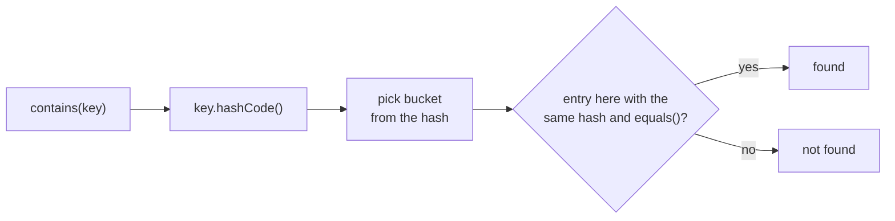

## Where we are

From JAVA-FUND-2 you know how overriding works and that `@Override` protects you from accidental overloads. Every class silently inherits a few methods from `Object`.

This lesson is about the ones that decide how your objects behave inside collections:

- `equals`;
- `hashCode`;
- `compareTo` (and its outside cousin `Comparator`);
- plus the design habit that makes them safe: immutability.

## The problem

A customer writes in: her ShopKart cart shows the same T-shirt, same size, twice, and she was charged
for both. You wrote the dedup code last sprint:

```java
class CartKey {
    String sku; String size;
    CartKey(String sku, String size) { this.sku = sku; this.size = size; }
}

Set<CartKey> seen = new HashSet<>();
seen.add(new CartKey("TSHIRT-1", "M"));
System.out.println(seen.contains(new CartKey("TSHIRT-1", "M")));
```

**Predict:** `true` or `false`?

It prints `false`.

Two keys with identical data, and the set says it has never seen it. No exception, no log line, just duplicate charges.

The cause:

- `CartKey` inherits `Object.equals`, which means "same object in memory";
- and `Object.hashCode`, which has nothing to do with the fields.

To fix it properly you need the contract that `HashSet`, `HashMap` and friends rely on.

## == versus equals

- **`==`** on references asks: *are these the same object?* (identity). On primitives it compares
  values.
- **`equals`** asks: *do these represent the same value?* (logical equality). `Object.equals` falls
  back to `==`; classes like `String`, `Integer`, `LocalDate` and `List` override it to compare
  contents.

```java
String a = new String("hi"), b = new String("hi");
System.out.println(a == b);        // false: two objects
System.out.println(a.equals(b));   // true: same characters
```

**Rule:** compare values with `equals` (or `Objects.equals(x, y)`, which is null-safe). Use `==` only
for primitives, enums, and when you truly mean identity.

```quiz
{"question": "CartKey does not override equals. What does new CartKey(\"A\", \"M\").equals(new CartKey(\"A\", \"M\")) compare?",
 "level": "easy",
 "options": [
   {"text": "Identity: whether both references point to the same object", "correct": true,
    "why": "Object.equals is implemented as this == obj, so two separate objects are never equal."},
   {"text": "All fields, one by one, using reflection",
    "why": "Java never does that by default. Only records generate field-based equals for you."},
   {"text": "Their hash codes",
    "why": "equals does not look at hashCode. The relationship goes the other way: equal objects must have equal hash codes."},
   {"text": "Their toString() output", "why": "toString is for display; equality never uses it."}]}
```

## The equals contract

`Object.equals`'s Javadoc lists five rules every override must keep, for non-null `x`, `y`, `z`:

| Rule | Meaning |
|---|---|
| Reflexive | `x.equals(x)` is true |
| Symmetric | `x.equals(y)` ⇔ `y.equals(x)` |
| Transitive | `x.equals(y)` and `y.equals(z)` ⇒ `x.equals(z)` |
| Consistent | repeated calls give the same answer while the compared fields don't change |
| Non-null | `x.equals(null)` is false, never an exception |

A correct override for `CartKey`:

```java
@Override
public boolean equals(Object o) {
    if (this == o) return true;                                   // fast path, reflexive
    if (!(o instanceof CartKey other)) return false;              // handles null and other types
    return sku.equals(other.sku) && size.equals(other.size);
}
```

`o instanceof CartKey other` is a **pattern-matching instanceof** (Java 16): it tests the type and
binds a typed variable in one step.

`instanceof` vs `getClass() != o.getClass()`: `instanceof` lets a subclass instance equal a parent instance. If the subclass adds a field to `equals`, symmetry breaks (`parent.equals(child)` is true, `child.equals(parent)` is false).

Either:

- make the class `final` and use `instanceof`;
- or use `getClass()` and accept that subclasses never equal parents.

For value classes, `final` is the usual answer.

## The hashCode contract, and why HashMap needs it

`HashMap` (and `HashSet`, which is a `HashMap` underneath) does not compare your key against every entry. It:

1. calls `hashCode()`;
2. uses the number to pick a **bucket** (a slot in an internal array);
3. only runs `equals` against the few entries in that bucket.



So the contract is:

1. **Equal objects must have equal hash codes.** If `x.equals(y)` then `x.hashCode() == y.hashCode()`.
2. Unequal objects *may* share a hash code (a **collision**); it just costs speed.
3. `hashCode` must be consistent while the fields used by `equals` don't change.

Break rule 1 and two equal keys get different hash codes:

- the lookup goes to a different bucket;
- even in the same bucket `HashMap` checks the stored hash before it calls `equals`.

So `equals` is never even called. That is exactly the `false` in "The problem". The fix uses the same fields as `equals`:

```java
@Override
public int hashCode() { return Objects.hash(sku, size); }
```

**Rule:** override `equals` and `hashCode` together, from the same fields. JAVA-FUND-6 opens up
`HashMap`'s buckets, resizing and tree bins.

```quiz
{"question": "A teammate 'fixes' the bug the other way round: HashOnly overrides hashCode (from id) but not equals. What prints?",
 "level": "medium",
 "code": [
   "Set<HashOnly> set = new HashSet<>(List.of(new HashOnly(\"x\")));",
   "System.out.println(set.contains(new HashOnly(\"x\")));"],
 "options": [
   {"text": "false", "correct": true,
    "why": "The lookup reaches the right bucket, but equals is still Object's identity check, and the objects differ."},
   {"text": "true", "why": "A matching hash only gets you to the bucket. HashMap still needs equals to confirm the match."},
   {"text": "It throws, because equals and hashCode must be overridden together",
    "why": "Nothing enforces the pairing at run time or compile time; the bug is silent."},
   {"text": "true or false, depending on the run",
    "why": "Identity hash codes vary, but play no part: hashCode comes from id and equals is identity, so false every run."}]}
```

## Mutable keys: the silent leak

Even a correct `hashCode` fails if a key's fields change after it is inserted.

**Predict:** what do the last two lines print?

```java
Set<List<String>> set = new HashSet<>();
List<String> key = new ArrayList<>(List.of("a"));
set.add(key);
key.add("b");                         // the list's hashCode changes
System.out.println(set.contains(key));
System.out.println(set.size());
```

`false`, then `1`. The lookup uses the new hash and looks in the new bucket, while the entry sits in the old one.

- It is stranded: you cannot find it or remove it by key, and in a long-lived cache that is a memory leak.
- **Rule:** keys in hash-based collections must not change while they are inside.
- Simplest guarantee: make key classes immutable (below).

## Records: equals and hashCode for free

A **record** (Java 16) is a class declared by its components; the compiler generates a canonical
constructor, private final fields, accessor methods, and `equals`, `hashCode` and `toString` based
on all components.

```java
public record CartKey(String sku, String size) {
    public CartKey {                                    // compact constructor: validate inputs
        Objects.requireNonNull(sku, "sku");
        Objects.requireNonNull(size, "size");
    }
}
// new CartKey("TSHIRT-1", "M").equals(new CartKey("TSHIRT-1", "M"))  -> true
```

Records are implicitly `final` and cannot extend another class (they can implement interfaces). They are a good fit for keys, DTOs and value objects.

Two caveats:

- a record is only **shallowly** immutable (a `List` component can still be mutated by whoever holds it);
- an array component is compared with the array's own `equals`, which is identity, not contents.

## Comparable: the natural order

Hash collections need equality. Sorted collections (`TreeMap`, `TreeSet`, `Collections.sort`,
`PriorityQueue`) need **order**. A class that has one obvious order implements **`Comparable<T>`**:

```java
public record Money(long paise) implements Comparable<Money> {
    @Override
    public int compareTo(Money other) { return Long.compare(paise, other.paise); }
}
```

`compareTo` returns a negative number, zero, or a positive number when `this` is less than, equal
to, or greater than `other`. The contract mirrors `equals`: sign-symmetric
(`sgn(a.compareTo(b)) == -sgn(b.compareTo(a))`), transitive, and consistent.

Use `Long.compare` / `Integer.compare`, never `a - b`: subtraction overflows for large or negative
values and returns the wrong sign. The lab shows it.

## Comparator: any other order

A **`Comparator<T>`** is an order defined *outside* the class. Use it when there is no single natural
order, or when you don't own the class.

```java
record Order(String customer, long totalPaise, LocalDate placed) {}

Comparator<Order> byValueDescThenDate = Comparator
        .comparingLong(Order::totalPaise).reversed()
        .thenComparing(Order::placed);

orders.sort(byValueDescThenDate);
Comparator<Order> nullsLast = Comparator.comparing(Order::customer,
        Comparator.nullsLast(Comparator.naturalOrder()));
```

## Consistency with equals

An order is **consistent with equals** when `a.compareTo(b) == 0` exactly when `a.equals(b)`. It is strongly recommended, because sorted collections use `compareTo` (or the comparator) **instead of** `equals`.

`BigDecimal` is the famous exception:

- `equals` compares value *and* scale (digits after the point);
- `compareTo` compares only the value.

**Predict:** what are the two set sizes?

```java
var a = new BigDecimal("1.0");
var b = new BigDecimal("1.00");
System.out.println(a.equals(b));                           // false: scale 1 vs scale 2
System.out.println(a.compareTo(b));                        // 0: same numeric value
System.out.println(new HashSet<>(List.of(a, b)).size());
System.out.println(new TreeSet<>(List.of(a, b)).size());
```

`2`, then `1`. Same two objects, a different "set" depending on the implementation: `HashSet` asks
`equals`, `TreeSet` asks `compareTo`.

```quiz
{"question": "Two different orders, same total. What does this print?", "level": "hard",
 "code": [
   "Set<Order> byTotal = new TreeSet<>(Comparator.comparingLong(Order::totalPaise));",
   "byTotal.add(new Order(\"asha\", 50_000, LocalDate.of(2026, 11, 1)));",
   "byTotal.add(new Order(\"ravi\", 50_000, LocalDate.of(2026, 11, 2)));",
   "System.out.println(byTotal.size());"],
 "options": [
   {"text": "1", "correct": true,
    "why": "TreeSet treats compare(...) == 0 as 'already present', so Ravi's order is silently dropped."},
   {"text": "2", "why": "That would be true for a HashSet, which uses the record's equals. A TreeSet never calls equals."},
   {"text": "It throws, because two elements compare as equal",
    "why": "There is no error; add simply returns false. That silence is what makes this a production bug."},
   {"text": "2, with Asha first because she was added first",
    "why": "Insertion order does not matter in a TreeSet, and the second element is not stored at all."}]}
```

**Rule:** if two objects can compare as 0 without being equal, break the tie with more fields
(`thenComparing`) before putting them in a sorted set or map.

## Immutability: the recipe

An **immutable** object cannot change after construction. That makes it safe as a map key, safe to
share between threads without locks, and easy to reason about. The recipe:

1. Make the class `final` (or use a record) so no subclass can add mutable state.
2. Make all fields `private final`.
3. No setters; "modifiers" return a new instance (`withLine(...)`).
4. Validate in the constructor, so an invalid instance can never exist.
5. **Defensive copies** of mutable inputs and outputs (next section).

```java
public final class Cart {
    private final String customerId;
    private final List<CartKey> lines;

    public Cart(String customerId, List<CartKey> lines) {
        this.customerId = Objects.requireNonNull(customerId);
        this.lines = List.copyOf(lines);            // defensive copy in; also rejects null elements
    }

    public List<CartKey> lines() { return lines; }  // safe: List.copyOf returns an unmodifiable list

    public Cart withLine(CartKey key) {
        var next = new ArrayList<>(lines);
        next.add(key);
        return new Cart(customerId, next);
    }
}
```

## Defensive copies

Without the copy, the caller still holds a reference to the list you stored:

```java
List<CartKey> mine = new ArrayList<>();
Cart cart = new Cart("c1", mine);
mine.add(new CartKey("X", "L"));   // with List.copyOf in the constructor, cart is unaffected
```

Copy **in** (constructor arguments) and, if you store a mutable type, copy **out** (getters). For
`Date` or arrays, clone or copy; better, use `java.time` types, which are immutable. And beware the
look-alike:

```quiz
{"question": "What does this print?", "level": "medium",
 "code": [
   "List<String> src  = new ArrayList<>(List.of(\"a\"));",
   "List<String> view = Collections.unmodifiableList(src);",
   "List<String> copy = List.copyOf(src);",
   "src.add(\"b\");",
   "System.out.println(view.size() + \" \" + copy.size());"],
 "options": [
   {"text": "2 1", "correct": true,
    "why": "unmodifiableList is a read-only view that reads src, so it sees \"b\". List.copyOf copied before the add."},
   {"text": "1 1",
    "why": "That treats unmodifiableList as a copy. It only blocks writes through the view; src's owner can still change it."},
   {"text": "2 2", "why": "List.copyOf copies the elements at call time; later changes to src do not reach it."},
   {"text": "It throws UnsupportedOperationException",
    "why": "Only writes through view or copy throw. src is a plain ArrayList and accepts the add."}]}
```

## Why String is immutable

`String` is the most-used immutable class (and a `final` class, so no subclass can add mutable state), and interviewers
ask why it was designed that way:

- **Safe sharing:** string literals are interned and shared (`"hi" == "hi"` is true for literals),
  and any string can cross threads without locks. Both are only safe if nobody can change it.
- **Security:** strings carry class names, file paths, URLs and SQL. If they were mutable, a value
  could change after it was validated.
- **Hash caching:** `String` computes its `hashCode` once and caches it, which makes strings fast
  `HashMap` keys.

The cost is that every "change" allocates a new string, which is why loops building text use
`StringBuilder`.

## Lab (~10 min)

Save as `KeysLab.java`, run with `java KeysLab.java`, and predict each numbered line first. `BadKey`
is the break-it case: a `HashSet` that loses an object because `hashCode` was not overridden.

```java
import java.math.BigDecimal;
import java.util.*;

public class KeysLab {
    static final class BadKey {                       // equals without hashCode
        final String id;
        BadKey(String id) { this.id = id; }
        @Override public boolean equals(Object o) { return o instanceof BadKey k && id.equals(k.id); }
    }

    record GoodKey(String id) {}

    static final class MutableKey {                   // correct equals/hashCode, but mutable
        String id;
        MutableKey(String id) { this.id = id; }
        @Override public boolean equals(Object o) { return o instanceof MutableKey k && id.equals(k.id); }
        @Override public int hashCode() { return id.hashCode(); }
    }

    public static void main(String[] args) {
        Set<BadKey> bad = new HashSet<>(List.of(new BadKey("a")));
        System.out.println("bad contains:  " + bad.contains(new BadKey("a")));      // 1

        Set<GoodKey> good = new HashSet<>(List.of(new GoodKey("a")));
        System.out.println("good contains: " + good.contains(new GoodKey("a")));    // 2

        MutableKey k = new MutableKey("a");
        Set<MutableKey> mut = new HashSet<>(Set.of(k));
        k.id = "b";
        System.out.println("mut contains:  " + mut.contains(k) + ", size " + mut.size());  // 3

        var one = new BigDecimal("1.0");
        var two = new BigDecimal("1.00");
        System.out.println("hash " + new HashSet<>(List.of(one, two)).size()
                + " / tree " + new TreeSet<>(List.of(one, two)).size());             // 4

        int low = Integer.MIN_VALUE, high = 1;
        System.out.println("low - high = " + (low - high)
                + ", Integer.compare = " + Integer.compare(low, high));              // 5
    }
}
```

**What you should observe:**

```text
bad contains:  false
good contains: true
mut contains:  false, size 1
hash 2 / tree 1
low - high = 2147483647, Integer.compare = -1
```

1. `false` (almost always; only an identical pair of identity hash codes could match): the two `BadKey`s have unrelated identity hash codes, so the lookup never reaches `equals`.
2. `true`: the record generated both methods.
3. a stranded entry.
4. the `BigDecimal` scale trap.
5. `low` is the smallest `int`, yet `low - high` overflows to a large positive number, so a subtraction comparator would sort it *after* `high`. `Integer.compare` gets the sign right.

**Break it, then fix it:**

1. Add `@Override public int hashCode() { return id.hashCode(); }` to `BadKey` and watch line 1 flip to `true`.
2. Then delete it again and instead remove the `equals` override: line 1 stays `false`, which is the medium quiz above in real code.
3. Finally, turn `MutableKey` into `record MutableKey(String id) {}` and notice that `k.id = "b"` no longer compiles: immutability turned a silent run-time bug into a compile error.

## Gotchas

- **`equals` without `hashCode`:** hash collections miss equal keys; generate both from the same fields, or use a record.
- **`equals(CartKey other)`:** an overload, so collections still get identity; always `@Override equals(Object)`.
- **Mutating a key after inserting it:** the entry is stranded; keep keys immutable.
- **Comparator by subtraction:** `a - b` overflows; use `Integer.compare` or `Comparator.comparingInt`.
- **Order inconsistent with equals in a `TreeSet`/`TreeMap`:** compare-as-0 elements are dropped; add tie-breakers.
- **Unmodifiable is not immutable:** `unmodifiableList` is a view; copy with `List.copyOf`.

## In interviews

Bank: [== vs equals() and the equals/hashCode Contract](#/q/java-equals-vs-double-equals-hashcode),
[Comparable vs Comparator](#/q/comparable-vs-comparator),
[Implement an immutable class](#/q/immutable-class),
[String Immutability and String Storage](#/q/java-string-immutability),
[Deep vs Shallow Copy](#/q/deep-vs-shallow-copy).

- *"Immutable class with a `List` field?"* `final` class, `private final` fields, no setters, validate, store
  `List.copyOf(...)` so it can be returned directly.
- *"What about JPA entities?"* An entity whose `hashCode` uses a generated id changes hash when persisted, so it is lost
  in any set it joined earlier; LIFECYCLE-6 returns to it.

## Explain it in 2 minutes

Prompt: *"Why override `hashCode` with `equals`, and how do you make a safe map key?"*

- Default `equals` is identity; `HashMap` picks the bucket by `hashCode`, then checks `equals` inside it.
- Contract: equal ⇒ same hash; consistent; collisions allowed but slow.
- Keys must not change while inside: immutable class or record, defensive copies.
- Sorted collections use `compareTo`/`Comparator` instead of `equals`; keep them consistent (`BigDecimal` is the
  counterexample).
- `Comparable` is the one natural order; `Comparator` is any other, defined outside the class.

## Check yourself

1. Is it legal for two unequal objects to have the same hash code? What does it cost?
2. What is wrong with `(a, b) -> a.age() - b.age()`, and the fix?
3. Your `Cart` stores the caller's `List` directly in a `private final` field. Is it immutable?

### Answers

1. Yes, a collision: correct but slower, because more `equals` checks run in that bucket.
2. Subtraction can overflow and return the wrong sign; use `Comparator.comparingInt(Person::age)`.
3. No, the caller can still mutate it; store `List.copyOf(lines)` in the constructor.

## Next

DSA-CPLX-1 and INTV-TIPS-1 put these tools to work in coding interviews; JAVA-FUND-6 then opens the `HashMap` buckets
and trees these contracts feed.
