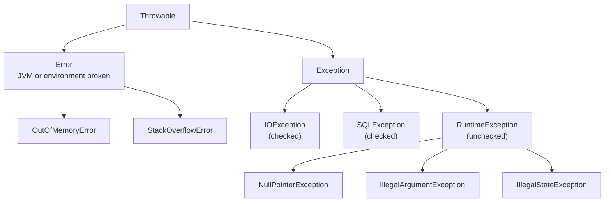

## Where we are

From JAVA-FUND-2 you know inheritance: code written against a parent works with any subclass. Exceptions apply that idea to failure. This lesson covers:

- how Java signals errors;
- how `try`/`catch`/`finally` really executes;
- how to close resources safely;
- how to design errors a caller can actually use.

## The problem

It is 3 a.m. and you are on call.

Customers are being charged yesterday's prices.

The nightly job that reloads the price file reported success. You open the code:

```java
int rc = readConfig("prices.yml", out);
// nobody checks rc
```

`readConfig` returned `2` ("malformed line"), and the caller carried on with the old prices. Status codes fail in three ways:

- callers forget to check them;
- they carry no detail (which file? which line?);
- every layer between the failure and the code that can handle it must pass the code upward by hand.

An **exception** is an object that describes a failure and is *thrown*: normal execution stops and the JVM unwinds the call stack until it finds a matching `catch`.

If nothing catches it, the thread dies with a stack trace. Ignoring an exception is a visible choice, not an accident.

## The hierarchy

Everything that can be thrown extends `Throwable`. The tree has two main branches:



- **`Error`** means the environment is broken (out of memory, a class that failed to link); application code almost never catches it.
- **`Exception`** is the branch you work with, and **`RuntimeException`** has a special status in the compiler, explained next.

Because this is an ordinary class hierarchy, `catch (IOException e)` also catches its subclass `FileNotFoundException`.

## Checked versus unchecked

A **checked exception** is any `Exception` that is *not* a `RuntimeException`. The compiler forces
every method that can throw one to either catch it or declare it with `throws`:

```java
String firstLine(Path p) throws IOException {     // must declare, or it will not compile
    return Files.readAllLines(p).get(0);
}
```

An **unchecked exception** is a `RuntimeException` (or an `Error`). The compiler does not track it; any method may throw it without saying so.

The distinction is purely a compile-time check: the JVM treats both kinds identically when it throws and unwinds.

| Kind | Meaning | Examples |
|---|---|---|
| Checked | a failure outside the program's control that a caller *could* reasonably recover from | `IOException`, `SQLException`, `TimeoutException` |
| Unchecked | a bug or broken precondition; retrying the same call will fail the same way | `NullPointerException`, `IllegalArgumentException` |

**The debate.** Checked exceptions make failure part of the signature, which is honest. In practice:

- every layer must declare or catch them;
- they leak details (why does `UserService.find` declare `SQLException`?);
- they don't fit lambdas: a lambda (a short inline function; JAVA-FUND-7) implements an interface like `Function`, whose `apply` declares no checked exception.

Spring uses unchecked exceptions almost everywhere and translates `SQLException` into its own unchecked `DataAccessException` hierarchy. Kotlin and C# have no checked exceptions at all.

A balanced position, and a good interview answer:

- checked exceptions sparingly, for recoverable conditions a direct caller is expected to handle;
- unchecked for programming errors and anything that will bubble up to a top-level handler.

```quiz
{"question": "Which one must a method declare with throws (or catch) to compile?", "level": "easy",
 "options": [
   {"text": "FileNotFoundException", "correct": true, "why": "It extends IOException, an Exception that is not a RuntimeException: checked."},
   {"text": "IllegalArgumentException", "why": "It extends RuntimeException, so it is unchecked; the compiler does not track it."},
   {"text": "OutOfMemoryError", "why": "Errors are unchecked too. Nobody is expected to declare or recover from them."},
   {"text": "NullPointerException", "why": "A RuntimeException: unchecked, and almost always a bug to fix, not a case to declare."}]}
```

## How try, catch and finally execute

```java
try {
    work();                     // runs first
} catch (IllegalArgumentException e) {
    handle(e);                  // runs only if work() threw a matching type
} finally {
    cleanup();                  // runs on every path: normal, caught, or uncaught
}
```

Rules worth knowing exactly:

1. `catch` blocks are checked **top to bottom**; the first matching type wins. A subclass catch must
   come before its parent, or the compiler rejects it as unreachable.
2. `finally` runs whether the `try` completed normally, threw, or executed `return`. The only common
   ways to skip it are `System.exit()` or the JVM dying.
3. If `try` returns a value, that value is computed *before* `finally` runs. Changing a local variable
   in `finally` does not change what is returned (mutating an object the return value points to does).

**Predict:** what does the caller get from this method?

```java
static int trap() {
    try {
        throw new IllegalStateException("real failure");
    } finally {
        return 42;
    }
}
```

`42`, and no exception. A `return` (or a new `throw`) inside `finally` replaces whatever the `try` was doing, including a pending exception.

- The original failure disappears without a trace.
- **Rule:** never `return` from `finally`; javac warns about it with `-Xlint:finally`.

```quiz
{"question": "What does this method return?", "level": "medium",
 "code": ["static int f() {", "    int x = 1;", "    try {", "        return x;", "    } finally {", "        x = 99;", "    }", "}"],
 "options": [
   {"text": "1", "correct": true, "why": "The return value is computed and saved before finally runs. Reassigning the local x afterwards changes nothing the caller sees."},
   {"text": "99", "why": "That would need finally to run before the return value is evaluated. It runs after, on a value already saved."},
   {"text": "It does not compile: x is assigned after return", "why": "finally is allowed to run code after a return in try; that is its whole purpose."},
   {"text": "99, if x were a field instead of a local", "why": "Still 1: the value is saved before finally runs, whatever kind of variable x is. Only mutating an object that a returned reference points to is visible."}]}
```

## Multi-catch and rethrowing

When two exceptions get the same handling, catch them together:

```java
try {
    parseAndSave(input);
} catch (NumberFormatException | DateTimeParseException e) {
    throw new ValidationException("bad input: " + input, e);
}
```

The types in a multi-catch must not be subclasses of one another (that would be redundant), and the
variable `e` is implicitly `final`.

## try-with-resources

Files, sockets and connections hold operating-system resources the garbage collector will not
release promptly, so they must be closed on every path. **try-with-resources** closes anything that
implements `AutoCloseable`:

```java
try (BufferedReader in = Files.newBufferedReader(path);
     BufferedWriter out = Files.newBufferedWriter(target)) {
    out.write(in.readLine());
}   // out.close() then in.close(), automatically
```

- Resources are closed in **reverse order** of declaration (`out`, then `in`), so a resource that
  depends on an earlier one is closed first.
- They are closed **before** any `catch` or `finally` block of the same statement runs.
- Since Java 9 you can list an existing effectively-final variable: `try (conn) { ... }`.

Watch a failing body with two resources, `a` then `b`, plus a `catch` and a `finally`:

```anim
{"title": "try (a; b) { body } catch { } finally { }: the body throws",
 "stages": ["open a, open b", "body", "close b", "close a", "catch", "finally"],
 "frames": [
  {"stage": 0, "note": "Resources open in declaration order: a, then b. If opening b failed, a would still be closed."},
  {"stage": 1, "note": "The body throws IllegalStateException. It becomes the primary exception, but it is not caught yet."},
  {"stage": 2, "note": "Resources close first, in reverse order. b.close() throws too: that exception is attached to the primary one as suppressed."},
  {"stage": 3, "note": "a.close() still runs. Any failure here is also added as suppressed."},
  {"stage": 4, "note": "Only now does catch see the exception: the body's IllegalStateException, with getSuppressed() listing the close failures."},
  {"stage": 5, "note": "finally runs last, on every path."}
 ]}
```

**Suppressed exceptions.** When the body throws and `close()` also throws, the body's exception is the
real cause, so it is the one thrown. The `close()` failure is attached to it as a **suppressed
exception**, available through `e.getSuppressed()` and printed under `Suppressed:` in the stack trace.

```quiz
{"question": "Old-style code closes in finally. The body throws IllegalStateException, then in.close() throws IOException. What reaches the caller?", "level": "hard",
 "code": ["BufferedReader in = open(path);", "try {", "    process(in);              // throws IllegalStateException", "} finally {", "    in.close();               // throws IOException", "}"],
 "options": [
   {"text": "The IOException, and the IllegalStateException is lost", "correct": true, "why": "An exception thrown from finally replaces the pending one, like return-in-finally. try-with-resources fixes this by keeping the body's exception and adding the close failure as suppressed."},
   {"text": "The IllegalStateException, with the IOException as suppressed", "why": "That is what try-with-resources does. A hand-written finally has no such rule."},
   {"text": "Both, chained: IOException caused by IllegalStateException", "why": "Java never chains them automatically; a cause is only set when code passes one to a constructor."},
   {"text": "The IllegalStateException; finally exceptions are ignored", "why": "Exceptions from finally are not ignored; they win, which is exactly the problem."}]}
```

## Designing your own exceptions

A **custom exception** is a class that extends `Exception` or `RuntimeException`. Make one when a
caller or a handler needs to tell this failure apart from others:

```java
public class PaymentDeclinedException extends RuntimeException {
    private final String errorCode;

    public PaymentDeclinedException(String errorCode, String message, Throwable cause) {
        super(message, cause);
        this.errorCode = errorCode;
    }

    public String errorCode() { return errorCode; }
}
```

Good custom exceptions:

- **Carry a cause** (`super(message, cause)`), so the trace shows `Caused by:` with the root failure.
- **Carry a stable code** (`PAYMENT_DECLINED`) that alerting and API responses can key on.
- **Have an actionable message** with identifiers (order id, file name) and no secrets or personal
  data, because messages end up in logs.
- **Form a small hierarchy** only when handlers really treat the branches differently.

## Exception translation at layer boundaries

A repository talks to a database and sees `SQLException`. The controller above it should not know a database exists.

**Exception translation** means catching a low-level exception at a layer boundary and rethrowing one that makes sense at the higher level, with the original as its cause:

```java
public Order load(long id) {
    try {
        return jdbcLoad(id);
    } catch (SQLException e) {
        throw new OrderStoreException("failed to load order " + id, e);   // keep the cause
    }
}
```

Each layer speaks its own vocabulary:

1. persistence errors;
2. domain errors (`InsufficientFunds`);
3. then HTTP status codes at the edge.

JDK precedent: `UncheckedIOException` wraps an `IOException` where a checked exception cannot be thrown, such as inside a lambda.

## Do not swallow

**Swallowing** an exception means catching it and doing nothing useful:

```java
try { send(mail); } catch (Exception e) { }                       // failure is now invisible
try { send(mail); } catch (Exception e) { e.printStackTrace(); }  // barely better: stderr, no context
```

For each `catch`, do one of three things:

- **handle** it (retry a transient fault, fall back, use a default you can justify);
- **translate** it (wrap with cause and rethrow);
- or **let it propagate** to a top-level handler that logs it once with context.

Logging *and* rethrowing at every layer is the opposite mistake: one failure appears five times in the logs.

**Predict:** `send(mail)` has a bug and throws `NullPointerException`. Which catch hides it:
`catch (Exception e) { }`, `catch (MailException e) { }`, or `catch (IOException e) { }` (assume `send`
declares `throws MailException, IOException`)?

Only `catch (Exception e)`.

- `NullPointerException` is a `RuntimeException`, which is an `Exception`, so the broad catch swallows a real bug.
- The narrow catches let it propagate and be seen.

Catch the narrowest type you can handle.

**At the edge of a Spring web app,** one `@RestControllerAdvice` class maps each exception type to an HTTP
status and a `ProblemDetail` body (the standard `application/problem+json` format). You build it in
SPRING-BOOT-6; only that one class decides status codes.

**Retry only transient faults:** a timeout, a dropped connection, `503 Service Unavailable`, a deadlock victim.
Never retry a validation error or `PaymentDeclinedException`; the same input fails the same way again.

## What an exception costs

**Predict:** what is the expensive part of `throw new IllegalArgumentException("bad row")`: the `throw`, or the
`new`?

The `new`.

A `Throwable`'s constructor calls `fillInStackTrace()`, which walks the whole call stack and records every frame; deep Spring stacks make that costly. Throwing and catching are comparatively cheap.

For a high-volume exception without a trace:

- `Exception` and `RuntimeException` have a protected constructor `(message, cause, enableSuppression, writableStackTrace)`;
- `writableStackTrace = false` skips the capture.
- **Watch out:** use it rarely: a failure with no stack trace is miserable to debug.

## Error-handling strategies side by side

Exceptions are not the only way to say "this did not work". Ask: **is the failure expected, and who
must react to it?**

| Way | Example | Choose when | Pitfall |
|---|---|---|---|
| Exception | `throw new PaymentDeclinedException(...)` | rare failure; the handler is far up the stack | used for normal outcomes, it is slow and hides control flow |
| `Optional` (a box holding a value or nothing; JAVA-FUND-7) | `Optional<User> findByEmail(String e)` | "not found" is a normal answer, with no reason needed | carries no reason; not for fields or parameters |
| Result type | `Result<Order, String>` (below) | expected failures with a reason the direct caller must handle, e.g. per-row validation | Java has no built-in one; do not wrap bugs in it |
| Error code | `int rc = readConfig(...)` | C interop, process exit codes, wire protocols | easy to ignore, no detail (see The problem) |

A **Result type** returns success or failure as a value. With a `sealed` interface (it lists the only classes
allowed to implement it) and two `record`s (compact immutable data classes), a `switch` must handle both cases:

```java
sealed interface Result<T> permits Ok, Err {}
record Ok<T>(T value) implements Result<T> {}
record Err<T>(String reason) implements Result<T> {}

String show(Result<Integer> r) {
    return switch (r) {                      // no default needed: the compiler knows both cases
        case Ok<Integer> ok   -> "row ok: " + ok.value();
        case Err<Integer> err -> "row rejected: " + err.reason();
    };
}
```

```quiz
{"question": "A bulk importer validates 1 million rows, about 5% of which are invalid. It must store the good rows and report every bad row with its reason. How should the row validator signal a bad row?",
 "level": "medium",
 "options": [
   {"text": "Return a Result (Ok or Err with a reason) for each row", "correct": true, "why": "Invalid rows are expected here, the direct caller must handle each one, and it needs the reason. No stack trace per row, and the switch cannot forget the failure case."},
   {"text": "Throw a checked InvalidRowException per row and catch it in the loop", "why": "It works, but 50,000 stack traces are paid for nothing, and an expected outcome is being treated as exceptional."},
   {"text": "Return Optional.empty() for a bad row", "why": "Optional says nothing about why the row failed, and the report needs the reason."},
   {"text": "Return -1 for a bad row", "why": "An error code is easy to ignore and carries no reason, the exact problems this lesson started from."}]}
```

## Lab (~10 min)

Save as `ExceptionLab.java` and run with `java ExceptionLab.java`. **Predict** the full output first,
line by line, then compare.

```java
public class ExceptionLab {

    static class Resource implements AutoCloseable {
        private final String name;

        Resource(String name) {
            this.name = name;
            System.out.println("open " + name);
        }

        void use() {
            throw new IllegalStateException("body failed using " + name);
        }

        @Override
        public void close() {
            System.out.println("close " + name);
            throw new IllegalArgumentException("close failed for " + name);
        }
    }

    @SuppressWarnings("finally")
    static int returnInFinally() {
        try {
            throw new IllegalStateException("lost");
        } finally {
            return 42;
        }
    }

    static int returnThenModify() {
        int x = 1;
        try {
            return x;
        } finally {
            x = 99;                       // does not affect the returned value
        }
    }

    public static void main(String[] args) {
        // 1. try-with-resources: close order and suppressed exceptions
        try (Resource a = new Resource("A"); Resource b = new Resource("B")) {
            b.use();
        } catch (IllegalStateException e) {
            System.out.println("caught: " + e.getMessage());
            for (Throwable s : e.getSuppressed()) {
                System.out.println("  suppressed: " + s.getMessage());
            }
        }

        // 2. finally traps
        System.out.println("returnInFinally = " + returnInFinally());
        System.out.println("returnThenModify = " + returnThenModify());

        // 3. wrapping keeps the cause
        try {
            try {
                Integer.parseInt("12x");
            } catch (NumberFormatException e) {
                throw new IllegalArgumentException("bad quantity in order 7", e);
            }
        } catch (IllegalArgumentException e) {
            System.out.println("wrapped: " + e.getMessage() + " / cause: " + e.getCause());
        }
    }
}
```

What you should observe:

- `open A`, `open B`, then `close B` before `close A` (reverse order), and both closes happen before
  `caught:` prints (closing runs before `catch`).
- The caught exception is the body's `IllegalStateException`; both close failures are listed as
  suppressed.
- `returnInFinally = 42`: the exception is gone. `returnThenModify = 1`.

**Break it:** rewrite step 1 without try-with-resources:

1. create `a` and `b` first;
2. then put `try { b.use(); } finally { b.close(); a.close(); }` inside the existing `try`/`catch`.

Watch for two failures:

- the program now dies with `close failed for B` (an `IllegalArgumentException` the `catch` does not match), so the body's exception is gone;
- `close A` never prints, because `b.close()` threw first.

## Gotchas

- **`return` or `throw` in `finally`** discards the original exception; keep `finally` for cleanup only.
- **Wrapping without the cause** (`new XException(e.getMessage())`) loses the root trace; pass `e`.
- **Empty or print-only catch blocks** hide failures; handle, translate or propagate, and log once at the top.
- **Catching `Exception`/`Throwable` broadly** also catches bugs and `Error`s like `OutOfMemoryError`; catch narrow types.
  Catch clauses are tried in order, so the specific type goes first.
- **Exceptions for normal control flow** are slow (stack capture) and obscure; use `Optional` or a Result.
- **Hand-written `close()` in `finally`** masks the real exception; use try-with-resources.

## In interviews

Bank: [Checked vs unchecked exceptions and the exception hierarchy](#/q/java-checked-vs-unchecked-exceptions),
[final vs finally vs finalize](#/q/java-final-finally-finalize),
[Code review: Java/SQL connection snippet](#/q/review-jdbc-connection-code).

- *"`final` vs `finally` vs `finalize`?"* `final` makes a variable, method or class unchangeable/unoverridable;
  `finally` is the always-run block; `finalize` was a GC cleanup hook, deprecated since Java 9 and for removal since Java 18: use try-with-resources.
- *"Why does Spring prefer unchecked exceptions?"* Most data-access failures are not recoverable by the immediate caller,
  so declaring them everywhere couples layers to JDBC; `@Transactional` also rolls back on unchecked ones by default
  (SPRING-BOOT-7).

## Explain it in 2 minutes

Prompt: *"How do you design error handling in a Java service?"*

- Checked for recoverable external failures a direct caller handles; unchecked for bugs and anything that bubbles up.
- Translate at layer boundaries, always keeping the cause.
- Custom exceptions carry a stable code and an actionable message with no sensitive data.
- try-with-resources for resources; close failures become suppressed, not masking.
- One top-level handler logs once and maps to a response; never swallow, never return from `finally`.

## Check yourself

1. Is `IllegalArgumentException` checked or unchecked? `FileNotFoundException`?
2. With resources `a` then `b`, in what order are they closed, and before or after `catch`?
3. Why should a repository not let `SQLException` reach the controller?

### Answers

1. Unchecked (a `RuntimeException`); checked (an `IOException`).
2. `b` then `a`, both before the `catch` block runs.
3. It leaks a persistence detail upward and couples layers to JDBC; translate it to a domain exception with the cause.

## Next

JAVA-FUND-5 (generics) adds compile-time type safety, which JAVA-FUND-6 (collections internals) relies on.
