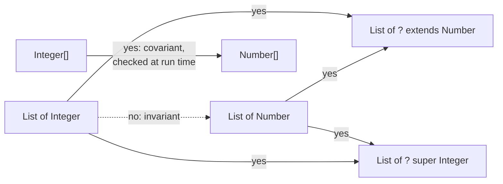

## Where we are

From JAVA-FUND-2 you know that a subclass can stand in for its parent. This lesson adds **generics**:
write a class or method once, use it with many types, *and the compiler still checks every use*. Every
collection, every Spring `Repository<T, ID>` and every `Optional<T>` is built on this.

## The problem

The nightly report job crashed with `ClassCastException` at `String name = names.get(i)` in
`ReportWriter`. You stare at that line for twenty minutes: `names` is a `List<String>`, so how can it
hold anything else? The real bug is three classes away, in a legacy helper that took a raw `List` and
added an `Integer`. This lesson is about how the compiler protects you, and the holes where it can't.

That protection didn't always exist. Before Java 5, collections held plain `Object`:

```java
List names = new ArrayList();
names.add("alice");
names.add(42);                          // compiles fine
String first = (String) names.get(1);   // ClassCastException at run time
```

A cast on every read, and a wrong element caught only when some distant line read it, at run time.

## Type parameters

A **type parameter** is a placeholder for a type, written in angle brackets, that the user of the
class fills in:

```java
public class Box<T> {
    private T value;

    public void put(T value) { this.value = value; }
    public T get() { return value; }
}

Box<String> b = new Box<>();     // the "diamond" <> lets the compiler infer String
b.put("hello");
String s = b.get();              // no cast
// b.put(42);                    // compile error: int is not a String
```

`Box<String>` is a **parameterized type**; `String` is the **type argument**. The old mistake is now a
compile error, and the casts are gone.

Methods can have their own type parameters too, declared before the return type:

```java
static <T> T firstOrDefault(List<T> list, T fallback) {
    return list.isEmpty() ? fallback : list.get(0);
}

String name = firstOrDefault(List.of("a", "b"), "none");   // T inferred as String
```

**Rule:** generics move type errors from run time to compile time and remove casts. Type arguments
must be reference types: `List<int>` is illegal, so you write `List<Integer>` and pay for boxing.

```quiz
{"question": "Which line compiles?", "level": "easy",
 "options": [
   {"text": "Map<String, Integer> m = new HashMap<>();", "correct": true, "why": "The diamond infers <String, Integer> from the left-hand side, and both type arguments are reference types."},
   {"text": "List<int> xs = new ArrayList<>();", "why": "Type arguments must be reference types. Use List<Integer> (values are boxed)."},
   {"text": "Box<String> b = new Box<>(); b.put(42);", "why": "Box<String>.put takes a String; passing an int is exactly the mistake generics turn into a compile error."},
   {"text": "String s = firstOrDefault(List.of(1, 2), \"none\");", "why": "T cannot be both Integer and String with a String result; the compiler rejects it."}]}
```

## Bounded type parameters

Suppose you want the larger of two values. With a plain `T` you cannot call `compareTo`, because the
compiler only knows `T` is some `Object`. A **bound** restricts which types are allowed and, in
return, lets you call their methods:

```java
static <T extends Comparable<T>> T max(T a, T b) {
    return a.compareTo(b) >= 0 ? a : b;
}

max(3, 7);            // Integer implements Comparable<Integer>
max("pear", "fig");   // String implements Comparable<String>
```

`extends` in a bound means "is or extends or implements", for classes and interfaces alike. Multiple
bounds use `&`: `<T extends Number & Comparable<T>>` (a class, if present, must come first).

The JDK writes the fully general form, `<T extends Comparable<? super T>>`, so `max` also works when
`T` inherits its `compareTo` from a parent; `? super` is explained two sections down.

## Invariance: List<Integer> is not a List<Number>

**Predict:** `Integer` is a subclass of `Number`. Does `List<Number> nums = ints;` compile, where
`ints` is a `List<Integer>`?

No:

```java
List<Integer> ints = new ArrayList<>();
// List<Number> nums = ints;    // compile error
```

If it were allowed, this would compile:

```java
nums.add(3.14);                  // a Double into what is really a List<Integer>
Integer i = ints.get(0);         // ClassCastException
```

So generic types are **invariant**: `List<A>` and `List<B>` are unrelated unless `A` and `B` are the
same type.

Arrays made the opposite choice. They are **covariant**: `Integer[]` *is* a `Number[]`. The hole is
patched at run time instead, with a check on every store:

```java
Number[] nums = new Integer[1];
nums[0] = 3.14;                  // compiles; throws ArrayStoreException at run time
```

This difference is a favourite interview question: arrays check element types at run time, generics
check them at compile time. Here is the whole picture, including the wildcard types from the next
section (an arrow means "can be assigned to"):



## Wildcards and PECS

Invariance is safe but rigid. A method `double sum(List<Number> xs)` refuses a `List<Integer>`. A
**wildcard** `?` stands for "some unknown type" and loosens this in a controlled way.

**`? extends T`** means "a list of some subtype of `T`". You can *read* elements as `T`, but you
cannot add anything (except `null`), because the compiler does not know which subtype the list really
holds:

```java
static double sum(List<? extends Number> xs) {
    double total = 0;
    for (Number n : xs) total += n.doubleValue();   // reading as Number is safe
    // xs.add(1);                                   // compile error
    return total;
}

sum(List.of(1, 2, 3));        // List<Integer> works
sum(List.of(1.5, 2.5));       // List<Double> works
```

**`? super T`** means "a list of `T` or some supertype of `T`". You can *add* `T` values, but reading
gives you only `Object`:

```java
static void fillWithOnes(List<? super Integer> out, int n) {
    for (int i = 0; i < n; i++) out.add(1);          // an Integer fits in any of these lists
}

fillWithOnes(new ArrayList<Integer>(), 3);
fillWithOnes(new ArrayList<Number>(), 3);
fillWithOnes(new ArrayList<Object>(), 3);
```

The mnemonic, from *Effective Java*, is **PECS: Producer Extends, Consumer Super**. If a parameter
*produces* values for you to read, use `? extends T`. If it *consumes* values you write into it, use
`? super T`. If it does both, use plain `T`. The JDK's own signature shows both at once:

```java
// java.util.Collections
public static <T> void copy(List<? super T> dest, List<? extends T> src)
```

A bare `?` (unbounded wildcard), as in `List<?>`, means "a list of something": you can read
`Object`s, check its size, or clear it, but not add to it. Wildcards belong in method parameters, not
in return types, where they would force every caller to deal with them.

```quiz
{"question": "You write void drainTo(Collection<???> sink), which adds Order objects into sink. Callers pass a List<Order>, a List<Object> or a Set<Order>. What replaces ???", "level": "medium",
 "options": [
   {"text": "? super Order", "correct": true, "why": "sink consumes Orders: Consumer Super. It accepts any collection that can hold an Order: Collection<Order>, Collection<Object>, ..."},
   {"text": "? extends Order", "why": "That is for producers. You could read from it but not add an Order, because it might really hold some Order subclass."},
   {"text": "Order", "why": "Collection<Order> accepts List<Order> and Set<Order> but rejects List<Object>: invariance."},
   {"text": "?", "why": "An unbounded wildcard accepts every collection but lets you add nothing except null."}]}
```

## Type erasure

Generics were added in Java 5 without changing the JVM, so old and new code could run side by side.
The mechanism is **type erasure**: the compiler checks the type arguments and then *removes* them.
In the bytecode, `T` becomes its bound (`Object` if unbounded, `Comparable` for `T extends
Comparable<T>`), and the compiler inserts casts where values come out.

**Predict:** what does this print?

```java
List<String> a = new ArrayList<>();
List<Integer> b = new ArrayList<>();
System.out.println(a.getClass() == b.getClass());
```

`true`. At run time both are just `ArrayList`; `String` and `Integer` existed only for the compiler.

Erasure explains a set of rules that otherwise look arbitrary:

| You cannot | Because at run time... | Workaround |
|---|---|---|
| `new T()` | there is no `T` to construct | pass a `Supplier<T>` or `Class<T>` |
| `new T[n]` | the array would need a real element type | `(T[]) new Object[n]` inside the class (as `ArrayList` does), or pass `IntFunction<T[]>` |
| `obj instanceof List<String>` when `obj` is an `Object` | the `String` part is gone | `obj instanceof List<?>` |
| `List<String>.class` | there is one `List.class` | `Class<T>` tokens, or a super-type token (coming in JAVA-FUND-8 with Jackson) |
| overload `f(List<String>)` and `f(List<Integer>)` | both erase to `f(List)`, a name clash | use different method names |
| declare `static T field` | one static field is shared by every parameterization | make it non-static or non-generic |
| `class Oops<T> extends Exception` | `catch` needs a run-time type | none; exceptions cannot be generic |

```quiz
{"question": "A utility class declares these two methods. What happens?", "level": "medium",
 "code": ["static int total(List<Integer> xs) { ... }", "static int total(List<String> xs) { ... }"],
 "options": [
   {"text": "Compile error: both methods have the same erasure, total(List)", "correct": true, "why": "After erasure the JVM would see two identical signatures, so javac reports a name clash. Give them different names."},
   {"text": "It compiles; the call picks the overload by the list's element type at run time", "why": "That needs the element type at run time, and erasure removed it. The compiler refuses before it gets that far."},
   {"text": "It compiles, but the second method always wins", "why": "There is no choice to make; the class never compiles."},
   {"text": "It compiles only if the return types differ", "why": "Return types are not part of the overload signature, and the clash is in the erased parameter types."}]}
```

## Bridge methods

Erasure creates one more wrinkle. Look at this class:

```java
class ByLength implements Comparator<String> {
    public int compare(String a, String b) { return Integer.compare(a.length(), b.length()); }
}
```

After erasure, the interface method is `compare(Object, Object)`, but the class only defines
`compare(String, String)`, which does not override it. To make polymorphism work, the compiler
generates a hidden **bridge method**:

```java
// generated by javac, marked synthetic
public int compare(Object a, Object b) { return compare((String) a, (String) b); }
```

You can see it with `javap` (the JDK's class-file disassembler). Bridge methods are why a stack trace
sometimes shows a method name twice, and why calling the comparator through a raw type with a
non-`String` throws `ClassCastException` from a line you never wrote.

## Raw types and heap pollution

A **raw type** is a generic type without its type argument: `List` instead of `List<String>`. It
exists so pre-Java 5 code still compiles; it switches off generic checking, and the compiler warns
"unchecked".

**Heap pollution** is the situation where a variable of a parameterized type refers to an object that
does not actually hold that type. Raw types are the easy way to create it:

```java
List<String> names = new ArrayList<>();
List raw = names;              // unchecked warning
raw.add(42);                   // compiles: raw types check nothing
String s = names.get(0);       // ClassCastException here, far from the real bug
```

The failure appears at the inserted cast, not where the bad element went in: the report-job crash
from the start of this lesson.

```quiz
{"question": "After this setup, which line throws ClassCastException?", "level": "hard",
 "code": ["List<String> names = new ArrayList<>();", "List raw = names;", "raw.add(42);"],
 "options": [
   {"text": "System.out.println(names.get(0));", "correct": true, "why": "names.get(0) has static type String, so the compiler picks println(String) and inserts a cast to String to call it. The cast meets an Integer and fails."},
   {"text": "Object o = names.get(0);", "why": "The target is Object, so no String cast is needed; the Integer flows through unchecked. The pollution is still there, waiting."},
   {"text": "for (Object x : names) { }", "why": "Each element is only treated as an Object, so nothing is cast to String and nothing fails."},
   {"text": "int n = names.size();", "why": "size() never looks at element types."}]}
```

## Generic varargs and @SafeVarargs

**Generic varargs** are the other source of heap pollution. `static <T> void log(T... items)` really receives a `T[]`,
which after erasure can be an `Object[]`. If the method stores or returns that array, callers can get a
`ClassCastException`, so the compiler warns "possible heap pollution". When a method only *reads* the
array, **`@SafeVarargs`** promises that and silences the warning. It is allowed only on methods that
cannot be overridden: `static`, `final`, `private` (since Java 9) methods and constructors, such as
the JDK's `List.of(E... elements)`.

## Lab (~10 min)

Save as `GenericsLab.java`, compile with `javac -Xlint:unchecked GenericsLab.java`, then run with
`java GenericsLab`.

```java
import java.util.ArrayList;
import java.util.Comparator;
import java.util.List;

public class GenericsLab {

    static double sum(List<? extends Number> xs) {
        double total = 0;
        for (Number n : xs) total += n.doubleValue();
        return total;
    }

    static <T> void copy(List<? super T> dest, List<? extends T> src) {
        for (T item : src) dest.add(item);
    }

    static <T> T[] toArray(T... items) {      // warning: possible heap pollution
        return items;
    }

    static <T> T[] pickTwo(T a, T b, T c) {
        return toArray(a, b);                 // T is erased: this creates an Object[]
    }

    static class ByLength implements Comparator<String> {
        public int compare(String a, String b) { return Integer.compare(a.length(), b.length()); }
    }

    @SuppressWarnings({"rawtypes", "unchecked"})
    public static void main(String[] args) {
        // 1. PECS
        List<Integer> ints = List.of(1, 2, 3);
        List<Number> numbers = new ArrayList<>();
        copy(numbers, ints);
        System.out.println("sum = " + sum(numbers));

        // 2. arrays are covariant and checked at run time
        try {
            Number[] arr = new Integer[1];
            arr[0] = 3.14;
        } catch (ArrayStoreException e) {
            System.out.println("ArrayStoreException: " + e.getMessage());
        }

        // 3. erasure
        System.out.println("same class? " + (new ArrayList<String>().getClass() == new ArrayList<Integer>().getClass()));

        // 4. heap pollution through a raw type
        List<String> names = new ArrayList<>();
        List raw = names;
        raw.add(42);
        try {
            String s = names.get(0);
            System.out.println(s);
        } catch (ClassCastException e) {
            System.out.println("CCE far from the bug: " + e.getMessage());
        }

        // 5. heap pollution through generic varargs
        try {
            String[] two = pickTwo("a", "b", "c");
            System.out.println(two.length);
        } catch (ClassCastException e) {
            System.out.println("CCE from varargs: " + e.getMessage());
        }

        // 6. a bridge method called through a raw type
        Comparator rawCmp = new ByLength();
        try {
            rawCmp.compare(1, 2);
        } catch (ClassCastException e) {
            System.out.println("CCE inside the bridge: " + e.getMessage());
        }
    }
}
```

**Predict** each numbered step's output before you run it. What you should observe:

- The compile step warns about `toArray` (possible heap pollution). Adding `@SafeVarargs` would hide
  the warning, but it would be a lie here, because `toArray` returns the array. That is why step 5
  fails.
- `same class? true`.
- Steps 4, 5 and 6 each throw `ClassCastException` at a line that looks innocent.
- Run `javap -p GenericsLab$ByLength` (quote the name in a Unix shell: `'GenericsLab$ByLength'`) and
  find two `compare` methods: yours, `compare(String, String)`, and the bridge `compare(Object,
  Object)`.

**Break it:** change `sum(List<? extends Number> xs)` to `sum(List<Number> xs)` and call
`sum(ints)`. Watch for the compile error "incompatible types: List<Integer> cannot be converted to
List<Number>": invariance in action. Then put the wildcard back and add `xs.add(1);` inside `sum`:
the `? extends` parameter refuses it.

## Gotchas

- **Raw types switch off checking:** one `List raw = ...` corrupts a typed list and crashes later; treat "unchecked"
  warnings as bugs.
- **`List<Integer>` is not a `List<Number>`:** use `List<? extends Number>` for a parameter you only read.
- **Adding to a `? extends` list does not compile:** if you add, it is a consumer, so use `? super T`.
- **`@SafeVarargs` is a promise, not a fix:** only when the varargs array is never stored or exposed.
- **Wildcards in return types** push complexity onto every caller; keep them in parameters.

## In interviews

No dedicated bank question yet; generics come up inside
[Collection hierarchy: Array vs List, List vs Set, Set vs Map](#/q/java-collections-hierarchy) and
[Comparable vs Comparator](#/q/comparable-vs-comparator).

- *"If types are erased, how does Jackson deserialize a `List<Order>`?"* With a super-type token: an anonymous subclass
  such as `new TypeReference<List<Order>>() {}` keeps the type argument in its class metadata (Spring has
  `ParameterizedTypeReference`).
- *"How does `ArrayList<E>` store elements without `new E[]`?"* An internal `Object[]`, cast on the way out; unchecked
  but safe because only `E`s enter through the typed API.

## Explain it in 2 minutes

Prompt: *"Explain Java generics, wildcards and type erasure."*

- Compile-time type checks, no casts; type arguments are reference types only; bounds let you call the bound's methods.
- Generics are invariant; arrays are covariant and checked at run time (`ArrayStoreException`).
- PECS: `? extends` to read, `? super` to write.
- Erasure: casts inserted, bridge methods generated; no `new T()`, no `instanceof List<String>` on an `Object`, no overloads on type
  arguments.
- Raw types and generic varargs cause heap pollution, surfacing as a distant `ClassCastException`.

## Check yourself

1. Which wildcard should `target` use in `void addAll(Collection<?> target, List<T> items)`, and why?
2. Why can't you write `new T()` inside `class Factory<T>`, and what do you do instead?
3. A `List<String>` throws `ClassCastException` on `get(0)`. How could that happen?

### Answers

1. `Collection<? super T>`: it consumes `T`s (Consumer Super).
2. Erasure leaves no `T` at run time; take a `Supplier<T>` (`new Factory<>(Order::new)`) or a `Class<T>`.
3. Heap pollution: it went through a raw `List` that received an `Integer`, an unchecked cast, or unsafe generic varargs.

## Next

JAVA-FUND-6 opens `ArrayList`, `HashMap`, `TreeMap` and `LinkedHashMap` and shows how they store your data.
