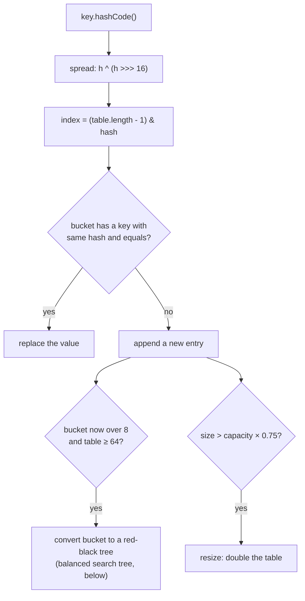

## Where we are

From JAVA-FUND-3 you know `equals`/`hashCode` and `Comparable`; from JAVA-FUND-5, generics. This lesson
opens `ArrayList`, `HashMap`, `LinkedHashMap` and `TreeMap`. Once you can picture the structure, every
Big-O claim and every `ConcurrentModificationException` explains itself.

## The problem

Two bugs land on your desk the same day. The nightly export now takes 40 minutes instead of one since
a teammate "optimised" it. And the delivery service sometimes forgets a customer's saved label:

```java
List<Integer> ids = new LinkedList<>(source);
for (int i = 0; i < ids.size(); i++) process(ids.get(i));

Map<Point, String> labels = new HashMap<>();    // Point: your class; hashCode uses x and y
Point p = new Point(1, 2);
labels.put(p, "home");
p.move(5, 5);
labels.get(p);
```

**Predict:** what does the last line return?

`null`: the entry is still in the map, but the map can no longer find it. And the export is O(n²),
because `LinkedList.get(i)` walks the list. Both bugs are invisible from the interface and obvious from
the inside.

## ArrayList: a resizable array

An `ArrayList` holds an internal `Object[]` plus a `size` counter. The array's length is the
**capacity**; `size` is how many slots are used.

```text
elementData: [ a | b | c | d | . | . ]     capacity 6, size 4
```

- `get(i)` and `set(i, x)` are O(1): direct array indexing.
- `add(x)` at the end writes into the next free slot, O(1), *until the array is full*. Then it
  allocates a bigger array and copies everything across, O(n) for that one call.
- `add(i, x)` and `remove(i)` shift every later element with `System.arraycopy`, O(n). Removing from
  the front is the worst case.

**Growth.** In current OpenJDK a no-argument `ArrayList` allocates capacity 10 on the first `add`, then
grows to about 1.5× on each overflow (`old + (old >> 1)`). It never shrinks unless you call
`trimToSize()`.

**Predict:** a no-argument `ArrayList` after 11 adds: what is its capacity?

15. The first add allocated 10; the 11th overflowed it, and 10 + (10 >> 1) = 15.

**Amortised O(1).** Capacity grows by a constant *factor*, so over n adds the total copying is
proportional to n and the *average* cost per add is constant: **amortised** cost (proof in DSA-CPLX-5).
If you know the size up front, `new ArrayList<>(n)` avoids the copies.

## LinkedList: the reality

`LinkedList` is a doubly linked list: one node object per element, each holding the element and
`prev`/`next` references.

```text
head ⇄ [a] ⇄ [b] ⇄ [c] ⇄ tail
```

"O(1) insert and delete" is true only once you *hold* the position (an iterator, or either end).
Finding position `i` is O(n): `get(i)` walks from the nearer end. Each node is a separate object
scattered across the heap, so traversal also misses the CPU cache far more than an array (DSA-CPLX-3).

**Rule:** default to `ArrayList` for lists and `ArrayDeque` (a resizable circular array, fast at both
ends) for stacks and queues. Reach for
`LinkedList` only when you measure a benefit.

```quiz
{"question": "The nightly export loops for (i = 0; i < n; i++) process(ids.get(i)) over a LinkedList of n ids. What is the total cost, and the fix?", "level": "easy",
 "options": [
   {"text": "O(n²); use an ArrayList or a for-each loop", "correct": true, "why": "Each get(i) walks up to n/2 nodes, n times. A for-each steps one node at a time: O(n) total."},
   {"text": "O(n); linked lists are fast at both ends", "why": "Fast at the ends, but get(i) in the middle walks from the nearer end."},
   {"text": "O(n log n); get(i) is a binary search", "why": "A linked list has no index to binary-search; it can only follow pointers."}]}
```

## HashMap: buckets

A `HashMap` is an array of **buckets** (the `table`). Each bucket holds the entries whose keys land at
that index. This is what `put(key, value)` does:



The table length is always a power of two, so the mask `(length - 1) & hash` works like `hash mod length`,
only cheaper and never negative.

```text
table (capacity 8)
 [1] → ("bob", 7)
 [3] → ("amy", 3) → ("zed", 9)      collision: two keys share bucket 3
 (other buckets empty)
```

**Why spread?** The mask uses only the *low* bits. A `hashCode` that varies mostly in its high bits
would pile entries into a few buckets; XOR-ing the high half into the low half lets those bits count.

`get(key)` computes the same index and walks one bucket with `equals`. Here the JAVA-FUND-3 contract
becomes concrete: equal keys need equal hash codes, or `get` searches the wrong bucket. One `null` key
is allowed, with hash 0.

## Load factor and resize

The **load factor** (default 0.75) is the maximum ratio of entries to buckets. The default capacity is
16, so the **threshold** is 16 × 0.75 = 12: the 13th entry triggers a **resize**, which doubles the
table and moves every entry. Because the length is a power of two, each entry either stays at its index
or moves to `index + oldCapacity`, decided by one extra bit of its hash, so no full rehash is needed.
A lower load factor means fewer collisions and more memory; 0.75 is rarely worth changing.

```quiz
{"question": "You know a map will hold exactly 100 entries and write new HashMap<>(100). How many resizes happen while you insert them?", "level": "medium",
 "options": [
   {"text": "One", "correct": true, "why": "100 is a capacity, rounded up to 128; its threshold is 96, so the 97th put resizes. HashMap.newHashMap(100) (Java 19+) takes the expected entry count instead."},
   {"text": "None: you sized it for 100", "why": "The constructor argument is the table capacity, not the number of entries; the load factor still applies."},
   {"text": "Four: 16 to 32 to 64 to 128 to 256", "why": "That is the no-argument map. A capacity argument starts at 128."},
   {"text": "It throws when the 101st entry arrives", "why": "HashMap never refuses entries; capacity only decides when it grows."}]}
```

## Treeification

With a terrible `hashCode` (a constant) or keys an attacker chose to collide, every key lands in one
bucket and the map becomes O(n).

Since Java 8, when a put grows a bucket past **8** entries, `HashMap` converts it into a small
red-black tree (a balanced search tree, covered with `TreeMap` below), making that bucket O(log k). The
table must have at least **64** buckets; below that, the map resizes instead, because spreading entries
is the better fix. A tree bucket that shrinks to 6 entries or fewer turns back into a list. Tree buckets
order keys by hash, and use `compareTo` when keys are `Comparable`.

**Rule:** HashMap `get`/`put` are O(1) on average with a decent `hashCode`. Since Java 8 the worst case
is O(log n) per bucket when colliding keys have different hashes or are `Comparable`; before Java 8 it
was always O(n).

```quiz
{"question": "An attacker sends 10,000 keys of a class whose hashCode() returns a constant and which does NOT implement Comparable. The table is large. What does each get() cost on Java 21?", "level": "hard",
 "options": [
   {"text": "O(n): the bucket becomes a tree, but the tree cannot order these keys", "correct": true, "why": "Equal hashes and no compareTo leave the tree nothing to branch on, so lookup searches both subtrees. With Comparable keys the same attack costs O(log n)."},
   {"text": "O(log n): Java 8 treeifies long buckets", "why": "The popular answer. Treeification only helps when keys can be ordered, by hash or by compareTo."},
   {"text": "O(1): the table resizes until the keys spread out", "why": "Resizing spreads keys by hash bits; identical hashes land in the same bucket at every size."},
   {"text": "put throws once a bucket passes 8 entries", "why": "HashMap never refuses entries; past 8 it converts the bucket to a tree."}]}
```

## Why mutable keys break

Back to the lost `Point`. Its hash put it in, say, bucket 5. `move(5, 5)` changed the fields
`hashCode` uses, so `get(p)` looks in a different bucket and finds nothing (even in the same bucket,
the stored hash would no longer match). The entry is still in
bucket 5, unreachable: a quiet memory leak.

**Rule:** map keys and set elements must not change in ways that affect `equals`/`hashCode` while they
are in the collection. Use immutable keys: `String`, boxed numbers, records with immutable fields.

## Iteration order

`HashMap` iterates bucket by bucket, so the order depends on hashes and capacity, and can change after
a resize or between JDK versions: never rely on it, not even in a test. (`Map.of` and `Set.of` vary
their order between JVM runs, deliberately.) Iteration costs O(capacity + size), so a map that once held
a million entries and was then cleared still iterates slowly. If order matters, use `LinkedHashMap`
(insertion or access order) or `TreeMap` (sorted).

## LinkedHashMap: order and LRU

A `LinkedHashMap` is a `HashMap` whose entries are also threaded onto a doubly linked list. Lookups
stay O(1); iteration follows the list: **insertion order**, O(size). With `accessOrder = true`, `get`
and `put` move the touched entry to the end, so the head is the **least recently used** entry. Add the
`removeEldestEntry` hook, which runs after each `put`, and you have an LRU cache:

```java
class LruCache<K, V> extends LinkedHashMap<K, V> {
    private final int maxEntries;

    LruCache(int maxEntries) {
        super(16, 0.75f, true);              // true = access order
        this.maxEntries = maxEntries;
    }

    @Override
    protected boolean removeEldestEntry(Map.Entry<K, V> eldest) {
        return size() > maxEntries;          // evict the head (least recently used)
    }
}
```

Java 21 adds `SequencedMap` methods (`firstEntry()`, `pollFirstEntry()`, `reversed()`). It is not
thread-safe; a concurrent LRU is in JAVA-CONC-7.

## TreeMap: a red-black tree

A `TreeMap` keeps its keys **sorted**, by `Comparable` or a `Comparator` you pass in. Internally it is a
**red-black tree**: a binary search tree whose red/black colouring rules (restored by rotations after
each change) keep the longest root-to-leaf path at most about twice the shortest. Height stays
O(log n), so `get`, `put` and `remove` are O(log n) guaranteed, not just on average.

```text
            (40 B)
           /      \
       (20 R)    (60 R)
       /   \      /   \
    (10 B)(30 B)(50 B)(70 B)
```

Sorted order unlocks the **`NavigableMap`** operations, which a `HashMap` cannot do at all:

```java
TreeMap<Integer, String> tiers = new TreeMap<>(Map.of(0, "free", 100, "silver", 500, "gold"));
tiers.floorEntry(250);      // 100=silver : greatest key <= 250
tiers.ceilingKey(250);      // 500        : smallest key >= 250
tiers.headMap(500);         // {0=free, 100=silver} : keys < 500 (a live view)
tiers.firstKey();           // 0
tiers.descendingMap();      // reverse-order view
```

Two traps. `TreeMap` decides key equality with `compareTo`/`compare`, not `equals`, so a comparator
inconsistent with `equals` silently merges entries. And with natural ordering, a `null` key throws
`NullPointerException`. `HashSet`, `LinkedHashSet` and `TreeSet` are thin wrappers over the matching
map, storing elements as keys, so everything above applies to them too.

```quiz
{"question": "What does this print?", "level": "medium",
 "code": ["var m = new TreeMap<String, Integer>(String.CASE_INSENSITIVE_ORDER);", "m.put(\"Apple\", 1);", "m.put(\"apple\", 2);", "System.out.println(m);"],
 "options": [
   {"text": "{Apple=2}", "correct": true, "why": "The comparator says the keys are equal (compare returns 0), so the second put replaces the value and keeps the original key object."},
   {"text": "{Apple=1, apple=2}", "why": "That is what a HashMap would do, because \"Apple\".equals(\"apple\") is false. TreeMap never calls equals."},
   {"text": "{apple=2}", "why": "put on an existing key replaces only the value; the key stored first stays."}]}
```

## Fail-fast iterators

**Predict:** does this loop throw?

```java
List<String> names = new ArrayList<>(List.of("ann", "bob", "cy"));
for (String n : names) {
    if (n.startsWith("a")) names.remove(n);
}
```

Yes: `ConcurrentModificationException`, with no threads involved. Each collection keeps a `modCount` that changes on every structural modification
(add or remove, not `set`). An iterator remembers the value when it starts and checks it on each
`next()`; if the collection changed behind its back, it throws `ConcurrentModificationException`. This
is **fail-fast**: stop rather than continue with undefined results.

It is **best-effort**: the lab shows a removal that does not throw, and with real threads the check may
miss changes entirely. Never rely on it for correctness.

Correct ways to remove while iterating: `names.removeIf(n -> n.startsWith("a"))`, or an explicit
`Iterator` and its own `it.remove()`. Concurrent collections iterate without this check (**weakly
consistent** iterators); `ConcurrentHashMap` and friends are in JAVA-CONC-3.

## Iterating and viewing a map

`keySet()`, `values()` and `entrySet()` copy nothing. They are **live views** backed by the map:
changes show through both ways. Views support removal (`remove`, `removeIf`, `retainAll`,
`iterator().remove()`) but `add` throws `UnsupportedOperationException`.

```java
Map<String, Integer> stock = new HashMap<>(Map.of("pen", 0, "ink", 4, "pad", 0));
stock.values().removeIf(q -> q == 0);            // removes "pen" and "pad" from the map itself
for (Map.Entry<String, Integer> e : stock.entrySet()) {
    e.setValue(e.getValue() * 2);                // writes through: ink=8
}
```

| Way | Example | Choose when | Pitfall |
|---|---|---|---|
| `entrySet()` loop | `for (var e : m.entrySet())` | you need key and value | looping `keySet()` then `get(k)` does a second lookup per key |
| `forEach` | `m.forEach((k, v) -> ...)` | short read-only pass | checked exceptions do not fit in the lambda |
| stream | `m.entrySet().stream().filter(...)` | filter, sort, collect into a new map | `Collectors.toMap` throws on a duplicate key unless you pass a merge function |
| `getOrDefault` | `m.getOrDefault(k, 0)` | read with a fallback | returns `null`, not the default, if the key is mapped to `null` |
| `putIfAbsent` | `m.putIfAbsent(k, v)` | set once | `v` is built even when not used; prefer `computeIfAbsent` if it is costly |
| `computeIfAbsent` | `m.computeIfAbsent(k, x -> new ArrayList<>()).add(v)` | group into lists, lazy caches | changing the same `HashMap` inside the function throws `ConcurrentModificationException` |
| `merge` | `m.merge(word, 1, Integer::sum)` | counters, combining values | a function returning `null` **removes** the entry |
| `replaceAll` | `m.replaceAll((k, v) -> v.trim())` | transform every value in place | cannot change keys |

**Special maps.** `EnumMap`: an array indexed by ordinal, compact, declaration order, no `null` keys.
`IdentityHashMap`: compares keys with `==` on purpose (serializers tracking visited objects).
`WeakHashMap`: an entry vanishes once nothing else references its key, but a value that refers to its
own key keeps it alive forever, and string literals never become unreachable.

**Wrappers.** Four different promises:

| Way | Promise | Pitfall |
|---|---|---|
| `Collections.unmodifiableMap(m)` | callers cannot change it | a **view**: changes to `m` still show through |
| `Map.copyOf(m)` | nobody can change it | a snapshot; throws `NullPointerException` on `null` keys or values |
| `Collections.synchronizedMap(m)` | each call takes one lock | iterating its views still needs `synchronized (map) { ... }` by hand |
| `ConcurrentHashMap` | scalable thread safety, atomic `merge`/`compute` | no `null` keys or values; in JAVA-CONC-3 |

**Predict:** a class returns `Collections.unmodifiableMap(settings)`, then later calls
`settings.put("mode", "dark")`. Does a caller holding the returned map see `mode`?

Yes. The wrapper is a read-only *view* of the same map, so changes through the original reference show
through. Use `Map.copyOf` when callers need a snapshot.

## Choosing a collection

| Need | Use |
|---|---|
| Ordered list, index access | `ArrayList` |
| Stack or FIFO queue | `ArrayDeque` (no per-element nodes) |
| Key lookup, order irrelevant | `HashMap` / `HashSet` |
| Lookup + insertion order, or LRU | `LinkedHashMap` |
| Sorted keys, ranges, floor/ceiling | `TreeMap` / `TreeSet` |
| Always take the smallest/largest | `PriorityQueue` (binary heap: O(log n) offer/poll, O(1) peek) |
| Fixed data that must not change | `List.of`, `Map.of` (unmodifiable, no nulls) |
| Shared between threads | concurrent collections (JAVA-CONC-3) |

## The Big-O table

| Operation | ArrayList | LinkedList | HashMap | LinkedHashMap | TreeMap |
|---|---|---|---|---|---|
| get by index / key | O(1) | O(n) | O(1) avg | O(1) avg | O(log n) |
| add at end / put | O(1) amortised | O(1) | O(1) avg | O(1) avg | O(log n) |
| insert/remove in middle | O(n) | O(n) to find, O(1) to unlink | n/a | n/a | n/a |
| remove by key | n/a | n/a | O(1) avg | O(1) avg | O(log n) |
| contains (value) | O(n) | O(n) | O(n) | O(n) | O(n) |
| iterate all | O(n) | O(n) | O(capacity + n) | O(n) | O(n) |
| min / max key | n/a | n/a | O(n) | O(n) | O(log n) |

"avg" assumes a reasonable `hashCode`; the worst case per bucket is O(log n) since Java 8 when keys can be ordered.
`containsKey` follows the "get by key" column; `contains` on a list is O(n), a hidden cost covered in
DSA-CPLX-2.

## Lab (~10 min)

Save as `CollectionsLab.java` and run with `java CollectionsLab.java`. **Predict** the LRU line and the
`get after mutation` line before you run it.

```java
import java.util.ArrayList;
import java.util.ConcurrentModificationException;
import java.util.HashMap;
import java.util.LinkedHashMap;
import java.util.List;
import java.util.Map;
import java.util.TreeMap;

public class CollectionsLab {

    static class LruCache<K, V> extends LinkedHashMap<K, V> {
        private final int maxEntries;

        LruCache(int maxEntries) {
            super(16, 0.75f, true);
            this.maxEntries = maxEntries;
        }

        @Override
        protected boolean removeEldestEntry(Map.Entry<K, V> eldest) {
            return size() > maxEntries;
        }
    }

    static final class MutablePoint {          // deliberately bad: mutable fields used in hashCode
        int x;
        int y;

        MutablePoint(int x, int y) { this.x = x; this.y = y; }

        @Override
        public boolean equals(Object o) {
            return o instanceof MutablePoint p && p.x == x && p.y == y;
        }

        @Override
        public int hashCode() { return 31 * x + y; }
    }

    public static void main(String[] args) {
        // 1. LRU via access order
        LruCache<String, Integer> cache = new LruCache<>(3);
        cache.put("a", 1);
        cache.put("b", 2);
        cache.put("c", 3);
        cache.get("a");                 // a becomes most recently used
        cache.put("d", 4);              // evicts b, the least recently used
        System.out.println("LRU: " + cache.keySet());

        // 2. a mutable key gets lost
        Map<MutablePoint, String> labels = new HashMap<>();
        MutablePoint p = new MutablePoint(1, 2);
        labels.put(p, "home");
        p.x = 5;
        System.out.println("get after mutation: " + labels.get(p) + ", size still " + labels.size());

        // 3. fail-fast iterator
        List<String> names = new ArrayList<>(List.of("ann", "abe", "bob", "cy"));
        try {
            for (String n : names) {
                if (n.startsWith("a")) names.remove(n);
            }
        } catch (ConcurrentModificationException e) {
            System.out.println("CME: removing inside for-each");
        }
        names.removeIf(n -> n.startsWith("a"));
        System.out.println("after removeIf: " + names);

        // 4. TreeMap navigation
        TreeMap<Integer, String> tiers = new TreeMap<>(Map.of(0, "free", 100, "silver", 500, "gold"));
        System.out.println("floor(250) = " + tiers.floorEntry(250) + ", ceilingKey(250) = " + tiers.ceilingKey(250));
        System.out.println("headMap(500) = " + tiers.headMap(500));

        // 5. insertion order vs hash order
        Map<String, Integer> hash = new HashMap<>();
        Map<String, Integer> linked = new LinkedHashMap<>();
        for (String k : List.of("zeta", "alpha", "mike", "bravo", "x-ray")) {
            hash.put(k, k.length());
            linked.put(k, k.length());
        }
        System.out.println("HashMap order:       " + hash.keySet());
        System.out.println("LinkedHashMap order: " + linked.keySet());
    }
}
```

What you should observe:

- `LRU: [c, a, d]`: `b` was evicted because `a` was touched after it.
- `get after mutation: null, size still 1`: the entry exists but cannot be found.
- The for-each removal throws `ConcurrentModificationException`; `removeIf` works.
- `floor(250) = 100=silver, ceilingKey(250) = 500`.
- The `HashMap` order differs from insertion order; the `LinkedHashMap` order matches it.

**Break it:** change the list in step 3 to `List.of("bob", "ann", "cy")`. **Predict** first: does it
throw? It doesn't. `"ann"` is second-to-last, so after the removal the iterator thinks it has reached
the end: the loop exits quietly and `"cy"` is never visited. Best-effort in action.

## Gotchas

- **Mutating a key after insertion** strands the entry; keep `equals`/`hashCode` fields immutable.
- **Relying on `HashMap` order** gives flaky tests; use `LinkedHashMap` or `TreeMap` when order matters.
- **`LinkedList` for random access** turns loops quadratic; use `ArrayList`, or `ArrayDeque` for queues.
- **Removing inside a for-each** throws CME or silently skips; use `removeIf` or `Iterator.remove()`.
- **`new HashMap<>(n)` is capacity, not expected size:** use `HashMap.newHashMap(n)` (Java 19+).
- **Sharing a plain `HashMap` between threads** can corrupt it without any exception; use `ConcurrentHashMap`.

## In interviews

Bank: [HashMap internals and complexity](#/q/hashmap-internals),
[Collection hierarchy: Array vs List, List vs Set, Set vs Map](#/q/java-collections-hierarchy),
[Fail-fast vs fail-safe iterators](#/q/fail-fast-vs-fail-safe-iterators), [LRU Cache](#/q/lru-cache),
[HashMap vs Hashtable vs ConcurrentHashMap](#/q/hashmap-vs-hashtable-vs-concurrenthashmap) (concurrent half in
JAVA-CONC-3).

- *"Why treeify past 8 and not always use trees?"* Tree nodes are about twice the size of list nodes and big buckets are
  rare with a decent hash; trees are a safety net for bad or hostile hashes.
- *"LRU without `LinkedHashMap`?"* A `HashMap<K, Node>` plus your own doubly linked list: O(1) lookup, move-to-front and
  evict-from-tail (full case study in LLD-DESIGN-6).

## Explain it in 2 minutes

Prompt: *"What happens inside a `HashMap` on `put`, and when would you use a different map?"*

- `hashCode`, spread with `h ^ (h >>> 16)`, masked to a power-of-two index; same hash + `equals` replaces, else append.
- Load factor 0.75 doubles the table; entries stay or move by the old capacity.
- Buckets longer than 8 (table ≥ 64) become red-black trees: worst case O(log n) if keys can be ordered.
- `LinkedHashMap` for insertion/access order (LRU via `removeEldestEntry`); `TreeMap` for sorted keys, `floor`/`ceiling`.
- Iterators are fail-fast and best-effort; not thread-safe.

## Check yourself

1. Why is `ArrayList.add` O(1) amortised although it sometimes copies the array?
2. With default settings, which insertion triggers the first resize, and what happens to each entry?
3. When does a bucket become a tree, and what happens instead if the table is small?

### Answers

1. Capacity grows by a constant factor (~1.5×), so total copying over n adds is O(n): constant per add on average.
2. The 13th (16 × 0.75 = 12); the table doubles to 32 and each entry stays or moves to index + 16.
3. When a put grows it past 8 entries and the table has at least 64 buckets; below 64 the map resizes instead. Back to a
   list at 6 or fewer.

## Next

JAVA-FUND-7 (lambdas and streams) and JAVA-FUND-10 build on these collections; JAVA-JVM-2 shows where their arrays and
nodes live in memory.
