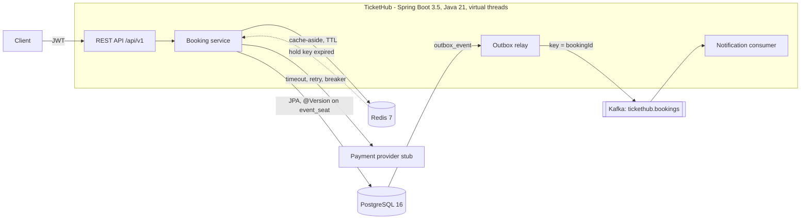

## Where we are

After CAPSTONE-11, TicketHub is a complete service: REST API, Postgres with optimistic locking, Redis caching and hold TTLs, the Kafka outbox with an idempotent consumer, Resilience4j on payments, a layered non-root image, full-stack Compose and Kubernetes manifests with probes. What is missing is the part interviewers actually see: proof that it works under load, and a clear way to tell the story.

## Goal

Turn the repo into evidence. Write a README that a reviewer understands in two minutes: the problem, a diagram, how to run it, and the decisions with their trade-offs. Run a load test that measures latency (p95) and **proves zero double bookings** under contention. Write the project as a STAR story in the app's Story bank (Progress → Stories). Finally, rehearse a 5-minute demo out loud until you can give it without notes. Most of this session is writing and speaking, and the speaking is what gets tested.

## What you build

- [ ] `README.md`: problem, Mermaid architecture diagram, run instructions, API summary, key decisions (ADR-style), measured results, next steps
- [ ] `loadtest/LoadTest.java`: a single-file Java 21 loader using `HttpClient` and virtual threads
- [ ] `loadtest/no-double-booking.sql`: the correctness check
- [ ] A measured result: p50/p95/p99 for holds, hold outcomes, and `0` rows from the double-booking query
- [ ] A STAR story saved in Progress → Stories
- [ ] A 5-minute demo script, rehearsed out loud at least twice (record one run on your phone)

## Acceptance criteria

1. A fresh clone plus `cp .env.example .env` plus `docker compose up -d --build` brings up the stack by following only the README. Test this in a new folder.
2. The README renders on GitHub with the Mermaid diagram and has a "Key decisions" section with at least 4 decisions, each with the alternative you rejected.
3. `java -Dusers=500 -Dseats=50 loadtest/LoadTest.java` finishes and prints the hold status counts, `confirmed <= 50`, and p50/p95/p99 latency in ms.
4. `psql -f loadtest/no-double-booking.sql` returns **0 rows** after the load test. The number of sold seats for the event equals the loader's `confirmed` count.
5. The `tickethub.holds` metric (`outcome:conflict`) roughly matches the loader's 409 count. It will not match exactly if you made other holds since the app started.
6. The README's numbers are the ones you measured, with the machine described (CPU, RAM, everything on one laptop). No numbers you did not measure.
7. The STAR story is in Progress → Stories. Read aloud, it takes 2 minutes or less.
8. You gave the 5-minute demo out loud, timed, in 5:30 or less, and you can answer the deep-dive questions below without looking.

## Steps

### 1. The README (15 min)

Use this skeleton. Keep every section short; the README is a map, not a manual.

````markdown
# TicketHub

Event-ticket booking service: browse events, hold seats for 10 minutes, confirm with payment.
**A seat is never sold twice**, even when hundreds of people click the same seat at once.

## Architecture



## Run it
```bash
cp .env.example .env && docker compose up -d --build
curl localhost:8080/actuator/health/readiness
```

## API
| Method | Path | Purpose |
|---|---|---|
| GET | /api/v1/events/{id}/seats | seat map with availability (cached 5 s) |
| POST | /api/v1/events/{id}/holds | hold seats (Idempotency-Key header) |
| POST | /api/v1/holds/{id}/confirm | pay and confirm |

## Key decisions
- **Optimistic locking on `event_seat` (`@Version`)**, not `SELECT ... FOR UPDATE` and not a Redis lock.
  Context: a seat is contested only at the moment of claiming. Consequence: the loser gets an immediate
  409, with no lock waits and no lock service to operate.
- **Transactional outbox** instead of sending to Kafka inside the transaction. Consequence: no lost or
  phantom events; at-least-once delivery, so the consumer dedupes on bookingId.
- **Cache TTLs: seat map 5 s plus after-commit eviction, events 10 min.** The seat map is advice; the
  hold against Postgres is the decision. A stale read costs a 409, never a double sale.
- **Postgres is the source of truth for hold expiry;** a Redis TTL is only the fast path. Redis loss is
  harmless.
- **Payment call inside the confirm transaction** (for now). Simple, but it holds a DB connection
  for up to about 7 s when payments degrade. Next step: reserve, charge, finalize.
- **Modular monolith (package-by-feature)** rather than microservices: one team, one database, clear
  seams (`event`, `booking`, `payment`, `notification`) if a split is ever needed.

## Results (measured on <your laptop: CPU, RAM>, everything local)
<p50/p95/p99, users, seats, outcomes, double bookings: 0>

## What I would do next
````

Add `.env.example` with placeholder values. Your real `.env` stays git-ignored.

### 2. The load test (15 min)

The question the test answers: *with many users fighting over a few seats, what is the hold latency, and is any seat sold twice?* Few seats and many users is deliberate, because contention is what you want to prove.

```java
// loadtest/LoadTest.java   run: java -Dusers=500 -Dseats=50 loadtest/LoadTest.java
import java.net.URI;
import java.net.http.HttpClient;
import java.net.http.HttpRequest;
import java.net.http.HttpResponse;
import java.nio.charset.StandardCharsets;
import java.time.Duration;
import java.time.Instant;
import java.util.ArrayList;
import java.util.Base64;
import java.util.Collections;
import java.util.List;
import java.util.Map;
import java.util.Objects;
import java.util.UUID;
import java.util.concurrent.ConcurrentHashMap;
import java.util.concurrent.Executors;
import java.util.concurrent.Semaphore;
import java.util.concurrent.ThreadLocalRandom;
import java.util.concurrent.atomic.AtomicInteger;
import javax.crypto.Mac;
import javax.crypto.spec.SecretKeySpec;

public class LoadTest {

    static final String BASE = System.getProperty("base", "http://localhost:8080/api/v1");
    static final int USERS = Integer.getInteger("users", 500);
    static final int SEATS = Integer.getInteger("seats", 50);
    static final long EVENT_ID = Long.getLong("event", 1L);
    static final long FIRST_SEAT_ID = Long.getLong("firstSeat", 1L);
    static final Duration TIMEOUT = Duration.ofSeconds(10);

    static final HttpClient HTTP = HttpClient.newBuilder().connectTimeout(Duration.ofSeconds(5)).build();
    static final List<Long> holdMicros = Collections.synchronizedList(new ArrayList<>());
    static final Map<Integer, AtomicInteger> holdStatus = new ConcurrentHashMap<>();
    static final AtomicInteger confirmed = new AtomicInteger();

    public static void main(String[] args) throws Exception {
        String secret = Objects.requireNonNull(System.getenv("TICKETHUB_JWT_SECRET"), "set TICKETHUB_JWT_SECRET");
        Semaphore inFlight = new Semaphore(200);
        Instant start = Instant.now();
        try (var executor = Executors.newVirtualThreadPerTaskExecutor()) {
            for (int u = 0; u < USERS; u++) {
                String token = jwt(secret, "load-user-" + u);
                long seatId = FIRST_SEAT_ID + ThreadLocalRandom.current().nextInt(SEATS);
                executor.submit(() -> {
                    inFlight.acquire();
                    try {
                        holdAndConfirm(token, seatId);
                    } finally {
                        inFlight.release();
                    }
                    return null;
                });
            }
        }                                             // close() waits for every task
        List<Long> sorted = new ArrayList<>(holdMicros);
        Collections.sort(sorted);
        System.out.printf("users=%d seats=%d took=%s%n", USERS, SEATS, Duration.between(start, Instant.now()));
        System.out.println("hold status counts: " + holdStatus);
        System.out.printf("confirmed=%d (must be <= %d)%n", confirmed.get(), SEATS);
        System.out.printf("hold latency ms p50=%.1f p95=%.1f p99=%.1f%n",
                pct(sorted, 0.50), pct(sorted, 0.95), pct(sorted, 0.99));
        if (confirmed.get() > SEATS) {
            System.err.println("DOUBLE BOOKING: more confirmations than seats");
            System.exit(1);
        }
    }

    static void holdAndConfirm(String token, long seatId) throws Exception {
        HttpRequest hold = HttpRequest.newBuilder(URI.create(BASE + "/events/" + EVENT_ID + "/holds"))
                .timeout(TIMEOUT)
                .header("Authorization", "Bearer " + token)
                .header("Content-Type", "application/json")
                .header("Idempotency-Key", UUID.randomUUID().toString())
                .POST(HttpRequest.BodyPublishers.ofString("{\"seatIds\":[" + seatId + "]}"))
                .build();
        long t0 = System.nanoTime();
        HttpResponse<String> res = HTTP.send(hold, HttpResponse.BodyHandlers.ofString());
        holdMicros.add((System.nanoTime() - t0) / 1_000);
        holdStatus.computeIfAbsent(res.statusCode(), k -> new AtomicInteger()).incrementAndGet();
        if (res.statusCode() != 201) {
            return;
        }
        String location = res.headers().firstValue("Location").orElseThrow();
        String holdId = location.substring(location.lastIndexOf('/') + 1);
        HttpRequest confirm = HttpRequest.newBuilder(URI.create(BASE + "/holds/" + holdId + "/confirm"))
                .timeout(TIMEOUT)
                .header("Authorization", "Bearer " + token)
                .POST(HttpRequest.BodyPublishers.noBody())
                .build();
        if (HTTP.send(confirm, HttpResponse.BodyHandlers.discarding()).statusCode() == 200) {
            confirmed.incrementAndGet();
        }
    }

    static double pct(List<Long> sorted, double p) {
        if (sorted.isEmpty()) {
            return 0;
        }
        int index = Math.max(0, (int) Math.ceil(p * sorted.size()) - 1);
        return sorted.get(index) / 1_000.0;
    }

    static String jwt(String secret, String subject) throws Exception {
        Base64.Encoder b64 = Base64.getUrlEncoder().withoutPadding();
        String header = b64.encodeToString("{\"alg\":\"HS256\",\"typ\":\"JWT\"}".getBytes(StandardCharsets.UTF_8));
        long exp = Instant.now().plusSeconds(3600).getEpochSecond();
        String claims = "{\"sub\":\"" + subject + "\",\"roles\":[\"USER\"],\"exp\":" + exp + "}";
        String payload = b64.encodeToString(claims.getBytes(StandardCharsets.UTF_8));
        Mac mac = Mac.getInstance("HmacSHA256");
        mac.init(new SecretKeySpec(secret.getBytes(StandardCharsets.UTF_8), "HmacSHA256"));
        byte[] signature = mac.doFinal((header + "." + payload).getBytes(StandardCharsets.UTF_8));
        return header + "." + payload + "." + b64.encodeToString(signature);
    }
}
```

Notes on the design:

- **Virtual threads** make "one blocking task per user" cheap (JAVA-CONC-6). The `Semaphore` caps concurrency at 200 in flight, so you measure the server, not a burst of connection setup.
- **The JWT claims must match CAPSTONE-8:** the role claim name (here `roles`), any `iss` or `aud` you validate, and whether the secret is raw UTF-8 bytes or base64-decoded. Adjust `jwt()` to match.
- **Use a fresh event** for each run (seed one with an admin call) so earlier bookings do not skew the counts.
- **Before measuring,** set the payment stub to `OK` and raise the hold rate limit, if you added one.

The correctness check is the real result:

```sql
-- loadtest/no-double-booking.sql   expected: 0 rows
select b.event_id, bs.seat_id, count(*) as times_sold
from booking b
join booking_seat bs on bs.booking_id = b.id
where b.status = 'CONFIRMED'
group by b.event_id, bs.seat_id
having count(*) > 1;
```

Then compare the sold count for the event in `event_seat` with the loader's `confirmed` count. Adjust the status value to whatever CAPSTONE-5 uses for a sold seat.

**Reading the numbers honestly.** The loader, the app, Postgres, Redis and Kafka all share one laptop, so the absolute latency says little about production. What the test does prove: zero double bookings under real contention, a p95 you can compare before and after a change, and how many attempts lost (409s). Write it up as "p95 X ms at 200 concurrent requests on <machine>, 0 double bookings in N attempts".

Alternative: if you prefer k6, the same flow is about 30 lines of JavaScript, and k6 prints `http_req_duration` p(95) for you. Use whichever you can explain.

### 3. The STAR story (10 min)

Open Progress → Stories in the app and add a story titled "TicketHub: preventing double booking under contention". Fill it from your real build, and keep it to about 2 minutes spoken.

- **Situation:** "I wanted end-to-end ownership of a backend with the hard parts of a real booking system, so I built TicketHub on my own over 12 weeks: Spring Boot 3.5, Java 21, Postgres, Redis, Kafka."
- **Task:** "The core requirement was that a seat is never sold twice, even when many users hold the same seat at once, while confirmations still notify downstream systems reliably and payment outages degrade gracefully."
- **Action:** pick three, each with the alternative you rejected:
  1. Optimistic locking with `@Version` on `event_seat`, proved by a Testcontainers race test where two threads claim one seat and exactly one wins.
  2. The transactional outbox to Kafka, and an idempotent consumer keyed on `bookingId`.
  3. Resilience4j: a 2 s timeout, retries only for transient errors with jittered backoff, and a circuit breaker that returns a 503 while seats stay held.
  4. Redis cache-aside with a 5 s seat-map TTL and after-commit eviction; Redis is never the source of truth.
- **Result:** "Under a load test of <N> users on <S> seats: <p95> ms p95 on my laptop and **0 double bookings**, verified with SQL. It runs from one `docker compose up` and on Kubernetes with probes and graceful shutdown." Then add one thing you learned, such as "evicting the cache inside the transaction re-cached stale data; I moved eviction to after commit."

Be explicit that it is a personal project. Interviewers respect that; they do not respect inflating it into production traffic.

### 4. The 5-minute demo script (15 min, out loud)

| Time | Show | Say |
|---|---|---|
| 0:00–0:30 | README top | The problem in one sentence, and the invariant: a seat is never sold twice. |
| 0:30–1:15 | The Mermaid diagram | The request path, where Postgres decides, where Redis advises, and how Kafka hears about bookings. |
| 1:15–2:15 | Terminal: hold, then a second hold on the same seat, then confirm | `201`, then `409 SEAT_UNAVAILABLE` with the problem-details body, then `200`. Point at the `@Version` column. |
| 2:15–3:00 | `kafka-console-consumer` and the app log | `BookingConfirmed` keyed by `bookingId`. Replay it: the consumer skips the duplicate. |
| 3:00–3:45 | Stub mode `FAIL`, then confirm | `503 PAYMENT_UNAVAILABLE` with `Retry-After`. The breaker opens in `/actuator/health`. The seats are still held. |
| 3:45–4:30 | Load-test output and the SQL | p95, the 409 count, and **0 rows**. |
| 4:30–5:00 | README "Key decisions" | One trade-off you would revisit (payment inside the transaction), and what you would do at 100x. |

Rehearse it twice, timed. The first run will be about 8 minutes. Cut words, not steps. Record the second run and listen once for filler and for places where you explain *what* the code does but not *why*.

### 5. Deep-dive questions (remaining time)

Practise these out loud. Each crisp answer is about 30 seconds.

- **Why optimistic and not pessimistic locking?** Contention happens only at the moment of claiming, and the loser should fail fast with a 409, not wait. `SELECT FOR UPDATE` would queue requests on hot seats and hold row locks across the request. Optimistic locking is one `UPDATE ... WHERE version = ?`.
- **Why not a Redis lock for seats?** It adds a second system that must agree with Postgres, and locks need fencing tokens to be safe. The database already gives atomicity on the row you write.
- **What happens if two pods expire the same hold?** Both receive the Redis event or run the job. The release is a conditional update (still held and due), so the second one changes nothing.
- **How do you know the outbox relay is not falling behind?** Watch `count(*) where published_at is null` and the age of the oldest unpublished row; alert on age, not count.
- **What breaks first at 100x?** Hot on-sales: thousands of users on a few seats, plus seat-map reads. Fixes: a virtual waiting room in front, a seat map served from cache with stampede protection, partitioning by event, and read replicas for browsing. Seat claims stay a single-row write.
- **Why is the consumer idempotent if Kafka has exactly-once?** Kafka transactions cover Kafka-to-Kafka processing. My side effect is a DB write and a notification, so delivery is at-least-once and I dedupe on `(consumer, bookingId)`.
- **What did you get wrong first?** Pick a true one: cache eviction before commit, a missing `-parameters` flag, liveness that checked the database, or the CRLF `mvnw` in the Docker build.
- **How would you split it into microservices?** Along the existing packages. `notification` goes first, since it already talks only through Kafka. `booking` and `event` share `event_seat`, so they stay together until there is a reason to split them.

## Hints

- **Mermaid does not render:** GitHub needs a fenced code block with the language set to `mermaid`, and labels with special characters in quotes.
- **Every hold returns 401 in the load test:** decode one generated token at a JWT debugger with a fake secret, and compare its claims with what CAPSTONE-8's `JwtAuthenticationConverter` expects.
- **The p95 is huge on the first run:** JIT warm-up and empty caches. Run once to warm up, then measure. Say this in the README.
- **The story sounds like a feature list:** every Action needs a *because* and a rejected alternative.

## Stretch

- Add the load test as a CI job on a schedule that fails if the double-booking query returns any rows.
- Put Grafana on the Prometheus endpoint from CAPSTONE-9 and screenshot holds per second and p95 during the load test for the README.
- Write two short ADR files under `docs/adr/` (optimistic locking, outbox) in Context / Decision / Consequences form.

## Talk about it in interviews

**"Tell me about something you built end to end."**
1. *What:* TicketHub, an event-booking service whose invariant is that no seat is ever sold twice.
2. *How it works inside:* a hold is one transaction that updates `event_seat` rows guarded by `@Version`. Confirm charges through a resilient payment client and writes `BookingConfirmed` to the outbox in the same transaction. A relay publishes to Kafka keyed by `bookingId`, and an idempotent consumer notifies the user.
3. *Where used:* the same patterns apply to inventory, reservations and payments, anywhere a scarce resource meets concurrent buyers and downstream systems must hear about it.
4. *What goes wrong:* contention on hot seats (409s are expected), at-least-once duplicates (dedupe), stale caches (TTL plus after-commit eviction), payment outages (breaker plus 503 plus seats stay held), and connection holding during slow payments, which is my known next fix.

**"How did you test it?"** Slice tests, then Testcontainers with real Postgres, Redis and Kafka. The race test proves the invariant at the unit of one seat, and the load test plus SQL proves it under contention.

**"What would you do differently?"** Take the payment call out of the DB transaction, alert on outbox lag, and add a waiting room for on-sales.

## Commit

```bash
git add -A
git commit -m "m12: README with architecture and decisions, load test proving zero double bookings, demo notes"
git tag m12
git push --follow-tags
```

## Next

The capstone is done. Keep the demo warm: give it out loud once a week in the run-up to interviews, and update the STAR story whenever you add a measured result. When a company's prep plan (from `/prep-company`) asks for a project deep dive, this is the one.
