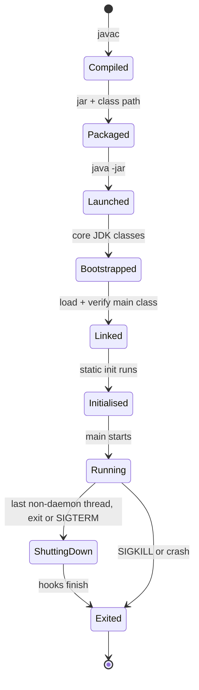

## Where we are

From JAVA-JVM-1 you know the pipeline:

- `javac` makes bytecode.
- The JVM loads classes lazily, interprets them, and JIT-compiles hot code.

This lesson stretches that into a full **lifecycle**, from typing source to the process exiting, with the trap that
waits at each stage. Come back to it whenever a start-up or shutdown bug appears.

## The problem

It is Friday, 6 pm. Your deploy went green an hour ago. Then, in quick succession:

- The new pod (one running copy of your service inside Kubernetes) logs `NoClassDefFoundError` for a class that obviously exists.
- Kubernetes restarts a pod and the messages it was processing are gone.
- A batch job's `main` printed "done" ten minutes ago, but the process is still running and the
  next job cannot start.

Three bugs, three different moments in a Java program's life. Most production surprises happen at
the edges of a program's life, not in the middle.

Know the stages and you know where to look.

## The whole lifecycle at a glance



The sections below walk each state: what happens, then the gotcha. Notice the arrow that skips
`ShuttingDown`: that is where your lost messages went.

## Stage 1: compile

```text
 Order.java ──javac──► Order.class  (+ Order$Line.class for each nested class)
```

The class file records a version (65 = Java 21).

- **Older JVM:** run it there and it fails with `UnsupportedClassVersionError`.
- **Fix:** build with `--release <N>` for the oldest Java you deploy to.
- **Bonus:** `--release 17` also checks that you only use APIs that exist in Java 17, which `-source/-target` alone do
  not.

A second trap: a **constant variable** (a `static final` primitive or `String` initialised with a
compile-time constant) is **copied into every class that uses it** at compile time.

```quiz
{"question": "Library v1 has  public static final int LIMIT = 10;  Your app uses Limits.LIMIT. You swap in library v2 (LIMIT = 50) without recompiling your app. What does your app see?", "level": "medium",
 "options": [
   {"text": "50, because the JVM loads the new Limits class", "why": "The value 10 was copied into your class file when it was compiled. Your code never reads the field from Limits at run time."},
   {"text": "10, the value copied in when your app was compiled", "correct": true, "why": "Constant variables are inlined by javac. Callers keep the old value until they are recompiled."},
   {"text": "NoSuchFieldError at run time", "why": "The field still exists in v2, and anyway your code does not look it up: the constant is already in your bytecode."},
   {"text": "UnsupportedClassVersionError", "why": "That is about class-file versions (compiled for a newer Java), not about library versions."}]}
```

## Stage 2: package

Classes go into a jar and onto the class path, where the first match wins (JAVA-FUND-1). Spring
Boot's executable jar nests dependency jars in `BOOT-INF/lib` and reads them with its own class loader (JAVA-JVM-4).

## Stage 3: launch the JVM

`java -Xmx512m -jar app.jar` starts a native process. The launcher parses options, creates the
JVM, and **ergonomics** (the JVM's automatic tuning) picks defaults from the hardware it sees:
maximum heap (a quarter of memory by default), garbage collector, number of JIT and GC threads.

Gotcha: in a container the JVM sees the container's limits, not the host's.

- A container with one CPU or under about 2 GB of memory silently gets the Serial collector (JAVA-JVM-5) instead of G1.
- The default heap is 25% of the container's memory.
- Check with `java -XX:+PrintFlagsFinal -version` or `jcmd <pid> VM.flags`.

## Stage 4: bootstrap the JDK

Before your code runs, the JVM:

- loads core classes (`Object`, `String`, `Thread`, `System` ...);
- starts its own internal threads: GC workers, JIT compiler threads, a finalizer and a reference handler thread.

Many core classes come from a pre-parsed archive (**Class Data Sharing**, CDS), which makes this faster.

Gotcha: even "hello world" loads several hundred classes before `main`. Start-up time grows with
how many classes you load (frameworks load thousands); CDS and AOT caches help.

## Stage 5: load and link the main class

A **class loader** (an object that finds class bytes by name) reads `Order.class`, then the JVM
**links** it:

```text
 find bytes ──► verify ──► prepare statics = 0/false/null ──► resolve references (lazily)
```

*Verify* checks the bytecode is safe, *prepare* creates static fields with default values, and
*resolve* turns names of other classes into real references when they are first needed.
JAVA-JVM-4 covers the loaders in depth.

- "Error: Could not find or load main class X": wrong class name, wrong package, or the class
  path does not contain it. Check the `package` line and `-cp`.
- `VerifyError` usually means a bytecode tool (an agent, weaving) produced bad code.

## Stage 6: initialise

**Initialisation** runs the class's static field initialisers and `static {}` blocks (together
compiled into a method called `<clinit>`), top to bottom, exactly once, under a lock so two
threads cannot both run it.

It happens just before the class's *first active use*:

- creating an instance;
- calling a static method;
- assigning a static field;
- reading a static field that is not a constant variable.

For the main class, that is before `main`.

```java
class Config {
    static final int MAX = 10;   // constant variable
    static int count = 5;        // ordinary static field
    static { System.out.println("Config <clinit>"); }
}
```

**Predict:** `main` prints `Config.MAX`, then `Config.count`. When does "Config <clinit>" appear?

Between the two.

- Reading `MAX` does not initialise `Config` at all, because `javac` copied the value 10 into the caller (Stage 1).
- Reading `count` is an active use, so `<clinit>` runs first.

Gotcha: two classes whose static initialisers use each other can see each other's fields still at
their default values (0/null).

```quiz
{"question": "Class TaxRules has  static Map<String, BigDecimal> RATES = loadRates();  and loadRates() throws on the first request because a file is missing. What do the first and the second request see?", "level": "hard",
 "options": [
   {"text": "Both get the original exception from loadRates()", "why": "Initialisation is attempted once. After it fails, the class is marked erroneous and the original exception is not thrown again."},
   {"text": "First: ExceptionInInitializerError. Second: NoClassDefFoundError \"Could not initialize class TaxRules\"", "correct": true, "why": "The first failure wraps the cause; every later use hits a class marked erroneous; on Java 18+ its cause names the original exception, on older JVMs only the first error shows it."},
   {"text": "The second request retries loadRates(), so it works once the file is restored", "why": "A failed class stays broken for the life of that JVM (that class loader). Only a restart retries it."},
   {"text": "ClassNotFoundException on both", "why": "The class was found and loaded fine. It is initialisation that failed."}]}
```

## Stage 7: main runs, the program warms up

`main` starts on the **main thread**, in the interpreter.

- Hot methods are compiled by C1, then C2 (JAVA-JVM-1).
- Other classes are loaded and initialised lazily, the first time a code path touches them.

- Warm-up: the first requests after start are slower.
- A missing dependency jar is only discovered when the code that needs it first runs:
  `NoClassDefFoundError` hours after a "successful" deploy.

## Stage 8: shutdown begins

One term first: a **thread pool** (an `ExecutorService`) keeps a few threads alive to run the tasks
you submit, so you do not start a new thread per task; JAVA-CONC-4 covers it in depth.

A **daemon thread** is a background thread that does not keep the JVM alive (call
`setDaemon(true)` before `start()`); every other thread is a non-daemon thread.

**Predict:** `main` returns while a non-daemon worker thread is still sleeping. Does the JVM exit?

No. Returning from `main` ends only the main thread. The JVM begins an orderly shutdown on one of:

```text
 ① the number of live NON-daemon threads drops to zero
 ② System.exit(code) (or Runtime.exit) is called
 ③ the process receives SIGTERM / SIGINT (Ctrl+C, docker stop, Kubernetes pod deletion)
 ─────────────────────────────────────────────
 ④ SIGKILL, Runtime.halt(), or a JVM crash: NO orderly shutdown at all
```

- `main` returned but the process never exits: some non-daemon thread is still alive (often an
  executor you never shut down). `jcmd <pid> Thread.print` shows which.
- An uncaught exception in `main` kills only the main thread. Other non-daemon threads keep the
  JVM running, and the exit code is 1 when it finally exits.

```quiz
{"question": "A batch job submits work to Executors.newFixedThreadPool(4), waits for the results, prints \"done\" and returns from main. It never calls shutdown(). What happens?", "level": "medium",
 "options": [
   {"text": "The JVM exits right after main returns", "why": "Returning from main ends only the main thread; the JVM waits for all non-daemon threads."},
   {"text": "The process keeps running, because the pool's idle threads are non-daemon", "correct": true, "why": "The default thread factory makes non-daemon threads, and a fixed pool keeps them alive while idle. Call shutdown() (or use try-with-resources on the ExecutorService in Java 21)."},
   {"text": "The JVM exits once the garbage collector frees the pool", "why": "Live threads are GC roots: a running thread and its pool are never collected just because main no longer references them."},
   {"text": "It exits with code 1 because work was left unfinished", "why": "All work finished. The process simply does not exit, so there is no exit code yet."}]}
```

## Stage 9: shutdown hooks run, then exit

**Shutdown hooks** are threads you register with `Runtime.getRuntime().addShutdownHook(...)`.

1. On orderly shutdown the JVM starts all of them (concurrently, in no guaranteed order).
2. It waits for them, then halts.

Daemon threads are simply stopped where they are; their `finally` blocks do not run. Spring Boot's graceful shutdown
and logging-framework flushes are built on hooks.

- SIGKILL never runs hooks.
  - Kubernetes sends SIGTERM, waits the grace period (30 s by default), then sends SIGKILL.
  - Keep shutdown work shorter than the grace period.
- Calling `System.exit()` inside a hook blocks forever, so shutdown never finishes.
- Hooks run concurrently: don't depend on another hook having finished.

```quiz
{"question": "Which of these lets your shutdown hook flush in-flight messages?", "level": "easy",
 "options": [
   {"text": "kill -9 <pid> (SIGKILL)", "why": "SIGKILL ends the process immediately. No hooks, no finally blocks."},
   {"text": "Runtime.getRuntime().halt(0)", "why": "halt terminates at once and does not start the shutdown sequence."},
   {"text": "kubectl delete pod (SIGTERM), if the hook finishes within the grace period", "correct": true, "why": "SIGTERM is an orderly trigger, so hooks run. If they take longer than the grace period, SIGKILL cuts them off."},
   {"text": "A JVM crash (segfault in native code)", "why": "A crash is not an orderly shutdown; hooks do not run."}]}
```

## Lab (~10 min)

Save as `Lifecycle.java`, then `javac Lifecycle.java`:

```java
public class Lifecycle {
    static {
        System.out.println("1. <clinit>: static initialiser runs before main");
    }

    public static void main(String[] args) {
        System.out.println("2. main starts");
        Runtime.getRuntime().addShutdownHook(new Thread(() ->
                System.out.println("5. shutdown hook runs")));

        Thread daemon = new Thread(() -> {
            try { Thread.sleep(60_000); } catch (InterruptedException ignored) { }
            System.out.println("never printed: daemon threads are abandoned at exit");
        });
        daemon.setDaemon(true);
        daemon.start();

        Thread worker = new Thread(() -> {
            try { Thread.sleep(500); } catch (InterruptedException ignored) { }
            System.out.println("4. non-daemon worker finishes, so the JVM may now exit");
        });
        worker.start();

        if (args.length > 0 && args[0].equals("crash")) {
            throw new IllegalStateException("3. main throws");      // main dies, worker does not
        }
        System.out.println("3. main returns, but the JVM waits for the non-daemon worker");
    }
}
```

1. `java Lifecycle`, then print the exit code (`echo $?` in bash, `echo $LASTEXITCODE` in
   PowerShell). Lines 1 to 5 in order; exit code 0; the daemon's line never appears.
2. **Predict, then run** `java Lifecycle crash`: will lines 4 and 5 still appear?
   - They do, after the stack trace, because the worker kept the JVM alive and the shutdown was orderly.
   - Exit code 1.
3. **Break it:** delete `daemon.setDaemon(true);` and run again. Watch for:
   - the process hanging for about 60 seconds after line 4;
   - then printing the "never printed" line, and only then line 5.
   - One forgotten flag turns a background helper into a thread that holds the JVM open.
4. `java -Xlog:class+load Lifecycle` and count the lines before `Lifecycle source:` appears:
   several hundred JDK classes before yours, most marked `source: shared objects file` (CDS).
5. Stretch: make the worker sleep 30 seconds, run `java Lifecycle` and press Ctrl+C. The hook still
   runs (SIGINT is an orderly trigger).

## Gotchas

- **`main` returning is not the end:** idle non-daemon pool threads keep the JVM alive; shut executors down.
- **A failed static initialiser is permanent** for that class in that JVM; fix the cause and restart.
- **Class loaders leak:** classes unload only when their loader is unreachable, so one surviving reference into an old
  loader leaks every class on each hot redeploy and metaspace (JAVA-JVM-2) grows.
- **SIGKILL skips shutdown hooks:** keep shutdown work inside the orchestrator's grace period.
- **Duplicate classes on the class path** cause `NoSuchMethodError`s that depend on jar order; keep one version.
- **Changed constants need recompiled callers**, and build with `--release` for the oldest runtime.

## In interviews

Asked as "What happens when you run `java -jar app.jar`?", "When is a static block executed?", "What is a daemon
thread?", "How do you implement graceful shutdown?". Bank:
[Process vs thread, shared variables and race conditions](#/q/process-vs-thread),
[Polymorphism, and can static methods be overridden?](#/q/polymorphism-and-static-method-overriding).

- *How does your service shut down gracefully in Kubernetes?* SIGTERM triggers hooks; Spring Boot
  (`server.shutdown=graceful`) stops accepting requests and drains in-flight ones within a timeout shorter than the
  pod's grace period, because SIGKILL follows.
- *Why does a static block sometimes run late, or not at all?* Initialisation happens on first active use, and reading a
  compile-time constant is not one.

## Explain it in 2 minutes

Prompt: "Walk me through the life of a Java program, from source to exit."

- `javac` makes versioned bytecode; jars on the class path, first match wins.
- `java` creates the JVM; ergonomics sizes heap, GC and threads from the container's resources.
- Bootstrap core classes (CDS); load → verify → prepare → resolve; `<clinit>` once on first active use.
- `main` runs interpreted, then JIT-compiled; other classes load lazily.
- Last non-daemon thread, `System.exit` or SIGTERM → hooks run concurrently → exit; SIGKILL skips all of it.

## Check yourself

1. `main` has returned but the process is still running. Most likely cause?
2. Which shutdown triggers run hooks, and which do not?
3. Why might a missing jar only be noticed hours after start-up?

### Answers

1. A live non-daemon thread, usually an executor never shut down (`jcmd <pid> Thread.print` shows it).
2. Last non-daemon thread, `System.exit`, SIGTERM/SIGINT run them; SIGKILL, `Runtime.halt` and crashes do not.
3. Classes load lazily, so the dependency is looked up only when the code needing it first runs.

## Next

JAVA-JVM-4 deepens stages 5 and 6 (loaders, delegation, unloading); LIFECYCLE-7 follows one *object* after JAVA-JVM-5.
