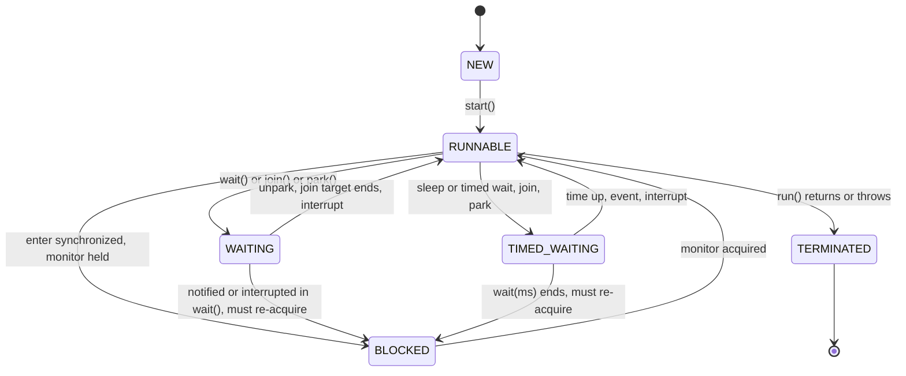

## Where we are

JAVA-CONC-1 introduced the six thread states in a short sketch. This lesson is the precise reference: which method call moves a thread into each state and what moves it out again. It also covers the cases that catch people out, where a thread's real situation and its reported state disagree. Senior interviewers probe exactly here, and thread dumps in production speak this language.

## The problem

You are on call, and checkout requests are hanging. CPU is low, nothing is in the error log, and the service has to be restarted or fixed soon. You take a thread dump and see 180 threads in `WAITING (parking)`, 3 in `BLOCKED (on object monitor)`, and 40 in `RUNNABLE` that are not using any CPU. To read that dump, you have to know precisely what puts a thread into each state. "WAITING means waiting for something" is not enough to find the bug. By the end of this lesson you will be able to read those three numbers.

## Terms first

- A **monitor** is the built-in lock that every Java object has. Entering a `synchronized` block or method acquires it, and leaving releases it. (JAVA-CONC-2 covers this in depth.)
- `obj.wait()`, called while holding `obj`'s monitor, releases it and sleeps until another thread calls `obj.notify()` (wake one waiter) or `obj.notifyAll()` (wake all).
- A **`ReentrantLock`** is a lock *object* from `java.util.concurrent.locks`: `lock()` and `unlock()` do the job of a `synchronized` block, explicitly. It does not use a monitor (JAVA-CONC-2 covers it).
- **Parking** is the low-level "suspend this thread" operation in `java.util.concurrent`. It is done by `LockSupport.park()`, and `LockSupport.unpark(thread)` resumes the thread. `ReentrantLock`, `Condition`, `BlockingQueue`, `CountDownLatch`, `Semaphore` and `FutureTask` all wait by parking.

## The six states

`Thread.State` has exactly six values. `t.getState()` returns one of them.

| State | Meaning |
|---|---|
| `NEW` | created, `start()` not called yet |
| `RUNNABLE` | executing in the JVM: on a CPU, ready for a CPU, **or blocked inside the OS** (I/O) |
| `BLOCKED` | waiting to acquire a **monitor** (`synchronized`) |
| `WAITING` | waiting with no time limit for another thread to do something |
| `TIMED_WAITING` | the same, but with a time limit |
| `TERMINATED` | `run()` has finished, normally or with an exception |

```quiz
{"question": "main calls t.join(1000) while t is still running. What is main's state while it waits?", "level": "easy",
 "options": [
   {"text": "TIMED_WAITING", "correct": true, "why": "join with a timeout is a wait with a time limit. It ends when t finishes or the second is up."},
   {"text": "WAITING", "why": "That is join() with no argument. Any call with a timeout gives TIMED_WAITING."},
   {"text": "BLOCKED", "why": "BLOCKED is reserved for waiting to acquire a monitor. main is waiting for t to end, not contending for a lock."},
   {"text": "RUNNABLE, because main is still alive", "why": "Alive is not a state. main is off the CPU until t ends or the timeout passes."}]}
```

## The full diagram



Every arrow out of BLOCKED, WAITING or TIMED_WAITING goes back to RUNNABLE, or from `wait()` to BLOCKED first, as explained below. A thread never jumps from one waiting state straight to TERMINATED: it must run again to finish.

## Transition by transition

**NEW → RUNNABLE.** `start()`, once only (JAVA-CONC-1).

**RUNNABLE → BLOCKED → RUNNABLE.** A thread reaches a `synchronized` block whose monitor another thread holds. It stays BLOCKED until the monitor is free and it wins it. This is the **only** way into BLOCKED, apart from the re-acquire after `wait()`.

**RUNNABLE → WAITING.** One of these calls, with no timeout:

- `obj.wait()`: releases `obj`'s monitor and waits to be notified.
- `t.join()`: waits for `t` to terminate. (For platform threads, `join` is built on `wait` internally.)
- `LockSupport.park()`: everything in `java.util.concurrent` that waits indefinitely.

**WAITING → RUNNABLE.** The matching event:

- `unpark` for a parked thread.
- `notify` or `notifyAll` for `wait()`.
- The target thread terminating, for `join()`.
- `interrupt()`, for all of them (how interruption works: JAVA-CONC-1).

**RUNNABLE → TIMED_WAITING → RUNNABLE.** The timed versions of the same calls: `Thread.sleep(ms)`, `wait(ms)`, `join(ms)`, and `parkNanos`/`parkUntil` (which are what `tryLock(timeout)`, `poll(timeout)`, `offer(timeout)`, `await(timeout)` and `Future.get(timeout)` use). The thread leaves when the time is up or when the matching event or an interrupt arrives.

**WAITING → BLOCKED → RUNNABLE: the `wait()` detour.** When a thread in `wait()` is notified, it cannot continue straight away, because it must re-acquire the monitor it released, and the notifier usually still holds it. So the thread moves to **BLOCKED** until the notifier leaves its `synchronized` block. The same applies to a thread interrupted or timed out inside `wait()`: it re-acquires the monitor *before* throwing `InterruptedException` or returning.

**RUNNABLE → TERMINATED.** `run()` returns, or throws an uncaught exception. No restart.

```quiz
{"question": "Thread A calls obj.wait(). Thread B calls obj.notify(), then keeps working for 2 seconds inside synchronized (obj). What is A's state during those 2 seconds?", "level": "medium",
 "options": [
   {"text": "BLOCKED", "correct": true, "why": "The wait() detour: A has been notified but must re-acquire obj's monitor, which B holds until it leaves the block."},
   {"text": "RUNNABLE, because it was notified", "why": "notify only makes A eligible. It cannot continue inside synchronized code without the monitor."},
   {"text": "WAITING, until B leaves the block", "why": "A is no longer waiting for a signal; it got one. Now it is contending for a monitor, which is exactly BLOCKED."},
   {"text": "TIMED_WAITING", "why": "There is no timeout anywhere here. A called wait() with no argument."}]}
```

## The traps

**Predict:** a thread calls `lock.lock()` on a `ReentrantLock` that another thread holds. BLOCKED or WAITING?

**1. `ReentrantLock` contention shows as WAITING, not BLOCKED.** BLOCKED means a *monitor* only. A thread stuck in `lock.lock()` is parked, so the dump shows `WAITING (parking)`. Two services can have the same lock-contention bug and look completely different in a dump.

**2. Blocking I/O shows as RUNNABLE.** A platform thread inside a socket `read()` or `accept()` is blocked in the operating system, but Java reports RUNNABLE. Forty RUNNABLE threads at 0% CPU usually means forty threads waiting on the network, often a slow downstream service with no timeout.

**3. RUNNABLE does not mean "on a CPU".** It covers running, ready-to-run and in native code. Use CPU profiling, not thread states, to answer "who is burning CPU?"

**4. `sleep` keeps locks; `wait` releases them.** `Thread.sleep` inside `synchronized` holds the monitor the whole time, so every other thread that needs it becomes BLOCKED. `wait()` releases that monitor, but only that one. Any *other* monitors the thread holds stay held.

**5. `yield()` and spinning stay RUNNABLE.** `Thread.yield()` is only a hint to the scheduler, and a busy-wait loop never leaves RUNNABLE.

```quiz
{"question": "T1 is inside synchronized (m) and calls lock.lock(); T2 holds the ReentrantLock lock and tries to enter synchronized (m). They are deadlocked. A teammate greps the thread dump for BLOCKED. What do they find?", "level": "hard",
 "options": [
   {"text": "Only T2 (BLOCKED on m); T1 shows WAITING (parking)", "correct": true,
    "why": "T2 contends for a monitor, so BLOCKED. T1 waits for a ReentrantLock, which parks. Grepping for BLOCKED shows only half the cycle."},
   {"text": "Both threads, BLOCKED", "why": "BLOCKED is reserved for monitors. T1 is waiting on a ReentrantLock, so it is parked: WAITING."},
   {"text": "Neither: both show WAITING (parking)", "why": "T2 is entering a synchronized block whose monitor T1 holds. That is exactly BLOCKED (on object monitor)."},
   {"text": "Neither: deadlocked threads show RUNNABLE", "why": "Both threads are off the CPU waiting for each other; neither is RUNNABLE."}]}
```

## Reading a thread dump

`jstack <pid>` (or `jcmd <pid> Thread.print`) prints each thread's state along with *why* it is in that state (abridged below; real dumps put the `State:` line under the thread's header):

```text
"worker-3" ... java.lang.Thread.State: BLOCKED (on object monitor)
        - waiting to lock <0x...> (a com.shop.Inventory)        ← who holds it is listed elsewhere

"worker-7" ... java.lang.Thread.State: WAITING (parking)
        - parking to wait for <0x...> (a java.util.concurrent.locks.ReentrantLock$NonfairSync)

"worker-9" ... java.lang.Thread.State: TIMED_WAITING (sleeping)
"worker-2" ... java.lang.Thread.State: WAITING (on object monitor)      ← inside Object.wait()
```

The detail in brackets tells you the mechanism: `on object monitor` for `synchronized` or `wait`, `parking` for `java.util.concurrent`, and `sleeping` for `Thread.sleep`.

```quiz
{"question": "Back to the on-call dump: 40 threads are RUNNABLE at 0% CPU, and their stacks end in a socket read. What is the most likely cause?", "level": "medium",
 "options": [
   {"text": "They are waiting on a slow downstream service, probably one called without a timeout", "correct": true,
    "why": "Blocking socket I/O reports RUNNABLE while the thread sits in the OS. A slow dependency with no timeout keeps them there."},
   {"text": "A CPU-bound loop is spinning in all 40 threads", "why": "Spinning would show high CPU. At 0% CPU, RUNNABLE means they are blocked outside the JVM."},
   {"text": "They are deadlocked on a monitor", "why": "Monitor contention shows as BLOCKED (on object monitor), not RUNNABLE."},
   {"text": "They are waiting for garbage collection to finish", "why": "Their stacks end in a socket read, and threads paused for GC do not show as stuck in socket I/O."}]}
```

That reads the story's dump: the 40 RUNNABLE threads are stuck on the network, the 3 BLOCKED threads are queued on a `synchronized` monitor, and the 180 parked threads are waiting in `java.util.concurrent` (a pool's idle workers, or a contended `ReentrantLock`). The stack under each line tells you which.

## Virtual threads use the same states

A virtual thread (JAVA-CONC-6) reports the same six states. While it is mounted and running it is RUNNABLE. When it is parked and unmounted (for example in `sleep` or `take`), it shows WAITING or TIMED_WAITING. The JVM-level picture is identical. What differs is that a waiting virtual thread does not occupy an OS thread. Two consequences: trap 2 is about platform threads, since a virtual thread blocked in socket I/O usually unmounts and parks; and `jstack` does not list virtual threads, so use `jcmd <pid> Thread.dump_to_file <file>`.

## Lab (~10 min)

Save this as `StateZoo.java` and run it with `java StateZoo.java`. It puts threads into every state and prints what `getState()` says. **Predict** each line before you run it, then compare with the expected output below.

```java
import java.net.ServerSocket;
import java.util.concurrent.locks.LockSupport;
import java.util.concurrent.locks.ReentrantLock;

public class StateZoo {
    static final Object monitor = new Object();

    public static void main(String[] args) throws Exception {
        // NEW
        Thread t = new Thread(() -> {}, "fresh");
        show("new Thread(..), not started", t);

        // RUNNABLE: busy on the CPU
        Thread spinner = Thread.ofPlatform().daemon().start(() -> { while (true) Thread.onSpinWait(); });  // a CPU hint; still RUNNABLE
        show("busy loop", spinner);

        // RUNNABLE: blocked in socket I/O, yet Java says RUNNABLE
        ServerSocket server = new ServerSocket(0);
        Thread acceptor = Thread.ofPlatform().daemon().start(() -> {
            try { server.accept(); } catch (Exception ignored) { }
        });
        show("waiting in ServerSocket.accept()", acceptor);
        server.close();

        // TIMED_WAITING
        Thread sleeper = Thread.ofPlatform().daemon().start(() -> sleep(10_000));
        show("Thread.sleep(10s)", sleeper);

        // WAITING via Object.wait()
        Thread waiter = Thread.ofPlatform().start(() -> {
            synchronized (monitor) {
                try { monitor.wait(); } catch (InterruptedException e) { Thread.currentThread().interrupt(); }
            }
        });
        show("monitor.wait()", waiter);

        // BLOCKED: notified, but must re-acquire the monitor that main still holds
        synchronized (monitor) {
            monitor.notify();
            show("notified, monitor still held by main", waiter);
        }
        waiter.join();

        // BLOCKED: trying to enter synchronized
        Thread entrant;
        synchronized (monitor) {
            entrant = Thread.ofPlatform().start(() -> { synchronized (monitor) { } });
            show("entering synchronized held by main", entrant);
        }
        entrant.join();

        // WAITING (not BLOCKED!): ReentrantLock parks the thread
        ReentrantLock lock = new ReentrantLock();
        lock.lock();
        Thread locker = Thread.ofPlatform().start(() -> { lock.lock(); lock.unlock(); });
        show("lock.lock() on a held ReentrantLock", locker);
        lock.unlock();
        locker.join();

        // WAITING via join, and via LockSupport.park
        Thread joiner = Thread.ofPlatform().daemon().start(() -> {
            try { sleeper.join(); } catch (InterruptedException e) { Thread.currentThread().interrupt(); }
        });
        show("otherThread.join()", joiner);
        Thread parked = Thread.ofPlatform().daemon().start(LockSupport::park);
        show("LockSupport.park()", parked);

        // TERMINATED
        show("after join()", locker);
    }

    static void show(String what, Thread t) {
        sleep(200);   // give the thread time to reach its state (fine for a demo, never for real coordination)
        System.out.printf("%-40s -> %s%n", what, t.getState());
    }

    static void sleep(long ms) {
        try { Thread.sleep(ms); } catch (InterruptedException e) { Thread.currentThread().interrupt(); }
    }
}
```

Expected output:

```text
new Thread(..), not started              -> NEW
busy loop                                -> RUNNABLE
waiting in ServerSocket.accept()         -> RUNNABLE
Thread.sleep(10s)                        -> TIMED_WAITING
monitor.wait()                           -> WAITING
notified, monitor still held by main     -> BLOCKED
entering synchronized held by main       -> BLOCKED
lock.lock() on a held ReentrantLock      -> WAITING
otherThread.join()                       -> WAITING
LockSupport.park()                       -> WAITING
after join()                             -> TERMINATED
```

Look for three things: socket I/O reports RUNNABLE, the notified waiter is BLOCKED (the `wait()` detour), and `ReentrantLock` contention is WAITING.

**Break it:** in the BLOCKED-after-notify step, move `show(...)` out of the `synchronized (monitor)` block, so it runs after `main` releases the monitor. Now the line no longer prints BLOCKED (usually TERMINATED, since the waiter re-acquires the monitor and finishes within the 200 ms). The detour is real but brief: a dump only catches it while the notifier still holds the lock.

**Try it:** add `Thread.sleep(60_000)` at the end of `main`, run `jstack <pid>` (find the pid with `jps`), and match each line of the dump to a line above.

## Gotchas

- **"BLOCKED means any lock":** no, monitors only; `ReentrantLock` and other `java.util.concurrent` waits show WAITING (parking).
- **"RUNNABLE means using CPU":** no, blocking I/O and ready threads are RUNNABLE too; use a CPU profiler for hot threads.
- **A notified thread does not run at once:** it goes WAITING → BLOCKED to re-acquire the monitor, and the condition may
  have changed meanwhile, so always re-check it in a `while` loop.
- **`sleep` inside `synchronized`** keeps the monitor, so everyone needing it piles up in BLOCKED.
- **An interrupted `wait()`** re-acquires the monitor before `InterruptedException` is thrown.

## In interviews

Asked directly: "What are the thread states and what causes each?" Also inside
[Process vs thread, shared variables and race conditions](#/q/process-vs-thread),
[Producer-consumer problem](#/q/producer-consumer-problem) and
[volatile and synchronized across CPU architectures](#/q/java-volatile-and-synchronized).

- *BLOCKED vs WAITING?* BLOCKED is contending for a monitor; WAITING is choosing to wait for a signal (`wait`, `join`,
  `park`). Adding that `ReentrantLock` contention shows as WAITING is what marks a strong answer.
- *`sleep` vs `wait`?* `sleep` is a static `Thread` method, needs no monitor and keeps locks; `wait` must be called while
  holding the object's monitor, releases it, and passes through BLOCKED to re-acquire it.

## Explain it in 2 minutes

*"Walk me through the Java thread lifecycle."*

- NEW → `start()` → RUNNABLE → TERMINATED when `run()` ends; no restart.
- BLOCKED only for monitor contention (entering `synchronized`, or re-entering after `wait`).
- WAITING from `wait`/`join`/`park`; TIMED_WAITING from `sleep` and the timed versions.
- Woken by notify, unpark, join target ending, timeout or interrupt; after `wait`, via BLOCKED.
- Traps: I/O shows RUNNABLE, `ReentrantLock` contention shows WAITING.

## Check yourself

1. Which calls lead to TIMED_WAITING?
2. A thread holds the monitors of `m1` and `m2` and calls `m1.wait()`. Which monitors does it release?
3. Can a thread go from WAITING directly to TERMINATED?

### Answers

1. `sleep`, `wait(ms)`, `join(ms)`, `parkNanos`/`parkUntil`, and what builds on them (`tryLock(t)`, `poll(t)`, `Future.get(t)`).
2. Only `m1`'s. It keeps `m2` while it waits, so any thread needing `m2` piles up in BLOCKED.
3. No. It must become RUNNABLE again to finish `run()`, even just to throw `InterruptedException`.

## Next

JAVA-CONC-2 if not done yet (monitors and `ReentrantLock` create these states); then JAVA-CONC-7 builds producer-consumer
with `wait`/`notifyAll` and `BlockingQueue`, where these transitions happen for real.
