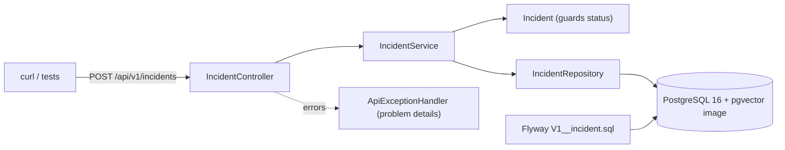
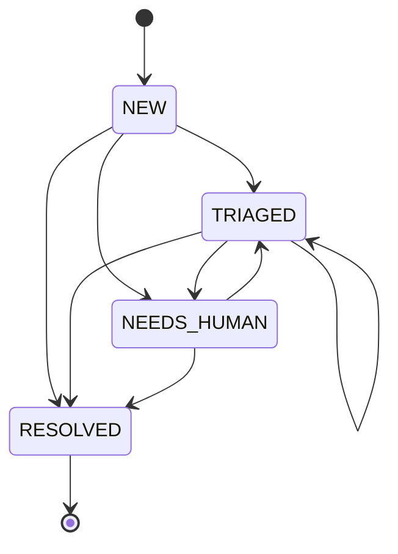

## Where we are

Nothing exists yet. What you bring:

- From SPRING-BOOT-8 you know how to test a Spring Boot app with slices and Testcontainers.
- From AI-ENG-7 you know the two ways to call an LLM from Spring and why every call belongs behind one interface you own.

Today you start **TriageDesk** (spec: `docs/AI-PROJECT.md`) in **your own new repo**. This milestone has no AI. You build the boring foundation the AI will stand on:

- incidents in PostgreSQL;
- an API to report them;
- and tests.

## The problem

It is your first evening on TriageDesk. You want to jump straight to "Claude classifies incidents", but there is:

- nowhere to put an incident;
- nothing to classify;
- no test that would tell you when the AI part breaks something.

Worse, the first thing an LLM project usually leaks is its API key: one `.env` committed "just to test", and it lives in git history forever.

Tonight you build the ground floor and lock the door before anything valuable is inside.

## Goal

Create a Spring Boot 4.1 service that stores incidents in PostgreSQL 16 (with the pgvector image from day one), with the schema owned by Flyway.

- **Endpoints:** `POST /api/v1/incidents`, `GET /api/v1/incidents/{id}` and a paginated `GET /api/v1/incidents`.
- **Domain:** the `Incident` entity guards its own status transitions.
- **Errors** come back as problem details with a stable `code`.
- **Secrets hygiene** every later milestone relies on: the API key is read from the environment only, and `.env` is ignored by git before you ever create it.



## What you build

- [ ] A Maven project `triagedesk` (Java 21, Spring Boot 4.1.x parent, Spring AI BOM imported for later), package `com.triagedesk`
- [ ] `.gitignore` containing `.env`, plus a committed `.env.example` with empty values
- [ ] `compose.yaml` with `pgvector/pgvector:pg16` and a healthcheck
- [ ] `db/migration/V1__incident.sql`
- [ ] `incident` package: `Severity`, `IncidentStatus` (with transitions), the `Incident` entity, `IncidentRepository`, `IncidentService`, `IncidentController`
- [ ] `common` package: `TriageDeskException`, `ApiExceptionHandler` (problem details), `ClockConfig`
- [ ] Tests: unit tests for the state machine, a `@WebMvcTest` for validation, and a Testcontainers integration test for the round trip

## Acceptance criteria

1. `docker compose up -d` starts Postgres. `./mvnw spring-boot:run` starts the app, and Flyway logs that it applied `V1`.
2. `curl -i -X POST localhost:8080/api/v1/incidents -H 'Content-Type: application/json' -d '{"title":"Checkout 5xx spike","description":"Error rate on /checkout rose after 14:02 deploy","service":"checkout","severity":"SEV2"}'` returns `201`, a `Location` header, and a body with `"status":"NEW"`.
3. A `GET` on the `Location` URL returns the same incident. `GET /api/v1/incidents/<random-uuid>` returns `404` with `"code":"INCIDENT_NOT_FOUND"`.
4. Posting a blank `title` returns `400` as a problem detail.
5. These tests pass with `./mvnw verify`:
   - `IncidentStatusTest.resolvedIsTerminal` (parameterised over every status), `IncidentStatusTest.triagedCanBeRetriaged`
   - `IncidentTest.illegalTransitionThrowsWithCode`, `IncidentTest.resolveSetsNotesAndTime` (fixed `Clock`)
   - `IncidentControllerTest.blankTitleIs400`, `IncidentControllerTest.unknownIdIs404WithCode`
   - `IncidentApiIT.reportThenFetchRoundTrip` (Testcontainers, `pgvector/pgvector:pg16`; run by the failsafe plugin from step 1, so Docker must be running. The course's verify project compiles it, but its offline build ran only the unit and slice tests)
6. `git status` never shows `.env`. `git grep -n "sk-ant"` finds nothing.

## Steps

### Session 1 · Project, secrets, schema (~40 min)

**1. Generate the project.** At start.spring.io pick Maven, Java 21, Boot 4.1.x, with Spring Web, Validation, Spring Data JPA, Flyway, PostgreSQL Driver, Actuator and Testcontainers.

Why 4.1 and not 4.0?

- spring.io lists the end of Boot 4.0.x open-source support as 31 Dec 2026, before this project starts.
- 4.1.x is supported until 31 Jul 2027, and Spring AI 2.0.3 is built against Boot 4.1.3.

**Predict:** you open the generated `pom.xml` expecting `spring-boot-starter-web`. What do you find?

Boot 4 split itself into smaller modules and renamed several starters:

- The web starter is now `spring-boot-starter-webmvc`.
- Flyway support moved into its own `spring-boot-starter-flyway`.
- Test slices have their own starters too (`spring-boot-starter-webmvc-test`, `spring-boot-starter-data-jpa-test`).

If you copy a Boot 3 pom from a blog, it still compiles in places and then fails in surprising ones. Compare with this list:

```xml
<parent>
  <groupId>org.springframework.boot</groupId>
  <artifactId>spring-boot-starter-parent</artifactId>
  <version>4.1.3</version>
  <relativePath/>
</parent>

<properties>
  <java.version>21</java.version>
  <spring-ai.version>2.0.3</spring-ai.version>
</properties>

<dependencyManagement>
  <dependencies>
    <dependency>
      <groupId>org.springframework.ai</groupId>
      <artifactId>spring-ai-bom</artifactId>
      <version>${spring-ai.version}</version>
      <type>pom</type>
      <scope>import</scope>
    </dependency>
  </dependencies>
</dependencyManagement>

<dependencies>
  <dependency><groupId>org.springframework.boot</groupId><artifactId>spring-boot-starter-webmvc</artifactId></dependency>
  <dependency><groupId>org.springframework.boot</groupId><artifactId>spring-boot-starter-validation</artifactId></dependency>
  <dependency><groupId>org.springframework.boot</groupId><artifactId>spring-boot-starter-data-jpa</artifactId></dependency>
  <dependency><groupId>org.springframework.boot</groupId><artifactId>spring-boot-starter-flyway</artifactId></dependency>
  <dependency><groupId>org.flywaydb</groupId><artifactId>flyway-database-postgresql</artifactId></dependency>
  <dependency><groupId>org.springframework.boot</groupId><artifactId>spring-boot-starter-actuator</artifactId></dependency>
  <dependency><groupId>org.postgresql</groupId><artifactId>postgresql</artifactId><scope>runtime</scope></dependency>

  <!-- tests -->
  <dependency>
    <groupId>org.springframework.boot</groupId><artifactId>spring-boot-starter-webmvc-test</artifactId>
    <scope>test</scope>
  </dependency>
  <dependency>
    <groupId>org.springframework.boot</groupId><artifactId>spring-boot-starter-data-jpa-test</artifactId>
    <scope>test</scope>
  </dependency>
  <dependency>
    <groupId>org.springframework.boot</groupId><artifactId>spring-boot-testcontainers</artifactId>
    <scope>test</scope>
  </dependency>
  <dependency>
    <groupId>org.testcontainers</groupId><artifactId>testcontainers-junit-jupiter</artifactId>
    <scope>test</scope>
  </dependency>
  <dependency>
    <groupId>org.testcontainers</groupId><artifactId>testcontainers-postgresql</artifactId>
    <scope>test</scope>
  </dependency>
</dependencies>

<build>
  <plugins>
    <plugin><groupId>org.springframework.boot</groupId><artifactId>spring-boot-maven-plugin</artifactId></plugin>
    <!-- the parent only manages failsafe; without this, ./mvnw verify never runs the *IT tests -->
    <plugin><groupId>org.apache.maven.plugins</groupId><artifactId>maven-failsafe-plugin</artifactId></plugin>
  </plugins>
</build>
```

- The BOM (bill of materials) pins every Spring AI artifact to one version. AI-BUILD-2 adds the starters without version numbers.
- `flyway-database-postgresql` is still needed next to the starter: Flyway keeps each database's support in its own module.
- Testcontainers 2 renamed its modules: `testcontainers-postgresql`, not `postgresql`.
- **The failsafe plugin is required.** The Boot parent only *manages* `maven-failsafe-plugin` (version and configuration); it does not switch it on. Without the `<plugin>` line, `./mvnw verify` runs your unit tests and silently skips every `*IT` class.

**2. Secrets hygiene, before any config.**

```text
# .gitignore (add to what start.spring.io generated)
.env
*.env.local
```

```text
# .env.example  (committed; real values go in .env, which git ignores)
ANTHROPIC_API_KEY=
```

Doing this first matters. The usual way a key leaks is that `.env` gets committed once, and then lives in the history forever.

**3. Compose and configuration.**

```yaml
# compose.yaml
services:
  postgres:
    image: pgvector/pgvector:pg16
    environment:
      POSTGRES_DB: triagedesk
      POSTGRES_USER: triagedesk
      POSTGRES_PASSWORD: triagedesk   # local only; never reuse outside your laptop
    ports: ["5432:5432"]
    healthcheck:
      test: ["CMD-SHELL", "pg_isready -U triagedesk"]
      interval: 5s
      retries: 10
```

You use the pgvector image now, even though vectors arrive in AI-BUILD-3. It is plain Postgres 16 with one extra extension available, so nothing has to change later.

```yaml
# src/main/resources/application.yml
spring:
  application.name: triagedesk
  datasource:
    url: jdbc:postgresql://localhost:5432/triagedesk
    username: triagedesk
    password: ${DB_PASSWORD:triagedesk}
  jpa:
    hibernate.ddl-auto: validate      # Flyway owns the schema; Hibernate only checks it
    open-in-view: false
  threads.virtual.enabled: true       # LLM calls block for seconds; virtual threads make that cheap
```

**4. The schema.**

```sql
-- src/main/resources/db/migration/V1__incident.sql
create table incident (
    id               uuid primary key,
    title            varchar(200) not null,
    description      text         not null,
    service          varchar(100) not null,
    severity         varchar(10)  not null,
    status           varchar(20)  not null,
    created_at       timestamptz  not null,
    resolution_notes text,
    resolved_at      timestamptz,
    version          bigint       not null
);
-- the queue view lists by status, newest first
create index incident_status_created on incident (status, created_at desc);
```

```quiz
{"question": "Why does this milestone set spring.jpa.hibernate.ddl-auto to validate instead of update?", "level": "easy",
 "options": [
   {"text": "Flyway owns the schema as reviewed, versioned SQL; Hibernate only checks that the entities match it", "correct": true, "why": "Migrations are applied in order and recorded in flyway_schema_history. validate fails fast at startup if an entity and a column disagree."},
   {"text": "update is not supported by PostgreSQL", "why": "It works on PostgreSQL. The problem is that it silently creates columns nobody reviewed."},
   {"text": "validate makes startup faster than update, which is the main reason", "why": "Speed is not the point. Ownership is: one tool writes the schema, the other only checks."},
   {"text": "Without validate, Flyway would refuse to run", "why": "Flyway runs regardless of ddl-auto. The two settings answer different questions."}]}
```

### Session 2 · The domain and the API (~45 min)

**5. Severity and the status state machine.**

```java
package com.triagedesk.incident;

public enum Severity { SEV1, SEV2, SEV3, SEV4 }   // SEV1 = most severe
```

The status rules live on the enum, as one readable state machine:

```java
package com.triagedesk.incident;

import java.util.EnumSet;
import java.util.Set;

public enum IncidentStatus {
    NEW, TRIAGED, NEEDS_HUMAN, RESOLVED;

    public boolean canTransitionTo(IncidentStatus next) {
        Set<IncidentStatus> allowed = switch (this) {
            case NEW -> EnumSet.of(TRIAGED, NEEDS_HUMAN, RESOLVED);
            case TRIAGED -> EnumSet.of(TRIAGED, NEEDS_HUMAN, RESOLVED);   // re-triage allowed
            case NEEDS_HUMAN -> EnumSet.of(TRIAGED, RESOLVED);
            case RESOLVED -> EnumSet.noneOf(IncidentStatus.class);
        };
        return allowed.contains(next);
    }
}
```



**Predict:** an incident is `NEEDS_HUMAN` because the model timed out; a human fixes it and then someone clicks "Triage now" again on the resolved incident. What happens?

`RESOLVED` allows no transition at all, so `transitionTo(TRIAGED)` throws `InvalidStatusTransitionException`, which becomes a `409` with `code: INVALID_STATUS_TRANSITION`. The rule sits in one place, so every future writer (the triage pipeline, the agent, a Kafka consumer) hits the same guard.

**6. Errors with stable codes.** Messages change; codes do not, so alerts and clients can key on them.

```java
package com.triagedesk.common;

public abstract class TriageDeskException extends RuntimeException {
    private final String code;

    protected TriageDeskException(String code, String message) {
        super(message);
        this.code = code;
    }

    protected TriageDeskException(String code, String message, Throwable cause) {
        super(message, cause);
        this.code = code;
    }

    public final String code() { return code; }
}
```

```java
package com.triagedesk.incident;

import com.triagedesk.common.TriageDeskException;
import java.util.UUID;

public class IncidentNotFoundException extends TriageDeskException {
    public IncidentNotFoundException(UUID id) {
        super("INCIDENT_NOT_FOUND", "no incident " + id);
    }
}
```

Write `InvalidStatusTransitionException(IncidentStatus from, IncidentStatus to)` the same way, with code `INVALID_STATUS_TRANSITION`.

**7. The entity.** `Incident` has an identity that survives changes, so equality is by id. Its version field is a wrapper `Long`, for a reason explained in the Hints.

```java
package com.triagedesk.incident;

import jakarta.persistence.Column;
import jakarta.persistence.Entity;
import jakarta.persistence.EnumType;
import jakarta.persistence.Enumerated;
import jakarta.persistence.Id;
import jakarta.persistence.Table;
import jakarta.persistence.Version;
import java.time.Clock;
import java.time.Instant;
import java.util.Objects;
import java.util.UUID;

@Entity
@Table(name = "incident")
public class Incident {
    @Id private UUID id;
    private String title;
    @Column(columnDefinition = "text") private String description;
    private String service;
    @Enumerated(EnumType.STRING) private Severity severity;
    @Enumerated(EnumType.STRING) private IncidentStatus status;
    private Instant createdAt;
    @Column(columnDefinition = "text") private String resolutionNotes;
    private Instant resolvedAt;
    @Version private Long version;          // (AI-BUILD-8 adds sourceKey above this line)

    protected Incident() { }   // for JPA

    private Incident(UUID id, String title, String description, String service, Severity severity, Instant createdAt) {
        this.id = id;
        this.title = requireText(title, "title");
        this.description = requireText(description, "description");
        this.service = requireText(service, "service");
        this.severity = Objects.requireNonNull(severity, "severity");
        this.status = IncidentStatus.NEW;
        this.createdAt = createdAt;
    }

    public static Incident report(String title, String description, String service, Severity severity, Clock clock) {
        return new Incident(UUID.randomUUID(), title, description, service, severity, clock.instant());
    }

    public void transitionTo(IncidentStatus next) {
        if (!status.canTransitionTo(next)) {
            throw new InvalidStatusTransitionException(status, next);
        }
        status = next;
    }

    public void resolve(String notes, Clock clock) {
        transitionTo(IncidentStatus.RESOLVED);
        resolutionNotes = requireText(notes, "resolutionNotes");
        resolvedAt = clock.instant();
    }

    private static String requireText(String value, String name) {
        if (value == null || value.isBlank()) throw new IllegalArgumentException(name + " is required");
        return value.strip();
    }

    @Override public boolean equals(Object o) { return o instanceof Incident other && id.equals(other.id); }
    @Override public int hashCode() { return id.hashCode(); }
    @Override public String toString() { return "Incident[" + id + ", " + status + "]"; }   // no free text in logs

    public UUID getId() { return id; }
    public String getTitle() { return title; }
    public String getDescription() { return description; }
    public String getService() { return service; }
    public Severity getSeverity() { return severity; }
    public IncidentStatus getStatus() { return status; }
    public Instant getCreatedAt() { return createdAt; }
    public String getResolutionNotes() { return resolutionNotes; }
    public Instant getResolvedAt() { return resolvedAt; }
}
```

`toString` leaves out the title and description on purpose. Incident text can contain anything a user pasted, including emails and tokens.

- AI-BUILD-6 redacts it before it reaches a model.
- Logs should never see it at all.

**8. Repository, service, clock.**

```java
package com.triagedesk.incident;

import java.util.UUID;
import org.springframework.data.domain.Page;
import org.springframework.data.domain.Pageable;
import org.springframework.data.jpa.repository.JpaRepository;

public interface IncidentRepository extends JpaRepository<Incident, UUID> {
    Page<Incident> findByStatus(IncidentStatus status, Pageable pageable);
}
```

This is the **Repository** pattern (REFERENCE-2): the domain asks for incidents in domain terms and never sees SQL.

```java
package com.triagedesk.incident;

import java.time.Clock;
import java.util.UUID;
import org.springframework.data.domain.Page;
import org.springframework.data.domain.PageRequest;
import org.springframework.data.domain.Sort;
import org.springframework.stereotype.Service;
import org.springframework.transaction.annotation.Transactional;

@Service
public class IncidentService {             // (AI-BUILD-3 adds events, AI-BUILD-8 the outbox)
    private final IncidentRepository incidents;
    private final Clock clock;

    @Transactional
    public Incident report(String title, String description, String service, Severity severity) {
        return incidents.save(Incident.report(title, description, service, severity, clock));
    }

    @Transactional(readOnly = true)
    public Incident get(UUID id) {
        return incidents.findById(id).orElseThrow(() -> new IncidentNotFoundException(id));
    }

    @Transactional(readOnly = true)
    public Page<Incident> list(IncidentStatus status, int page, int size) {
        PageRequest request = PageRequest.of(page, size, Sort.by(Sort.Direction.DESC, "createdAt"));
        return status == null ? incidents.findAll(request) : incidents.findByStatus(status, request);
    }
}
```

Add the constructor that takes `IncidentRepository` and `Clock`. Time comes from an injected `Clock` so tests can freeze it:

```java
package com.triagedesk.common;

import java.time.Clock;
import org.springframework.context.annotation.Bean;
import org.springframework.context.annotation.Configuration;

@Configuration
class ClockConfig {
    @Bean
    Clock clock() { return Clock.systemUTC(); }
}
```

**9. Controller.** It returns DTO records, never the entity.

- The entity's shape is a storage decision; the API's shape is a contract with clients.
- They change for different reasons.

```java
@RestController
@RequestMapping("/api/v1/incidents")
class IncidentController {

    record ReportIncidentRequest(@NotBlank @Size(max = 200) String title,
                                 @NotBlank @Size(max = 10_000) String description,
                                 @NotBlank @Size(max = 100) String service,
                                 @NotNull Severity severity) { }

    record IncidentView(UUID id, String title, String description, String service, Severity severity,
                        IncidentStatus status, Instant createdAt, String resolutionNotes) {
        static IncidentView from(Incident i) {
            return new IncidentView(i.getId(), i.getTitle(), i.getDescription(), i.getService(), i.getSeverity(),
                    i.getStatus(), i.getCreatedAt(), i.getResolutionNotes());
        }
    }

    record PageResponse<T>(List<T> items, int page, int size, long totalItems) { }

    private final IncidentService service;

    IncidentController(IncidentService service) { this.service = service; }

    @PostMapping
    ResponseEntity<IncidentView> report(@Valid @RequestBody ReportIncidentRequest req, UriComponentsBuilder uri) {
        Incident incident = service.report(req.title(), req.description(), req.service(), req.severity());
        var location = uri.path("/api/v1/incidents/{id}").buildAndExpand(incident.getId()).toUri();
        return ResponseEntity.created(location).body(IncidentView.from(incident));
    }

    @GetMapping("/{id}")
    IncidentView get(@PathVariable UUID id) { return IncidentView.from(service.get(id)); }

    @GetMapping
    PageResponse<IncidentView> list(@RequestParam(required = false) IncidentStatus status,
                                    @RequestParam(defaultValue = "0") @Min(0) int page,
                                    @RequestParam(defaultValue = "20") @Min(1) @Max(100) int size) {
        var result = service.list(status, page, size).map(IncidentView::from);
        return new PageResponse<>(result.getContent(), page, size, result.getTotalElements());
    }
}
```

The imports are `jakarta.validation.*`, `org.springframework.web.bind.annotation.*`, `org.springframework.http.ResponseEntity` and `org.springframework.web.util.UriComponentsBuilder`.

Your JSON is written by **Jackson 3** now: Boot 4 uses the `tools.jackson` packages by default. You will meet that directly in AI-BUILD-7 and AI-BUILD-8.

**10. Problem details.** Extending `ResponseEntityExceptionHandler` makes Spring's own errors, such as validation failures, also come back as RFC 9457 bodies:

```java
package com.triagedesk.common;

import com.triagedesk.incident.IncidentNotFoundException;
import com.triagedesk.incident.InvalidStatusTransitionException;
import org.springframework.http.HttpStatus;
import org.springframework.http.ProblemDetail;
import org.springframework.web.bind.annotation.ExceptionHandler;
import org.springframework.web.bind.annotation.RestControllerAdvice;
import org.springframework.web.servlet.mvc.method.annotation.ResponseEntityExceptionHandler;

@RestControllerAdvice                       // AI-BUILD-4 scopes it to @RestController classes
class ApiExceptionHandler extends ResponseEntityExceptionHandler {

    @ExceptionHandler(IncidentNotFoundException.class)
    ProblemDetail notFound(IncidentNotFoundException e) { return problem(HttpStatus.NOT_FOUND, e); }

    @ExceptionHandler(InvalidStatusTransitionException.class)
    ProblemDetail conflict(InvalidStatusTransitionException e) { return problem(HttpStatus.CONFLICT, e); }

    private static ProblemDetail problem(HttpStatus status, TriageDeskException e) {
        ProblemDetail body = ProblemDetail.forStatusAndDetail(status, e.getMessage());
        body.setProperty("code", e.code());
        return body;
    }
}
```

(This is the AI-BUILD-1 shape. AI-BUILD-4 scopes the advice with `annotations = RestController.class`, and AI-BUILD-7 adds two more handlers for actions.)

```quiz
{"question": "Code tries to move a RESOLVED incident to TRIAGED. Which layer decides it is illegal, and what does the client see?", "level": "medium",
 "options": [
   {"text": "Incident.transitionTo throws InvalidStatusTransitionException; ApiExceptionHandler turns it into 409 with code INVALID_STATUS_TRANSITION", "correct": true, "why": "The rule lives on the domain (the enum plus the entity), and the advice maps the typed exception to a stable code."},
   {"text": "The controller checks the status and returns 400", "why": "Then every other writer (agent, Kafka consumer) would need its own copy of the check. The controller stays thin."},
   {"text": "The database rejects it with a constraint, so the client sees 500", "why": "No database constraint encodes the state machine, and a 500 would hide a client mistake."},
   {"text": "Bean Validation on the request record rejects it with 400", "why": "Validation checks the shape of the request (blank, size, null), not the incident's current state."}]}
```

### Session 3 · Tests (~35 min)

**11. Unit tests for the domain.** Fast, no Spring:

```java
class IncidentTest {
    private final Clock clock = Clock.fixed(Instant.parse("2026-11-01T10:00:00Z"), ZoneOffset.UTC);

    @Test
    void illegalTransitionThrowsWithCode() {
        Incident incident = Incident.report("Disk full", "db-01 at 100%", "orders-db", Severity.SEV2, clock);
        incident.resolve("Rotated logs", clock);

        assertThatThrownBy(() -> incident.transitionTo(IncidentStatus.TRIAGED))
                .isInstanceOf(InvalidStatusTransitionException.class)
                .extracting(e -> ((InvalidStatusTransitionException) e).code())
                .isEqualTo("INVALID_STATUS_TRANSITION");
    }

    @Test
    void resolveSetsNotesAndTime() {
        Incident incident = Incident.report("Disk full", "db-01 at 100%", "orders-db", Severity.SEV2, clock);

        incident.resolve("  Rotated logs  ", clock);

        assertThat(incident.getStatus()).isEqualTo(IncidentStatus.RESOLVED);
        assertThat(incident.getResolutionNotes()).isEqualTo("Rotated logs");
        assertThat(incident.getResolvedAt()).isEqualTo(Instant.parse("2026-11-01T10:00:00Z"));
    }
}
```

`IncidentStatusTest.resolvedIsTerminal` is a `@ParameterizedTest` with `@EnumSource(IncidentStatus.class)` asserting `RESOLVED.canTransitionTo(next)` is false for every value.

**12. A web slice test.** Boot 4 moved the slice annotations into the module they test, so the import is new:

```java
import org.springframework.boot.webmvc.test.autoconfigure.WebMvcTest;
import org.springframework.test.context.bean.override.mockito.MockitoBean;

@WebMvcTest(IncidentController.class)
class IncidentControllerTest {
    @Autowired MockMvc mvc;
    @MockitoBean IncidentService service;

    @Test
    void blankTitleIs400() throws Exception {
        mvc.perform(post("/api/v1/incidents").contentType(MediaType.APPLICATION_JSON)
                        .content("""
                                {"title":" ","description":"d","service":"checkout","severity":"SEV2"}"""))
                .andExpect(status().isBadRequest())
                .andExpect(jsonPath("$.detail").exists());
    }

    @Test
    void unknownIdIs404WithCode() throws Exception {
        UUID id = UUID.randomUUID();
        when(service.get(any())).thenThrow(new IncidentNotFoundException(id));

        mvc.perform(get("/api/v1/incidents/{id}", id))
                .andExpect(status().isNotFound())
                .andExpect(jsonPath("$.code").value("INCIDENT_NOT_FOUND"));
    }
}
```

**13. The integration test.** **Predict:** you paste a Boot 3 Testcontainers config with `new PostgreSQLContainer<>(...)` from an old project. Does it compile against Testcontainers 2?

No. In Testcontainers 2 the class moved to `org.testcontainers.postgresql` and is no longer generic, so the diamond and the old import both fail.

`asCompatibleSubstituteFor("postgres")` declares that the pgvector image speaks the Postgres protocol.

- With Testcontainers 2.0.5 it is optional for this particular image (the module already knows `pgvector/pgvector`).
- But it is harmless, and it documents the intent.

This config is shared by every integration test from now on:

```java
package com.triagedesk;

import org.springframework.boot.test.context.TestConfiguration;
import org.springframework.boot.testcontainers.service.connection.ServiceConnection;
import org.springframework.context.annotation.Bean;
import org.testcontainers.postgresql.PostgreSQLContainer;
import org.testcontainers.utility.DockerImageName;

@TestConfiguration(proxyBeanMethods = false)
public class TestcontainersConfig {
    @Bean
    @ServiceConnection
    PostgreSQLContainer postgres() {
        return new PostgreSQLContainer(
                DockerImageName.parse("pgvector/pgvector:pg16").asCompatibleSubstituteFor("postgres"));
    }
}
```

For the round trip, this course uses `RestTestClient`, the test client that came with Spring Framework 7, auto-configured by `@AutoConfigureRestTestClient`:

```java
@SpringBootTest(webEnvironment = SpringBootTest.WebEnvironment.RANDOM_PORT)
@AutoConfigureRestTestClient
@ActiveProfiles("test")
@Import(TestcontainersConfig.class)
class IncidentApiIT {
    @Autowired RestTestClient http;

    @Test
    void reportThenFetchRoundTrip() {
        var created = http.post().uri("/api/v1/incidents").contentType(MediaType.APPLICATION_JSON)
                .body("""
                        {"title":"Checkout 5xx spike","description":"Errors after deploy",
                         "service":"checkout","severity":"SEV2"}""")
                .exchange()
                .expectStatus().isCreated()
                .returnResult(String.class);

        http.get().uri(created.getResponseHeaders().getLocation())
                .exchange()
                .expectStatus().isOk()
                .expectBody()
                .jsonPath("$.status").isEqualTo("NEW")
                .jsonPath("$.service").isEqualTo("checkout");
    }
}
```

The imports are `org.springframework.boot.resttestclient.autoconfigure.AutoConfigureRestTestClient` and `org.springframework.test.web.servlet.client.RestTestClient`.

The name ends in `IT`, so Surefire (`./mvnw test`) skips it and Failsafe runs it during `./mvnw verify`, but only because step 1 declared the failsafe plugin. Start Docker first.

**Break it:**

1. In `IncidentStatus`, add `TRIAGED` to the set allowed after `RESOLVED` and run `./mvnw test`.
2. Watch `IncidentStatusTest.resolvedIsTerminal` fail for exactly that case: the test is the written contract of the state machine. Put it back.
3. Then, in a scratch copy of `V1`, rename the column `service` to `service_name` and start the app against a fresh database.
4. Watch `ddl-auto: validate` stop startup with a missing-column error naming `service`.

That is the safety net Flyway plus validate gives you.

```quiz
{"question": "Your IT passes locally. On a teammate's laptop, in a later milestone, Flyway fails at V3 on 'create extension if not exists vector' with 'could not open extension control file .../vector.control'. Their TestcontainersConfig was copied from an old project. Most likely cause?", "level": "hard",
 "options": [
   {"text": "Their container uses the plain postgres image, which does not ship the pgvector extension files, so create extension fails in V3", "correct": true, "why": "That is exactly why both Compose and TestcontainersConfig pin pgvector/pgvector:pg16 from day one. The plain image passes V1 and V2 and breaks at V3."},
   {"text": "ddl-auto: validate should be update in tests", "why": "Hibernate does not create Postgres extensions either way, and Flyway runs before Hibernate validates."},
   {"text": "@ServiceConnection only works with H2", "why": "@ServiceConnection exists to wire containers such as Postgres into the context automatically."},
   {"text": "Flyway must run with initialize-schema: true", "why": "That is a Spring AI pgvector property, not a Flyway one, and this project keeps it false on purpose."}]}
```

## Hints

- **`Long version`, not `long`.** Spring Data decides between `persist` and `merge` by checking whether the entity is new.
  - With an assigned UUID and a primitive version it cannot tell, so it calls `merge`, which costs an extra `SELECT` before every insert.
  - A `null` wrapper version means "new".
- **Flyway says it does not support PostgreSQL.** You are missing `flyway-database-postgresql`.
- **Why `@Column(columnDefinition = "text")`?** It documents in the entity that these columns are Postgres `text`, matching `V1`, so a reader does not assume a `varchar(255)` limit. Flyway still owns the actual type.
- **Imports from Boot 3 do not resolve.** Boot 4 moved test slices and auto-configuration into per-technology modules. `WebMvcTest` is in `org.springframework.boot.webmvc.test.autoconfigure`; let the IDE find the new package instead of adding old artifacts.
- **Testcontainers cannot find Docker on Windows.** Start Docker Desktop first. "Could not find a valid Docker environment" means the engine is not running, not just the UI.
- **Do not add `ANTHROPIC_API_KEY` to `application.yml` "temporarily".** In AI-BUILD-2 the YAML gets `${ANTHROPIC_API_KEY:}`, a placeholder with no value, and nothing more.

## Stretch

- Add `GET /api/v1/incidents?service=` with a derived query and an index that supports it. Explain why the index column order matters (DB-SQL-6).
- Add a `@ParameterizedTest` that walks every `IncidentStatus` pair against a hand-written truth table.
- Install a secret scanner such as gitleaks as a pre-commit hook, and prove it blocks a fake key string.

## Talk about it in interviews

**"Why Flyway instead of letting Hibernate create the schema?"**

- *What:* versioned SQL migrations, applied in order and recorded in a history table.
- *How it works inside:* on startup Flyway compares `flyway_schema_history` with the migration files and applies the missing ones in order, each in its own transaction (Postgres supports transactional DDL, so a failed migration leaves no half-applied schema). Hibernate's `validate` then checks the entities match.
- *Where used:* every TriageDesk table, including the pgvector table in AI-BUILD-3, whose column dimension must match the embedding model. That is a decision you want reviewed in SQL, not generated.
- *What goes wrong:* editing an applied migration (the checksum fails on other machines), and `ddl-auto: update` in production silently creating columns nobody reviewed.

**"Why is the state machine on the enum and not in a service?"** The rule belongs to the domain.

- Putting it on `IncidentStatus` and enforcing it in `Incident.transitionTo` means no caller, whether a controller, the agent or a Kafka consumer, can create an illegal state.
- Later milestones add three new writers, and they all go through the same guard.

**"What changed for you moving to Spring Boot 4?"**

- Starters split by technology (`spring-boot-starter-webmvc`, `spring-boot-starter-flyway`, per-slice test starters).
- Test annotations moved packages.
- Jackson 3 became the default.
- Testcontainers 2 renamed modules and dropped the generic container type.
- `RestTestClient` replaced `TestRestTemplate` in my tests.

I picked 4.1 over 4.0 because of the support window.

**"How do you keep secrets out of the repo?"**

- Ignore `.env` before it exists, and commit a `.env.example`.
- Read keys only from the environment (`${ANTHROPIC_API_KEY:}`).
- Keep tests key-free with fakes, and scan commits.

If a key leaks, rotate it first, because rewriting history does not un-leak it.

## Done when

- [ ] `docker compose up -d` plus `./mvnw spring-boot:run` applies `V1` and serves the API
- [ ] The curl round trip and the `404` with `INCIDENT_NOT_FOUND` work
- [ ] `./mvnw verify` is green and its output shows Failsafe running `IncidentApiIT` (Docker running)
- [ ] `.env` is ignored and `git grep -n "sk-ant"` finds nothing

## Commit

```bash
git add -A
git commit -m "p1: TriageDesk skeleton - incidents in Postgres via Flyway, ingest API, problem details, tests"
git tag p1
```

## Next

AI-BUILD-2 adds the first model call: a triage pipeline that classifies and summarises an incident with Spring AI structured output, with a timeout and a "needs human" fallback.
