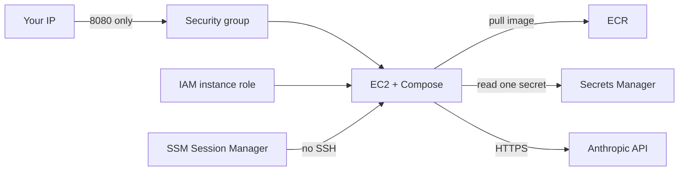

## Where we are

After AI-BUILD-9, TriageDesk is a complete, observable system on your laptop:

- LLM triage with structured output;
- RAG over past incidents in pgvector;
- a dashboard and an MCP server;
- evals and PII redaction;
- a bounded agent with human approval;
- Kafka ingestion through an outbox;
- Resilience4j around the model;
- and Prometheus, Grafana and Jaeger.

It runs from your IDE plus Compose, on Spring Boot 4.1 and Spring AI 2.0. From DIST-SYS-11 you know Terraform: state, `plan` and `apply`, providers and resources, and why infrastructure belongs in code.

## The problem

An interviewer says: "You mention LLMs, MCP and Terraform on your CV. Show me."

Today the honest answer is "it runs on my laptop, let me find the right terminal".

Worse, the first time you try a cloud deploy you will be tempted to:

- paste the API key into a Terraform variable "just for now";
- leave the instance running overnight;
- and discover both on next month's bill or in a public state file.

You want:

- one command that runs the whole stack;
- a cloud copy that lives for one evening with the secret never in state;
- a verified `destroy`;
- a story you can tell in two minutes.

## Goal

Ship it and tell it.

1. Package the app as a non-root container image and run the whole stack with one Compose command.
2. Write Terraform that deploys a **small, demo-sized** copy to AWS:
   - one EC2 instance running Compose;
   - the image in ECR;
   - the API key in Secrets Manager (with the value never in Terraform);
   - access limited to your IP, and no SSH.
3. Run your demo on it, then `terraform destroy` and **verify** nothing is left running. A **budget alert** lives in a separate stack that you keep.
4. Finally, write the README (with an architecture diagram), the STAR story, and a 5-minute demo script you rehearse out loud.

Check the AWS pricing page for every service you create, keep it small, and destroy it the same day.

## What you build

- [ ] `Dockerfile` (multi-stage, JRE base on glibc, non-root user) and an `app` service in `compose.yaml` behind a Compose profile
- [ ] `infra/budget/`: a Terraform stack with one `aws_budgets_budget` and email notifications. **Keep this one**
- [ ] `infra/app/`: ECR repo, Secrets Manager secret (container only), IAM role and instance profile (SSM, ECR read, read *one* secret), security group (port 8080 from your IP), EC2 instance (IMDSv2, encrypted disk) with `user_data` that starts Compose
- [ ] `infra/app/compose.aws.yaml`: app + Postgres (pgvector) + Kafka, with small heap settings
- [ ] `.gitignore` entries for `*.tfstate*`, `.terraform/`, `*.tfvars`; `.terraform.lock.hcl` committed
- [ ] `README.md` following the outline in step 7, with the architecture diagram
- [ ] A STAR story in the app's Story bank (Progress → Stories) and a 5-minute demo, rehearsed twice

## Acceptance criteria

1. In a fresh clone: `cp .env.example .env`, fill in the key, then `docker compose --profile app up -d --build` brings up app, Postgres, Kafka, Prometheus, Grafana and Jaeger. `curl localhost:8080/actuator/health` returns `UP`. `docker compose exec app id -u` prints `10001`, not `0`.
2. `terraform fmt -check -recursive` and `terraform validate` pass in both stacks. `terraform plan` in `infra/app` lists only the resources from step 3.
3. After deploying: `curl http://<public_ip>:8080/actuator/health` returns `UP` from your network and **times out** from another network (try your phone's hotspot). Port 22 is not open.
4. On the AWS instance, `POST /api/v1/incidents` leads to an `LLM` triage by Claude within seconds, and the dashboard renders at `http://<public_ip>:8080/`.
5. The secret value appears nowhere in Terraform: searching `terraform.tfstate` and the plan output for your key's prefix finds nothing.
6. `aws budgets describe-budgets --account-id <id>` lists `triagedesk-monthly`.
7. `terraform destroy` in `infra/app` completes, and then all three checks in step 6 come back empty or "not found". The budget stack is still there.
8. The README renders on GitHub, and a reviewer can run the project from it alone. The STAR story reads aloud in about 2 minutes. You gave the demo, timed, in 5:30 or less.

## Steps

### Session 1 · The image and the budget (~40 min)

**1. The image.**

```dockerfile
# syntax=docker/dockerfile:1
FROM maven:3.9-eclipse-temurin-21 AS build
WORKDIR /src
COPY pom.xml .
RUN mvn -q -B dependency:go-offline
COPY src ./src
RUN mvn -q -B -DskipTests package          # tests run in CI/locally with Docker; Testcontainers cannot run here

FROM eclipse-temurin:21-jre
RUN useradd --system --uid 10001 app && mkdir -p /var/cache/onnx && chown app /var/cache/onnx
WORKDIR /app
COPY --from=build /src/target/triagedesk-*.jar app.jar
USER app
ENV JAVA_TOOL_OPTIONS="-XX:MaxRAMPercentage=75"
EXPOSE 8080
ENTRYPOINT ["java", "-jar", "/app/app.jar"]
```

**Predict:** you switch the runtime stage to a small Alpine JRE image to save 100 MB. When does it break: at the first embedding, or earlier?

Earlier: **at startup**.

- The `TransformersEmbeddingModel` bean loads ONNX Runtime and the native tokenizer while it is being created (in a field initializer and in `afterPropertiesSet`).
- So the context fails with a `BeanCreationException` caused by `UnsatisfiedLinkError` before the app serves a single request.
- **Root cause:** those native libraries are built for glibc; Alpine uses musl.
- Spring AI 2.0.3 still pulls ONNX Runtime (1.21.1 on the verify project's classpath), so this did not change with the upgrade.

Re-check it yourself by starting the image and watching it reach `UP`, because a smoke test beats a remembered rule.

- **Non-root user, and a cache directory it owns.** Set `SPRING_AI_EMBEDDING_TRANSFORMER_CACHE_DIRECTORY=/var/cache/onnx` (it binds to `spring.ai.embedding.transformer.cache.directory`) and mount a volume there, so the model files are fetched once, not on every start.
- **`MaxRAMPercentage`** sizes the heap from the container's memory limit instead of the host's, but only if the container *has* a limit. Without one the JVM sees the whole machine. So give the `app` service `mem_limit: 1536m` (or a size you choose) in both Compose files.
- **The API key is not in the image.** Run `docker history` on it to check. It arrives at runtime through `env_file: .env`.
- `target/triagedesk-*.jar` matches the `triagedesk` artifactId from AI-BUILD-1.

In `compose.yaml`, add the `app` service with `profiles: ["app"]`, so `docker compose up` for development still starts only the infrastructure. Give it:

- `env_file: .env`;
- `SPRING_DATASOURCE_URL=jdbc:postgresql://postgres:5432/triagedesk`;
- `KAFKA_BOOTSTRAP=kafka:19092` (the internal listener);
- `MANAGEMENT_OPENTELEMETRY_TRACING_EXPORT_OTLP_ENDPOINT=http://jaeger:4318/v1/traces`;
- the cache volume and `mem_limit: 1536m`;
- `depends_on` with `condition: service_healthy` for Postgres.

When the app runs in Compose, point Prometheus at `app:8080` instead of `host.docker.internal:8080`.

```quiz
{"question": "Why does the build stage run with -DskipTests?", "level": "easy",
 "options": [
   {"text": "The *IT tests need Docker (Testcontainers), which is not available inside a docker build; tests run before the image is built, locally or in CI", "correct": true, "why": "The image build is packaging, not verification. Skipping tests there is only safe because they ran green elsewhere first."},
   {"text": "Tests are not needed once the code compiles", "why": "Compiling proves nothing about behaviour; the 68 unit tests and the ITs still have to pass, just not inside the image build."},
   {"text": "Spring Boot 4 forbids running tests during package", "why": "There is no such rule; mvn package runs tests by default."},
   {"text": "Tests would bake the API key into the image", "why": "No test needs the key; they use fake models. The reason is Docker-in-Docker, not secrets."}]}
```

**2. The budget stack, first and kept.** A budget is an **alert, not a brake**. AWS emails you when actual or forecast spend crosses a threshold, and billing data arrives with a delay of hours. That is why it lives in its own stack, which `terraform destroy` on the app never touches.

```hcl
# infra/budget/main.tf
terraform {
  required_version = ">= 1.6"
  required_providers {
    aws = {
      source  = "hashicorp/aws"
      version = "~> 6.0"
    }
  }
}

provider "aws" {
  region = var.region
}

variable "region" { type = string }
variable "alert_email" { type = string }
variable "monthly_limit_usd" {
  type        = string
  description = "Your own limit, e.g. a small amount you are comfortable losing in a mistake"
}

resource "aws_budgets_budget" "monthly" {
  name         = "triagedesk-monthly"
  budget_type  = "COST"
  limit_amount = var.monthly_limit_usd
  limit_unit   = "USD"
  time_unit    = "MONTHLY"

  notification {
    comparison_operator        = "GREATER_THAN"
    threshold                  = 50
    threshold_type             = "PERCENTAGE"
    notification_type          = "ACTUAL"
    subscriber_email_addresses = [var.alert_email]
  }

  notification {
    comparison_operator        = "GREATER_THAN"
    threshold                  = 100
    threshold_type             = "PERCENTAGE"
    notification_type          = "FORECASTED"
    subscriber_email_addresses = [var.alert_email]
  }
}
```

Put your values in `infra/budget/terraform.tfvars` (git-ignored: it holds your email), then run `terraform init && terraform apply`.

### Session 2 · The app stack, deploy, destroy (~60 min)

**3. The app stack.**



```hcl
# infra/app/versions.tf
terraform {
  required_version = ">= 1.6"
  required_providers {
    aws = {
      source  = "hashicorp/aws"
      version = "~> 6.0"
    }
  }
}

provider "aws" {
  region = var.region
  default_tags {
    tags = { Project = "triagedesk", ManagedBy = "terraform" }   # every resource is findable by tag
  }
}
```

```hcl
# infra/app/variables.tf
variable "region" { type = string }
variable "my_ip_cidr" {
  type        = string
  description = "Your public IP as a /32, e.g. from https://checkip.amazonaws.com"
}
variable "instance_type" {
  type        = string
  default     = "t3.medium"   # 4 GiB for app + Postgres + Kafka; check its price on the AWS pricing page
}
variable "image_tag" {
  type    = string
  default = "p10"
}
variable "compose_version" {
  type        = string
  description = "A Docker Compose release tag from github.com/docker/compose/releases, e.g. v2.x.y"
}
```

```hcl
# infra/app/main.tf
data "aws_vpc" "default" {
  default = true
}

data "aws_ami" "al2023" {
  most_recent = true
  owners      = ["amazon"]
  filter {
    name   = "name"
    values = ["al2023-ami-2023.*-x86_64"]
  }
}

resource "aws_ecr_repository" "app" {
  name         = "triagedesk"
  force_delete = true            # destroy succeeds even with images inside
  image_scanning_configuration {
    scan_on_push = true
  }
}

resource "aws_secretsmanager_secret" "anthropic" {
  name                    = "triagedesk/anthropic-api-key"
  recovery_window_in_days = 0    # delete immediately on destroy, so the name can be reused next time
}
# No aws_secretsmanager_secret_version: the VALUE is set outside Terraform, so it never enters state.

resource "aws_iam_role" "app" {
  name = "triagedesk-ec2"
  assume_role_policy = jsonencode({
    Version   = "2012-10-17"
    Statement = [{ Effect = "Allow", Principal = { Service = "ec2.amazonaws.com" }, Action = "sts:AssumeRole" }]
  })
}

resource "aws_iam_role_policy_attachment" "ssm" {
  role       = aws_iam_role.app.name
  policy_arn = "arn:aws:iam::aws:policy/AmazonSSMManagedInstanceCore"     # shell access without SSH
}

resource "aws_iam_role_policy_attachment" "ecr_read" {
  role       = aws_iam_role.app.name
  policy_arn = "arn:aws:iam::aws:policy/AmazonEC2ContainerRegistryReadOnly"
}

resource "aws_iam_role_policy" "read_one_secret" {
  role = aws_iam_role.app.id
  policy = jsonencode({
    Version   = "2012-10-17"
    Statement = [{
      Effect   = "Allow"
      Action   = ["secretsmanager:GetSecretValue"]
      Resource = aws_secretsmanager_secret.anthropic.arn
    }]
  })
}

resource "aws_iam_instance_profile" "app" {
  name = "triagedesk-ec2"
  role = aws_iam_role.app.name
}

resource "aws_security_group" "app" {
  name   = "triagedesk"
  vpc_id = data.aws_vpc.default.id

  ingress {
    description = "Dashboard, API and MCP - from my IP only"
    from_port   = 8080
    to_port     = 8080
    protocol    = "tcp"
    cidr_blocks = [var.my_ip_cidr]
  }

  egress {
    from_port   = 0
    to_port     = 0
    protocol    = "-1"
    cidr_blocks = ["0.0.0.0/0"]    # pull images, reach the Anthropic API, fetch the ONNX model
  }
}

resource "aws_instance" "app" {
  ami                         = data.aws_ami.al2023.id
  instance_type               = var.instance_type
  iam_instance_profile        = aws_iam_instance_profile.app.name
  vpc_security_group_ids      = [aws_security_group.app.id]
  associate_public_ip_address = true
  user_data_replace_on_change = true

  metadata_options {
    http_tokens = "required"       # IMDSv2 only
  }

  root_block_device {
    volume_size = 30
    volume_type = "gp3"
    encrypted   = true
  }

  user_data = templatefile("${path.module}/user_data.sh.tftpl", {
    region          = var.region
    registry        = split("/", aws_ecr_repository.app.repository_url)[0]
    image           = "${aws_ecr_repository.app.repository_url}:${var.image_tag}"
    secret_id       = aws_secretsmanager_secret.anthropic.name
    compose_version = var.compose_version
    compose_file    = file("${path.module}/compose.aws.yaml")
  })
}

output "public_ip" { value = aws_instance.app.public_ip }
output "instance_id" { value = aws_instance.app.id }
output "ecr_url" { value = aws_ecr_repository.app.repository_url }
```

**Predict:** why is there no `aws_secretsmanager_secret_version` resource holding the key, marked `sensitive = true`?

Because `sensitive` only hides a value from CLI output. Terraform still writes every attribute, including a secret version's `secret_string`, into the state file in plain JSON.

- **Simplest fix:** create only the secret *container* and set the value out of band (step 4). That keeps the key out of state.
- **Alternative:** Terraform 1.11+ with a recent AWS provider also offers write-only arguments, `secret_string_wo` plus `secret_string_wo_version`, which are never stored.
  The value must still arrive through an ephemeral variable, so you have not avoided handling it, only moved it.

```bash
#!/bin/bash
# infra/app/user_data.sh.tftpl  (runs once, as root, at first boot; never use set -x here: it would log the key)
set -euo pipefail
dnf install -y docker
systemctl enable --now docker
mkdir -p /usr/local/lib/docker/cli-plugins
curl -fsSL "https://github.com/docker/compose/releases/download/${compose_version}/docker-compose-linux-x86_64" \
  -o /usr/local/lib/docker/cli-plugins/docker-compose
chmod +x /usr/local/lib/docker/cli-plugins/docker-compose

mkdir -p /opt/triagedesk && cd /opt/triagedesk
aws ecr get-login-password --region ${region} | docker login --username AWS --password-stdin ${registry}
KEY=$(aws secretsmanager get-secret-value --region ${region} --secret-id ${secret_id} --query SecretString --output text)
umask 077
printf 'ANTHROPIC_API_KEY=%s\nDB_PASSWORD=%s\nAPP_IMAGE=%s\n' "$KEY" "$(openssl rand -hex 16)" "${image}" > .env
cat > compose.yaml <<'EOF'
${compose_file}
EOF
docker compose up -d
```

`templatefile` replaces `${...}` placeholders with the variables you pass.

- Bash's own `$KEY` and `$(...)` have no braces, so Terraform leaves them alone.
- The inserted `compose_file` text is not re-interpreted, so Compose's own `${DB_PASSWORD}` and `${APP_IMAGE}` survive for Compose to read from `.env`.

`compose.aws.yaml` holds three services:

- `postgres` (`pgvector/pgvector:pg16`, `POSTGRES_PASSWORD: ${DB_PASSWORD}`, a healthcheck, a named volume);
- `kafka` (as in AI-BUILD-8, plus `KAFKA_HEAP_OPTS: "-Xmx512m -Xms512m"`);
- `app` (`image: ${APP_IMAGE}`, `env_file: .env`, the internal URLs, port `8080:8080`, the ONNX cache volume, `mem_limit: 1536m`).

Leave Prometheus, Grafana and Jaeger out of the cloud copy, which keeps the instance small.

```quiz
{"question": "To save a file, you paste the compose YAML straight into user_data.sh.tftpl instead of passing it in as compose_file. It contains POSTGRES_PASSWORD: ${DB_PASSWORD}. What happens?", "level": "hard",
 "options": [
   {"text": "terraform plan fails: templatefile treats ${DB_PASSWORD} as a template variable and there is no such variable. Inline it as $${DB_PASSWORD} to leave a literal ${...} for Compose", "correct": true, "why": "templatefile interpolates every ${...} in the template itself. Text passed in as a variable is inserted as-is, which is exactly why the lesson passes compose_file instead of inlining it."},
   {"text": "It works: Compose reads DB_PASSWORD from .env at runtime", "why": "Compose never sees it. Terraform processes the template first and stops on the undefined variable."},
   {"text": "Terraform replaces it with an empty string, so Postgres starts with no password", "why": "templatefile does not default unknown variables to empty; it errors."},
   {"text": "Bash expands it at boot to the DB_PASSWORD environment variable", "why": "The quoted 'EOF' heredoc stops bash expansion, and Terraform fails before the script ever exists."}]}
```

```quiz
{"question": "terraform destroy on infra/app finishes with 'Destroy complete!'. Which statement is right?", "level": "medium",
 "options": [
   {"text": "You still run the instance, ECR and secret lookups and check billing the next day, because a partial failure or something created outside this state would not show in that line", "correct": true, "why": "Destroy only removes what is in this stack's state. Verification by query is cheap; a forgotten instance is not."},
   {"text": "Everything in the AWS account is gone, including the budget", "why": "The budget is a separate stack with its own state; app destroy never touches it, by design."},
   {"text": "The secret is kept for 30 days in a recovery window", "why": "recovery_window_in_days = 0 deletes it immediately, so the name can be reused."},
   {"text": "ECR destroy fails if images are inside, so the repository always survives", "why": "force_delete = true lets Terraform delete a repository that still holds images."}]}
```

**4. Deploy in two phases.** The instance pulls the image and reads the secret **at first boot**, so both must exist before it starts:

```bash
cd infra/app && terraform init
# phase 1: only the registry and the empty secret
terraform apply -target=aws_ecr_repository.app -target=aws_secretsmanager_secret.anthropic

# set the secret value WITHOUT putting it in Terraform or your shell history:
# either paste it in the Secrets Manager console, or write it to a file OUTSIDE the repo and run
aws secretsmanager put-secret-value --secret-id triagedesk/anthropic-api-key --secret-string file://$HOME/anthropic.key
rm "$HOME/anthropic.key"

# push the image (build for the instance's CPU architecture)
ECR_URL=$(terraform output -raw ecr_url)
aws ecr get-login-password --region <region> | docker login --username AWS --password-stdin "${ECR_URL%%/*}"
docker build --platform linux/amd64 -t "$ECR_URL:p10" ../..
docker push "$ECR_URL:p10"

# phase 2: everything else
terraform apply
```

`-target` is meant for exceptional cases like this bootstrap, not for daily use. Terraform prints a warning saying so, and you can quote it in an interview.

Debug the box without SSH:

1. `aws ssm start-session --target $(terraform output -raw instance_id)` (it needs the Session Manager plugin);
2. then `sudo cat /var/log/cloud-init-output.log` and `sudo docker compose -f /opt/triagedesk/compose.yaml logs app`.

The first boot takes a few minutes: package install, image pulls, Kafka start, Flyway migrations, the ONNX model fetch.

**5. Demo on the instance** (criteria 3 and 4), then:

**6. Destroy and verify.**

```bash
terraform destroy
aws ec2 describe-instances --region <region> \
  --filters Name=tag:Project,Values=triagedesk Name=instance-state-name,Values=pending,running,stopping,stopped \
  --query 'Reservations[].Instances[].InstanceId'                     # expect []
aws ecr describe-repositories --region <region> --repository-names triagedesk   # expect RepositoryNotFoundException
aws secretsmanager describe-secret --region <region> --secret-id triagedesk/anthropic-api-key   # expect ResourceNotFound
```

Check the Billing console the next day too. A `destroy` that failed half-way is the classic way a demo turns into a bill.

### Session 3 · README, story, demo (~45 min writing, rehearse after)

**7. README outline** (keep each section short; the README is a map, not a manual):

```text
# TriageDesk
One line: an incident-triage service where an LLM classifies incidents, retrieval surfaces how similar
incidents were fixed, AI clients use it over MCP, and every model call is bounded, redacted, measured and evaluated.
Personal project, synthetic data. Spring Boot 4.1, Spring AI 2.0, Java 21.

## Architecture            (the diagram below)
## Run it                  (cp .env.example .env; docker compose --profile app up -d --build; URLs)
## Use it                  (curl examples; dashboard; MCP Inspector and Claude Code setup)
## Key decisions           (each with the alternative rejected)
   - Spring AI + a TriageClassifier port, not one vendor SDK (swappable Claude/Ollama)
   - Structured output + validation in code; FALLBACK -> NEEDS_HUMAN as the safe default
   - Local ONNX embeddings (384-d) in pgvector, not a hosted embedding API or a separate vector DB
   - Redact on egress (prompts, embeddings, MCP), keep originals for authorised humans
   - Fixed pipeline by default; agent on demand, bounded, with human-approved actions
   - Outbox + idempotent consumers; Resilience4j owns retries (Anthropic SDK retries = 0, Spring AI retry = 1)
   - EC2 + Compose for the demo, not ECS/RDS/MSK (cost and lifetime), destroyed after
## Evals                   (golden set size, splits, YOUR measured numbers per model and prompt version)
## Observability           (screenshot of the Grafana board; the two alerts)
## Security notes          (secrets handling, redaction limits: regex does not catch names; no auth on MCP)
## Upgrade notes           (what moved from Boot 3.5 / Spring AI 1.1: property renames, tool loop, Jackson 3)
## What I would do next    (auth on UI and MCP, hybrid search, ECS + RDS + TLS, outbox trace propagation)
```

Architecture diagram (paste into the README as a `text` block, so it renders everywhere):

```text
                   REST /api/v1          Thymeleaf UI            MCP (Streamable HTTP /mcp)
 producers ──┐         │                     │                      │  ◄── Claude Code / Inspector
  (Kafka)    │         ▼                     ▼                      ▼
             │   ┌───────────────── TriageDesk (Spring Boot 4.1, Spring AI 2.0, Java 21) ─────────────────┐
             │   │ incident ──(same tx)──► outbox_event ──relay──► Kafka: triagedesk.incidents.reported   │
             └──►│ ingest (dedupe sourceKey)                              │                              │
                 │                                                        ▼                              │
                 │                                  TriageWorker (idempotent by status)                  │
                 │                                                        │                              │
                 │   GuardChain (redact PII/secrets) ─► TriagePipeline: prepare ─► classify ─► validate   │
                 │        │                                   │            │                             │
                 │        ▼                                   ▼            ▼                             │
                 │   SimilarIncidentFinder ◄── ONNX embeddings │   ResilientTriageClassifier             │
                 │        │ (384-d)                            │   (time limit, retry, breaker)          │
                 │        ▼                                    │            │                            │
                 │   pgvector: vector_store                    │            ▼                            │
                 │                                             │   ChatModel: Anthropic | Ollama         │
                 │   AutoTriageAgent ─► PendingAction ─► human approve ─► ActionHandler                  │
                 └───────────┬──────────────────────────────────────────────┬───────────────────────────┘
                             ▼                                              ▼
                PostgreSQL 16 + pgvector                     Micrometer ─► Prometheus/Grafana, OTLP ─► Jaeger
```

STAR story (fill the brackets from **your** build; never inflate it into production work):

- **Situation:** "LLM, MCP and Terraform experience kept appearing in the roles I want, and I had none that I could defend in depth. So I built TriageDesk, a personal project: an incident-triage service in Spring Boot 4.1, Spring AI 2.0 and Java 21, over [N] weeks."
- **Task:** "The goal was a production-shaped LLM feature: classify incidents reliably, reuse past fixes, let AI clients use it, and make every model call bounded, private, measurable and testable."
- **Action** (pick three, each with the alternative you rejected):
  1. "Structured output into a Java record behind a `TriageClassifier` port, validated in code, with every failure falling back to `NEEDS_HUMAN`, instead of parsing free text."
  2. "A golden set of [N] synthetic incidents, scored by code, with a baseline gate. It showed [model A] at [x]% category accuracy versus [model B] at [y]%, and retrieval moved it from [a]% to [b]%."
  3. "Redaction on egress through a guard chain, proved by a test that captures the exact prompt, instead of trusting the provider with whatever users paste."
  4. "Resilience4j owning retries, with the Anthropic SDK's and Spring AI's own retries turned off so the policies did not multiply, plus a breaker that counts only availability failures."
  5. "An MCP server with three bounded, idempotent tools, used from Claude Code."
- **Result:** "[p95 triage latency] on my laptop with [model]; [x]% accuracy on the held-out split; cost visible per day in Grafana; deployed to AWS with Terraform for the demo and destroyed after, with a budget alert as a safety net." Then one lesson, such as "[the thing that surprised you, e.g. the SDK under Spring AI retried twice on its own, so 3 attempts were really 9 calls]."

```quiz
{"question": "An interviewer asks: 'So you ran this in production at your company?' What is the right answer?", "level": "medium",
 "options": [
   {"text": "No: it is a personal project with synthetic data, deployed to AWS for a demo and destroyed the same day; here is what production would change", "correct": true, "why": "Honesty is the point, and the follow-up (ECS, RDS, TLS, auth, managed Kafka) shows you know the gap. Inflating it collapses at the first operational question."},
   {"text": "Say yes, because the code is production-shaped", "why": "Production-shaped is not production. Presenting a personal project as employer work is a credibility risk that one follow-up question exposes."},
   {"text": "Avoid the question and talk about the eval numbers", "why": "Dodging reads as hiding. State it plainly, then steer to the decisions."},
   {"text": "Say it is used internally by a few friends", "why": "Inventing users is the same problem in a smaller size."}]}
```

5-minute demo script:

| Time | Show | Say |
|---|---|---|
| 0:00–0:30 | README top | The problem in one line, and the rule: the model suggests, humans decide, every call is bounded. |
| 0:30–1:15 | The architecture diagram | Request path: ingest → outbox → worker → guards → retrieval → model → validation. Where it falls back. |
| 1:15–2:00 | Dashboard: report an incident, watch it get triaged | Structured output fields, the "AI suggestion" label, similar incidents with their fixes and scores. |
| 2:00–2:45 | Claude Code with the MCP server | Ask about a past problem; it calls `search_incidents`. Point out the bounded, idempotent tool design. |
| 2:45–3:30 | Eval output and the redaction test | Accuracy against the baseline, injection cases resisted, and the test proving the model never saw the email. |
| 3:30–4:15 | Grafana, then the breaker drill | Latency, tokens, cost. Point the base URL at a failing stub: breaker opens, incidents land in `NEEDS_HUMAN`. |
| 4:15–5:00 | Terraform files and the destroy check | What runs on AWS, how the secret stays out of state, the budget alert, and what production would change. |

- Rehearse twice, timed.
- Cut words, not steps.
- Record the second run and listen for places where you say *what* the code does but not *why*.

## Hints

- **The app container exits with an ONNX or `UnsatisfiedLinkError`.** You are on a musl (Alpine) image, or the cache directory is not writable by the non-root user.
- **No traces from the container.** Inside Compose, `localhost:4318` is the app container itself. Override the endpoint with `MANAGEMENT_OPENTELEMETRY_TRACING_EXPORT_OTLP_ENDPOINT`, the Boot 4 property name.
- **`terraform apply` fails with "secret ... scheduled for deletion".** A previous secret with the same name is in its recovery window. `recovery_window_in_days = 0` prevents this for new ones. For an old one, restore and delete it, or pick a new name.
- **The instance is up but port 8080 times out from your own network.** Your public IP changed. Update `my_ip_cidr` and `apply` again; the security group updates in place.
- **`exec format error` on the instance.** You built an ARM image. Rebuild with `--platform linux/amd64`, or switch to a Graviton instance type and an `arm64` AMI and Compose binary.
- **Never commit state or tfvars.** State is JSON with every resource attribute, including secrets held by other resources (for the instance it keeps a hash of `user_data`). Tfvars hold your email and IP. Commit `.terraform.lock.hcl`, so provider versions stay pinned.

## Stretch

- Move state to an S3 backend with locking, and explain what changes when two people share a stack.
- Add a GitHub Actions workflow: `mvn verify` (Testcontainers runs on GitHub's Linux runners), build the image, `terraform fmt -check` and `validate`, and `plan` on pull requests, but no automatic `apply` (DIST-SYS-6).
- Write `docs/production.md`: the same system on ECS Fargate behind an ALB with TLS and authentication, RDS for PostgreSQL with pgvector, a managed Kafka option, secrets injected by the task definition, and managed Prometheus and Grafana. State the trade-off for each choice. Do not quote prices; link the pricing pages.

## Talk about it in interviews

**"Walk me through how you deployed it."**

- *What:* Terraform for a demo-sized AWS deployment of a personal project: ECR, Secrets Manager, an IAM instance profile, a security group and one EC2 instance running Compose. A separate budget stack keeps the alert alive after the app is destroyed.
- *How it works inside:* `terraform plan` shows the diff against state, and `apply` makes it so. `user_data` installs Docker, logs in to ECR with the instance role, reads the one secret it may read, writes `.env` with mode 600, and starts Compose. Access is SSM Session Manager, with no SSH, IMDSv2 only, and 8080 open to one IP.
- *Where used:* for the live demo, created and destroyed the same day, with destruction verified by queries rather than assumed.
- *What goes wrong:* secrets in state (avoided by setting the value out of band), a half-finished destroy (hence the verification and the budget alert), state committed to git, public IP drift locking you out, and an image built for the wrong CPU architecture.

**"Why EC2 with Compose and not ECS, RDS and MSK?"** It is a demo that lives for hours. One instance is the smallest thing that runs the real stack, it is cheap to create and destroy, and it is easy to reason about. For production I would move each piece to a managed service: ECS for rolling deploys and health-based replacement, RDS for backups and failover (it supports the pgvector extension), managed Kafka, TLS and authentication at a load balancer, and secrets injected by the platform instead of written to a file.

**"What did you learn building it?"** Prepare two honest, specific answers from your own build. Examples of the shape: "stacked retry policies multiply calls", "a framework upgrade renamed config keys that silently switched tracing off, so I added a test that checks keys against the jars' metadata", "regex redaction cannot see names". Specific beats impressive.

## Done when

- [ ] `docker compose --profile app up -d --build` runs the full stack from a fresh clone, as user `10001`
- [ ] Both Terraform stacks pass `fmt -check` and `validate`; the key is absent from state and plan output
- [ ] You demoed on AWS, destroyed, and all three verification queries came back empty
- [ ] The budget stack still exists
- [ ] README, STAR story and a timed demo (≤ 5:30) are done

## Commit

```bash
git add -A
git commit -m "p10: container image, full-stack compose, Terraform AWS demo with budget stack, README, story"
git tag p10
```

## Next

You have finished AI-BUILD. Now:

- put the STAR story into rotation with your other stories;
- link the repo from your CV;
- when an interviewer asks about LLMs, MCP, evals, resilience or Terraform, answer from TriageDesk: what you built, why that way, and what you would change.
