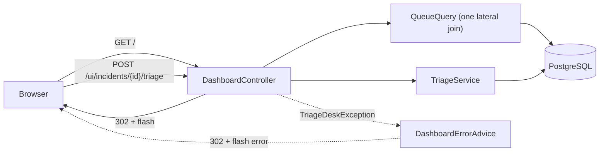

## Where we are

After AI-BUILD-3, TriageDesk:

- triages incidents with an LLM;
- enriches the prompt with similar past incidents from pgvector;
- exposes it all as JSON.

Nobody can *see* the queue without curl. From SPRING-BOOT-6 you know the Spring MVC request pipeline: `DispatcherServlet`, handler mapping, controllers, view resolution and exception resolvers.

This milestone runs on Spring Boot 4.1 (stack and versions: `docs/AI-PROJECT.md`).

## The problem

It is Monday morning and a friend who agreed to try TriageDesk asks, "So where do I look?" You open a terminal and start typing `curl ... | jq`.

Halfway through the second command she has lost interest.

Worse, when she finally sees a triage, she reads the model's `SEV3` as a fact and closes the incident.

A tool that people cannot see, or that hides which parts are guesses, is a tool nobody trusts. This session gives TriageDesk a face, and it makes the AI's suggestions look like suggestions.

## Goal

Build a small server-rendered dashboard with Thymeleaf. It has three pages:

- the **triage queue**: open incidents, most severe first, with the AI's category and suggested severity;
- the **incident page**: details, the latest triage clearly labelled as an AI suggestion, the triage history,
  similar past incidents with their fixes, plus "Triage now" and "Resolve" forms;
- **stats**: counts by status, category mix, outcomes, latency and tokens over the last 7 days.

The pages:

- read through dedicated SQL **read models** (one query per page section, no N+1);
- escape every piece of incident text;
- use Post/Redirect/Get for actions.

There is almost no JavaScript.

## What you build

- [ ] `spring-boot-starter-thymeleaf`; templates `queue.html`, `incident.html`, `stats.html`, a shared `fragments.html`; one `static/app.css`
- [ ] `dashboard.QueueQuery` and `dashboard.StatsQuery`: `JdbcClient` read models, one round trip per page section
- [ ] `dashboard.DashboardController`: `GET /`, `GET /ui/incidents/{id}`, `POST /ui/incidents/{id}/triage`, `POST /ui/incidents/{id}/resolve`, `GET /ui/stats`
- [ ] `ApiExceptionHandler` scoped to `@RestController`s, plus `dashboard.DashboardErrorAdvice`: UI errors become a flash message and a redirect, not a JSON problem detail
- [ ] `TriageService.history(id)` (newest first) for the incident page
- [ ] AI output labelled as such: model, prompt version, outcome, and "suggested" wording
- [ ] Tests: `@WebMvcTest` for views, model, escaping and flash messages; a Docker IT for the queue SQL

## Acceptance criteria

1. `http://localhost:8080/` lists open incidents ordered by suggested severity (or reported severity when there is no triage yet), then oldest first. `NEEDS_HUMAN` rows are visibly highlighted.
2. On an incident page, "Triage now" runs the pipeline and redirects back with a flash message such as "Triage finished: LLM". Refreshing the page does **not** re-run triage.
3. The incident page shows the latest triage under an "AI suggestion" heading with outcome, model and prompt version, up to 3 similar incidents with their fixes and scores, and the triage history.
4. Resolving from the page moves the incident out of the queue. Resolving an already-resolved incident shows a flash error, not a JSON body.
5. `/ui/stats` shows outcome counts with average latency and token totals for the last 7 days, the category distribution of each incident's latest successful triage, and counts by status.
6. These unit tests pass (`./mvnw test`, no Docker):
   - `DashboardControllerTest.queueRendersRows`, `DashboardControllerTest.escapesIncidentText` (a title of `<script>alert(1)</script>` appears only escaped)
   - `DashboardControllerTest.triagePostRedirectsWithFlash`, `DashboardControllerTest.invalidTransitionShowsFlashError`
7. You write one Docker integration test, `QueueQueryIT` (Testcontainers, `pgvector/pgvector:pg16`, the `TestcontainersConfig` from AI-BUILD-1), with two cases: `ordersBySuggestedSeverityThenAge` and `excludesResolved`. It runs with `./mvnw verify` when Docker Desktop is up.
8. With 200 incidents seeded, the SQL log for `GET /` shows **one** query for the queue, not one per row.

## Steps

### Session 1 · Read models (~40 min)

**1. Why a read model.** Loading `Incident` entities and then fetching each one's latest triage is the N+1 problem (DB-SQL-8): one query for the list, plus one per row.

A page that only *reads* deserves its own query, shaped exactly like the page. That is a small piece of **CQRS** (command-query responsibility segregation, REFERENCE-2):

- writes go through the domain;
- reads use purpose-built queries.

**Predict:** the queue needs "the latest triage per incident". With plain SQL and no window functions, how do you get it in the *same* query as the incident list?

A `LEFT JOIN LATERAL` subquery with `ORDER BY created_at DESC LIMIT 1`. Lateral means the subquery may refer to the current outer row (`i.id`), so it runs once per incident, and the `triage_incident_created` index from AI-BUILD-2 turns each run into an index probe.

**2. `QueueQuery`.**

```java
package com.triagedesk.dashboard;

import java.time.OffsetDateTime;
import java.util.List;
import java.util.UUID;
import org.springframework.jdbc.core.simple.JdbcClient;
import org.springframework.stereotype.Component;

@Component
class QueueQuery {

    record QueueRow(UUID id, String title, String service, String severity, String status, OffsetDateTime createdAt,
                    String category, String suggestedSeverity, String outcome) {
        public String effectiveSeverity() {   // public: Thymeleaf's SpEL will not call a package-private method
            return suggestedSeverity != null ? suggestedSeverity : severity;
        }
    }

    private final JdbcClient jdbc;

    QueueQuery(JdbcClient jdbc) { this.jdbc = jdbc; }

    List<QueueRow> open(int limit) {
        return jdbc.sql("""
                select i.id, i.title, i.service, i.severity, i.status, i.created_at,
                       t.category, t.suggested_severity, t.outcome
                from incident i
                left join lateral (
                    select category, suggested_severity, outcome
                    from triage
                    where triage.incident_id = i.id
                    order by created_at desc
                    limit 1
                ) t on true
                where i.status <> 'RESOLVED'
                order by coalesce(t.suggested_severity, i.severity), i.created_at   -- 'SEV1' < 'SEV2' as text
                limit :limit""")
            .param("limit", limit)
            .query(QueueRow.class)
            .list();
    }
}
```

- **`OffsetDateTime`, not `Instant`:** the PostgreSQL JDBC driver maps `timestamptz` to `OffsetDateTime`. `.query(QueueRow.class)` maps columns to record components by name, so `created_at` fills `createdAt`.
- **`'SEV1' < 'SEV2'` as text** works only because the names sort in severity order. The comment says so; order by a `case` expression if you ever rename them.
- **Why is `effectiveSeverity()` public** when the record itself is package-private? Hold that thought until Session 2.

**3. `StatsQuery`.** Same pattern, three small queries, with `since` computed from the injected `Clock` (not `now()` in SQL, so a test can freeze time):

```java
    Stats lastSevenDays() {
        Timestamp since = Timestamp.from(clock.instant().minus(Duration.ofDays(7)));   // not now() in SQL: tests freeze time
        List<OutcomeRow> outcomes = jdbc.sql("""
                select outcome, count(*) as n, avg(latency_ms) as avg_latency_ms,
                       sum(input_tokens) as input_tokens, sum(output_tokens) as output_tokens
                from triage where created_at >= :since group by outcome""")
            .param("since", since).query(OutcomeRow.class).list();
        List<CountRow> categories = jdbc.sql("""
                select category as name, count(*) as n
                from (select distinct on (incident_id) category
                      from triage where outcome <> 'FALLBACK'
                      order by incident_id, created_at desc) latest
                group by category order by n desc""")
            .query(CountRow.class).list();
        List<CountRow> statuses = jdbc.sql("select status as name, count(*) as n from incident group by status")
            .query(CountRow.class).list();
        return new Stats(outcomes, categories, statuses);
    }
```

The records are `OutcomeRow(String outcome, long n, Double avgLatencyMs, Long inputTokens, Long outputTokens)`, `CountRow(String name, long n)` and `Stats(List<OutcomeRow> outcomes, List<CountRow> categories, List<CountRow> statuses)`. `DISTINCT ON` is PostgreSQL's "first row per group" in the given order.

**4. `TriageService.history`.** Add the derived query `List<Triage> findByIncidentIdOrderByCreatedAtDesc(UUID incidentId)` to `TriageRepository`, and expose it:

```java
    public List<Triage> history(UUID incidentId) {                             // AI-BUILD-4
        return triages.findByIncidentIdOrderByCreatedAtDesc(incidentId);
    }
```

```quiz
{"question": "Why does the queue get its own SQL read model instead of loading Incident entities and calling triageService.latest(id) for each row?", "level": "easy",
 "options": [
   {"text": "Because 100 rows would cost 101 queries (N+1); one query shaped like the page costs one", "correct": true, "why": "The list query plus one latest-triage query per row is the N+1 problem. The lateral join fetches both in one round trip."},
   {"text": "Because JPA entities cannot be rendered by Thymeleaf", "why": "Thymeleaf renders any object with accessible getters; the incident page does render the Incident entity."},
   {"text": "Because JdbcClient is faster than JPA for every query", "why": "Not in general. The win here is the number of round trips, not the API."},
   {"text": "Because the read model lets the dashboard write triages without the domain rules", "why": "The opposite: in CQRS the read side never writes. Writes still go through IncidentService and the triage pipeline."}]}
```

### Session 2 · Controller, PRG and templates (~45 min)

**5. The controller.**

```java
@Controller
class DashboardController {
    private final QueueQuery queue;
    private final StatsQuery stats;
    private final IncidentService incidents;
    private final TriageService triage;
    private final SimilarIncidentFinder similar;

    // constructor assigns all five fields

    @GetMapping("/")
    String queue(Model model) {
        model.addAttribute("rows", queue.open(100));
        return "queue";
    }

    @GetMapping("/ui/incidents/{id}")
    String incident(@PathVariable UUID id, Model model) {
        var incident = incidents.get(id);
        model.addAttribute("incident", incident);
        model.addAttribute("history", triage.history(id));            // newest first
        model.addAttribute("similar", similar.find(id, incident.getService(), incident.getTitle(),
                incident.getDescription(), 3));
        return "incident";
    }

    @PostMapping("/ui/incidents/{id}/triage")
    String triageNow(@PathVariable UUID id, RedirectAttributes redirect) {
        Triage result = triage.triage(id);
        redirect.addFlashAttribute("message", "Triage finished: " + result.getOutcome());
        return "redirect:/ui/incidents/" + id;
    }

    @PostMapping("/ui/incidents/{id}/resolve")
    String resolve(@PathVariable UUID id, @RequestParam String resolutionNotes, RedirectAttributes redirect) {
        incidents.resolve(id, resolutionNotes);
        redirect.addFlashAttribute("message", "Resolved and added to similar-incident search");
        return "redirect:/";
    }

    @GetMapping("/ui/stats")
    String stats(Model model) {
        model.addAttribute("stats", stats.lastSevenDays());
        return "stats";
    }
}
```

**Predict:** a user clicks "Triage now", the page comes back, and they press F5. Without the `redirect:`, what does the browser re-send, and what does it cost you?

It re-sends the **POST**, so the pipeline runs again and you pay for a second LLM call (the browser may show a "resubmit form?" warning, which people click through).

- **Post/Redirect/Get (PRG)** answers every POST with a redirect, so the page the user sees came from a GET, and F5 repeats only the harmless GET.
- A **flash attribute** survives exactly one redirect: Spring keeps it in the session until the next request reads it. That is how "Triage finished: LLM" reaches the page.

```quiz
{"question": "After a successful POST /ui/incidents/{id}/triage, which response gives you both refresh-safety and the success message on the next page?", "level": "medium",
 "options": [
   {"text": "A redirect to the incident page, with the message added as a flash attribute", "correct": true, "why": "PRG makes F5 repeat a GET, and the flash attribute survives exactly that one redirect."},
   {"text": "Return the view name \"incident\" with the message in the Model", "why": "The message shows, but the page is the POST's response, so F5 re-runs a paid triage."},
   {"text": "A redirect with the message put in the Model", "why": "Model attributes do not survive a redirect (they may end up as query parameters at best); flash attributes exist for this."},
   {"text": "Return 204 No Content and let the browser stay on the form", "why": "Browsers do nothing visible on a 204 form post, so the user sees no result at all."}]}
```

**6. Errors on pages.** `ApiExceptionHandler` from AI-BUILD-1 is a `@RestControllerAdvice`, and an unscoped advice applies to **every** controller.

A failed resolve from a form would show the browser a JSON problem detail. Scope it to REST controllers:

```java
@RestControllerAdvice(annotations = RestController.class)   // scoped in AI-BUILD-4 so pages get their own advice
class ApiExceptionHandler extends ResponseEntityExceptionHandler {
```

And give the dashboard its own advice, which turns any `TriageDeskException` into a flash error and a redirect:

```java
package com.triagedesk.dashboard;

import com.triagedesk.common.TriageDeskException;
import jakarta.servlet.http.HttpServletRequest;
import org.springframework.web.bind.annotation.ControllerAdvice;
import org.springframework.web.bind.annotation.ExceptionHandler;
import org.springframework.web.servlet.support.RequestContextUtils;

@ControllerAdvice(assignableTypes = DashboardController.class)
class DashboardErrorAdvice {

    @ExceptionHandler(TriageDeskException.class)
    String onDomainError(TriageDeskException e, HttpServletRequest request) {
        RequestContextUtils.getOutputFlashMap(request).put("error", e.code() + ": " + e.getMessage());
        if ("GET".equals(request.getMethod())) {
            return "redirect:/";      // e.g. unknown incident id; redirecting to the same URL would loop
        }
        return "redirect:" + request.getRequestURI().replaceFirst("/(triage|resolve)$", "");
    }
}
```

`RequestContextUtils.getOutputFlashMap(request)` is the flash map Spring will carry across the redirect, the same thing `RedirectAttributes.addFlashAttribute` writes to. `invalidTransitionShowsFlashError` proves it reaches the next request.

**7. Templates: escape everything.**

```html
<!-- templates/queue.html -->
<!DOCTYPE html>
<html xmlns:th="http://www.thymeleaf.org">
<head>
  <meta charset="utf-8">
  <title>TriageDesk · Queue</title>
  <link rel="stylesheet" th:href="@{/app.css}">
</head>
<body>
<nav th:replace="~{fragments :: nav}"></nav>
<p class="flash" th:if="${message}" th:text="${message}"></p>
<p class="flash error" th:if="${error}" th:text="${error}"></p>
<table>
  <thead><tr><th>Sev</th><th>Title</th><th>Service</th><th>Status</th><th>AI category</th><th>Reported</th></tr></thead>
  <tbody>
  <tr th:each="r : ${rows}" th:classappend="${r.status() == 'NEEDS_HUMAN'} ? 'needs-human'">
    <td th:text="${r.effectiveSeverity()}">SEV2</td>
    <td><a th:href="@{/ui/incidents/{id}(id=${r.id()})}" th:text="${r.title()}">title</a></td>
    <td th:text="${r.service()}">service</td>
    <td th:text="${r.status()}">NEW</td>
    <td th:text="${r.category() ?: '—'}">DATABASE</td>
    <td th:text="${#temporals.format(r.createdAt(), 'yyyy-MM-dd HH:mm')}">time</td>
  </tr>
  </tbody>
</table>
</body>
</html>
```

- **`th:text` escapes HTML. `th:utext` does not. Never use `th:utext` on anything from an incident or a model.**
  - Incident text is user input, and LLM output is model output steered by user input.
  - Either can contain `<script>`.
  - Rendering it raw is stored XSS, a cross-site scripting attack that persists in your database.
- **Escaping protects markup, not meaning.**
  - `th:href="${...}"` escapes quotes and angle brackets, but a value of `javascript:alert(1)` contains none, so it
    is written out as is and runs when clicked.
  - Only link to URLs you build yourself (`@{/ui/incidents/{id}(id=...)}`), or check that a stored URL starts with
    `https://` before you render it.
- Record accessors are called as methods (`r.title()`), which works in Spring EL whether or not your version also maps `r.title` to the component.

**Predict:** in the first version of this project, `effectiveSeverity()` had no modifier (package-private, like the record). The record's own accessors (`r.title()`) worked.

What happened when the queue rendered?

The page failed with `TemplateProcessingException: Exception evaluating SpringEL expression: "r.effectiveSeverity()"`. This is exactly how the verify build of this milestone failed.

- Spring EL invokes methods reflectively from *outside* your package, so it only calls **public** methods.
- Record accessors are implicitly public, which is why `r.title()` worked.
- A helper method you add to a record is not, unless you say so.

The fix is one word: `public`.

The incident page (`templates/incident.html`) shows the latest triage under **"AI suggestion"**, with suggested wording and its provenance:

```html
<section class="ai" th:with="latest=${history.isEmpty() ? null : history[0]}">
  <h2>AI suggestion</h2>
  <p th:if="${latest == null}">Not triaged yet.</p>
  <div th:if="${latest != null and latest.outcome.name() != 'FALLBACK'}">
    <p>Category <b th:text="${latest.category}">DATABASE</b> · suggested severity
      <b th:text="${latest.suggestedSeverity}">SEV2</b></p>
    <p th:text="${latest.summary}">summary</p>
    <p class="meta" th:text="|${latest.outcome} · ${latest.model} · ${latest.promptVersion}|">LLM · model · v1</p>
  </div>
  <p th:if="${latest != null and latest.outcome.name() == 'FALLBACK'}"
     th:text="|Needs a human: ${latest.failureCode}|">Needs a human</p>
</section>

<form method="post" th:action="@{/ui/incidents/{id}/triage(id=${incident.id})}"
      onsubmit="this.querySelector('button').disabled = true">
  <button type="submit">Triage now</button>
</form>
```

- `Triage` is a JPA entity with public getters, so `latest.category` works as a property.
- The inline `onsubmit` disables the button so an impatient double click does not pay for two LLM calls. That is the only JavaScript.
- The rest of the page (resolve form, similar incidents, history) and `stats.html` follow the same `th:each` / `th:text` pattern; copy their shape from the queue.



```quiz
{"question": "A stretch idea adds a 'runbook link' the model suggests. An injected incident makes the model return javascript:alert(document.cookie). Is this template safe?", "level": "hard",
 "code": ["<a th:href=\"${latest.runbookUrl}\" th:text=\"${latest.runbookUrl}\">runbook</a>"],
 "options": [
   {"text": "No: th:href escapes markup characters, but the javascript: URL has none, so it is rendered as a live link that runs when clicked", "correct": true, "why": "Escaping stops new tags and broken-out attributes, not a dangerous URL scheme. Build links yourself or allow only https:// URLs."},
   {"text": "Yes: both attributes use th: processing, so Thymeleaf escapes the value", "why": "It is escaped, but escaping does not change javascript:alert(...) at all; the browser still treats it as script."},
   {"text": "Yes, if the text is shown with th:text instead of th:utext", "why": "th:text makes the visible label safe; the href attribute is a separate sink with its own rule."},
   {"text": "No, and the fix is th:utext, which lets you sanitise the URL in the template", "why": "th:utext removes escaping entirely and makes things worse; th:utext does no sanitising."}]}
```

### Session 3 · Tests (~30 min)

**8. View tests with `@WebMvcTest`.** In Boot 4 the annotation lives in `org.springframework.boot.webmvc.test.autoconfigure.WebMvcTest` (dependency `spring-boot-starter-webmvc-test`). It renders the real Thymeleaf templates through MockMvc, so you can assert on HTML:

```java
@WebMvcTest(DashboardController.class)
class DashboardControllerTest {
    @Autowired MockMvc mvc;
    @MockitoBean QueueQuery queue;
    @MockitoBean StatsQuery stats;
    @MockitoBean IncidentService incidents;
    @MockitoBean TriageService triage;
    @MockitoBean SimilarIncidentFinder similar;

    @Test
    void escapesIncidentText() throws Exception {
        when(queue.open(anyInt())).thenReturn(List.of(row("<script>alert(1)</script>")));

        mvc.perform(get("/"))
                .andExpect(status().isOk())
                .andExpect(content().string(containsString("&lt;script&gt;alert(1)&lt;/script&gt;")))
                .andExpect(content().string(not(containsString("<script>alert(1)"))));
    }

    @Test
    void invalidTransitionShowsFlashError() throws Exception {
        UUID id = UUID.randomUUID();
        when(incidents.resolve(id, "fixed"))
                .thenThrow(new InvalidStatusTransitionException(IncidentStatus.RESOLVED, IncidentStatus.RESOLVED));

        mvc.perform(post("/ui/incidents/{id}/resolve", id).param("resolutionNotes", "fixed"))
                .andExpect(status().is3xxRedirection())
                .andExpect(redirectedUrl("/ui/incidents/" + id))
                .andExpect(flash().attribute("error", containsString("INVALID_STATUS_TRANSITION")));
    }

    private static QueueQuery.QueueRow row(String title) {
        return new QueueQuery.QueueRow(UUID.randomUUID(), title, "checkout", "SEV2", "NEW",
                OffsetDateTime.parse("2026-11-01T10:00:00Z"), null, null, null);
    }
}
```

`queueRendersRows` and `triagePostRedirectsWithFlash` follow the same shape:

1. mock the read model or `triage.triage(id)` (a `mock(Triage.class)` whose `getOutcome()` returns `Outcome.LLM`);
2. then assert the view name, the redirect and `flash().attribute("message", "Triage finished: LLM")`.

**Break it:**

- change `th:text` to `th:utext` in `queue.html` and watch `escapesIncidentText` fail;
- then remove `public` from `effectiveSeverity()` and watch two tests fail with the SpEL error.

**9. `QueueQueryIT` (Docker).** This one is yours to write; it is not in the reference build because it needs Docker.

1. Use `@SpringBootTest`, `@ActiveProfiles("test")` and `@Import(TestcontainersConfig.class)`.
2. Insert incidents through `IncidentService.report`.
3. Triage two of them through `TriageService` with a fake `TriageClassifier` (`@Primary` bean, as in AI-BUILD-2's `TriageApiIT`).
4. Resolve one.
5. Then assert the order of `QueueQuery.open(10)` and that the resolved incident is absent.

For criterion 8, set `logging.level.org.springframework.jdbc.core.JdbcTemplate=DEBUG` in the test profile and count the statements.

```quiz
{"question": "DashboardControllerTest uses @WebMvcTest(DashboardController.class). Why must QueueQuery, StatsQuery and the three services be @MockitoBean?", "level": "medium",
 "options": [
   {"text": "The slice only creates web-layer beans (controllers, advice, view resolution); the controller's dependencies do not exist unless you supply them", "correct": true, "why": "A slice test leaves out @Component and @Service beans, so the constructor would fail without mocks."},
   {"text": "Because Mockito is faster than Spring at creating beans", "why": "Speed is a side effect of the slice; the reason is that those beans are not in the slice at all."},
   {"text": "Because @WebMvcTest starts Testcontainers and the mocks stop it from connecting", "why": "A web slice starts no database and no containers."},
   {"text": "To make the templates render; Thymeleaf is not part of the slice", "why": "Thymeleaf view resolution is part of the MVC slice, which is why the HTML assertions work."}]}
```

## Hints

- **`TemplateInputException: Error resolving template [queue]`.** The file must be at `src/main/resources/templates/queue.html`, and the controller must return `"queue"`, not `"/queue.html"`.
- **`Exception evaluating SpringEL expression: "r.effectiveSeverity()"`.** The method is not public. Record accessors are public automatically; your own helper methods are not.
- **The browser shows JSON after a failed form post.** The REST advice is still global. Scope it with `annotations = RestController.class`.
- **Flash messages never appear.** You returned a view name instead of `"redirect:..."`. Flash attributes need the redirect.
- **The triage button hangs for many seconds.** That is the synchronous LLM call. Virtual threads keep the server healthy, and AI-BUILD-8 makes triage asynchronous through Kafka.

## Stretch

- **Human feedback that becomes eval data.**
  - Add "Accept" and "Correct" buttons next to the AI suggestion.
  - A correction stores the human's category and severity in a `triage_feedback` table.
  - AI-BUILD-6 can export these rows as new golden-set cases. Real disagreements are the best eval cases you will
    ever get.
- Add a `<meta http-equiv="refresh" content="30">` to the queue, or htmx polling for the table only, and explain the cost of each.
- Protect the UI with Spring Security form login (SPRING-BOOT-9).
  - The dashboard is unauthenticated until you do.
  - In AI-BUILD-10 the security group restricts it to your IP.

## Talk about it in interviews

**"Why server-rendered Thymeleaf and not React?"**
- *What:* HTML rendered on the server per request, with forms and redirects.
- *How it works inside:* the controller fills a `Model`, the view resolver finds the template, and Thymeleaf renders it with automatic HTML escaping. PRG and flash attributes handle actions.
- *Where used:* the queue, the incident page and stats in TriageDesk. It is an internal tool where the value is the data, not rich interaction.
- *What goes wrong:*
  - `th:utext` on user or model text (stored XSS);
  - JSON errors leaking into pages from a global REST advice;
  - helper methods SpEL cannot call because they are not public;
  - long synchronous actions (fixed with async processing).
- *When to choose an SPA:* for a product with heavy interaction, an SPA earns its extra build and API surface. Here it would not.

**"How do you present AI output to users?"**

- Label it as a suggestion.
- Show which model and prompt version produced it.
- Show the fallback state honestly ("Needs a human: LLM_TIMEOUT").
- Keep the human's decision separate from the model's guess.
- Capture corrections. Corrections are the cheapest source of real eval cases.

**"How did you avoid N+1 on the queue?"** A read model: one SQL query with a `LATERAL` join for the latest triage per incident, backed by an `(incident_id, created_at desc)` index.

The domain entities stay for writes. It is CQRS in miniature, without a second database.

## Done when

- [ ] The queue, incident page and stats render with live data, and NEEDS_HUMAN rows stand out
- [ ] F5 after "Triage now" does not create a second triage row
- [ ] A failed resolve shows a flash error, never JSON
- [ ] The four `DashboardControllerTest` tests pass, and `QueueQueryIT` passes with Docker up
- [ ] The SQL log shows one queue query for 200 incidents

## Commit

```bash
git add -A
git commit -m "p4: Thymeleaf dashboard - triage queue, incident page with similar incidents, stats; read models, PRG, escaping"
git tag p4
```

## Next

AI-BUILD-5 opens TriageDesk to AI clients: an MCP server that exposes `search_incidents`, `get_incident` and `triage_incident` as tools, used from the MCP Inspector and Claude Code.
