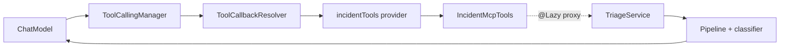
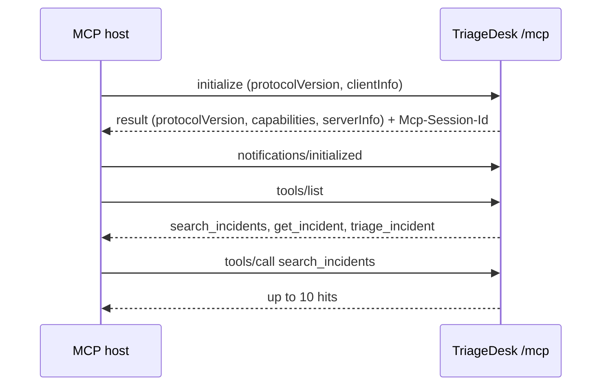

## Where we are

After AI-BUILD-4, TriageDesk has, on top of LLM triage with RAG:

- a dashboard over the triage queue;
- incident pages with similar past incidents;
- stats.

Its capabilities are reachable only by people (the UI) and by code that knows its REST API.

From AI-ENG-4 you know MCP:

- hosts, clients and servers;
- JSON-RPC over stdio or Streamable HTTP;
- the three server primitives (tools, resources, prompts).

This milestone uses Spring AI 2.0's MCP server starter (versions: `docs/AI-PROJECT.md`).

## The problem

You are in Claude Code, fixing a flaky deploy script. You remember TriageDesk has seen this exact "TLS handshake failure" before.

To find out how it was fixed, you:

1. leave the editor;
2. open the dashboard;
3. search by eye;
4. copy the fix, and paste it back into the chat.

The AI next to you could have asked TriageDesk itself, if only TriageDesk spoke a protocol it understands.

Writing a custom plugin per AI client would cost you a week each.

MCP is the one protocol every host speaks, and Spring AI turns three annotated methods into an MCP server.

## Goal

Turn TriageDesk into an **MCP server** so that any MCP host (the MCP Inspector, Claude Code, Claude Desktop) can discover and call three tools:

- `search_incidents` (semantic search over resolved incidents);
- `get_incident` (details plus the latest triage);
- `triage_incident` (run the pipeline).

How:

- You use Spring AI's MCP server starter over **Streamable HTTP** at `/mcp`, inside the same Spring Boot app.
- You look at the raw JSON-RPC handshake once with curl, so the protocol is no longer magic.
- You design the tools the way the model needs them: few, coarse, well described, bounded in size, and safe to call twice.

## What you build

- [ ] `spring-ai-starter-mcp-server-webmvc`, with a server name, version and instructions
- [ ] `mcp.IncidentMcpTools`: a **Facade** over the incident, similarity and triage services, with three `@Tool` methods
- [ ] `mcp.McpToolsConfig`: a `ToolCallbackProvider` bean built with `MethodToolCallbackProvider`
- [ ] `SimilarIncidentFinder.search(String text, int k)` for free-text queries, and `TriageService.latest(UUID)`
- [ ] Output limits: at most 10 results, long text truncated, no internal fields
- [ ] `triage_incident` is idempotent: it returns the recent triage unless `force` is true
- [ ] Tests: unit tests for the tool class, a registration test, and a smoke test that speaks JSON-RPC to `/mcp`

## Acceptance criteria

1. The app starts. `curl` with the `initialize` request from step 6 returns a JSON-RPC result whose `serverInfo.name` is `triagedesk`, and an `Mcp-Session-Id` response header.
2. In the **MCP Inspector**, connecting to `http://localhost:8080/mcp` with the Streamable HTTP transport and listing tools shows exactly `search_incidents`, `get_incident` and `triage_incident`, with their descriptions and input schemas.
3. Running `search_incidents` in the Inspector with `{"query": "TLS handshake errors on the API"}` returns your seeded certificate incident with its fix. `get_incident` with a non-UUID returns a tool error that says what is wrong.
4. In **Claude Code**, after `claude mcp add --transport http triagedesk http://localhost:8080/mcp`, `/mcp` shows `triagedesk` as connected. The prompt "Find past incidents like 'disk full on the billing hosts' and tell me how they were fixed" makes Claude call `search_incidents` and answer from its results.
5. Calling `triage_incident` twice within 10 minutes calls the LLM once. The second call returns the stored triage, and the dashboard shows one new triage row, not two.
6. These tests pass with `./mvnw test` (no Docker, no API key):
   - `IncidentMcpToolsTest.searchCapsLimitAtTen`, `getIncidentRejectsNonUuid`, `triageReturnsRecentTriageWithoutCallingPipeline`, `descriptionIsTruncated`
   - `McpToolsRegistrationTest.exposesExactlyThreeTools`
   - `McpServerSmokeTest.initializeThenListTools` (real HTTP on a random port: initialize, session id, tools/list)
   - The full application context still starts (in the reference build, `ApplicationWiringTest`; see the Hint on startup cycles)

## Steps

### Session 1 · The tools (~45 min)

**1. The starter and configuration.**

```xml
<dependency><groupId>org.springframework.ai</groupId><artifactId>spring-ai-starter-mcp-server-webmvc</artifactId></dependency>
```

```yaml
spring:
  ai:
    mcp:
      server:
        name: triagedesk
        version: 0.5.0
        type: sync
        protocol: streamable          # the 2.0 default, written out for readers
        instructions: >
          TriageDesk holds IT incidents. Use search_incidents to find similar resolved incidents and their fixes,
          get_incident for one incident, and triage_incident only when asked to (it calls an LLM and costs money).
        streamable-http:
          mcp-endpoint: /mcp
```

In Spring AI 2.0, `protocol` **defaults to `streamable`**, `mcp-endpoint` to `/mcp` and `type` to `sync` (checked in the 2.0.3 configuration metadata).

- In 1.1 you had to set `protocol` yourself or you got the older SSE transport, which is why old blog posts insist on it.
- The lines stay here as documentation.

The WebMVC starter adds the MCP endpoint to the web server you already run: one process serves the dashboard, the REST API and MCP.

- **Separate deployables** would buy independent scaling and a smaller attack surface.
- **Here** they would only cost a second app.

**2. The Facade.** A model reads tool names, descriptions and parameter descriptions to decide what to call (AI-ENG-2).

- Write them for a reader with no context.
- Say what the tool does **not** do.
- Keep results small, because every byte you return becomes input tokens on the host's side.

```java
package com.triagedesk.mcp;

@Component
public class IncidentMcpTools {
    static final int MAX_RESULTS = 10;
    static final int MAX_TEXT = 2_000;
    static final Duration FRESH_TRIAGE = Duration.ofMinutes(10);

    public record IncidentHit(String id, String title, String service, String fix, double score) { }

    public record TriageInfo(String outcome, String category, String suggestedSeverity, String probableCause,
                             String summary, String model, String createdAt) { }

    public record IncidentInfo(String id, String title, String service, String severity, String status,
                               String createdAt, String description, String resolutionNotes, TriageInfo latestTriage) { }

    private final IncidentService incidents;
    private final SimilarIncidentFinder finder;
    private final TriageService triage;
    private final Clock clock;                      // (AI-BUILD-6 adds a GuardChain field and constructor parameter)

    // @Lazy breaks a startup cycle: the ChatModel's ToolCallingManager collects every ToolCallbackProvider bean,
    // and TriageService itself needs the ChatModel. The proxy resolves TriageService on first use instead.
    IncidentMcpTools(IncidentService incidents, SimilarIncidentFinder finder, @Lazy TriageService triage, Clock clock) {
        this.incidents = incidents;
        this.finder = finder;
        this.triage = triage;
        this.clock = clock;
    }

    @Tool(name = "search_incidents", description = """
            Semantic search over RESOLVED incidents. Use it to find past incidents similar to a problem \
            and how they were fixed. Does not search open incidents. Returns at most 10 hits, best first.""")
    public List<IncidentHit> searchIncidents(
            @ToolParam(description = "The problem in plain words, e.g. 'TLS handshake errors on api-gateway'")
            String query,
            @ToolParam(description = "Maximum hits, 1 to 10. Defaults to 5.", required = false)
            Integer limit) {
        if (query == null || query.isBlank()) throw new IllegalArgumentException("query must not be blank");
        int k = Math.clamp(limit == null ? 5 : limit, 1, MAX_RESULTS);
        return finder.search(query, k).stream()
                .map(s -> new IncidentHit(s.incidentId().toString(), s.title(), s.service(),
                        truncate(s.resolution()), s.score()))
                .toList();
    }

    @Tool(name = "get_incident", description = """
            Get one incident by its id (a UUID): title, service, reported severity, status, description, \
            resolution notes if resolved, and the latest AI triage if any.""")
    public IncidentInfo getIncident(@ToolParam(description = "The incident id, a UUID") String incidentId) {
        Incident i = incidents.get(parseId(incidentId));
        TriageInfo latest = triage.latest(i.getId()).map(IncidentMcpTools::info).orElse(null);
        return new IncidentInfo(i.getId().toString(), i.getTitle(), i.getService(), i.getSeverity().name(),
                i.getStatus().name(), i.getCreatedAt().toString(), truncate(i.getDescription()),
                i.getResolutionNotes() == null ? null : truncate(i.getResolutionNotes()), latest);
    }

    @Tool(name = "triage_incident", description = """
            Run AI triage on an open incident: category, suggested severity, probable cause, summary. \
            Calls an LLM, so it is slow and costs money. If the incident was triaged in the last 10 minutes, \
            returns that result instead unless force is true. Fails for resolved incidents.""")
    public TriageInfo triageIncident(
            @ToolParam(description = "The incident id, a UUID") String incidentId,
            @ToolParam(description = "true to re-run even if a recent triage exists", required = false) Boolean force) {
        UUID id = parseId(incidentId);
        if (!Boolean.TRUE.equals(force)) {
            var recent = triage.latest(id)
                    .filter(t -> t.getCreatedAt().isAfter(clock.instant().minus(FRESH_TRIAGE)));
            if (recent.isPresent()) return info(recent.get());
        }
        return info(triage.triage(id));
    }

    private static UUID parseId(String raw) {
        try {
            return UUID.fromString(raw.strip());
        } catch (RuntimeException e) {
            throw new IllegalArgumentException("incidentId must be a UUID like 3f2b8c1e-...; got: " + raw);
        }
    }

    private static TriageInfo info(Triage t) {
        return new TriageInfo(t.getOutcome().name(), name(t.getCategory()), name(t.getSuggestedSeverity()),
                t.getProbableCause(), t.getSummary(), t.getModel(), t.getCreatedAt().toString());
    }

    private static String name(Enum<?> e) { return e == null ? null : e.name(); }

    static String truncate(String s) { return s.length() <= MAX_TEXT ? s : s.substring(0, MAX_TEXT) + " [truncated]"; }
}
```

Imports: `org.springframework.ai.tool.annotation.Tool`, `...ToolParam`, `org.springframework.context.annotation.Lazy`, plus your own packages.

Design notes:

- **A Facade** (REFERENCE-2): three coarse operations over three services. The model never has to chain five fine-grained calls to answer "what is this incident and has it happened before?"
- **Ids are strings in the schema**, parsed and validated in code.
  - A bad value becomes a clear error message the model can correct, instead of a framework stack trace.
  - A tool's `RuntimeException` message goes back to the caller as the tool result (AI-BUILD-7 has a test that proves this for the agent).
- **Results are bounded** (10 hits, 2,000 characters per text field), because the host pays in context window for everything you return.
- Add the two service methods the tools need:

```java
    public List<SimilarIncident> search(String text, int k) {                  // AI-BUILD-5: free-text queries
        SearchRequest request = SearchRequest.builder().query(text).topK(k).similarityThreshold(minScore).build();
        return vectorStore.similaritySearch(request).stream().map(SimilarIncidentFinder::toSimilar).toList();
    }
```

```java
    public Optional<Triage> latest(UUID incidentId) {                          // AI-BUILD-5
        return triages.findFirstByIncidentIdOrderByCreatedAtDesc(incidentId);
    }
```

**Predict:** an agent in Claude Code loops and calls `triage_incident` on the same incident four times in two minutes. Without the 10-minute window, what happens to your bill and your data?

Four paid LLM calls, four `triage` rows, and the incident's history fills with near-duplicates.

Models do repeat calls: on retries, when they lose track, or when a result looks surprising.

- A write tool must be **idempotent within a window**, so the second to fourth calls return the stored triage and spend nothing.
- `force` keeps the deliberate re-run possible.

```quiz
{"question": "Why does get_incident take the id as a String and parse it, instead of declaring a UUID parameter?", "level": "easy",
 "options": [
   {"text": "So a bad value produces a clear message the model can read and correct, instead of a framework conversion error", "correct": true, "why": "parseId throws 'incidentId must be a UUID like ...; got: INC-42', and that text goes back to the model as the tool result."},
   {"text": "Because MCP tool schemas cannot describe UUIDs", "why": "JSON Schema can express a string with a uuid format; the choice is about error quality, not capability."},
   {"text": "Because Java records cannot hold UUID fields", "why": "They can; SimilarIncident holds a UUID. The input type is a design choice for the model's sake."},
   {"text": "To let the model pass incident titles instead of ids", "why": "Titles are rejected too: anything that is not a UUID fails with the same message."}]}
```

**3. Register the tools.**

```java
package com.triagedesk.mcp;

import org.springframework.ai.tool.ToolCallbackProvider;
import org.springframework.ai.tool.method.MethodToolCallbackProvider;
import org.springframework.context.annotation.Bean;
import org.springframework.context.annotation.Configuration;

@Configuration
class McpToolsConfig {

    @Bean
    ToolCallbackProvider incidentTools(IncidentMcpTools tools) {
        return MethodToolCallbackProvider.builder().toolObjects(tools).build();
    }
}
```

The MCP server auto-configuration in Spring AI 2.0 still exports every `ToolCallback` and `ToolCallbackProvider` bean as an MCP tool.

- **Good:** that is convenient now.
- **Watch out:** it is a trap in AI-BUILD-7. The agent's tools must **not** be beans of these types, or they would be published to every MCP client too.

Spring AI 2.0 also ships MCP-specific annotations such as `@McpTool`, `@McpResource` and `@McpPrompt`, picked up by an annotation scanner that is on by default.

We stay with `@Tool` because the same annotation also serves the agent in AI-BUILD-7.

### Session 2 · Prove it starts and speaks MCP (~35 min)

**4. The startup cycle.** Start the app now and it may fail before it serves a single request.

**Predict:** `IncidentMcpTools` needs `TriageService`.

`TriageService` needs the pipeline, which needs the classifier, which needs a `ChatClient` built from the `ChatModel`.
Why would adding a `ToolCallbackProvider` bean make *that* chain circular?

Because the `ChatModel` itself depends on the tool machinery.

Spring AI's auto-configured `AnthropicChatModel` takes a `ToolCallingManager`, whose `ToolCallbackResolver` collects **every** `ToolCallbackProvider` bean when it is created. So the chain is:

- `ChatModel → ToolCallingManager → ToolCallbackResolver → incidentTools → IncidentMcpTools → TriageService → pipeline → classifier → ChatClient.Builder → ChatModel`.

Spring Boot forbids circular references by default and stops with "The dependencies of some of the beans in the application context form a cycle".

The reference build hit exactly this: unit tests were green, and only a test that started the **whole** context caught it.

- **Fix:** the `@Lazy` on the `TriageService` constructor parameter shown above.
- **How it works:** Spring injects a proxy and looks up the real `TriageService` on the first tool call, after startup has finished.



```quiz
{"question": "Which change breaks the startup cycle ChatModel -> ToolCallingManager -> ToolCallbackResolver -> incidentTools -> IncidentMcpTools -> ... -> ChatModel?", "level": "hard",
 "options": [
   {"text": "@Lazy on the TriageService constructor parameter of IncidentMcpTools", "correct": true, "why": "TriageService is the link that leads back to the ChatModel; a lazy proxy there lets IncidentMcpTools be built without it, and the real service is looked up on the first tool call."},
   {"text": "@Lazy on the IncidentService constructor parameter instead", "why": "IncidentService does not depend on the ChatModel, so making it lazy removes nothing from the cycle; TriageService is still created eagerly."},
   {"text": "Inject the TriagePipeline instead of TriageService, so the tools skip the service layer", "why": "The pipeline needs the classifier, which needs ChatClient.Builder, which needs the ChatModel: the same cycle, one hop shorter."},
   {"text": "Set spring.main.allow-circular-references=true", "why": "That only helps field or setter injection; a cycle made entirely of constructor injection still cannot be built, and the flag would hide the design problem anyway."}]}
```

**5. Tests.** Unit tests construct the tools with mocks and a fixed clock:

```java
class IncidentMcpToolsTest {
    private final IncidentService incidents = mock(IncidentService.class);
    private final SimilarIncidentFinder finder = mock(SimilarIncidentFinder.class);
    private final TriageService triage = mock(TriageService.class);
    private final Clock clock = Clock.fixed(Instant.parse("2026-11-01T10:00:00Z"), ZoneOffset.UTC);
    private final IncidentMcpTools tools = new IncidentMcpTools(incidents, finder, triage, clock);

    @Test
    void searchCapsLimitAtTen() {
        tools.searchIncidents("disk full", 500);
        verify(finder).search("disk full", 10);
    }

    @Test
    void triageReturnsRecentTriageWithoutCallingPipeline() {
        UUID id = UUID.randomUUID();
        Triage recent = mock(Triage.class);
        when(recent.getCreatedAt()).thenReturn(clock.instant().minusSeconds(60));
        when(recent.getOutcome()).thenReturn(Outcome.LLM);
        when(triage.latest(id)).thenReturn(Optional.of(recent));

        tools.triageIncident(id.toString(), null);

        verify(triage, never()).triage(any());
    }
}
```

AI-BUILD-6 adds a `GuardChain` argument to these constructor calls, before `clock`.

The registration test needs no Spring context at all:

```java
    @Test
    void exposesExactlyThreeTools() {
        var tools = new IncidentMcpTools(mock(IncidentService.class), mock(SimilarIncidentFinder.class),
                mock(TriageService.class), Clock.systemUTC());

        ToolCallback[] callbacks = new McpToolsConfig().incidentTools(tools).getToolCallbacks();

        assertThat(Arrays.stream(callbacks).map(c -> c.getToolDefinition().name()))
                .containsExactlyInAnyOrder("search_incidents", "get_incident", "triage_incident");
        assertThat(Arrays.stream(callbacks).filter(c -> c.getToolDefinition().name().equals("search_incidents"))
                .findFirst().orElseThrow().getToolDefinition().inputSchema())
                .contains("\"query\"", "\"required\"");
    }
```

The smoke test is the one that proves the protocol.

It starts only the web server and Spring AI's MCP auto-configuration (database, Kafka and models switched off by properties), then speaks JSON-RPC to `/mcp` over real HTTP on a random port:

```java
    @Test
    void initializeThenListTools() {
        RestClient http = RestClient.builder().baseUrl("http://localhost:" + port).build();

        ResponseEntity<String> init = post(http, null, """
                {"jsonrpc":"2.0","id":1,"method":"initialize",
                 "params":{"protocolVersion":"2025-06-18","capabilities":{},
                           "clientInfo":{"name":"smoke-test","version":"0"}}}""");
        String session = init.getHeaders().getFirst("Mcp-Session-Id");

        assertThat(init.getBody()).contains("\"name\":\"triagedesk\"", "\"protocolVersion\"", "\"tools\"");
        assertThat(session).isNotBlank();

        post(http, session, """
                {"jsonrpc":"2.0","method":"notifications/initialized"}""");
        ResponseEntity<String> tools = post(http, session, """
                {"jsonrpc":"2.0","id":2,"method":"tools/list","params":{}}""");

        assertThat(tools.getBody()).contains("search_incidents", "get_incident", "triage_incident");
    }
```

`post(...)` sets `Content-Type: application/json`, `Accept: application/json, text/event-stream`, and the `Mcp-Session-Id` header once there is one.

The test class is `@SpringBootTest(webEnvironment = RANDOM_PORT)` over a tiny `@SpringBootConfiguration @EnableAutoConfiguration` that:

- imports `McpToolsConfig` and provides an `IncidentMcpTools` built from mocks;
- uses `spring.autoconfigure.exclude` to turn off the DataSource, Hibernate, Data JPA, Flyway and Kafka auto-configurations;
- sets `spring.ai.model.chat=none`, `spring.ai.model.embedding=none`, `spring.ai.vectorstore.type=none` to turn off the AI ones.

**Break it:** remove `@Lazy` and start the full app (or a full-context test). Watch for the cycle report naming `toolCallbackResolver`.

### Session 3 · Look at the wire, then use real hosts (~40 min)

**6. The handshake by hand.** MCP over Streamable HTTP is JSON-RPC 2.0 in HTTP POSTs (AI-ENG-4):

```bash
curl -i -X POST http://localhost:8080/mcp \
  -H 'Content-Type: application/json' \
  -H 'Accept: application/json, text/event-stream' \
  -d '{"jsonrpc":"2.0","id":1,"method":"initialize",
       "params":{"protocolVersion":"2025-06-18","capabilities":{},
                 "clientInfo":{"name":"curl","version":"0"}}}'
```

**Predict:** you ask for protocol version `2025-06-18`. Must the server answer with that same version?

No. `initialize` is a **negotiation**: the server answers with a version it supports, and the client decides whether it can live with it.

The MCP Java SDK 2.1.0 inside Spring AI 2.0.3 knows `2024-11-05`, `2025-03-26`, `2025-06-18` and `2025-11-25`.

The response also carries:

- the server's `capabilities` (`tools` among them);
- `serverInfo`;
- an `Mcp-Session-Id` header.

The body may arrive as a Server-Sent Events frame (`event: message` / `data: {...}`), because you said you accept both.

A real client then sends `notifications/initialized` and `tools/list` with the session header, exactly as the smoke test does.



```quiz
{"question": "The host sends tools/call triage_incident with incidentId 'INC-42'. What does the host's model receive?", "level": "medium",
 "options": [
   {"text": "A tool error whose text is 'incidentId must be a UUID like 3f2b8c1e-...; got: INC-42', so it can retry with a real id", "correct": true, "why": "parseId turns the bad value into an IllegalArgumentException, and the tool's exception message is returned to the caller as the result."},
   {"text": "An HTTP 500 and a dropped MCP session", "why": "Tool failures are reported inside the JSON-RPC result; the session stays usable."},
   {"text": "A triage of the most similar incident, found by searching for 'INC-42'", "why": "The tool never guesses: anything that is not a UUID is rejected."},
   {"text": "Nothing: the call hangs until spring.ai.mcp.server.request-timeout (20s) expires", "why": "Validation fails immediately, long before the request timeout."}]}
```

**7. MCP Inspector** (the official debugging UI):

1. Run `npx @modelcontextprotocol/inspector` and open the URL it prints.
2. Choose transport **Streamable HTTP**, enter `http://localhost:8080/mcp`, and connect.
3. Under Tools, list them, then run each with good and bad inputs.

Read the descriptions as the model will, because they are your prompt to every future model.

**8. Claude Code:**

```bash
claude mcp add --transport http triagedesk http://localhost:8080/mcp
claude            # then type /mcp to check the connection, and ask a question that needs the tools
```

Claude Code asks for permission before it runs a tool. That is the host acting as gatekeeper (AI-ENG-4: servers provide, hosts decide).

Watch which tool it picks, and with what arguments. If it picks the wrong one, improve the description, not the model.

**Claude Desktop:**

- Local servers are configured in its config file and remote ones as connectors.
- The details change between releases, so follow its current docs.
- A `localhost` HTTP server may need a local bridge (the `mcp-remote` npm package is one).

## Hints

- **Startup fails with a bean cycle through `toolCallbackResolver`.** Add `@Lazy` to the `TriageService` parameter of `IncidentMcpTools` (step 4). Any tool class that reaches the `ChatModel`, directly or through services, has the same problem.
- **The Inspector cannot connect.** Check the transport (Streamable HTTP, not SSE or STDIO) and the full URL including `/mcp`. If you copied an old tutorial that sets `protocol: SSE`, remove it.
- **Tools list is empty.** The `ToolCallbackProvider` bean is missing, or the `@Tool` methods are not `public`.
- **A field shows up as `null` in results.** Results are serialised to JSON, so whatever your record holds is what the host sees. Check the getter you call on `Triage`.
- **Long triage calls fail from the host.** The server's `spring.ai.mcp.server.request-timeout` defaults to 20 seconds, and the host has its own limit. Check both before raising either.
- **Security, before anything leaves your laptop:** this endpoint has no authentication.
  - The MCP specification's security guidance for local servers is to bind to localhost and validate the `Origin` header (against DNS-rebinding attacks from web pages).
  - Keep it local until you add auth (Stretch).

## Stretch

- Add an MCP **resource** `incident://{id}` that returns an incident as Markdown, and a **prompt** `postmortem_draft(incidentId)` (AI-ENG-4: resources are app-controlled, prompts user-controlled), with Spring AI 2.0's `@McpResource` and `@McpPrompt` annotations. Read the Spring AI MCP annotations reference first.
- Add a second transport: a `stdio` profile with `spring.ai.mcp.server.stdio=true` (and the web server off), and register it in Claude Desktop as a local server.
- Protect `/mcp` with a bearer token checked in a servlet filter, then read how the MCP spec defines authorization for HTTP servers (OAuth 2.1) and write down what a real deployment needs.

## Talk about it in interviews

**"What is MCP, and why did you add it?"**
- *What:* an open protocol through which AI hosts discover and call capabilities (tools, resources, prompts) exposed by servers.
- *How it works inside:* JSON-RPC 2.0 over Streamable HTTP.
  - An `initialize` handshake negotiates the protocol version and capabilities and returns a session id, then `tools/list` and `tools/call`.
  - Spring AI turns `@Tool` methods into tool definitions with JSON Schemas derived from the parameters, and exports every `ToolCallbackProvider` bean.
- *Where used:* TriageDesk exposes three tools, so Claude Code or any MCP host can search past incidents and triage new ones without custom integration code.
- *What goes wrong:*
  - tool sprawl and vague descriptions (the model picks the wrong tool);
  - huge results (context and cost);
  - write tools without idempotency (repeated spend);
  - no auth on an HTTP endpoint;
  - startup cycles between tools and the model;
  - indirect prompt injection: incident text you return goes into the *host's* model, so the host must treat it as data.

**"Why not just give the AI client your REST API?"** REST is designed for programs that already know the contract. MCP adds:

- discovery (the host asks what tools exist);
- schemas and descriptions written for a model;
- one protocol every MCP host speaks.

TriageDesk keeps both: REST for the UI and integrations, MCP for AI hosts. Both sit over the same services, so the logic exists once.

**"How do you design a good tool?"**
- Few, coarse tools that match user intents.
- Precise descriptions, including what the tool does not do.
- String ids validated in code, with errors the model can act on.
- Bounded output.
- Idempotent writes.
- Treat every argument as untrusted input.

## Done when

- [ ] `curl` initialize returns `serverInfo.name: triagedesk` and an `Mcp-Session-Id`
- [ ] The Inspector lists exactly three tools and `search_incidents` finds your certificate incident
- [ ] Claude Code answers a "how was this fixed before?" question by calling `search_incidents`
- [ ] Two `triage_incident` calls within 10 minutes create one triage row
- [ ] The unit, registration and smoke tests pass, and the full app starts

## Commit

```bash
git add -A
git commit -m "p5: MCP server over Streamable HTTP - search_incidents, get_incident, triage_incident; bounded, idempotent tools"
git tag p5
```

## Next

AI-BUILD-6 measures and protects all of this:

- a golden set that scores classification accuracy on every prompt or model change;
- a PII-redaction guard chain that runs before any text leaves the process, including MCP results.
