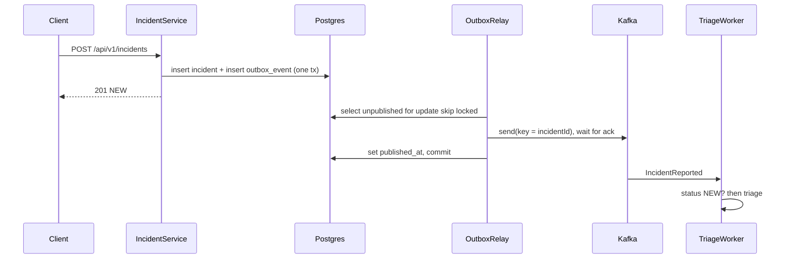

## Where we are

After AI-BUILD-7, TriageDesk triages through a fixed pipeline or a bounded agent, redacts on every exit, and has evals. Triage is still **synchronous**: `POST /incidents` stores an incident, and somebody has to click "Triage now" and wait for the model. A slow or failing provider is handled only by one timeout and a fallback. From DIST-SYS-2 you know Kafka partitions, consumer groups, offsets and delivery guarantees. From DIST-SYS-3 you know timeouts, retries with backoff and jitter, circuit breakers and the transactional outbox.

## The problem

It is Monday morning and the model provider is having a bad hour: every third request gets a 529 "overloaded". Forty incidents arrive from the monitoring system in ten minutes. Today each one waits for a human to click "Triage now", and each click either hangs for 20 seconds or falls back. Worse, you notice the SDK under Spring AI quietly retries twice on its own, so your "one retry" is really several HTTP calls per click, hammering a provider that is already struggling. You want incidents stored instantly, triaged in the background, retried *sensibly*, and parked safely in `NEEDS_HUMAN` when the provider is down, without losing a single one.

## Goal

Make triage **asynchronous and resilient**. Reporting an incident writes the incident *and* an `IncidentReported` event in **one transaction** (the transactional outbox). A relay publishes the event to Kafka, and a triage worker consumes it and runs the pipeline. Other systems can also push incidents onto an inbound topic, deduplicated by their own `sourceKey`. The LLM call moves behind **Resilience4j**: a time limit per attempt, retries with exponential backoff and jitter **only for transient faults**, and a circuit breaker that fails fast while the provider is down. Every path that gives up ends in the same safe place: a `FALLBACK` triage and the incident in `NEEDS_HUMAN`. Poison messages go to a dead-letter topic instead of blocking a partition.

## What you build

- [ ] Kafka (KRaft, single broker) in `compose.yaml`. Topics `triagedesk.incidents.inbound`, `triagedesk.incidents.reported`, each with a `.DLT`
- [ ] `V5__outbox.sql`: `outbox_event`, and `incident.source_key` (unique)
- [ ] `common.outbox.OutboxWriter` (`Propagation.MANDATORY`) and `OutboxRelay` (`for update skip locked`, key = `incidentId`)
- [ ] `IncidentService.report` appends `IncidentReported` in the same transaction
- [ ] `incident.ingest.InboundIncidentListener`: idempotent on `sourceKey`
- [ ] `triage.TriageWorker`: idempotent by status (only `NEW` incidents are triaged)
- [ ] `triage.ResilientTriageClassifier`: a **Decorator** with time limiter, retry and circuit breaker. It replaces `TimeoutTriageClassifier`
- [ ] Provider retries off: `spring.ai.anthropic.max-retries: 0` and `spring.ai.retry.max-attempts: 1`
- [ ] `DefaultErrorHandler` + `DeadLetterPublishingRecoverer`; bad JSON skips retries
- [ ] Tests: `ResilientTriageClassifierTest` (unit), and Docker ITs `TriageWorkerIT`, plus `OutboxIT`, `InboundIdempotencyIT`, `DeadLetterIT` that you write

## Acceptance criteria

1. `POST /api/v1/incidents` returns `201` with `status: "NEW"` immediately. Within a few seconds `GET` on it shows `TRIAGED` (or `NEEDS_HUMAN`), with nobody clicking anything.
2. `select event_type, published_at is not null from outbox_event` shows `IncidentReported | t`. `kafka-console-consumer.sh --topic triagedesk.incidents.reported --from-beginning --property print.key=true` prints `<incidentId>` and the JSON payload.
3. Producing the same inbound message (same `sourceKey`) twice creates **one** incident and one triage.
4. Producing `not-json` to either topic lands it on that topic's `.DLT` without retries, and the next valid message is still processed.
5. `ResilientTriageClassifierTest` passes with `./mvnw test`: `transientIsRetriedThreeTimes`, `anthropicIoErrorIsTransient`, `nonTransientIsNotRetried`, `slowAttemptTimesOutPerAttempt`, `delegateRunsInsideTheCallersObservation`, `invalidOutputIsNotABreakerFailure`, `openBreakerSkipsDelegate` (the open breaker fails at once **without calling the delegate**, ending in `LLM_UNAVAILABLE`).
6. With the provider unreachable (for example a wrong `spring.ai.anthropic.base-url` in a local profile), new incidents end in `NEEDS_HUMAN` with `failureCode: LLM_UNAVAILABLE`, and `GET /actuator/health` shows the `llm` circuit breaker as `OPEN` (set `management.endpoint.health.show-details: always` locally).
7. Docker ITs pass with `./mvnw verify` (with the failsafe plugin declared, see step 8): `TriageWorkerIT.reportedIncidentIsTriagedAsynchronously`, and the three you write: `OutboxIT` (if the reporting transaction fails after the incident insert, there is no incident, no outbox row and nothing in Kafka), `InboundIdempotencyIT`, `DeadLetterIT`.

## Steps

### Session 1 · Kafka and the outbox (~50 min)

**1. Kafka and dependencies.** Add the same single-broker KRaft service as in the capstone (`apache/kafka:3.9.0`, with an `INTERNAL` listener `kafka:19092` for containers and a `HOST` listener `localhost:9092` for your app; CAPSTONE-10 explains why: an *advertised listener* is the address the broker tells clients to reconnect to, so host and containers each need their own).

```xml
<!-- Boot 4 has a Kafka starter; plain spring-kafka no longer brings the auto-configuration -->
<dependency><groupId>org.springframework.boot</groupId><artifactId>spring-boot-starter-kafka</artifactId></dependency>
<dependency>
  <groupId>io.github.resilience4j</groupId>
  <artifactId>resilience4j-spring-boot4</artifactId>
  <version>${resilience4j.version}</version>   <!-- 2.4.0 -->
</dependency>
<dependency><groupId>org.testcontainers</groupId><artifactId>testcontainers-kafka</artifactId><scope>test</scope></dependency>
<dependency><groupId>org.awaitility</groupId><artifactId>awaitility</artifactId><scope>test</scope></dependency>
```

Testcontainers 2 renamed its modules (`testcontainers-kafka`, `testcontainers-postgresql`), and Resilience4j now ships a `-spring-boot4` starter next to the `-spring-boot3` one.

```yaml
spring:
  kafka:
    bootstrap-servers: ${KAFKA_BOOTSTRAP:localhost:9092}
    producer:
      acks: all
      properties:
        enable.idempotence: true
    consumer:
      auto-offset-reset: earliest
      max-poll-records: 1             # one slow LLM call per poll keeps far inside max.poll.interval.ms
triagedesk:
  outbox:
    poll: 500ms
```

`@EnableScheduling` sits on `TriageDeskApplication`. `KafkaConfig` declares a `NewTopic` with 3 partitions for each topic and each DLT (the dead-letter recoverer publishes to the same partition number).

**2. The outbox.** **The dual-write problem:** you must change the database *and* tell Kafka. If you send to Kafka inside the transaction and the commit then fails, you announced an incident that does not exist. If you send after the commit and the process dies, the triage never happens. The **transactional outbox** (REFERENCE-2) writes the event as a row in the same transaction, and a relay publishes it later.



```sql
-- V5__outbox.sql
create table outbox_event (
    id             uuid primary key,
    aggregate_type varchar(50)  not null,
    aggregate_id   varchar(100) not null,
    event_type     varchar(100) not null,
    payload        jsonb        not null,
    created_at     timestamptz  not null,
    published_at   timestamptz
);
create index outbox_unpublished on outbox_event (created_at) where published_at is null;

alter table incident add column source_key varchar(200);
create unique index incident_source_key on incident (source_key) where source_key is not null;
```

**Predict:** the Boot 3 version of `OutboxWriter` wrapped `mapper.writeValueAsString(event)` in `try { ... } catch (JsonProcessingException e)`. What does the Boot 4 version need?

Nothing. Boot 4 auto-configures **Jackson 3**, whose mapper is `tools.jackson.databind.json.JsonMapper`, and its exceptions extend the *unchecked* `tools.jackson.core.JacksonException`. The checked `JsonProcessingException` dance is gone. (The annotations, such as `@JsonPropertyDescription`, still live in `com.fasterxml.jackson.annotation`.)

```java
package com.triagedesk.common.outbox;

import tools.jackson.databind.json.JsonMapper;
// other imports omitted

@Component
public class OutboxWriter {
    private final JdbcClient jdbc;
    private final JsonMapper json;
    private final Clock clock;

    OutboxWriter(JdbcClient jdbc, JsonMapper json, Clock clock) {
        this.jdbc = jdbc;
        this.json = json;
        this.clock = clock;
    }

    @Transactional(propagation = Propagation.MANDATORY)   // fail fast if someone calls it outside a transaction
    public void append(String aggregateType, String aggregateId, Object event) {
        jdbc.sql("""
                insert into outbox_event (id, aggregate_type, aggregate_id, event_type, payload, created_at)
                values (?, ?, ?, ?, cast(? as jsonb), ?)""")
            .params(UUID.randomUUID(), aggregateType, aggregateId, event.getClass().getSimpleName(),
                    json.writeValueAsString(event), Timestamp.from(clock.instant()))   // Jackson 3: unchecked
            .update();
    }
}
```

In `IncidentService`, `report` saves the incident and then calls:

```java
private void announce(Incident incident) {                       // AI-BUILD-8: same transaction as the insert
    outbox.append("Incident", incident.getId().toString(),
            new IncidentReported(incident.getId(), incident.getService(), incident.getSeverity(), clock.instant()));
}
```

`IncidentReported(UUID incidentId, String service, Severity severity, Instant occurredAt)` carries **no free text**. Consumers that need the description load it, which keeps PII off the topic. JPA and `JdbcClient` share the same `DataSource` transaction, so both inserts commit together.

The relay:

```java
@Scheduled(fixedDelayString = "${triagedesk.outbox.poll:500ms}")
@Transactional
public void publish() {
    List<Row> rows = jdbc.sql("""
            select id, aggregate_id, payload::text as payload
            from outbox_event
            where published_at is null
            order by created_at
            limit 100
            for update skip locked""")
        .query(Row.class).list();
    for (Row row : rows) {
        send(row);                                          // key = incidentId: one partition, in order
        jdbc.sql("update outbox_event set published_at = ? where id = ?")
            .params(Timestamp.from(clock.instant()), row.id()).update();
    }
}

private void send(Row row) {
    try {
        kafka.send(TOPIC, row.aggregateId(), row.payload()).get(5, TimeUnit.SECONDS);   // wait for the broker ack
    } catch (InterruptedException e) {
        Thread.currentThread().interrupt();
        throw new IllegalStateException("interrupted while publishing " + row.id(), e);
    } catch (ExecutionException | TimeoutException e) {   // roll back; the next tick retries the row
        throw new IllegalStateException("publish failed for outbox row " + row.id(), e);
    }
}
```

- **Key = `incidentId`.** All events for one incident land on one partition, in order.
- **`for update skip locked`** lets two app instances relay at the same time without sending the same rows.
- **Wait for the ack, with a timeout.** If it fails, the transaction rolls back and the next tick retries. If the process dies after the ack but before the commit, the row is sent again. That is **at-least-once** delivery, so the consumer must be idempotent.

```quiz
{"question": "The relay sent a row, Kafka acked it, and the JVM crashed before the update committed. What happens next?", "level": "easy",
 "options": [
   {"text": "The row is still unpublished, so the next relay tick sends it again: a duplicate the consumer must tolerate", "correct": true, "why": "The update rolled back with the crash, so published_at is still null. Outbox gives at-least-once, not exactly-once."},
   {"text": "Nothing: Kafka's idempotent producer removes the duplicate", "why": "Producer idempotence dedupes retries within one producer session; a new process after a crash is a new session."},
   {"text": "The incident is lost, because the event was never committed", "why": "The incident and the outbox row committed earlier in the reporting transaction; only published_at is missing."},
   {"text": "The relay deadlocks on the row lock left by the crashed transaction", "why": "Postgres releases a dead session's locks when its connection drops."}]}
```

### Session 2 · Consumers and dead letters (~40 min)

**3. Inbound ingestion, idempotent on `sourceKey`.**

```java
@Component
class InboundIncidentListener {
    private static final Logger log = LoggerFactory.getLogger(InboundIncidentListener.class);
    private final JsonMapper json;
    private final IncidentService incidents;

    // constructor assigns both fields

    @KafkaListener(topics = "triagedesk.incidents.inbound", groupId = "ingest")
    void on(String payload) {
        InboundIncident in = json.readValue(payload, InboundIncident.class);   // bad JSON -> JacksonException -> DLT
        try {
            incidents.reportFromSource(in.sourceKey(), in.title(), in.description(), in.service(), in.severity());
        } catch (DataIntegrityViolationException duplicate) {   // a concurrent duplicate lost the unique-index race
            log.info("duplicate inbound incident sourceKey={} ignored", in.sourceKey());
        }
    }
}
```

`reportFromSource` is `@Transactional`: if an incident with that `sourceKey` exists it returns it, otherwise it reports a new one with the same outbox append. The partial unique index is the referee if two copies race. Producers should key inbound messages by `sourceKey`, so copies share a partition.

**4. The triage worker: idempotent by state.**

```java
@KafkaListener(topics = "triagedesk.incidents.reported", groupId = "triage-worker", concurrency = "3")
void on(String payload) {
    IncidentReported event = json.readValue(payload, IncidentReported.class);
    if (incidents.get(event.incidentId()).getStatus() != IncidentStatus.NEW) {
        log.debug("incident={} already handled; skipping duplicate event", event.incidentId());
        return;
    }
    try {
        triage.triage(event.incidentId());     // the pipeline never throws for LLM trouble: it falls back
    } catch (InvalidStatusTransitionException raced) {
        log.info("incident={} changed status during triage; skipping", event.incidentId());
    }
}
```

**Why no dedupe table here?** The capstone's consumer inserts a `processed_event` row in the same transaction as its side effect. Here the side effect is a paid, slow LLM call that cannot be part of a database transaction. Instead, the incident's **status is the idempotency key**: only `NEW` incidents are triaged, `@Version` stops two concurrent triages from both committing, and the partition key keeps one incident's events in one consumer thread.

**The poll-interval arithmetic.** Kafka evicts a consumer that does not poll again within `max.poll.interval.ms` (default 5 minutes). One triage can take up to 3 attempts × 20 s plus backoff, roughly a minute in the worst case. With `max-poll-records: 1`, one poll's work stays far inside the limit. With the default of 500 records, a *slow* provider is the danger: at 10 s per triage, 500 records take over 80 minutes, so the consumer is evicted, its partitions rebalanced, and the same records redelivered: a rebalance storm. (A provider that is fully *down* is less risky here, because the open breaker makes each record fail fast.) `concurrency = "3"` matches the partitions and caps parallel LLM calls at 3, your backpressure against rate limits.

**5. Dead letters.**

```java
@Bean
DefaultErrorHandler kafkaErrorHandler(KafkaOperations<?, ?> template) {
    var handler = new DefaultErrorHandler(new DeadLetterPublishingRecoverer(template), new FixedBackOff(1_000L, 2));
    handler.addNotRetryableExceptions(JacksonException.class, IncidentNotFoundException.class,
            IllegalArgumentException.class);   // retrying bad data only delays the DLT
    return handler;
}
```

Boot picks up a `CommonErrorHandler` bean for the auto-configured listener container factory. Note `JacksonException`, not `JsonProcessingException`: the listener's `readValue` throws the Jackson 3 type.

```quiz
{"question": "A producer sends 'not-json' to triagedesk.incidents.reported. With the error handler above, what happens?", "level": "medium",
 "options": [
   {"text": "readValue throws JacksonException, which is not retryable, so the record goes straight to triagedesk.incidents.reported.DLT and the partition moves on", "correct": true, "why": "Not-retryable exceptions skip the FixedBackOff and go to the recoverer at once; the next offset is then processed."},
   {"text": "It is retried twice with a 1 s pause, then dead-lettered", "why": "That is what happens to retryable exceptions. Bad JSON will be bad JSON on every attempt, so it is marked not-retryable."},
   {"text": "The consumer stops: the partition is blocked until someone deletes the record", "why": "That is the poison-pill problem the DeadLetterPublishingRecoverer exists to avoid."},
   {"text": "It is dropped silently because the payload is a String", "why": "The String deserializer accepts it; the failure happens in readValue and is handled by the error handler, not silently."}]}
```

### Session 3 · Resilience4j around the LLM (~50 min)

**6. Who retries?** Before adding a retry, find every retry that already exists.

**Predict:** Resilience4j will make up to 3 attempts. In Spring AI 2.0 the Anthropic client is built on the official Anthropic Java SDK. With default settings, how many HTTP requests can one triage send during an outage?

Up to **9**. The SDK retries twice by default (`spring.ai.anthropic.max-retries`, default 2), so each of your 3 attempts can be 3 requests. On the Ollama path it is worse: Spring AI's own retry (`spring.ai.retry.max-attempts`, default 10, backoff starting at 2 s × 5) would turn 3 attempts into 30. One explicit policy beats several hidden ones, so turn the hidden ones off:

```yaml
spring:
  ai:
    anthropic:
      timeout: 20s                    # the SDK's HTTP timeout per request (default 60s)
      max-retries: 0                  # the SDK retries twice by default; AI-BUILD-8 owns retries instead
    retry:
      max-attempts: 1                 # Spring AI's own retry (used by the Ollama client); default is 10
```

The Boot 3 draft of this milestone used `spring.ai.retry.on-http-codes: 429,529` to make rate limits retryable. That no longer applies to Claude: in 2.0 the Anthropic client does not go through `spring.ai.retry` at all, and it does not throw Spring AI's `TransientAiException`. It throws the SDK's own exceptions: `RateLimitException` for 429, `InternalServerException` for any 5xx (529 "overloaded" included) and `AnthropicIoException` for connection and read failures. Your transient test has to name them.

**7. The decorator.**

```yaml
resilience4j:
  circuitbreaker:
    instances:
      llm:
        sliding-window-size: 20
        minimum-number-of-calls: 5
        failure-rate-threshold: 50
        wait-duration-in-open-state: 30s
        permitted-number-of-calls-in-half-open-state: 2
        automatic-transition-from-open-to-half-open-enabled: true
        record-failure-predicate: com.triagedesk.triage.TransientLlmFailure   # availability problems only
        register-health-indicator: true
  timelimiter:
    instances:
      llm:
        timeout-duration: 20s
management:
  health:
    circuitbreakers:
      enabled: true
```

`record-failure-predicate` names a class that decides, per exception, whether the breaker counts it as a failure. Everything it rejects counts as a success for the breaker. The class just reuses the retry rule, so "what we retry" and "what opens the breaker" can never drift apart:

```java
public class TransientLlmFailure implements Predicate<Throwable> {
    @Override
    public boolean test(Throwable e) { return ResilientTriageClassifier.isTransient(e); }
}
```

Why not a `record-exceptions` list? Listing `TriageFailedException` there (an easy mistake, since timeouts use it) would also count `INVALID_OUTPUT`, and then a model returning malformed JSON would open the breaker. Malformed JSON is a *quality* problem, not an outage. A 400 or 401 is a bug or a bad key, and retrying will not help either. `ResilientTriageClassifierTest.invalidOutputIsNotABreakerFailure` pins this down, and `ApplicationWiringTest` checks the YAML really binds (`TransientAiException` recorded, `IllegalStateException` not).

```java
final class ResilientTriageClassifier implements TriageClassifier, AutoCloseable {
    private final TriageClassifier delegate;
    private final CircuitBreaker breaker;
    private final TimeLimiter timeLimiter;
    private final Retry retry;
    // ContextExecutorService copies the caller's observation to the worker thread, so the model call's span stays
    // inside the triagedesk.triage trace (AI-BUILD-9) instead of starting a trace of its own.
    private final ExecutorService executor = ContextExecutorService.wrap(Executors.newVirtualThreadPerTaskExecutor());

    ResilientTriageClassifier(TriageClassifier delegate, CircuitBreakerRegistry breakers, TimeLimiterRegistry limiters,
                              RetryRegistry retries, Duration initialBackoff) {
        this.delegate = delegate;
        this.breaker = breakers.circuitBreaker("llm");
        this.timeLimiter = limiters.timeLimiter("llm");
        this.retry = retries.retry("llm", RetryConfig.custom()
                .maxAttempts(3)
                .intervalFunction(IntervalFunction.ofExponentialRandomBackoff(initialBackoff, 2.0, 0.5))
                .retryOnException(ResilientTriageClassifier::isTransient)
                .build());
    }

    @Override
    public Classification classify(TriageInput input) {
        Supplier<Classification> attempt = CircuitBreaker.decorateSupplier(breaker, () -> withTimeout(input));
        try {
            return Retry.decorateSupplier(retry, attempt).get();
        } catch (CallNotPermittedException open) {
            throw new LlmUnavailableException("circuit open", open);
        } catch (RuntimeException e) {
            if (isTransient(e)) throw new LlmUnavailableException("gave up after retries", e);
            throw e;                                    // non-transient: the pipeline records LLM_ERROR
        }
    }

    /** Availability problems only. A 400/401, or malformed output, is not fixed by trying again. */
    static boolean isTransient(Throwable e) {
        return switch (e) {
            case TransientAiException t -> true;         // Ollama path: Spring AI's retry classification
            case RateLimitException t -> true;           // Anthropic SDK: HTTP 429
            case InternalServerException t -> true;      // Anthropic SDK: HTTP 5xx, including 529 overloaded
            case AnthropicIoException t -> true;         // Anthropic SDK: connection reset, read timeout
            case ResourceAccessException t -> true;      // RestClient-based providers: I/O errors
            case TriageFailedException t -> "LLM_TIMEOUT".equals(t.code());
            default -> false;
        };
    }

    private Classification withTimeout(TriageInput input) {
        try {
            return timeLimiter.executeFutureSupplier(
                    () -> CompletableFuture.supplyAsync(() -> delegate.classify(input), executor));
        } catch (TimeoutException e) {
            throw new TriageFailedException("LLM_TIMEOUT", "attempt timed out", e);
        } catch (RuntimeException e) {
            throw e;
        } catch (Exception e) {
            throw new IllegalStateException(e);
        }
    }

    @Override
    public void close() { executor.close(); }
}
```

`LlmUnavailableException` extends `TriageFailedException` with code `LLM_UNAVAILABLE`, so `TriagePipeline` already turns it into a `FALLBACK` with no change to the pipeline. That is the payoff of the AI-BUILD-2 **Decorator** seam (REFERENCE-2). `TriageConfig` now builds this instead of the timeout decorator:

```java
@Bean   // AI-BUILD-8 replaced TimeoutTriageClassifier with this; close() is inferred as the destroy method
ResilientTriageClassifier triageClassifier(ChatClient triageChatClient, CircuitBreakerRegistry breakers,
                                           TimeLimiterRegistry limiters, RetryRegistry retries, TriageProperties props) {
    return new ResilientTriageClassifier(new SpringAiTriageClassifier(triageChatClient), breakers, limiters, retries,
            props.initialBackoff());
}
```

**Why wrap the executor?** The attempt runs on another thread, and the current Micrometer observation lives in a thread-local. Without `ContextExecutorService.wrap` (from `io.micrometer.context`), the model call on the worker thread sees no current observation, so in AI-BUILD-9 its span would start a separate trace. `delegateRunsInsideTheCallersObservation` fails without the wrapper and passes with it.

Read it inside out: each **attempt** has its own time limit. The **breaker** records each attempt. **Retry** is outermost, so one triage costs at most 3 attempts. An open breaker throws `CallNotPermittedException`, which is not transient, so it fails fast with no retry and no delegate call. **Jitter** (the random factor 0.5) spreads retries out, so three workers do not hit a recovering provider at the same instant.

```quiz
{"question": "Claude returns 401 Unauthorized because the key was rotated. What does ResilientTriageClassifier do?", "level": "medium",
 "options": [
   {"text": "One attempt, no retry, the breaker does not count it as a failure, and the pipeline records FALLBACK with LLM_ERROR", "correct": true, "why": "A 401 is an UnauthorizedException from the SDK: not transient, so TransientLlmFailure rejects it too. Retrying a bad key cannot succeed, and it is not an outage."},
   {"text": "Three attempts with backoff, then LLM_UNAVAILABLE", "why": "Only transient errors are retried. Retrying a 401 just spends time and quota."},
   {"text": "It opens the breaker immediately so no more calls are made", "why": "The breaker only records availability exceptions; one 401 is not one of them, and the breaker needs minimum-number-of-calls anyway."},
   {"text": "The SDK retries it twice before Resilience4j sees it", "why": "max-retries is 0, so the SDK sends a single request; Resilience4j is the only retry layer, and it skips non-transient errors."}]}
```

**8. Tests.**

```java
private ResilientTriageClassifier wrap(TriageClassifier delegate) {
    var breakers = CircuitBreakerRegistry.of(CircuitBreakerConfig.custom()
            .slidingWindowSize(4).minimumNumberOfCalls(4).failureRateThreshold(50)
            .recordException(ResilientTriageClassifier::isTransient)
            .waitDurationInOpenState(Duration.ofMinutes(1)).build());
    var limiters = TimeLimiterRegistry.of(TimeLimiterConfig.custom().timeoutDuration(Duration.ofMillis(200)).build());
    return new ResilientTriageClassifier(delegate, breakers, limiters, RetryRegistry.ofDefaults(), Duration.ofMillis(10));
}

@Test
void anthropicIoErrorIsTransient() {
    var classifier = wrap(in -> { calls.incrementAndGet(); throw new AnthropicIoException("reset", null); });

    assertThatThrownBy(() -> classifier.classify(input)).isInstanceOf(LlmUnavailableException.class);
    assertThat(calls).hasValue(3);
}

@Test
void openBreakerSkipsDelegate() {
    var classifier = wrap(in -> { calls.incrementAndGet(); throw new TransientAiException("503"); });
    for (int i = 0; i < 2; i++) {
        assertThatThrownBy(() -> classifier.classify(input)).isInstanceOf(LlmUnavailableException.class);
    }
    int before = calls.get();

    assertThatThrownBy(() -> classifier.classify(input))
            .isInstanceOf(LlmUnavailableException.class)
            .extracting(e -> ((LlmUnavailableException) e).code()).isEqualTo("LLM_UNAVAILABLE");
    assertThat(calls.get()).isEqualTo(before);       // failed fast: delegate not invoked
}
```

The Docker ITs use Testcontainers 2's `org.testcontainers.kafka.KafkaContainer`, the fake classifier from AI-BUILD-2 and Awaitility, never `Thread.sleep`:

```java
@SpringBootTest
@Testcontainers
@ActiveProfiles("test")
@Import({TestcontainersConfig.class, TriageApiIT.FakeClassifier.class})
class TriageWorkerIT {
    @Container @ServiceConnection static KafkaContainer kafka = new KafkaContainer("apache/kafka:3.9.0");

    @Autowired IncidentService incidents;

    @Test
    void reportedIncidentIsTriagedAsynchronously() {
        var incident = incidents.report("Checkout 5xx", "Errors after deploy", "checkout", Severity.SEV2);

        await().atMost(Duration.ofSeconds(15)).untilAsserted(() ->
                assertThat(incidents.get(incident.getId()).getStatus()).isEqualTo(IncidentStatus.TRIAGED));
    }
}
```

**Make `verify` actually run them.** The Boot parent only *manages* the failsafe plugin. Unless you declare it, `./mvnw verify` silently skips every `*IT` class (surefire only picks up `*Test`):

```xml
<!-- the parent only manages failsafe; without this, ./mvnw verify never runs the *IT tests -->
<plugin><groupId>org.apache.maven.plugins</groupId><artifactId>maven-failsafe-plugin</artifactId></plugin>
```

Write `OutboxIT`, `InboundIdempotencyIT` and `DeadLetterIT` in the same style. For `OutboxIT`, call `report` inside a `TransactionTemplate` that throws after the call, then assert no incident row, no outbox row, and (with a short-poll consumer) no Kafka record.

```quiz
{"question": "Your breaker uses minimum-number-of-calls 5, failure-rate-threshold 50 and sliding-window-size 20. The provider is fully down. Retry is outermost (3 attempts). After how many triages does the breaker open, at the earliest?", "level": "hard",
 "options": [
   {"text": "During the 2nd triage: the 1st records 3 failures, the 2nd's 2nd attempt is the 5th failure, the breaker opens and its 3rd attempt is rejected", "correct": true, "why": "The breaker records each attempt, not each triage. It needs 5 recorded calls before evaluating; at 5 of 5 failed it opens, and the next attempt throws CallNotPermittedException, which is not retried."},
   {"text": "After the 5th triage, because each triage counts as one call", "why": "The breaker wraps each attempt (it sits inside Retry), so one triage can record up to 3 calls."},
   {"text": "After the 20th failure, when the sliding window is full", "why": "The breaker evaluates once minimum-number-of-calls is reached; it does not wait for a full window."},
   {"text": "Never, because retries hide the failures from the breaker", "why": "That would be true if Retry sat inside the breaker. Here the breaker is inside, so every attempt is visible to it."}]}
```

## Hints

- **The time limit fires but the HTTP call keeps going.** `TimeLimiter` cancels the future, but the SDK's blocking request may run until its own `spring.ai.anthropic.timeout` (20 s). Keep the SDK timeout close to the time limit so abandoned calls do not pile up.
- **The agent has no retries.** The AI-BUILD-7 agent calls the `ChatModel` directly, so it bypasses `ResilientTriageClassifier`, and `max-retries: 0` leaves it with no retry at all. That is acceptable for a manual, on-demand action (a failed run becomes a `FALLBACK`, and a human can click again). Stretch: put the agent's model call behind the same `llm` breaker.
- **Count your retry layers.** The Anthropic SDK (`spring.ai.anthropic.max-retries`, default 2), Spring AI's retry for RestClient-based providers such as Ollama (`spring.ai.retry.max-attempts`, default 10), and Resilience4j. Keep exactly one: Resilience4j.
- **Your transient check never fires on Claude errors.** You are matching `TransientAiException`. The 2.0 Anthropic client throws SDK exceptions (`com.anthropic.errors.*`). `anthropicIoErrorIsTransient` guards this.
- **`IllegalTransactionStateException` from `OutboxWriter`.** The caller is not transactional. `MANDATORY` did its job.
- **`cannot find symbol: JsonProcessingException`, or a catch block that "can never be thrown".** You copied Boot 3 code. Jackson 3 exceptions are unchecked (`tools.jackson.core.JacksonException`).
- **No `KafkaTemplate` bean, no listeners start.** You added `spring-kafka` without `spring-boot-starter-kafka`. In Boot 4 the auto-configuration lives in the starter's module.
- **Nothing is consumed.** Check `auto-offset-reset: earliest` and the group id. Inspect the group with `kafka-consumer-groups.sh --bootstrap-server localhost:9092 --describe --group triage-worker`.
- **The dashboard's "Triage now" still calls synchronously.** That is fine. Manual re-triage is a deliberate human action, and it uses the same resilient classifier.

## Stretch

- **Re-triage after recovery:** a scheduled job finds `NEEDS_HUMAN` incidents whose latest triage failed with `LLM_UNAVAILABLE`, and re-queues them once the breaker is `CLOSED` again. Make sure it cannot loop.
- Add a **bulkhead** (`resilience4j.bulkhead`) limiting concurrent LLM calls across the REST path and the worker, and explain how it differs from consumer concurrency.
- Add a **fallback model**: when Claude's breaker is open, try the Ollama classifier behind the same port before giving up. Run the eval set to decide whether its answers are good enough to show, or only good enough to queue.

## Talk about it in interviews

**"How do you call an unreliable third-party API, like an LLM, from a backend?"**
- *What:* bound it, retry only what can succeed on retry, stop calling it while it is down, and degrade to a safe result.
- *How it works inside:* a Resilience4j decorator. A per-attempt time limit, up to 3 attempts with exponential backoff and jitter only for transient errors (429, 5xx including 529, I/O, timeouts), and a circuit breaker that records only availability failures. Every give-up becomes a `FALLBACK` triage and `NEEDS_HUMAN`. The SDK's and Spring AI's own retries are switched off so the policies do not multiply.
- *Where used:* every triage that goes through the `TriageClassifier` port: the Kafka worker, the REST path and the MCP tool. The on-demand agent calls the model directly and is a manual action without retries.
- *What goes wrong:* stacked retry policies (3 × 3 = 9 calls), retrying non-transient errors, matching the wrong exception types after a framework upgrade, malformed output counted as an outage, and consumers evicted because a retry storm outlasted `max.poll.interval.ms`.

Bank questions: [Design an Idempotent API](#/q/design-idempotent-api), [Kafka architecture](#/q/kafka-architecture), [Microservices patterns: API gateway, service discovery, circuit breaker, saga](#/q/microservices-design-patterns).

**"Why the outbox instead of publishing directly?"** The dual-write problem: Kafka and Postgres cannot share a transaction, so one of the two writes can be lost. The outbox puts the event in the same transaction as the incident, and a relay publishes it at-least-once. Consumers are idempotent: by unique `sourceKey` on ingest, and by incident status in the triage worker.

**"What does the user see when the model is down?"** Incidents still arrive and are stored at once, because ingestion does not depend on the model. They land as `NEEDS_HUMAN` with the reason `LLM_UNAVAILABLE`. Nothing is lost or blocked. Health shows the breaker open, so alerting can page on it (AI-BUILD-9).

## Done when

- [ ] `./mvnw test` is green, including all seven `ResilientTriageClassifierTest` cases
- [ ] With Docker running, `./mvnw verify` runs `TriageWorkerIT` and your three outbox, idempotency and DLT ITs green
- [ ] A posted incident becomes `TRIAGED` with no click; a duplicate `sourceKey` makes one incident
- [ ] A wrong base URL ends in `NEEDS_HUMAN` / `LLM_UNAVAILABLE` and the health page shows the breaker `OPEN`
- [ ] `record-failure-predicate` (not a `record-exceptions` list) is in the breaker config
- [ ] `spring.ai.anthropic.max-retries: 0` and `spring.ai.retry.max-attempts: 1` are in `application.yml`

## Commit

```bash
git add -A
git commit -m "p8: async ingestion via Kafka and transactional outbox, idempotent consumers, DLT, Resilience4j around the LLM"
git tag p8
```

## Next

AI-BUILD-9 makes it all visible: triage latency, token usage and cost as Micrometer metrics, traces that follow one incident from Kafka through retrieval and the model call, and a Grafana board.
