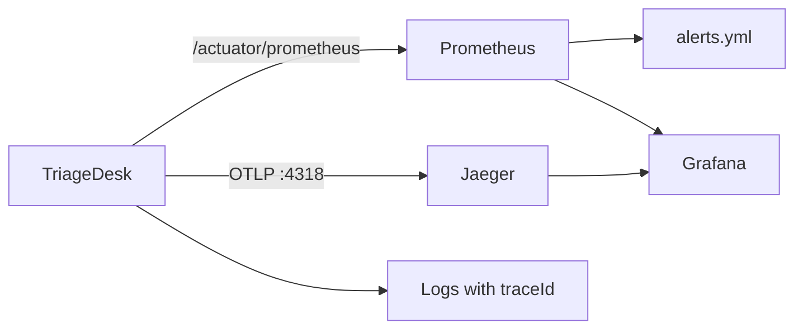

## Where we are

After AI-BUILD-8, incidents flow in through REST or Kafka via a transactional outbox, a worker triages them behind Resilience4j, and every give-up lands in `NEEDS_HUMAN`. Token counts and latency are stored per triage row, but nobody can answer live questions: "is triage slower today?", "how much did we spend this week?", "is the breaker open?", "where did that slow triage spend its 40 seconds?". From DIST-SYS-7 you know the three signals (logs, metrics, traces), Prometheus and Grafana, and SLO thinking.

## The problem

Friday afternoon you change the prompt to add two more retrieved incidents. Monday the dashboard looks fine, every incident is `TRIAGED`. Then the provider invoice arrives: input tokens doubled, and triage p95 went from 6 to 14 seconds. Nobody noticed, because nothing measured it. Worse, one triage last week took 40 seconds and you cannot tell whether it was the vector query, three retries or one slow model call. You want a single screen that answers "slower? pricier? failing? why?" the same day, and an alert that fires when the breaker opens, without ever putting incident text into a metric or a trace.

## Goal

Make TriageDesk observable with Micrometer. **Metrics:** triage latency by outcome (a histogram, so you can read p95), LLM call latency and tokens (Spring AI emits these already), **cost in dollars** computed from tokens and prices you configure, redactions by kind, queue depth, agent stop reasons, circuit-breaker state and Kafka lag. **Traces:** one trace per triage that shows the Kafka consume, the retrieval query, the model call and its HTTP request, exported over OTLP to Jaeger. **A Grafana board** that answers the questions above on one screen, plus two alert rules. None of the signals carries incident text or high-cardinality ids.

## What you build

- [ ] Dependencies: `micrometer-registry-prometheus` and `spring-boot-starter-opentelemetry`
- [ ] `/actuator/prometheus` exposed; `triagedesk.triage` with percentile histograms; Kafka observation on
- [ ] An `Observation` named `triagedesk.triage` around the pipeline, with low-cardinality `outcome` and `failure` tags
- [ ] `triage.LlmCostMeter`: a `triagedesk.llm.cost` counter (base unit `usd`) from configured per-model prices
- [ ] `triagedesk.guard.redactions{kind}` (`RedactionMetrics`), `triagedesk.queue.depth{status}` (`QueueDepthMetrics`), `triagedesk.agent.runs{stop_reason}`
- [ ] Compose: Prometheus, Grafana (provisioned data sources and dashboard), Jaeger
- [ ] `ops/prometheus.yml`, `ops/alerts.yml`, `ops/grafana/...`, and an exported `triagedesk.json` dashboard
- [ ] Tests: `LlmCostMeterTest`, `TriageObservationTest`

## Acceptance criteria

1. `curl localhost:8080/actuator/prometheus | grep -E "triagedesk_triage_seconds_count|gen_ai_client_token_usage_total|triagedesk_llm_cost_usd_total|resilience4j_circuitbreaker_state"` shows all four families after one triage.
2. `http://localhost:9090/targets` shows the `triagedesk` target `UP`.
3. Grafana at `http://localhost:3000` has a provisioned "TriageDesk" dashboard with at least: triage rate by outcome, triage p95, LLM call latency, tokens per minute by type, cost over the last 24 hours, breaker state, queue depth and redactions by kind. They show live data after you post 10 incidents.
4. Jaeger at `http://localhost:16686` shows a trace for one incident's triage, with a Kafka consume span, the `triagedesk.triage` span, a vector-store query span and the chat-model span nested inside. App log lines for that triage carry the same `traceId`.
5. With the provider failing (AI-BUILD-8, criterion 6), the `LlmCircuitOpen` alert shows as firing on `http://localhost:9090/alerts` within a couple of minutes.
6. No metric has an `incidentId`, `title` or free-text tag, and `spring.ai.chat.observations.log-prompt` and `log-completion` are still `false`.
7. These tests pass with `./mvnw test`:
   - `LlmCostMeterTest.costIsTokensTimesPricePerMillion`, `LlmCostMeterTest.unpricedModelIsCountedNotGuessed`
   - `TriageObservationTest.recordsOutcomeAndFailureTags` (`SimpleMeterRegistry` + `ObservationRegistry`)
   - `ConfigurationKeysTest` (every `management.*` key you add is a current Boot 4.1 property)

## Steps

### Session 1 · Dependencies and the triage observation (~40 min)

**1. Dependencies and configuration.**

```xml
<dependency><groupId>io.micrometer</groupId><artifactId>micrometer-registry-prometheus</artifactId></dependency>
<!-- Boot 4: one starter brings the Micrometer Tracing OTel bridge and the OTLP exporter -->
<dependency><groupId>org.springframework.boot</groupId><artifactId>spring-boot-starter-opentelemetry</artifactId></dependency>
```

On Boot 3 you added `micrometer-tracing-bridge-otel` and `opentelemetry-exporter-otlp` by hand. Boot 4 has a starter for it.

**Predict:** you copy the tracing config from a Boot 3 tutorial: `management.otlp.tracing.endpoint: http://localhost:4318/v1/traces`. What happens on Boot 4.1?

The property was renamed in Boot 4.0 to `management.opentelemetry.tracing.export.otlp.endpoint`. The old name is marked deprecated at *error* level in the configuration metadata, so it no longer configures anything and no spans reach Jaeger. The verify project's `ConfigurationKeysTest.catchesSpringAi1AndBoot3Names` feeds the old name to a checker built from the jars' metadata and gets `management.otlp.tracing.endpoint (deprecated)` back. Add that test to your repo; it catches every rename the day you upgrade.

```yaml
management:
  endpoints:
    web:
      exposure:
        include: health,info,prometheus,metrics
  health:
    circuitbreakers:
      enabled: true
  metrics:
    distribution:
      percentiles-histogram:
        triagedesk.triage: true      # buckets, so Prometheus can compute p95 across instances
  tracing:
    sampling:
      probability: 1.0               # local only; sample less in production
  opentelemetry:
    tracing:
      export:
        otlp:
          endpoint: http://localhost:4318/v1/traces
spring:
  kafka:
    template:
      observation-enabled: true       # propagate trace context through Kafka headers
    listener:
      observation-enabled: true
```

Spring AI already records observations for `ChatClient`, `ChatModel`, embedding and vector-store calls once Actuator is present. In the 2.0.3 source the chat-model observation is named `gen_ai.client.operation` (`DefaultChatModelObservationConvention.DEFAULT_NAME`; Prometheus: `gen_ai_client_operation_seconds_*`), and `AiObservationMetricNames` holds `gen_ai.client.operation.duration` and the token counter `gen_ai.client.token.usage` (`gen_ai_client_token_usage_total`, tag `gen_ai.token.type` = input, output, total). Tags include `gen_ai.operation.name` and `gen_ai.request.model`. One catch: the *embedding* convention uses the same name `gen_ai.client.operation`, and your local ONNX embedding model is observed too, so filter on `gen_ai_operation_name="chat"` when you mean the LLM. Do not re-implement them. Add only what the framework cannot know: outcome, cost, redactions, queue depth.

Leave the content-logging switches alone: `spring.ai.chat.observations.log-prompt`, `log-completion` and `spring.ai.tools.observations.include-content` all still default to `false` in 2.0. Turning them on would put incident text into traces, and with it everything the guard chain worked to keep out.

**2. Observe the triage.** An **Observation** is Micrometer's single instrumentation API: one observation produces a timer metric *and* a trace span. The pipeline's `run` is `final` and must not be proxied (AI-BUILD-2), so you instrument it programmatically in `TriageService`:

```java
public Triage triage(UUID incidentId) {
    Incident incident = incidents.get(incidentId);                         // 1. short read transaction
    if (!incident.getStatus().canTransitionTo(IncidentStatus.TRIAGED)) {   // fail before paying for a call
        throw new InvalidStatusTransitionException(incident.getStatus(), IncidentStatus.TRIAGED);
    }
    Observation observation = Observation.createNotStarted("triagedesk.triage", observations)   // AI-BUILD-9
            .lowCardinalityKeyValue("outcome", "UNKNOWN")
            .lowCardinalityKeyValue("failure", "none")
            .start();
    try (Observation.Scope scope = observation.openScope()) {
        PipelineResult result = pipeline.run(incident);                    // 2. no transaction: the slow part
        observation.lowCardinalityKeyValue("outcome", result.outcome().name());
        observation.lowCardinalityKeyValue("failure", result.failureCode() == null ? "none" : result.failureCode());
        return recorder.record(incidentId, result);                        // 3. short write transaction
    } catch (RuntimeException e) {
        observation.error(e);
        throw e;
    } finally {
        observation.stop();
    }
}
```

`observations` is the auto-configured `ObservationRegistry`. Two rules hide in this snippet:
- **Every tag key is always present**, with `"none"` instead of a missing tag. Prometheus expects all series of one metric name to have the same label keys, and Micrometer's Prometheus registry rejects a meter that breaks this.
- **Low cardinality only.** `outcome` has 4 values (`LLM`, `AGENT`, `FALLBACK`, and `UNKNOWN`, which stays when an exception escapes the pipeline) and `failure` about 6. An `incidentId` tag would create a new time series per incident, and Prometheus memory grows with the number of series. Ids belong in traces and logs. The `service` field is user-supplied, so it is unbounded too.

The opened scope makes the Spring AI and vector-store spans **children** of `triagedesk.triage`, which gives you the nested trace in Jaeger. The chat call runs on another thread (the AI-BUILD-8 time limiter's executor), and it still nests because that executor is wrapped with `ContextExecutorService`, which copies the current observation to the worker thread. Without the wrapper the chat span would start a trace of its own.

```quiz
{"question": "A teammate wants to add .lowCardinalityKeyValue(\"incident\", incidentId.toString()) so the p95 panel can be filtered by incident. What is the problem?", "level": "easy",
 "options": [
   {"text": "Each incident id creates a new time series, so Prometheus memory grows without bound; ids belong in traces and logs", "correct": true, "why": "Cardinality is the number of distinct label combinations. A UUID per triage makes it unbounded."},
   {"text": "Micrometer does not allow String tag values", "why": "All tag values are Strings; the issue is how many distinct values there are."},
   {"text": "It is fine because it is declared lowCardinality", "why": "The method name is a promise you make, not something Micrometer enforces."},
   {"text": "The trace span would lose its parent", "why": "Tags do not affect span parentage; the opened scope does that."}]}
```

**3. Test it with no infrastructure.** `TriageObservationTest` wires a real `ObservationRegistry` to a `SimpleMeterRegistry` and a pipeline that always times out:

```java
var meters = new SimpleMeterRegistry();
var observations = ObservationRegistry.create();
observations.observationConfig().observationHandler(new DefaultMeterObservationHandler(meters));
// ... a TriagePipeline whose classify throws TriageFailedException("LLM_TIMEOUT", ...)

new TriageService(incidents, timesOut, recorder, mock(TriageRepository.class), observations).triage(incident.getId());

assertThat(meters.get("triagedesk.triage").tags("outcome", "FALLBACK", "failure", "LLM_TIMEOUT").timer().count())
        .isEqualTo(1);
```

### Session 2 · Cost and the small meters (~35 min)

**4. Cost: tokens × your prices.** Token counts are facts. Prices are configuration. **Never hard-code a price.** Read the current per-million-token prices for your model from Anthropic's pricing page and set them through environment variables. Ollama costs zero per call.

```yaml
triagedesk:
  pricing:
    models:
      "[claude-haiku-4-5]":                       # brackets keep the key intact in a map
        input-per-million: ${PRICE_IN_PER_MTOK:0}  # set from the Anthropic pricing page
        output-per-million: ${PRICE_OUT_PER_MTOK:0}
      "[llama3.2]":
        input-per-million: 0
        output-per-million: 0
```

```java
@Component
public class LlmCostMeter {

    @ConfigurationProperties("triagedesk.pricing")
    public record Pricing(Map<String, Price> models) {
        public record Price(BigDecimal inputPerMillion, BigDecimal outputPerMillion) { }
    }

    private static final BigDecimal MILLION = BigDecimal.valueOf(1_000_000);
    private final MeterRegistry registry;
    private final Map<String, Pricing.Price> prices;

    LlmCostMeter(MeterRegistry registry, Pricing pricing) {
        this.registry = registry;
        this.prices = pricing.models() == null ? Map.of() : Map.copyOf(pricing.models());
    }

    public void record(String model, int inputTokens, int outputTokens) {
        String name = model == null ? "unknown" : model;
        Pricing.Price price = prices.get(name);
        if (price == null) {        // never guess a price: count it, and alert if it grows
            Counter.builder("triagedesk.llm.unpriced.calls").tag("model", name).register(registry).increment();
            return;
        }
        BigDecimal usd = price.inputPerMillion().multiply(BigDecimal.valueOf(inputTokens))
                .add(price.outputPerMillion().multiply(BigDecimal.valueOf(outputTokens)))
                .divide(MILLION, MathContext.DECIMAL64);
        Counter.builder("triagedesk.llm.cost").baseUnit("usd").tag("model", name)
                .register(registry).increment(usd.doubleValue());
    }
}
```

`TriageConfig` registers `Pricing` with `@EnableConfigurationProperties`. `TriageRecorder` calls `record` for every non-fallback triage. The `model` tag is low-cardinality (a handful of configured models). The model string comes from the response metadata, so it must match your config key exactly; the unpriced counter tells you when it does not.

**Predict:** an attempt reaches the model, the model works for 25 seconds, and the 20-second time limit cancels it. What does `triagedesk.llm.cost` record for that attempt?

Nothing. The provider may well bill those tokens, but no response came back, so there is no usage to multiply. `TriageRecorder` only calls `record` for non-fallback triages anyway. Cost is therefore a **lower bound**. Say so in the dashboard panel's description, and compare it with the provider's console once a week.

```quiz
{"question": "After a model upgrade, the cost panel goes flat while triagedesk_triage_seconds_count keeps rising. Most likely cause?", "level": "medium",
 "options": [
   {"text": "The response metadata now reports a model name that is not a key in triagedesk.pricing.models, so calls land in triagedesk.llm.unpriced.calls instead", "correct": true, "why": "LlmCostMeter never guesses a price. The unpriced counter rising is the signal; fix the config key."},
   {"text": "Prometheus dropped the counter because its base unit is usd", "why": "Base units only shape the exported name (triagedesk_llm_cost_usd_total); they do not drop meters."},
   {"text": "The new model is cheaper, so cost rounds to zero", "why": "Counters accumulate doubles; a cheaper model gives a smaller slope, not a flat line."},
   {"text": "Spring AI stopped emitting gen_ai_client_token_usage_total", "why": "LlmCostMeter uses the token counts stored on the triage, not the Spring AI metric."}]}
```

**5. The small meters.**
- **Redactions:** `GuardChain` gets a second constructor that takes a `RedactionMetrics`. It is marked `@Autowired` because the class now has several constructors, and Spring only picks one by itself when there is exactly one. The no-argument constructor stays for unit tests:

```java
@Autowired
public GuardChain(RedactionMetrics metrics) { this((Consumer<GuardReport>) metrics::record); }
```

  `RedactionMetrics` turns each call's `GuardReport` into counters:

```java
void record(GuardReport report) {
    report.counts().forEach((kind, n) -> registry.counter("triagedesk.guard.redactions", "kind", kind).increment(n));
}
```

  A sudden jump in `SECRET` means people are pasting tokens into tickets. The metric tells you without anyone reading the tickets.
- **Queue depth:** a scheduled job stores counts in `AtomicLong`s registered once as gauges. The gauge reads a number; it never queries the database on a scrape:

```java
@Scheduled(fixedDelay = 30_000)          // the gauge reads a number; it never queries the database on a scrape
void refresh() {
    depth.values().forEach(h -> h.set(0));
    jdbc.sql("select status, count(*) as n from incident where status <> 'RESOLVED' group by status")
        .query((rs, i) -> Map.entry(IncidentStatus.valueOf(rs.getString("status")), rs.getLong("n")))
        .list()
        .forEach(e -> depth.get(e.getKey()).set(e.getValue()));
}
```

- **Agent:** `AgentService` counts `triagedesk.agent.runs` by `stop_reason` and records a `triagedesk.agent.steps` distribution summary.
- **Breaker and Kafka:** the Resilience4j starter publishes `resilience4j_circuitbreaker_state{name="llm",state=...}`, and Spring Kafka's Micrometer integration publishes consumer metrics. Find the exact lag metric name in your `/actuator/prometheus` output (search for `lag`) before you build a panel on it.

### Session 3 · Prometheus, Grafana, Jaeger (~45 min)

**6. Compose services.** Add three services to `compose.yaml`, each with a pinned image tag you choose from Docker Hub (bump them deliberately):
- `prometheus` (`prom/prometheus`): port `9090`, `extra_hosts: ["host.docker.internal:host-gateway"]` so it can reach the app on your host (Linux needs this line), and read-only mounts of `./ops/prometheus.yml` to `/etc/prometheus/prometheus.yml` and `./ops/alerts.yml` to `/etc/prometheus/alerts.yml`.
- `grafana` (`grafana/grafana`): port `3000`, mounts `./ops/grafana/provisioning` to `/etc/grafana/provisioning` and `./ops/grafana/dashboards` to `/var/lib/grafana/dashboards`.
- `jaeger` (`jaegertracing/all-in-one`): environment `COLLECTOR_OTLP_ENABLED: "true"`, ports `16686` (UI) and `4318` (OTLP over HTTP).

```yaml
# ops/prometheus.yml
global:
  scrape_interval: 15s
rule_files: [/etc/prometheus/alerts.yml]
scrape_configs:
  - job_name: triagedesk
    metrics_path: /actuator/prometheus
    static_configs:
      - targets: ["host.docker.internal:8080"]
```

```yaml
# ops/alerts.yml
groups:
  - name: triagedesk
    rules:
      - alert: LlmCircuitOpen
        expr: resilience4j_circuitbreaker_state{name="llm",state="open"} == 1
        for: 1m
        annotations:
          summary: "LLM circuit breaker open: new incidents go to NEEDS_HUMAN"
      - alert: HighTriageFallbackRate
        expr: >
          sum(rate(triagedesk_triage_seconds_count{outcome="FALLBACK"}[10m]))
          / sum(rate(triagedesk_triage_seconds_count[10m])) > 0.2
        for: 10m
```

The 20% threshold is a starting choice for a demo. In a real system you derive it from an SLO (DIST-SYS-7). There is no Alertmanager here, so alerts show on Prometheus's Alerts page.



Grafana provisioning: `ops/grafana/provisioning/datasources/datasources.yml` declares a Prometheus data source (`url: http://prometheus:9090`, `isDefault: true`) and a Jaeger one (`url: http://jaeger:16686`). `ops/grafana/provisioning/dashboards/dashboards.yml` declares a file provider pointing at `/var/lib/grafana/dashboards`. Build the dashboard in the Grafana UI with these queries, then export it as JSON into `ops/grafana/dashboards/triagedesk.json`, so it is versioned with the code:

```text
Triage rate by outcome   sum by (outcome) (rate(triagedesk_triage_seconds_count[5m]))
Triage p95 (s)           histogram_quantile(0.95, sum by (le) (rate(triagedesk_triage_seconds_bucket[5m])))
LLM call avg (s)         sum(rate(gen_ai_client_operation_seconds_sum{gen_ai_operation_name="chat"}[5m]))
                         / sum(rate(gen_ai_client_operation_seconds_count{gen_ai_operation_name="chat"}[5m]))
Tokens/min by type       60 * sum by (gen_ai_token_type) (rate(gen_ai_client_token_usage_total{gen_ai_operation_name="chat"}[5m]))
Cost, last 24h (USD)     sum(increase(triagedesk_llm_cost_usd_total[24h]))
Breaker state            resilience4j_circuitbreaker_state{name="llm"}
Queue depth              triagedesk_queue_depth
Redactions by kind       sum by (kind) (increase(triagedesk_guard_redactions_total[1h]))
```

Check each name against your own `/actuator/prometheus` output. Micrometer derives Prometheus names from the meter name, the base unit and the type: copy them, do not guess them.

```quiz
{"question": "Your p95 panel uses histogram_quantile over triagedesk_triage_seconds_bucket and shows 'No data', yet triagedesk_triage_seconds_count is rising. Why, and what would be wrong with the 'quick fix' of publishing a client-side 0.95 percentile instead?", "level": "hard",
 "options": [
   {"text": "percentiles-histogram is not enabled for triagedesk.triage, so no _bucket series exist; a client-side percentile cannot be aggregated across instances, so it is wrong as soon as you run two", "correct": true, "why": "Buckets are additive, so Prometheus can sum them over instances and then take the quantile. Precomputed percentiles from each JVM cannot be averaged into a correct global p95."},
   {"text": "Prometheus needs a 1h range for histogram_quantile; a client-side percentile is the same thing computed earlier", "why": "Any range works once buckets exist, and averaging per-instance percentiles is mathematically wrong."},
   {"text": "The Observation must be a Timer, not an Observation; client-side percentiles are the recommended Micrometer default", "why": "DefaultMeterObservationHandler turns the observation into a timer already; the missing piece is the histogram config."},
   {"text": "Spring AI overwrites the triagedesk.triage metric; switch to a client-side percentile to avoid the clash", "why": "Spring AI uses its own gen_ai.* names and never touches triagedesk.triage."}]}
```

## Hints

- **The Prometheus target is DOWN with "connection refused".** The app runs on your host and Prometheus in a container. Use `host.docker.internal`, which works on Docker Desktop for Windows and Mac; on Linux the `extra_hosts: host-gateway` line makes it work.
- **The chat-model span shows up as a separate trace, not under `triagedesk.triage`.** The executor that runs the attempt lost the context. Check that `ResilientTriageClassifier` wraps it with `ContextExecutorService.wrap(...)`.
- **The LLM latency panel looks too fast.** Local embedding calls share the `gen_ai_client_operation` name. Filter on `gen_ai_operation_name="chat"`.
- **No traces in Jaeger.** Check the Boot 4 property name (`management.opentelemetry.tracing.export.otlp.endpoint`), port 4318 with the `/v1/traces` path, sampling 1.0, and that `spring-boot-starter-opentelemetry` is on the classpath.
- **The worker's trace does not connect to the HTTP request that created the incident.** Expected. The relay sends from its own scheduled transaction, so the Kafka message carries the *relay's* context. See Stretch.
- **`histogram_quantile` returns nothing.** The percentile histogram is not on for `triagedesk.triage`, so there are no `_bucket` series.
- **Grafana shows "No data" for cost.** Prices default to 0 until you set the environment variables, and `increase` of a counter that never moved is empty.
- **`triagedesk_llm_unpriced_calls_total` is rising.** The model name in the response metadata does not match a key under `triagedesk.pricing.models`. Copy the exact string from the metric's `model` label.

## Stretch

- **End-to-end trace through the outbox:** store the current `traceparent` in an `outbox_event.trace_parent` column when appending, and have the relay send it as a Kafka header, so the worker's trace continues the original request's trace.
- Define an SLO ("95% of incidents get an `LLM` triage within 60 s of being reported"), add a recording rule for it, and a burn-rate alert (DIST-SYS-7).
- Add a daily cost alert against a budget you choose, and a panel for tokens per triage by prompt version. A prompt change that doubles input tokens should be visible the same day.

## Talk about it in interviews

**"How do you monitor an LLM feature in production?"**
- *What:* the usual RED metrics (rate, errors, duration), plus LLM-specific ones: tokens by type, cost, fallback rate by reason, breaker state, guard hits, and for the agent, steps and stop reasons.
- *How it works inside:* Micrometer Observations. Spring AI instruments chat, embedding and vector-store calls (`gen_ai.client.operation`, `gen_ai.client.token.usage`). My `triagedesk.triage` observation wraps the pipeline with low-cardinality outcome and failure tags, and produces both a histogram and a parent span. Cost is tokens multiplied by configured prices, recorded as a counter in USD. Traces go over OTLP to Jaeger, and logs carry the trace id.
- *Where used:* one Grafana board answers "slower? pricier? failing? why?", and alerts fire on an open breaker and a high fallback rate.
- *What goes wrong:* high-cardinality tags, prompt text leaking into traces through content logging, cost dashboards that silently under-count failed calls, renamed config keys after a Boot upgrade that silently switch tracing off, and inconsistent tag keys that make the registry drop a meter.

Bank questions: [Caching to reduce LLM cost; LLM observability](#/q/llm-cost-caching-and-observability), [Design a Metrics Aggregator / Monitoring System](#/q/design-metrics-monitoring-system).

**"How would you cut LLM cost, and prove it?"** Find where the tokens go first: tokens per triage by prompt version and model. Then make the change (a shorter prompt, prompt caching, fewer retrieved passages, a cheaper model for easy cases), and prove it twice: the cost panel shows the drop, and the eval run (AI-BUILD-6) shows accuracy held.

**"Logs, metrics or traces: which first?"** Metrics to *detect* (p95 up, fallback rate up, breaker open), traces to *locate* (this triage spent its time in retries, not in retrieval), logs with the trace id to *explain* (which exception, which failure code).

## Done when

- [ ] `./mvnw test` is green, including `LlmCostMeterTest`, `TriageObservationTest` and `ConfigurationKeysTest`
- [ ] All four metric families from criterion 1 appear after one triage
- [ ] Grafana shows the eight panels with live data; the dashboard JSON is committed
- [ ] One nested trace in Jaeger, and the same `traceId` in the app log
- [ ] `LlmCircuitOpen` fires during the provider-failure drill

## Commit

```bash
git add -A
git commit -m "p9: observability - triage observation, cost meter, guard/queue/agent metrics, OTLP traces, alerts, Grafana"
git tag p9
```

## Next

AI-BUILD-10 ships it: a container image, Terraform for a small AWS deployment with a budget alert and `terraform destroy`, the README with an architecture diagram, a STAR story and a 5-minute demo.
