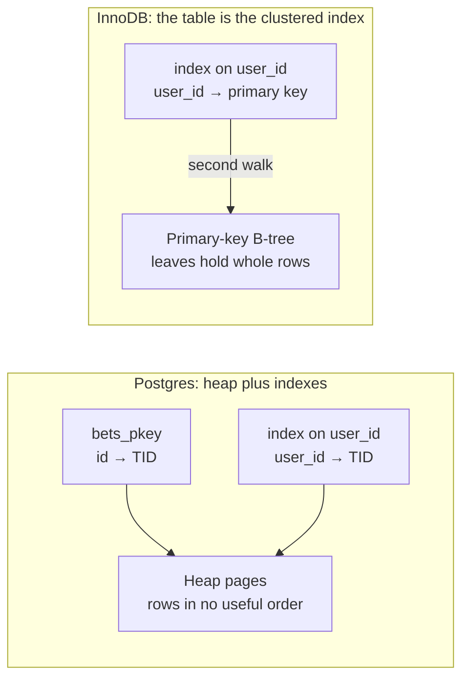

## Where we are

DB-SQL-6 showed how Postgres stores a table (a heap, with every index pointing at a TID) and DB-SQL-7 showed its
isolation levels, row locks, and MVCC cleaned up by VACUUM. MySQL's InnoDB engine uses the same words (B-tree,
repeatable read, MVCC) for different machinery. This lesson maps each Postgres idea to its InnoDB counterpart, so
you can tell where a Postgres-trained instinct goes wrong. Facts are from the MySQL 8.4 Reference Manual.

## The problem

Your team moves the bet-history service from Postgres to MySQL 8.4 to share a cluster with payments. The schema
ports over unchanged: `bets` keeps its random UUID v4 primary key and four secondary indexes, and the wallet code
keeps its read-then-write logic. Within a week, two things go wrong. Bulk loads that were fine on Postgres crawl,
and the secondary indexes are much bigger than before. Then, on Saturday, the settlement job runs a range
`SELECT ... FOR UPDATE` over a user's bets, and bet placement for that user stalls: inserts wait, and some fail
with "Lock wait timeout exceeded". Nobody changed the code. The storage engine changed, and you are asked to
explain why before the next big match.

## The table is the primary-key B-tree

Everything in DB-SQL-6 assumed the Postgres layout: a heap in no useful order, with every index
(including the primary key) pointing at a TID. MySQL's InnoDB engine stores tables differently,
and interviewers like to ask what that changes.

| Way | Example | When it helps | Pitfall |
|---|---|---|---|
| Postgres heap | `bets` heap + `bets_pkey` → TID | Every index is equal; the primary key is just a unique index | Every index points at the physical row, so a non-HOT update touches all of them |
| InnoDB clustered PK | The table *is* the primary-key B-tree | Primary-key range scans read neighbouring rows from the same pages | A random or wide key scatters inserts and causes page splits |
| InnoDB secondary index | `(user_id)` leaf holds `user_id` + the PK | Moving a row doesn't touch secondary indexes | Every lookup is two B-tree walks, and every entry repeats the PK |

**Predict:** you create an InnoDB table with no primary key at all. What does InnoDB order the rows by?

In InnoDB the leaves of the primary-key B-tree hold the whole row, so the table is kept sorted by
primary key. With no primary key, InnoDB uses the first `UNIQUE` index whose columns are all
`NOT NULL`, or else a hidden row id. A secondary index stores the primary key value, not a physical
address, and InnoDB walks the primary-key tree with it to fetch the row.



A primary-key range scan is where the clustered layout pays off:

```sql
-- MySQL: the clustered index means this range scan reads rows stored side by side
SELECT * FROM bets WHERE id BETWEEN 1000 AND 1100;
-- Postgres: the same query walks the index, then fetches each row from wherever the heap put it
```

## Secondary indexes, key width and UUID v4 vs v7

Two consequences follow, and they matter for key design:

- **A wide primary key makes every secondary index bigger.** A 16-byte UUID is copied into every
  entry of every secondary index. MySQL's own manual says a short primary key is advantageous.
- **A random primary key makes inserts expensive.** A UUID v4 is random, so each insert lands on a
  random leaf page of the clustered index. Pages split, fill half-empty, and the working set no
  longer fits in memory. A UUID v7 starts with a millisecond timestamp, so new keys arrive roughly
  in order and append at the right edge, like an auto-increment id.

In Postgres the heap doesn't care about key order, but the primary-key B-tree index still does: v4
keys scatter its inserts too, so v7 (or `bigint` identity) is kinder there as well. Postgres 18 adds
a built-in `uuidv7()` function; on Postgres 16, generate v7 in the application.

```quiz
{"question": "A MySQL InnoDB table uses a random UUID v4 as its primary key and has four secondary indexes. Inserts have slowed and the indexes are large. What is the most effective fix?", "level": "medium",
 "options": [
   {"text": "Switch to a time-ordered key (UUID v7 or a bigint auto-increment) for the primary key", "correct": true, "why": "Ordered keys append at the right edge of the clustered index, and a bigint shrinks the copy of the PK stored in all four secondary indexes."},
   {"text": "Drop the primary key so InnoDB has no clustered index", "why": "InnoDB always has a clustered index; without a PK it uses a unique NOT NULL index or a hidden row id."},
   {"text": "Add a secondary index on the UUID column", "why": "The UUID is already the clustered key; another index adds a write and fixes neither the random inserts nor the size."},
   {"text": "Change the secondary indexes to store a physical row address instead", "why": "That is how Postgres works; InnoDB secondary indexes always store the primary key value."}]}
```

## Repeatable read by default, and a snapshot only for SELECT

Everything in DB-SQL-7 is Postgres. Many teams run MySQL, and the same words (repeatable read, MVCC) hide
different machinery. Three differences come up in interviews.

| Topic | Postgres | MySQL InnoDB | Pitfall when you switch |
|---|---|---|---|
| Default isolation | Read committed | **Repeatable read** | Code that assumed fresh reads per statement sees an old snapshot |
| Stopping phantoms | Snapshot (repeatable read) or conflict tracking (serializable) | **Next-key locks** on locking reads and writes | Range `UPDATE`s and `FOR UPDATE` lock gaps and block other inserts |
| Old row versions | New tuple in the heap; VACUUM removes dead ones | Row updated in place; old version kept in the **undo log**; purge removes it | A long transaction bloats the heap in Postgres, the undo log in InnoDB |
| Repeatable-read write conflict | Error `40001`, retry | No error: the write applies to the latest committed row | Lost updates you thought RR prevented |

**Snapshot vs writes.** InnoDB's repeatable-read snapshot applies to plain `SELECT`s. An `UPDATE`
or `DELETE` acts on the latest committed rows, even ones the transaction's own `SELECT` can't see.
So a read-modify-write (`SELECT balance`, compute in Java, `UPDATE ... SET balance = ?`) is still a
lost update at MySQL's default level, whereas Postgres repeatable read would raise `40001`. The fix
is the same in both: an atomic `SET balance = balance - ?` with a guard, or `SELECT ... FOR UPDATE`.

```quiz
{"question": "On MySQL InnoDB at its default isolation level, transaction A reads balance = 10 with a plain SELECT. B debits 10 and commits. A then runs UPDATE wallets SET balance = 10 - 5 WHERE user_id = 42 (the value it computed). What happens?", "level": "hard",
 "options": [
   {"text": "The UPDATE succeeds and overwrites B's debit: a lost update", "correct": true, "why": "InnoDB's repeatable-read snapshot covers plain SELECTs, but UPDATE acts on the latest committed row and raises no serialization error."},
   {"text": "A fails with a serialization error and must retry", "why": "That is Postgres repeatable read (40001). InnoDB does not detect this conflict."},
   {"text": "A's UPDATE blocks forever, because next-key locks stop it", "why": "B has committed and released its locks; and A's plain SELECT took no locks at all."},
   {"text": "A sees B's change and computes from 0", "why": "A already computed the value in Java from its old read; the UPDATE writes the constant it was given."}]}
```

## Record, gap and next-key locks

**Predict:** session A locks user 42's bets with stakes between 10 and 20 using `FOR UPDATE`. Session B then
inserts a *new* bet for user 42 with stake 15.00, a row nobody could have locked because it didn't exist. Does B
wait?

**Gap and next-key locks.** A *record lock* locks one index entry. A *gap lock* locks the space
between two index entries, so nobody can insert there. A *next-key lock* is both: the record plus
the gap before it. At repeatable read, InnoDB takes next-key locks for locking reads
(`FOR UPDATE`, `FOR SHARE`), `UPDATE` and `DELETE` that scan a range:

```sql
-- MySQL, session A (bets has an index on (user_id, stake))
START TRANSACTION;
SELECT * FROM bets WHERE user_id = 42 AND stake BETWEEN 10 AND 20 FOR UPDATE;
-- session B now waits, because the gaps in that index range are locked:
INSERT INTO bets (user_id, stake, ...) VALUES (42, 15.00, ...);
```

So A can re-run its range query and no phantom row appears. Two details: gap locks are "purely
inhibitive" (they only block inserts, and two transactions can hold gap locks on the same gap), and
an equality search on a *unique* index locks only that one record, with no gap. At read committed
InnoDB turns gap locking off for searches and index scans, which is why many MySQL shops switch
to read committed to cut lock waits.

```quiz
{"question": "InnoDB session A holds a gap lock on the gap between two index entries. Which statement from session B has to wait?", "level": "easy",
 "options": [
   {"text": "An INSERT whose key falls inside that gap", "correct": true, "why": "Blocking inserts into the gap is the only thing a gap lock does."},
   {"text": "A plain SELECT that reads the same range", "why": "A plain SELECT is a consistent read from a snapshot and takes no locks, so it never waits for them."},
   {"text": "Its own gap lock on the same gap, from a locking read", "why": "Gap locks are purely inhibitive and can co-exist: two transactions may hold gap locks on the same gap."},
   {"text": "A SELECT ... FOR UPDATE on a row far outside the range", "why": "It locks other index records; nothing it needs is held by A."}]}
```

## Undo log and purge vs VACUUM

**Undo log vs tuple versions.** InnoDB writes the new value into the row and copies the old value
into the undo log; a reader with an older snapshot rebuilds its version from there. A background
*purge* discards undo records that no snapshot needs. Postgres keeps old versions in the table
itself until VACUUM. The operational lesson is identical: a long-open transaction stops cleanup.

## Lab (~10 min)

Run MySQL 8.4 in Docker and watch the two surprises from the story happen. Expected outcomes below are what the
MySQL 8.4 manual specifies; check them against what you see.

```text
docker run --name mysql-lab -e MYSQL_ALLOW_EMPTY_PASSWORD=yes -d mysql:8.4
docker logs -f mysql-lab        # wait for "ready for connections", then Ctrl+C
docker exec -it mysql-lab mysql -uroot      # open this in two terminals: session A and session B
```

Setup (in session A):

```sql
CREATE DATABASE lab; USE lab;
CREATE TABLE bets (id BIGINT AUTO_INCREMENT PRIMARY KEY, user_id BIGINT NOT NULL,
                   stake DECIMAL(10,2) NOT NULL, KEY idx_user_stake (user_id, stake));
INSERT INTO bets (user_id, stake) VALUES (42, 5.00), (42, 10.00), (42, 20.00), (42, 30.00), (7, 15.00);
CREATE TABLE wallets (user_id BIGINT PRIMARY KEY, balance DECIMAL(10,2) NOT NULL);
INSERT INTO wallets VALUES (42, 10.00);
SELECT @@transaction_isolation;          -- REPEATABLE-READ
```

**1. A gap lock blocks an insert.** Run `USE lab;` in session B first.

```sql
-- A
START TRANSACTION;
SELECT * FROM bets WHERE user_id = 42 AND stake BETWEEN 10 AND 20 FOR UPDATE;
-- B: waits, then after innodb_lock_wait_timeout (50 s by default) fails with ERROR 1205
INSERT INTO bets (user_id, stake) VALUES (42, 15.00);
-- A, while B waits: see the locks
SELECT index_name, lock_mode, lock_data FROM performance_schema.data_locks WHERE object_name = 'bets';
ROLLBACK;
```

You should see record locks on `idx_user_stake` whose `lock_mode` is `X` (next-key) or includes `GAP`.

**2. Break it: switch both sessions to read committed.** Run
`SET SESSION TRANSACTION ISOLATION LEVEL READ COMMITTED;` in A and B and repeat step 1. B's insert now succeeds
at once, because read committed turns off gap locking for searches and index scans. Re-run A's `SELECT ... FOR
UPDATE` inside its open transaction and the 15.00 row is there: the phantom that next-key locks were preventing.
`ROLLBACK` in A, then `SET SESSION TRANSACTION ISOLATION LEVEL REPEATABLE READ;` in both sessions.

**3. A lost update at repeatable read.**

```sql
-- A
START TRANSACTION;
SELECT balance FROM wallets WHERE user_id = 42;            -- 10.00
-- B (autocommit)
UPDATE wallets SET balance = balance - 10.00 WHERE user_id = 42;   -- now 0.00
-- A
SELECT balance FROM wallets WHERE user_id = 42;            -- still 10.00: A's snapshot
UPDATE wallets SET balance = 5.00 WHERE user_id = 42;      -- the value A computed from 10.00; no error
COMMIT;
SELECT balance FROM wallets WHERE user_id = 42;            -- 5.00: B's debit is gone
```

Postgres repeatable read would have failed A's `UPDATE` with `40001`. Reset with
`UPDATE wallets SET balance = 10.00 WHERE user_id = 42;` and redo step 3 with
`SET balance = balance - 5.00 WHERE user_id = 42 AND balance >= 5.00` and A updates 0 rows instead.
Clean up with `docker rm -f mysql-lab`.

## Gotchas

- **Porting a random UUID v4 primary key.** It scatters inserts across the clustered index and is copied into
  every secondary index. Use a `BIGINT` auto-increment or a UUID v7.
- **Trusting repeatable read to stop lost updates.** InnoDB raises no error; `UPDATE` acts on the latest
  committed row. Use `SET x = x - ?` with a guard, or `FOR UPDATE`.
- **Range locking reads at repeatable read** lock gaps and block inserts. Keep them short, or use read committed.
- **Expecting a fresh snapshot per statement.** At InnoDB's default the first read fixes it for the transaction.
- **Long-open transactions** stop purge, so the undo log grows.

## In interviews

Asked as "How does MySQL store a table differently?", "Why is a UUID key slow in MySQL?" or "Does repeatable
read stop phantoms in MySQL?". [Indexes, Partitioning and Sharding](#/q/db-indexing-partitioning-sharding) leads
into key design; [Replica vs snapshot vs checkpoint; deadlock detection](#/q/dbms-replica-snapshot-checkpoint)
into locking.

**Follow-up:** "So MySQL repeatable read is safer?" No: next-key locks stop phantoms for locking reads, but a
read-modify-write loses an update that Postgres would reject with `40001`.

## Explain it in 2 minutes

*"Your team moves from Postgres to MySQL InnoDB. What changes for keys and concurrency?"*

1. The table is the primary-key B-tree; secondary indexes store the key, so lookups walk two trees.
2. Keep the key short and ordered: `BIGINT` or UUID v7, not v4.
3. Default repeatable read: `SELECT`s read one snapshot, writes act on the latest rows.
4. Locking reads and range writes take next-key locks that block inserts into gaps.
5. Old versions live in the undo log until purge; a long transaction stalls it, as it stalls VACUUM.

## Check yourself

1. What does an InnoDB secondary index store to find the row, and what does that cost?
2. Why does a UUID v7 primary key insert better than a v4 in InnoDB?
3. At repeatable read, why does an insert into a range locked with `FOR UPDATE` wait? What changes at read
   committed?

### Answers

1. The primary-key value: two B-tree walks per lookup, and a wide key bloats every secondary index.
2. v7 starts with a timestamp, so keys append at the right edge; v4 lands on random pages that split.
3. Next-key locks cover the gaps, and gap locks block inserts. Read committed skips gap locks for searches and
   index scans.

## Next

**DB-SQL-8** turns from engine internals to throughput: N+1 queries, pagination, batching and connection pools,
which work the same way on MySQL and Postgres.
