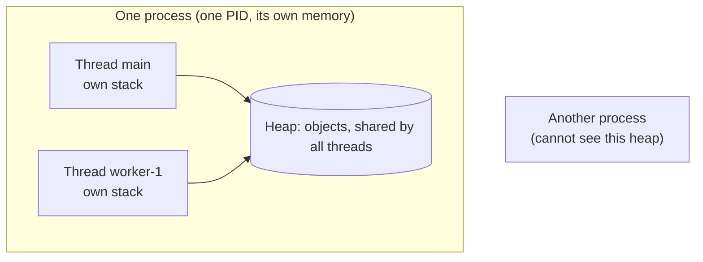

## Where we are

This is the first lesson of the Academy.

- **Assumed:** you can write a small Java class with a `main` method.
- **By the end:** you will know what really happens when a browser asks a server for a page, and you will have built a server with nothing but the JDK.

Every later lesson in the Story of Backend builds on this picture.

Throughout the track we grow one app, **ShopKart**, a small online shop. Each era of backend history builds it a different way.

## The problem

You are twenty minutes into a first-round interview for a backend role. The interviewer smiles and asks the oldest warm-up there is: *"You type `shopkart.com/orders` into a browser and press Enter. What happens?"*

You say "the browser calls the server and gets the page back". The interviewer waits. Then:

- *"Calls it how?*
- *What is 'the server', exactly?*
- *Which part of it runs your code?"*

That silence is where a lot of interviews are lost, and it is also where every backend framework begins.

CGI in the 1990s, servlets, Spring Boot today: each is a different answer to "which part runs your code, and how does it handle many people at once?"

To answer well you need seven small ideas: the computer, the program, the process, memory, the thread, the network, and HTTP. One section each, then you build the whole thing.

## A computer: CPU, memory, disk

A **computer** is a machine that follows instructions. Three parts matter to us:

- The **CPU** (processor) executes instructions, billions per second. A modern CPU has several **cores**, and each core can run its own stream of instructions at the same moment.
- **Memory** (RAM) is fast, temporary storage. It is wiped when the power goes off.
- The **disk** (SSD or hard drive) is slower, permanent storage. Your files and installed programs live here.

**Rule:** the CPU only works on what is in memory. Anything on disk has to be loaded into memory first.

## A program and a process

- A **program** is a file of instructions sitting on disk.
  - Examples: `java.exe`, a browser, your compiled `Hello.class`.
- A **process** is a program that is *running*. When it starts, the operating system (Windows, Linux, macOS) gives it:
  - its own **private memory**, which other processes cannot touch;
  - an id number, the **PID** (process id);
  - a share of **CPU time**.

**Predict:** you open two terminal windows and run `java Hello` in each. How many programs are there, and how many processes?

**One program and two processes.**
- Each process has its own PID and its own memory.
- If one crashes, the other carries on.

**Rule:** processes are **isolated**.
- **Good:** one process cannot break another.
- **Cost:** starting one is expensive, because the OS sets up fresh memory and loads the program.
- **Java pays more:** every process starts a whole JVM (the program that runs Java bytecode).
- Remember this cost. In BE-STORY-2 it becomes the central problem.

## Memory inside a process: stack and heap

Inside a Java process, memory has two main areas:

- The **stack** holds the local variables of the method running right now. Every method call adds a **frame** to the stack, and the frame is removed when the method returns.
- The **heap** holds objects, meaning anything created with `new`.

```java
void placeOrder() {
    int qty = 2;                        // qty lives on the stack
    Order o = new Order("book", qty);   // the Order object lives on the heap;
}                                       // the reference 'o' lives on the stack
```

**Rule:**

- stack memory belongs to one running method call;
- heap memory can be reached by anyone holding a reference to the object.

Lesson JAVA-JVM-2 goes much deeper.

## A thread

A **thread** is a single path of execution inside a process: a worker following the code line by line. Every thread has **its own stack**, and all threads in a process **share the same heap**.



A thread is much cheaper to start than a process, because it reuses the process's memory.

The price of that sharing: two threads can change the same object at the same moment and corrupt it. You will watch this happen in BE-STORY-3.

Analogy: a process is a restaurant kitchen and threads are its cooks. The cooks share the fridge (heap) but each has their own chopping board (stack).

The analogy breaks because real cooks see each other and coordinate; threads do neither unless your code makes them.

```quiz
{"question": "Two threads run inside the same Java process. Which of these does each thread have to itself?", "level": "easy",
 "options": [
   {"text": "Its own stack", "correct": true, "why": "Each thread runs its own method calls, so each needs its own frames and local variables."},
   {"text": "Its own heap", "why": "The heap belongs to the process. All its threads share it, which is why threads are cheap and also why they can corrupt shared objects."},
   {"text": "Its own PID", "why": "The PID identifies the process. Every thread in it lives under that one PID."},
   {"text": "Its own private memory that other threads cannot touch", "why": "That is what separates processes, not threads. Threads in one process can all reach the same objects."}]}
```

## A network: IP addresses and ports

A **network** connects computers so they can send each other bytes. Two numbers say where bytes should go:

- An **IP address** identifies a machine, for example `142.250.183.14`. The special address `127.0.0.1`, also called **localhost**, always means "this same machine".
- A **port** (a number from 0 to 65535) identifies one program on that machine.
  - Web servers usually listen on port 80 (HTTP) or 443 (HTTPS).
  - In our labs the server listens on 8080.

**Rule:** `localhost:8080` means "the program listening on port 8080 on my own computer". Only one process can listen on a given port at a time.

```quiz
{"question": "HelloServer is running and listening on port 8080. You start a second copy in another terminal. What happens?", "level": "medium",
 "options": [
   {"text": "The second copy fails at startup with a BindException", "correct": true, "why": "Only one process can listen on a port. The port is taken, so binding fails. Stop the old copy or pick another port."},
   {"text": "The second copy quietly moves to port 8081", "why": "Nothing moves ports for you. The program asked for 8080 and gets an error when it cannot have it."},
   {"text": "Both copies share port 8080 and take turns", "why": "Two processes cannot both listen on one port like this. Spreading requests over several processes needs something in front, such as a load balancer."},
   {"text": "The first copy is shut down and replaced", "why": "The OS never kills a running process to hand its port to another. The newcomer is the one that fails."}]}
```

## TCP: a reliable conversation between client and server

Every conversation has two roles:

- The **server** starts first, **listens** on a port and waits.
- The **client** connects to that port and asks for something.

A browser is a client; ShopKart's backend is a server.

Raw networks can lose, duplicate or reorder pieces of data. **TCP** (Transmission Control Protocol) turns this into a reliable, ordered stream of bytes between client and server, called a **connection**.

- **Handshake:** before any data flows, the two sides exchange three small messages to agree they are both ready: the **three-way handshake** (SYN, SYN-ACK, ACK).
- **In Java:** you never write TCP yourself. You open a `Socket` and simply read and write bytes.
- **UDP**, the alternative, is faster but gives no delivery guarantees (see the bank question below).

One server talks to many clients at once, and *how* it does so (a process each? a thread each?) is the question that drives the next several eras.

## HTTP: the language of the web

TCP only moves bytes. Both sides also have to agree on what the bytes *mean*.

**HTTP** (HyperText Transfer Protocol) is that agreement for the web.

Tim Berners-Lee designed it at CERN around 1990, together with the first web server and browser.

An HTTP **request** is plain text:

```text
GET /orders?user=akhil HTTP/1.1        <- request line: method, path, version
Host: shopkart.com                     <- headers: name: value
Accept: text/html
                                       <- blank line: headers are over
                                       <- (optional body, e.g. form data for POST)
```

A **response** has the same shape:

```text
HTTP/1.1 200 OK                        <- status line: version, status code, reason
Content-Type: text/html
Content-Length: 20
                                       <- blank line
<h1>Your orders</h1>                   <- body
```

The words you need:

- The **method** says what you want: `GET` to read, `POST` to submit or create.
- The **status code** says how it went: `200` OK, `404` not found, `500` the server failed.
- **Headers** are metadata, such as the type of the body or its length.

Each line ends in `\r\n` (carriage return, line feed), and an empty line ends the headers.

```quiz
{"question": "You write this request by hand over a socket, and the call just hangs: no response, no error. Why?", "level": "medium",
 "code": ["GET /hello HTTP/1.1\\r\\n", "Host: localhost\\r\\n"],
 "options": [
   {"text": "There is no blank line, so the server is still waiting for more headers", "correct": true, "why": "The empty line is how the server knows the headers are over. Without it, it keeps reading and never starts to answer."},
   {"text": "A GET request must have a body", "why": "GET normally has no body at all. The missing piece is the end-of-headers marker."},
   {"text": "Host must be the real domain name, not localhost", "why": "Host can be any name the server accepts. A wrong host might give a 404 or 400, but it would not hang."},
   {"text": "The server is not running", "why": "Then you would get an immediate 'connection refused' error, not a hang."}]}
```

## Request and response

Now put the pieces together. Press **Play** and watch one click travel through them.

```anim
{"title": "One click on shopkart.com/orders", "stages": ["Server listens on a port", "TCP connection opens", "Request text sent", "A thread runs your code", "Response text sent", "Browser draws the page", "Next request starts fresh"], "frames": [
{"stage": 0, "note": "The ShopKart server is a process with a PID. It started first and is listening on port 8080 (443 for HTTPS)."},
{"stage": 1, "note": "The browser (the client) opens a TCP connection to the server's IP address and port. The three-way handshake runs first."},
{"stage": 2, "note": "The browser writes plain text: request line, headers, a blank line. GET /orders HTTP/1.1"},
{"stage": 3, "note": "Inside the server process, a thread picks up the request and runs the handler: read the orders, build the HTML. Its local variables live on its own stack."},
{"stage": 4, "note": "The server writes back plain text: status line (200 OK), headers, a blank line, then the HTML body."},
{"stage": 5, "note": "The browser reads the response and draws the HTML on screen."},
{"stage": 6, "note": "HTTP is stateless: the next request carries no memory of this one unless the client sends something that identifies you."}
]}
```

**Predict:** the class below starts a server *and* a raw client in one process, and the client sends the request text by hand. What is the very first line the client receives?

```java
import com.sun.net.httpserver.HttpServer;
import java.io.OutputStream;
import java.net.InetSocketAddress;
import java.net.Socket;
import java.nio.charset.StandardCharsets;

public class OneRequest {
    public static void main(String[] args) throws Exception {
        System.out.println("One process, PID " + ProcessHandle.current().pid());

        // The server: listen on a port the OS picks (port 0 = "any free port")
        HttpServer server = HttpServer.create(new InetSocketAddress("127.0.0.1", 0), 0);
        server.createContext("/orders", exchange -> {
            System.out.println("[server] " + exchange.getRequestMethod() + " " + exchange.getRequestURI()
                    + " handled by thread " + Thread.currentThread().getName());
            byte[] body = "<h1>Your orders</h1>\n".getBytes(StandardCharsets.UTF_8);
            exchange.getResponseHeaders().add("Content-Type", "text/html; charset=utf-8");
            exchange.sendResponseHeaders(200, body.length);          // status line + headers
            try (OutputStream out = exchange.getResponseBody()) {
                out.write(body);                                     // body
            }
        });
        server.start();
        int port = server.getAddress().getPort();
        System.out.println("[server] listening on 127.0.0.1:" + port);

        // The client: open a TCP connection and write HTTP as plain text
        try (Socket socket = new Socket("127.0.0.1", port)) {
            String request = "GET /orders?user=akhil HTTP/1.1\r\n"
                    + "Host: localhost\r\n"
                    + "Connection: close\r\n"
                    + "\r\n";                                         // blank line = end of headers
            socket.getOutputStream().write(request.getBytes(StandardCharsets.US_ASCII));
            System.out.println("[client] sent:\n" + request);
            String response = new String(socket.getInputStream().readAllBytes(), StandardCharsets.UTF_8);
            System.out.println("[client] received:\n" + response);
        } finally {
            server.stop(0);
        }
    }
}
```

Press **Run**. The first line received is the status line, `HTTP/1.1 200 OK`, followed by:

- headers (`Date`, `Content-type`, `Content-length`);
- a blank line;
- the body.

The server log also names the thread that ran the handler (`HTTP-Dispatcher`): not `main`, but a separate thread inside the same process. HTTP really is just text over a TCP connection.

## HTTP is stateless

One more property matters a great deal. HTTP is **stateless**: each request stands alone, and the server does not automatically remember that the previous request came from you.

So how does a site "remember" you are logged in? The client sends something with *every* request that identifies you:

- usually a small value called a **cookie** that the server handed out at login;
- or a token.

Logins, carts and sessions are all built on top of HTTP this way. You will build a session in BE-STORY-3.

Busy sites run several copies (instances) of the same server process, with a **load balancer** in front: a component that hands each incoming request to one of the instances.

Because HTTP is stateless, nothing ties your next request to the instance that served the last one.

```quiz
{"question": "ShopKart runs two server instances, A and B, behind a load balancer. You log in on A, which keeps your login state in a map on its heap. The load balancer sends your next request to B. What happens?", "level": "hard",
 "options": [
   {"text": "B finds no login for your cookie, so you look logged out", "correct": true, "why": "A and B are separate processes, and processes are isolated: B cannot see A's heap. The cookie only carries an id, and B has nothing stored under it. The fix is shared session storage (or sticky routing)."},
   {"text": "B reads your login from A's heap, since both run the same program", "why": "Same program, different processes. Each process has its own private memory, so A's heap is invisible to B."},
   {"text": "The load balancer notices and forwards the request back to A", "why": "A plain load balancer knows nothing about your login. Sending a user back to the same instance (sticky sessions) is extra configuration, and it breaks again when A restarts."},
   {"text": "The cookie holds the whole login state, so B knows you anyway", "why": "Here the cookie is just an id the server handed out. The state it points to lives in A's memory, which B cannot reach."}]}
```

## Lab (~10 min)

Build a real server with only the JDK, talk to it from a browser, then break it.

**1. The server.** Save this as `HelloServer.java` and run it in a terminal with `java HelloServer.java` (since Java 11 the launcher can run a single source file directly). It keeps running until you press Ctrl+C, so use a terminal rather than the Run button.

```java
import com.sun.net.httpserver.HttpExchange;
import com.sun.net.httpserver.HttpServer;
import java.io.IOException;
import java.io.OutputStream;
import java.net.InetSocketAddress;
import java.nio.charset.StandardCharsets;

public class HelloServer {
    public static void main(String[] args) throws IOException {
        long pid = ProcessHandle.current().pid();
        HttpServer server = HttpServer.create(new InetSocketAddress(8080), 0);
        server.createContext("/hello", exchange -> {
            String name = exchange.getRequestURI().getQuery();              // "akhil" from /hello?akhil
            reply(exchange, "Hello, " + (name == null ? "stranger" : name) + "! (from PID " + pid + ")\n");
        });
        server.createContext("/slow", exchange -> {
            try {
                Thread.sleep(5_000);                                        // pretend: a slow database query
            } catch (InterruptedException e) {
                Thread.currentThread().interrupt();
            }
            reply(exchange, "Finally done.\n");
        });
        // server.setExecutor(java.util.concurrent.Executors.newFixedThreadPool(4));   // the fix (step 4)
        server.start();
        System.out.println("PID " + pid + " listening on http://localhost:8080/hello");
    }

    private static void reply(HttpExchange exchange, String text) throws IOException {
        System.out.println(exchange.getRequestMethod() + " " + exchange.getRequestURI()
                + " handled by thread " + Thread.currentThread().getName());
        byte[] bytes = text.getBytes(StandardCharsets.UTF_8);
        exchange.getResponseHeaders().add("Content-Type", "text/plain; charset=utf-8");
        exchange.sendResponseHeaders(200, bytes.length);
        try (OutputStream out = exchange.getResponseBody()) {
            out.write(bytes);
        }
    }
}
```

**2. Talk to it.** Open `http://localhost:8080/hello?akhil`.

- The PID in the page matches the PID the server printed: one long-running process answers every request.
- Try `http://localhost:8080/nothing`: a `404`, because no handler is mapped to that path.

**3. Break it: one slow customer.** **Predict:** open `/slow` in one tab and, while it is still loading, `/hello` in a second tab. Does `/hello` answer at once?

It does not: `/hello` waits until `/slow` finishes, about 5 seconds.

- **Why:** the server log shows both requests were handled by the same thread, `HTTP-Dispatcher`.
- **Cause:** with no executor set, `HttpServer` handles every request on the single thread that `start()` created, so one slow request blocks everyone.
- Picture ShopKart on sale day with one customer running a slow report.

**4. Fix it.** Uncomment the `setExecutor` line and restart. Repeat step 3:

- `/hello` now answers immediately;
- the log shows different threads (`pool-1-thread-1`, `pool-1-thread-2`).

You just moved from "one thread for everyone" to "a thread per request", which is exactly the jump the servlet era made (BE-STORY-3).

**5. Break it again.** With the server running, start a second copy in another terminal. Watch for `java.net.BindException: Address already in use`: the port is taken.

## Gotchas

- **`localhost` is the machine the code runs on**; in a container it points elsewhere. Use real host names in config.
- **`BindException` on start:** an old copy still holds the port. Stop it or change the port.
- **No blank line after the headers** and the server waits forever.
- **Header names are case-insensitive**; never compare them with `equals`.
- **HTTP is stateless:** memory between requests needs a cookie or token plus a session store.

## In interviews

- [Process vs thread, shared variables and race conditions](#/q/process-vs-thread)
- [TCP vs UDP](#/q/tcp-vs-udp)
- [Stack vs Heap: What Happens on int a = 10?](#/q/java-stack-vs-heap-memory)

Follow-ups:

- *"What happens when you type a URL and press Enter?"*
  1. DNS resolves the name to an IP;
  2. TCP connects (plus TLS for HTTPS);
  3. the request goes out;
  4. a server thread handles it;
  5. the browser renders the response.
  - Go in that order, then say which step you would check for a given kind of slowness.
- *"Why are threads cheaper than processes?"* They share the process's heap, so no new memory is set up; you lose isolation.

## Explain it in 2 minutes

*"Explain to a new graduate what happens, inside the server, when a browser asks for `/orders`."*

1. The server is a **process** **listening on a port**.
2. The browser opens a **TCP connection** and sends a **text HTTP request**.
3. A **thread** runs the handler: own stack, shared heap.
4. The server writes an **HTTP response**; HTTP is **stateless**.
5. How to serve many clients at once (processes or threads) drives the eras that follow.

## Check yourself

1. Why is a new process more expensive than a new thread?
2. In `void f() { Order o = new Order(); }`, where do `o` and the `Order` object live?
3. What do `127.0.0.1` and port `8080` each identify?
4. What does "HTTP is stateless" mean for a login feature?

### Answers

1. A process needs fresh memory and the program loaded (for Java, a JVM); a thread reuses its process's memory.
2. `o` is on the stack in `f`'s frame; the object is on the heap.
3. The machine (this one) and the listening program on it.
4. Every request must carry a cookie or token so the server can recognise you.

## Next

BE-STORY-2 (CGI) serves the first dynamic pages with **a new process per request**, and measures why that hurts.
