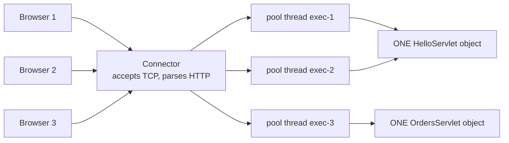

## Where we are

In BE-STORY-2 you built CGI, with **one process per request**. You measured it:

- **Good:** strong isolation.
- **Cost:** every request paid the start-up cost, and nothing survived between requests.

This lesson covers Java's answer, **servlets**: one long-lived server process that handles each request on a **thread**. It is much faster, and it brings a new class of bug.

## The problem

It is 1999 and you are ShopKart's only backend developer. Marketing has booked a holiday sale for next week.

Your CGI lab numbers say every request:

- starts a process;
- opens a database connection;
- forgets everything on exit.

At sale traffic the server will spend more time starting programs than serving customers. You need two things:

1. **Keep the runtime warm.** Load the code once and reuse it for every request.
2. **Keep useful things in memory between requests**: database connections, caches, and who is logged in.

Java was well suited to this. The JVM is a long-running process, and Java had threads built in from version 1.0.

## The invention: a container and a servlet

A **servlet** is a Java class that handles HTTP requests. You extend `HttpServlet` and override a method such as `doGet`:

```java
public class HelloServlet extends HttpServlet {
    @Override
    protected void doGet(HttpServletRequest req, HttpServletResponse resp) throws IOException {
        resp.setContentType("text/html");
        resp.getWriter().println("<h1>Hello " + req.getParameter("user") + "</h1>");
    }
}
```

Your servlet does not open ports or parse HTTP itself. A **servlet container** (a web server that hosts servlets, such as Apache Tomcat or Jetty) does that work, all inside one JVM process:



A **thread pool** is a set of threads created up front and reused, so the container doesn't create a new thread for every request.

- Tomcat's default maximum is 200 threads.
- When a request finishes, its thread returns to the pool for the next one.

History: Sun introduced the Servlet API around 1997 and in 1999 donated its reference implementation to Apache, where it became **Apache Tomcat**. In 2020 the package moved from `javax.servlet` to `jakarta.servlet` (Jakarta EE 9), which is why modern code imports `jakarta.*`.

## The servlet lifecycle

**Predict:** 150 users load the hello page at the same moment. How many `HelloServlet` objects exist?

One. The container manages the servlet's life, and your code never calls `new HelloServlet()`:

```anim
{"title": "The life of one servlet object",
 "stages": ["load class", "create ONE instance", "init()", "service() per request", "destroy()"],
 "frames": [
  {"stage": 0, "note": "The container loads HelloServlet's class, at deploy time or on the first request to its URL."},
  {"stage": 1, "note": "It creates a single instance. This object will serve every request mapped to the servlet."},
  {"stage": 2, "note": "init() runs once: the place to read config or open expensive resources."},
  {"stage": 3, "note": "Each request calls service(), which dispatches to doGet or doPost. Many pool threads run it on the same object at the same moment, so anything in its fields is shared by all of them."},
  {"stage": 4, "note": "At shutdown or undeploy, destroy() runs once: close what init() opened."}
 ]}
```

Rule: **by default the container creates a single instance of each servlet and calls it from many threads at the same moment.** This one fact explains the main bug of the era.

```quiz
{"question": "During one day a servlet serves 50,000 requests and the server is never restarted. How many times does init() run?", "level": "easy",
 "options": [
   {"text": "Once", "correct": true, "why": "init() runs once, after the container creates the single instance. Each request only calls service()."},
   {"text": "50,000 times, once per request", "why": "That is CGI's model: a fresh start per request. The point of servlets is that set-up is paid once."},
   {"text": "200 times, once per pool thread", "why": "Threads share the one servlet object; they do not each get their own initialised copy."},
   {"text": "Once per user session", "why": "Sessions are a separate mechanism (next section); the servlet's lifecycle does not depend on users."}]}
```

## Sessions: remembering the user

HTTP is stateless (BE-STORY-1), but now that the process lives on, it can remember things. When you call `req.getSession()`, the container:

1. creates an `HttpSession` object, which is a map kept in server memory,
2. sends the browser a **cookie** named `JSESSIONID` (a small name=value pair the browser automatically returns on later requests to the same site),
3. on the next request, uses that cookie to find the same session object.

```java
HttpSession session = req.getSession();           // creates the session + JSESSIONID cookie
session.setAttribute("user", "akhil");
// later request, same browser:
String user = (String) req.getSession(false).getAttribute("user");   // "akhil"
```

Rule: a session lives **in that server's memory**. The cookie carries only an id, never the data.

```quiz
{"question": "ShopKart adds a second server behind a round-robin load balancer. Sessions stay in each server's memory. A user logs in on server A; their next request lands on server B. What happens?", "level": "medium",
 "options": [
   {"text": "B finds no session for that JSESSIONID, so the user looks logged out", "correct": true, "why": "B has never seen this id. Fixes: sticky sessions, session replication, an external session store, or stateless tokens."},
   {"text": "B fetches the session from A automatically", "why": "Plain containers do not share in-memory sessions; replication has to be set up on purpose."},
   {"text": "It works, because the cookie carries the user's data", "why": "The cookie carries only the session id. The data stays in A's memory."},
   {"text": "The load balancer merges both servers' sessions", "why": "A round-robin balancer only picks a server; it knows nothing about sessions."}]}
```

## Servlets, all the ways

Interviewers like the corners of the Servlet API: hooks, hand-offs, async and wiring. Here they are on one screen (Jakarta Servlet 6, `jakarta.servlet.*`).

A **filter** below means a class that wraps every matching request before and after the servlet, for logging or auth.

| Way | Example | When to choose | Pitfall |
|---|---|---|---|
| `ServletContextListener` | open a pool in `contextInitialized` | app-wide start/stop work | slow work here delays the whole app's start |
| `HttpSessionListener` | count live sessions | per-user setup or metrics | a closed tab fires `sessionDestroyed` only at timeout |
| `forward()` | servlet hands the request to `/confirm` | one server-side hand-off | browser URL stays the old one |
| `include()` | pull a header fragment into the page | compose one response | included part cannot set status or headers |
| `sendRedirect()` | 302 to `/orders/42` | after a POST, or to another site | new request: request attributes are gone |
| Async servlet | `startAsync()` then `complete()` | slow I/O holding pool threads | forgetting `complete()` leaves the client waiting |
| `loadOnStartup` | `@WebServlet(loadOnStartup = 1)` | heavy `init()` | default (`-1`) means the first user pays for it |
| `web.xml` | `<servlet>` + `<servlet-mapping>` | override without recompiling | verbose; drifts from code |
| Annotations | `@WebServlet`, `@WebFilter`, `@WebListener` | most plain servlet apps | filter order is not defined by annotations |
| Programmatic | `ServletContainerInitializer`, `ServletRegistrationBean` | frameworks, Spring Boot | hidden: grep the code, not the XML |

**Listeners** are callbacks the container fires on lifecycle events. Both interfaces have `default` no-op methods, so you override only what you need, and `@WebListener` registers the class:

```java
@WebListener
public class AppEvents implements ServletContextListener, HttpSessionListener {
    private final AtomicInteger liveSessions = new AtomicInteger();

    @Override public void contextInitialized(ServletContextEvent e) { /* open DB pool, warm caches */ }
    @Override public void contextDestroyed(ServletContextEvent e)   { /* close the pool */ }
    @Override public void sessionCreated(HttpSessionEvent e)        { liveSessions.incrementAndGet(); }
    @Override public void sessionDestroyed(HttpSessionEvent e)      { liveSessions.decrementAndGet(); }
}
```

**Forward, include, redirect.**

- `forward()` and `include()` happen inside the server on the *same* request object, so `req.setAttribute(...)` values survive and the browser sees one response.
  - **Watch out:** `forward()` must run before anything is committed (sent) to the client, otherwise it throws `IllegalStateException`.
- `sendRedirect()` sends a 302 with a `Location` header. The browser then makes a *second* request (a GET), the address bar changes, and request attributes are lost.
  - So you pass an id in the URL or keep it in the session.

```java
protected void doPost(HttpServletRequest req, HttpServletResponse resp) throws IOException {
    String id = saveOrder(req);                                    // write once
    resp.sendRedirect(req.getContextPath() + "/orders/" + id);     // Post/Redirect/Get
}
```

That pattern, **Post/Redirect/Get**, means a browser refresh repeats the harmless GET, not the POST.

```quiz
{"question": "doPost saves an order, then calls req.getRequestDispatcher(\"/confirm\").forward(req, resp). The user sees the confirmation and presses F5. What happens?", "level": "hard",
 "options": [
   {"text": "The browser re-sends the POST, so a second order can be saved", "correct": true, "why": "The forward happened inside the server; the browser's last request is still the POST to /orders, so refresh repeats it (most browsers first ask you to confirm). A redirect (Post/Redirect/Get) would make the last request a GET."},
   {"text": "The browser reloads /confirm with a GET", "why": "The browser never learned about /confirm. Its address bar still shows /orders and its last request was the POST."},
   {"text": "Nothing is re-sent, because a forward is server-side", "why": "Server-side is exactly why the browser still holds the original POST to repeat."},
   {"text": "The container spots the duplicate through the JSESSIONID and ignores it", "why": "The container does no duplicate detection; preventing double submits is your job (PRG, or an idempotency key)."}]}
```

## Async servlets and wiring

Normally a pool thread is held for the whole request, even while it waits 3 seconds for a slow partner API. With async support the servlet can return early and finish the response later.

**Predict:** in the code below, `doGet` returns at once. Is the response sent to the browser at that moment?

```java
@WebServlet(urlPatterns = "/report", asyncSupported = true)
public class ReportServlet extends HttpServlet {
    private final ExecutorService slowIo = Executors.newFixedThreadPool(20);

    @Override
    protected void doGet(HttpServletRequest req, HttpServletResponse resp) {
        AsyncContext ac = req.startAsync();                // response stays open after doGet returns
        slowIo.submit(() -> {
            try {
                ac.getResponse().getWriter().println(callSlowPartner());
            } catch (IOException e) {
                log("report failed", e);
            } finally {
                ac.complete();                             // send the response and end the request
            }
        });
    }                                                      // the container thread is back in the pool now

    @Override public void destroy() { slowIo.shutdown(); }
}
```

No. After `startAsync()` the response stays open until `complete()` is called, or until the async timeout expires (Tomcat's default is 30 seconds; set your own with `ac.setTimeout(...)`).

- **Watch out:** every filter in the chain must also allow async, or `startAsync()` throws `IllegalStateException`.
- **What it frees:** async frees the *container's* threads; the slow work still occupies a thread somewhere unless the client is non-blocking.
- **Built on it:** Spring MVC's `DeferredResult` builds on it, and virtual threads (BE-STORY-13, JAVA-CONC-6) now give the same benefit with plain blocking code.

**Initialisation and wiring.**

- A servlet is created lazily, usually on its first request; `loadOnStartup` of zero or more creates it at deploy time, lower numbers first.
- `web.xml` wins when it overrides an annotation (`@WebServlet` and friends arrived in Servlet 3.0).
- Programmatic registration runs at start-up: a `ServletContainerInitializer` (found through `META-INF/services`) or, in Spring Boot, a `ServletRegistrationBean`.

**Containers.**

- **Classic deployment** drops a WAR (web archive) into an installed Tomcat that hosts many apps.
- **Spring Boot** embeds Tomcat (or Jetty; Undertow was dropped in Boot 4) in one runnable "fat" jar containing both the app and the server (BE-STORY-8), the style the lab uses.

## The new pain, part 1: shared mutable state

Because one servlet instance serves every thread, an **instance field** is shared by all concurrent requests:

```java
public class CounterServlet extends HttpServlet {
    private int count = 0;                    // ONE copy, shared by every request thread
    protected void doGet(HttpServletRequest req, HttpServletResponse resp) {
        count++;                              // read, add one, write back
    }
}
```

**Predict:** 100 users send 100 requests each, 10,000 increments in all. What does `count` end at?

Usually *less* than 10,000, and different on every run. `count++` is three steps:

1. read `count`;
2. add 1;
3. write it back.

If two threads both read 41, both write 42, and one increment is lost.

This is a **race condition**: the result depends on how the threads' steps interleave. It never appears when you test alone in a browser; it appears under load in production.

The fixes, from weakest to best:

- `synchronized`: only one thread at a time runs the block. This is correct, but every request queues on it.
- `AtomicLong`: a JDK class whose `incrementAndGet()` performs read-add-write as one indivisible step. This is correct and fast.
- **No shared mutable state at all.** Keep per-request data in local variables (each thread has its own stack, BE-STORY-1) and shared data in a database. This is the real fix.

Not a fix: `volatile`. It makes each write visible to other threads at once, but `count++` is still three separate steps.

```quiz
{"question": "A teammate 'fixes' the lost updates by declaring the field private volatile int count. Run the 10,000-request load again. What do you get?", "level": "medium",
 "options": [
   {"text": "Still usually below 10,000", "correct": true, "why": "volatile makes each read and write visible to other threads, but count++ is still three separate steps, so two threads can still read the same value. Use AtomicLong or remove the shared state."},
   {"text": "Exactly 10,000, because volatile makes count++ atomic", "why": "The popular belief. volatile gives visibility, not atomicity of read-modify-write."},
   {"text": "Exactly 10,000, but every request now queues like synchronized", "why": "volatile takes no lock, so nothing queues, and nothing makes the three steps indivisible either."},
   {"text": "It no longer compiles: volatile is not allowed on servlet fields", "why": "volatile is legal on any field; it just does not fix this bug."}]}
```

## The new pain, part 2: HTML in Java, Java in HTML

Building pages with `println` quickly gets messy:

```java
out.println("<table><tr><th>Item</th></tr>");
for (Order o : orders) out.println("<tr><td>" + o.item() + "</td></tr>");
out.println("</table>");
```

A designer can't change the layout without editing and recompiling Java.

- **JSP (JavaServer Pages)** came shortly afterwards and flipped this around: an HTML file with Java embedded in it.
- The container compiles each JSP *into a servlet* the first time it is requested.

```jsp
<%@ page import="java.util.List" %>
<h1>Orders</h1>
<ul>
<% for (String o : (List<String>) session.getAttribute("orders")) { %>
    <li><%= o %></li>
<% } %>
</ul>
```

The HTML is easier to edit, but queries, validation and business rules creep into the page too. Teams ended up with JSPs containing SQL and servlets containing HTML.

That **mixing of concerns** is the pain BE-STORY-4 addresses.

## Alternatives at the time

- **PHP** (Rasmus Lerdorf, mid-1990s) usually ran inside Apache (`mod_php`).
  - Each request started with a clean slate and kept state in a database or session store.
  - That **shared-nothing** model avoided the shared-counter bug entirely and was cheap to host, a large part of why it spread.
- **ASP** (Microsoft, 1996, on IIS) put script inside HTML pages; JSP is Java's later version of that idea.

**Node.js** (2009) challenged thread-per-request from the other side: one thread running an **event loop** with non-blocking I/O.

- **Good:** while one request waits for the database the same thread serves others, and idle connections cost almost nothing.
- **Cost:** a CPU-heavy request blocks *everyone*.

Java answered with non-blocking I/O, async servlets, reactive frameworks and finally virtual threads (BE-STORY-13), which keep thread-per-request style at event-loop cost.

## Lab (~10 min)

Use embedded Tomcat: Tomcat started from your own `main` method, with no separate install.

- **Project:** create a Maven project in IntelliJ with this dependency (any current 11.0.x version works, and Tomcat 11 needs Java 17 or later).
- **Why Maven:** it also pulls in `tomcat-annotations-api`, without which Tomcat will not start. So the lesson page's
  Run button cannot run this class:

```xml
<dependency>
    <groupId>org.apache.tomcat.embed</groupId>
    <artifactId>tomcat-embed-core</artifactId>
    <version>11.0.20</version>
</dependency>
```

```java
import jakarta.servlet.http.HttpServlet;
import jakarta.servlet.http.HttpServletRequest;
import jakarta.servlet.http.HttpServletResponse;
import jakarta.servlet.http.HttpSession;
import java.io.File;
import java.io.IOException;
import java.io.PrintWriter;
import java.util.ArrayList;
import java.util.List;
import org.apache.catalina.Context;
import org.apache.catalina.startup.Tomcat;

public class ShopKart {

    // BREAK: one servlet instance serves every request, on many threads at once.
    public static class CounterServlet extends HttpServlet {
        private int count = 0;                       // shared by all request threads!

        @Override
        protected void doGet(HttpServletRequest req, HttpServletResponse resp) throws IOException {
            if (req.getParameter("read") != null) {
                resp.getWriter().println("count = " + count);
                return;
            }
            count++;                                 // read, add one, write back: NOT atomic
            resp.getWriter().println("ok");
        }
    }

    // BUILD: login stores the user in a session; orders are kept per session.
    public static class LoginServlet extends HttpServlet {
        @Override
        protected void doGet(HttpServletRequest req, HttpServletResponse resp) throws IOException {
            HttpSession session = req.getSession();             // creates a session + JSESSIONID cookie
            session.setAttribute("user", req.getParameter("user"));
            session.setAttribute("orders", new ArrayList<String>());
            resp.getWriter().println("Logged in as " + req.getParameter("user"));
        }
    }

    public static class OrdersServlet extends HttpServlet {
        @Override
        @SuppressWarnings("unchecked")
        protected void doGet(HttpServletRequest req, HttpServletResponse resp) throws IOException {
            HttpSession session = req.getSession(false);        // false: don't create one
            if (session == null) {
                resp.sendError(401, "Log in first: /login?user=you");
                return;
            }
            List<String> orders = (List<String>) session.getAttribute("orders");
            String item = req.getParameter("add");
            if (item != null) orders.add(item);

            resp.setContentType("text/html");
            PrintWriter out = resp.getWriter();                 // HTML written from Java...
            out.println("<h1>Orders for " + session.getAttribute("user") + "</h1><ul>");
            for (String o : orders) out.println("<li>" + o + "</li>");
            out.println("</ul><p>thread: " + Thread.currentThread().getName() + "</p>");
        }
    }

    public static void main(String[] args) throws Exception {
        Tomcat tomcat = new Tomcat();
        tomcat.setPort(8082);
        tomcat.getConnector();                                  // create the default HTTP connector
        Context ctx = tomcat.addContext("", new File(".").getAbsolutePath());
        Tomcat.addServlet(ctx, "counter", new CounterServlet());
        ctx.addServletMappingDecoded("/count", "counter");
        Tomcat.addServlet(ctx, "login", new LoginServlet());
        ctx.addServletMappingDecoded("/login", "login");
        Tomcat.addServlet(ctx, "orders", new OrdersServlet());
        ctx.addServletMappingDecoded("/orders", "orders");
        tomcat.start();
        System.out.println("Running on http://localhost:8082");
        tomcat.getServer().await();
    }
}
```

**Build.**

1. Run `main`.
2. In a browser visit `/login?user=akhil`.
3. Then `/orders?add=book` and `/orders?add=pen`.

The list survives between requests because the session holds it. The thread name changes (`http-nio-8082-exec-N`): different pool threads serve you, but the process stays the same.

**Predict** what a private window shows at `/orders`, then try it: a 401, since it is a different browser with no cookie and so no session.

**Break it.** Use the `LoadTest` from BE-STORY-2 (run it from your BE-STORY-2 folder, or copy it here) to send 100 users × 100 requests, which is 10,000 increments:

```text
java -cp out LoadTest http://localhost:8082/count 100 100
```

Then open `/count?read`. **Watch for a number below 10,000.**

One run of this lab showed about 9,800. The exact number varies on every run, which is part of what makes these bugs hard.

**Compare with BE-STORY-2.** The throughput and median latency should be dramatically better than the CGI numbers you recorded.

**Fix.**

1. Replace the `int` with `private final AtomicLong count = new AtomicLong();` and call `count.incrementAndGet()`.
2. Run the load again and you should get exactly 10,000.
3. Then ask whether this counter belongs in a servlet at all.

## Gotchas

- **Servlet instance fields are shared by all requests:** keep per-request data in locals or request/session attributes.
- **`synchronized` on `doGet`** is correct but serialises every request; prefer atomics or no shared state.
- **`getSession()` creates a session, `getSession(false)` does not:** calling the first everywhere wastes memory on bots.
- **Sessions live in one server's memory:** behind a load balancer use sticky sessions, replication, an external store or tokens.
- **The thread pool is finite:** threads blocked on a slow DB make requests queue while the CPU idles.
- **`javax.*` code will not run unchanged on Tomcat 10+**, which uses `jakarta.*`.

## In interviews

- [Process vs thread, shared variables and race conditions](#/q/process-vs-thread)
- [volatile and synchronized across CPU architectures](#/q/java-volatile-and-synchronized)
- [final Methods and synchronized Method Access](#/q/java-final-and-synchronized-methods)
- [Mutex vs semaphore and deadlock prevention](#/q/mutex-vs-semaphore-deadlock)
- [Connection Pooling and the DB Connection Process](#/q/jdbc-connection-pooling): a long-lived process can keep a pool of open DB connections, which CGI could not.

Follow-ups:

- *"Is a servlet thread-safe?"* One instance is called concurrently by many threads, so mutable instance fields are unsafe; keep servlets stateless. Spring's singleton controllers follow the same rule.
- *"Three fixes for a lost `count++`?"* `synchronized` (simple, contended), `AtomicLong` (lock-free CAS, one variable only), or no shared state (the real answer).

## Explain it in 2 minutes

*"Is a servlet thread-safe? Walk me through 100 requests hitting the same servlet."*

1. **One JVM process**; each request runs on a **pool thread**.
2. **One servlet instance**, called **concurrently** by those threads.
3. **Locals** are safe (own stack); **instance fields** are shared heap.
4. `count++` is read-modify-write, so threads **lose updates**; fix with no shared state, then atomics, then `synchronized`.
5. Versus CGI: far cheaper and state can live in memory, but isolation is gone.

## Check yourself

1. Who creates the servlet object, and how many per declaration?
2. How does the container know which session is your browser's?
3. What does a JSP become before it runs?
4. Your servlet stores the current user in a field `currentUser`. What goes wrong?

### Answers

1. The container, normally **once**, reused for every request.
2. The `JSESSIONID` cookie the browser sends back.
3. A servlet, compiled on first use.
4. Concurrent users overwrite it and see each other's data. Use a local or the session.

## Next

BE-STORY-4 (MVC & Struts) untangles HTML-in-Java with a **front controller** and model, view and controller kept apart.
