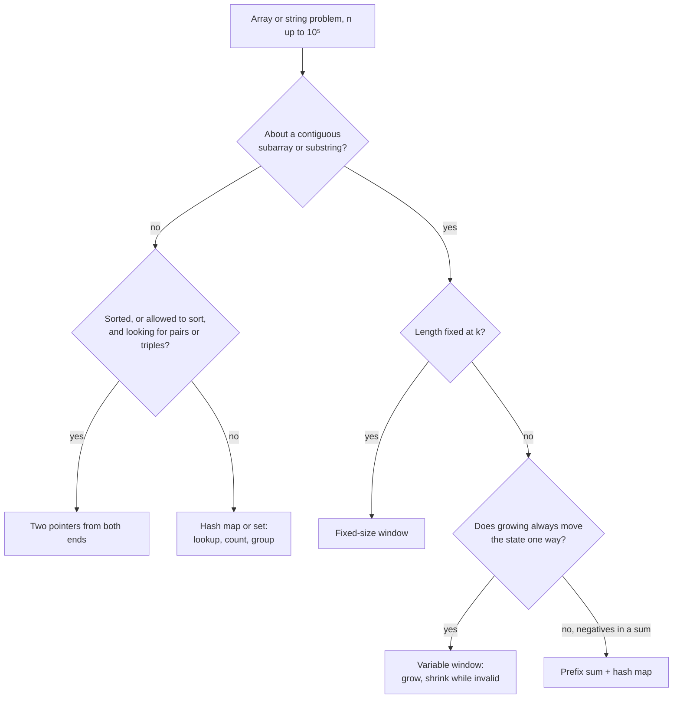

## Where we are

You can write a basic Java class with arrays and loops. This lesson gives you the four technique families
that turn most O(n²) array and string problems into O(n): **hashing, two pointers, sliding window and prefix
sums**.

**Big-O in two sentences:** O(n) or O(n²) counts how many times the inner work runs as the input size n grows:
one loop over n items is O(n), a loop inside a loop is O(n²), so doubling n quadruples the work. DSA-CPLX-1,
later this week, goes deeper.

## The problem

It is Thursday evening and you have three practice problems open: Two Sum, Longest Substring Without
Repeating Characters, and Subarray Sum Equals K. You write nested loops for all three. They pass the
samples. But each problem's follow-up, and your interviewer, asks for O(n).

The gap is not "the trick". It is that you can't tell which of four tricks applies, so you guess. In a real
round, a wrong guess costs ten minutes before you notice that a sliding window can't handle negative numbers.

## Hashing: stop searching, start remembering

A **hash map** (`HashMap`) stores key → value pairs; a **hash set** (`HashSet`) stores keys only. Both find a
key in O(1) time on average. How is JAVA-FUND-6; here you only need the cost.

**Signal:** your brute force has an inner loop that *searches* for a value ("is `target - x` here?").
Replace the search with a lookup in a map you fill as you go.

**Predict:** this Two Sum puts the current value in the map *before* looking up its **complement** (the
value that would complete the pair, `target - nums[i]`). What does it return for `[3, 2, 4]`, target 6?

```java
for (int i = 0; i < nums.length; i++) {
    indexOf.put(nums[i], i);
    Integer j = indexOf.get(target - nums[i]);
    if (j != null) return new int[] { j, i };
}
```

It returns `[0, 0]`: at index 0, the complement of 3 is 3, and the 3 it finds is itself. The fix is the
order. Look up first, then remember:

```java
static int[] twoSum(int[] nums, int target) {
    Map<Integer, Integer> indexOf = new HashMap<>();          // value -> index, for everything already passed
    for (int i = 0; i < nums.length; i++) {
        Integer j = indexOf.get(target - nums[i]);            // look up the complement first...
        if (j != null) return new int[] { j, i };
        indexOf.put(nums[i], i);                              // ...then remember the current value
    }
    return new int[0];
}
```

**Complexity:** O(n) time, O(n) extra space: memory traded for time. Say so out loud.

## Hashing variants: counting, grouping, membership

**Counting.** `map.merge(key, 1, Integer::sum)` puts 1 if the key is absent, otherwise adds 1 to the old
value. `Integer::sum` is shorthand for `(a, b) -> a + b`; JAVA-FUND-7 covers lambdas. The key line (full
version in the Lab):

```java
for (char c : s.toCharArray()) counts.merge(c, 1, Integer::sum);
```

**Grouping by a key.** Give items that belong together an equal key;
`computeIfAbsent(key, k -> new ArrayList<>())` returns the list for that key. `k -> new ArrayList<>()` is a
small function that makes the empty list when the key is new. Group Anagrams sorts each word's letters to
get the key: "eat", "tea" and "ate" all become "aet". The key lines (full version in the Lab):

```java
char[] key = w.toCharArray();
Arrays.sort(key);
groups.computeIfAbsent(new String(key), k -> new ArrayList<>()).add(w);
```

**Membership.** Longest Consecutive Sequence wants the longest run of consecutive integers in an unsorted
array, in O(n), so no sorting. Put everything in a set and count only from a run's start (no predecessor):

```java
static int longestConsecutive(int[] nums) {
    Set<Integer> present = new HashSet<>();
    for (int x : nums) present.add(x);
    int best = 0;
    for (int x : present) {
        if (present.contains(x - 1)) continue;                // only count from the start of a run
        int len = 1;
        while (present.contains(x + len)) len++;
        best = Math.max(best, len);
    }
    return best;
}
```

Only run starts enter the inner `while`, so each number is walked at most once in total: O(n). Drop the
`continue` and a long run makes it O(n²).

When the keys are 26 lowercase letters, an `int[26]` beats `Map<Character, Integer>`: it is faster and
avoids **boxing** (wrapping an `int` in an `Integer` object).

```quiz
{"question": "counts is an empty HashMap<Character, Integer>. What does counts.merge('a', 1, Integer::sum) do?", "level": "easy",
 "options": [
   {"text": "Stores 'a' -> 1", "correct": true, "why": "When the key is absent, merge just stores the given value. The function only runs when a value already exists."},
   {"text": "Throws NullPointerException because there is no old value to add to", "why": "merge handles the absent case itself; that is the whole point of using it instead of get + 1."},
   {"text": "Stores 'a' -> 2, because it adds 1 to a default of 1", "why": "There is no default. Absent means the value 1 is stored as it is."},
   {"text": "Does nothing until the key is put first", "why": "merge inserts absent keys. You would need put first only with a plain get-and-add approach."}]}
```

## Two pointers from both ends

**Two pointers** means two indices that move through the array by a rule, so together they make one pass
instead of a nested loop.

**Signal:** the input is **sorted** (or you may sort it), and you are looking for a pair with some property:
a sum, a difference, the widest container.

The loop body of `pairSumSorted`, with `lo = 0` and `hi` at the last index (full version in the Lab):

```java
int sum = sorted[lo] + sorted[hi];
if (sum == target) return new int[] { lo, hi };
if (sum < target) lo++;                                   // need bigger: move the small end up
else hi--;                                                // need smaller: move the big end down
```

**Why it is safe:** if `sorted[lo] + sorted[hi]` is too small, then `sorted[lo]` plus *any* element at or
before `hi` is also too small, since those are all ≤ `sorted[hi]`. So `lo` can never be part of an answer
and you drop it. Each step discards one element for good, so the loop is O(n).

**Variant: Container With Most Water.** Area is `width × min(height)`. Move the **shorter** wall inward:
moving the taller one shrinks the width while the shorter wall still caps the height.

**Complexity:** O(n) time, O(1) space, plus O(n log n) if you must sort. On unsorted input where indices
matter (Two Sum), sorting loses them, so the hash map is simpler.

## Two pointers in the same direction

**Signal:** change an array **in place** (no second array), such as removing duplicates. The fast pointer
reads every element; the slow one marks where the next kept element goes.

The key line of `removeDuplicates`, with `write` starting at 1 (full version in the Lab):

```java
if (sorted[read] != sorted[write - 1]) sorted[write++] = sorted[read];
```

`[1, 1, 2, 3, 3, 3, 4]` becomes `[1, 2, 3, 4, ...]` and it returns 4. O(n) time, O(1) space. Fast/slow on
linked lists comes in DSA-PAT-3.

## 3Sum: sort, fix one, two pointers, skip duplicates

3Sum asks for all **unique** triplets that sum to 0. Sort, fix `a[i]`, and the rest is "pair sum to `-a[i]`"
with the template above: O(n) per `i`, O(n²) overall instead of O(n³).

The hard part is "unique". **Predict:** without any duplicate skipping, what does the sorted input
`[-4, -1, -1, 0, 1, 2]` produce?

`[[-1, -1, 2], [-1, 0, 1], [-1, 0, 1]]`. The second `-1` as the fixed element finds `[-1, 0, 1]` again.
Two skips fix it:

```java
static List<List<Integer>> threeSum(int[] nums) {
    int[] a = nums.clone();
    Arrays.sort(a);
    List<List<Integer>> out = new ArrayList<>();
    for (int i = 0; i < a.length - 2; i++) {
        if (i > 0 && a[i] == a[i - 1]) continue;              // dedup 1: same first value
        int lo = i + 1, hi = a.length - 1;
        while (lo < hi) {
            int sum = a[i] + a[lo] + a[hi];
            if (sum < 0) lo++;
            else if (sum > 0) hi--;
            else {
                out.add(List.of(a[i], a[lo], a[hi]));
                lo++;
                hi--;
                while (lo < hi && a[lo] == a[lo - 1]) lo++;   // dedup 2: same second value
            }
        }
    }
    return out;
}
```

Dedup 1 compares with the *previous* element (`a[i - 1]`), not the next. Comparing with `a[i + 1]` would
skip `-1` at index 1 and lose `[-1, -1, 2]`. A `Set<List<Integer>>` also dedups, but costs memory;
interviewers usually want the skip.

```quiz
{"question": "A sorted array of up to 10⁵ ints. Return true if any two elements sum to a target, using O(1) extra space. Which pattern fits?", "level": "medium",
 "options": [
   {"text": "Two pointers from both ends", "correct": true, "why": "Sorted plus a pair condition is the signal. Each step discards one end for good: O(n) time, O(1) space."},
   {"text": "Hash set of values seen so far", "why": "It is O(n) time, but O(n) extra space, which the problem forbids. It also ignores that the input is sorted, the hint the problem gave you."},
   {"text": "Variable-size sliding window", "why": "A window looks at contiguous runs. A pair can be any two positions, so a window does not apply."},
   {"text": "Prefix sums", "why": "Prefix sums answer range-sum questions about contiguous subarrays, not the sum of two arbitrary elements."}]}
```

## Sliding window: fixed size

A **subarray** is a contiguous run of an array; a **substring** is the same for a string. A **sliding window**
is a subarray `[left..right]` that you move along the input, updating a running state (a sum, counts)
instead of recomputing it.

**Signal:** "subarray / substring **of length k**". Maximum sum of k consecutive elements, or Permutation in
String (is some window of length `|s1|` an anagram of `s1`?).

The key line of `maxSumWindow`, after summing the first k elements (full version in the Lab):

```java
sum += a[right] - a[right - k];                           // one in, one out
```

O(n) instead of O(n·k). For Permutation in String the state is an `int[26]` of letter counts, and you
compare the window's counts with `s1`'s counts after each step.

```quiz
{"question": "Find the longest subarray with sum ≤ S. All values are positive, n ≤ 10⁵. Which approach fits best?", "level": "medium",
 "options": [
   {"text": "Variable-size sliding window: grow right, shrink left while the sum exceeds S", "correct": true, "why": "Positive values mean growing only raises the sum and shrinking only lowers it, so 'too big' always means shrink. O(n) time, O(1) space."},
   {"text": "Prefix sums plus a hash map", "why": "It works, but it costs O(n) extra space and is more complex: 'sum ≤ S' needs the earliest prefix ≥ prefix − S, not an exact match, so you must search the stored prefixes instead of one map lookup. Positive values allow the simpler O(1)-space window."},
   {"text": "Fixed-size sliding window", "why": "The problem asks for the longest length, so the length is the unknown. A fixed window needs k given."},
   {"text": "Two pointers from both ends", "why": "Opposite-end pointers need sorted input and a pair. Sorting would destroy the contiguous subarrays the problem is about."}]}
```

## Sliding window: variable size

**Signal:** "the **longest** or **shortest** subarray / substring such that a condition holds", where the
condition can be repaired by dropping elements from the left. The template has three steps per character:
grow, shrink while invalid, record.

```java
static int longestUniqueSubstring(String s) {
    int[] count = new int[128];                               // assumes ASCII characters
    int left = 0, best = 0;
    for (int right = 0; right < s.length(); right++) {
        char c = s.charAt(right);
        count[c]++;                                           // 1. grow: take s[right] in
        while (count[c] > 1) {                                // 2. shrink while the window is invalid
            count[s.charAt(left)]--;
            left++;
        }
        best = Math.max(best, right - left + 1);              // 3. window is valid: record it
    }
    return best;
}
```

Watch the window move on `"abcabcbb"` (printed by running the method with a trace line):

```text
right  char  left     window   best
  0     a    0 -> 0   a         1
  1     b    0 -> 0   ab        2
  2     c    0 -> 0   abc       3
  3     a    0 -> 1   bca       3     second 'a': drop the old 'a'
  4     b    1 -> 2   cab       3
  5     c    2 -> 3   abc       3
  6     b    3 -> 5   cb        3     drop 'a' and the old 'b'
  7     b    5 -> 7   b         3
```

Both pointers only move forward, so each index enters and leaves once: O(n) despite the inner `while`.

**Variants:**

- **Longest** window: record *after* shrinking. **Shortest** (Minimum Window Substring): record *inside* the
  shrink loop, while the window is still valid.
- State: `int[26]` / `int[128]` for small alphabets, else a `HashMap`.
- Longest Repeating Character Replacement: valid while `length - count of most common letter ≤ k`.

## The at-most-K trick

Max Consecutive Ones III (longest run of 1s if you may flip k zeros) is "the longest window with **at most
k zeros**". Key lines of `longestOnes` (full version in the Lab):

```java
if (a[right] == 0) zeros++;
while (zeros > k) { if (a[left] == 0) zeros--; left++; }
```

The second half of the trick is for **counting** subarrays with **exactly** K of something. For a fixed
`right`, the starts that give exactly K form a range in the middle, so one `left` pointer cannot count them.
For at most K, every start from `left` to `right` is valid, which is `right - left + 1` subarrays. Hence
exactly(K) = atMost(K) − atMost(K − 1):

```java
static int countExactlyKDistinct(int[] a, int k) {
    return countAtMostKDistinct(a, k) - countAtMostKDistinct(a, k - 1);
}
```

`countAtMostKDistinct` (in the Lab) is a variable window over a `HashMap` of counts. For `[1, 2, 1, 2, 3]`
and k = 2 the result is 7.

## Prefix sums

A **prefix sum** array `p` stores running totals: `p[i]` is the sum of the first `i` elements, with
`p[0] = 0`. Then the sum of `a[l..r]` is `p[r + 1] - p[l]`, in O(1). The key line of `prefixSums` (full
version in the Lab):

```java
for (int i = 0; i < a.length; i++) p[i + 1] = p[i] + a[i];  // p has length a.length + 1
```

For `[3, -2, 5, 1]`, `p` is `[0, 3, 1, 6, 7]`, and the sum of indices 1..3 is `p[4] - p[1] = 7 - 3 = 4`.

**Signal:** many range sums on one array, or "count subarrays with sum k" with **negative** values.

**Prefix + hash map.** A subarray ending here sums to `k` exactly when an earlier prefix equals
`prefix - k`. So count earlier prefixes in a map: Two Sum applied to prefixes.

**Predict:** what does `subarraySum([1,-1,1], 1)` return without `seen.put(0, 1)`?

```java
static int subarraySum(int[] nums, int k) {
    Map<Integer, Integer> seen = new HashMap<>();
    seen.put(0, 1);                                           // the empty prefix
    int prefix = 0, count = 0;
    for (int x : nums) {
        prefix += x;
        count += seen.getOrDefault(prefix - k, 0);            // earlier prefixes that leave exactly k
        seen.merge(prefix, 1, Integer::sum);
    }
    return count;
}
```

It returns 1 instead of 3. The `{0: 1}` seed stands for the empty prefix before index 0; without it, the
subarrays that start at index 0 (`[1]` and `[1, -1, 1]`) are never counted. For "longest subarray with
sum k", store each prefix's **earliest index**, seeded `{0: -1}`. O(n) time, O(n) space.

## Why a sliding window fails with negatives

A variable window relies on one promise: **growing moves the state one way, shrinking moves it back**. With
non-negative numbers, "sum too big" always means "shrink". A negative number breaks that: growing can lower
the sum, so you cannot tell which way to move.

```quiz
{"question": "This window counts subarrays with sum k. What does it return for nums = [1, -1, 1], k = 1? (The true answer is 3: [1], [1, -1, 1] and the last [1].)", "level": "hard",
 "code": ["int left = 0, sum = 0, count = 0;", "for (int right = 0; right < nums.length; right++) {", "    sum += nums[right];", "    while (sum > k && left <= right) sum -= nums[left++];", "    if (sum == k) count++;", "}", "return count;"],
 "options": [
   {"text": "2", "correct": true, "why": "The sum never exceeds 1, so left never moves. At right = 2 it counts [1, -1, 1] but never checks the last [1] alone. One window per right cannot see every subarray when sums go down as well as up."},
   {"text": "3", "why": "That is the true count, but the window only ever looks at one subarray per right end. It misses [1] at index 2 because the sum was never too big, so it never shrank."},
   {"text": "1", "why": "At right = 1 the sum is 0 and nothing is counted, but right = 0 and right = 2 both see sum 1."},
   {"text": "It loops forever", "why": "left only moves forward and the while has a left <= right guard, so the loop always ends."}]}
```

The fix is prefix sums plus a hash map, which never needs to decide a direction.

## Signal → pattern



| The problem says | Try | Cost |
|---|---|---|
| "find a pair / complement", unsorted, need indices | hash map, look up then insert | O(n) time, O(n) space |
| "count", "frequency", "group by", "anagram" | `merge`, `computeIfAbsent`, or `int[26]` | O(n) |
| "consecutive values" in an unsorted array | hash set, start only at run starts | O(n) |
| sorted input, pair or triple with a target | two pointers from both ends (3Sum: fix one) | O(n), O(n²) for 3Sum |
| modify in place, remove or move elements | same-direction read / write pointers | O(n), O(1) space |
| subarray or substring "of length k" | fixed window | O(n) |
| "longest / shortest" subarray with a repairable condition, or "at most k" | variable window | O(n) |
| count subarrays with "exactly k" | atMost(k) − atMost(k − 1) | O(n) |
| subarray sum = k with negatives, or many range-sum queries | prefix sum (+ hash map seeded `{0: 1}`) | O(n), O(1) per query |

## Lab (~10 min)

Every template from this lesson, run on small inputs. Save it as `PatternLab.java` and run
`java PatternLab.java`.

```java
import java.util.ArrayList;
import java.util.Arrays;
import java.util.HashMap;
import java.util.HashSet;
import java.util.List;
import java.util.Map;
import java.util.Set;

public class PatternLab {

    // ---------- Hashing ----------
    static int[] twoSum(int[] nums, int target) {
        Map<Integer, Integer> indexOf = new HashMap<>();          // value -> index, for everything already passed
        for (int i = 0; i < nums.length; i++) {
            Integer j = indexOf.get(target - nums[i]);            // look up the complement first...
            if (j != null) return new int[] { j, i };
            indexOf.put(nums[i], i);                              // ...then remember the current value
        }
        return new int[0];
    }

    static Map<Character, Integer> countChars(String s) {
        Map<Character, Integer> counts = new HashMap<>();
        for (char c : s.toCharArray()) counts.merge(c, 1, Integer::sum);
        return counts;
    }

    static Map<String, List<String>> groupAnagrams(String[] words) {
        Map<String, List<String>> groups = new HashMap<>();
        for (String w : words) {
            char[] key = w.toCharArray();
            Arrays.sort(key);                                     // "eat", "tea", "ate" all become "aet"
            groups.computeIfAbsent(new String(key), k -> new ArrayList<>()).add(w);
        }
        return groups;
    }

    static int longestConsecutive(int[] nums) {
        Set<Integer> present = new HashSet<>();
        for (int x : nums) present.add(x);
        int best = 0;
        for (int x : present) {
            if (present.contains(x - 1)) continue;                // only count from the start of a run
            int len = 1;
            while (present.contains(x + len)) len++;
            best = Math.max(best, len);
        }
        return best;
    }

    // ---------- Two pointers ----------
    static int[] pairSumSorted(int[] sorted, int target) {
        int lo = 0, hi = sorted.length - 1;
        while (lo < hi) {
            int sum = sorted[lo] + sorted[hi];
            if (sum == target) return new int[] { lo, hi };
            if (sum < target) lo++;                               // need bigger: move the small end up
            else hi--;                                            // need smaller: move the big end down
        }
        return new int[0];
    }

    static int maxArea(int[] h) {
        int lo = 0, hi = h.length - 1, best = 0;
        while (lo < hi) {
            best = Math.max(best, (hi - lo) * Math.min(h[lo], h[hi]));
            if (h[lo] < h[hi]) lo++; else hi--;                   // move the shorter wall
        }
        return best;
    }

    static int removeDuplicates(int[] sorted) {
        if (sorted.length == 0) return 0;
        int write = 1;                                            // slow pointer: next free slot
        for (int read = 1; read < sorted.length; read++) {        // fast pointer: scans everything
            if (sorted[read] != sorted[write - 1]) sorted[write++] = sorted[read];
        }
        return write;
    }

    static List<List<Integer>> threeSum(int[] nums) {
        int[] a = nums.clone();
        Arrays.sort(a);
        List<List<Integer>> out = new ArrayList<>();
        for (int i = 0; i < a.length - 2; i++) {
            if (i > 0 && a[i] == a[i - 1]) continue;              // dedup 1: same first value
            int lo = i + 1, hi = a.length - 1;
            while (lo < hi) {
                int sum = a[i] + a[lo] + a[hi];
                if (sum < 0) lo++;
                else if (sum > 0) hi--;
                else {
                    out.add(List.of(a[i], a[lo], a[hi]));
                    lo++;
                    hi--;
                    while (lo < hi && a[lo] == a[lo - 1]) lo++;   // dedup 2: same second value
                }
            }
        }
        return out;
    }

    // ---------- Sliding window ----------
    static int maxSumWindow(int[] a, int k) {
        int sum = 0;
        for (int i = 0; i < k; i++) sum += a[i];
        int best = sum;
        for (int right = k; right < a.length; right++) {
            sum += a[right] - a[right - k];                       // one in, one out
            best = Math.max(best, sum);
        }
        return best;
    }

    static int longestUniqueSubstring(String s) {
        int[] count = new int[128];                               // assumes ASCII characters
        int left = 0, best = 0;
        for (int right = 0; right < s.length(); right++) {
            char c = s.charAt(right);
            count[c]++;                                           // 1. grow: take s[right] in
            while (count[c] > 1) {                                // 2. shrink while the window is invalid
                count[s.charAt(left)]--;
                left++;
            }
            best = Math.max(best, right - left + 1);              // 3. window is valid: record it
        }
        return best;
    }

    static int longestOnes(int[] a, int k) {                      // longest window with at most k zeros
        int left = 0, zeros = 0, best = 0;
        for (int right = 0; right < a.length; right++) {
            if (a[right] == 0) zeros++;
            while (zeros > k) {
                if (a[left] == 0) zeros--;
                left++;
            }
            best = Math.max(best, right - left + 1);
        }
        return best;
    }

    static int countAtMostKDistinct(int[] a, int k) {             // subarrays with at most k distinct values
        Map<Integer, Integer> count = new HashMap<>();
        int left = 0, total = 0;
        for (int right = 0; right < a.length; right++) {
            count.merge(a[right], 1, Integer::sum);
            while (count.size() > k) {
                if (count.merge(a[left], -1, Integer::sum) == 0) count.remove(a[left]);
                left++;
            }
            total += right - left + 1;                            // every subarray ending at right
        }
        return total;
    }

    static int countExactlyKDistinct(int[] a, int k) {
        return countAtMostKDistinct(a, k) - countAtMostKDistinct(a, k - 1);
    }

    // ---------- Prefix sums ----------
    static int[] prefixSums(int[] a) {
        int[] p = new int[a.length + 1];                          // p[i] = sum of the first i elements
        for (int i = 0; i < a.length; i++) p[i + 1] = p[i] + a[i];
        return p;
    }

    static int rangeSum(int[] p, int l, int r) {                  // sum of a[l..r], inclusive
        return p[r + 1] - p[l];
    }

    static int subarraySum(int[] nums, int k) {
        Map<Integer, Integer> seen = new HashMap<>();
        seen.put(0, 1);                                           // the empty prefix
        int prefix = 0, count = 0;
        for (int x : nums) {
            prefix += x;
            count += seen.getOrDefault(prefix - k, 0);            // earlier prefixes that leave exactly k
            seen.merge(prefix, 1, Integer::sum);
        }
        return count;
    }

    static int subarraySumWindow(int[] nums, int k) {             // WRONG when values can be negative
        int left = 0, sum = 0, count = 0;
        for (int right = 0; right < nums.length; right++) {
            sum += nums[right];
            while (sum > k && left <= right) sum -= nums[left++];
            if (sum == k) count++;
        }
        return count;
    }

    public static void main(String[] args) {
        System.out.println("twoSum            " + Arrays.toString(twoSum(new int[] { 2, 7, 11, 15 }, 9)));
        System.out.println("countChars        " + countChars("banana"));
        System.out.println("groupAnagrams     " + groupAnagrams(new String[] { "eat", "tea", "tan", "ate", "nat", "bat" }));
        System.out.println("longestConsec     " + longestConsecutive(new int[] { 100, 4, 200, 1, 3, 2 }));
        System.out.println("pairSumSorted     " + Arrays.toString(pairSumSorted(new int[] { 1, 3, 4, 6, 8, 11 }, 10)));
        System.out.println("maxArea           " + maxArea(new int[] { 1, 8, 6, 2, 5, 4, 8, 3, 7 }));
        int[] d = { 1, 1, 2, 3, 3, 3, 4 };
        int len = removeDuplicates(d);
        System.out.println("removeDuplicates  " + len + " " + Arrays.toString(Arrays.copyOf(d, len)));
        System.out.println("threeSum          " + threeSum(new int[] { -1, 0, 1, 2, -1, -4 }));
        System.out.println("threeSum          " + threeSum(new int[] { -2, 0, 0, 2, 2 }));
        System.out.println("maxSumWindow      " + maxSumWindow(new int[] { 2, 1, 5, 1, 3, 2 }, 3));
        System.out.println("longestUnique     " + longestUniqueSubstring("abcabcbb"));
        System.out.println("longestOnes       " + longestOnes(new int[] { 1, 1, 0, 0, 1, 1, 1, 0, 1 }, 1));
        System.out.println("exactly2Distinct  " + countExactlyKDistinct(new int[] { 1, 2, 1, 2, 3 }, 2));
        int[] p = prefixSums(new int[] { 3, -2, 5, 1 });
        System.out.println("prefix/rangeSum   " + Arrays.toString(p) + " sum[1..3]=" + rangeSum(p, 1, 3));
        int[] neg = { 1, -1, 1 };
        System.out.println("subarraySum       " + subarraySum(neg, 1) + " (prefix + map)");
        System.out.println("subarraySumWindow " + subarraySumWindow(neg, 1) + " (sliding window, wrong)");
    }
}
```

It prints (the `HashMap` print order may differ on another JDK):

```text
twoSum            [0, 1]
countChars        {a=3, b=1, n=2}
groupAnagrams     {aet=[eat, tea, ate], abt=[bat], ant=[tan, nat]}
longestConsec     4
pairSumSorted     [2, 3]
maxArea           49
removeDuplicates  4 [1, 2, 3, 4]
threeSum          [[-1, -1, 2], [-1, 0, 1]]
threeSum          [[-2, 0, 2]]
maxSumWindow      9
longestUnique     3
longestOnes       5
exactly2Distinct  7
prefix/rangeSum   [0, 3, 1, 6, 7] sum[1..3]=4
subarraySum       3 (prefix + map)
subarraySumWindow 2 (sliding window, wrong)
```

**What to observe:** the last two lines are the same question on `[1, -1, 1]`. Prefix sums get 3; the window
gets 2.

**Break it**, one change at a time, and predict the line that changes before you rerun:

1. Delete `seen.put(0, 1);` in `subarraySum`. The `subarraySum` line drops from 3 to 1 (your Predict above).
2. Delete the `dedup 1` line in `threeSum`. The first `threeSum` line becomes
   `[[-1, -1, 2], [-1, 0, 1], [-1, 0, 1]]`.
3. Put it back and delete the `dedup 2` line instead. Now the first line is fine but the second becomes
   `[[-2, 0, 2], [-2, 0, 2]]`, because the second `0` is tried as the middle element again.

Finally, add `maxSumWindow(new int[] { 2, -5, 3, 4 }, 2)` to `main`. It prints 7 (`[3, 4]`). Why is a
*fixed* window still correct with negatives? It never decides whether to shrink.

## Gotchas

- **Inserting before looking up:** an element pairs with itself. Look up, then insert.
- **Window on sums with negatives:** growing can lower the sum. Use prefix sums plus a hash map.
- **Missing prefix seed:** seed `{0: 1}` (count) or `{0: -1}` (earliest index), or index-0 subarrays vanish.
- **3Sum duplicates:** compare with the *previous* value, not the next, and skip equal middles after a hit.
- **`==` on map `Integer`s:** fails outside -128..127 (the default Integer cache). Use `.equals` or unbox.
- **`int` overflow in running sums:** if n × max value can pass about 2.1 × 10⁹, use a `long`.

## In interviews

This week and next:

- [Two Sum](#/q/two-sum): complement lookup; sorted follow-up means two pointers.
- [3Sum](#/q/3sum): sort, fix one, two pointers, skip duplicates.
- [Longest Consecutive Sequence](#/q/longest-consecutive-sequence): hash set; explain why it is O(n).
- [Group Anagrams](#/q/group-anagrams): group by sorted-letters or 26-count key.
- [Container With Most Water](#/q/container-with-most-water): prove moving the shorter wall is safe.
- [Longest Substring Without Repeating Characters](#/q/longest-substring-without-repeating-characters),
  [Permutation in String](#/q/permutation-in-string),
  [Longest Repeating Character Replacement](#/q/longest-repeating-character-replacement),
  [Max Consecutive Ones III](#/q/max-consecutive-ones-iii),
  [Minimum Window Substring](#/q/minimum-window-substring): the window family, fixed to shortest.
- [Subarray Sum Equals K](#/q/subarray-sum-equals-k): prefix sum plus a counting map.
- [Trapping Rain Water](#/q/trapping-rain-water): DSA-CPLX-4 takes it from O(n²) time to O(n) time and O(1)
  space.

**Typical follow-up:** "Why not a sliding window?" on Subarray Sum Equals K. Strong answer: "Negatives mean
growing can lower the sum, so I can't pick a side to move. Prefix sums never decide."

## Explain it in 2 minutes

*"How do you decide between a hash map, two pointers, a sliding window and prefix sums?"*

A good answer covers:

1. Hash map: brute force searches for a value; O(n) time for O(n) space.
2. Two pointers: sorted input, pairs or triples; each step discards one element.
3. Sliding window: contiguous; fixed if length given, variable for longest / shortest.
4. Variable window needs growth to move state one way; negatives in a sum break it.
5. Prefix sums: range sums; plus a hash map for "sum equals k" with negatives.

## Check yourself

1. In opposite-end two pointers, why can you discard `lo` when the sum is too small?
2. For a *shortest* valid window, where do you record the answer, and why is that different from a longest
   window?
3. How do you count subarrays with exactly K distinct values using a window?

### Answers

1. Every element at or before `hi` is ≤ `sorted[hi]`, so `sorted[lo]` plus any of them is also too small.
2. Inside the shrink loop, while the window is still valid, because each shrink might give a new shortest.
   For the longest, you record after shrinking, once the window is valid again.
3. atMost(K) − atMost(K − 1), where atMost adds `right - left + 1` at each step of a variable window.

## Next

DSA-PAT-2: stacks, monotonic stacks and binary search. INTV-TIPS-1 drills the Java idioms used here.
