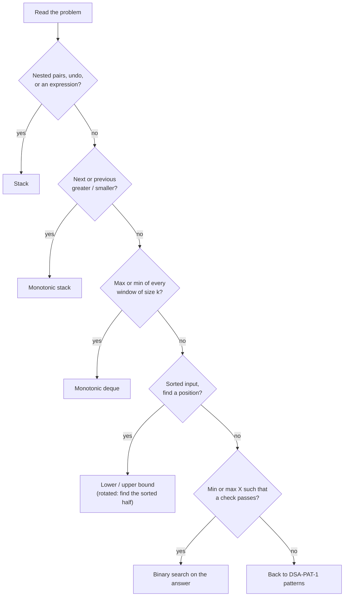

## Where we are

DSA-PAT-1 gave you hashing, two pointers, sliding windows and prefix sums: patterns that walk an array once
and remember something cheap as they go. This lesson adds two families that remember *more cleverly*. A
**stack** remembers the things you have not finished with yet, in the order you will need them back. **Binary
search** throws away half of the possibilities with every question it asks. Both show up in nearly every interview
loop, and both have one or two lines that people get wrong under pressure.

## The problem

It is your second coding round. The interviewer pastes: *"Koko has piles of bananas and h hours. Each hour
she eats up to k bananas from one pile. Find the smallest k that lets her finish."* You notice there is no
sorted array anywhere, so binary search never crosses your mind. You simulate every k from 1 upwards, the
interviewer asks what happens when piles hold a billion bananas, and the next 20 minutes go on rescuing a
brute force.

The skill this lesson builds is noticing the **signal**: the phrase in the problem that tells you which
template to reach for. Each section ends with one, and the last section collects them in a table.

## A stack for matching and parsing

A **stack** is last-in, first-out: you `push` onto the top and `pop` from the top. In Java use
`ArrayDeque` (`push`, `pop`, `peek`), not the old synchronised `Stack` class (INTV-TIPS-1 covers why).

**Predict:** for `"([)]"`, does counting opens and closes per bracket type find the problem?

No. Each type is balanced (one `(` and one `)`, one `[` and one `]`), yet the string is invalid because `)`
arrives while `[` is still open. What matters is that every closer matches the **most recent unmatched
opener**, and "most recent" is exactly what the top of a stack gives you.

```java
static boolean isValid(String s) {
    Map<Character, Character> openerOf = Map.of(')', '(', ']', '[', '}', '{');
    Deque<Character> stack = new ArrayDeque<>();
    for (char c : s.toCharArray()) {
        if (openerOf.containsKey(c)) {
            if (stack.isEmpty() || !openerOf.get(c).equals(stack.pop())) return false;
        } else {
            stack.push(c);
        }
    }
    return stack.isEmpty();                 // leftover openers mean "((" is invalid too
}
```

The same idea evaluates expressions. In **Basic Calculator II** (`+ - * /`, no brackets) you keep the operator
that came *before* the current number. On `+` or `-` push the number (or its negation). On `*` or `/` pop the
top, combine and push back. At the end, sum the stack. Multiplication binds tighter because it is applied
straight away, while addition waits on the stack.

```java
switch (op) {                               // op = the operator before num
    case '+' -> stack.push(num);
    case '-' -> stack.push(-num);
    case '*' -> stack.push(stack.pop() * num);
    case '/' -> stack.push(stack.pop() / num);
}
```

With **brackets** (Basic Calculator), a `(` starts a sub-problem: push the running total and the sign in front
of the bracket, reset, and on `)` combine them back.

```java
} else if (c == '(') {
    stack.push(result);                     // save the outer total...
    stack.push(sign);                       // ...and the sign in front of '('
    result = 0;
    sign = 1;
} else if (c == ')') {
    result += sign * num;
    num = 0;
    result = stack.pop() * result + stack.pop();
}
```

**Min-stack** (push, pop, min, all O(1)) uses the same structure differently: each entry stores its value
*and the minimum at the time it was pushed*, so popping restores the old minimum for free.

```java
void push(int x) {
    int min = stack.isEmpty() ? x : Math.min(x, stack.peek()[1]);
    stack.push(new int[] {x, min});         // {value, minSoFar}
}
```

**Signal:** nested structure, "most recent unmatched", undo, evaluate an expression, or "support min in O(1)".

```quiz
{"question": "Why does a min-stack store the minimum next to every entry instead of one `min` field?", "level": "easy",
 "options": [
   {"text": "So pop can restore the previous minimum in O(1)", "correct": true, "why": "When the current minimum is popped, the entry below already knows the minimum of everything under it. A single field would have to rescan the stack."},
   {"text": "Because ArrayDeque cannot hold more than one field per element", "why": "A deque holds any object. The pair is a design choice, not a library limit."},
   {"text": "To make push O(log n)", "why": "Push is O(1): one Math.min against the top entry. Nothing here is logarithmic."},
   {"text": "It is only needed when values can be negative", "why": "Negatives change nothing. The problem is popping the current minimum, which happens with any values."}]}
```

## Monotonic stack: the next greater element

**Problem:** for each element, find the next element to its right that is greater, or -1. The brute force
scans right from every index: O(n²).

A **monotonic stack** keeps its contents sorted (here, values decreasing from bottom to top) by popping
anything that would break the order before pushing. The insight: when a bigger value `a[i]` arrives, every
smaller value waiting on the stack has just found its answer.

```java
static int[] nextGreater(int[] a) {
    int[] ans = new int[a.length];
    Arrays.fill(ans, -1);
    Deque<Integer> stack = new ArrayDeque<>();     // indices, values decreasing bottom to top
    for (int i = 0; i < a.length; i++) {
        while (!stack.isEmpty() && a[stack.peek()] < a[i]) ans[stack.pop()] = a[i];
        stack.push(i);
    }
    return ans;
}
```

```text
a = [2, 1, 2, 4, 3]          stack holds indices (values shown)
i  a[i]  pops (answer set)            stack after
0  2     -                            [0(2)]
1  1     -                            [0(2), 1(1)]
2  2     ans[1] = 2                   [0(2), 2(2)]      equal value stays: 2 < 2 is false
3  4     ans[2] = 4, ans[0] = 4       [3(4)]
4  3     -                            [3(4), 4(3)]
end: indices 3 and 4 never popped, so ans = [4, 2, 4, -1, -1]
```

**Predict:** a `while` inside a `for`. Is this O(n²)?

No. Each index is pushed once and popped at most once, so the total work over the whole run is at most 2n:
O(n) total (DSA-CPLX-5 calls this amortised analysis).

**Variants** come from two choices. Direction of the comparison: pop while smaller gives next *greater*; pop while
larger gives next *smaller*. Strict or not: `<` versus `<=` decides how equal values are treated, which matters
when duplicates exist.

**The histogram idea.** In Largest Rectangle in Histogram, keep heights *increasing*. When a bar is popped, the
bar that pops it is its first smaller bar on the right, and the new top of the stack is its first smaller bar
on the left. The bar's widest rectangle spans exactly between them: `height × (i - left - 1)`. A 0-height
sentinel at the end flushes the stack.

**Signal:** "next greater / smaller", "previous greater", "how many days until warmer", "span", or "for each
bar, how far can it extend".

```quiz
{"question": "Daily temperatures: for each day, how many days until a warmer day? n is up to 100,000. Which pattern?", "level": "medium",
 "options": [
   {"text": "A monotonic stack of indices, popping while the stack top is colder than today", "correct": true, "why": "\"Next warmer\" is next greater element. Today's index minus the popped index is the answer for that day. O(n) total."},
   {"text": "A sliding window of fixed size", "why": "The distance to the next warmer day is not fixed, so there is no window size to slide."},
   {"text": "Sort the temperatures, then binary search each day", "why": "Sorting destroys the left-to-right order that \"next\" depends on."},
   {"text": "A max-heap of all temperatures", "why": "A heap knows the maximum overall, not the first warmer day to the right. You would still scan, and pay log n per step."}]}
```

## Monotonic deque: sliding window maximum

A **deque** (double-ended queue, `ArrayDeque` again) lets you add and remove at both ends. Sliding Window
Maximum needs both: remove from the **front** when an index falls out of the window, and remove from the
**back** any index whose value can never be a maximum again because a newer, larger-or-equal value arrived.
The front is always the window's maximum.

```java
static int[] maxSlidingWindow(int[] a, int k) {
    int[] out = new int[a.length - k + 1];
    Deque<Integer> dq = new ArrayDeque<>();        // indices, values decreasing front to back
    for (int i = 0; i < a.length; i++) {
        if (!dq.isEmpty() && dq.peekFirst() <= i - k) dq.pollFirst();       // front left the window
        while (!dq.isEmpty() && a[dq.peekLast()] <= a[i]) dq.pollLast();     // can never be a max again
        dq.offerLast(i);
        if (i >= k - 1) out[i - k + 1] = a[dq.peekFirst()];
    }
    return out;
}
```

```text
a = [1, 3, -1, -3, 5, 3, 6, 7], k = 3      deque holds indices (values)
i  a[i]  expire front   pop back          deque after          output
0   1    -              -                 [0(1)]               -
1   3    -              0                 [1(3)]               -
2  -1    -              -                 [1(3), 2(-1)]        3
3  -3    -              -                 [1(3), 2(-1), 3(-3)] 3
4   5    1              3, 2              [4(5)]               5
5   3    -              -                 [4(5), 5(3)]         5
6   6    -              5, 4              [6(6)]               6
7   7    -              6                 [7(7)]               7
```

O(n) total for the same reason as the stack. A max-heap also works but costs O(n log n) and needs lazy deletion
of expired entries, so the deque is the answer interviewers want.

**Signal:** "maximum (or minimum) of every window of size k", or a DP whose transition takes the best of the
last k states.

## Binary search on a sorted index

**Binary search** keeps a range that must contain the answer and halves it with every comparison: O(log n).
The bugs live in three places, so learn one template that removes them.

**Predict:** with `lo = 1_500_000_000` and `hi = 2_000_000_000`, what does `(lo + hi) / 2` print?

It prints `-397483648`. The sum exceeds `Integer.MAX_VALUE` (about 2.1 billion) and wraps around to negative.
`lo + (hi - lo) / 2` prints `1750000000`. Always write the midpoint that way. (On sorted arrays this needs
huge arrays to bite, but on *answer* ranges, below, values near a billion are normal.)

The template is **lower bound**: the first index whose value is `>= target`. Candidate answers are `0..a.length`
(`a.length` means "every value is smaller"); keep them in `[lo, hi]`. The loop only reads `a[mid]` with
`mid < hi`, so `hi = a.length` is safe.

```java
static int lowerBound(int[] a, int target) {
    int lo = 0, hi = a.length;              // candidates 0..a.length: the answer is in [lo, hi]
    while (lo < hi) {
        int mid = lo + (hi - lo) / 2;
        if (a[mid] < target) lo = mid + 1;  // mid is too small: the answer is right of it
        else hi = mid;                      // mid might be the answer: keep it
    }
    return lo;                              // lo == hi
}
```

The **loop invariant** is the sentence that stays true on every iteration: *everything left of `lo` is
`< target`, and everything from `hi` onward is `>= target`*. Each branch keeps it true, the range shrinks every
time (because `mid < hi`), and when `lo == hi` that boundary is the answer.

```text
a = [1, 2, 2, 2, 5, 8], target = 2
lo  hi  mid  a[mid]  action
0   6   3    2       not < 2, hi = 3
0   3   1    2       not < 2, hi = 1
0   1   0    1       < 2,     lo = 1
lo == hi == 1   → first 2 is at index 1
```

**Upper bound** (first index `> target`) is the same code with `a[mid] <= target`. Together they answer most
sorted-array questions: is it present (`lo < n && a[lo] == target`), how many copies (`upper - lower`), where
to insert, first and last position. Java's `Arrays.binarySearch` returns *some* matching index when there are
duplicates, not necessarily the first, which is why interviewers want the template.

```quiz
{"question": "A colleague writes lowerBound with `int lo = 0, hi = a.length - 1;` and otherwise the same loop. For a = [1, 2, 2, 2, 5, 8] and target 9, what does it return?", "level": "hard",
 "code": ["int lo = 0, hi = a.length - 1;", "while (lo < hi) {", "    int mid = lo + (hi - lo) / 2;", "    if (a[mid] < target) lo = mid + 1; else hi = mid;", "}", "return lo;"],
 "options": [
   {"text": "5, the last index, which wrongly claims 8 >= 9", "correct": true, "why": "The range [0, 5] never includes 6, the true answer \"past the end\". The loop squeezes onto the last index and returns it. Use hi = a.length, or check a[lo] >= target after the loop."},
   {"text": "6, the correct insert position", "why": "6 is outside the range [0, 5] the loop searches, so it can never be returned."},
   {"text": "It loops forever", "why": "The range still shrinks every step because mid < hi. The infinite loop comes from writing lo = mid, not from this change."},
   {"text": "-1, because the target is missing", "why": "Nothing in this code returns -1. That is a different template's convention."}]}
```

## Binary search on the answer

Back to Koko. There is no sorted array, but there is a **monotone predicate**: a yes/no question about a
candidate answer that flips exactly once as the candidate grows. "Can she finish within h hours at speed k?"
is no, no, no, ..., yes, yes, yes. If speed 4 works, speed 5 works too. Binary search finds the first yes,
which is lower bound applied to the predicate instead of an array.

**Predict:** piles `[3, 6, 7, 11]`, h = 8. What range of speeds do you search?

From 1 (the slowest possible) to 11 (the largest pile: faster cannot help, because she eats one pile per hour
at most).

```java
static int minEatingSpeed(int[] piles, int h) {
    int lo = 1, hi = Arrays.stream(piles).max().orElseThrow();
    while (lo < hi) {
        int mid = lo + (hi - lo) / 2;
        if (hoursAt(piles, mid) <= h) hi = mid; else lo = mid + 1;   // feasible: try slower
    }
    return lo;
}

static long hoursAt(int[] piles, int speed) {
    long hours = 0;
    for (int p : piles) hours += (p + speed - 1) / speed;           // ceiling division
    return hours;
}
```

```text
lo  hi  mid  hours at mid           feasible?  action
1   11  6    1+1+2+2 = 6            yes        hi = 6
1   6   3    1+2+3+4 = 10           no         lo = 4
4   6   5    1+2+2+3 = 8            yes        hi = 5
4   5   4    1+2+2+3 = 8            yes        hi = 4
lo == hi == 4
```

Cost: O(n log M), where M is the largest pile. Write `hoursAt` as a separate pure function: it is the only part
that changes between problems, and you can test it alone.

**Split Array Largest Sum** (split into k contiguous parts, minimise the largest part's sum) is the same
shape. Candidate answer: a cap on the part sum. Predicate: "greedily cutting whenever the running sum would
exceed the cap needs at most k parts". Range: from the largest element (no part can be smaller) to the total
sum (one part).

**Find the Duplicate Number** (n + 1 values in 1..n) can be solved by binary search on the **value range**:
count how many values are `<= mid`. If the count exceeds `mid`, a duplicate lives in `[1, mid]`. That is
O(n log n) with O(1) extra space; the O(n) answer uses cycle detection, which DSA-PAT-3 covers.

**Signal:** "minimum X such that...", "maximum X such that...", "smallest capacity / speed / largest sum", and
a check that is easy if someone hands you X.

```quiz
{"question": "Ship packages (in order) within D days: find the least ship capacity. Which approach is the intended one?", "level": "medium",
 "options": [
   {"text": "Binary search the capacity between max(weight) and sum(weights), checking days needed greedily", "correct": true, "why": "\"Least capacity such that it fits in D days\" is a monotone predicate: more capacity never needs more days. It is the same shape as Split Array Largest Sum."},
   {"text": "Sort the weights and pack the heaviest first", "why": "Packages must ship in their given order, and sorting does not find the minimum capacity anyway."},
   {"text": "A monotonic stack over the weights", "why": "Nothing here asks for a next greater or smaller element."},
   {"text": "Try every capacity from 1 upwards until one fits", "why": "Correct but O(n · sum). The monotone predicate lets you skip half the capacities per check."}]}
```

## Rotated sorted arrays

A sorted array rotated at an unknown point, like `[4, 5, 6, 7, 0, 1, 2]`, is not sorted, but **at least one half
around any `mid` is**. Compare `a[lo]` with `a[mid]` to find out which half, check whether the target lies
inside that sorted half's range, and discard the other.

```java
static int searchRotated(int[] a, int target) {    // distinct values
    int lo = 0, hi = a.length - 1;                  // closed range [lo, hi]: we look for an exact match
    while (lo <= hi) {
        int mid = lo + (hi - lo) / 2;
        if (a[mid] == target) return mid;
        if (a[lo] <= a[mid]) {                      // left half [lo, mid] is sorted
            if (a[lo] <= target && target < a[mid]) hi = mid - 1; else lo = mid + 1;
        } else {                                    // right half [mid, hi] is sorted
            if (a[mid] < target && target <= a[hi]) lo = mid + 1; else hi = mid - 1;
        }
    }
    return -1;
}
```

Notice this uses a **closed** range and `lo <= hi`, because it searches for an exact match and can return
early. Lower bound uses `lo < hi` and `hi = mid` because the answer can be "past the end". Pick one style per
template and never mix them within one loop.

**Variants.** *Find the minimum* of a rotated array: compare `a[mid]` with `a[hi]`; if bigger, the minimum is
to the right. *With duplicates*, `a[lo] == a[mid] == a[hi]` tells you nothing, so shrink both ends by one; the
worst case becomes O(n), and saying so is part of a strong answer.

**Signal:** "sorted, then rotated", "find the pivot", or a sorted array where O(log n) is expected and the
order breaks once.

## Picking the template



## Lab (~10 min)

Save this as `StackAndSearchTemplates.java` and run `java StackAndSearchTemplates.java`. It collects every
template from this lesson and runs each on a small input.

```java
import java.util.ArrayDeque;
import java.util.Arrays;
import java.util.Deque;
import java.util.Map;

public class StackAndSearchTemplates {

    static boolean isValid(String s) {
        Map<Character, Character> openerOf = Map.of(')', '(', ']', '[', '}', '{');
        Deque<Character> stack = new ArrayDeque<>();
        for (char c : s.toCharArray()) {
            if (openerOf.containsKey(c)) {
                if (stack.isEmpty() || !openerOf.get(c).equals(stack.pop())) return false;
            } else {
                stack.push(c);
            }
        }
        return stack.isEmpty();
    }

    static int calculate(String s) {                      // + - * / without parentheses
        Deque<Integer> stack = new ArrayDeque<>();
        int num = 0;
        char op = '+';                                    // the operator BEFORE the number being read
        for (int i = 0; i < s.length(); i++) {
            char c = s.charAt(i);
            if (Character.isDigit(c)) num = num * 10 + (c - '0');
            if ((!Character.isDigit(c) && c != ' ') || i == s.length() - 1) {
                switch (op) {
                    case '+' -> stack.push(num);
                    case '-' -> stack.push(-num);
                    case '*' -> stack.push(stack.pop() * num);
                    case '/' -> stack.push(stack.pop() / num);
                    default -> throw new IllegalArgumentException("bad operator " + op);
                }
                op = c;
                num = 0;
            }
        }
        int sum = 0;
        for (int v : stack) sum += v;
        return sum;
    }

    static final class MinStack {
        private final Deque<int[]> stack = new ArrayDeque<>();   // {value, minSoFar}

        void push(int x) {
            int min = stack.isEmpty() ? x : Math.min(x, stack.peek()[1]);
            stack.push(new int[] {x, min});
        }
        int pop() { return stack.pop()[0]; }
        int min() { return stack.peek()[1]; }
    }

    static int[] nextGreater(int[] a) {
        int[] ans = new int[a.length];
        Arrays.fill(ans, -1);
        Deque<Integer> stack = new ArrayDeque<>();        // indices, values decreasing bottom to top
        for (int i = 0; i < a.length; i++) {
            while (!stack.isEmpty() && a[stack.peek()] < a[i]) ans[stack.pop()] = a[i];
            stack.push(i);
        }
        return ans;
    }

    static int largestRectangle(int[] h) {
        Deque<Integer> stack = new ArrayDeque<>();        // indices, heights increasing
        int best = 0;
        for (int i = 0; i <= h.length; i++) {
            int cur = (i == h.length) ? 0 : h[i];         // a 0-height sentinel flushes the stack
            while (!stack.isEmpty() && h[stack.peek()] >= cur) {
                int height = h[stack.pop()];
                int left = stack.isEmpty() ? -1 : stack.peek();
                best = Math.max(best, height * (i - left - 1));
            }
            stack.push(i);
        }
        return best;
    }

    static int[] maxSlidingWindow(int[] a, int k) {
        int[] out = new int[a.length - k + 1];
        Deque<Integer> dq = new ArrayDeque<>();           // indices, values decreasing front to back
        for (int i = 0; i < a.length; i++) {
            if (!dq.isEmpty() && dq.peekFirst() <= i - k) dq.pollFirst();       // front left the window
            while (!dq.isEmpty() && a[dq.peekLast()] <= a[i]) dq.pollLast();     // can never be a max again
            dq.offerLast(i);
            if (i >= k - 1) out[i - k + 1] = a[dq.peekFirst()];
        }
        return out;
    }

    static int lowerBound(int[] a, int target) {          // first i with a[i] >= target, answer in [lo, hi]
        int lo = 0, hi = a.length;
        while (lo < hi) {
            int mid = lo + (hi - lo) / 2;                 // overflow-safe midpoint
            if (a[mid] < target) lo = mid + 1; else hi = mid;
        }
        return lo;                                        // a.length if every value is smaller
    }

    static int upperBound(int[] a, int target) {          // first i with a[i] > target
        int lo = 0, hi = a.length;
        while (lo < hi) {
            int mid = lo + (hi - lo) / 2;
            if (a[mid] <= target) lo = mid + 1; else hi = mid;
        }
        return lo;
    }

    static int searchRotated(int[] a, int target) {       // distinct values: one half is always sorted
        int lo = 0, hi = a.length - 1;
        while (lo <= hi) {
            int mid = lo + (hi - lo) / 2;
            if (a[mid] == target) return mid;
            if (a[lo] <= a[mid]) {                        // left half [lo, mid] is sorted
                if (a[lo] <= target && target < a[mid]) hi = mid - 1; else lo = mid + 1;
            } else {                                      // right half [mid, hi] is sorted
                if (a[mid] < target && target <= a[hi]) lo = mid + 1; else hi = mid - 1;
            }
        }
        return -1;
    }

    static int minEatingSpeed(int[] piles, int h) {       // binary search on the answer
        int lo = 1, hi = Arrays.stream(piles).max().orElseThrow();
        while (lo < hi) {
            int mid = lo + (hi - lo) / 2;
            if (hoursAt(piles, mid) <= h) hi = mid; else lo = mid + 1;   // feasible: try slower
        }
        return lo;
    }

    static long hoursAt(int[] piles, int speed) {
        long hours = 0;
        for (int p : piles) hours += (p + speed - 1) / speed;           // ceiling division
        return hours;
    }

    static int splitArray(int[] nums, int k) {            // minimise the largest part sum over k parts
        int lo = Arrays.stream(nums).max().orElseThrow();
        int hi = Arrays.stream(nums).sum();
        while (lo < hi) {
            int mid = lo + (hi - lo) / 2;
            if (partsNeeded(nums, mid) <= k) hi = mid; else lo = mid + 1;
        }
        return lo;
    }

    static int partsNeeded(int[] nums, int cap) {
        int parts = 1, running = 0;
        for (int x : nums) {
            if (running + x > cap) { parts++; running = 0; }
            running += x;
        }
        return parts;
    }

    static int findDuplicate(int[] nums) {                // binary search on the value range
        int lo = 1, hi = nums.length - 1;
        while (lo < hi) {
            int mid = lo + (hi - lo) / 2;
            int count = 0;
            for (int x : nums) if (x <= mid) count++;
            if (count > mid) hi = mid; else lo = mid + 1;
        }
        return lo;
    }

    public static void main(String[] args) {
        System.out.println("isValid(\"([]{})\") = " + isValid("([]{})") + ", isValid(\"([)]\") = " + isValid("([)]"));
        System.out.println("calculate(\"3+2*2-8/4\") = " + calculate("3+2*2-8/4"));

        MinStack ms = new MinStack();
        ms.push(5); ms.push(2); ms.push(7);
        System.out.print("min-stack min = " + ms.min());
        ms.pop(); ms.pop();
        System.out.println(", after two pops min = " + ms.min());

        System.out.println("nextGreater([2,1,2,4,3]) = " + Arrays.toString(nextGreater(new int[] {2, 1, 2, 4, 3})));
        System.out.println("largestRectangle([2,1,5,6,2,3]) = " + largestRectangle(new int[] {2, 1, 5, 6, 2, 3}));
        System.out.println("maxSlidingWindow([1,3,-1,-3,5,3,6,7], 3) = "
                + Arrays.toString(maxSlidingWindow(new int[] {1, 3, -1, -3, 5, 3, 6, 7}, 3)));

        int[] sorted = {1, 2, 2, 2, 5, 8};
        System.out.println("lowerBound(2) = " + lowerBound(sorted, 2) + ", upperBound(2) = " + upperBound(sorted, 2)
                + ", count of 2s = " + (upperBound(sorted, 2) - lowerBound(sorted, 2)) + ", lowerBound(9) = "
                + lowerBound(sorted, 9));
        System.out.println("searchRotated([4,5,6,7,0,1,2], 0) = " + searchRotated(new int[] {4, 5, 6, 7, 0, 1, 2}, 0));
        System.out.println("minEatingSpeed([3,6,7,11], 8) = " + minEatingSpeed(new int[] {3, 6, 7, 11}, 8));
        System.out.println("splitArray([7,2,5,10,8], 2) = " + splitArray(new int[] {7, 2, 5, 10, 8}, 2));
        System.out.println("findDuplicate([1,3,4,2,2]) = " + findDuplicate(new int[] {1, 3, 4, 2, 2}));

        int lo = 1_500_000_000, hi = 2_000_000_000;
        System.out.println("(lo + hi) / 2 = " + (lo + hi) / 2 + ", lo + (hi - lo) / 2 = " + (lo + (hi - lo) / 2));
    }
}
```

**What you should see:**

```text
isValid("([]{})") = true, isValid("([)]") = false
calculate("3+2*2-8/4") = 5
min-stack min = 2, after two pops min = 5
nextGreater([2,1,2,4,3]) = [4, 2, 4, -1, -1]
largestRectangle([2,1,5,6,2,3]) = 10
maxSlidingWindow([1,3,-1,-3,5,3,6,7], 3) = [3, 3, 5, 5, 6, 7]
lowerBound(2) = 1, upperBound(2) = 4, count of 2s = 3, lowerBound(9) = 6
searchRotated([4,5,6,7,0,1,2], 0) = 4
minEatingSpeed([3,6,7,11], 8) = 4
splitArray([7,2,5,10,8], 2) = 18
findDuplicate([1,3,4,2,2]) = 2
(lo + hi) / 2 = -397483648, lo + (hi - lo) / 2 = 1750000000
```

**Break it.**

1. In `lowerBound`, change `lo = mid + 1` to `lo = mid`. **Predict first**, then run. The program prints the
   first six lines and then hangs at the `lowerBound` line: once `hi == lo + 1`, `mid == lo`, and if
   `a[mid] < target` nothing changes. Stop it with Ctrl+C. Rule: every branch must shrink the range.
2. Undo that, and change `hi = a.length` to `hi = a.length - 1`. Now `lowerBound(9)` prints `5` instead of `6`:
   the hard quiz above, live.
3. Stretch: write `minShipCapacity(int[] weights, int days)` by copying `splitArray`. Only the names change.

## Gotchas

- **`(lo + hi) / 2` overflows** once the range nears a billion, which binary search on the answer reaches
  easily. Always write `lo + (hi - lo) / 2`.
- **Mixing range styles.** The lower-bound style is `while (lo < hi)` with `hi = mid`. The exact-match style is
  `while (lo <= hi)` with `hi = mid - 1`. Mixing them gives infinite loops or skipped answers.
- **Wrong answer bounds.** Koko's lower bound is 1, not 0 (division by zero). Split Array's lower bound is
  the largest element, not 0. Ask: what is the smallest answer that could possibly be valid?
- **`int` overflow in the predicate.** Summing hours or part sums can exceed `int`; accumulate in `long`.
- **Storing values instead of indices** on a monotonic stack or deque. Window expiry and distances ("how many
  days") need indices, and you can always read the value back with `a[i]`.
- **`java.util.Stack`** is synchronised and extends `Vector`. Use `ArrayDeque`, and remember it rejects `null`.

## In interviews

Bank problems for each template:

- Stack for matching and parsing: [Valid Parentheses](#/q/valid-parentheses),
  [Basic Calculator II](#/q/basic-calculator-ii), [Calculator / expression evaluation variant](#/q/basic-calculator)
  (clarify the grammar first: which operators, brackets, unary minus, spaces).
- Stack design: [Stack with push/pop/min](#/q/min-stack).
- Monotonic deque: [Sliding Window Maximum](#/q/sliding-window-maximum).
- Binary search on an index: [Search in Rotated Sorted Array](#/q/search-in-rotated-sorted-array).
- Binary search on the answer: [Koko Eating Bananas](#/q/koko-eating-bananas),
  [Split Array Largest Sum](#/q/split-array-largest-sum),
  [Find the Duplicate Number](#/q/find-the-duplicate-number) (value-range search, then the cycle-detection
  follow-up).

**Typical follow-ups.** "Prove your binary search terminates and is correct": state the invariant and show
each branch keeps it while shrinking the range. "What if the rotated array has duplicates?": shrink both ends
when `a[lo] == a[mid] == a[hi]`, worst case O(n). "Why is the monotonic stack O(n)?": every index is pushed
once and popped at most once.

## Explain it in 2 minutes

*"How do you recognise and solve a binary-search-on-the-answer problem?"*

A good answer covers:

1. The signal: "minimum (or maximum) X such that a condition holds", with no sorted array required.
2. The predicate must be monotone: once X works, every bigger X works (or every smaller, for maximise).
3. Bounds: the smallest and largest answers that could possibly be valid.
4. The loop is lower bound on the predicate: `hi = mid` when feasible, `lo = mid + 1` otherwise, overflow-safe
   midpoint.
5. Cost: O(log(range) × cost of one check), for example O(n log M) for Koko.
6. Keep the check a separate pure function, and use `long` inside it.

## Check yourself

1. Why can counting brackets per type not replace the stack in Valid Parentheses?
2. In next greater element, why do you push indices instead of values, and why is the algorithm O(n)?
3. What does the front of the sliding-window deque hold, and when do you remove from each end?
4. State the loop invariant of lower bound.
5. What makes Koko Eating Bananas a binary search problem when nothing is sorted?

### Answers

1. Counts ignore order. `"([)]"` has balanced counts but closes `(` while `[` is still the most recent open.
2. Indices let you compute distances and write answers back to the right slot. Each index is pushed once and
   popped at most once, so the total work is at most 2n.
3. The index of the current window's maximum. Remove from the front when that index leaves the window, and from
   the back while the back's value is `<=` the new value.
4. Everything left of `lo` is `< target`, and everything from `hi` onward is `>= target`.
5. The predicate "can she finish in h hours at speed k?" is monotone in k, so you binary search the speed range
   1..max(pile) for the first speed that passes.

## Next

DSA-PAT-3 moves to linked lists, intervals and heaps, and picks up the cycle-detection follow-up to Find the
Duplicate Number.
