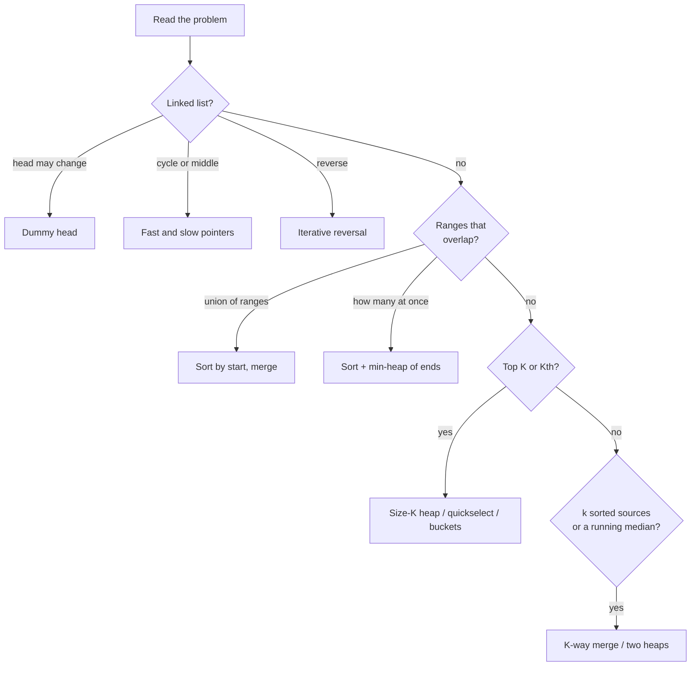

## Where we are

DSA-PAT-1 gave you the array patterns: hashing, two pointers, sliding windows, prefix sums.

This lesson covers four families that interviewers pair together because they share one skill, **keeping just enough order**:

- linked lists (rewire pointers without losing the rest);
- intervals (sort once, then sweep);
- heaps (always know the smallest so far);
- top-K (do not sort what you will throw away).

Java's `PriorityQueue` is a heap; here you learn to use it without its traps.

## The problem

You are in a phone screen. *"Our services write error codes to logs. Return the K most frequent codes; ties go to the smaller code."*

You count with a `HashMap`, sort all entries by count, and take the first K. It works.

Then: *"There are 50 million distinct codes and K is 10. Can you avoid sorting all of them?"*

And then: *"Your comparator is `(a, b) -> b.count - a.count`. Is that safe?"*

Two follow-ups, two places where a working answer turns into a weak one.

Each section below ends with a **signal**: the phrase in a problem that tells you which template to use. The
final table collects them.

## Linked lists: the dummy head

A **singly linked list** is a chain of nodes, each holding a value and a `next` reference. You cannot index
into it; you can only walk it and rewire `next` pointers.

Most list bugs come from one special case: **the head itself changes** (you delete it, or reverse a section that starts at it).

A **dummy head** is a throwaway node placed before the real head, so every real node has a predecessor and the head is no longer special. You return `dummy.next` at the end.

```java
static ListNode mergeTwo(ListNode a, ListNode b) {
    ListNode dummy = new ListNode(0), tail = dummy;
    while (a != null && b != null) {
        if (a.val <= b.val) { tail.next = a; a = a.next; } else { tail.next = b; b = b.next; }
        tail = tail.next;
    }
    tail.next = (a != null) ? a : b;        // attach whatever remains: it is already sorted
    return dummy.next;
}
```

Merging two sorted lists like this is O(n + m) time and O(1) extra space, because it relinks existing nodes
instead of copying them.

```quiz
{"question": "Why does Reverse Linked List II (reverse positions left..right) use a dummy head?", "level": "easy",
 "options": [
   {"text": "So the node before the reversed section always exists, even when left is 1", "correct": true, "why": "With a dummy, 'the node before position left' is a real node for every left, so one code path handles reversing from the head."},
   {"text": "To make the reversal O(log n)", "why": "Reversal visits each node in the section once. The dummy changes the code shape, not the complexity."},
   {"text": "Because Java cannot set a variable to null", "why": "Java can. The problem is that the head has no predecessor to rewire, not anything about null."},
   {"text": "To keep a copy of the original list", "why": "The dummy is one extra node pointing at the head. It copies nothing."}]}
```

**Signal:** "the head may change", "remove nodes", "merge", "partition a list". Reach for a dummy first.

## Reversal: iterative and recursive

**Predict:** in the loop below, what breaks if you write `cur.next = prev` *before* saving `cur.next`?

You lose the rest of the list.

`cur.next` was the only reference to the next node, so once it points back to `prev` you cannot step forward. Always save first.

```java
static ListNode reverse(ListNode head) {     // O(n) time, O(1) space
    ListNode prev = null, cur = head;
    while (cur != null) {
        ListNode next = cur.next;            // 1. save the rest
        cur.next = prev;                     // 2. flip the arrow
        prev = cur;                          // 3. step both forward
        cur = next;
    }
    return prev;
}
```

The recursive version reverses the tail first, then hooks the current node on the end:

```java
static ListNode reverseRecursive(ListNode head) {    // O(n) time, O(n) call stack
    if (head == null || head.next == null) return head;
    ListNode newHead = reverseRecursive(head.next);
    head.next.next = head;
    head.next = null;
    return newHead;
}
```

It is shorter but uses one stack frame per node. On a test run with Java 21's default stack, 10,000 nodes reversed fine and 100,000 threw `StackOverflowError` (the exact limit depends on the JVM and stack size).

Say that, and prefer the iterative one.

**Reverse a section** (Reverse Linked List II) combines both ideas: walk a pointer `before` to the node ahead of
position `left`, then repeatedly move the node after `cur` to the front of the section.

```text
list 1→2→3→4→5, left = 2, right = 4; before = node 1, cur = node 2 (it ends up last)
step  moved  list after
1     3      1→3→2→4→5
2     4      1→4→3→2→5
```

**Signal:** "reverse", "reverse in groups of k", "palindrome list" (reverse the second half and compare).

## Fast and slow pointers, and the cycle start

Two pointers start at the head; **slow** moves one step, **fast** moves two.

- If there is a cycle, fast laps slow and they meet inside it.
- If fast reaches `null`, there is no cycle.
- On a list without a cycle, when fast reaches the end, slow is at the **middle**.

**Predict:** after they meet, the template sends one pointer back to the head and moves both one step at a
time. Why does the second meeting point land exactly on the cycle's first node?

Let:

- `a` be the distance from the head to the cycle start;
- `b` the distance from the start to the meeting point;
- `c` the cycle length.

Slow walked `a + b`; fast walked twice that, which is `a + b` plus some whole number of laps `m · c`.

So `a + b = m · c`, which means `a = m · c - b`: walking `a` steps from the meeting point goes round to the start, the same place `a` steps from the head reaches.

```java
static ListNode cycleStart(ListNode head) {          // Floyd: O(n) time, O(1) space
    ListNode slow = head, fast = head;
    while (fast != null && fast.next != null) {
        slow = slow.next;
        fast = fast.next.next;
        if (slow == fast) {
            ListNode p = head;
            while (p != slow) { p = p.next; slow = slow.next; }
            return p;
        }
    }
    return null;
}
```

A `HashSet<ListNode>` of visited nodes also finds the start, in O(n) space. Interviewers ask for O(1).

The same trick solves **Find the Duplicate Number** in O(n) time and O(1) space: treat `i → nums[i]` as a
`next` pointer. A repeated value means two indices point at the same node, which is a cycle start.

**Signal:** "cycle", "middle of the list", "O(1) extra space" on a list, or an array of values that can be read
as pointers.

## Intervals: sort by start, then sweep

An **interval** is a pair `[start, end]`. Two sorted-by-start intervals overlap when the second starts before the first ends.

Once intervals are sorted by start, overlaps can only happen between neighbours in that order, so one pass is enough.

```java
static int[][] mergeIntervals(int[][] intervals) {   // O(n log n) for the sort
    int[][] sorted = intervals.clone();
    Arrays.sort(sorted, Comparator.comparingInt((int[] iv) -> iv[0]));
    List<int[]> out = new ArrayList<>();
    for (int[] iv : sorted) {
        if (out.isEmpty() || out.get(out.size() - 1)[1] < iv[0]) {
            out.add(new int[] {iv[0], iv[1]});
        } else {
            int[] last = out.get(out.size() - 1);
            last[1] = Math.max(last[1], iv[1]);      // overlap: extend, never shrink
        }
    }
    return out.toArray(new int[0][]);
}
```

The `Math.max` matters: `[1, 10]` followed by `[2, 3]` must stay `[1, 10]`.

**Meeting rooms** asks a different question: not "what is the union?" but "how many overlap at once?". Sort by
start, and keep a **min-heap of end times** for the rooms in use. The heap's top is the room that frees up
first. If it is free by the time the next meeting starts, reuse it; otherwise open a new room.

```java
static int minMeetingRooms(int[][] meetings) {       // half-open [start, end)
    int[][] sorted = meetings.clone();
    Arrays.sort(sorted, Comparator.comparingInt((int[] m) -> m[0]));
    PriorityQueue<Integer> ends = new PriorityQueue<>();
    for (int[] m : sorted) {
        if (!ends.isEmpty() && ends.peek() <= m[0]) ends.poll();   // earliest room is free again
        ends.offer(m[1]);
    }
    return ends.size();
}
```

```text
meetings [0,30] [5,10] [15,20]     heap of end times
meeting   peek <= start?    heap after     rooms
[0,30]    empty             {30}           1
[5,10]    30 <= 5? no       {10, 30}       2
[15,20]   10 <= 15? yes     {20, 30}       2
```

**Predict:** for `[1, 5]` and `[5, 10]`, one room or two?

One, because `5 <= 5` frees the room. That assumes **half-open** intervals (a meeting ending at 5 has left by 5).

Ask the interviewer; if a meeting ending at 5 still holds the room at 5, use `<` and the answer is 2.

A sweep line over sorted start and end times gives the same count without a heap, but Meeting Rooms III needs
*which* room, so it keeps two heaps: free room numbers, and busy rooms ordered by (end time, room number).

**Signal:** "overlapping", "merge ranges", "minimum rooms / platforms / servers", "maximum concurrent".

## Heaps with PriorityQueue

A **binary heap** is a complete binary tree stored in an array where every parent is `<=` its children (a min-heap).

- The smallest element is always at index 0.
- For index `i`, the parent is `(i - 1) / 2` and the children are `2i + 1` and `2i + 2`.

```java
void offer(int x) {                                  // add at the end, then sift up
    a[size] = x;
    int i = size++;
    while (i > 0 && a[(i - 1) / 2] > a[i]) { swap(i, (i - 1) / 2); i = (i - 1) / 2; }
}

int poll() {                                         // move the last leaf to the root, then sift down
    int top = a[0];
    a[0] = a[--size];
    int i = 0;
    while (true) {
        int l = 2 * i + 1, r = l + 1, smallest = i;
        if (l < size && a[l] < a[smallest]) smallest = l;
        if (r < size && a[r] < a[smallest]) smallest = r;
        if (smallest == i) return top;
        swap(i, smallest);
        i = smallest;
    }
}
```

That is the whole of "implement a min-heap without libraries", apart from growing the array and throwing on an empty `poll`. Java's `PriorityQueue` is this structure.

From its Javadoc:

- `offer`, `poll` and `add` are O(log n);
- `peek` and `size` are O(1);
- `remove(Object)` and `contains` are O(n).

It is a **min-heap by
default**; pass `Comparator.reverseOrder()` for a max-heap. Its iterator and `toString` are **not** in sorted order; only repeated `poll` gives sorted output.

**Comparator pitfalls:**

- `(a, b) -> a - b` **overflows** when the values are far apart (see the hard quiz). Use `Integer::compare`,
  `Comparator.comparingInt(...)` or `Comparator.reverseOrder()`.
- Ties need a deliberate rule. If the problem says "ties by smaller index", add `.thenComparingInt(...)`;
  the heap does not keep insertion order for equal keys.
- Do not change a field that the comparator reads while the object sits in the heap. The heap will not
  re-sort; remove it, change it, and offer it again.

```quiz
{"question": "What does this print?", "level": "hard",
 "code": ["PriorityQueue<Integer> pq = new PriorityQueue<>((a, b) -> a - b);", "pq.offer(-1);", "pq.offer(Integer.MAX_VALUE);", "System.out.println(pq.peek());"],
 "options": [
   {"text": "2147483647", "correct": true, "why": "Comparing MAX_VALUE with -1 computes MAX_VALUE - (-1), which overflows to Integer.MIN_VALUE: negative, so MAX_VALUE is ranked smaller. Integer::compare prints -1."},
   {"text": "-1", "why": "That is what a correct comparator gives. The subtraction overflows here, so the heap's order is wrong."},
   {"text": "It throws ArithmeticException", "why": "Java int arithmetic wraps around silently. Only Math.subtractExact throws on overflow."},
   {"text": "null, because the comparator is invalid", "why": "The heap holds two elements, so peek returns one of them. The comparator is wrong, not rejected."}]}
```

## Top-K: heap, sort, quickselect or buckets

Four ways to get the K largest (or most frequent) of n items. For "most frequent", first count with a
`HashMap` in O(n); then n below is the number of distinct keys.

| Approach | Time | Extra space | When to pick it |
|---|---|---|---|
| Sort everything | O(n log n) | O(n) | n is small, or you need everything ranked anyway |
| Min-heap of size K | O(n log K) | O(K) | K much smaller than n, or data arrives as a **stream** |
| Quickselect | O(n) average, O(n²) worst | O(1) beyond the array | Offline, one-off, the order inside the top K does not matter |
| Bucket sort by count | O(n) | O(n) | Keys are small integers, such as frequencies bounded by n |

**Predict:** to keep the K **largest**, do you use a min-heap or a max-heap?

A **min-heap** of size K. Its top is the smallest of your current top K, which is exactly the one to evict when something bigger arrives.

A max-heap of all n items also works, but it costs O(n) memory and gives up the streaming property.

```java
PriorityQueue<Map.Entry<Integer, Integer>> heap = new PriorityQueue<>(Map.Entry.comparingByValue());
for (Map.Entry<Integer, Integer> e : freq.entrySet()) {
    heap.offer(e);
    if (heap.size() > k) heap.poll();                // evict the least frequent
}
```

For **Top K Frequent Words** with "ties alphabetically", the heap's order must be the *eviction* order: lower
count first, and for equal counts the alphabetically *later* word first. Then reverse the output.

```java
Comparator<String> worstFirst = Comparator.<String>comparingInt(freq::get)
        .thenComparing(Comparator.<String>reverseOrder());
```

**Quickselect** partitions like quicksort but recurses into only the side that contains position n - K. A
random pivot makes the O(n²) worst case unlikely. **Bucket sort** works for frequencies because a count is
between 1 and n: put each key in `buckets[count]` and read from the top.

**Signal:** "top K", "K largest / smallest / closest / most frequent", "Kth largest".

```quiz
{"question": "A service emits 10 million latency samples per hour. You must always be able to report the 100 slowest seen so far. Which approach?", "level": "medium",
 "options": [
   {"text": "A min-heap capped at 100: offer each sample and poll when the size exceeds 100", "correct": true, "why": "It is a stream, so you cannot sort or quickselect over all data. O(log 100) per sample and O(100) memory."},
   {"text": "A max-heap of every sample, polled 100 times when asked", "why": "It works but keeps all 10 million samples in memory and every offer costs log of the whole heap."},
   {"text": "Quickselect over all samples when asked", "why": "Quickselect needs the whole array in memory and redoes O(n) work per report."},
   {"text": "Bucket sort by latency value", "why": "Latencies are not small bounded integers like frequencies, so the bucket array would be huge or lossy."}]}
```

## K-way merge and two heaps

**K-way merge** generalises merging two lists: put the head of each of the k lists in a min-heap, poll the
smallest, append it, and offer that node's successor. Each of the N total nodes enters and leaves a heap of
size at most k, so the cost is O(N log k). Merging the lists pairwise, one after another, costs O(N · k).

```java
PriorityQueue<ListNode> heap = new PriorityQueue<>(Comparator.comparingInt((ListNode n) -> n.val));
for (ListNode n : lists) if (n != null) heap.offer(n);
while (!heap.isEmpty()) {
    ListNode smallest = heap.poll();
    tail.next = smallest;
    tail = smallest;
    if (smallest.next != null) heap.offer(smallest.next);
}
```

**Two heaps** keep a running median: a **max-heap** `low` for the smaller half and a **min-heap** `high` for the
larger half, with `low` holding the same number of elements or one more. The median is `low.peek()` or the
average of both tops. Every add goes through `low`, then its largest moves to `high`, then the sizes are
rebalanced. That keeps every element of `low` `<=` every element of `high`.

```text
add   low (max-heap)   high (min-heap)   median
5     [5]              []                5.0
15    [5]              [15]              10.0
1     [5, 1]           [15]              5.0
3     [3, 1]           [5, 15]           4.0
```

Add is O(log n), median is O(1). Average the two tops in `long` or `double`, never `int + int`.

**Signal:** "merge k sorted", "smallest range covering k lists", "median of a stream", "balance two halves".

## Picking the template



## Lab (~10 min)

Save this as `ListHeapTemplates.java` and run `java ListHeapTemplates.java`. It collects the templates from this
lesson and runs each on a small input.

```java
import java.util.ArrayList;
import java.util.Arrays;
import java.util.Collections;
import java.util.Comparator;
import java.util.HashMap;
import java.util.List;
import java.util.Map;
import java.util.PriorityQueue;
import java.util.concurrent.ThreadLocalRandom;

public class ListHeapTemplates {

    static final class ListNode {
        int val;
        ListNode next;
        ListNode(int val) { this.val = val; }
    }

    // ---- Linked lists ----
    static ListNode reverse(ListNode head) {                 // iterative: O(n) time, O(1) space
        ListNode prev = null, cur = head;
        while (cur != null) {
            ListNode next = cur.next;                        // 1. save the rest
            cur.next = prev;                                 // 2. flip the arrow
            prev = cur;                                      // 3. step both forward
            cur = next;
        }
        return prev;
    }

    static ListNode reverseRecursive(ListNode head) {        // O(n) time, O(n) call stack
        if (head == null || head.next == null) return head;
        ListNode newHead = reverseRecursive(head.next);
        head.next.next = head;
        head.next = null;
        return newHead;
    }

    static ListNode reverseBetween(ListNode head, int left, int right) {    // 1-based positions
        ListNode dummy = new ListNode(0);
        dummy.next = head;
        ListNode before = dummy;
        for (int i = 1; i < left; i++) before = before.next;
        ListNode cur = before.next;
        for (int i = 0; i < right - left; i++) {             // move cur.next to the front of the section
            ListNode moved = cur.next;
            cur.next = moved.next;
            moved.next = before.next;
            before.next = moved;
        }
        return dummy.next;                                   // correct even when left == 1
    }

    static ListNode cycleStart(ListNode head) {              // Floyd: meet inside, then walk from head
        ListNode slow = head, fast = head;
        while (fast != null && fast.next != null) {
            slow = slow.next;
            fast = fast.next.next;
            if (slow == fast) {
                ListNode p = head;
                while (p != slow) { p = p.next; slow = slow.next; }
                return p;
            }
        }
        return null;
    }

    static ListNode mergeTwo(ListNode a, ListNode b) {
        ListNode dummy = new ListNode(0), tail = dummy;
        while (a != null && b != null) {
            if (a.val <= b.val) { tail.next = a; a = a.next; } else { tail.next = b; b = b.next; }
            tail = tail.next;
        }
        tail.next = (a != null) ? a : b;
        return dummy.next;
    }

    static ListNode mergeK(List<ListNode> lists) {           // k-way merge: O(N log k)
        PriorityQueue<ListNode> heap = new PriorityQueue<>(Comparator.comparingInt((ListNode n) -> n.val));
        for (ListNode n : lists) if (n != null) heap.offer(n);
        ListNode dummy = new ListNode(0), tail = dummy;
        while (!heap.isEmpty()) {
            ListNode smallest = heap.poll();
            tail.next = smallest;
            tail = smallest;
            if (smallest.next != null) heap.offer(smallest.next);
        }
        return dummy.next;
    }

    // ---- Intervals ----
    static int[][] mergeIntervals(int[][] intervals) {
        int[][] sorted = intervals.clone();
        Arrays.sort(sorted, Comparator.comparingInt((int[] iv) -> iv[0]));
        List<int[]> out = new ArrayList<>();
        for (int[] iv : sorted) {
            if (out.isEmpty() || out.get(out.size() - 1)[1] < iv[0]) {
                out.add(new int[] {iv[0], iv[1]});
            } else {
                int[] last = out.get(out.size() - 1);
                last[1] = Math.max(last[1], iv[1]);          // overlap: extend, never shrink
            }
        }
        return out.toArray(new int[0][]);
    }

    static int minMeetingRooms(int[][] meetings) {           // half-open [start, end)
        int[][] sorted = meetings.clone();
        Arrays.sort(sorted, Comparator.comparingInt((int[] m) -> m[0]));
        PriorityQueue<Integer> ends = new PriorityQueue<>();  // end times of rooms in use
        for (int[] m : sorted) {
            if (!ends.isEmpty() && ends.peek() <= m[0]) ends.poll();   // earliest room is free again
            ends.offer(m[1]);
        }
        return ends.size();
    }

    // ---- Top-K ----
    static List<Integer> topKFrequentHeap(int[] nums, int k) {    // O(n log k)
        Map<Integer, Integer> freq = new HashMap<>();
        for (int x : nums) freq.merge(x, 1, Integer::sum);
        PriorityQueue<Map.Entry<Integer, Integer>> heap =
                new PriorityQueue<>(Map.Entry.comparingByValue());   // min-heap by count
        for (Map.Entry<Integer, Integer> e : freq.entrySet()) {
            heap.offer(e);
            if (heap.size() > k) heap.poll();                       // evict the least frequent
        }
        List<Integer> out = new ArrayList<>();
        while (!heap.isEmpty()) out.add(heap.poll().getKey());
        Collections.reverse(out);
        return out;
    }

    static List<Integer> topKFrequentBuckets(int[] nums, int k) {  // O(n): counts are bounded by n
        Map<Integer, Integer> freq = new HashMap<>();
        for (int x : nums) freq.merge(x, 1, Integer::sum);
        List<List<Integer>> buckets = new ArrayList<>();       // buckets.get(c) = values seen exactly c times
        for (int c = 0; c <= nums.length; c++) buckets.add(new ArrayList<>());
        freq.forEach((value, count) -> buckets.get(count).add(value));
        List<Integer> out = new ArrayList<>();
        for (int c = nums.length; c > 0 && out.size() < k; c--) {
            for (int v : buckets.get(c)) if (out.size() < k) out.add(v);
        }
        return out;
    }

    static List<String> topKWords(String[] words, int k) {      // ties: alphabetical first
        Map<String, Integer> freq = new HashMap<>();
        for (String w : words) freq.merge(w, 1, Integer::sum);
        Comparator<String> worstFirst = Comparator.<String>comparingInt(freq::get)
                .thenComparing(Comparator.<String>reverseOrder());
        PriorityQueue<String> heap = new PriorityQueue<>(worstFirst);
        for (String w : freq.keySet()) {
            heap.offer(w);
            if (heap.size() > k) heap.poll();
        }
        List<String> out = new ArrayList<>();
        while (!heap.isEmpty()) out.add(heap.poll());
        Collections.reverse(out);
        return out;
    }

    static int kthLargest(int[] nums, int k) {              // quickselect: O(n) average, O(n^2) worst
        int[] a = nums.clone();
        int target = a.length - k, lo = 0, hi = a.length - 1;
        while (true) {
            int p = partition(a, lo, hi);
            if (p == target) return a[p];
            if (p < target) lo = p + 1; else hi = p - 1;
        }
    }

    static int partition(int[] a, int lo, int hi) {         // Lomuto with a random pivot
        swap(a, lo + ThreadLocalRandom.current().nextInt(hi - lo + 1), hi);
        int pivot = a[hi], store = lo;
        for (int i = lo; i < hi; i++) if (a[i] < pivot) swap(a, i, store++);
        swap(a, store, hi);
        return store;
    }

    static void swap(int[] a, int i, int j) { int t = a[i]; a[i] = a[j]; a[j] = t; }

    // ---- Two heaps: running median ----
    static final class MedianFinder {
        private final PriorityQueue<Integer> low = new PriorityQueue<>(Comparator.reverseOrder());  // max-heap
        private final PriorityQueue<Integer> high = new PriorityQueue<>();                          // min-heap

        void add(int x) {
            low.offer(x);
            high.offer(low.poll());                          // the largest of the low half moves up
            if (high.size() > low.size()) low.offer(high.poll());   // keep low.size() >= high.size()
        }

        double median() {
            return low.size() > high.size() ? low.peek() : (low.peek() + (long) high.peek()) / 2.0;
        }
    }

    // ---- helpers for main ----
    static ListNode listOf(int... values) {
        ListNode dummy = new ListNode(0), tail = dummy;
        for (int v : values) { tail.next = new ListNode(v); tail = tail.next; }
        return dummy.next;
    }

    static String str(ListNode head) {
        StringBuilder sb = new StringBuilder("[");
        for (ListNode n = head; n != null; n = n.next) sb.append(n.val).append(n.next != null ? "," : "");
        return sb.append("]").toString();
    }

    public static void main(String[] args) {
        System.out.println("reverse [1..5]           = " + str(reverse(listOf(1, 2, 3, 4, 5))));
        System.out.println("reverseRecursive [1..5]  = " + str(reverseRecursive(listOf(1, 2, 3, 4, 5))));
        System.out.println("reverseBetween(2,4)      = " + str(reverseBetween(listOf(1, 2, 3, 4, 5), 2, 4)));
        System.out.println("reverseBetween(1,2)      = " + str(reverseBetween(listOf(1, 2, 3), 1, 2)));

        ListNode cyc = listOf(3, 2, 0, -4);
        cyc.next.next.next.next = cyc.next;                  // tail points back to the node with value 2
        System.out.println("cycle starts at value    = " + cycleStart(cyc).val);

        System.out.println("mergeK                   = "
                + str(mergeK(List.of(listOf(1, 4, 5), listOf(1, 3, 4), listOf(2, 6)))));
        System.out.println("mergeIntervals           = "
                + Arrays.deepToString(mergeIntervals(new int[][] {{8, 10}, {1, 3}, {2, 6}, {15, 18}})));
        System.out.println("minMeetingRooms          = " + minMeetingRooms(new int[][] {{0, 30}, {5, 10}, {15, 20}}));
        System.out.println("minMeetingRooms touching = " + minMeetingRooms(new int[][] {{1, 5}, {5, 10}}));

        int[] nums = {1, 1, 1, 2, 2, 3};
        System.out.println("topKFrequent heap k=2    = " + topKFrequentHeap(nums, 2));
        System.out.println("topKFrequent buckets k=2 = " + topKFrequentBuckets(nums, 2));
        System.out.println("topKWords k=2            = "
                + topKWords(new String[] {"i", "love", "leetcode", "i", "love", "coding"}, 2));
        System.out.println("kthLargest k=2           = " + kthLargest(new int[] {3, 2, 1, 5, 6, 4}, 2));

        MedianFinder mf = new MedianFinder();
        StringBuilder medians = new StringBuilder();
        for (int x : new int[] {5, 15, 1, 3}) { mf.add(x); medians.append(mf.median()).append(' '); }
        System.out.println("running medians          = " + medians.toString().trim());

        PriorityQueue<Integer> broken = new PriorityQueue<>((a, b) -> a - b);
        PriorityQueue<Integer> safe = new PriorityQueue<>(Integer::compare);
        for (int x : new int[] {-1, Integer.MAX_VALUE}) { broken.offer(x); safe.offer(x); }
        System.out.println("(a, b) -> a - b peek     = " + broken.peek() + ", Integer::compare peek = " + safe.peek());
    }
}
```

**What you should see:**

```text
reverse [1..5]           = [5,4,3,2,1]
reverseRecursive [1..5]  = [5,4,3,2,1]
reverseBetween(2,4)      = [1,4,3,2,5]
reverseBetween(1,2)      = [2,1,3]
cycle starts at value    = 2
mergeK                   = [1,1,2,3,4,4,5,6]
mergeIntervals           = [[1, 6], [8, 10], [15, 18]]
minMeetingRooms          = 2
minMeetingRooms touching = 1
topKFrequent heap k=2    = [1, 2]
topKFrequent buckets k=2 = [1, 2]
topKWords k=2            = [i, love]
kthLargest k=2           = 5
running medians          = 5.0 10.0 5.0 4.0
(a, b) -> a - b peek     = 2147483647, Integer::compare peek = -1
```

**Break it.**

1. In `minMeetingRooms`, change `ends.peek() <= m[0]` to `ends.peek() < m[0]`. **Predict first.** The line
   `minMeetingRooms touching` changes from `1` to `2`: back-to-back meetings no longer share a room. Neither is
   "wrong" until you know whether intervals are half-open, which is the clarifying question to ask.
2. In `reverse`, move `cur.next = prev;` above `ListNode next = cur.next;`. The reversed list prints as `[1]`:
   the rest of the chain was lost on the first step.
3. Stretch: add `kClosestPoints(int[][] points, int k)` with a max-heap of size K keyed on `x*x + y*y`. Which
   comparator do you write, and why must it not be `(p, q) -> dist(q) - dist(p)` when coordinates are large?

## Gotchas

- **Losing the rest of the list:** save `cur.next` before rewiring it, every time.
- **Recursive list code on long lists** can throw `StackOverflowError`. Prefer iteration and say why.
- **No `Math.max` when merging:** `[1, 10]` then `[2, 3]` shrinks to `[1, 3]`.
- **Touching intervals:** pick `<` vs `<=` from the problem; ask if unstated.
- **Comparator subtraction** overflows. Use `Integer::compare` or `Comparator.comparingInt`.
- **Printing a `PriorityQueue`** shows heap order, not sorted order. Poll for sorted output.

## In interviews

- Linked lists: [Reverse Linked List II](#/q/reverse-linked-list-ii), [Linked List Cycle II](#/q/linked-list-cycle-ii),
  [Find the Duplicate Number](#/q/find-the-duplicate-number) (Floyd on an array)
- Intervals: [Merge car-rental booking intervals](#/q/merge-intervals), [Meeting Rooms II](#/q/meeting-rooms-ii),
  [Meeting Rooms III (variation)](#/q/meeting-rooms-iii)
- Heaps: [Implement a PriorityQueue (min-heap) without libraries](#/q/implement-min-heap),
  [Single-Threaded CPU](#/q/single-threaded-cpu)
- Top-K: [Top K Frequent Elements](#/q/top-k-frequent-elements), [Top K Frequent Error Codes](#/q/top-k-frequent-words)
- K-way merge, two heaps: [Merge k Sorted Lists](#/q/merge-k-sorted-lists),
  [Find Median from Data Stream](#/q/find-median-from-data-stream)

**Follow-ups.** "Why does the cycle-start trick work?": the `a + b = m · c` argument. "Beat O(n log n) for top K?": size-K
heap O(n log K), buckets O(n) for bounded counts, quickselect O(n) average.

## Explain it in 2 minutes

*"Give me the options for top K frequent elements and when you would pick each."*

1. Count with a `HashMap`: O(n).
2. Sort distinct keys by count: O(n log n), simplest for small n.
3. Size-K min-heap: O(n log K), O(K) memory, works on a stream.
4. Quickselect O(n) average (offline only); bucket sort O(n) since counts are 1..n.
5. Ties need an explicit comparator (`comparingInt` + `thenComparing`), never subtraction.

## Check yourself

1. Why can recursive reversal fail where iterative does not?
2. Meeting Rooms II: what does the heap hold, and why a min-heap?
3. What invariant do the running-median heaps keep?

### Answers

1. One stack frame per node, so long lists throw `StackOverflowError`; iteration is O(1) space.
2. End times of rooms in use; the earliest-freeing room is the only one worth checking against the next start.
3. Every element of `low` `<=` every element of `high`; `low` is the same size as `high` or one larger.

## Next

DSA-PAT-4: BFS uses a queue, Dijkstra this lesson's min-heap, and trees reuse the pointer-rewiring habits.
