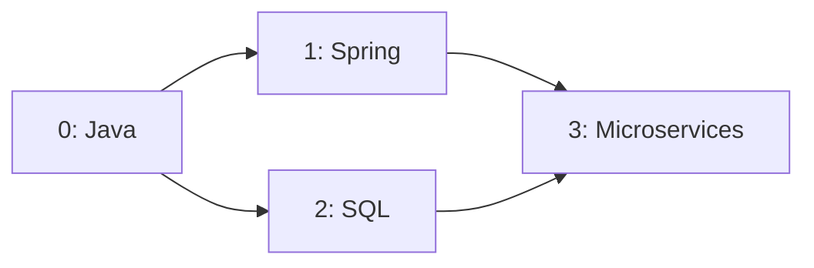
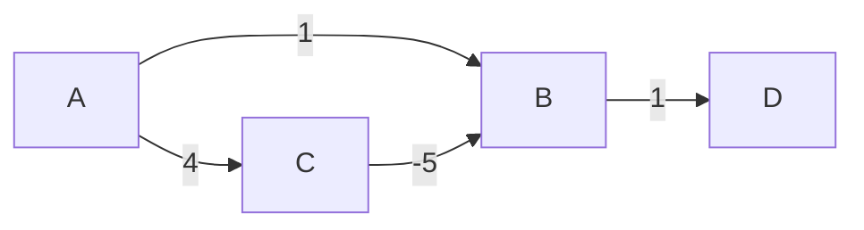

## Where we are

DSA-PAT-3 gave you linked lists (nodes that point at other nodes) and heaps, including Java's
`PriorityQueue`. This lesson connects them:

- a tree is nodes with child pointers;
- a graph is nodes with any pointers;
- a handful of traversals (plus union-find) solve most tree and graph rounds.

For each one you get the signal, a Java 21 template, its variants and what it costs.

## The problem

It is the second round of an onsite. The interviewer shares a grid of oranges: some fresh, some
rotten.

Every minute, rot spreads to the four neighbours of each rotten orange. "How many minutes
until everything is rotten?"

You start a DFS from the first rotten orange, then another from the second, and try to merge the
minute counts. Twenty minutes later the code is long and one test is wrong.

The interviewer says, "What if every rotten orange starts at the same time?"

That sentence was the signal for **multi-source BFS**, which is twelve lines.

## Words first

- A **graph** is a set of **vertices** (nodes) joined by **edges**. Edges are **directed** (one-way,
  like a prerequisite) or **undirected** (two-way, like a friendship), and may carry a **weight**
  (a cost or distance).
- A **tree** is a connected undirected graph with no cycles. A **binary tree** gives each node at
  most a `left` and a `right` child.
- A **path** is a sequence of edges; a **cycle** is a path that returns to its start.
- A **traversal** visits every reachable node once. V is the number of vertices, E the number of
  edges.

## Tree traversals

**Predict:** for the tree below, what order does "visit left subtree, then the node, then the right
subtree" produce?

```text
        4
      /   \
     2     6
    / \     \
   1   3     7
```

It produces `1 2 3 4 6 7`: sorted. That is **inorder**. The three depth-first orders differ only in
where the node is visited:

- **preorder** (node, left, right) copies or serialises a tree;
- **inorder** (left, node, right) reads a BST in order;
- **postorder** (left, right, node) computes answers from children, such as height or a path sum.

The recursive form is three lines. The iterative form uses your own stack, which matters when a
degenerate tree is 10⁵ nodes deep and the call stack would overflow:

```java
Deque<Node> stack = new ArrayDeque<>();
Node cur = root;
while (cur != null || !stack.isEmpty()) {
    while (cur != null) { stack.push(cur); cur = cur.left; }   // go left as far as possible
    cur = stack.pop();
    visit(cur);
    cur = cur.right;
}
```

**Level order** is BFS on a tree: a queue, and an inner loop that runs `queue.size()` times so each
pass is exactly one level. Zigzag order is the same loop, reversing every other level.

A **binary search tree** (BST) keeps every key in the left subtree smaller than the node and every
key in the right subtree larger.

- **Cost:** search, insert and delete walk one path: O(h), where h is the height.
  - O(log n) when balanced;
  - O(n) when it degenerates into a chain (insert sorted keys and see).
- **In Java:** `TreeMap` is a balanced (red-black) BST, so its operations are O(log n).

```quiz
{"question": "You need the k-th smallest key in a BST. Which traversal gives it most directly?", "level": "easy",
 "options": [
   {"text": "Inorder, stopping at the k-th visited node", "correct": true, "why": "Inorder visits a BST's keys in ascending order, so the k-th visit is the answer. O(h + k) with the iterative version."},
   {"text": "Level order, taking the k-th node dequeued", "why": "Level order follows depth, not key order. The root is dequeued first but is rarely the smallest."},
   {"text": "Preorder", "why": "Preorder visits the node before its smaller left subtree, so keys come out unsorted."},
   {"text": "Postorder", "why": "Postorder visits children before parents; the order is not sorted either."}]}
```

## Representing a graph

Interviews hand you graphs in three shapes. Convert once, at the top of your method:

```text
edge list      int[][] edges = {{0,1},{0,2},{1,3}}         as given, rarely traversed directly
adjacency list List<List<Integer>> adj; adj.get(u) = neighbours of u      O(V + E) memory
matrix         boolean[V][V]; m[u][v] = edge?                             O(V²) memory, O(1) edge test
grid           char[][]; neighbours are the 4 cells around (r, c)         the graph is implicit
```

Use an adjacency list by default (a matrix only for small, dense graphs); for weights store `int[]{to, weight}`.

## BFS: shortest path when every edge costs 1

**Breadth-first search** explores in rings: everything at distance 1, then distance 2, and so on,
using a queue (first in, first out).

- Because of that order, the first time BFS reaches a node it has found the fewest-edges path to it.
- That is the signal: **"minimum number of steps / moves /
  transformations"** with no weights.

**Predict:** in the orange grid below (2 = rotten, 1 = fresh, 0 = empty), how many minutes until
nothing is fresh?

```text
2 1 1
1 1 0
0 1 1
```

Four. Put **every** rotten cell in the queue at distance 0, then expand one level per minute.

That is **multi-source BFS**: it equals adding a fake super-source joined to all sources.

```text
minute  newly rotten            fresh left
0       (0,0)  [the source]     6
1       (0,1) (1,0)             4
2       (0,2) (1,1)             2
3       (2,1)                   1
4       (2,2)                   0   → answer 4
```

The template, with the one rule that keeps it O(V + E): **mark a node visited when you enqueue it**,
not when you poll it. Otherwise one node can sit in the queue many times.

```java
Deque<int[]> queue = new ArrayDeque<>();
// offer every source and mark it
while (!queue.isEmpty()) {
    int size = queue.size();                 // one level = one step
    for (int i = 0; i < size; i++) {
        int[] cell = queue.poll();
        for (int[] d : DIRS) {
            int nr = cell[0] + d[0], nc = cell[1] + d[1];
            if (nr < 0 || nc < 0 || nr >= rows || nc >= cols || seen[nr][nc] || blocked[nr][nc]) continue;
            seen[nr][nc] = true;             // mark on enqueue
            queue.offer(new int[]{nr, nc});
        }
    }
    steps++;
}
```

Variants: BFS over **states** instead of cells (Word Ladder: each word is a node, one-letter changes
are edges), and **two-colouring** (colour each node opposite to its parent; a clash means the graph
is not bipartite).

```quiz
{"question": "Which approach fits: \"Given an n x n grid of 0s and 1s, return the shortest distance from every 0-cell to its nearest 1-cell.\"", "level": "medium",
 "options": [
   {"text": "Multi-source BFS starting from all 1-cells at once", "correct": true, "why": "Distances to the nearest of many sources: put every source in the queue at distance 0 and expand once. O(n²) total."},
   {"text": "A BFS from every 0-cell", "why": "Correct but O(n²) BFS runs of O(n²) each, so O(n⁴). Reverse the direction and start from the sources."},
   {"text": "Dijkstra from every 1-cell", "why": "Every step costs 1, so a heap adds a log factor for nothing, and one run per source repeats the work."},
   {"text": "DFS from each 0-cell, tracking the minimum depth", "why": "DFS goes deep first, so the first time it reaches a cell is not along the shortest path. It finds a path, not the shortest one."}]}
```

## DFS: components, flood fill and cycles

**Depth-first search** follows one path as far as it can before backing up. It does not give
shortest paths, but it is the natural tool for **"how many groups / is it connected / does a path
exist / is there a cycle"**.

Number of islands is DFS from each unvisited land cell, sinking the island as you go; each start is
one component. Write it:

- with recursion when the depth is small;
- with an explicit `ArrayDeque` stack when a 1000 × 1000 grid could make one island 10⁶ cells deep,
  which would throw `StackOverflowError` with the default thread stack.

Cycle detection depends on the edge type:

- **Undirected:** a cycle exists if DFS reaches an already-visited node that is not the parent it
  came from, or if union-find's `union(a, b)` finds both already in one group.
- **Directed:** use three colours: white = unvisited, grey = on the current DFS path, black = done.
  - Reaching a **grey** node means you have looped back onto your own path: a cycle.
  - Reaching a black node is fine; it is just a shared descendant.

## Topological sort

A **topological order** lists the nodes of a directed graph so every edge goes from earlier to
later.

- **Exists:** only if the graph has no directed cycle, which is called a **DAG** (directed acyclic graph).
- **Signal:** **prerequisites, build order, "X must happen before Y"**.



**Kahn's algorithm** (BFS): count each node's **indegree** (incoming edges), queue every node with
indegree 0, and each time you take one out, decrement its neighbours' indegrees, queueing any that
reach 0.

```java
for (int i = 0; i < n; i++) if (indegree[i] == 0) queue.offer(i);
while (!queue.isEmpty()) {
    int u = queue.poll();
    order.add(u);
    for (int v : adj.get(u)) if (--indegree[v] == 0) queue.offer(v);
}
return order.size() == n ? order : List.of();      // fewer than n: the rest sit on a cycle
```

**Predict:** add an edge 3 → 0 to the graph above. What does Kahn return?

An empty list. No node has indegree 0 any more, so nothing is ever queued, and `order.size()` is 0.

The size check is your cycle detector for free.

**DFS post-order** is the alternative: run the three-colour DFS, append each node when it turns
black, then reverse the list. Both are O(V + E).

Prefer Kahn in interviews:

- the cycle check is one comparison;
- there is no recursion depth;
- "smallest label first" variants just swap the queue for a `PriorityQueue`.

Alien Dictionary is topological sort after you derive edges from adjacent words.

## Union-find: groups that only merge

**Union-find** (disjoint set union) is new here.

Its signal: **edges arrive one at a time and you ask "are
these connected yet?" or "how many groups now?"**, often in time order. Each node has a `parent`; a **root**
is its own parent and names its group.

- `find` follows parents up to the root.
- `union` finds both roots and, if they differ, links one under the other.
- Each union that succeeds reduces the group count by one; a union that fails means the edge closed a cycle.

```java
int find(int x) {
    if (parent[x] != x) parent[x] = find(parent[x]);   // path compression
    return parent[x];
}
boolean union(int a, int b) {
    int ra = find(a), rb = find(b);
    if (ra == rb) return false;                        // already connected
    if (rank[ra] < rank[rb]) { int t = ra; ra = rb; rb = t; }
    parent[rb] = ra;                                   // union by rank
    if (rank[ra] == rank[rb]) rank[ra]++;
    groups--;
    return true;
}
```

**Rank** is an upper bound on a tree's height; hanging the lower tree under the higher keeps trees
shallow.

- With path compression as well, operations cost O(α(n)) **amortised** (averaged over a sequence of
  operations), effectively constant.
- **Trade-off against BFS/DFS:** union-find answers connectivity as edges are **added**, but cannot delete
  edges or give you a path.
- Kruskal's MST uses it to skip cycle-closing edges.

## Dijkstra: shortest path with non-negative weights

When edges have different costs, BFS's "first arrival is shortest" breaks: two cheap edges can beat
one expensive edge. **Dijkstra's algorithm** fixes this by always expanding the unsettled node with
the smallest known distance, taken from a `PriorityQueue` (DSA-PAT-3).

```java
dist[src] = 0;
pq.offer(new long[]{src, 0});
while (!pq.isEmpty()) {
    int u = (int) pq.poll()[0];
    if (settled[u]) continue;                 // stale entry, skip it
    settled[u] = true;                        // dist[u] is now final
    for (int[] e : adj.get(u)) {              // e = {to, weight}
        int v = e[0];
        if (!settled[v] && dist[u] + e[1] < dist[v]) {
            dist[v] = dist[u] + e[1];
            pq.offer(new long[]{v, dist[v]});  // no decrease-key in PriorityQueue: push a new entry
        }
    }
}
```

Cost: O((V + E) log V) with a binary heap. Distances are `long` so sums cannot overflow `int`.

**Why no negative edges:**

- When u leaves the heap, every other route to u passes through a node whose distance is already at
  least `dist[u]`, and adding non-negative edges can only make it longer. So `dist[u]` is final.
- A negative edge breaks that argument: a longer prefix plus a negative edge can come in under `dist[u]`
  after u is settled.



**Bellman-Ford**, in one line: relax every edge V − 1 times (O(V·E)); it handles negative edges, and
if a V-th round still improves something, there is a negative cycle.

```quiz
{"question": "Run the Dijkstra template above from A on the graph just shown (C → B costs −5). What does it report for D?", "level": "hard",
 "options": [
   {"text": "2, although the true shortest distance is 0", "correct": true, "why": "A settles (0), then B (1), then D (2), then C (4). When C relaxes C → B, B is already settled, so B stays 1 and D stays 2. The real path A → C → B → D costs 4 − 5 + 1 = 0."},
   {"text": "0, because the PriorityQueue re-sorts after the negative edge", "why": "The heap only orders what is pushed. B was settled before C was popped, and settled nodes are never updated, so the improvement is lost."},
   {"text": "It loops forever", "why": "That needs a negative cycle and an algorithm that keeps relaxing. Here there is no cycle, and every node is settled exactly once."},
   {"text": "It throws an exception on the negative weight", "why": "Nothing checks the sign. Dijkstra fails silently with a wrong number, which is why the interviewer asks."}]}
```

## Which shortest-path algorithm?

| Graph | Use | Time |
|---|---|---|
| Unweighted (every edge 1), grid moves | BFS | O(V + E) |
| Many sources, nearest one wins | Multi-source BFS | O(V + E) |
| Weights only 0 or 1 | 0-1 BFS: `ArrayDeque`, 0-edges to the front, 1-edges to the back | O(V + E) |
| Non-negative weights | Dijkstra with `PriorityQueue` | O((V + E) log V) |
| Negative edges, or "at most k edges" | Bellman-Ford (k rounds, each from a copy of last round's array) | O(V · E) or O(k · E) |
| A DAG, any weights | Relax edges in topological order | O(V + E) |
| All pairs, V ≤ a few hundred | Floyd-Warshall | O(V³) |

Cheapest Flights Within K Stops is the "at most k edges" row: plain Dijkstra on cost ignores the
stop limit.

```quiz
{"question": "A delivery robot moves on a grid. Entering a cell costs that cell's number, from 1 to 9. Which algorithm finds the cheapest route?", "level": "medium",
 "options": [
   {"text": "Dijkstra", "correct": true, "why": "Costs differ but are never negative: exactly Dijkstra's case. O(RC log(RC))."},
   {"text": "BFS", "why": "BFS minimises the number of moves, not their total cost. Two cheap cells can beat one expensive one."},
   {"text": "Bellman-Ford", "why": "It is correct but O(V·E) for no reason: there are no negative costs to handle."},
   {"text": "Topological sort, then relax", "why": "That needs a DAG. Grid moves in four directions create cycles."}]}
```

## Lab (~10 min)

One class runs every template: inorder, level order, multi-source BFS, islands with an explicit
stack, Kahn with and without a cycle, union-find, and Dijkstra next to Bellman-Ford.

```java
import java.util.*;

public class GraphPatterns {

    // ---- Trees ----
    static final class Node {
        int val; Node left, right;
        Node(int val, Node left, Node right) { this.val = val; this.left = left; this.right = right; }
    }

    static List<Integer> inorderIterative(Node root) {        // left, node, right with an explicit stack
        List<Integer> out = new ArrayList<>();
        Deque<Node> stack = new ArrayDeque<>();
        Node cur = root;
        while (cur != null || !stack.isEmpty()) {
            while (cur != null) { stack.push(cur); cur = cur.left; }   // go left as far as possible
            cur = stack.pop();
            out.add(cur.val);
            cur = cur.right;
        }
        return out;
    }

    static List<List<Integer>> levelOrder(Node root) {        // BFS, one inner loop per level
        List<List<Integer>> levels = new ArrayList<>();
        Deque<Node> queue = new ArrayDeque<>();
        if (root != null) queue.offer(root);
        while (!queue.isEmpty()) {
            int size = queue.size();                          // freeze the level size
            List<Integer> level = new ArrayList<>();
            for (int i = 0; i < size; i++) {
                Node n = queue.poll();
                level.add(n.val);
                if (n.left != null) queue.offer(n.left);
                if (n.right != null) queue.offer(n.right);
            }
            levels.add(level);
        }
        return levels;
    }

    // ---- Grids: multi-source BFS and DFS components ----
    static final int[][] DIRS = {{1, 0}, {-1, 0}, {0, 1}, {0, -1}};

    static int minutesToRot(int[][] grid) {                   // 2 = rotten, 1 = fresh, 0 = empty
        int rows = grid.length, cols = grid[0].length, fresh = 0;
        Deque<int[]> queue = new ArrayDeque<>();
        for (int r = 0; r < rows; r++)
            for (int c = 0; c < cols; c++) {
                if (grid[r][c] == 2) queue.offer(new int[]{r, c});   // every source starts at distance 0
                else if (grid[r][c] == 1) fresh++;
            }
        int minutes = 0;
        while (!queue.isEmpty() && fresh > 0) {
            int size = queue.size();
            for (int i = 0; i < size; i++) {
                int[] cell = queue.poll();
                for (int[] d : DIRS) {
                    int nr = cell[0] + d[0], nc = cell[1] + d[1];
                    if (nr < 0 || nc < 0 || nr >= rows || nc >= cols || grid[nr][nc] != 1) continue;
                    grid[nr][nc] = 2;                         // mark when enqueued, not when polled
                    fresh--;
                    queue.offer(new int[]{nr, nc});
                }
            }
            minutes++;
        }
        return fresh == 0 ? minutes : -1;
    }

    static int countIslands(char[][] grid) {                  // DFS with an explicit stack: no recursion depth limit
        int islands = 0;
        for (int r = 0; r < grid.length; r++)
            for (int c = 0; c < grid[0].length; c++) {
                if (grid[r][c] != '1') continue;
                islands++;
                Deque<int[]> stack = new ArrayDeque<>();
                stack.push(new int[]{r, c});
                grid[r][c] = '0';
                while (!stack.isEmpty()) {
                    int[] cell = stack.pop();
                    for (int[] d : DIRS) {
                        int nr = cell[0] + d[0], nc = cell[1] + d[1];
                        if (nr < 0 || nc < 0 || nr >= grid.length || nc >= grid[0].length || grid[nr][nc] != '1') continue;
                        grid[nr][nc] = '0';
                        stack.push(new int[]{nr, nc});
                    }
                }
            }
        return islands;
    }

    // ---- Topological sort (Kahn) ----
    static List<Integer> topoSort(int n, int[][] edges) {     // edge {a, b} means a must come before b
        List<List<Integer>> adj = new ArrayList<>();
        for (int i = 0; i < n; i++) adj.add(new ArrayList<>());
        int[] indegree = new int[n];
        for (int[] e : edges) { adj.get(e[0]).add(e[1]); indegree[e[1]]++; }
        Deque<Integer> queue = new ArrayDeque<>();
        for (int i = 0; i < n; i++) if (indegree[i] == 0) queue.offer(i);
        List<Integer> order = new ArrayList<>();
        while (!queue.isEmpty()) {
            int u = queue.poll();
            order.add(u);
            for (int v : adj.get(u)) if (--indegree[v] == 0) queue.offer(v);
        }
        return order.size() == n ? order : List.of();         // fewer than n means a cycle
    }

    // ---- Union-find ----
    static final class UnionFind {
        final int[] parent, rank;
        int groups;
        UnionFind(int n) {
            parent = new int[n]; rank = new int[n]; groups = n;
            for (int i = 0; i < n; i++) parent[i] = i;
        }
        int find(int x) {
            if (parent[x] != x) parent[x] = find(parent[x]);  // path compression
            return parent[x];
        }
        boolean union(int a, int b) {
            int ra = find(a), rb = find(b);
            if (ra == rb) return false;                       // already connected: this edge closes a cycle
            if (rank[ra] < rank[rb]) { int t = ra; ra = rb; rb = t; }
            parent[rb] = ra;                                  // union by rank: shorter tree under taller
            if (rank[ra] == rank[rb]) rank[ra]++;
            groups--;
            return true;
        }
    }

    // ---- Dijkstra and Bellman-Ford ----
    static long[] dijkstra(int n, int[][] edges, int src) {   // edge {from, to, weight}, weights must be >= 0
        List<List<int[]>> adj = new ArrayList<>();
        for (int i = 0; i < n; i++) adj.add(new ArrayList<>());
        for (int[] e : edges) adj.get(e[0]).add(new int[]{e[1], e[2]});
        long[] dist = new long[n];
        Arrays.fill(dist, Long.MAX_VALUE);
        boolean[] settled = new boolean[n];
        PriorityQueue<long[]> pq = new PriorityQueue<>(Comparator.comparingLong(a -> a[1]));
        dist[src] = 0;
        pq.offer(new long[]{src, 0});
        while (!pq.isEmpty()) {
            int u = (int) pq.poll()[0];
            if (settled[u]) continue;                         // stale entry: u was already finalised
            settled[u] = true;
            for (int[] e : adj.get(u)) {
                int v = e[0];
                if (!settled[v] && dist[u] + e[1] < dist[v]) {
                    dist[v] = dist[u] + e[1];
                    pq.offer(new long[]{v, dist[v]});
                }
            }
        }
        return dist;
    }

    static long[] bellmanFord(int n, int[][] edges, int src) {   // V-1 rounds of relaxing every edge
        long[] dist = new long[n];
        Arrays.fill(dist, Long.MAX_VALUE);
        dist[src] = 0;
        for (int round = 0; round < n - 1; round++)
            for (int[] e : edges)
                if (dist[e[0]] != Long.MAX_VALUE && dist[e[0]] + e[2] < dist[e[1]]) dist[e[1]] = dist[e[0]] + e[2];
        return dist;
    }

    public static void main(String[] args) {
        //        4
        //      /   \
        //     2     6
        //    / \     \
        //   1   3     7
        Node root = new Node(4, new Node(2, new Node(1, null, null), new Node(3, null, null)),
                new Node(6, null, new Node(7, null, null)));
        System.out.println("inorder (BST gives sorted): " + inorderIterative(root));
        System.out.println("level order: " + levelOrder(root));

        int[][] oranges = {{2, 1, 1}, {1, 1, 0}, {0, 1, 1}};
        System.out.println("minutes to rot: " + minutesToRot(oranges));

        char[][] map = {"11000".toCharArray(), "11000".toCharArray(), "00100".toCharArray(), "00011".toCharArray()};
        System.out.println("islands: " + countIslands(map));

        int[][] prereqs = {{0, 1}, {0, 2}, {1, 3}, {2, 3}};
        System.out.println("topological order: " + topoSort(4, prereqs));
        System.out.println("with a cycle 3->0: " + topoSort(4, new int[][]{{0, 1}, {0, 2}, {1, 3}, {2, 3}, {3, 0}}));

        UnionFind uf = new UnionFind(5);
        uf.union(0, 1); uf.union(3, 4); uf.union(1, 0);
        System.out.println("groups after unions: " + uf.groups + ", 0~1: " + (uf.find(0) == uf.find(1))
                + ", 1~3: " + (uf.find(1) == uf.find(3)));

        // A=0, B=1, C=2, D=3
        int[][] roads = {{0, 1, 1}, {0, 2, 4}, {2, 1, 2}, {1, 3, 1}};   // break it: change {2, 1, 2} to {2, 1, -5}
        System.out.println("dijkstra:     " + Arrays.toString(dijkstra(4, roads, 0)));
        System.out.println("bellman-ford: " + Arrays.toString(bellmanFord(4, roads, 0)));
    }
}
```

Run it with `java GraphPatterns.java`. It prints:

```text
inorder (BST gives sorted): [1, 2, 3, 4, 6, 7]
level order: [[4], [2, 6], [1, 3, 7]]
minutes to rot: 4
islands: 3
topological order: [0, 1, 2, 3]
with a cycle 3->0: []
groups after unions: 3, 0~1: true, 1~3: false
dijkstra:     [0, 1, 4, 2]
bellman-ford: [0, 1, 4, 2]
```

**Break it:** change the edge `{2, 1, 2}` to `{2, 1, -5}` (C → B costs −5) and run again. Predict
first. The last two lines become:

```text
dijkstra:     [0, 1, 4, 2]
bellman-ford: [0, -1, 4, 0]
```

Dijkstra does not crash or warn. It returns a confident wrong answer for B and D, exactly as the
hard quiz predicted.

**Watch for:** any problem statement that allows negative weights.

**Extension:** in `minutesToRot`, mark on poll instead.

1. Delete `grid[nr][nc] = 2;` and `fresh--;` from the inner loop.
2. Just after `queue.poll()` add `if (grid[cell[0]][cell[1]] == 1) { grid[cell[0]][cell[1]] = 2;
fresh--; }` (sources are already 2, and a cell polled twice must count once). Count the `offer` calls on a
   10 × 10 all-fresh grid with one rotten corner:
   - 99 with mark-on-enqueue;
   - 184,754 with mark-on-poll;
   - and the minutes come out one too high (19, not 18) because `fresh` now lags a level.
3. At 30 × 30 it runs out of heap.

## Gotchas

- **Marking visited on poll:** cells re-enter the queue and O(V + E) becomes a timeout. Mark when you offer.
- **Recursive DFS at depth ~10⁴+** (big grids, chain trees): `StackOverflowError`. Use an `ArrayDeque` stack or BFS.
- **Dijkstra with negative weights:** silently wrong. Use Bellman-Ford; a "lazy" re-processing variant is correct without
  negative cycles but can take exponential time.
- **Directed cycles with a plain visited set:** a visited node may be a shared descendant. Use grey/black or Kahn's count.
- **Disconnected parts:** loop over every node as a start; one BFS from node 0 misses components.
- **`int` distances:** use `long` with `Long.MAX_VALUE` as unreached, and never add to it.

## In interviews

- BFS / multi-source: [Rotting Oranges](#/q/rotting-oranges),
  [Word Ladder (min single-character transformations)](#/q/word-ladder),
  [Pacific Atlantic Water Flow](#/q/pacific-atlantic-water-flow) (BFS backwards from each ocean)
- DFS components: [Number of Islands (with dynamic constraints)](#/q/number-of-islands),
  [Max Area of Island](#/q/max-area-of-island)
- Two-colouring: [Is Graph Bipartite?](#/q/is-graph-bipartite)
- Topological sort: [Course Schedule II](#/q/course-schedule-ii), [Alien Dictionary](#/q/alien-dictionary)
- Union-find: [Earliest timestamp when all users are connected](#/q/the-earliest-moment-when-everyone-become-friends)
- Shortest paths: [Shortest Path Between Two Vertices in a Weighted Graph](#/q/dijkstra-shortest-path),
  [Cheapest Flights Within K Stops](#/q/cheapest-flights-within-k-stops),
  [Mouse to treat staying far from the cat](#/q/find-the-safest-path-in-a-grid) (multi-source BFS, then best-bottleneck search)
- Trees: [Binary Tree Zigzag Level Order Traversal](#/q/binary-tree-zigzag-level-order-traversal),
  [Kth Smallest Element in a BST](#/q/kth-smallest-element-in-a-bst),
  [Mirror of a binary tree](#/q/invert-binary-tree),
  [Binary Tree Maximum Path Sum](#/q/binary-tree-maximum-path-sum) (postorder returning a value)

**Follow-up:** "Why BFS and not DFS?" BFS explores by distance, so the first arrival is shortest in an unweighted graph;
DFS only proves a path exists.

## Explain it in 2 minutes

*"How do you choose between BFS, DFS, topological sort, union-find and Dijkstra?"*

1. BFS for fewest steps unweighted; multi-source when many starts spread together.
2. DFS for components, flood fill, reachability, cycles (grey nodes when directed).
3. Kahn for prerequisite order; fewer than V output means a cycle.
4. Union-find for connectivity as edges arrive, O(α(n)) amortised.
5. Dijkstra for non-negative weights, O((V + E) log V); Bellman-Ford for negative edges.

## Check yourself

1. Directed graph: why is "I reached a visited node" not a cycle?
2. The two union-find optimisations?
3. Edges cost 0 or 1. Which algorithm, and why not plain Dijkstra?

### Answers

1. It may be a finished (black) node reached another way, like a diamond; only a grey node proves a cycle.
2. Path compression (point find-path nodes at the root) and union by rank (shorter tree under taller): amortised O(α(n)).
3. 0-1 BFS with a deque (0-edges front, 1-edges back), O(V + E). Dijkstra works but pays a needless log factor.

## Next

DSA-PAT-5 turns DFS into backtracking (explore every choice and undo it), adds tries, and analyses recursion cost.
