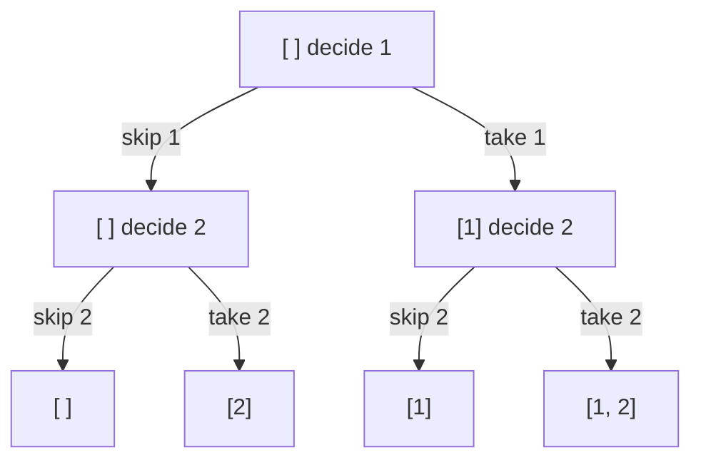

## Where we are

DSA-PAT-4 taught DFS: go deep, back up, try the next branch. This lesson keeps that shape and points
it at a different target.

Instead of visiting the nodes of a graph that already exists, you explore a tree of **choices** that you generate
as you go. That is backtracking. You will also:

- build a trie, a tree keyed by characters;
- learn to state the cost of any recursion: the recurrence, the recursion tree, the Master theorem and the bounds
  interviewers expect for exhaustive search.

## The problem

The interviewer types: "Given a string of digits like `25525511135`, return every valid IP address
you can make by inserting three dots."

You start writing nested loops, and it works, but it is ugly:

- one for where the first dot goes;
- one for the second;
- one for the third.

Then the follow-up: "Now the phone keypad. Digits `23` map to `abc` and `def`; return all letter combinations
for a digit string of **any** length."

Nested loops cannot help now: the number of loops would have to equal the input length. You need a
function that makes one choice, calls itself for the rest, and then undoes the choice.

Then the last question: "What's the complexity?" A vague "exponential" loses points. You need a number such as
O(4ⁿ · n), and a reason.

## The backtracking template

**Backtracking** builds a candidate answer one choice at a time, recurses to make the remaining
choices, and then undoes the last choice so the next option starts from a clean state. It is DFS on
an implicit tree whose nodes are partial answers.

```java
void backtrack(State state, List<Answer> out) {
    if (isComplete(state)) { out.add(copyOf(state)); return; }
    for (Choice c : choicesFrom(state)) {
        if (!isValid(state, c)) continue;      // prune: skip choices that cannot lead to an answer
        apply(state, c);                       // choose
        backtrack(state, out);                 // explore
        undo(state, c);                        // un-choose
    }
}
```

Three decisions define every problem: **what is a partial answer**, **what are the choices from
here**, and **when is it complete**. One mutable `path` is shared by the whole search, so the
un-choose step is what makes it correct.

Here is the tree for subsets of `{1, 2}`. Each level decides one element: skip it (left) or take it
(right).

The leaves are the answers.



**Predict:** with `{1, 2, 3}` the code below records every subset. What prints if you write
`out.add(path)` instead of `out.add(new ArrayList<>(path))`?

```java
static void subsets(int[] nums, int i, List<Integer> path, List<List<Integer>> out) {
    if (i == nums.length) { out.add(new ArrayList<>(path)); return; }
    subsets(nums, i + 1, path, out);            // skip nums[i]
    path.add(nums[i]);                          // choose
    subsets(nums, i + 1, path, out);            // explore
    path.removeLast();                          // un-choose (Java 21 List.removeLast)
}
```

Eight empty lists: `[[], [], [], [], [], [], [], []]`. Every entry is a reference to the same
`path` object, and by the time you print it the un-choose steps have emptied it.

Always store a copy at the leaf.

```quiz
{"question": "In the subsets template, why does path.removeLast() run after the second recursive call?", "level": "easy",
 "options": [
   {"text": "So the caller gets back path exactly as it was before this level made its choice", "correct": true, "why": "One path is shared by the whole search. Undoing the choice restores the state, so the next option starts clean."},
   {"text": "To free memory as the recursion unwinds", "why": "Memory is a side effect at most. Without the removal the answers are wrong, not just bigger."},
   {"text": "To stop the recursion from running forever", "why": "Termination comes from i reaching nums.length, not from the removal."},
   {"text": "It is optional; the output is the same without it", "why": "Without it, later branches inherit elements from earlier ones. The Lab's break-it step shows the garbage it produces."}]}
```

## The four shapes

Most backtracking problems are one of these. What changes is the loop and the start index.

| Shape | Choices at each step | Key line | Answers |
|---|---|---|---|
| Subsets | skip or take `nums[i]` | recurse with `i + 1` | 2ⁿ |
| Combinations (choose k) | any number after the last one taken | loop `x` from `start`, recurse with `x + 1` | C(n, k) |
| Combinations with reuse | same, but you may take the same number again | recurse with `x`, not `x + 1` | depends on the target |
| Permutations | any unused element | `boolean[] used`, loop over all j | n! |

**Constraint search** is the same template with a validity rule.

- **Generate Parentheses** adds `(` while `open < n` and `)` only while `close < open`, so it never builds an
  invalid prefix.
- **Restore IP Addresses** chooses a 1-, 2- or 3-digit piece that is ≤ 255 and has no leading zero, four times.
- **N-Queens** places one queen per row in a column no other queen attacks.

**Duplicates in the input** (`[1, 2, 2]`) in subsets or combinations:

1. sort first;
2. then inside the loop skip `nums[j]` when it equals `nums[j - 1]` and `j` is not the first option at this level
   (`j > start`).

That removes duplicate answers without a `Set`. Permutations need a slightly different check that also looks at
`used[j - 1]`.

## Pruning

**Pruning** means cutting a branch as soon as you know it cannot produce an answer. It does not
change the worst case on paper, but it often changes the real running time by orders of magnitude.

Two cheap prunes cover most problems:

- **Feasibility:** in choose-k from 1..n, stop the loop at `n - need + 1`, where `need` is how many
  numbers are still missing. Starting later leaves too few numbers.
- **Bound:** in Combination Sum with sorted candidates, `break` (not `continue`) as soon as a
  candidate exceeds the remaining target; every later one is bigger.

The Lab measures one: Generate Parentheses for n = 3 makes 22 calls. A search that tried both
characters at all six positions without the validity rule would make 2⁷ − 1 = 127.

```quiz
{"question": "Combination Sum: candidates [2, 3, 5], target 8, each candidate can be used any number of times. Which change to the choose-k template is needed?", "level": "medium",
 "options": [
   {"text": "Recurse with the same index x instead of x + 1", "correct": true, "why": "Staying at x allows reuse, and never going back below x still prevents duplicates such as [3, 5] and [5, 3]."},
   {"text": "Use a boolean[] used array as in permutations", "why": "That allows any order, so [3, 5] and [5, 3] would both appear. Combinations need a start index, not a used array."},
   {"text": "Restart the loop from 0 on every call", "why": "Same problem: the same multiset is produced in several orders."},
   {"text": "Add every path to the output, not only complete ones", "why": "That returns all partial sums. Record a path only when the remaining target hits exactly 0."}]}
```

## Tries

A **trie** (prefix tree) stores strings character by character:

- each node has one child per possible next character;
- a flag marks where a word ends;
- words with a common prefix share the path for that prefix.

The signal: **many lookups by prefix**, such as:

- autocomplete;
- "does any word start with...";
- a word search on a board that must prune as soon as the letters form no prefix.

```java
static final class TrieNode {
    final TrieNode[] next = new TrieNode[26];   // one slot per letter a-z
    boolean isWord;
}

void insert(String word) {
    TrieNode node = root;
    for (char ch : word.toCharArray()) {
        int i = ch - 'a';
        if (node.next[i] == null) node.next[i] = new TrieNode();
        node = node.next[i];
    }
    node.isWord = true;
}
```

`search` walks the same path and checks `isWord` at the end; `startsWith` only checks that the walk
did not fall off. Each operation is O(L) for a word of length L, independent of how many words are
stored.

**Predict:** after inserting `car`, `card`, `care` and `dog`, what do `search("ca")` and
`startsWith("ca")` return?

`false` and `true`. The path c → a exists, but no word ends at `a`.

**Array or map children?**

- A `TrieNode[26]` is fast and visits children in alphabetical order for free (what "top three suggestions in
  lexicographic order" needs), but costs 26 references per node.
- A `HashMap<Character, TrieNode>` suits large or unknown alphabets and sparse tries, at the price of hashing and
  no built-in order.

## Analysing recursion: the recurrence

A **recurrence** writes a function's cost in terms of its cost on smaller inputs. Read it straight
off the code: one term per recursive call, plus the work done in this call.

```text
binary search     T(n) = T(n/2) + O(1)
merge sort        T(n) = 2T(n/2) + O(n)        two halves, then a linear merge
tree traversal    T(n) = 2T(n/2) + O(1)        on a balanced tree
naive Fibonacci   T(n) = T(n-1) + T(n-2) + O(1)
subsets           T(n) = 2T(n-1) + O(1), plus O(n) per leaf for the copy
```

To solve one, draw the **recursion tree**: each node is a call, labelled with the work it does
itself. Add up each level, then add the levels.

For merge sort:

- level k has 2ᵏ calls of size n/2ᵏ, so every level costs n;
- there are log₂ n levels: O(n log n).

## The Master theorem

For divide-and-conquer recurrences of the form **T(n) = a·T(n/b) + f(n)**, with a ≥ 1 and b > 1,
compare f(n) with **n^(log_b a)**, the total cost of the leaves.

| Case | Condition | Result | Example |
|---|---|---|---|
| 1. Leaves dominate | f(n) = O(n^c) for some c < log_b a | Θ(n^(log_b a)) | 2T(n/2) + O(1) → Θ(n) |
| 2. Every level equal | f(n) = Θ(n^(log_b a) · logᵏ n), k ≥ 0 | Θ(n^(log_b a) · logᵏ⁺¹ n) | 2T(n/2) + n → Θ(n log n); T(n/2) + 1 → Θ(log n) |
| 3. Root dominates | f(n) = Ω(n^c) for some c > log_b a, and a·f(n/b) ≤ c′·f(n) for some c′ < 1 | Θ(f(n)) | T(n/2) + n → Θ(n) |

The extra condition in case 3 (called the **regularity condition**) says the work shrinks as you go
down; ordinary polynomials such as n or n² satisfy it.

The theorem does **not** apply to "subtract" recurrences such as T(n) = 2T(n − 1) + O(1). Use the
recursion tree: 2 branches, depth n, so 2ⁿ calls.

```quiz
{"question": "A function does a linear scan of its n elements, then recurses on half of them: T(n) = T(n/2) + O(n). What is its complexity?", "level": "hard",
 "options": [
   {"text": "Θ(n)", "correct": true, "why": "The levels cost n + n/2 + n/4 + ..., a geometric series under 2n. Master theorem case 3: a = 1, b = 2, log_b a = 0, and f(n) = n grows faster."},
   {"text": "Θ(n log n)", "why": "That assumes every level costs n, as in merge sort, which makes two calls. With one call the levels halve, so the first level dominates."},
   {"text": "Θ(log n)", "why": "There are log n levels, but each does real work, not O(1). That answer fits binary search, T(n/2) + O(1)."},
   {"text": "Θ(n²)", "why": "Nothing multiplies n by n. The total is the doubling-sum argument from DSA-CPLX-1 run in reverse."}]}
```

## Bounds for exhaustive search

Backtracking has no Master theorem; count the tree instead.

- **branches^depth**: if each call makes at most b choices and the depth is d, there are at most
  bᵈ leaves. Phone keypad: up to 4 letters per digit, n digits, so O(4ⁿ) leaves.
- **Multiply by the work per leaf**, usually the O(n) copy: subsets are **O(2ⁿ · n)**,
  permutations **O(n! · n)**, keypad **O(4ⁿ · n)**, choose-k **O(C(n, k) · k)**.
- Internal nodes rarely change the bound.
  - A binary tree with 2ⁿ leaves has 2ⁿ − 1 internal nodes.
  - For permutations the internal nodes add up to less than about 1.72 · n!.
- A **fixed** depth and branch count is constant time. Restore IP Addresses has 4 pieces and at most
  3 choices each, so at most 3⁴ = 81 leaves whatever the input.

**Recursion depth is memory.** Each active call is a frame on the thread's stack, so the extra space
is O(depth) plus whatever the path holds.

- **Default stack:** on 64-bit Linux and macOS the default thread stack is 1 MB (the `-Xss` option).
- **How deep:** depends on frame size; on one Windows machine about 14,000 frames of a tiny method fit (11,000 to
  14,000 across runs).
- **Watch out:** backtracking depth is usually small (n ≤ 20), but a recursion that goes thousands deep can throw
  `StackOverflowError`; the Lab shows one.

Convert those to a loop or an explicit stack, as DSA-PAT-4 did for DFS.

**Say which bound you mean.**

- O is an upper bound, Ω a lower bound and Θ both at once (merge sort is Θ(n log n)).
- Separately, say which inputs you describe, worst case or expected (averaged over random choices such as a pivot):
  quicksort with random pivots is Θ(n log n) expected and Θ(n²) in the worst case.

```quiz
{"question": "Return all permutations of n distinct numbers. Which bound should you state?", "level": "medium",
 "options": [
   {"text": "O(n! · n) time, O(n) extra space besides the output", "correct": true, "why": "n! leaves, each copied in O(n), and internal nodes add only a constant factor. The recursion and path are n deep."},
   {"text": "O(2ⁿ · n)", "why": "That is subsets: two choices per element. Permutations choose among all unused elements, n then n−1 and so on."},
   {"text": "O(nⁿ)", "why": "A true but loose upper bound: it ignores that used elements cannot be chosen again. State the tight bound."},
   {"text": "O(n²)", "why": "The output alone has n! lists, so no algorithm can be polynomial here."}]}
```

## Signal → pattern

| Signal in the problem | Pattern |
|---|---|
| "Return all", "list every", "generate all valid" | Backtracking |
| All subsets / power set, n ≤ about 20 | Skip-or-take backtracking (or a bitmask loop) |
| Choose k items, order does not matter | Combinations with a start index |
| Same, with reuse allowed | Recurse with the same index |
| All orderings | Permutations with a `used` array |
| Build a string under rules (balanced, ≤ 255, no attacks) | Constraint search with pruning |
| Input has duplicates, answers must not | Sort, then skip equal neighbours at one level |
| Many prefix queries, autocomplete, word search on a board | Trie (array children for a-z) |

## Lab (~10 min)

The class runs each template, counts recursive calls so you can check the bounds, builds a trie, and
shows a recursion that is too deep.

```java
import java.util.*;

public class BacktrackingPatterns {

    static long calls;                                        // counts recursive calls, to see the bounds

    // ---- Subsets: at each index, skip it or take it ----
    static void subsets(int[] nums, int i, List<Integer> path, List<List<Integer>> out) {
        calls++;
        if (i == nums.length) { out.add(new ArrayList<>(path)); return; }   // copy: path keeps changing
        subsets(nums, i + 1, path, out);                      // skip nums[i]
        path.add(nums[i]);                                    // choose
        subsets(nums, i + 1, path, out);                      // explore
        path.removeLast();                                    // un-choose
    }

    // ---- Permutations: any unused element can go next ----
    static void permutations(int[] nums, boolean[] used, List<Integer> path, List<List<Integer>> out) {
        calls++;
        if (path.size() == nums.length) { out.add(new ArrayList<>(path)); return; }
        for (int j = 0; j < nums.length; j++) {
            if (used[j]) continue;
            used[j] = true; path.add(nums[j]);                // choose
            permutations(nums, used, path, out);              // explore
            used[j] = false; path.removeLast();               // un-choose
        }
    }

    // ---- Combinations: k of 1..n, only increasing, with pruning ----
    static void combine(int start, int n, int k, List<Integer> path, List<List<Integer>> out) {
        calls++;
        if (path.size() == k) { out.add(new ArrayList<>(path)); return; }
        int need = k - path.size();
        for (int x = start; x <= n - need + 1; x++) {         // prune: stop when too few numbers are left
            path.add(x);
            combine(x + 1, n, k, path, out);
            path.removeLast();
        }
    }

    // ---- Constraint search: balanced parentheses ----
    static void parens(int open, int close, int n, StringBuilder sb, List<String> out) {
        calls++;
        if (sb.length() == 2 * n) { out.add(sb.toString()); return; }
        if (open < n)     { sb.append('('); parens(open + 1, close, n, sb, out); sb.deleteCharAt(sb.length() - 1); }
        if (close < open) { sb.append(')'); parens(open, close + 1, n, sb, out); sb.deleteCharAt(sb.length() - 1); }
    }

    // ---- Trie with array children (lowercase a-z) ----
    static final class Trie {
        private static final class TrieNode {
            final TrieNode[] next = new TrieNode[26];
            boolean isWord;
        }
        private final TrieNode root = new TrieNode();

        void insert(String word) {
            TrieNode node = root;
            for (char ch : word.toCharArray()) {
                int i = ch - 'a';
                if (node.next[i] == null) node.next[i] = new TrieNode();
                node = node.next[i];
            }
            node.isWord = true;
        }
        boolean search(String word)       { TrieNode n = walk(word); return n != null && n.isWord; }
        boolean startsWith(String prefix) { return walk(prefix) != null; }

        private TrieNode walk(String s) {
            TrieNode node = root;
            for (char ch : s.toCharArray()) {
                node = node.next[ch - 'a'];
                if (node == null) return null;
            }
            return node;
        }
    }

    // ---- Recursion depth ----
    static long sumRecursive(int n) { return n == 0 ? 0 : n + sumRecursive(n - 1); }

    public static void main(String[] args) {
        List<List<Integer>> out = new ArrayList<>();
        calls = 0; subsets(new int[]{1, 2, 3}, 0, new ArrayList<>(), out);
        System.out.println("subsets " + out + " calls=" + calls);

        out = new ArrayList<>();
        calls = 0; permutations(new int[]{1, 2, 3}, new boolean[3], new ArrayList<>(), out);
        System.out.println("permutations " + out + " calls=" + calls);

        out = new ArrayList<>();
        calls = 0; combine(1, 4, 2, new ArrayList<>(), out);
        System.out.println("combinations " + out + " calls=" + calls);

        List<String> ps = new ArrayList<>();
        calls = 0; parens(0, 0, 3, new StringBuilder(), ps);
        System.out.println("parentheses " + ps + " calls=" + calls);

        Trie trie = new Trie();
        for (String w : List.of("car", "card", "care", "dog")) trie.insert(w);
        System.out.println("search car=" + trie.search("car") + " ca=" + trie.search("ca")
                + " startsWith ca=" + trie.startsWith("ca") + " cat=" + trie.startsWith("cat"));

        System.out.println("recursive sum(1_000) = " + sumRecursive(1_000));
        try {
            System.out.println(sumRecursive(10_000_000));
        } catch (StackOverflowError e) {
            System.out.println("recursive sum(10_000_000): StackOverflowError");
        }
    }
}
```

Run it with `java BacktrackingPatterns.java`. On one machine it printed:

```text
subsets [[], [3], [2], [2, 3], [1], [1, 3], [1, 2], [1, 2, 3]] calls=15
permutations [[1, 2, 3], [1, 3, 2], [2, 1, 3], [2, 3, 1], [3, 1, 2], [3, 2, 1]] calls=16
combinations [[1, 2], [1, 3], [1, 4], [2, 3], [2, 4], [3, 4]] calls=10
parentheses [((())), (()()), (())(), ()(()), ()()()] calls=22
search car=true ca=false startsWith ca=true cat=false
recursive sum(1_000) = 500500
recursive sum(10_000_000): StackOverflowError
```

**What to observe:** subsets made 15 = 2⁴ − 1 calls (a full binary tree over 3 decisions);
permutations made 16 calls for 3! = 6 leaves, so internal nodes are a small constant factor; 10³
frames fit and 10⁷ do not.

**Break it:** delete the `path.removeLast();` line in `subsets` (the one marked "un-choose") and
predict the first line. It became:

```text
subsets [[], [3], [3, 2], [3, 2, 3], [3, 2, 3, 1], [3, 2, 3, 1, 3], [3, 2, 3, 1, 3, 2], [3, 2, 3, 1, 3, 2, 3]] calls=15
```

Same number of calls, completely wrong answers: each branch inherits the leftovers of the previous
one. **Watch for** output that grows longer than n, or repeats elements that appear once in the
input: that is a missing un-choose.

## Gotchas

- **Storing `path` instead of a copy:** every answer aliases one emptied list. Copy at the leaf: `new ArrayList<>(path)`.
- **Not undoing every change:** reset `used[j]` and `path` in the un-choose step, in reverse order.
- **`continue` where `break` is right:** with sorted candidates, once one exceeds the remaining target, all later do.
- **Master theorem on T(n − 1):** it only handles a·T(n/b) + f(n). Use the recursion tree.
- **"Exponential" without a number:** state branches^depth × work per leaf, e.g. O(2ⁿ · n).
- **Assuming a trie is smaller:** a `TrieNode[26]` trie often uses more memory than a `HashSet<String>`; it wins on prefix
  queries, not on space.

## In interviews

- [Generate Parentheses](#/q/generate-parentheses) (answer count is a Catalan number, bounded by O(4ⁿ))
- [Letter Combinations of a Phone Number](#/q/letter-combinations-of-a-phone-number) (O(4ⁿ · n))
- [Restore IP Addresses](#/q/restore-ip-addresses) (fixed depth 4: constant-bounded search)
- [Multilingual Dictionary on a Trie](#/q/implement-trie-ii-prefix-tree) (map children for large alphabets)
- [Top-3 Words by Prefix (with wildcard)](#/q/search-suggestions-system) (walk the prefix, alphabetical DFS that stops at
  three; the wildcard is a small backtracking branch)

**Follow-up:** "Complexity of your backtracking?" Branching factor and depth give the leaf count; multiply by per-leaf
work and add O(depth) stack space.

## Explain it in 2 minutes

*"Walk me through backtracking and how you analyse it."*

1. DFS over partial answers: choose, explore, un-choose.
2. Subsets, combinations, permutations and constraint search differ only in choices and start index.
3. Pruning cuts hopeless branches: rarely the worst case, often real time.
4. Cost is leaves (branches^depth, 2ⁿ, n!) × per-leaf work; space is depth. Master theorem for divide and conquer, recursion tree for subtract recurrences.
5. A trie gives O(L) prefix queries; array children for a-z, a map for large alphabets.

## Check yourself

1. The three decisions that define any backtracking problem?
2. Solve T(n) = 4T(n/2) + n.
3. Is "quicksort is O(n log n)" correct?

### Answers

1. What a partial answer is, what the choices from it are, and when it is complete.
2. a = 4, b = 2, log₂ 4 = 2; n < n², case 1: Θ(n²).
3. Not as a worst case: Θ(n log n) expected with random pivots, Θ(n²) worst.

## Next

DSA-PAT-6 stores repeated subproblem answers (dynamic programming) and covers greedy, its faster, riskier cousin.
