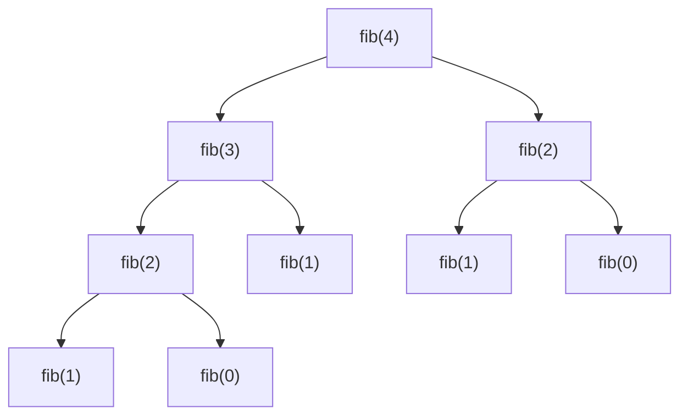

## Where we are

DSA-PAT-5 taught you to explore a tree of choices with backtracking and to count its cost: often
2ⁿ or worse. This lesson notices that many of those branches solve **the same smaller problem again
and again**. Store each answer once and the exponential search becomes a polynomial table. That is
dynamic programming. You will also meet greedy, which commits to one choice and never looks back:
faster when it is right, silently wrong when it is not.

## The problem

You are in a coding round with 25 minutes left. The problem: "A message of digits was encoded with
A = 1, ..., Z = 26. How many ways can `11106` be decoded?" You write a clean recursion: take one
digit, or take two if they form 10–26, and recurse on the rest. The samples pass. The hidden test is
a string of 100 digits, and it times out.

The interviewer asks how many distinct inputs your function is really called with: only 101, one per
starting index, and your code solves each of them an exponential number of times. One array of 101 entries
fixes it, and recognising that moment is this lesson.

## Recognising DP

**Dynamic programming** (DP) solves a problem by combining answers to smaller subproblems, computing
each distinct subproblem only once. It applies when two properties hold:

- **Overlapping subproblems:** the same subproblem appears in many branches of the recursion.
- **Optimal substructure:** the best answer for the whole is built from best answers for the parts.
  (For counting problems, read "the count for the whole is built from counts for the parts".)

Here is naive Fibonacci, `fib(n) = fib(n-1) + fib(n-2)`, for n = 4:



`fib(2)` is computed twice already. **Predict:** roughly how many calls does naive `fib(50)` make?

About 4 × 10¹⁰. The number of calls is 2·fib(n + 1) − 1, which grows like 1.618ⁿ. Yet there are
only 51 distinct subproblems. Overlap is the waste DP removes.

Signals in the problem text: **"number of ways"**, **"minimum / maximum cost"**, **"longest /
shortest"**, **"is it possible"**, combined with choices at each step whose effect depends only on a
small amount of state.

## Memo, table, rolling array

Three ways to write the same DP. Take House Robber: houses in a row hold `a[i]` money; you cannot rob
two adjacent houses. The best from house i onwards is either skip i, or rob i and jump to i + 2.

**Top-down memoisation:** the recursion as written, plus a cache.

```java
static int robMemo(int[] a, int i, Integer[] memo) {
    if (i >= a.length) return 0;
    if (memo[i] != null) return memo[i];
    return memo[i] = Math.max(robMemo(a, i + 1, memo), a[i] + robMemo(a, i + 2, memo));
}
```

**Bottom-up tabulation:** fill an array from the base cases up, in an order where every cell's
inputs are ready.

```java
int[] dp = new int[n + 1];                 // dp[i] = best using houses 0..i-1
dp[1] = a[0];
for (int i = 2; i <= n; i++) dp[i] = Math.max(dp[i - 1], dp[i - 2] + a[i - 1]);
```

**Space-optimised (rolling):** `dp[i]` only reads the last two cells, so keep two variables.

```java
int prev2 = 0, prev1 = 0;
for (int x : a) { int cur = Math.max(prev1, prev2 + x); prev2 = prev1; prev1 = cur; }
```

| | Memo (top-down) | Table (bottom-up) | Rolling |
|---|---|---|---|
| Work | Only states actually reached | Every state | Every state |
| Stack | O(depth) frames; deep inputs can overflow | None | None |
| Space | O(states) | O(states) | O(one or two rows) |
| Rebuild the chosen items | Yes | Yes | Usually no: the history is gone |

In an interview, start top-down if the recursion is clearer, then offer the table and the rolling
version as the follow-up.

## Defining state and transition

Every DP answer is five decisions. Write them as comments before any code.

1. **State:** what you must know about the remaining problem. `dp[i]` = ways to decode `s[i..]`.
2. **Transition:** how a state is built from smaller ones. `dp[i] = dp[i+1]` (if `s[i]` is not `0`)
   `+ dp[i+2]` (if `s[i..i+1]` is 10–26).
3. **Base cases:** `dp[n] = 1`, the empty suffix has one decoding.
4. **Order:** i from n − 1 down to 0, since `dp[i]` reads larger indices.
5. **Answer:** `dp[0]`.

**Complexity = number of states × cost of one transition.** Decode Ways: n states × O(1) = O(n).
Edit distance: (m + 1)(n + 1) states × O(1) = O(mn). LIS done the simple way: n states × O(n) scan
= O(n²).

If the state you need is large (a whole set of items used), you have the wrong state, or the problem
is a bitmask DP (below) or not DP at all.

```quiz
{"question": "dp[i][j] is defined for 0 ≤ i ≤ n and 0 ≤ j ≤ n, and each cell takes the best over a split point k between i and j. What is the time complexity?", "level": "easy",
 "options": [
   {"text": "O(n³)", "correct": true, "why": "About n² states, each doing an O(n) loop over k. States × transition cost."},
   {"text": "O(n²)", "why": "That counts the states only. Each state also loops over up to n split points."},
   {"text": "O(n² log n)", "why": "Nothing halves here; the split loop is linear."},
   {"text": "O(2ⁿ)", "why": "That is the cost without memoisation. With the table, each state is computed once."}]}
```

## The classic shapes

Most interview DP is one of these. Learn the state for each and you will recognise the rest.

| Shape | State | Transition | Cost | Examples |
|---|---|---|---|---|
| 1D linear | `dp[i]` = best for prefix or suffix i | from i−1, i−2 (or a few back) | O(n) | House Robber, Decode Ways, Kadane |
| 2D grid | `dp[r][c]` = best to reach (r, c) | from above and left | O(RC), one row of space | Min path sum, Dungeon Game (filled backwards) |
| 0/1 knapsack | `dp[c]` = best with capacity c | take item or not, c **downwards** | O(n · C) | Partition Equal Subset Sum |
| Unbounded knapsack | `dp[c]` | take item again, c **upwards** | O(n · C) | Coin Change, Coin Change II |
| LIS | `dp[i]` = longest ending at i | max over j < i with a[j] < a[i] | O(n²), or O(n log n) | Russian Doll Envelopes |
| Two strings | `dp[i][j]` = answer for prefixes | match, insert, delete, replace | O(mn) | Edit Distance, LCS |
| Interval | `dp[i][j]` = answer for s[i..j] | split at k, or shrink both ends | O(n²) to O(n³) | Longest Palindromic Substring, Burst Balloons |
| On trees | value returned from a postorder DFS | combine children's answers | O(n) | Binary Tree Maximum Path Sum |

**Bitmask DP** in one line: when n ≤ about 20 and the state is "which items are used", encode the
set as the bits of an `int` and index `dp[mask]` (2ⁿ states).

## Knapsack: one loop direction, two problems

In the rolling 1D knapsack, `dp[c]` means "best value with capacity c using the items seen so far".

```java
for (int i = 0; i < w.length; i++)
    for (int c = cap; c >= w[i]; c--)          // 0/1: downwards
        dp[c] = Math.max(dp[c], dp[c - w[i]] + v[i]);
```

**Predict:** items (weight 1, value 15), (3, 20), (4, 30), capacity 4. What changes if the inner loop
runs **upwards**?

Upwards, `dp[c - w[i]]` may already include item i from this same pass, so the item is reused.
Going downwards reads only values from before item i. Here is the first item's pass both ways:

```text
pass for item (w=1, v=15)      dp[0] dp[1] dp[2] dp[3] dp[4]
before                           0     0     0     0     0
downwards (0/1)                  0    15    15    15    15     each cap holds one copy
upwards (unbounded)              0    15    30    45    60     dp[2] reused dp[1], and so on
```

After all three items the 0/1 answer is 35 (items of weight 1 and 3); the unbounded answer is 60
(four copies of the first item). Same code, one loop reversed, different problem.

```quiz
{"question": "Partition Equal Subset Sum: can [1, 5, 11, 5] be split into two parts with equal sums? Which shape fits?", "level": "medium",
 "options": [
   {"text": "0/1 knapsack on booleans: can some subset reach sum/2, capacity loop downwards", "correct": true, "why": "Each number is used at most once and the question is reachability of a target sum. O(n · sum) time, O(sum) space."},
   {"text": "Unbounded knapsack with the capacity loop upwards", "why": "That lets one number count several times; [1] alone could 'reach' any target."},
   {"text": "Backtracking over all subsets", "why": "Correct but O(2ⁿ). The sum is bounded, so the table is polynomial in n and the sum."},
   {"text": "Greedy: sort descending and add to the smaller side", "why": "A heuristic with counterexamples: [3, 3, 2, 2, 2] can be split into 6 and 6, but greedy ends with 7 and 5."}]}
```

## Two strings: the edit distance table

`dp[i][j]` = fewest edits (insert, delete, replace) to turn the first i characters of s into the
first j characters of t. If the characters match, copy the diagonal; otherwise 1 + the minimum of
replace (diagonal), delete (above) and insert (left). The first row and column are "insert
everything" and "delete everything".

```text
horse → ros        ""   r   o   s
             ""     0   1   2   3
             h      1   1   2   3
             o      2   2   1   2      o = o: copy the diagonal (1)
             r      3   2   2   2
             s      4   3   3   2      s = s: copy the diagonal (2)
             e      5   4   4   3      answer: 3
```

That is the table the Lab prints. LCS (longest common subsequence) is the same grid with "match:
diagonal + 1, else max of above and left".

**LIS** has a faster variant worth knowing: keep `tails[k]`, the smallest possible last element of an
increasing subsequence of length k + 1, and binary-search where each new number goes (DSA-PAT-2).
O(n log n). Russian Doll Envelopes is LIS after sorting by width ascending and, for equal widths,
height descending.

## Greedy: commit and never look back

A **greedy algorithm** makes the locally best choice at each step and never revisits it. Interval
scheduling: to attend the most non-overlapping meetings, sort by end time and take every meeting
that starts after the last one you took. O(n log n) for the sort, O(1) space beyond it.

Greedy is only correct when you can prove it. The standard proof is the **exchange argument**: take
any optimal solution that differs from greedy's; swap its first differing choice for greedy's
choice; show the result is still valid and no worse. Repeat, and the optimal solution becomes
greedy's. For meetings: greedy's first pick ends earliest, so swapping it into an optimal schedule
cannot overlap the meeting that follows.

When the exchange step fails, greedy fails. Weighted meetings (Maximum Profit in Job Scheduling)
break it: one long, valuable job can beat several short ones. That needs DP: sort by end time,
`dp[i] = max(dp[i-1], profit[i] + dp[last job that ends by start i])`, with a binary search for
the last compatible job.

```quiz
{"question": "Coins are {1, 3, 4} and the amount is 6. Greedy takes the largest coin that fits, repeatedly. How many coins does greedy use, and what is the optimum?", "level": "hard",
 "options": [
   {"text": "Greedy uses 3 (4 + 1 + 1); the optimum is 2 (3 + 3)", "correct": true, "why": "Taking 4 first leaves 2, which only 1s can pay. The exchange argument fails: you cannot swap the 4 into the optimal 3 + 3 without making it worse. Coin change needs unbounded-knapsack DP."},
   {"text": "Both use 2 coins", "why": "Greedy never considers 3 + 3: after taking 4 it is committed, and 2 remains."},
   {"text": "Greedy uses 2 coins (4 + 2)", "why": "There is no 2-coin in this set."},
   {"text": "Greedy is always optimal for coin change because larger coins mean fewer coins", "why": "It holds for some coin systems, such as 1, 5, 10, 25, but not for every set. {1, 3, 4} is the standard counterexample."}]}
```

## DP or greedy?

| Question to ask | Points to |
|---|---|
| Can I prove "the locally best choice is in some optimal answer" (exchange argument)? | Greedy |
| Does a small counterexample break the greedy rule (try 3–4 items by hand)? | DP |
| Do choices have weights or values that interact (weighted intervals, coin values)? | DP |
| Is it counting "number of ways"? | DP (greedy never counts) |
| Unweighted intervals: most meetings, fewest arrows, merge | Greedy, sorted by end or start |
| Constraints n · C ≤ about 10⁷ with a numeric capacity C | Knapsack DP is affordable |
| n up to 10⁵ and an O(n²) DP is the only idea | Look for greedy, or a faster DP (binary search, monotonic structure) |

## Lab (~10 min)

One class runs every shape: House Robber three ways, a grid, both knapsacks, coin change by DP and
by greedy, LIS, the edit distance table and greedy meetings.

```java
import java.util.*;

public class DpPatterns {

    // ---- 1D linear: house robber, three ways ----
    static int robMemo(int[] a, int i, Integer[] memo) {       // top-down: best from house i onwards
        if (i >= a.length) return 0;
        if (memo[i] != null) return memo[i];
        return memo[i] = Math.max(robMemo(a, i + 1, memo), a[i] + robMemo(a, i + 2, memo));
    }

    static int robTable(int[] a) {                            // bottom-up: dp[i] = best using houses 0..i-1
        int[] dp = new int[a.length + 1];
        dp[1] = a[0];
        for (int i = 2; i <= a.length; i++) dp[i] = Math.max(dp[i - 1], dp[i - 2] + a[i - 1]);
        return dp[a.length];
    }

    static int robRolling(int[] a) {                          // only the last two cells are ever read
        int prev2 = 0, prev1 = 0;
        for (int x : a) { int cur = Math.max(prev1, prev2 + x); prev2 = prev1; prev1 = cur; }
        return prev1;
    }

    // ---- 2D grid: minimum path sum moving right or down ----
    static int minPathSum(int[][] g) {
        int rows = g.length, cols = g[0].length;
        int[] dp = new int[cols];                             // one rolling row
        for (int r = 0; r < rows; r++)
            for (int c = 0; c < cols; c++) {
                if (r == 0 && c == 0) dp[c] = g[0][0];
                else if (r == 0) dp[c] = dp[c - 1] + g[r][c];
                else if (c == 0) dp[c] = dp[c] + g[r][c];
                else dp[c] = Math.min(dp[c], dp[c - 1]) + g[r][c];   // dp[c] is "above", dp[c-1] is "left"
            }
        return dp[cols - 1];
    }

    // ---- Knapsack: 0/1 vs unbounded differ only in loop direction ----
    static int knapsack01(int[] w, int[] v, int cap) {
        int[] dp = new int[cap + 1];
        for (int i = 0; i < w.length; i++)
            for (int c = cap; c >= w[i]; c--)                 // downwards: each item used at most once
                dp[c] = Math.max(dp[c], dp[c - w[i]] + v[i]);
        return dp[cap];
    }

    static int knapsackUnbounded(int[] w, int[] v, int cap) {
        int[] dp = new int[cap + 1];
        for (int i = 0; i < w.length; i++)
            for (int c = w[i]; c <= cap; c++)                 // upwards: dp[c - w] may already include item i
                dp[c] = Math.max(dp[c], dp[c - w[i]] + v[i]);
        return dp[cap];
    }

    // ---- Coin change: DP vs greedy ----
    static int minCoinsDp(int[] coins, int amount) {
        int[] dp = new int[amount + 1];
        Arrays.fill(dp, Integer.MAX_VALUE);
        dp[0] = 0;
        for (int a = 1; a <= amount; a++)
            for (int coin : coins)
                if (coin <= a && dp[a - coin] != Integer.MAX_VALUE) dp[a] = Math.min(dp[a], dp[a - coin] + 1);
        return dp[amount] == Integer.MAX_VALUE ? -1 : dp[amount];
    }

    static int minCoinsGreedy(int[] coinsDescending, int amount) {
        int count = 0;
        for (int coin : coinsDescending) { count += amount / coin; amount %= coin; }
        return amount == 0 ? count : -1;
    }

    // ---- LIS: O(n log n) with "smallest tail of each length" ----
    static int lis(int[] a) {
        int[] tails = new int[a.length];
        int len = 0;
        for (int x : a) {
            int i = Arrays.binarySearch(tails, 0, len, x);
            if (i < 0) i = -(i + 1);                          // insertion point
            tails[i] = x;
            if (i == len) len++;
        }
        return len;
    }

    // ---- Two strings: edit distance ----
    static int[][] editTable(String s, String t) {
        int[][] dp = new int[s.length() + 1][t.length() + 1];
        for (int i = 0; i <= s.length(); i++) dp[i][0] = i;   // delete everything
        for (int j = 0; j <= t.length(); j++) dp[0][j] = j;   // insert everything
        for (int i = 1; i <= s.length(); i++)
            for (int j = 1; j <= t.length(); j++)
                dp[i][j] = s.charAt(i - 1) == t.charAt(j - 1)
                        ? dp[i - 1][j - 1]
                        : 1 + Math.min(dp[i - 1][j - 1], Math.min(dp[i - 1][j], dp[i][j - 1]));
        return dp;
    }

    // ---- Greedy: most non-overlapping meetings, earliest end first ----
    static int maxMeetings(int[][] meetings) {
        int[][] m = meetings.clone();
        Arrays.sort(m, Comparator.comparingInt(x -> x[1]));
        int count = 0, lastEnd = Integer.MIN_VALUE;
        for (int[] x : m) if (x[0] >= lastEnd) { count++; lastEnd = x[1]; }
        return count;
    }

    public static void main(String[] args) {
        int[] houses = {2, 7, 9, 3, 1};
        System.out.println("rob memo=" + robMemo(houses, 0, new Integer[houses.length])
                + " table=" + robTable(houses) + " rolling=" + robRolling(houses));

        System.out.println("min path sum = " + minPathSum(new int[][]{{1, 3, 1}, {1, 5, 1}, {4, 2, 1}}));

        int[] w = {1, 3, 4}, v = {15, 20, 30};
        System.out.println("knapsack cap 4: 0/1=" + knapsack01(w, v, 4) + " unbounded=" + knapsackUnbounded(w, v, 4));

        System.out.println("coins {1,3,4} amount 6: dp=" + minCoinsDp(new int[]{1, 3, 4}, 6)
                + " greedy=" + minCoinsGreedy(new int[]{4, 3, 1}, 6));

        System.out.println("LIS of [10,9,2,5,3,7,101,18] = " + lis(new int[]{10, 9, 2, 5, 3, 7, 101, 18}));

        int[][] table = editTable("horse", "ros");
        System.out.println("edit distance horse->ros = " + table[5][3]);
        for (int[] row : table) System.out.println("  " + Arrays.toString(row));

        System.out.println("max meetings = " + maxMeetings(new int[][]{{1, 4}, {3, 5}, {0, 6}, {5, 7}, {8, 9}, {5, 9}}));
    }
}
```

Run it with `java DpPatterns.java`. It prints:

```text
rob memo=12 table=12 rolling=12
min path sum = 7
knapsack cap 4: 0/1=35 unbounded=60
coins {1,3,4} amount 6: dp=2 greedy=3
LIS of [10,9,2,5,3,7,101,18] = 4
edit distance horse->ros = 3
  [0, 1, 2, 3]
  [1, 1, 2, 3]
  [2, 2, 1, 2]
  [3, 2, 2, 2]
  [4, 3, 3, 2]
  [5, 4, 4, 3]
max meetings = 3
```

**What to observe:** the three House Robber versions agree; the coin line is the hard quiz, run;
the edit table matches the trace above.

**Break it:** in `knapsack01`, change the inner loop to run upwards,
`for (int c = w[i]; c <= cap; c++)`. Predict the third line, then run. It became:

```text
knapsack cap 4: 0/1=60 unbounded=60
```

The "0/1" knapsack now reuses the weight-1 item four times. No exception, just a bigger number.
**Watch for** a 0/1 answer that equals the unbounded one, or an answer above the sum of all values.

## Gotchas

- **Wrong rolling-knapsack direction:** downwards for 0/1, upwards for unbounded. Comment the reason.
- **Memo keyed on the wrong state:** anything the function reads (running sum, previous item) must be in the key.
- **`Integer.MAX_VALUE` as infinity, then `+ 1`:** overflows negative and wins every `min`. Check "unreachable" first.
- **Deep top-down recursion:** n = 10⁵ means 10⁵ frames. Tabulate.
- **Greedy without proof:** try a 3–4 item counterexample by hand first.
- **Rolling away the path:** if items or the alignment are asked for, keep the full table or a parent array.

## In interviews

- 1D: [Best Time to Buy and Sell Stock](#/q/best-time-to-buy-and-sell-stock) (minimum so far),
  [Kadane's algorithm with hashmap follow-up](#/q/maximum-subarray) (best sum ending here),
  [Decode Ways](#/q/decode-ways), [Delete and Earn](#/q/delete-and-earn) (House Robber over values)
- Knapsack: [Partition Equal Subset Sum](#/q/partition-equal-subset-sum)
- Strings and intervals: [Edit Distance](#/q/edit-distance),
  [Longest Palindromic Substring](#/q/longest-palindromic-substring) (or expand around each centre: O(n²) time, O(1) space)
- Grid: [Dungeon Game](#/q/dungeon-game) (fill from the bottom-right, because the health you need depends on what
  comes after)
- LIS: [Russian Doll / box stacking (with rotation)](#/q/russian-doll-envelopes)
- Greedy vs DP: [Split array into groups of 5 consecutive numbers](#/q/hand-of-straights) (greedy from the smallest with a
  `TreeMap`), [Maximum Profit in Job Scheduling](#/q/maximum-profit-in-job-scheduling) (DP plus binary search)

**Follow-up:** "Can you reduce the space?" Name the previous cells each state reads (one row, two variables) and admit
rolling loses the path rebuild.

## Explain it in 2 minutes

*"How do you approach a dynamic programming problem?"*

1. Spot it: overlapping subproblems, optimal substructure; "number of ways", "min/max", "longest".
2. State in words, then transition, base cases, fill order, answer cell; cost is states × transition.
3. Top-down memo or bottom-up table; roll the array when a state reads only the previous row.
4. Name the shape: 1D, grid, knapsack, LIS, two strings, interval, tree, bitmask.
5. Greedy only with an exchange argument; coins {1, 3, 4} show why.

## Check yourself

1. Which two properties make a problem suitable for DP?
2. One trade-off between memoisation and tabulation?
3. Why does "earliest end first" work for unweighted meetings but not weighted jobs?

### Answers

1. Overlapping subproblems and optimal substructure.
2. Memo computes only reachable states but can overflow the stack; tabulation allows rolling but needs a fill order.
3. Equal values let the earliest-ending meeting be exchanged into an optimum; with weights one long job can beat several.

## Next

Practise these families on the bank problems above; INTV-TIPS-1 has the Java idioms, DSA-CPLX-4 the brute-force-to-optimal talk-through.
