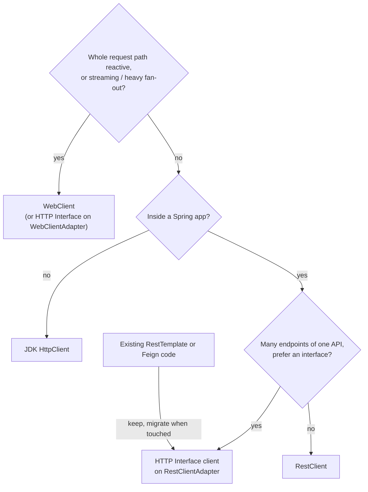

## Where we are

SPRING-BOOT-6 followed a request **into** your service: `DispatcherServlet`, handler mapping, message
converters, `@ControllerAdvice`. Real services also make requests **out**: to a payment provider, a pricing
service, a partner API.

This lesson is the outbound side:

- the HTTP clients Spring and the JDK give you;
- which one to pick;
- the settings (timeouts, error mapping, retries, pools) that decide whether a slow dependency stays someone else's problem.

## The problem

It is Black Friday, 10:02. ShopKart's product page calls the pricing service for every request.

1. Pricing is struggling and starts answering in 40 seconds instead of 40 milliseconds.
2. Your client has **no read timeout**, so each call waits.
3. Within two minutes all 200 Tomcat threads are stuck waiting on pricing.
4. The product page, the cart and even the health check stop responding.

Pricing was slow; **you** went down.

Meanwhile:

- a teammate wraps the "create order" call in a retry loop "to be safe", and some customers get two orders;
- code review also finds three HTTP clients in one codebase.

All client-side choices; let's make them deliberately.

## Six clients at a glance

| Client | Style | Blocking? | Status |
|---|---|---|---|
| `RestTemplate` | Template methods (`getForObject`) | Yes | On its way out (details next) |
| `RestClient` | Fluent builder, Spring 6.1+ | Yes | The default choice for new blocking code |
| `WebClient` | Fluent, reactive (`Mono`, `Flux`) | No | Active; for reactive and streaming |
| HTTP Interface client | Annotated Java interface (`@HttpExchange`) | Either, by adapter | Active; Spring's declarative option |
| OpenFeign | Annotated interface (Spring Cloud) | Yes | Feature-complete: bug fixes only |
| JDK `HttpClient` | Plain Java 11+ API | Both (`send`, `sendAsync`) | Part of the JDK |

**Blocking** means the calling thread waits until the response arrives. **Non-blocking** means the thread
is handed back and the result arrives later as a callback or a reactive stream.

## RestTemplate: the classic, now retiring

`RestTemplate` has been Spring's HTTP client since Spring 3. One method per HTTP verb:

```java
Quote quote = restTemplate.getForObject("http://pricing/quotes/{id}", Quote.class, 42);
```

Its status, stated carefully:

- Since Spring Framework 6.1, its Javadoc says `RestClient` "offers a more modern API".
- The Spring Framework 7.0 reference docs (Spring Boot 4.0) describe it as deprecated in favour of
  `RestClient` and link a migration guide, though the 7.0 class itself carries no `@Deprecated`.
- In **Spring Framework 7.1** the class is annotated `@Deprecated(since = "7.1", forRemoval = true)`, and
  its Javadoc says it is planned for removal in **8.0**.

So: keep existing `RestTemplate` code working, write no new code with it, and migrate as you touch it.
Spring Boot does not auto-configure a `RestTemplate` bean, only a `RestTemplateBuilder`.

## RestClient: fluent and synchronous

`RestClient` (Spring Framework 6.1+) is the blocking client to reach for today. It shares
`RestTemplate`'s underlying machinery (request factories, message converters, interceptors) behind a
fluent API.

Boot auto-configures a prototype `RestClient.Builder`; inject it rather than calling
`RestClient.create()`, so you inherit Boot's settings and observability.

```java
@Bean
RestClient pricingClient(RestClient.Builder builder) {
    return builder.baseUrl("http://pricing:8080").build();
}

Quote quote = pricingClient.get()
        .uri("/quotes/{id}", 42)
        .retrieve()
        .body(Quote.class);
```

`retrieve()` throws a subclass of `RestClientException` on a 4xx or 5xx by default; you will customise
that shortly.

## WebClient: reactive, when it pays

`WebClient` lives in Spring WebFlux. It returns a `Mono` (zero or one value, later) or a `Flux` (a stream of
values) instead of the value itself, so no thread waits while the bytes are in flight.

```java
Mono<Quote> quote = webClient.get()
        .uri("/quotes/{id}", 42)
        .retrieve()
        .bodyToMono(Quote.class);
```

**Predict:** in a normal Spring MVC controller, someone swaps `RestClient` for `WebClient` and then calls
`.block()` on every result "for performance". What do they gain?

Almost nothing. `.block()` makes the calling thread wait, exactly like `RestClient`, and now there is a
reactive stack in the mix to debug as well.

`WebClient` pays off when:

- the **whole path** is non-blocking (a WebFlux application);
- you fan out many calls at once and combine them;
- you stream a large or endless response (server-sent events).

For a blocking MVC application on Java 21, `RestClient` on **virtual threads** (cheap threads that release the OS thread
while waiting; JAVA-CONC-6) gives cheap waiting without reactive code.

## HTTP Interface clients: declare it, Spring implements it

You write a Java interface with annotations; Spring generates the implementation (a proxy) at startup.

```java
@HttpExchange("/quotes")
public interface PricingApi {

    @GetExchange("/{id}")
    Quote get(@PathVariable long id);

    @PostExchange
    Quote create(@RequestBody QuoteRequest request);
}
```

The proxy runs on top of a real client through an adapter: `RestClientAdapter` (blocking) or
`WebClientAdapter` (methods may then return `Mono` or `Flux`). Wiring it by hand:

```java
RestClient restClient = RestClient.create("http://pricing:8080");
HttpServiceProxyFactory factory = HttpServiceProxyFactory.builderFor(RestClientAdapter.create(restClient)).build();
PricingApi pricing = factory.createClient(PricingApi.class);
```

In Spring Boot 4 you can skip that: put `@ImportHttpServices(group = "pricing", types = PricingApi.class)` on
a configuration class, and configure the group with properties:

```properties
spring.http.serviceclient.pricing.base-url=http://pricing:8080
spring.http.serviceclient.pricing.connect-timeout=500ms
spring.http.serviceclient.pricing.read-timeout=2s
```

Then inject `PricingApi` like any bean. The interface is also the easiest thing to mock in a unit test.

## OpenFeign: the declarative client that came first

**Spring Cloud OpenFeign** popularised declarative clients: an interface marked `@FeignClient` using Spring MVC
annotations, enabled with `@EnableFeignClients`.

```java
@FeignClient(name = "pricing", url = "http://pricing:8080")
public interface PricingFeignClient {
    @GetMapping("/quotes/{id}")
    Quote get(@PathVariable("id") long id);
}
```

Its docs call it **feature-complete** (bug fixes only, since Spring Cloud 2022.0.0) and suggest migrating to
Spring's HTTP Service Clients, so keep it in existing services and use HTTP Interface clients for new code.

## JDK HttpClient: no framework at all

`java.net.http.HttpClient` (Java 11+) needs no dependency. Since Java 21 it implements `AutoCloseable`.

```java
try (HttpClient client = HttpClient.newBuilder().connectTimeout(Duration.ofSeconds(1)).build()) {
    HttpRequest request = HttpRequest.newBuilder(URI.create("http://pricing:8080/quotes/42"))
            .timeout(Duration.ofSeconds(2))
            .build();
    HttpResponse<String> response = client.send(request, HttpResponse.BodyHandlers.ofString());
}
```

You map JSON and errors yourself. Use it in libraries, CLIs and small tools; inside Spring, use it as the
**engine under `RestClient`** via `JdkClientHttpRequestFactory`.

```quiz
{"question": "You are starting a new blocking Spring Boot 4 service that calls three internal APIs. Which client does the Spring team point you to?", "level": "easy",
 "options": [
   {"text": "RestClient, or an HTTP Interface client backed by RestClient", "correct": true, "why": "RestClient is the modern synchronous client, and HTTP Interface clients add a declarative layer on top of it."},
   {"text": "RestTemplate", "why": "The docs mark it deprecated in favour of RestClient, and from Spring Framework 7.1 it is @Deprecated for removal in 8.0."},
   {"text": "Spring Cloud OpenFeign", "why": "Its own docs call it feature-complete and suggest migrating to Spring's HTTP Service Clients."},
   {"text": "WebClient with .block() everywhere", "why": "That gives blocking behaviour with reactive complexity. Use WebClient when the path is truly non-blocking."}]}
```

## Timeouts, per client

Two timeouts matter on every call:

- **Connect timeout**: how long to wait to open the TCP connection.
- **Read (response) timeout**: how long to wait for the response once connected.

Without them you get Black Friday.

| Client | Where you set them |
|---|---|
| Any Boot-built client | `spring.http.clients.connect-timeout`, `spring.http.clients.read-timeout` (global) |
| HTTP Interface group | `spring.http.serviceclient.<group>.connect-timeout` / `read-timeout` |
| `RestClient` | On the request factory, e.g. `JdkClientHttpRequestFactory.setReadTimeout(...)` over an `HttpClient` with `connectTimeout(...)` |
| `WebClient` (Reactor Netty) | `HttpClient.create().option(ChannelOption.CONNECT_TIMEOUT_MILLIS, 500).responseTimeout(Duration.ofSeconds(2))` |
| OpenFeign | `spring.cloud.openfeign.client.config.<name>.connectTimeout` / `readTimeout` |
| JDK `HttpClient` | Builder `connectTimeout(...)`, and `HttpRequest.Builder.timeout(...)` per request |

Pick values from the dependency's real latency (a little above its p99), not round numbers, and keep the
whole chain inside the caller's budget (WEB-API-5).

## Error mapping: status codes to your exceptions

Do not let `HttpClientErrorException` leak into your service layer. Map statuses to exceptions that mean
something in your domain, in one place.

```java
Quote quote = pricingClient.get().uri("/quotes/{id}", id)
        .retrieve()
        .onStatus(status -> status.value() == 404, (req, res) -> { throw new QuoteNotFoundException(id); })
        .onStatus(HttpStatusCode::is5xxServerError, (req, res) -> { throw new PricingUnavailableException(); })
        .body(Quote.class);
```

To apply it to every call from one client, set it once with `defaultStatusHandler(HttpStatusCode::isError,
...)` on the builder; HTTP Interface clients inherit it. `WebClient` has the same `onStatus`, and Feign uses an
`ErrorDecoder` bean.

## Retries: only for idempotent calls

A **retry** sends the same request again after a failure. It helps with transient faults (a connection
reset, a `503`) and does harm everywhere else.

An operation is **idempotent** if doing it twice has the same effect as once: `GET`, `PUT` and `DELETE` are, by definition; `POST` is not.

**Predict:** the "create order" `POST` times out after 2 seconds and the client retries. Did the first
attempt fail?

You do not know. A timeout means the **response** did not arrive in time; the server may have created the
order and the reply got lost.

- **Risk:** retrying a non-idempotent `POST` can create a second order.
- **Rule:** retry a `POST` only if the server supports an **idempotency key** header that lets it recognise the repeat.

On Spring Boot 4 you need no extra library: Spring Framework 7 has a built-in `@Retryable` (package
`org.springframework.resilience.annotation`, enabled with `@EnableResilientMethods` on a configuration class).

Its defaults are generous:

- it retries **any exception**;
- up to `maxRetries = 3` times **after** the first call (so up to four attempts);
- with a 1 s delay.

Always set `includes`, or it retries everything, a `400` included:

```java
@Retryable(includes = {ResourceAccessException.class, HttpServerErrorException.class},   // I/O errors, 5xx
           maxRetries = 2, delay = 200, multiplier = 2)                                   // 3 attempts in all
public Quote getQuote(long id) {   // a GET: safe to repeat
    return pricingClient.get().uri("/quotes/{id}", id).retrieve().body(Quote.class);
}
```

**Resilience4j** is the richer library (circuit breakers too, DIST-SYS-3); on Boot 4 use its
`resilience4j-spring-boot4` starter (2.4.0 or later).

- **Watch out:** count carefully when you switch: its `max-attempts: 3` **includes** the first call, while `maxRetries = 3` does not.
- **Rule:** the same for both: retry only idempotent calls, on transient errors.

```quiz
{"question": "submitPayment() is annotated @Retryable and sends POST /payments with an Idempotency-Key header. Inside the method, the key is created with UUID.randomUUID(). The provider times out once. Is the retry safe?", "level": "hard",
 "code": ["@Retryable(includes = ResourceAccessException.class)", "public Receipt submitPayment(PaymentRequest req) {", "    String key = UUID.randomUUID().toString();", "    return client.post().uri(\"/payments\").header(\"Idempotency-Key\", key)", "            .body(req).retrieve().body(Receipt.class);", "}"],
 "options": [
   {"text": "No: every attempt runs the method again and gets a new key, so the provider sees two different payments", "correct": true, "why": "The retry re-invokes the whole method, so randomUUID() runs again. Create the key once, outside the retried method (for example when the order is created), and pass it in."},
   {"text": "Yes: any Idempotency-Key header makes a POST safe to retry", "why": "Only the same key on every attempt lets the server spot the repeat. A fresh key per attempt looks like a new request."},
   {"text": "Yes: the timeout means the first attempt never reached the provider", "why": "A timeout says nothing about the server's outcome; the payment may have been taken and only the reply lost."},
   {"text": "No, but only because @Retryable never retries a POST", "why": "@Retryable knows nothing about HTTP methods. It retries the Java method on the configured exceptions."}]}
```

## Interceptors and logging

An **interceptor** wraps every request a client sends (auth header, correlation id, timing log). For
`RestClient` it is a `ClientHttpRequestInterceptor`, registered with `requestInterceptor(...)` on the builder;
for `WebClient` an `ExchangeFilterFunction`.

```java
ClientHttpRequestInterceptor timing = (request, body, execution) -> {
    long start = System.nanoTime();
    ClientHttpResponse response = execution.execute(request, body);
    log.info("{} {} -> {} in {} ms", request.getMethod(), request.getURI().getPath(),
            response.getStatusCode().value(), (System.nanoTime() - start) / 1_000_000);
    return response;
};
```

Log the path, never query strings, bodies or `Authorization` headers: they hold tokens and personal data.
Boot's builders already propagate trace headers and record client metrics (SPRING-BOOT-11).

## Connection pools

Clients reuse open TCP (and TLS) connections from a **pool**; the JDK `HttpClient` and Reactor Netty pool by
default.

- **Watch out:** a pool that is too small makes requests queue, which looks exactly like a slow dependency, so with
  Apache HttpClient 5 size it explicitly (`setMaxConnTotal`, `setMaxConnPerRoute`).
- **Rule:** create **one client per dependency and reuse it**.

## Client-side load balancing

Spring Cloud LoadBalancer's `@LoadBalanced` builder resolves `http://pricing` to one registered instance per
call, though on Kubernetes the Service name already balances for you (WEB-API-5).

## Testing your clients

**Predict:** can `MockRestServiceServer` prove that your read timeout works?

No. It replaces the transport, so no socket ever waits and no timeout can fire.

The second tool below can.

- **`MockRestServiceServer`** (spring-test) replaces the client's transport with a mock, for `RestTemplate`
  or a `RestClient.Builder` (`MockRestServiceServer.bindTo(builder).build()`, since 6.1). Fast, no sockets;
  Boot's `@RestClientTest` slice sets it up for you (SPRING-BOOT-8).

```java
RestClient.Builder builder = RestClient.builder().baseUrl("http://pricing");
MockRestServiceServer server = MockRestServiceServer.bindTo(builder).build();
server.expect(requestTo("http://pricing/quotes/42"))
      .andRespond(withSuccess("{\"id\":42,\"price\":1999}", MediaType.APPLICATION_JSON));
// build the client from the builder, call it, assert, then:
server.verify();
```

- **WireMock** runs a real HTTP server on a local port that you stub (`stubFor(get(urlEqualTo("/quotes/42"))
  .willReturn(...))`). Because real bytes cross a real socket, it tests timeouts, slow responses, connection
  resets and any client, including `WebClient` and Feign.

Use `MockRestServiceServer` for request and mapping logic, WireMock when timeouts and the wire matter.

## Choosing: the decision table



| Client | Blocking | Maintenance status | API style | Pick it when |
|---|---|---|---|---|
| `RestTemplate` | Yes | Deprecated for removal from 7.1, removal planned in 8.0 | Template methods | Never for new code; keep legacy running |
| `RestClient` | Yes | Active, recommended | Fluent | New blocking code, a few calls |
| `WebClient` | No | Active | Fluent, reactive | WebFlux apps, streaming, large fan-out |
| HTTP Interface | Adapter decides | Active | Declarative | Many endpoints of one API; easy mocking |
| OpenFeign | Yes | Feature-complete, bug fixes only | Declarative | Existing Spring Cloud services already on it |
| JDK `HttpClient` | Both | Part of the JDK | Low-level fluent | No Spring, libraries, or as the engine under `RestClient` |

```quiz
{"question": "A Spring MVC service on Java 21 calls a partner API with 15 endpoints. The team wants code that is easy to mock in unit tests and no reactive code. Which client?", "level": "medium",
 "options": [
   {"text": "An HTTP Interface client (@HttpExchange) backed by RestClient", "correct": true, "why": "Declarative, one interface for 15 endpoints, trivially mockable, blocking, and actively developed."},
   {"text": "WebClient", "why": "Nothing here is reactive. You would add reactive types and .block() calls for no benefit."},
   {"text": "Spring Cloud OpenFeign", "why": "It would work, but it is feature-complete and its docs suggest Spring's HTTP Service Clients for new code."},
   {"text": "RestTemplate wrapped in a facade class", "why": "Deprecated for removal from Spring Framework 7.1. Do not start new code on it."}]}
```

## Lab (~10 min)

You will call a local "pricing service" with the JDK `HttpClient`:

- map status codes to typed exceptions (like `onStatus`);
- retry an idempotent `GET` on `503` with backoff;
- watch a request timeout save you from a slow endpoint.

The server is the JDK's built-in `com.sun.net.httpserver.HttpServer` on a random
free port, so nothing else is needed. Save as `QuoteClientDemo.java`, then `javac QuoteClientDemo.java`
and `java QuoteClientDemo`.

```java
import com.sun.net.httpserver.HttpExchange;
import com.sun.net.httpserver.HttpServer;
import java.io.IOException;
import java.net.InetSocketAddress;
import java.net.URI;
import java.net.http.HttpClient;
import java.net.http.HttpRequest;
import java.net.http.HttpResponse;
import java.net.http.HttpTimeoutException;
import java.nio.charset.StandardCharsets;
import java.time.Duration;
import java.util.concurrent.Executors;
import java.util.concurrent.atomic.AtomicInteger;

public class QuoteClientDemo {

    static class RemoteServerException extends RuntimeException {
        RemoteServerException(int status) { super("remote returned " + status); }
    }

    static class RemoteClientException extends RuntimeException {
        RemoteClientException(int status) { super("remote rejected the request with " + status); }
    }

    // A tiny stand-in for another service, on a random free port.
    static HttpServer startServer() throws IOException {
        HttpServer server = HttpServer.create(new InetSocketAddress("127.0.0.1", 0), 0);
        AtomicInteger flakyCalls = new AtomicInteger();
        server.createContext("/quotes/42", ex -> reply(ex, 200, "{\"id\":42,\"price\":1999}"));
        server.createContext("/quotes/404", ex -> reply(ex, 404, "{\"error\":\"no such quote\"}"));
        server.createContext("/flaky", ex -> {
            int n = flakyCalls.incrementAndGet();
            reply(ex, n <= 2 ? 503 : 200, n <= 2 ? "busy" : "{\"ok\":true}");
        });
        server.createContext("/slow", ex -> {
            try { Thread.sleep(3_000); } catch (InterruptedException e) { Thread.currentThread().interrupt(); }
            reply(ex, 200, "finally");
        });
        server.setExecutor(Executors.newVirtualThreadPerTaskExecutor());
        server.start();
        return server;
    }

    static void reply(HttpExchange ex, int status, String body) throws IOException {
        byte[] bytes = body.getBytes(StandardCharsets.UTF_8);
        ex.sendResponseHeaders(status, bytes.length);
        try (var out = ex.getResponseBody()) { out.write(bytes); }
    }

    // Like RestClient's onStatus: turn status codes into typed exceptions in one place.
    static String get(HttpClient client, URI uri) throws IOException, InterruptedException {
        HttpRequest request = HttpRequest.newBuilder(uri)
                .timeout(Duration.ofMillis(500))            // response timeout for this request
                .header("X-Correlation-Id", "demo-123")
                .GET().build();
        HttpResponse<String> response = client.send(request, HttpResponse.BodyHandlers.ofString());
        int status = response.statusCode();
        if (status >= 500) throw new RemoteServerException(status);
        if (status >= 400) throw new RemoteClientException(status);
        return response.body();
    }

    // Retry only a GET (idempotent), only on 5xx, with bounded exponential backoff.
    static String getWithRetry(HttpClient client, URI uri, int maxAttempts) throws Exception {
        long backoffMs = 100;
        for (int attempt = 1; ; attempt++) {
            try {
                return get(client, uri);
            } catch (RemoteServerException e) {
                if (attempt == maxAttempts) throw e;
                System.out.println("  attempt " + attempt + " failed (" + e.getMessage() + "), retrying in " + backoffMs + " ms");
                Thread.sleep(backoffMs);
                backoffMs *= 2;
            }
        }
    }

    public static void main(String[] args) throws Exception {
        HttpServer server = startServer();
        String base = "http://127.0.0.1:" + server.getAddress().getPort();
        try (HttpClient client = HttpClient.newBuilder()
                .connectTimeout(Duration.ofSeconds(1))       // time to open the TCP connection
                .build()) {
            System.out.println("200  -> " + get(client, URI.create(base + "/quotes/42")));
            try {
                getWithRetry(client, URI.create(base + "/quotes/404"), 3);
            } catch (RemoteClientException e) {
                System.out.println("404  -> " + e.getClass().getSimpleName() + ": " + e.getMessage());
            }
            System.out.println("flaky:");
            System.out.println("  result " + getWithRetry(client, URI.create(base + "/flaky"), 3));
            long start = System.nanoTime();
            String outcome;
            try {
                outcome = get(client, URI.create(base + "/slow"));
            } catch (HttpTimeoutException e) {
                outcome = e.getClass().getSimpleName();
            }
            long ms = Duration.ofNanos(System.nanoTime() - start).toMillis();
            System.out.println("slow -> " + outcome + " after ~" + (ms / 100 * 100) + " ms");
        } finally {
            server.stop(0);
        }
    }
}
```

**Predict:** what does the `/slow` line print, and after roughly how long? Real output (Java 21):

```text
200  -> {"id":42,"price":1999}
404  -> RemoteClientException: remote rejected the request with 404
flaky:
  attempt 1 failed (remote returned 503), retrying in 100 ms
  attempt 2 failed (remote returned 503), retrying in 200 ms
  result {"ok":true}
slow -> HttpTimeoutException after ~500 ms
```

The `404` also goes through `getWithRetry` but is not retried (the server said the request is wrong); the
`503`s are, with growing waits; the slow call is cut off at the request timeout instead of holding the thread.

**Break it.** Delete the `.timeout(Duration.ofMillis(500))` line in `get` and run again. The last line
becomes:

```text
slow -> finally after ~3000 ms
```

The client waited as long as the server chose to take. Now imagine the server takes 40 seconds and 200
request threads make this call: that is the Black Friday outage.

Put the timeout back.

Then try one more: change the catch in `getWithRetry` to `catch (RemoteServerException | RemoteClientException e)`.
The `404` call, which `main` already sends through `getWithRetry`, now makes three attempts (two retries)
and still fails:

```text
200  -> {"id":42,"price":1999}
  attempt 1 failed (remote rejected the request with 404), retrying in 100 ms
  attempt 2 failed (remote rejected the request with 404), retrying in 200 ms
404  -> RemoteClientException: remote rejected the request with 404
```

Retrying a client error only adds load and latency.

## Gotchas

- **No read timeout.** One slow dependency exhausts your threads; set connect and read timeouts on every client.
- **Retrying non-idempotent calls.** A timed-out `POST` may have succeeded; retry it only with an idempotency key,
  and never retry a `4xx` other than `429`.
- **A new client per request.** It discards the pool and pays TCP+TLS per call; build one per dependency and reuse it.
- **`WebClient` plus `.block()` in MVC.** Same blocking, more complexity; use `RestClient` on virtual threads.
- **Logging full requests.** Headers and bodies carry tokens and personal data; log method, path, status, duration.
- **New code on `RestTemplate` or Feign.** Deprecated for removal / feature-complete; use `RestClient` or HTTP Interface.

## In interviews

Bank: [Synchronous vs asynchronous calls in Spring Boot](#/q/spring-sync-vs-async-calls),
[Microservices communication: gRPC vs REST vs events](#/q/microservices-communication-grpc-vs-rest-eda),
[Microservices patterns: API gateway, service discovery, circuit breaker, saga](#/q/microservices-design-patterns),
[How would you optimise a slow API?](#/q/optimize-slow-api),
[Design an Idempotent API](#/q/design-idempotent-api).

**Follow-up: "Is RestTemplate deprecated?"** The 7.0 docs point to `RestClient`; the class is
`@Deprecated(forRemoval = true)` from 7.1, with removal planned in 8.0.

**Follow-up: "Isn't WebClient always faster?"** No. It saves threads while waiting, which matters only when the
whole path is non-blocking or you fan out; each call still takes as long as the server.

## Explain it in 2 minutes

"How do you call other services from a Spring Boot application, and what do you configure?"

- `RestClient` (or HTTP Interface clients) for blocking calls; `WebClient` only for reactive, streaming or fan-out.
- Connect and read timeouts on every client, sized from real latency.
- Status codes mapped to domain exceptions with `onStatus` or `defaultStatusHandler`.
- Retry only idempotent calls on transient errors (set `includes`), with backoff.
- One pooled client per dependency; `MockRestServiceServer` or WireMock in tests.

## Check yourself

1. Name the two timeouts every HTTP client needs and what each bounds.
2. A method has `@Retryable` with no attributes. What does it retry, and how many calls can it make?
3. Which test tool can prove your read timeout works, and why not the other?

### Answers

1. Connect: opening the TCP connection. Read: waiting for the response once connected.
2. Any exception, `400`s included, up to 3 retries after the first call (4 in all), 1 s apart. Set `includes`.
3. WireMock, because real bytes cross a socket; `MockRestServiceServer` replaces the transport, so nothing waits.

## Next

DIST-SYS-3 wraps these clients in circuit breakers and bulkheads; DIST-SYS-12 uses them to integrate with
systems you do not control.
