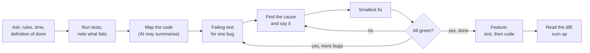
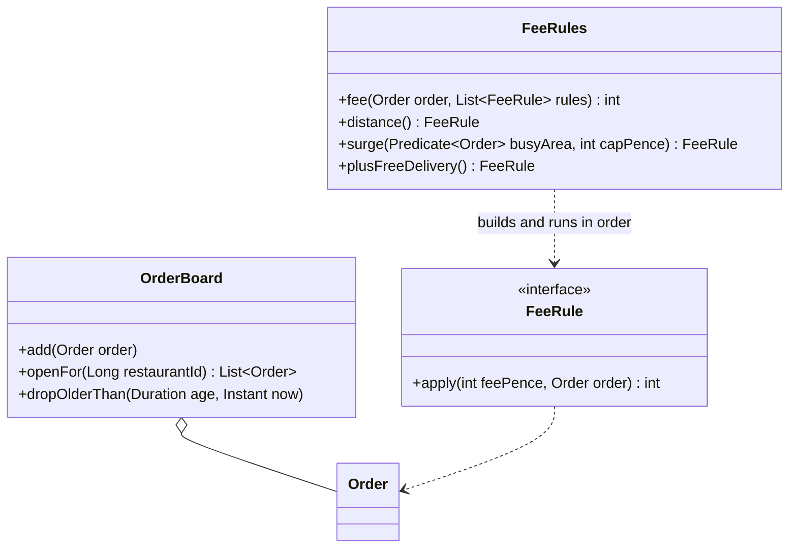
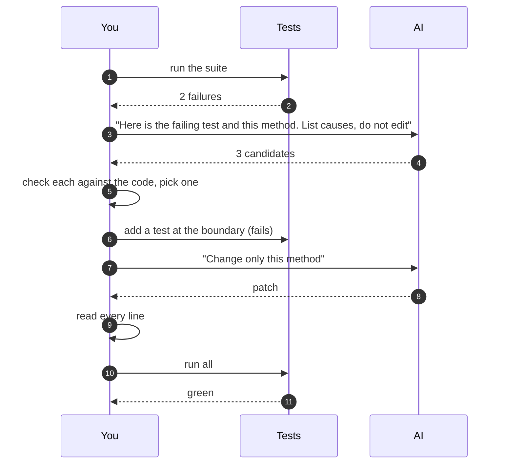

**Short answer:** Treat the AI as a fast junior and yourself as the reviewer who owns the result. Run the tests first, reproduce each bug with a failing test, fix the cause with the smallest change, and re-run everything. Then add the feature where the code already has a place for it. Interviewers can see that the AI can type; they most likely grade whether you understood, checked and explained.

**What is known:** one report, London, May 2026, read from a search snippet only. It says a 15-minute general MCQ, then bug fixing plus a feature on HackerRank, with AI allowed in both.

- It looks like the AI-allowed rounds other companies now use, including DoorDash, Deliveroo's owner. The exact format is **not confirmed**.
- Other Deliveroo live rounds allow **no AI**. Ask the recruiter in writing which rule applies to each of your rounds.

## Picture it







**How to read it:**
- The loop is one bug at a time. A test goes red **before** the fix, or you have not proved anything.
- The AI lists causes; you choose. That moment is what they want to see.
- The feature comes last, on green code.

## Requirements

**Ask first (two minutes)**
- Which AI tools, and may it edit files or only chat?
- Is everything failing covered by tests, or must I find bugs too?
- What counts most: all bugs, the feature, or quality of the change?
- May I change public signatures? Is there a hidden test suite?
- Should I talk while I work, or write notes at the end?

## Classes

A practice codebase, written for this page (not the reported task). Four bugs are planted; find them before reading on.

```java
import java.time.*;
import java.time.Instant;
import java.util.*;

record Order(long id, Long restaurantId, int subtotalPence, int distanceMetres, boolean plusMember, Instant placedAt) {}

class BuggyOrderBoard {
    private final List<Order> orders = new ArrayList<>();

    void add(Order order) { orders.add(order); }

    List<Order> openFor(Long restaurantId) {
        return orders.stream().filter(o -> o.restaurantId() == restaurantId).toList();
    }

    void dropOlderThan(Duration age, Instant now) {
        for (Order order : orders) {
            if (order.placedAt().isBefore(now.minus(age))) orders.remove(order);
        }
    }

    int feePence(Order order) {
        int fee = 199;
        if (order.distanceMetres() > 2000) fee += (order.distanceMetres() - 2000) / 1000 * 50;
        if (order.plusMember() && order.subtotalPence() > 2500) fee = 0;
        return fee;
    }
}
```

The spec says:
- Fee is 199p up to 2 km, then 50p for every **started** kilometre.
- Plus members pay nothing from £25.00.
- **Feature:** in a busy area the fee is 50% higher, rounded half up, at most 599p. Plus stays free.

| Bug | Symptom | Cause |
|---|---|---|
| `o.restaurantId() == restaurantId` | Works for restaurant 7, not for 1000 | Reference comparison; `Long` caches only -128 to 127 |
| `orders.remove` inside for-each | `ConcurrentModificationException`, or silently skipped items | Changing a list while iterating |
| `/ 1000 * 50` | 2001 m costs 199 | Rounds down, the spec says started km |
| `> 2500` | £25.00 is charged | Boundary: "from" means `>=` |

## Patterns used

- **Strategy** plus an ordered list (a simple **Chain**): each `FeeRule` takes the fee so far. The feature is one new rule and one place in the order.
- Only used because a third rule arrived and order matters. For two rules an `if` is fine, and saying so is a good sign.

## Code

```java
import java.time.*;
import java.util.*;

class OrderBoard {
    private final List<Order> orders = new ArrayList<>();

    void add(Order order) { orders.add(order); }

    List<Order> openFor(Long restaurantId) {
        return orders.stream().filter(o -> Objects.equals(o.restaurantId(), restaurantId)).toList();
    }

    void dropOlderThan(Duration age, Instant now) {
        Instant cutoff = now.minus(age);
        orders.removeIf(order -> order.placedAt().isBefore(cutoff));
    }
}
```

```java
import java.util.List;
import java.util.function.Predicate;

interface FeeRule {
    int apply(int feePence, Order order);
}

final class FeeRules {
    private FeeRules() {}

    static int fee(Order order, List<FeeRule> rules) {
        int fee = 199;
        for (FeeRule rule : rules) fee = rule.apply(fee, order);
        return fee;
    }

    static FeeRule distance() {
        return (fee, order) -> fee + 50 * Math.ceilDiv(Math.max(0, order.distanceMetres() - 2000), 1000);
    }

    /** New feature: 50% more in a busy area, rounded half up, never above the cap. */
    static FeeRule surge(Predicate<Order> busyArea, int capPence) {
        return (fee, order) -> busyArea.test(order) ? Math.min(capPence, (fee * 3 + 1) / 2) : fee;
    }

    static FeeRule plusFreeDelivery() {
        return (fee, order) -> order.plusMember() && order.subtotalPence() >= 2500 ? 0 : fee;
    }
}
```

The tests that prove it, boundaries first:

```java
@ParameterizedTest
@CsvSource({
    "0, 2000, false, false, 199",
    "0, 2001, false, false, 249",      // first started km
    "0, 3000, false, false, 249",
    "2499, 100, true, false, 199",
    "2500, 100, true, false, 0",       // from 25.00
    "0,    0, false, true,  299",      // 298.5 rounds up
    "0, 9000, false, true,  599",      // capped
    "2500, 100, true, true, 0",        // Plus wins during surge
})
void feeRules(int subtotal, int metres, boolean plus, boolean busy, int expected) {
    List<FeeRule> rules = List.of(FeeRules.distance(), FeeRules.surge(o -> busy, 599), FeeRules.plusFreeDelivery());
    assertEquals(expected, FeeRules.fee(order(1L, subtotal, metres, plus, 0), rules));
}
```

Plus one test each for restaurant id 1000 and for dropping several old orders at once. All 13 checks pass on Java 21, and the buggy class fails as the table says.

## How to work with the AI

**Good prompts**
- "Summarise what each class does and who calls it. Do not change anything."
- "This test fails with this message. List possible causes with line numbers."
- "Change only `feePence`. Keep the signature. No new dependencies."
- "What edge cases does this method miss?" Then check each one yourself.

**Check its work, every time**
- Read the whole diff. Reject renames, reformatting and edits you did not ask for.
- Did it change a **test** to make it pass? Undo that.
- Does it call methods that exist? Compile at once.
- Null, empty, boundary, rounding, time zone, concurrency: the usual misses.
- If you cannot explain a line, do not keep it.

**Narrate in short lines**
- "Two tests fail, both in fees, so I start there."
- "The AI suggests a null check. That hides the symptom; the cause is the `==`."
- "Fixed and green. Same pattern elsewhere? I search for other `Long` comparisons."

## The clock (about 60 minutes)

- **0-5** ask, run the tests, write down the failures.
- **5-12** map the code.
- **12-35** bugs, one at a time, commit after each.
- **35-52** the feature, test first.
- **52-60** full run, read the diff, sum up what is done, not done and risky.

Stuck on one bug for 8 minutes? Write what you know, move on, come back.

## Extensions

- **The MCQ with AI allowed:** still answer first, then use the AI to check doubtful ones. About a minute each leaves no time to prompt for all.
- **No tests in the repo:** write one characterisation test around the area before touching it.
- **Intermittent bug:** look for shared state, time and ordering; run the test 100 times.
- **The AI is down or slow:** the plan is the same. Practise one run a week without it.

Go deeper: [H3 · Debugging and production habits](../academy/lessons/H3.md).
