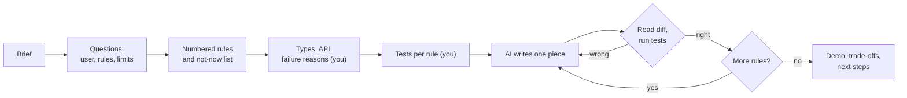
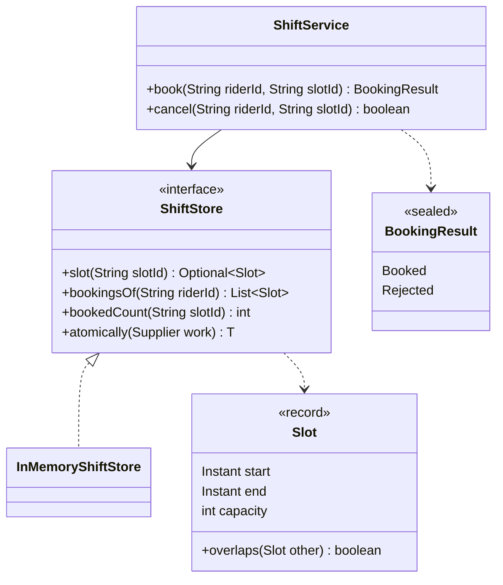
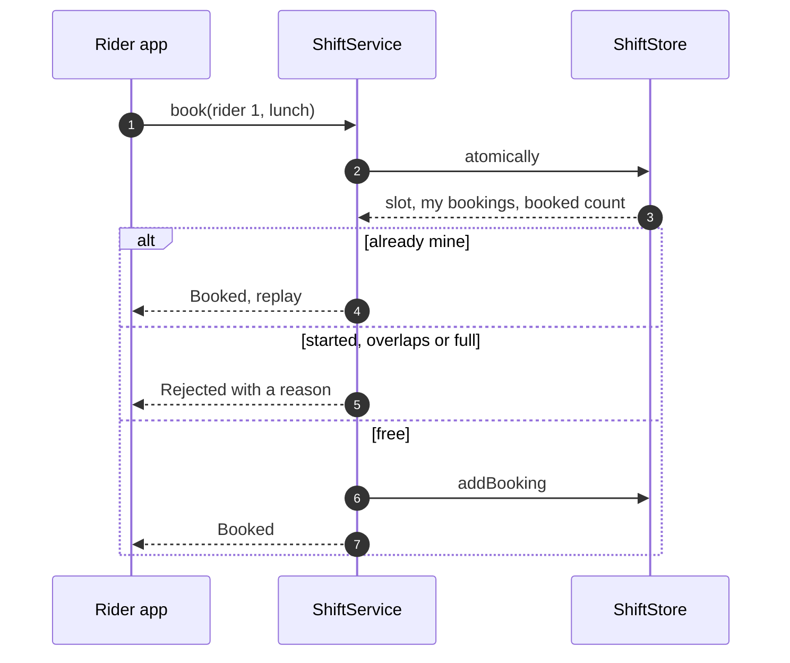

**Short answer:** Spend the first 10 minutes turning the brief into rules, edge cases and a short "not now" list, and agree it. Then write the contract and the tests yourself, and let the AI fill in small pieces you review one by one. They are most likely grading judgement: did the service match the requirements, did you catch what the AI got wrong, and did you think about the user.

**What is known:** one report, London, May 2026, read from a search snippet only: an onsite AI coding round on using AI to build services that match the requirements, plus product thinking.

- It looks like the AI-allowed rounds now common elsewhere, including at DoorDash, Deliveroo's owner. The exact format is **not confirmed**.
- Other Deliveroo live rounds allow **no AI**. Ask the recruiter which tools are allowed, whose laptop, and whether it can edit files.

## Picture it







**How to read it:**
- You own the boxes marked "(you)": rules, contract, tests. If the AI writes those too, nobody checked the requirements.
- `ShiftStore` is the seam: memory now, database later, no change to the rules.
- The checks and the write are in one atomic step, so two riders cannot take the last place.

## Requirements

Practice brief, written for this page: *"Let riders book shifts in a zone."* That is too vague on purpose.

**Ask first**
- Who uses it and what hurts today? ("Riders turn up and there is no work.")
- What does success look like: filled shifts, fewer no-shows, less support?
- Limits per slot, and can shifts overlap?
- Until when can a rider cancel?
- What happens when it is full: refuse, or a waitlist?
- Scale, and must it survive a restart today?
- What will you test: correctness, design, or a running endpoint?

**Agree rules you can test**
1. A slot has a zone, a start, an end and a capacity of at least 1.
2. Never more bookings than capacity, also under concurrency.
3. A rider cannot hold overlapping slots; back-to-back is fine.
4. No booking once the slot has started.
5. Booking twice is a repeat, not a second place.
6. Cancelling frees the place, and cancelling twice is fine.

**Not now:** login, UI, notifications, waitlist, late-cancel penalty. Saying this is product thinking.

## Classes

- `Slot`: the facts, and the overlap rule next to them.
- `BookingResult`: a sealed type with reasons, so the app can show "full" and "overlaps" differently.
- `ShiftService`: the six rules, no framework.
- `ShiftStore`: the port. `InMemoryShiftStore` uses one lock.

## Patterns used

- **Ports and Adapters:** rules do not know the database. It also makes the AI's work small and checkable.
- **Result type** for expected refusals, exceptions for bugs only.
- Not used: events, CQRS, a generic rule engine. AI tools love to add these; cut them.

## Code

```java
import java.time.Instant;
import java.util.List;
import java.util.Optional;
import java.util.function.Supplier;

record Slot(String id, String zone, Instant start, Instant end, int capacity) {
    Slot {
        if (!start.isBefore(end)) throw new IllegalArgumentException("slot must end after it starts");
        if (capacity < 1) throw new IllegalArgumentException("capacity must be at least 1");
    }

    boolean overlaps(Slot other) {
        return start.isBefore(other.end) && other.start.isBefore(end);     // back-to-back slots do not overlap
    }
}

sealed interface BookingResult {
    record Booked(String slotId, boolean replay) implements BookingResult {}
    record Rejected(Reason reason) implements BookingResult {}

    enum Reason { UNKNOWN_SLOT, ALREADY_STARTED, FULL, OVERLAPS_ANOTHER_BOOKING }
}

/** Port. In memory here; in production a transaction that locks the rider row, then the slot row. */
interface ShiftStore {
    Optional<Slot> slot(String slotId);

    List<Slot> bookingsOf(String riderId);

    int bookedCount(String slotId);

    void addBooking(String riderId, String slotId);

    boolean removeBooking(String riderId, String slotId);

    <T> T atomically(Supplier<T> work);
}
```

```java
import java.time.Clock;
import java.util.List;
import java.util.Optional;

final class ShiftService {
    private final ShiftStore store;
    private final Clock clock;

    ShiftService(ShiftStore store, Clock clock) {
        this.store = store;
        this.clock = clock;
    }

    BookingResult book(String riderId, String slotId) {
        return store.atomically(() -> {
            Optional<Slot> found = store.slot(slotId);
            if (found.isEmpty()) return new BookingResult.Rejected(BookingResult.Reason.UNKNOWN_SLOT);
            Slot slot = found.get();
            List<Slot> mine = store.bookingsOf(riderId);
            if (mine.contains(slot)) return new BookingResult.Booked(slotId, true);          // a retry gets the same answer
            if (!clock.instant().isBefore(slot.start())) {
                return new BookingResult.Rejected(BookingResult.Reason.ALREADY_STARTED);
            }
            if (mine.stream().anyMatch(slot::overlaps)) {
                return new BookingResult.Rejected(BookingResult.Reason.OVERLAPS_ANOTHER_BOOKING);
            }
            if (store.bookedCount(slotId) >= slot.capacity()) {
                return new BookingResult.Rejected(BookingResult.Reason.FULL);
            }
            store.addBooking(riderId, slotId);
            return new BookingResult.Booked(slotId, false);
        });
    }

    /** Idempotent: cancelling twice is fine. Returns whether a booking was removed. */
    boolean cancel(String riderId, String slotId) {
        return store.atomically(() -> store.removeBooking(riderId, slotId));
    }
}
```

```java
import java.util.*;
import java.util.function.Supplier;

final class InMemoryShiftStore implements ShiftStore {
    private final Map<String, Slot> slots = new HashMap<>();
    private final Map<String, Set<String>> slotsByRider = new HashMap<>();
    private final Map<String, Integer> bookedBySlot = new HashMap<>();

    InMemoryShiftStore(Collection<Slot> slots) { slots.forEach(s -> this.slots.put(s.id(), s)); }

    public Optional<Slot> slot(String slotId) { return Optional.ofNullable(slots.get(slotId)); }

    public List<Slot> bookingsOf(String riderId) {
        return slotsByRider.getOrDefault(riderId, Set.of()).stream().map(slots::get).toList();
    }

    public int bookedCount(String slotId) { return bookedBySlot.getOrDefault(slotId, 0); }

    public void addBooking(String riderId, String slotId) {
        if (slotsByRider.computeIfAbsent(riderId, r -> new HashSet<>()).add(slotId)) bookedBySlot.merge(slotId, 1, Integer::sum);
    }

    public boolean removeBooking(String riderId, String slotId) {
        boolean removed = slotsByRider.getOrDefault(riderId, new HashSet<>()).remove(slotId);
        if (removed) bookedBySlot.merge(slotId, -1, Integer::sum);
        return removed;
    }

    public synchronized <T> T atomically(Supplier<T> work) { return work.get(); }
}
```

The test that catches a version which checks and then writes without a lock:

```java
@Test
void neverOverbooksUnderConcurrency() throws Exception {
    List<Callable<BookingResult>> calls = new ArrayList<>();
    for (int i = 0; i < 200; i++) { String rider = "r" + i; calls.add(() -> service.book(rider, "lunch")); }
    long booked = 0;
    try (var pool = Executors.newVirtualThreadPerTaskExecutor()) {
        for (Future<BookingResult> f : pool.invokeAll(calls)) if (f.get() instanceof BookingResult.Booked) booked++;
    }
    assertEquals(2, booked);                       // capacity of the lunch slot
}
```

One test per rule as well: retry, full, overlap, back-to-back, unknown slot, started slot, cancel twice. All pass on Java 21.

**Put HTTP on top last**

```text
PUT    /riders/{riderId}/bookings/{slotId}  -> 201 new, 200 repeat, 404 unknown, 409 { reason }
DELETE /riders/{riderId}/bookings/{slotId}  -> 204
```

- `PUT` on the pair is naturally idempotent, so a mobile retry is safe.
- The rider id must match the logged-in user.

## How to work with the AI

**Do**
- Paste the numbered rules and the types, then ask for **one** method.
- Ask for its assumptions first: "What is unclear in these rules?"
- Say the limits: Java 21, no new libraries, keep signatures.
- After it passes: "Which rule could this break under two parallel calls?"

**Check**
- Map every rule to a test. A rule with no test is a guess.
- Read for check-then-act races, `LocalDateTime` where an instant is needed, swallowed exceptions, and code nobody asked for.
- Run it and call it. Compiling is not proof.

**Narrate**
- "I write the tests, because they are the requirements."
- "It added retries and a cache. Not asked, so I remove them."
- "It used `count` and then `insert`. Two riders can both pass; I put both in one transaction."

## The clock (about 60 minutes)

- **0-10** questions, rules, not-now list.
- **10-18** types, API, test names.
- **18-45** rule by rule: test, AI, review, run.
- **45-53** endpoint and a live demo of two rules.
- **53-60** limits, next steps, what you would measure.

## Extensions

- **Real database:** lock the rider row, then the slot row (always that order), or use a conditional update on `booked < capacity`. Add `UNIQUE(rider_id, slot_id)`.
- **Why the rider row?** Two parallel bookings by one rider in different slots can both pass the overlap check. In PostgreSQL an exclusion constraint on the time range also stops it.
- **Waitlist:** on cancel, offer the place to the first in line for two minutes.
- **Product metrics:** fill rate, time to fill, no-show rate, rejected attempts by reason. A high `FULL` count in one zone is a business signal.
- **Roll-out:** one zone, a feature flag, compare no-shows before and after.
- **Change of requirement mid-round** (likely): say which rule changes, change its test first, then the code.

Go deeper: [H3 · Debugging and production habits](../academy/lessons/H3.md), [D10 · Shipping a feature: the playbook](../academy/lessons/D10.md).
