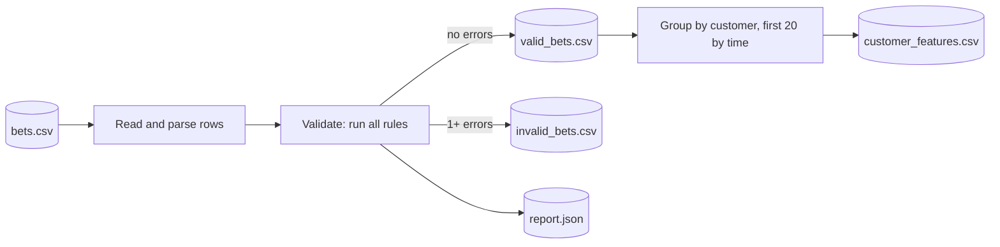

**Short answer:** Build it as three stages with clear outputs: **read** (parse each CSV row into a typed record, keeping parse errors instead of crashing), **validate** (run every business rule on every row and collect *all* failures, not just the first; write `valid_bets.csv`, `invalid_bets.csv` with an `errors` column, and a `report.json` with counts per rule), then **feature build** (per customer, sort valid bets by `placed_at` then `bet_id`, take the first 20, and compute stake, odds, outcome, sport and timing features into `customer_features.csv`). Rules are small, independent classes behind one interface, so adding a rule touches nothing else. It runs as a CLI with input and output paths and exit codes, packaged in a Docker image. The original take-home was Python (pandas); I show the design in Java 21 since the logic is the same.

## Explanation

### The pipeline



Features are built only from the valid rows, and every input row ends up in exactly one of the two outputs. The report lets someone check that: `rows_read = valid + invalid`.

### Assumed columns and rules

Columns: `bet_id, customer_id, placed_at, settled_at, sport, market, odds, stake, currency, status, payout, in_play, channel`.

| Rule code | Check |
|---|---|
| `MISSING_FIELD` | Required fields present and non-blank |
| `BAD_FORMAT` | Numbers parse, timestamps are ISO-8601 with an offset |
| `DUPLICATE_BET_ID` | `bet_id` seen before (first one wins, later ones invalid) |
| `STAKE_NOT_POSITIVE` | `stake > 0` (and below a sanity cap) |
| `ODDS_OUT_OF_RANGE` | Decimal odds `> 1.0` and below a cap such as 1001 |
| `UNKNOWN_STATUS` | `status` in `open, won, lost, void` |
| `PAYOUT_MISMATCH` | `won`: payout = stake x odds (to the penny); `lost`: 0; `void`: equals stake; `open`: empty |
| `SETTLED_BEFORE_PLACED` | `settled_at >= placed_at`; `open` bets have no `settled_at` |
| `FUTURE_TIMESTAMP` | `placed_at` not after the extract time |
| `UNKNOWN_CURRENCY` | ISO 4217 code from an allowed list |

Two design points to say out loud. First, **collect all errors per row**: a data team fixing the source wants to know every problem in one pass. Second, **validation needs no global state except duplicates**, so it can stream; duplicate detection keeps a `Set` of seen ids (or, for huge files, sorts first or uses the database's unique constraint).

### Which bets count as "the first 20"

- Order by `placed_at`, then `bet_id` as a tie-breaker, so the result is deterministic.
- Only **valid** bets count. An invalid bet does not use up one of the 20 slots.
- Customers with fewer than 20 valid bets: keep them, with an `n_bets` column, and let the model decide; or drop them if the spec says "exactly 20". Ask.
- Timestamps in UTC; convert to the customer's zone only for "hour of day" features.

### Features (per customer, over those bets)

- **Volume and stake:** `n_bets`, `total_stake`, `mean_stake`, `median_stake`, `stake_std`, `max_stake`, `max_to_median_stake` (one huge bet among small ones).
- **Price appetite:** `mean_odds`, `share_longshots` (odds above 5), `share_favourites` (odds below 1.5).
- **Outcome:** `win_rate` over settled bets, `net_pnl` (payouts minus stakes), `roi`. Careful with leakage if the model predicts something correlated with outcomes.
- **Behaviour:** `distinct_sports`, `top_sport_share`, `share_in_play`, `share_mobile`, `mean_minutes_between_bets`, `days_to_20th_bet`, `night_share` (bets between 00:00 and 06:00 local).
- **Responsible-gambling signals:** `chasing_ratio` (how often the stake rises right after a loss), `stake_trend` (mean of the last 5 stakes over the first 5).

## Example

The rule interface and two rules:

```java
public record BetRow(int line, String betId, String customerId, Instant placedAt, Instant settledAt,
                     String sport, BigDecimal odds, BigDecimal stake, String status,
                     BigDecimal payout, boolean inPlay) {}

public interface Rule {
    Optional<String> check(BetRow bet);              // empty = passed, else the rule code
}

final class PayoutMatchesStatus implements Rule {
    public Optional<String> check(BetRow b) {
        BigDecimal expected = switch (b.status()) {
            case "won"  -> b.stake().multiply(b.odds()).setScale(2, RoundingMode.HALF_UP);
            case "lost" -> BigDecimal.ZERO;
            case "void" -> b.stake();
            default     -> null;                     // open: payout must be absent
        };
        boolean ok = expected == null ? b.payout() == null
                   : b.payout() != null && b.payout().compareTo(expected) == 0;
        return ok ? Optional.empty() : Optional.of("PAYOUT_MISMATCH");
    }
}

final class OddsInRange implements Rule {
    public Optional<String> check(BetRow b) {
        return b.odds().compareTo(BigDecimal.ONE) > 0 && b.odds().compareTo(new BigDecimal("1001")) < 0
                ? Optional.empty() : Optional.of("ODDS_OUT_OF_RANGE");
    }
}
```

The validator collects every failure:

```java
public record Validated(BetRow bet, List<String> errors) {
    boolean valid() { return errors.isEmpty(); }
}

public final class Validator {
    private final List<Rule> rules;
    private final Set<String> seenIds = new HashSet<>();

    public Validator(List<Rule> rules) { this.rules = List.copyOf(rules); }

    public Validated validate(BetRow bet) {
        List<String> errors = new ArrayList<>();
        for (Rule r : rules) r.check(bet).ifPresent(errors::add);
        if (!seenIds.add(bet.betId())) errors.add("DUPLICATE_BET_ID");
        return new Validated(bet, errors);
    }
}
```

`compareTo`, not `equals`, for `BigDecimal`: `new BigDecimal("2.0").equals(new BigDecimal("2.00"))` is `false`.

Features from the first 20 valid bets:

```java
static final Comparator<BetRow> BY_TIME =
        Comparator.comparing(BetRow::placedAt).thenComparing(BetRow::betId);

Map<String, CustomerFeatures> build(List<BetRow> validBets) {
    return validBets.stream()
        .collect(Collectors.groupingBy(BetRow::customerId, TreeMap::new, Collectors.toList()))
        .entrySet().stream()
        .collect(Collectors.toMap(Map.Entry::getKey,
                 e -> features(e.getValue().stream().sorted(BY_TIME).limit(20).toList()),
                 (a, b) -> a, TreeMap::new));
}

static CustomerFeatures features(List<BetRow> bets) {
    DoubleSummaryStatistics stake = bets.stream().mapToDouble(b -> b.stake().doubleValue()).summaryStatistics();
    long settled = bets.stream().filter(b -> b.status().equals("won") || b.status().equals("lost")).count();
    long won = bets.stream().filter(b -> b.status().equals("won")).count();
    double inPlay = bets.stream().filter(BetRow::inPlay).count() / (double) bets.size();
    return new CustomerFeatures(bets.size(), stake.getSum(), stake.getAverage(), stake.getMax(),
            settled == 0 ? Double.NaN : won / (double) settled, inPlay,
            bets.stream().map(BetRow::sport).distinct().count());
}
```

Using `double` is acceptable here because these are statistics for a model, not money movements; the validation of payouts stays in `BigDecimal`.

The same "first 20" in SQL, if the data is loaded into a database first:

```sql
WITH ranked AS (
  SELECT b.*, ROW_NUMBER() OVER (PARTITION BY customer_id ORDER BY placed_at, bet_id) AS rn
  FROM valid_bets b
)
SELECT customer_id,
       COUNT(*)                                        AS n_bets,
       SUM(stake)                                      AS total_stake,
       AVG(stake)                                      AS mean_stake,
       AVG(odds)                                       AS mean_odds,
       AVG(CASE WHEN status = 'won' THEN 1.0 WHEN status = 'lost' THEN 0.0 END) AS win_rate,
       AVG(CASE WHEN in_play THEN 1.0 ELSE 0.0 END)    AS share_in_play,
       COUNT(DISTINCT sport)                           AS distinct_sports
FROM ranked
WHERE rn <= 20
GROUP BY customer_id;
```

`AVG` ignores NULLs, so open and void bets drop out of `win_rate` automatically.

### Packaging

- CLI (picocli in Java, `argparse` or `click` in Python): `bets-pipeline --input bets.csv --out ./out [--max-bets 20] [--as-of 2026-10-12T00:00:00Z]`. `--as-of` makes `FUTURE_TIMESTAMP` reproducible.
- Exit codes: `0` success (even with invalid rows: they are data, not failures), `1` bad arguments, `2` unreadable input or wrong header.
- Docker: multi-stage build, run as non-root, input and output as mounted volumes: `docker run -v $PWD/data:/data bets-pipeline --input /data/bets.csv --out /data/out`.
- Logs to stderr, results to files; `report.json` also records the rule set version and the input file's checksum.

## Pitfalls and follow-ups

- **Stop at the first error per row?** No. Collect all codes; a row with three problems should show three.
- **Which duplicate is valid?** The first in file order, by default. If rows have an `updated_at`, keep the latest version instead. Say which and why.
- **Deterministic output?** Sort customers and use a tie-breaker on `bet_id`; same input gives byte-identical output, which makes golden-file tests possible.
- **File bigger than memory?** Validation streams row by row (except the duplicate set). For features, external-sort by `(customer_id, placed_at)` or load into DuckDB or Postgres and use the window query; only 20 rows per customer are kept.
- **Bad encoding, quoted commas, BOM?** Use a real CSV parser (Apache Commons CSV, Jackson CSV, Python's `csv`), never `split(",")`. A row with the wrong number of columns is `BAD_FORMAT`, not a crash.
- **Floating point in payout checks?** Compare money as `BigDecimal` (or integer pence) with an explicit rounding rule; a tolerance of half a penny is acceptable if the source rounds differently.
- **Leakage?** If the label is defined after bet 20, only use bets 1 to 20, and make sure `settled_at` of those bets is before the prediction time, or drop outcome features.
- **Tests?** One unit test per rule (pass and fail), a parser test with malformed rows, a feature test with a hand-computed customer (including ties in `placed_at` and a customer with fewer than 20 bets), and an end-to-end test on a small sample CSV comparing outputs to expected files.
- **How does this relate to live bet validation?** Same idea as the `BetValidator` chain in [the bet placement LLD](design-betting-bet-placement-lld.md): independent rules behind one interface. Offline you collect all failures; online you reject on the first.

Related: [sql-scenario-based-queries](sql-scenario-based-queries.md) for the top-N-per-group pattern used for "first 20".

Go deeper: [Q3 · Window functions](../academy/lessons/Q3.md), [Q4 · SQL interview patterns](../academy/lessons/Q4.md), [E4 · Behavioural patterns](../academy/lessons/E4.md).
