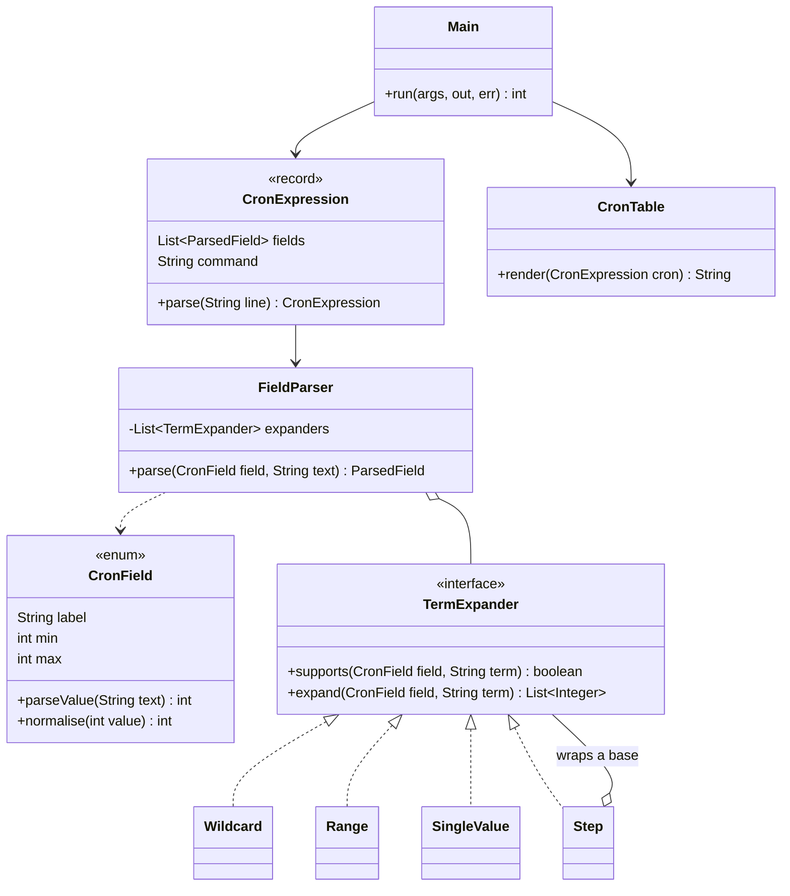
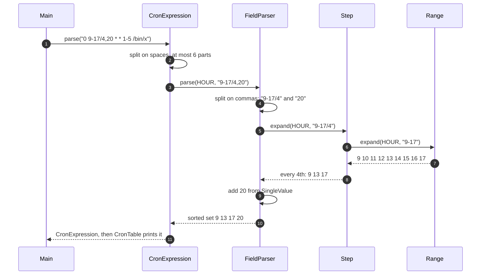

**Short answer:** Keep three things apart: what a field is (name and bounds, as data), how a term expands (`*`, `a-b`, `/n`, each behind one small interface), and how the table prints. A field is split on commas, each term goes to the first expander that supports it, and the values land in a sorted set. Bad input fails with a message that names the field, on stderr, with a non-zero exit code. The live round then becomes easy, because every reported extension touches one class.

**Read this first: learn the design, then write your own.**

- Deliveroo rejects AI-written submissions, and this page was written by an AI. Do not submit this code or a reworded copy of it.
- The live round extends **your** code for an hour with **no AI allowed**. You can only do that fast on code you wrote.
- Good use: read it, close it, write yours from an empty folder in 3 hours, then compare.

## Picture it





**How to read it:**
- `CronField` is data. Adding a field or a name does not change any algorithm.
- `TermExpander` is the seam the live round pushes on: a new operator is a new class plus one entry in a list.
- `Step` wraps another expander, so `*/n` and `a-b/n` need no extra code.
- Expanders return values in **walking order**; only the set at the end sorts. That detail makes wrap-around ranges with steps come out right.

## Requirements

- One argument: five time fields and a command. `@yearly` and friends are out of scope.
- Fields: minute 0-59, hour 0-23, day of month 1-31, month 1-12, day of week 0-6 with 7 also meaning Sunday.
- Output: the name padded to 14 columns, then the values separated by single spaces.

For `"*/15 0 1,15 * 1-5 /usr/bin/find"`:

```text
minute        0 15 30 45
hour          0
day of month  1 15
month         1 2 3 4 5 6 7 8 9 10 11 12
day of week   1 2 3 4 5
command       /usr/bin/find
```

**Grammar**

```text
field := term ("," term)*
term  := base | base "/" step          step is 1 or more
base  := "*" | value | value "-" value     (a step needs * or a range)
value := digits                        later: digits or a name
```

**Choices to write in the README**
- `5/15` is rejected: standard crontab does not define it, and guessing is worse than an error.
- `*` for day of week prints `0 1 2 3 4 5 6`, and 7 is printed as 0.
- Fields are checked one by one, so `30 2` (30 February) is accepted and simply never runs.

## Classes

- `Main`: arguments, streams, exit code. `run` is separate so tests need no process.
- `CronExpression`: splits the line; the limit on `split` keeps the command's own arguments and spaces.
- `CronField`: enum of label, bounds and value parsing.
- `FieldParser`: commas, then the first matching expander, then a `TreeSet`.
- `Wildcard`, `Range`, `SingleValue`, `Step`: one grammar rule each.
- `CronTable`: the only class that knows about 14 columns.
- `CronParseException`: user-facing errors only. A bug in our code is not caught and hidden.

## Patterns used

- **Strategy:** each `TermExpander` is a swappable rule, tried in order.
- **Decorator:** `Step` adds "every n-th" to any base expander.
- **Data-driven enum:** bounds and names live in one table, not in five `if` blocks.
- Not used on purpose: a parser generator, a DI framework, one class per field. The brief values a small correct program.

## Code

```java
import java.util.List;

/** One row of the table. A new field or a new bound is one line here. */
enum CronField {
    MINUTE("minute", 0, 59, 59),
    HOUR("hour", 0, 23, 23),
    DAY_OF_MONTH("day of month", 1, 31, 31),
    MONTH("month", 1, 12, 12),
    DAY_OF_WEEK("day of week", 0, 6, 7);          // 7 is accepted as a second name for Sunday (0)

    final String label;
    final int min;
    final int max;
    private final int maxInput;

    CronField(String label, int min, int max, int maxInput) {
        this.label = label;
        this.min = min;
        this.max = max;
        this.maxInput = maxInput;
    }

    int parseValue(String text) {
        if (!text.matches("\\d{1,4}")) throw new CronParseException(this, "'" + text + "' is not a number");
        int value = Integer.parseInt(text);
        if (value < min || value > maxInput) {
            throw new CronParseException(this, value + " is outside " + min + "-" + maxInput);
        }
        return value;
    }

    /** Only day of week changes: 7 becomes 0. */
    int normalise(int value) {
        return value > max ? min : value;
    }
}

/** Strategy: one piece of the grammar. Returns values in walking order, so a step can count along them. */
interface TermExpander {
    boolean supports(CronField field, String term);

    List<Integer> expand(CronField field, String term);
}
```

```java
import java.util.List;
import java.util.stream.IntStream;

final class Wildcard implements TermExpander {
    public boolean supports(CronField field, String term) { return term.equals("*"); }

    public List<Integer> expand(CronField field, String term) {
        return IntStream.rangeClosed(field.min, field.max).boxed().toList();
    }
}

final class Range implements TermExpander {
    public boolean supports(CronField field, String term) { return term.contains("-"); }

    public List<Integer> expand(CronField field, String term) {
        String[] ends = term.split("-", -1);
        if (ends.length != 2) throw new CronParseException(field, "'" + term + "' is not a range like a-b");
        int from = field.parseValue(ends[0]);
        int to = field.parseValue(ends[1]);
        if (from > to) throw new CronParseException(field, "range '" + term + "' starts after it ends");
        return IntStream.rangeClosed(from, to).boxed().toList();
    }
}

/** Decorator: expands what is left of '/', then keeps every n-th value. */
final class Step implements TermExpander {
    private final List<TermExpander> bases;

    Step(List<TermExpander> bases) { this.bases = bases; }

    public boolean supports(CronField field, String term) { return term.contains("/"); }

    public List<Integer> expand(CronField field, String term) {
        String[] parts = term.split("/", -1);
        if (parts.length != 2 || !parts[1].matches("\\d{1,4}") || Integer.parseInt(parts[1]) == 0) {
            throw new CronParseException(field, "'" + term + "' needs one step of 1 or more, like */5");
        }
        int step = Integer.parseInt(parts[1]);
        List<Integer> values = bases.stream()
                .filter(base -> base.supports(field, parts[0])).findFirst()
                .orElseThrow(() -> new CronParseException(field, "a step needs * or a range before '/'"))
                .expand(field, parts[0]);
        return IntStream.range(0, values.size()).filter(i -> i % step == 0).mapToObj(values::get).toList();
    }
}

final class SingleValue implements TermExpander {
    public boolean supports(CronField field, String term) { return true; }   // last resort, so it must be last

    public List<Integer> expand(CronField field, String term) { return List.of(field.parseValue(term)); }
}
```

```java
import java.util.ArrayList;
import java.util.Collections;
import java.util.List;
import java.util.SortedSet;
import java.util.TreeSet;

final class FieldParser {
    private final List<TermExpander> expanders;

    FieldParser(List<TermExpander> expanders) { this.expanders = List.copyOf(expanders); }

    static FieldParser standard() {
        List<TermExpander> bases = List.of(new Wildcard(), new Range());
        return new FieldParser(List.of(new Step(bases), new Wildcard(), new Range(), new SingleValue()));
    }

    ParsedField parse(CronField field, String text) {
        SortedSet<Integer> values = new TreeSet<>();          // sorted and without duplicates
        for (String term : text.split(",", -1)) {             // -1 keeps empty terms, so "1,,2" is an error
            TermExpander expander = expanders.stream().filter(e -> e.supports(field, term)).findFirst().orElseThrow();
            expander.expand(field, term).forEach(v -> values.add(field.normalise(v)));
        }
        return new ParsedField(field, text, Collections.unmodifiableSortedSet(values));
    }
}

record ParsedField(CronField field, String text, SortedSet<Integer> values) {}

record CronExpression(List<ParsedField> fields, String command) {

    static CronExpression parse(String line) {
        CronField[] fields = CronField.values();
        String[] parts = line.trim().split("\\s+", fields.length + 1);    // the limit keeps "cmd -a -b" in one piece
        if (parts.length != fields.length + 1) {
            throw new CronParseException(
                    "expected " + fields.length + " time fields and a command, got " + parts.length + " part(s)");
        }
        FieldParser parser = FieldParser.standard();
        List<ParsedField> parsed = new ArrayList<>();
        for (int i = 0; i < fields.length; i++) parsed.add(parser.parse(fields[i], parts[i]));
        return new CronExpression(List.copyOf(parsed), parts[fields.length]);
    }
}
```

```java
import java.io.PrintStream;
import java.util.stream.Collectors;

final class CronTable {
    private CronTable() {}

    static String render(CronExpression cron) {
        StringBuilder out = new StringBuilder();
        for (ParsedField parsed : cron.fields()) {
            out.append(row(parsed.field().label,
                    parsed.values().stream().map(String::valueOf).collect(Collectors.joining(" "))));
        }
        return out.append(row("command", cron.command())).toString();
    }

    private static String row(String name, String value) {
        return "%-14s%s\n".formatted(name, value);
    }
}

final class CronParseException extends RuntimeException {
    CronParseException(String message) { super(message); }
    CronParseException(CronField field, String message) { super(field.label + ": " + message); }
}

public final class Main {
    public static void main(String[] args) {
        System.exit(run(args, System.out, System.err));
    }

    /** Separate from main so tests can check output and exit code without starting a process. */
    static int run(String[] args, PrintStream out, PrintStream err) {
        if (args.length != 1) {
            err.println("Usage: cron-parser \"*/15 0 1,15 * 1-5 /usr/bin/find\"  (one argument: keep the quotes)");
            return 2;
        }
        try {
            out.print(CronTable.render(CronExpression.parse(args[0])));
            return 0;
        } catch (CronParseException e) {
            err.println("Invalid cron expression: " + e.getMessage());
            return 2;
        }
    }
}
```

Each type goes in its own file (add `import java.util...` per file). Put everything in one package.

## Error handling

- Every message says **which field** and **which text**: `day of month: 0 is outside 1-31`.
- `split(",", -1)` keeps empty terms, so `1,,2` and `1,` are errors, not silently fixed.
- The `\d{1,4}` check means a huge number gives our message instead of a `NumberFormatException`.
- Two or more shell arguments means the user forgot the quotes and the shell expanded `*`. The usage line says so.
- Errors go to stderr with exit code 2; stdout stays clean for scripts.

## Tests

Write these first: the brief asks for tests, and they carry you through the live round.

```java
class CronParserTest {
    private static String expand(CronField field, String text) {
        return FieldParser.standard().parse(field, text).values().stream().map(String::valueOf)
                .collect(Collectors.joining(" "));
    }

    @Test
    void printsTheTableFromTheBrief() {
        String expected = """
                minute        0 15 30 45
                hour          0
                day of month  1 15
                month         1 2 3 4 5 6 7 8 9 10 11 12
                day of week   1 2 3 4 5
                command       /usr/bin/find
                """;
        assertEquals(expected, CronTable.render(CronExpression.parse("*/15 0 1,15 * 1-5 /usr/bin/find")));
    }

    @ParameterizedTest
    @CsvSource(delimiter = '|', value = {
        "HOUR         | 9-17/4    | 9 13 17",
        "MINUTE       | */60      | 0",
        "MINUTE       | 30,5,5-7  | 5 6 7 30",          // sorted, no duplicates
        "MONTH        | */5       | 1 6 11",            // steps count from the minimum
        "DAY_OF_WEEK  | 5-7       | 0 5 6",             // 7 is Sunday
    })
    void expandsValidFields(CronField field, String text, String expected) {
        assertEquals(expected, expand(field, text));
    }

    @ParameterizedTest
    @CsvSource(delimiter = '|', quoteCharacter = '"', value = {
        "MINUTE       | 60    | minute: 60 is outside 0-59",
        "DAY_OF_MONTH | 0     | day of month: 0 is outside 1-31",
        "HOUR         | 5-3   | hour: range '5-3' starts after it ends",
        "MINUTE       | */0   | minute: '*/0' needs one step of 1 or more, like */5",
        "MINUTE       | 5/15  | minute: a step needs * or a range before '/'",
        "MINUTE       | 1,,2  | minute: '' is not a number",
    })
    void rejectsInvalidFieldsWithAUsefulMessage(CronField field, String text, String message) {
        assertEquals(message, assertThrows(CronParseException.class, () -> expand(field, text)).getMessage());
    }

    @Test
    void keepsCommandArguments() {
        assertEquals("/usr/bin/find . -name  x", CronExpression.parse(" * *  * * * /usr/bin/find . -name  x ").command());
    }

    @Test
    void badInputGivesExitCode2AndNothingOnStdout() {
        var out = new ByteArrayOutputStream();
        var err = new ByteArrayOutputStream();
        assertEquals(2, Main.run(new String[] {"61 * * * * x"}, new PrintStream(out), new PrintStream(err)));
        assertEquals("", out.toString());
    }
}
```

Use `quoteCharacter = '"'`, because the messages contain `'`, which is the default quote in `@CsvSource`.

## README and the 3 hours

Commit the Maven wrapper, so a clean machine needs only a JDK. With no runtime dependencies a plain jar works: set `mainClass` in the `maven-jar-plugin` manifest.

```text
Needs: JDK 21 (macOS or Linux). Maven is not needed, the wrapper downloads it.
Test:  ./mvnw test
Build: ./mvnw -q package
Run:   java -jar target/cron-parser.jar "*/15 0 1,15 * 1-5 /usr/bin/find"     (keep the quotes)
Then:  supported syntax, design in 5 lines, assumptions, what I would do next
```

- **0:00-0:20** grammar, assumptions, project skeleton, first failing test (the table).
- **0:20-1:30** single value, `*`, lists, ranges, steps, each with a test first.
- **1:30-2:10** errors, exit codes, sad-path tests.
- **2:10-2:40** README; clone into a new folder and follow it word for word.
- **2:40-3:00** stop adding. Rename, delete dead code, small clean commits.

## Extensions

Reported in the live rounds. Code below was run with the base tests still green.

**1. Names (MON-FRI, JAN).** Add a `names` list to the enum and look there first, so ranges, lists and steps accept names for free.

```java
MONTH("month", 1, 12, 12, List.of("JAN", "FEB", "MAR", "APR", "MAY", "JUN", "JUL", "AUG", "SEP", "OCT", "NOV", "DEC")),
DAY_OF_WEEK("day of week", 0, 6, 7, List.of("SUN", "MON", "TUE", "WED", "THU", "FRI", "SAT"));

int parseValue(String text) {
    int index = names.indexOf(text.toUpperCase(Locale.ROOT));      // names.get(0) means min
    if (index >= 0) return min + index;
    // ... the number check as before
}
```

Tests: `MON-FRI`, `mon,Wed,5`, and `HOUR MON` is an error.

**2. Wrap-around (`22-2`, `FRI-MON`, `NOV-FEB`).** Only `Range` changes, and its "starts after it ends" test changes with it.

```java
if (from > to) from = field.normalise(from);                       // 7-2 means 0-2
if (from <= to) return IntStream.rangeClosed(from, to).boxed().toList();
if (field == CronField.YEAR) throw new CronParseException(field, "range '" + term + "' starts after it ends");
return IntStream.concat(IntStream.rangeClosed(from, field.max), IntStream.rangeClosed(field.min, to)).boxed().toList();
```

- `22-4/2` walks 22, 23, 0, 1, 2, 3, 4 and keeps 22, 0, 2, 4. A sorted set too early would break this.
- Years do not wrap (add that line when `YEAR` exists).

**3. Optional year.** The hard part is telling a year from a command, so ask: "Can a command start with a digit?"

```java
String[] parts = line.trim().split("\\s+");
List<CronField> layout = new ArrayList<>(STANDARD);                // a constant with the five standard fields
if (parts.length >= 7 && parts[5].matches("[\\d*][\\d*,/-]*")) layout.add(CronField.YEAR);
```

- Then loop over `layout` instead of `CronField.values()`, and print the year row only when it was given.
- `7z x a.zip` has a letter, so it stays a command. `2027 arg` is ambiguous; say it and document it.
- The old six-part input must still work: that is the first test to write.

**4. A new operator.** Write one class and register it before `SingleValue`; here, Quartz-style `?` for the two day fields only.

```java
final class NoSpecificValue implements TermExpander {
    public boolean supports(CronField field, String term) { return term.equals("?"); }

    public List<Integer> expand(CronField field, String term) {
        if (field != CronField.DAY_OF_MONTH && field != CronField.DAY_OF_WEEK) {
            throw new CronParseException(field, "'?' is only allowed for day of month and day of week");
        }
        return IntStream.rangeClosed(field.min, field.max).boxed().toList();
    }
}
```

- Operators on some fields only: `supports` and `expand` both receive the field, so the rule stays in that class.
- `L`, `W` and `#` depend on the month, so they cannot become a fixed list. Say that: the table prints them as written, and next-n needs a predicate on a date.

**5. Arguments for the command.** Already there, because `split("\\s+", 6)` stops after six parts. Add the test and say why it passes.

**6. Next n runs.** Skip whole units instead of testing every minute, and mind the day rule.

- If **both** day of month and day of week are restricted, cron runs when **either** matches.
- If one is `*`, only the other counts. In Vixie cron a field that starts with `*`, such as `*/2`, counts as unrestricted.

```java
import java.time.LocalDate;
import java.time.LocalDateTime;
import java.time.temporal.ChronoUnit;
import java.util.ArrayList;
import java.util.List;

final class NextRuns {
    private static final int HORIZON_YEARS = 50;              // stops "30 February", which never comes

    private final CronExpression cron;

    NextRuns(CronExpression cron) { this.cron = cron; }

    List<LocalDateTime> after(LocalDateTime start, int count) {
        List<LocalDateTime> runs = new ArrayList<>();
        LocalDateTime limit = start.plusYears(HORIZON_YEARS);
        LocalDateTime t = start.truncatedTo(ChronoUnit.MINUTES).plusMinutes(1);
        while (runs.size() < count && t.isBefore(limit)) {
            if (!cron.allows(CronField.YEAR, t.getYear())) {
                t = t.toLocalDate().withDayOfYear(1).plusYears(1).atStartOfDay();
            } else if (!cron.allows(CronField.MONTH, t.getMonthValue())) {
                t = t.toLocalDate().withDayOfMonth(1).plusMonths(1).atStartOfDay();
            } else if (!dayMatches(t.toLocalDate())) {
                t = t.toLocalDate().plusDays(1).atStartOfDay();
            } else if (!cron.allows(CronField.HOUR, t.getHour())) {
                t = t.truncatedTo(ChronoUnit.HOURS).plusHours(1);
            } else if (!cron.allows(CronField.MINUTE, t.getMinute())) {
                t = t.plusMinutes(1);
            } else {
                runs.add(t);
                t = t.plusMinutes(1);
            }
        }
        return runs;
    }

    /** Cron rule: if both day fields are restricted, EITHER may match. Otherwise both must (one of them is "every day"). */
    private boolean dayMatches(LocalDate day) {
        boolean dom = cron.allows(CronField.DAY_OF_MONTH, day.getDayOfMonth());
        boolean dow = cron.allows(CronField.DAY_OF_WEEK, day.getDayOfWeek().getValue() % 7);     // Java: Sunday is 7
        boolean bothRestricted = cron.restricted(CronField.DAY_OF_MONTH) && cron.restricted(CronField.DAY_OF_WEEK);
        return bothRestricted ? dom || dow : dom && dow;
    }
}
```

Two small methods on `CronExpression` support it:

```java
/** A field that was not written (the year) allows every value. */
boolean allows(CronField field, int value) {
    return fields.stream().filter(f -> f.field() == field).allMatch(f -> f.values().contains(value));
}

boolean restricted(CronField field) {
    return fields.stream().anyMatch(f -> f.field() == field && !f.text().startsWith("*") && !f.text().equals("?"));
}
```

- Test `0 0 13 * FRI`: every Friday **and** every 13th.
- Test `0 0 29 2 *` (next leap year) and `0 0 30 2 *` (the horizon stops the loop, empty list).
- Pass `start` in, never call `now()` inside, so the tests are fixed.
- Time zones: this works on local time. With DST a local time can be missing or appear twice, so ask what should happen.

## The 60-minute extension round

- **0-15: walk through.** Run the tests, show the picture above in words, then one input's path. Name two things you would improve; do not read code aloud.
- **15-45: extend.** For each request: repeat it back, ask one edge question, write a failing test, make it pass, re-run **everything**.
- **45-60: questions.** Trade-offs, what you would do next, your own questions.

Tactics:
- Say where the change goes before typing: "Names only touch `parseValue`, so ranges and lists come free."
- If a request breaks the design, say so and refactor in one green step first.
- Commit, or at least re-run the suite, after each extension. A half-done third one can be dropped safely.
- Have the IDE, the shortcut to run one test, and the project open before the call.
- Practise all six from your own base, 10 minutes each, with a timer and no AI.

## Follow-ups

- **MON-FRI, year, operators, wrap-around, names, command arguments, next n:** sections 1-6 above.
- **Two or three extensions, a test for each:** the loop in the 60-minute section.
- **Why not regex for everything?** It can accept a field, but it cannot say what is wrong with it.
- **Why an enum and not a class per field?** The fields differ only in data. If one gains real behaviour, I would extract an interface then.
- **Performance?** Each field has at most 60 values (130 for the year). Clarity wins.

Go deeper: [E4 · Behavioural patterns](../academy/lessons/E4.md), [E5 · The LLD interview method](../academy/lessons/E5.md), [D12 · Testing Spring Boot](../academy/lessons/D12.md).
