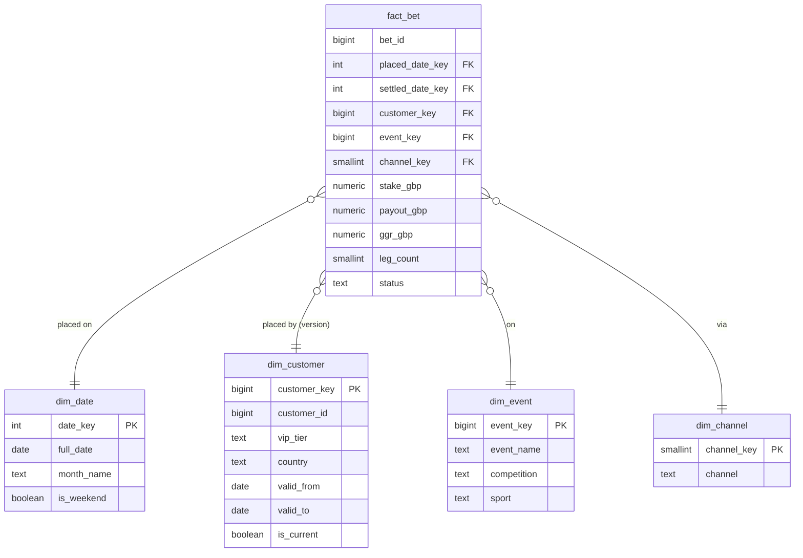

**Short answer:** The operational database (OLTP) is normalised for many small, fast writes; the warehouse (OLAP) is denormalised for big scans and aggregates, and is fed from the OLTP side by CDC or batch ELT. In the warehouse I model a **star schema** (Kimball): a **fact table** at a clearly stated grain (one row per bet) holding numeric measures and foreign keys, surrounded by **dimension tables** (date, customer, event, channel) holding descriptive attributes. Dimensions that change and whose history matters, such as a customer's VIP tier or country, are **SCD type 2**: a new row per version with `valid_from`, `valid_to` and `is_current`, so a bet joins to the customer as they were when the bet was placed. Star beats snowflake for query simplicity and speed; snowflaking saves little space and adds joins.

## Explanation

### OLTP vs OLAP

| | OLTP (bet placement DB) | OLAP (warehouse) |
|---|---|---|
| Work | Many short reads and writes by key | Few long queries scanning millions of rows |
| Model | 3NF, constraints, see [the betting schema](design-betting-database-schema.md) | Star schema, denormalised dimensions |
| Storage | Row store (PostgreSQL) | Columnar (Snowflake, BigQuery, Redshift, ClickHouse) |
| Freshness | Now | Minutes to a day behind |
| History | Current state (plus a ledger) | Full history, SCD versions |
| Users | The app | Analysts, BI dashboards, data science, regulators |

Running reports on the OLTP primary steals I/O and locks from bet placement. Move the data instead: Debezium reads the Postgres WAL into Kafka (CDC), or a nightly ELT job extracts changed rows by `updated_at`, loads them raw, and transforms them in the warehouse (often with dbt).

### The design method

1. **Pick the business process:** bet placement and settlement.
2. **Declare the grain:** one row per bet. (Leg-level analysis, such as "which selections appear in accumulators", gets a second fact at one row per leg.)
3. **Pick the dimensions:** who (customer), what (event, sport, competition, market), when (date of placement, date of settlement), how (channel: web, iOS, retail), currency.
4. **Pick the facts (measures):** stake, potential payout, payout, GGR (stake minus payout), number of legs.

Get the grain wrong and the numbers are wrong: mixing bet rows and leg rows in one table double-counts stakes.

### The star schema



- **Fact table:** long and narrow, append-mostly, numbers plus foreign keys. `bet_id` is a **degenerate dimension**: an identifier with no table of its own, kept for drill-down.
- **Dimension tables:** short and wide, descriptive text used in `WHERE` and `GROUP BY`. `dim_event` is flattened (event, competition, sport in one row); that is the star.
- **Snowflake:** split `dim_event` into `dim_event → dim_competition → dim_sport`. It is more normalised and saves a little space, but every query needs more joins and BI tools handle it worse. Default to star; snowflake only for a huge dimension with a large, shared sub-dimension.
- **Surrogate keys** (`customer_key`) instead of the source id, because SCD2 needs several rows per customer, and sources may reuse or change ids. A `-1 "Unknown"` row in each dimension catches facts that arrive before their dimension row (late-arriving dimensions).
- **`dim_date`** has one row per day with ready-made attributes (week, month, fiscal period, weekend, bank holiday), so nobody computes calendars in queries.

### Three kinds of fact table

- **Transaction fact:** one row per event, such as `fact_bet`. Fully additive measures (stake sums across every dimension).
- **Periodic snapshot:** one row per customer per day, such as `fact_customer_balance_daily`. Balance is **semi-additive**: sum it across customers, never across days (take the closing balance or an average instead).
- **Accumulating snapshot:** one row per bet that is updated as milestones happen (placed, accepted, settled, paid), with a date key per milestone. Good for "average time from placement to settlement".

Ratios such as margin percent are **non-additive**: store the parts (stake, GGR) and divide after summing.

### Slowly changing dimensions

| Type | What happens on change | Use for |
|---|---|---|
| 0 | Never changes | Date of birth, signup date |
| 1 | Overwrite, no history | Typo fixes, email |
| 2 | New row, old one closed | VIP tier, country, risk segment |
| 3 | Extra "previous" column | Only the last change matters |
| 6 | 1 + 2 + 3 combined | History plus "current value" on every row |

SCD2 for `dim_customer`:

```sql
CREATE TABLE dim_customer (
  customer_key  BIGINT GENERATED ALWAYS AS IDENTITY PRIMARY KEY,
  customer_id   BIGINT  NOT NULL,              -- natural key from OLTP
  vip_tier      TEXT    NOT NULL,
  country       CHAR(2) NOT NULL,
  valid_from    DATE    NOT NULL,
  valid_to      DATE    NOT NULL DEFAULT DATE '9999-12-31',
  is_current    BOOLEAN NOT NULL DEFAULT TRUE
);
CREATE UNIQUE INDEX dim_customer_one_current ON dim_customer (customer_id) WHERE is_current;
```

Daily load from a staging table `stg_customer` (today's snapshot of the source):

```sql
-- 1. close the current version of customers whose tracked attributes changed
UPDATE dim_customer d
SET valid_to = CURRENT_DATE - 1, is_current = FALSE
FROM stg_customer s
WHERE d.customer_id = s.customer_id
  AND d.is_current
  AND (d.vip_tier, d.country) IS DISTINCT FROM (s.vip_tier, s.country);

-- 2. insert a new current version for changed and brand-new customers
INSERT INTO dim_customer (customer_id, vip_tier, country, valid_from)
SELECT s.customer_id, s.vip_tier, s.country, CURRENT_DATE
FROM stg_customer s
LEFT JOIN dim_customer d ON d.customer_id = s.customer_id AND d.is_current
WHERE d.customer_id IS NULL;
```

Step 2 finds both cases because step 1 already closed the changed rows. `IS DISTINCT FROM` treats NULLs as values, so a NULL-to-value change is caught. When a bet is loaded, it looks up the customer version valid at `placed_at`, so a bet placed as "Silver" stays Silver in reports even after the customer becomes "Gold".

## Example

"GGR by sport and VIP tier at the time of the bet, per month of 2026, web and app only":

```sql
SELECT dd.year, dd.month_name, de.sport, dc.vip_tier,
       SUM(f.stake_gbp)  AS turnover,
       SUM(f.ggr_gbp)    AS ggr,
       ROUND(100 * SUM(f.ggr_gbp) / NULLIF(SUM(f.stake_gbp), 0), 2) AS margin_pct
FROM fact_bet f
JOIN dim_date     dd ON dd.date_key     = f.placed_date_key
JOIN dim_event    de ON de.event_key    = f.event_key
JOIN dim_customer dc ON dc.customer_key = f.customer_key       -- the version at bet time
JOIN dim_channel  ch ON ch.channel_key  = f.channel_key
WHERE dd.year = 2026
  AND ch.channel IN ('web', 'ios', 'android')
  AND f.status IN ('WON', 'LOST')
GROUP BY dd.year, dd.month_number, dd.month_name, de.sport, dc.vip_tier
ORDER BY dd.month_number, ggr DESC;
```

Every join is fact-to-dimension on an integer key, filters sit on small dimensions, and the columnar engine reads only the five columns it needs from the fact table. To report by the customer's **current** tier instead, join on `customer_id` to the `is_current` row (or keep a type 1 `current_vip_tier` column, which is type 6).

## Pitfalls and follow-ups

- **Star vs snowflake?** Star: denormalised dimensions, one join per dimension, simplest and usually fastest; the default. Snowflake: normalised dimension hierarchies, less redundancy, more joins. Storage is cheap and columnar compression makes the redundancy almost free.
- **Fact vs dimension?** Facts are measurements of a business event at a fixed grain: numeric, mostly additive, many rows. Dimensions give the context to slice by: descriptive, fewer rows, change slowly. Test: if you sum it, it is a fact; if you group or filter by it, it is a dimension attribute.
- **What is a conformed dimension?** One `dim_customer` and one `dim_date` shared by every fact (bets, deposits, casino rounds), so reports across processes line up. The Kimball bus matrix lists which facts use which dimensions.
- **Kimball vs Inmon vs Data Vault?** Kimball: dimensional marts, bottom-up, fast to value. Inmon: a normalised enterprise warehouse first, marts from it. Data Vault: hubs, links and satellites for auditable raw history, with star marts on top. Many lakehouses now use bronze/silver/gold layers that map to raw, cleaned, and dimensional.
- **Late or corrected data?** Late facts look up the dimension version valid at the event time. A resettled bet is either an update to the accumulating snapshot or a correcting row in the transaction fact; never silently change history that reports were filed on.
- **A dimension that changes very often (risk score daily)?** Do not SCD2 it in the main dimension; it would explode. Use a mini-dimension of banded values, or put the score in a daily snapshot fact.
- **Partitioning and performance?** Partition or cluster the fact by `placed_date_key`; most queries filter by date. Pre-aggregate hot dashboards into summary tables (daily GGR by sport) or materialised views.
- **GDPR "right to be forgotten" with SCD2?** Keep personal data in a separate, small dimension (or tokenise it) so it can be erased without rewriting facts.
- **Real-time need (live liability)?** Not the warehouse. Stream bets through Kafka into an aggregate store; the warehouse is for analysis, not for trading decisions.

Related: [sql-scenario-based-queries](sql-scenario-based-queries.md) for the query patterns, [rdbms-scaling-vs-nosql](rdbms-scaling-vs-nosql.md) for the OLTP scaling side.

Go deeper: [Q2 · Aggregation, GROUP BY, subqueries and CTEs](../academy/lessons/Q2.md), [Q4 · SQL interview patterns](../academy/lessons/Q4.md), [Q8 · Scaling databases: replicas, partitioning, sharding, caching, CQRS](../academy/lessons/Q8.md), [F8 · Design a sports betting platform](../academy/lessons/F8.md).
