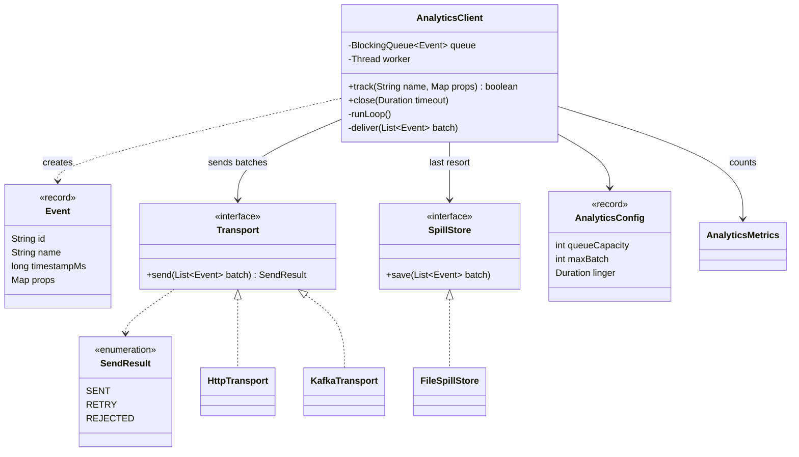
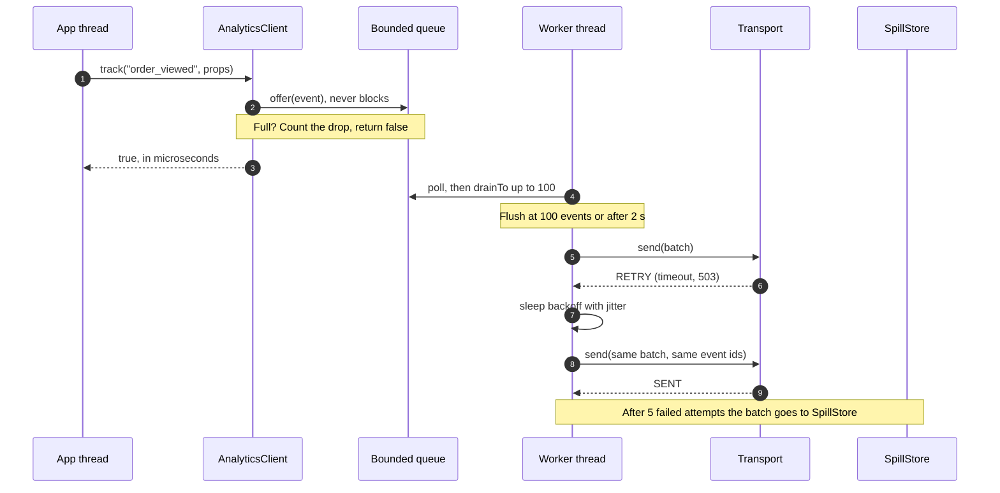

**Short answer:** `track(name, props)` must never slow down or break the host application, so it only builds an immutable event and offers it to a bounded in-memory queue. One worker thread collects events into batches, flushes by size or by time, and sends them through a pluggable `Transport`.

Transient failures are retried with exponential backoff and jitter, and then spilled to a local store; bad batches are not retried. When the queue is full I drop and *count* the event, and `close(timeout)` flushes what is left.

## Picture it





**How to read it:**
- Only `track` and `close` are public. The app depends on nothing else.
- Steps 1–4 run on the caller's thread and do no I/O.
- Steps 5–6: the batch leaves when it is full or when its oldest event has waited 2 s.
- Steps 7–10: a retry sends the same event ids, so the server can remove duplicates.
- `Transport` and `SpillStore` are interfaces, so tests use fakes and no network.

## Requirements

The reported wording is one line, so I assume this scope.

- Used inside a Java service by many threads; about 5,000 events/s at peak.
- Never block or throw into business code. Bounded memory.
- Batch by size and time. Retry transient errors. Flush on shutdown.
- At-least-once delivery to the collector while the process lives; some loss is acceptable and must be visible.
- Losing analytics is acceptable, losing an order is not: this is *not* an audit log.
- Out of scope: the collector server, dashboards, the schema registry.

## Classes

- `Event` (record): id, name, timestamp, a copied map of properties. Immutable, so it can cross threads safely.
- `AnalyticsClient`: the facade, owns the queue and the worker.
- `Transport`: sends one batch and classifies the answer as `SENT`, `RETRY` or `REJECTED`.
- `SpillStore`: keeps batches that could not be delivered.
- `AnalyticsConfig`: sizes and times. `AnalyticsMetrics`: counters for sent, dropped, invalid, rejected, spilled.

## Patterns used

- **Producer-consumer:** many app threads, one worker, a bounded queue between them.
- **Strategy:** `Transport` and `SpillStore` are interchangeable.
- **Facade:** one small class hides threads, batching and retries.
- **Dependency injection:** a `Clock` and the strategies come through the constructor, so tests are deterministic.

## Code

```java
import java.time.Clock;
import java.time.Duration;
import java.util.*;
import java.util.concurrent.*;
import java.util.concurrent.atomic.LongAdder;

record Event(String id, String name, long timestampMs, Map<String, String> props) {
    Event {
        if (name == null || name.isBlank()) throw new IllegalArgumentException("event name is required");
        props = Map.copyOf(props);          // defensive copy: the caller may reuse its map; rejects nulls
    }
}

enum SendResult { SENT, RETRY, REJECTED }

interface Transport {                       // Strategy: HTTP, Kafka, stdout, fake for tests
    SendResult send(List<Event> batch);
}

interface SpillStore {                      // where undeliverable batches go: a local file, or nothing
    void save(List<Event> batch);
}

record AnalyticsConfig(int queueCapacity, int maxBatch, Duration linger,
                       int maxAttempts, Duration baseBackoff, Duration maxBackoff) {
    static AnalyticsConfig defaults() {
        return new AnalyticsConfig(10_000, 100, Duration.ofSeconds(2),
                                   5, Duration.ofMillis(200), Duration.ofSeconds(10));
    }
}

final class AnalyticsMetrics {
    final LongAdder sent = new LongAdder();
    final LongAdder dropped = new LongAdder();
    final LongAdder invalid = new LongAdder();
    final LongAdder rejected = new LongAdder();
    final LongAdder spilled = new LongAdder();
}

public final class AnalyticsClient {
    private final AnalyticsConfig config;
    private final Transport transport;
    private final SpillStore spill;
    private final Clock clock;
    private final BlockingQueue<Event> queue;
    private final AnalyticsMetrics metrics = new AnalyticsMetrics();
    private final Thread worker;
    private volatile boolean closed;

    AnalyticsClient(AnalyticsConfig config, Transport transport, SpillStore spill, Clock clock) {
        this.config = config;
        this.transport = transport;
        this.spill = spill;
        this.clock = clock;
        this.queue = new ArrayBlockingQueue<>(config.queueCapacity());
        this.worker = Thread.ofPlatform().name("analytics-worker").daemon(true).unstarted(this::runLoop);
    }

    AnalyticsClient start() {
        worker.start();                     // not in the constructor: "this" must not escape half-built
        return this;
    }

    /** Never blocks, never throws. Returns false if the event was not accepted. */
    public boolean track(String name, Map<String, String> props) {
        Event event;
        try {
            event = new Event(UUID.randomUUID().toString(), name, clock.millis(), props);
        } catch (IllegalArgumentException | NullPointerException e) {
            metrics.invalid.increment();
            return false;
        }
        if (closed || !queue.offer(event)) {
            metrics.dropped.increment();
            return false;
        }
        return true;
    }

    private void runLoop() {
        List<Event> batch = new ArrayList<>(config.maxBatch());
        long flushAt = 0;
        try {
            while (!(closed && queue.isEmpty() && batch.isEmpty())) {
                long wait = batch.isEmpty() ? config.linger().toNanos() : flushAt - System.nanoTime();
                Event first = closed || wait <= 0 ? queue.poll() : queue.poll(wait, TimeUnit.NANOSECONDS);
                if (first != null) {
                    if (batch.isEmpty()) flushAt = System.nanoTime() + config.linger().toNanos();
                    batch.add(first);
                    queue.drainTo(batch, config.maxBatch() - batch.size());
                }
                boolean full = batch.size() >= config.maxBatch();
                boolean due = !batch.isEmpty() && System.nanoTime() - flushAt >= 0;
                if (full || due || (closed && !batch.isEmpty())) {
                    deliver(batch);
                    batch.clear();
                }
            }
        } catch (InterruptedException e) {  // close() ran out of time: save what is left
            queue.drainTo(batch);
            spillQuietly(batch);
        }
    }

    private void deliver(List<Event> batch) throws InterruptedException {
        List<Event> copy = List.copyOf(batch);
        for (int attempt = 1; attempt <= config.maxAttempts(); attempt++) {
            switch (sendQuietly(copy)) {
                case SENT -> { metrics.sent.add(copy.size()); return; }
                case REJECTED -> { metrics.rejected.add(copy.size()); return; }   // a retry cannot fix bad data
                case RETRY -> { if (attempt < config.maxAttempts()) Thread.sleep(backoffMs(attempt)); }
            }
        }
        spillQuietly(copy);
    }

    private SendResult sendQuietly(List<Event> batch) {
        try {
            return transport.send(batch);
        } catch (RuntimeException e) {      // one bad send must not kill the only worker
            return SendResult.RETRY;
        }
    }

    private void spillQuietly(List<Event> batch) {
        if (batch.isEmpty()) return;
        try {
            spill.save(List.copyOf(batch));
            metrics.spilled.add(batch.size());
        } catch (RuntimeException e) {
            metrics.dropped.add(batch.size());
        }
    }

    /** Exponential backoff with full jitter. */
    private long backoffMs(int attempt) {
        long exponential = config.baseBackoff().toMillis() << Math.min(attempt - 1, 20);
        long cap = Math.min(config.maxBackoff().toMillis(), exponential);
        return ThreadLocalRandom.current().nextLong(cap + 1);
    }

    /** Sends what is queued, waiting at most the given time; the rest is spilled. */
    public void close(Duration timeout) throws InterruptedException {
        closed = true;
        if (!worker.join(timeout)) {
            worker.interrupt();
            worker.join(Duration.ofSeconds(1));
        }
    }

    AnalyticsMetrics metrics() { return metrics; }
}
```

Points to say out loud:
- `queue.offer` returns at once; `put` would block the app when the collector is down.
- `System.nanoTime()` measures the linger, because the wall clock can jump. The event's own time uses the `Clock`.
- A failing batch blocks the worker while it backs off. That is wanted: hammering a sick collector helps nobody, and the bounded queue limits the damage.
- An event tracked at the same instant as `close` may be lost, so stop producers first.

Tests I would write first:
- Flush at 100 events; flush after the linger with fewer.
- `RETRY` then `SENT` sends the same ids; `REJECTED` is sent once; repeated `RETRY` ends in the spill store.
- With a blocked transport, `track` still returns at once and the drop count is exact.
- `close` sends everything; `close` with a stuck transport returns within its timeout.

## Extensions

- **Durability:** write to a local file first and ship from it with a saved offset. Survives a crash, costs disk I/O.
- **Throughput:** each batch is one request, so raise `maxBatch` and compress first. Then use several in-flight sends, giving up global order.
- **Priorities and sampling:** an `OverflowPolicy` strategy (drop newest, drop oldest, keep important names), and a `Sampler` that keeps 1 in N of noisy events.
- **Enrichment:** a chain of `EventProcessor`s (add app version, remove personal data) run before the queue.
- **Batch limits by bytes:** collectors usually cap the request size; track the encoded size too.
- **Poison event:** on `REJECTED`, split the batch in half and resend each part, so one bad event does not lose the other 99.
- **Circuit breaker:** after many failures spill straight away, and probe again later.
- **Virtual threads?** One worker does not need them; they help if the transport makes many parallel blocking calls.

Related lessons: [E5 · The LLD interview method](../academy/lessons/E5.md), [E8 · LLD case studies, part 2](../academy/lessons/E8.md).
