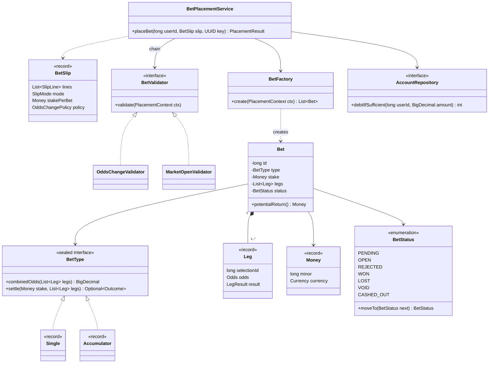
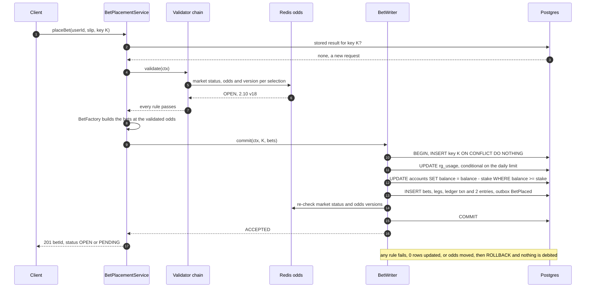
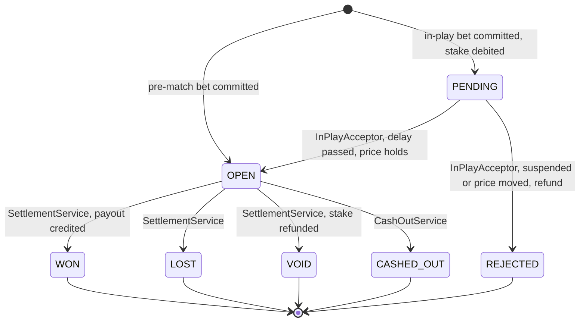

**Short answer:** A `BetSlip` holds the user's picks (selection, odds seen, odds version), the stake and how they accept odds changes. `BetPlacementService.placeBet(userId, slip, idempotencyKey)` returns the stored result if the key was already used. Otherwise it runs a list of `BetValidator`s, a `BetFactory` turns the slip into `Bet`s (singles or one accumulator), and one database transaction claims the key, debits the wallet with `UPDATE ... WHERE balance >= :stake`, and inserts the bets, the ledger entries and a `BetPlaced` outbox row. The payout rule lives in the bet type (Strategy). The lifecycle `PENDING → OPEN → WON/LOST/VOID/CASHED_OUT` is an enum with a transition table, and every status change in the database is guarded with `WHERE status = :from`. Concurrency control lives in the database, not in `synchronized`, because several app instances serve the same wallet.

## Picture it







**How to read it:**
- Class diagram: three seams carry the patterns. `BetValidator` is the rule chain, `BetType` is the payout and settlement strategy, and the repositories (`AccountRepository` shown) hide SQL behind interfaces. `Bet` owns its `Leg`s; a single has one leg, an accumulator two or more.
- Sequence steps 2–3: the fast idempotency check. A retry returns the stored result before any validation runs.
- Steps 4–8: validation and building the bets happen **outside** the transaction (they read Redis), so the database transaction stays a few milliseconds long.
- Steps 10–15: one transaction. The key, the limit counter and the wallet are locked in that fixed order. Each conditional `UPDATE` reports how many rows it changed, and 0 means "reject". A last odds check runs just before `COMMIT`.
- State diagram: each arrow is owned by exactly one service. Only `OPEN` bets are settled or cashed out, and every move is a conditional `UPDATE ... WHERE status = :from`, so a retried or duplicated message changes nothing.

## Requirements

Assumed scope (say it in the first two minutes):
- A slip has 1..n selections. Mode `SINGLES` makes one bet per selection; mode `ACCUMULATOR` makes one bet over all of them (all must win, odds multiply).
- Reject when a market is suspended, the odds moved beyond what the user accepts (`NONE`, `HIGHER`, `ANY`), the stake is outside min/max, the user is self-excluded or over a responsible-gambling limit, or the balance is too low.
- Debit the wallet **exactly once**, even with client retries and several app instances.
- Lifecycle through settlement: won, lost, void (refund), plus in-play `PENDING` and cash-out.
- Every money movement is in a double-entry ledger. Events go out for notifications and read models.
- Out of scope: pricing odds, payments, KYC, the odds feed itself (see [design-sports-betting-platform](design-sports-betting-platform.md)).

## Classes

| Type | Responsibility |
|---|---|
| `Money` (record) | Amount in **minor units** (`long` pence) plus `Currency`. Exact arithmetic and the one rounding rule. |
| `Odds` (record) | Decimal odds (`BigDecimal`, e.g. 2.10) plus `version`, the selection's `odds_version` when the price was read. |
| `BetSlip`, `SlipLine` (records) | The request: lines of `(selectionId, oddsSeen)`, mode, stake per bet, `OddsChangePolicy`. |
| `Leg` (record) | One selection inside a bet: selection, event, odds at placement, `LegResult` (`UNSETTLED`, `WIN`, `LOSE`, `VOID`). |
| `Bet` | id, user, `BetType`, stake, legs, `BetStatus`, payout. No public status setter. |
| `BetType` (sealed interface) | `Single`, `Accumulator`. Combined odds, potential return, settlement outcome. |
| `BetStatus` (enum) | The lifecycle and its allowed transitions. |
| `PlacementContext` (record) | Everything validators need: the slip, current market snapshots (status, odds), limits, flags. Loaded once. |
| `BetValidator` (interface) | One rule each. Throws `BetRejectedException(reason)`. |
| `BetFactory` | Slip → `List<Bet>`, priced at the validated odds, initial status `OPEN` or `PENDING` (in-play). |
| `BetPlacementService` | Orchestrates: idempotency fast path, validators, factory, then `BetWriter`. |
| `BetWriter` | The one `@Transactional` method that moves money. |
| `SettlementService` | Applies results to legs and moves `OPEN` bets to `WON`, `LOST` or `VOID`. |
| Repositories (interfaces) | `AccountRepository`, `BetRepository`, `LedgerRepository`, `IdempotencyRepository`, `RgUsageRepository`, `OutboxRepository`. |

The tables behind them (`accounts`, `ledger_txns`, `ledger_entries`, `bets`, `bet_legs`, `idempotency_keys`, `rg_usage`, `outbox`) are in [F8](../academy/lessons/F8.md) and [design-betting-database-schema](design-betting-database-schema.md).

## Patterns used

| Pattern | Where | Why |
|---|---|---|
| **Strategy** (polymorphic `BetType`) | Payout and settlement per bet type | The rules differ by type (an accumulator loses on one losing leg, a void leg counts as odds 1.0). A new type is a new class; `Bet` and `SettlementService` never `switch` on the type. `sealed` documents the closed set and gives exhaustive `switch` where one is needed. |
| **Chain of Responsibility** (a `List<BetValidator>`) | Validation | Each rule is a small, testable class. Spring injects every `BetValidator` bean in `@Order`, so a new rule is a new class with no edit to the service (open/closed). Fail fast: the first rejection wins, because the API returns one error code. Cheap rules run first, then Redis-backed ones. |
| **State** (enum plus transition table) | `BetStatus` | Illegal moves (`LOST → WON`, settling a `CASHED_OUT` bet) throw in the domain, and the conditional `UPDATE` repeats the guard in the database. I use an enum rather than a class per state because the states have no behaviour of their own, only allowed next states. |
| **Factory** | `BetFactory` | One slip can become N singles or one accumulator, and in-play bets start `PENDING`. The service does not care which. A system bet later expands into several bets here. |
| **Observer** (domain events through an outbox) | `BetPlaced`, `BetSettled` | Notifications, liability per market and the my-bets read model react without the placement code knowing them. The event is an `outbox` row in the same transaction, then a relay publishes it to Kafka, so an event is never lost and never sent for a rolled-back bet. |
| **Repository** | All persistence | Services depend on interfaces (DIP). Spring Data implements them in production; unit tests use in-memory fakes. |

## Code

Java 21. Imports, getters and the Spring Data annotations on most repositories are left out.

```java
// ---------- money and odds ----------
public record Money(long minor, Currency currency) {
    public static Money of(String amount, Currency c) {      // "10.00" GBP -> 1000
        return new Money(new BigDecimal(amount)
                .movePointRight(c.getDefaultFractionDigits()).longValueExact(), c); // sub-penny input throws
    }
    public Money plus(Money o) { same(o); return new Money(Math.addExact(minor, o.minor), currency); }
    /** The one rounding rule: multiply exactly, round DOWN to the minor unit, once. */
    public Money times(BigDecimal factor) {
        return new Money(new BigDecimal(minor).multiply(factor)
                .setScale(0, RoundingMode.DOWN).longValueExact(), currency);
    }
    public BigDecimal toDecimal() { return BigDecimal.valueOf(minor, currency.getDefaultFractionDigits()); }
    public boolean isPositive() { return minor > 0; }
    public static Money zero(Currency c) { return new Money(0, c); }
    private void same(Money o) {
        if (!currency.equals(o.currency)) throw new IllegalArgumentException("currency mismatch");
    }
}

public record Odds(BigDecimal decimal, long version) {
    public Odds {
        if (decimal.compareTo(BigDecimal.ONE) <= 0) throw new IllegalArgumentException("odds must be > 1");
    }
}

public enum OddsChangePolicy { NONE, HIGHER, ANY }
public enum SlipMode { SINGLES, ACCUMULATOR }
public enum LegResult { UNSETTLED, WIN, LOSE, VOID }
public enum MarketStatus { OPEN, SUSPENDED, RESULTED }

public record SlipLine(long selectionId, Odds oddsSeen) {}
public record BetSlip(List<SlipLine> lines, SlipMode mode, Money stakePerBet, OddsChangePolicy policy) {}
public record Leg(long selectionId, long eventId, Odds odds, LegResult result) {}
public record Outcome(BetStatus status, Money payout) {}

public enum Reason { INVALID_SLIP, RELATED_SELECTIONS, SELF_EXCLUDED, MARKET_SUSPENDED, ODDS_CHANGED,
                     STAKE_OUT_OF_RANGE, LIMIT_EXCEEDED, INSUFFICIENT_FUNDS }   // mapped to 400/403/409/422/402
public final class BetRejectedException extends RuntimeException {   // unchecked: @Transactional rolls back
    public final Reason reason; public final Odds currentOdds;       // currentOdds only for ODDS_CHANGED
    public BetRejectedException(Reason r) { this(r, null); }
    public BetRejectedException(Reason r, Odds now) { super(r.name()); reason = r; currentOdds = now; }
}

// ---------- lifecycle: State as an enum with a transition table ----------
public enum BetStatus {
    PENDING, OPEN, REJECTED, WON, LOST, VOID, CASHED_OUT;

    public Set<BetStatus> allowedNext() {
        return switch (this) {                       // exhaustive: a new status forces a decision here
            case PENDING -> EnumSet.of(OPEN, REJECTED);
            case OPEN    -> EnumSet.of(WON, LOST, VOID, CASHED_OUT);
            case REJECTED, WON, LOST, VOID, CASHED_OUT -> EnumSet.noneOf(BetStatus.class);
        };
    }
    public BetStatus moveTo(BetStatus next) {
        if (!allowedNext().contains(next))
            throw new IllegalStateException("illegal bet transition " + this + " -> " + next);
        return next;
    }
}

// ---------- bet types: Strategy ----------
public sealed interface BetType permits Single, Accumulator {
    void checkLegs(List<Leg> legs);
    Optional<Outcome> settle(Money stake, List<Leg> legs);       // empty = not decided yet

    default BigDecimal combinedOdds(List<Leg> legs) {             // exact product, no intermediate rounding
        return legs.stream().map(l -> l.odds().decimal()).reduce(BigDecimal.ONE, BigDecimal::multiply);
    }
    default Money potentialReturn(Money stake, List<Leg> legs) { return stake.times(combinedOdds(legs)); }
}

public record Single() implements BetType {
    public void checkLegs(List<Leg> legs) {
        if (legs.size() != 1) throw new BetRejectedException(Reason.INVALID_SLIP);
    }
    public Optional<Outcome> settle(Money stake, List<Leg> legs) {
        Leg leg = legs.getFirst();
        return switch (leg.result()) {
            case UNSETTLED -> Optional.empty();
            case WIN  -> Optional.of(new Outcome(BetStatus.WON, stake.times(leg.odds().decimal())));
            case LOSE -> Optional.of(new Outcome(BetStatus.LOST, Money.zero(stake.currency())));
            case VOID -> Optional.of(new Outcome(BetStatus.VOID, stake));          // refund
        };
    }
}

public record Accumulator() implements BetType {
    public void checkLegs(List<Leg> legs) {
        if (legs.size() < 2) throw new BetRejectedException(Reason.INVALID_SLIP);
        if (legs.stream().map(Leg::eventId).distinct().count() != legs.size())
            throw new BetRejectedException(Reason.RELATED_SELECTIONS);            // two legs on one event
    }
    public Optional<Outcome> settle(Money stake, List<Leg> legs) {
        if (legs.stream().anyMatch(l -> l.result() == LegResult.LOSE))           // one loser ends it now
            return Optional.of(new Outcome(BetStatus.LOST, Money.zero(stake.currency())));
        if (legs.stream().anyMatch(l -> l.result() == LegResult.UNSETTLED)) return Optional.empty();
        List<Leg> winners = legs.stream().filter(l -> l.result() == LegResult.WIN).toList();
        if (winners.isEmpty()) return Optional.of(new Outcome(BetStatus.VOID, stake)); // all void: refund
        return Optional.of(new Outcome(BetStatus.WON, stake.times(combinedOdds(winners)))); // void leg = 1.0
    }
}

public final class Bet {
    private final long id, userId;
    private final BetType type;
    private final Money stake;
    private final List<Leg> legs;
    private BetStatus status;

    Bet(long id, long userId, BetType type, Money stake, List<Leg> legs, BetStatus initial) {
        type.checkLegs(legs);
        this.id = id; this.userId = userId; this.type = type;
        this.stake = stake; this.legs = List.copyOf(legs); this.status = initial;
    }
    public Money potentialReturn() { return type.potentialReturn(stake, legs); }
    void moveTo(BetStatus next) { status = status.moveTo(next); }    // package-private, no public setter
    // getters: id(), userId(), type(), stake(), legs(), status()
}

// ---------- validation: Chain of Responsibility ----------
public record MarketSnapshot(long eventId, MarketStatus status, Odds odds) {}
public record PlacementContext(long userId, BetSlip slip, Map<Long, MarketSnapshot> snapshots,
                               boolean inPlay, boolean selfExcluded, Money maxStake, Money dailyStakeLimit) {
    public MarketSnapshot snapshot(long selectionId) { return snapshots.get(selectionId); }
}

public interface BetValidator { void validate(PlacementContext ctx); }   // throws BetRejectedException

@Component @Order(30)                       // after SelfExclusion (10) and MarketOpen (20)
class OddsChangeValidator implements BetValidator {
    @Override public void validate(PlacementContext ctx) {
        for (SlipLine line : ctx.slip().lines()) {
            Odds now = ctx.snapshot(line.selectionId()).odds();
            if (now.version() == line.oddsSeen().version()) continue;              // price unchanged
            int cmp = now.decimal().compareTo(line.oddsSeen().decimal());          // compareTo, never equals
            boolean acceptable = switch (ctx.slip().policy()) {
                case NONE   -> cmp == 0;
                case HIGHER -> cmp >= 0;                                           // better for the user
                case ANY    -> true;
            };
            if (!acceptable) throw new BetRejectedException(Reason.ODDS_CHANGED, now);
        }
    }
}

// ---------- creation: Factory ----------
@Component
class BetFactory {
    private final IdGenerator ids;                     // UUIDv7 or Snowflake-style, known before insert
    BetFactory(IdGenerator ids) { this.ids = ids; }

    List<Bet> create(PlacementContext ctx) {
        BetSlip slip = ctx.slip();
        BetStatus initial = ctx.inPlay() ? BetStatus.PENDING : BetStatus.OPEN;
        List<Leg> legs = slip.lines().stream().map(l -> {
            MarketSnapshot m = ctx.snapshot(l.selectionId());
            return new Leg(l.selectionId(), m.eventId(), m.odds(), LegResult.UNSETTLED); // validated price
        }).toList();
        return switch (slip.mode()) {
            case SINGLES -> legs.stream()
                    .map(leg -> new Bet(ids.next(), ctx.userId(), new Single(), slip.stakePerBet(), List.of(leg), initial))
                    .toList();
            case ACCUMULATOR -> List.of(
                    new Bet(ids.next(), ctx.userId(), new Accumulator(), slip.stakePerBet(), legs, initial));
        };
    }
}

// ---------- the use case ----------
@Service
public class BetPlacementService {
    private final IdempotencyRepository idempotency;
    private final PlacementContextLoader contexts;       // Redis: market status, odds; DB: limits, flags
    private final List<BetValidator> validators;         // every BetValidator bean, in @Order
    private final BetFactory factory;
    private final BetWriter writer;
    // constructor injection omitted

    public PlacementResult placeBet(long userId, BetSlip slip, UUID idempotencyKey) {
        Optional<PlacementResult> earlier = idempotency.findResult(userId, idempotencyKey);
        if (earlier.isPresent()) return earlier.get();              // a retry: same answer, no new debit

        PlacementContext ctx = contexts.load(userId, slip);
        validators.forEach(v -> v.validate(ctx));                   // first failure throws
        List<Bet> bets = factory.create(ctx);
        return writer.commit(ctx, idempotencyKey, bets);            // separate bean: the proxy applies @Transactional
    }
}

@Component
class BetWriter {
    private final IdempotencyRepository idempotency;
    private final RgUsageRepository rgUsage;
    private final AccountRepository accounts;
    private final BetRepository betRepo;
    private final LedgerRepository ledger;
    private final OutboxRepository outbox;
    private final OddsRecheck oddsRecheck;
    private final Clock clock;
    // constructor injection omitted

    @Transactional                                             // READ COMMITTED, the PostgreSQL default
    PlacementResult commit(PlacementContext ctx, UUID key, List<Bet> bets) {
        long userId = ctx.userId();
        if (!idempotency.claim(userId, key))                   // INSERT ... ON CONFLICT DO NOTHING, 0 rows
            return idempotency.findResult(userId, key).orElseThrow();   // a concurrent twin committed first

        Money total = bets.stream().map(Bet::stake).reduce(Money::plus).orElseThrow();
        rgUsage.ensureRow(userId, "STAKE_DAY", LocalDate.now(clock));
        if (rgUsage.addIfWithinLimit(userId, "STAKE_DAY", LocalDate.now(clock),
                total.toDecimal(), ctx.dailyStakeLimit().toDecimal()) == 0)
            throw new BetRejectedException(Reason.LIMIT_EXCEEDED);
        if (accounts.debitIfSufficient(userId, total.toDecimal()) == 0)
            throw new BetRejectedException(Reason.INSUFFICIENT_FUNDS);

        for (Bet bet : bets) {
            betRepo.insert(bet);                                // bets + bet_legs rows
            ledger.postStake(userId, bet.id(), bet.stake());    // BET_STAKE: USER_CASH -x, HOUSE_STAKES +x
            outbox.add("bets", Long.toString(userId), new BetPlaced(bet.id(), userId, bet.stake()));
        }
        oddsRecheck.verify(ctx);                                // suspended or moved beyond policy: throws
        PlacementResult result = PlacementResult.accepted(bets);
        idempotency.storeResult(userId, key, result);
        return result;
    }   // BetRejectedException is unchecked, so Spring rolls everything back
}

public interface AccountRepository extends Repository<Account, Long> {
    @Modifying
    @Query(value = """
            UPDATE accounts SET balance = balance - :amount
            WHERE user_id = :userId AND kind = 'USER_CASH' AND balance >= :amount
            """, nativeQuery = true)
    int debitIfSufficient(@Param("userId") long userId, @Param("amount") BigDecimal amount); // rows updated
}

public interface BetRepository {
    void insert(Bet bet);
    Bet findWithLegs(long betId);
    int setLegResult(long betId, long selectionId, LegResult r); // ... WHERE result = 'UNSETTLED'
    int transition(long betId, BetStatus from, BetStatus to, BigDecimal payout);
    // UPDATE bets SET status = :to, payout = :payout, settled_at = now() WHERE id = :betId AND status = :from
}
```

Notes on the code:
- **Why not `double`.** Binary floating point cannot hold 0.10 or 2.10 exactly (`0.1 + 0.2 != 0.3`), errors add up over millions of bets, and the ledger must sum to exactly zero. `long` minor units are exact and fast, and `Math.addExact` catches overflow. `BigDecimal` is used only for odds and the multiply step. Compare `BigDecimal`s with `compareTo`, because `new BigDecimal("2.1").equals(new BigDecimal("2.10"))` is `false`. The F8 columns are `NUMERIC(14,2)`, so `toDecimal()` converts at the repository edge.
- **Rounding rule.** Multiply the stake by the exact product of all the odds and round **once, down** to the minor unit. Never round the combined odds first. Example: £5 on 2.10 × 1.85 × 3.40 = 13.209 gives 500 × 13.209 = 6604.5 pence, so the return is £66.04. Which rounding mode to use is a business rule. State it, put it in one place (`Money.times`), and test it.
- **One transaction, fixed lock order:** key, limit row, wallet. Two bets from one user queue up rather than deadlock. Different users never share a row. The house account balance is not updated per bet; only its ledger entries are written ([F8](../academy/lessons/F8.md)).
- **Why `BetWriter` is a separate bean.** `@Transactional` works through a Spring proxy. A call from `placeBet` to a `@Transactional` method in the same class would skip the proxy and run with no transaction.

**Settlement** applies a result to one batch of bet ids. The batch is claimed with `FOR UPDATE SKIP LOCKED`, as in [design-sports-betting-platform](design-sports-betting-platform.md):

```java
@Service
public class SettlementService {
    // repositories injected

    @Transactional
    public void settleBatch(long selectionId, LegResult result, List<Long> betIds) {
        for (long betId : betIds) {
            if (bets.setLegResult(betId, selectionId, result) == 0) continue;  // already applied: a replay
            Bet bet = bets.findWithLegs(betId);
            Optional<Outcome> decided = bet.type().settle(bet.stake(), bet.legs());
            if (decided.isEmpty()) continue;                    // accumulator still waiting for other legs
            Outcome o = decided.get();
            BetStatus.OPEN.moveTo(o.status());                  // domain guard: throws on an illegal move
            if (bets.transition(betId, BetStatus.OPEN, o.status(), o.payout().toDecimal()) == 0)
                continue;                                       // cashed out or settled by someone else
            if (o.payout().isPositive()) {                      // WON pays out, VOID refunds the stake
                ledger.postSettlement(bet.userId(), betId, o.status(), o.payout());
                accounts.credit(bet.userId(), o.payout().toDecimal());
            }
            outbox.add("bets", Long.toString(bet.userId()), new BetSettled(betId, o.status(), o.payout()));
        }
    }
}
```

The leg update and the bet transition commit together, so a crash replays cleanly. A redelivered result finds the leg already set and skips it. A bet that was cashed out is no longer `OPEN`, so its transition updates 0 rows. A unique key on `(bet_id, type)` for payout ledger transactions is a second backstop against paying twice.

## Extensions

- **New bet types.** *Each-way* is two equal-stake parts: win, and place at a fraction of the odds. So the `BetFactory` creates two linked bets, or an `EachWay` type settles both parts. A *system bet* (a Trixie is 3 doubles and a treble) is expanded by the factory into several `Accumulator` bets, each with its own stake. Existing types do not change. With a `sealed` interface you add one name to `permits`, and the compiler points at any exhaustive `switch` that must handle the new type. If the set must be open to plug-ins, drop `sealed`.
- **Cash-out.** `CashOutService` quotes an offer from the current odds with a short expiry and an odds version. Accepting it is `transition(betId, OPEN, CASHED_OUT, offer)` plus a ledger credit in one transaction. If settlement wins the race, the transition updates 0 rows and the offer fails.
- **In-play delay.** The factory creates `PENDING` bets with the stake already debited. After the delay an `InPlayAcceptor` re-runs the market and odds validators and calls `transition(PENDING, OPEN)`, or `transition(PENDING, REJECTED)` with a reversing `BET_REFUND` ledger transaction. The client hears the outcome over the WebSocket.
- **Multi-currency.** `Money` already carries `Currency` and refuses to add different currencies. Keep one `USER_CASH` account per user and currency. Take the minor-unit scale from `Currency.getDefaultFractionDigits()` (0 for JPY, 2 for GBP). FX conversion is a separate ledger transaction, never hidden inside a bet.
- **Testing.** Unit-test each validator with a hand-built `PlacementContext` (no Spring, no Redis). Write parameterised tests for each `BetType`: a table of leg results and odds against the expected status and payout, including the rounding example and the all-void accumulator. Test the `BetStatus` table for every pair of states. Integration tests with Testcontainers PostgreSQL: two concurrent £100 bets on a £100 wallet give exactly one success, the same key sent twice gives one bet and one debit, and the ledger sums to zero.

## Follow-ups

- **New bet type (each-way, system) without touching existing code?** It is a new `BetType` implementation (Strategy) plus, if it expands into several bets, a branch in `BetFactory`. `Bet`, `BetWriter` and `SettlementService` only call `potentialReturn` and `settle`, so they do not change. With `sealed`, the only edit is adding the name to `permits`.
- **New validation rule (self-exclusion, max stake per market)?** Write a class that implements `BetValidator`, annotate it `@Component @Order(n)` and add any data it needs to `PlacementContext`. Spring injects it into the list and `BetPlacementService` is untouched. One caution: a rule that guards a running total (a daily stake limit, the balance) must **also** be a conditional `UPDATE` inside the transaction. A check before the transaction is a pre-check for a friendly error only; on its own it allows write skew ([Q6](../academy/lessons/Q6.md)).
- **Two threads place bets on the same wallet at once. Where is the concurrency control?** In the database row. `UPDATE accounts SET balance = balance - :stake WHERE ... AND balance >= :stake` takes the row lock. Under PostgreSQL's read committed, the second update waits, then re-checks its `WHERE` on the committed row, updates 0 rows and the bet is rejected with `INSUFFICIENT_FUNDS`. `CHECK (balance >= 0)` is the backstop. `synchronized` is wrong for two reasons. Other app instances do not share the JVM lock. And even on one instance, the lock is released when the method returns, which is before the transaction proxy commits. *Optimistic alternative:* an `Account` entity with `@Version`. Read it, check the balance in Java, save (Hibernate adds `WHERE version = ?`), and on `ObjectOptimisticLockingFailureException` retry the whole transaction a few times with the same idempotency key. It is fine when conflicts are rare, but the conditional update needs one round trip and no retry loop. *Pessimistic alternative:* `SELECT ... FOR UPDATE` (`@Lock(PESSIMISTIC_WRITE)`), then check and update. It is equally correct and needs two round trips.
- **How does a bet move from placed to won/lost/void, and who may change it?** Placement creates it `OPEN`, or `PENDING` when in-play. Only the `InPlayAcceptor` moves `PENDING` to `OPEN` or `REJECTED`. Only `SettlementService` moves `OPEN` to `WON`, `LOST` or `VOID`, when results arrive per leg. Only `CashOutService` moves `OPEN` to `CASHED_OUT`. There is no public setter. Each move passes `BetStatus.moveTo` in the domain and `UPDATE ... WHERE id = ? AND status = :from` in the database, so a duplicate result or a race with cash-out updates 0 rows and does nothing. Correcting a wrong result (resettlement) is a separate, audited admin operation that posts reversing ledger transactions. It is not a normal transition.

Related: [design-sports-betting-platform](design-sports-betting-platform.md) for the HLD around this, [design-betting-database-schema](design-betting-database-schema.md) for the tables, [design-idempotent-api](design-idempotent-api.md) for the key handling.

Go deeper: [F8 · Design a sports betting platform](../academy/lessons/F8.md), [Q6 · Transactions, isolation, locking and MVCC](../academy/lessons/Q6.md), [E4 · Behavioural patterns](../academy/lessons/E4.md), [E5 · The LLD interview method](../academy/lessons/E5.md).

## Say it in 2 minutes

"The request is a `BetSlip`: the selections with the odds and odds version the user saw, the stake, whether it is singles or an accumulator, and an odds-change policy: none, higher or any. `placeBet(userId, slip, idempotencyKey)` first returns the stored result if the key was used, so a retry never places a second bet. Then a chain of `BetValidator`s runs (self-exclusion, market open, odds within policy, stake limits), each its own class, so a new rule is a new bean. A `BetFactory` turns the slip into bets at the validated price, `PENDING` if in-play. Then one transaction: claim the idempotency key, bump the responsible-gambling counter with a conditional update, debit the wallet with `UPDATE ... WHERE balance >= stake` and check that one row changed, insert the bets and legs, the two ledger entries and a `BetPlaced` outbox row, re-check the odds, commit. Concurrency lives in that row lock, not in `synchronized`, because there are many app instances. `@Version` with a retry is the optimistic alternative. Money is a `Money` record in long minor units, never `double`. The payout is the stake times the exact product of the odds, rounded down once. Payout and settlement rules sit in the bet type as a Strategy: a single pays stake times odds, and an accumulator loses on any losing leg and treats void legs as 1.0. The lifecycle is an enum with a transition table. Settlement moves only `OPEN` bets, with `WHERE status = 'OPEN'`, so a replayed result or a race with cash-out does nothing."
